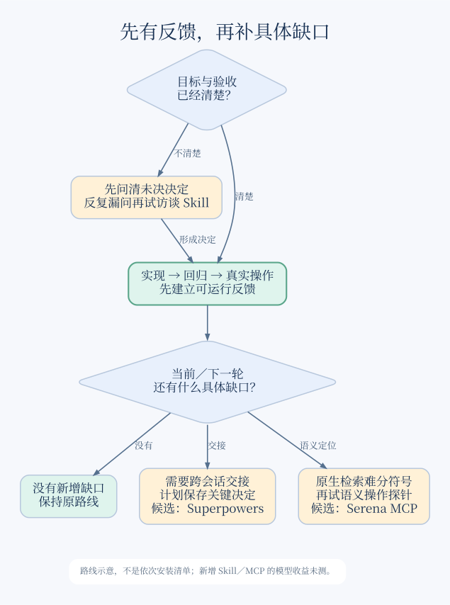

# 13 · 前沿雷达

## 本周 Top 5：挑一个真实任务就开做

**本周（2026-11-26 刷新）优先清理五类跨端暗伤：指令静默截断、长程自驱无外置计划、跨宿主插件遮蔽 Hook、后台子 Agent 调用开销，以及 WebGL2 阴影与渲染回退。** 按手头任务选一项即做；上一轮通过的 [Playwright 分片核对](decisions/verification.md#第一步把目标和保留项填进这段任务) 与 [Memos #6502 冲突检查](decisions/upstream-contributions.md#实现到投稿让-agent-产出可审材料) 继续保留为默认常规检查。

| 排名／你正在做什么 | 本周先试的做法 | 依据与边界／何时换路 |
|---|---|---|
| **1 · 多 Agent 共用仓库，规则总在半途失效** | 🧪 **核每个客户端实际加载的文件和顺序**：Codex 默认合计 32 KiB，可用 `project_doc_max_bytes` 调整；同目录最多加载一份，未找到有效的 `AGENTS.override.md` 或 `AGENTS.md` 才查 fallback 名称 | [Codex 官方发现规则](https://learn.chatgpt.com/docs/agent-configuration/agents-md)；[社区跨端实跑](https://dev.to/4sapi/who-wins-when-claudemd-agentsmd-and-a-skill-disagree-160-runs-across-two-coding-agents-p9b)观察到 36 KiB 案例尾部规则未加载。共享说明按[指令文件页](decisions/instruction-files.md)接入，不把 fallback 当第二份文件 |
| **2 · 多天／长程自驱任务易飘移或早停** | 🧪 **试验外置计划、实跑反馈与从产物开下一轮**：同一任务和模型，对照原会话直接续跑 | [HoH 论文表 2](https://arxiv.org/html/2609.01481)：45 道游戏任务、同为三轮，HoH 71.52 分、续跑 58.24 分；每题平均 841 万与 633 万编码 token。作者基准，未换算实扣；小改动不套外层循环 |
| **3 · 在 Claude Code 内混派 Codex 复审或拆解** | 🧪 **试用官方 `codex-plugin-cc`**（`/codex:review`、`/codex:adversarial-review`、`/codex:rescue`），但发布或自建插件**禁止根目录同时留 `plugin.json` 盖住 `.codex-plugin/plugin.json`**，并给循环加调用上限 | [官方仓库](https://github.com/openai/codex-plugin-cc)；反例复盘（[2026-11-24](https://dev.to/iliaa/porting-claude-codes-you-should-know-to-codex-and-the-hooks-that-never-ran-2m35)）：混放清单致 Codex 0.162.1 静默跳过 Hook，且冷启动审阅循环 2,904 次调用吃掉 79.4M 输入 token。现有原CLI已够用不硬凑双端 |
| **4 · 子 Agent 等待久或调用开销高** | 🧪 **同题比较单 Agent＋窄 Skill 与实际需要的委派方式**；先按请求用途核开销，再决定是否单独试缓存 TTL。必须隔离的并行写不因这组数据改路 | [社区 35 次／两项目](https://www.reddit.com/r/ClaudeCode/comments/1xuqnnc/i_tested_anthropics_one_agent_with_skills_beats_a/)报告团队成本高 62%、耗时约两倍；[摘要调用、缓存与计量口径](02-models-and-cost.md#缓存与总成本)另核，不把 API 估算当订阅扣额 |
| **5 · WebGL2／Three.js 场景掉帧或切 WebGPU 反更慢** | 🧪 **先用 `PCFShadowMap` 替代已废弃的 `PCFSoftShadowMap`（r186+）**，排查透射材质触发全不透明物体双次 `getProgram()`，切 `WebGPURenderer` 前**单测其 WebGL2 回退帧时** | [three.js #34654](https://github.com/mrdoob/three.js/issues/34654)；[r187 基准](https://3d-asset.com/guides/threejs-webgpurenderer-vs-webglrenderer-benchmark)（4,176 网格场景下 `WebGPURenderer` CPU 48 ms、WebGL2 回退达 62 ms vs `WebGLRenderer` 28 ms）。小规模单帧够用时不提前大改渲染器 |

**依据**：五项均为 2026-10～11 月一手仓库源码、论文全文、实跑基准或公开复盘（2026-11-26 核读；均独立于本仓旧实测）；上轮列表与来源详见[固定版](https://github.com/dbvv1/a1dbv/blob/f3f1488896d0b6fe788cb646ed243b0a8a5885f0/docs/13-frontier-radar.md#L4-L18)。

## 工具入口与代表做法

下列客户端按调查使用面安排阅读，机制按任务采用优先级排列；详细候选与历史依据继续保留，遇到对应缺口再读。

### 广用客户端：找到你的入口

**先按已在用的客户端对号入座，从“从哪里开始”一列起步；偏离需求时按同一行的换路条件处理。** 两项调查口径不同，比例只用于安排阅读顺序。

| 工具／使用面 | 先掌握什么 | 从哪里开始／何时换路 | 依据与本仓范围 |
|---|---|---|---|
| **Claude Code：39%** | 交完整可体验目标，以真实体验推动下一轮 | 从可试玩功能开始，偏离需求时给具体反馈 | 连续改稿复盘，仅作资料参照 |
| **GitHub Copilot：21%** | 把迁移拆成可合入块，保住兼容标准 | 从已有测试的迁移块开始，靠删API变绿就退回核查 | 生产迁移，为同厂自报 |
| **Codex：16%** | 接收可运行产物，而非完成宣言 | 从实际主路径开始，视觉或行为不合格就反馈缺口 | 作品纠错，为八月个案 |
| **Cursor：12%** | 先让Agent能自己启动和验证工程 | 从干净副本跑通开始，UI起不来就先补环境 | 环境复盘，为厂商自报 |
| **OpenCode：7%** | 需要可选模型时先固定provider与主版本 | 从连续初改＋二改开始，不兼容就撤回相关迁移 | 实现与 V2 迁移，仅作资料参照 |

五项本仓均未试用；OpenCode 是开源路线补充，不是调查第五名。主专题与详细限制详见[成熟机制与反例](research/2026-10-22-frontier-trials.md#可借的成熟机制与反例)。

**依据**：[一手] JetBrains 2026 年同题“工作中使用”自报多选、Stack Overflow“过去一年用过”作使用面参照（[题干、分母与局限](research/2026-10-22-frontier-trials.md#两个调查的题意不能混用)）；[社区：单例] [连续改稿复盘](https://simonwillison.net/2026/Oct/20/battledrones/)；[一手：同厂自报] [生产迁移](https://github.blog/ai-and-ml/generative-ai/migrating-the-github-copilot-runtime-to-rust-using-copilot/)；[社区：八月个案] [作品纠错](https://simonwillison.net/2026/Aug/7/moonlight-mayhem/)；[一手：厂商自报] [环境复盘](https://cursor.com/blog/cloud-agent-environment)；[一手] [OpenCode 实现](https://github.com/anomalyco/opencode)、[V2 迁移](https://opencode.ai/v2/docs/migrate-v1/)；[研究] 使用面与阅读顺序；核实 2026-10-24。

### 代表机制：按任务采用，不按热度装齐

**先建立反馈，再按缺口选流程、窄 Skill 或语义 MCP，只选当前缺的一层。** 下面都有真实采用或任务对照线索，但总体采用率与净收益未知，顺序不是普及率排名。

| 机制／代表 | 借用的精华 | 从哪里开始／何时不用 | 真实采用或对照 | 本仓范围／评级 |
|---|---|---|---|---|
| **反馈闭环：运行＋回归保护** | 将这次发现的错误变成下次会失败的检查 | 从一个真实bug开始，已有检查能检出就复用 | Krupa 同模型小题，区分修对与留下测试 | ✅ 借用机制，已有工具反例实测而非模型对照 |
| **领域反馈：框架原生检查** | 将领域约束变成Agent实际可见的失败，再按需求选修法 | 已有框架检查先运行；不能用缓存实时数据或关校验求绿 | Next 官方 040 任务已有具体错误结构 | 🧪 [16.4.3构建1→0及补丁](../experiments/next-static-shell.md)，官方合成题，浏览器／模型增益未验 |
| **按需流程：Superpowers** | 按任务选择直做、计划或完整流程 | 从跨模块未决设计开始，清楚小改不启整套 | Luca 保留分流与 V2EX 去留并存 | 🧪 按项目试用，本仓未安装运行 |
| **窄Skill：Matt Pocock** | 只借grill-with-docs澄清会改变实现的决定 | 从架构问题开始，决定已齐就进入实现 | Faruk 实际重构未走完整ticket链 | 🧪 按需试用，本仓未运行 |
| **语义MCP：Serena** | 用符号身份查声明与调用位置 | 从同名符号定位开始，原生搜索或LSP已够就不用 | Luca 使用与中文短试无明显差异并存 | 🧪 [2.1.0符号编辑实试](../experiments/serena-symbol-edit.md)，不替代版本核对 |
| **版本文档 MCP：Context7** | 匹配已索引的版本，不用来替代官方文档 | 先选实际存在的版本 ID，再查官方同 tag；[已试入口](research/2026-10-22-frontier-trials.md#context7精确版本查询实试) | [生成文档刷新回执](https://github.com/upstash/context7/issues/3309#issuecomment-6012188572)：普通 Refresh 与从主干重建曾是不同动作 | 🧪 已验两版检索，未验生成代码 |
| **规格接力：OpenSpec** | 二改漏带旧场景时，CLI 阻止整块规格被覆盖；归档后留下当前约定 | 跨角色或连续二改可试；明确小改沿用任务与测试 | 两次改动实试及采用／退出详见[OpenSpec 记录](research/2026-10-22-frontier-trials.md#openspec规格接力与协作落点)：`--skip-specs` 会留下旧规格，归档不等于实现完成 | 🧪 [已试1.14.3 CLI](07-workflows.md#openspec让下一位接手当前约定而不只是旧计划)，未测Agent／团队收益 |
| **并行写入：Git worktree** | 每个独立写入任务保留自己的目录、分支和未提交现场 | 先用原生入口或Git，跨树管理成为瓶颈再评估管理器 | 事故后采用与集成后收缩并发支持条件使用 | ✅ 借用机制，[隔离／合入／脏树保护与截图](research/2026-10-22-frontier-trials.md#git-worktree不装编排器也能隔离写入)已验 |
| **环境准备：Worktrunk** | 同步复制所选依赖副本，完成后才启动测试／Agent | 多棵树反复准备环境时试；已有原生入口／脚本够用就不换 | 使用者复制慢反馈提醒不能承诺零成本；大树复制失败已有修复 | 🧪 [0.81.0双树依赖与立即测试](../experiments/worktrunk-ready.md)已试并独立重放，未测模型／性能收益 |
| **增量测试反馈：pytest-testmon** | 用执行关系从既有测试选择本次反馈 | 测试昂贵且相关目标不易列全时试；小套件先直接跑文件 | Polylogue 采用与[暂缓的成本比较](research/2026-10-12-development-feedback.md#新增选测能力先比较改动类型与完整运行成本)并存 | 🧪 [2.2.0历史改动重放](../experiments/testmon-feedback.md)已试；成熟工具，未测模型／净提速 |
| **依赖接续：GitHub gh-stack** | 父层修订后在所属工作树重排子层，按恢复日志继续 | 子任务依赖未合入父层时用；独立任务仍用普通worktree | 多Agent使用者的旧版缺口与官方0.2.0工作树支持 | 🧪 [依赖接续与跨树恢复](08-multi-agent.md#有依赖的分支更新父层再接续消费者)；[0.3.0 子模块故障实试](../experiments/gh-stack-submodule/README.md)：失败可能部分完成，勿用 ignore=all 掩盖；未测远端PR／模型收益 |
| **网页验收：Playwright CLI＋Skill** | 用短命令观察网页、操作元素并检查结果 | 已有Playwright先复用项目入口，现有浏览器已够用就不另装 | 实践者由MCP转CLI与调用后仍漏验收支持按目标选用 | 🧪 [预装1.62.0探针与截图](research/2026-10-22-frontier-trials.md#playwright-cli已有入口先复用)已核，浏览器流程未验 |
| **组件资料：Storybook MCP** | 组件故事负责反馈；MCP 只补资料缺口 | 已有 story play 按 Top 5 直接用，不先加 MCP | [GitButler 的按需接入与实际版本](collaboration/local-jobs/A-STORYBOOK-ADOPTION-001.md) | 👀 MCP 未试，docs toolset 受框架与 manifest 限制 |

**照做入口**

- **网页验收**：项目已装 Playwright，就用 `npx --no-install playwright --version` 和 `npx --no-install playwright cli --help` 核本地入口，再走[完整用户路径](23-browser-verification.md#4-一次完整验证的顺序)。[本仓探针](research/2026-10-22-frontier-trials.md#playwright-cli已有入口先复用)只核版本和帮助，未跑通浏览器。
- **两项可独立的修改**：从同一确认过的 SHA 各建一棵树（如 `git worktree add -b task-a ../task-a <基线SHA>`）；已有客户端自动建树就不再套一层。交回后在[集成树验共同结果](research/2026-10-22-frontier-trials.md#git-worktree不装编排器也能隔离写入)。
- **找代码或根因**：不了解仓库先用 [DeepWiki 找文件，再回固定源码](research/2026-10-22-frontier-trials.md#deepwiki先找模块再回固定源码)；缺跨仓调用例再用 [Grep 找例子，读全上下文](research/2026-10-22-frontier-trials.md#grep公开代码查例子先核完整调用)。终端过长才试 [RTK](03-context-engineering.md#27-终端输出先辨过滤恢复与重新执行)，区分取回旧记录与重跑命令。

图：条件分流，不是安装顺序；新增 Skill／MCP 的模型收益未测（[图源](img/2026-10-23-workflow-choice.dot)）。

**依据**（2026-10-24 核实，代表机制采用与反例）：
- 总表与本仓试跑：[采用证据与边界总表](research/2026-10-22-frontier-trials.md#代表机制的采用证据与边界)（Playwright 1.62.0、RTK、ast-grep 等实试）；
- 流程／评审／语义：[Krupa 同模型小题](https://bartlomiejkrupa.dev/articles/does-superpowers-beat-no-plugin/)、[Next 040](https://github.com/vercel/next.js/tree/8b583887cee277dd7036bcfdfeafbd1d6e37fc59/evals/evals/agent-040-instant)、[Luca 分流](https://www.lucavallin.com/blog/how-i-actually-use-claude-code)、[V2EX 去留](https://v2ex.com/t/1227194)、[Faruk 重构](https://blog.faruk.dev.br/articles/agents/matt-pocock-skills-harness-product-crud/)、[Serena 短试](https://www.v2ex.com/t/1249379)、[Context7 #3309](https://github.com/upstash/context7/issues/3309#issuecomment-6012188572)；
- 并行／测试／入口：[事故复盘](https://blog.michaelschilling.com/blog/many-agents-one-clone/)、[收缩并发](https://utsabpant.com/blog/running-coding-agents-in-parallel)、[MCP 转 CLI](https://www.reddit.com/r/claude/comments/1v9aa4z/for_claude_code_what_do_you_prefer_mcp_tools/)、[漏验收反馈](https://linux.do/t/topic/2560865)、[Worktrunk #3384](https://github.com/max-sixty/worktrunk/issues/3384) / [#1864](https://github.com/max-sixty/worktrunk/pull/1864)、[Polylogue #1059](https://github.com/Sinity/polylogue/issues/1059)、[gh-stack #473](https://github.com/github/gh-stack/discussions/473) / [0.2.0](https://github.com/github/gh-stack/releases/tag/v0.2.0)、[Playwright Agent CLI](https://playwright.dev/agent-cli/installation) / [Skills](https://playwright.dev/agent-cli/skills)、[Grep MCP](https://vercel.com/blog/grep-a-million-github-repositories-via-mcp)。

## 值得一试：新候选与成熟机制

**先看适合自己的那一项，并按“本仓试用结果”区分已试与未试用。** 下表从 GitHub、HN 及中英文社区回扫中挑选，包含新项目和仍有用的成熟机制，是试用候选而非效果排行榜；核查日期不等于发布日期，热度取各次快照，4周star增长未知。

| 项目／做法 | 为什么值得看、适合谁 | 关注证据 | 本仓试用结果 | 坑与评级 |
|---|---|---|---|---|
| [原生侧问：解释、调查与改方向分开](decisions/context-management.md#编码途中想问一句先选侧问改变要求仍回主线) | 编码继续时问清决定或比较方案；Claude `/btw` 解释已有上下文，Cursor 本地 `/side` 可持续调查并 `@` 接回 | 两家官方契约；独立作者 Cursor 3.22.7 短对话操作，来源见入口 | 未试用；核读 2026-11-09，非本周新发布功能 | 👀 Claude 侧问无工具；Cursor 侧聊不支持 Cloud Agents，带父背景；改变执行要求仍回主线 |
| [ECC search-first](decisions/skills-and-plugins.md#ecc-search-first) | 将仓内优先搜索与复用判断压成窄 Skill，适合 Agent 经常先造新组件的场景 | 294,952★快照；官方 Skill 与使用者 #3680，原轮激活／因果未确认 | [真实 Inspector 问题事后对照](../experiments/ecc-search-first/README.md)：两方法同选仓内小改；现有 parser 16/17 匹配、空值反例复核；2026-11-02 | 🧪 只读方法／函数探针，未装整包；无新增采用或提速证据，不替换 Top 5 |
| [Skill 安装成功却断链](decisions/skills-and-plugins.md#skills-linked-parent) | 先核实际版本和读正文；旧父链接缺陷已修 | [1.9.0 发布](https://github.com/vercel-labs/skills/releases/tag/v1.9.0) | 1.7.4 的失败夹具在同一 HOME 用 1.9.0 修复，正文读回 | 🧪 copy 仅为不能升级的旧版兜底；未运行模型 |
| [Vitest 升级后跨文件漏 env](15-task-playbooks.md#vitest-reused-worker-env) | Agent 修连片失败前先核 worker 状态：默认隔离对照，必要时每文件入口复位 | [用户 #11423](https://github.com/vitest-dev/vitest/issues/11423) 仍开；[#11441](https://github.com/vitest-dev/vitest/pull/11441) 已关闭未合并，v5.1.1 未复跑 | 4.1.11／5.0.5、同 Node／Vite 七组：新版8文件2worker漏值；setup与默认隔离全过，两版单worker均漏；2026-10-31 | 🧪 unstubEnvs 不恢复直接赋值；独立新目录复跑，字符串哨兵，非数据库／模型验收 |
| [RTK 的 uv 短失败无恢复](03-context-engineering.md#rtk-uv-short-failure) | 已用过滤器但失败丢诊断：先核已发生结果，下一次保留原生输出 | 真实用户 #4860；已有 500-byte 源码门槛补实际执行 | OSS 1.1.0、tee／SQLite 各6条件：499无记录、500完整取回且不重跑；2026-10-31 | 🧪 排除外层 uv 不排除内层 pytest；独立门槛复跑，未验模型／Windows |
| [Intent 的 pnpm 全局漏发现](decisions/skills-and-plugins.md#intent-pnpm-global) | 已全局装过 CLI 却列不出 Skill：按实际包根逐个读取，不重装、不拼根 | 真实使用者 #206；已有 PR #207 未合并 | pnpm 11.17.0 实际安装；Intent 0.3.6／0.5.6 默认 0，逐根 5＋1，六份正文均加载；2026-10-31 | 🧪 只修单次读取，不恢复自动多根；非作者复跑，消费者工作流／模型未验 |
| [OpenSpec／Pi 升级](decisions/skills-and-plugins.md#openspec-pi-discovery) | 2.x 项目共享 Skill，不保留旧 Pi 排除 | [2.x 迁移和旧版区别](../experiments/openspec-pi-discovery/README.md#openspec-2-upgrade-recheck) | 1.16→2.1.1 实跑；保留旧排除读 0 个，撤掉后 6 个 | 🧪 先备份手改、预览更新，未验模型流程 |
| [Knip 活测试入口误报](09-review-and-quality.md#knip-live-test-entry) | Agent 清理 unused 前，先核框架入口；已用 workspace 项目精确补测试 entry | 真实用户 #2247；现有修复 PR 仍被要求处理否定模式回归 | 6.43.0／6.44.0 两误报→0，原1项测试仍过，真正未用控制仍报告；2026-10-31 | 🧪 不把测试归安全删除，不用 ignore 压绿；独立6.44复跑，未验模型／完整产品 |
| [Agent Framework 工具调用 ID](../experiments/agent-framework-call-id/README.md) | 已用 Python SDK 且工具外派需 provider ID：先核原始 ID，再用函数中间件临时取值 | 真实用户 #9454 的代理／回放需求；公共 API 尚待规划 | 1.22.0／1.24.0／固定主干各 9 场景；无中间件缺 context ID，但框架结果 ID 保留；2026-10-31 | 🧪 metadata 非空可能来自框架回填；脚本模型＋内存代理，真实服务与跨会话回放未验 |
| [Repomix 分块包输入回流](../experiments/repomix-split-input/README.md) | 已用打包器、上下文包每轮变大时，先查旧分片是否再成输入；干净输入＋树外输出可避免这条路径 | [正式版 1.19.0](https://github.com/yamadashy/repomix/releases/tag/v1.19.0) 已含 #1921 | 11-20 复跑正式包：旧版三轮 2→3→3，已修版 2→2→2；核实际分片清单 | 🧪 只迁新输出不清除树内旧分片；不用宽泛 glob 吞掉用户文件。不替换按需读取默认，未测模型收益 |
| [Agent-Reach：按平台动作补读取缺口](research/2026-10-29-agent-reach-trial.md) | 现有入口取不到中文平台／视频原文时，按具体 search、read 动作试，不以渠道总体正常代替验收 | 官方 1.6.0 与 Reddit #868、HN／LINUX DO 真实反馈；从官方 GitHub 安装，避开 PyPI 同名包 | 隔离安装固定源码：公开 GitHub 搜索返回5条，issue读取遭代理403；新增决定性原文0篇，中文平台／视频未试 | 🧪 保现有搜索默认；遇访问拒绝停止对应入口。此前漏项由外部带入，[时间窗与目录漏检复盘](research/2026-10-29-agent-reach-trial.md#漏项归因窗口漏掉旧项目目录也不保证收录)可直接核对 |
| [测试保护：给合法规格变更留接收路径](https://secondtimeisabug.com/blog/coding-agent-guardrails-270-runs/) | 规格改变旧断言时，先明确哪些测试须保留、哪些须随契约更新及由谁接收；不要把“测试只读”直接复制为无人值守默认 | 作者公开270次运行；[固定任务计划](https://github.com/second-time-is-a-bug-book/book-companion/blob/b0a04d5b584b7d1c6afc8b9c365c19073929b570/experiment/tasks/BATCH-2.md)的T4明确需要修改旧测试 | 本仓未试用；只读复算[公开记录](https://github.com/second-time-is-a-bug-book/book-companion/tree/b0a04d5b584b7d1c6afc8b9c365c19073929b570/experiment/results)：有规则的T4中23/30次留下旧单测失败；三条件首过率未见清晰提高 | 👀 作者同一小项目，未公开轨迹／补丁，遗留失败计入了停下等人；不据此撤掉测试保护或宣称门禁无效 |
| [Goose／LiteLLM 别名丢图](collaboration/archive/inbox-through-2026-11-25.md#goose-litellm-vision-payload) | 元数据说支持图片却看不到图时，查真实 HTTP payload 与配置优先级，在格式化前解析能力 | #13158 使用者报告、固定源码与非作者审查，来源见入口 | 回环 HTTP／Wiremock：基线 2 失败＋7 对照通过，本地候选扩展 18 项通过 | 🧪 历史排障；上游主干已修、v1.57.0 未含；旧实现不再投稿，真实代理未验 |
| [Flutter 原生指令加载排障](collaboration/archive/inbox-through-2026-11-25.md#flutter-native-rule-loading) | 代码已改、运行应用没更新时，先核原生规则／MCP instructions 实际加载，再考虑长 Skill | #498 维护者尝试、8-19 用户复测与 #228 固定规则，来源见入口 | 2026-10-27 只读核实；未安装、未试用 | 👀 成功原因未隔离；reload／restart 仅限适用 Flutter 项目，不新增通用默认 |
| [Stryker／Vitest 5：先辨报告状态](../experiments/stryker-report-triage.md) | 已有 mutation 流水线、分数异常时，先让 Agent 核逐项状态与诊断，保阈值，再决定修 runner 或补断言 | 上游 #6214／10.1.1 与 openclaw-atif #35 真实采用；[原兼容性记录](collaboration/archive/inbox-through-2026-11-25.md#stryker-vitest5-test-selection) | 10-30 真项目 358 测试通过；11 Killed＋17 CompileError，17 项逐个编译重现，100 分分母为 11 | 🧪 不为编译错误硬补断言或关 checker；缺失 testsCompleted 不等于零测试 survivor，空 coveredBy 也须结合 static／实际执行看 |
| [ToB 修补因果回放](09-review-and-quality.md#patch-causality-replay) | 修补仍疑似绕开真实路径时，用同入口／输入验原版失败、补丁通过、隔离树完整撤回后再失败，并保正常控制 | ToB 固定 Skill、GPAC 接收时收紧独立构建要求；来源见入口 | 本仓真实 CI 字段缺失修补回放为 1→0→1，控制全过；整插件未运行 | 🧪 只证明所测输入的修补；原回归已够用时不加整套流程 |
| [Otari 窄架构检查](06-hooks-and-guardrails.md#otari-architecture-feedback) | Agent 在遗留代码中反复扩大旧依赖时，检查一条已定边界与具体旧债 | Mozilla AI 从“跑过命令”改 verifier，真实漏检后收窄旧包豁免；来源见入口 | 当前树 verifier 通过，独立检查器 302 项测试通过；未在 a1 真实改动中采用 | 🧪 新增豁免仍靠评审拒绝；已有检查够用就不加，不照搬全套架构器 |
| [Griffe Python API 差量](09-review-and-quality.md#griffe-api-feedback) | 已发布 Python 库改接口时，把兼容报告交给 Agent 核调用 | Microsoft 实际采用、误报修订与基线解析故障；来源见入口 | 2.4.0 官方检查器 7 项测试通过；通用 CLI 只核帮助，未在 a1 真实改动中采用 | 🧪 先作非阻断反馈；跳过不等于比较通过，不替代行为测试 |
| [OSS Verify](collaboration/archive/inbox-through-2026-11-25.md#2026-10-27oss-verify把已有-fuzz-性质交给独立证明检查器) | 已有 C/C++ fuzz target、需要可复验性质的维护者：先选已有证明，核入口与性质，再用 `oft check`／Rocq 复验；官方 Skill 帮 Agent 把性质落实为可失败的测试入口 | Anthropic／Theorem 10-22 实践与固定公开证明；外部复验者遇栈限制，10-27 文档已补容器要求 | 未安装、未试用；2026-10-27 核公开实现，固定快照有 61 入口／26 库的 proofs | 👀 证明对应固定二进制、入口、性质与机器模型；先读修订后的 checking／proving 文档，一般应用回归不换整套链 |
| [mutmut 3.8.0](https://github.com/boxed/mutmut/blob/3.8.0/README.rst) | Python 真实修复后，怀疑测试只覆盖新 helper 时，在隔离副本配置 `source_paths` 与现有回归；`mutmut run '<模块>.<函数>*'` 运行，再用 `mutmut browse` 看仍能通过测试的变异，按业务契约补断言 | rtl_433 的[固定配置](https://github.com/rtl-433-hass/rtl_433/blob/f59045c13d70b61ea91cbebf129e880dac08ef54/pyproject.toml)与[消费者测试](https://github.com/rtl-433-hass/rtl_433/blob/f59045c13d70b61ea91cbebf129e880dac08ef54/tests/test_mut_library_floor.py)覆盖异常回退、可变容器复制，并按影响范围缩小运行 | 11-05 已用于本仓 check_repo 补回归：[两处 continue→break 变异](https://github.com/dbvv1/a1dbv/commit/b9aa772babababecacebf52ff6d273f28c68ff0c)原断言漏掉，新断言检出并合入；非全仓变异验收 | 🧪 首轮动态加载产生133项 no-tests却exit 0；仅隔离副本对齐模块名后才实际执行。核变异副本与执行数，零执行不算通过；原回归足够就不加工具，不设默认分数门槛 |
| [Vitest 原生 minimal reporter](collaboration/archive/inbox-through-2026-11-25.md#2026-10-28vitest-先选原生-reporter不叠两份终端输出) | 测试输出太吵时单独选 minimal／agent，保留必要报告消费者；不与 default 叠加 | 官方 5.0.5、GenomeSpy 指令、Cloudflare 实际组合配置与社区重跑反馈，2026-10-27 核实 | 合成探针保失败诊断与计数；11-05 GenomeSpy 发布脚本历史回放：旧源码12过／2失败，补齐脚本与格式配置后14过 | 👀 非原创修复或 reporter 效率对照；已有自动选择够用就沿用，保留必要报告消费者，不据此宣称提效 |
| [Anthropic SDK 0.x→2.x 实际契约](../experiments/anthropic-sdk-migration/README.md) | 升级现有模型适配器时，同时核跨过的 v1 HTTP 层与 v2 参数／认证变化 | 官方两份迁移指南、Hermes 实际构造与调用链、Bedrock 用户反例 | 原依赖通过；只换 2.3.0 检出 Timeout 类型、采样参数、旧 Omit 删掉认证头三个失效层；7 项回归通过 | 🧪 借用真实请求检查；暂缓仅改版本号，纯内存 transport，应用完整迁移／服务端未验（10-30） |
| [Next.js 按源码变化构建](collaboration/archive/inbox-through-2026-11-25.md#2026-10-27sdk-迁移与按改动构建) | 维护框架源码时按改动范围及产物有效性选构建，不因新 worktree 就全量构建 | Next.js 10-22 已合入 AGENTS／backport Skill，2026-10-27 核实 | 未试用；待真实 Next.js 框架维护任务采用 | 👀 仅测例改动也须核现有产物；不推广为本仓门禁 |
| [Portless 命名入口与代理状态](../experiments/portless-state-isolation/README.md) | 多 worktree 共用一个代理；确需独立代理时，端口与状态目录一起分开 | state-in-url 八应用采用线索保留；真实用户 #521 报告同目录启第二端口后错停代理 | 0.15.12／固定主干原 CLI 均复现；独立目录控制通过，窄候选 3 项失败→7／7 通过；2026-10-31 | 🧪 高端口 HTTP、关闭 hosts／LAN；`get` 不证明就绪，不复制 `--force`；候选未发布，未验 Windows／并发启停 |
| [Godot 真正发布包](../experiments/godot-export-adoption/README.md) | 已有 Godot 项目让 AI 从交付包验新内容，不把Editor或PCK代成品 | 官方4.7.2模板与固定CI源码，2026-10-26核实 | debug/release与二改通过；检出txt遗漏／JSON误纳入；可选真实脚本采样检出空累计，波次调用2→5 | 🧪 Linux headless应用实跑；不代GPU/音频/渠道验收 |
| [Godot 原生资源二改](../experiments/godot-scene-authoring/README.md) | 已有 Godot 项目让 AI 改场景后，交给原消费者而非只验文本 | 官方 4.7.2＋完整 demo；2026-10-26 核实 | 真 import／保存／新进程：位移80→48px、刷怪2→5、碰撞范围变化；未导入 exit 0 的漏检已补 | 🧪 原生 headless 非画面／导出验收；保已有引擎与测试框架 |
| [等待与回滚同题比较](../experiments/ggrs-rollback-adoption/README.md) | 操作等待已影响节奏时，让 AI 先验证完整恢复成本再接成熟预测 | 官方 GGRS 固定修复源码／MIT 或 Apache-2.0，2026-10-26 核实 | 同一官方飞船模拟：等待 80 次执行／240 次停步，预测 107 次执行／9 次恢复；技能漏恢复实际检出 | 🧪 固定开发 SHA 有协议变更；用户态队列不是公网，保已有引擎栈 |
| [Yarn 作者到真实 VM](../experiments/yarn-localization-production/README.md) | 让 AI 改对白后核 lineID、变量、人物及受影响译文，不只看导出表 | 官方核心 3.2.2／MIT，Compiler＋Dialogue；2026-10-26 核实 | 真实双语六句、二改七句；文本／人物／语境／新增四行待审，旧表拒绝、新表进入 VM | 🧪 保官方 CSV／原生导入；本例 JSON 只作预检，未跑 Unity 字幕／语音 |
| [符号身份先于解析](../experiments/native-symbol-triage/README.md) | 让 AI 调查原生故障前先核模块 ID，避免用错符号修错代码 | 官方 Sentry CLI 3.8.2 固定源码／FSL-1.1-MIT；2026-10-26 核实 | Linux 原创 ELF 默认 5/5、另含 CLI 6/6：两份可用符号中错配者仍给貌似可信行号 | 🧪 本地查验不需上传；不把 usable 当匹配，不代 IL2CPP／远程接收实测 |
| [Luban 配置生产链](../experiments/luban-data-production/README.md) | 游戏多表引用与生成消费者成为日常负担时，让 AI 改作者源而非生成文件 | 5.1.0／MIT，官方源码与社区对照见 [WP11](research/2026-10-14-game-wp11-gameplay-architecture.md#data-production-chain)；2026-10-26 核实 | 真实生成→TS 编译→Tables 加载、字段／引用二改，3 测试含 5 类非法输入通过 | 🧪 小量沿已有 JSON／SO；strict 失败仍可产文件，须看退出码／报告；未验原生游戏接入 |
| [show-me 最小结构 diff](../experiments/show-me-symlink-handoff.md) | 交接互相影响的分支时，先标判断顺序和每条回归位置 | 固定 `653b6411` 的 Skill 与真实组合反馈 #12，链接见记录 | 手动应用表达形状：212 行原 diff 配 26 行交接，熟悉补丁的接收者 4/4 定位分支与测试 | 🧪 简单 diff 直接审；插件未调用，未测理解提速；代码候选仍待完整检查 |
| [Hippo 显式退役](../experiments/hippo-public-guidance-retrieval.md) | 跨工具保存历史决定，手动标明哪条被替换 | 固定 `4d078af8`；外部 #346 只是测试提议 | 隔离组件保留旧行并排除当前召回；四个中文问题失去词项后返回相同前五条，未取出新的主引擎和发布原段；新行 `source` 仍指旧段、`artifact_ref` 为空 | ⛔ 本仓指导仍用 Git 原文＋`rg`；替代关系与引用须人工回源，未接宿主集成或私人记忆 |
| [context-mode 原块检索](../experiments/context-mode-retrieval.md) | 中文资料按关键词取原块，漏条件再缩到同源 | 使用者保留与退出并存，额外成本见记录 | 8 文件／344 块；三问两条零命中，跨来源前三漏掉同源限制 | 🧪 已知文件还是用 `rg`；未接全套插件 |
| [DevTools离线堆分析](../experiments/browserless-heap.md) | 已有快照时让Agent追对象持有链，不再手抄DevTools表 | 1.12.0 取消分析工具的浏览器依赖 | 三阶段合成ESM快照取回LoadCache链段，无浏览器调用 | 🧪 缓存保留不自动等于应用泄漏，未测模型收益 |
| MCPorter | shell-only Agent临时调用已授权的公开MCP | 日用复盘与官方入口详见[该记录](../experiments/mcporter-public-read.md#来源与验证范围)；不据自报评效率 | 0.16.0匿名取TanStack/router资料，全文落盘后提取目标章 | 🧪 已有原生入口就沿用，不自动导入客户端配置 |
| Context Hub | 查库文档时带回已验证的项目经验 | 社区提出与Context7的区别，详见[原帖及核查](research/2026-10-22-frontier-trials.md#context-hub把库文档与已验证经验一起交接) | 0.1.4实际保存Next经验，新进程取回含备注文件 | 🧪 单项目先用项目文档；发布包与主干备注语义不同 |
| QMD 词法／混合检索 | 已有索引且关键词找不到同义内容时再试 | 命中不等于现行结论；检查索引是否落后 | [2.8.3 实试](research/2026-10-22-frontier-trials.md#qmd-hybrid-intake)：混排把旧过程排第一 | 🧪 已知位置先用 `rg`，CPU 建索引和重排耗时见实测 |
| Lychee离线深链反馈 | 多页改标题后，让Agent连同入链源检查章节入口 | OpenTelemetry生产内部检查与中文技能仓库采用配置 | [0.24.2真实维护](research/2026-10-22-frontier-trials.md#lychee改完文档验链接能否落到那一节)：找出并修复2条旧深链，GitHub渲染回核 | 🧪 按需补片段反馈；不替代内容核实，不验证外链 |
| OMP 的 LSP 改名预览 | 跨文件迁移前，让 Agent 看见语言服务实际准备改哪些引用 | 官方、实际用户与 [Actual 迁移预览](research/2026-10-22-frontier-trials.md#omp-semantic-runtime) | 🧪 18.12.6 已在真实 JS→TS 需求只读预览；服务在线但返回空编辑，未执行 apply／DAP | 把预览当编辑清单，不当迁移验收；开发别名与真实构建入口分别核对，由类型／运行消费者接收 |
| DebugMCP standalone | 无IDE时向MCP客户端提供断点／变量工具 | 用户#31的无IDE需求与发布回执，不是普遍收益证明 | [0.1.2与pdb同输入实试](../experiments/python-debugger-entry.md)均完成观察，输出可见性有差别 | 🧪 pdb够用就不装，CLI与扩展Skill须分开 |
| Agentation | 把多条页面批注复制给不同编码客户端 | Nodum十月采用为维护者自报 | [3.1.2两条批注导出／刷新实试与截图](../experiments/agentation-feedback.md)，排序后旧标记未跟随对象 | 🧪 原生评论够用就不装，旧定位须复核 |
| Graphicle | 用跨文件图和行号导航陌生仓库 | 339★及HN 48分／15评为关注快照 | 0.1.4定位与两文件反例已有[真实输出截图](research/2026-10-22-frontier-trials.md#graphicle导航有用影响图需要核对) | 🧪 同名错边仍在，不据图删测试 |
| GPT with Taste | 为嫌输出啰嗦的人提供明确偏好 | linux.do首帖208 Likes为关注快照 | 隔离安装与恢复已有[真实输出截图](research/2026-10-22-frontier-trials.md#gpt-with-taste安装保文件不代表保有效指令) | 🧪 先保旧配置，不自动合并instructions |
| InstaLanding的HTML参照法 | 用可运行参照探索UI方向 | Reddit原帖可读但热度未核 | 三状态衍生页完成，浏览器接收未完成 | 👀 DOM-stub通过不等于视觉通过 |
| Coucou | 为多会话用户集中提示完成与待决定状态 | 6,163★及9-27新建为发现快照 | 包已核hash，但桌面应用未启动 | 👀 通知未试用，接入会涉及hooks配置 |
| Whiteboard | 保存绑定代码版本的说明以便异步接管 | 3,286★及HN 424分／143评为关注快照 | 0.3.4后端保存、结构diff及重启已验 | 🧪 [部分试用](research/2026-10-22-frontier-trials.md#whiteboard-headless-trial)，可定位不等于说明正确 |
| Oil UI | 用现成比较器挑选已有HTML设计候选 | 2,005★及9-30新建为发现快照 | 0.23.9打包与保原件已验，浏览器未验 | 🧪 部分试用，修改源页后须重建 |
| VibeWise | 学陌生技术栈时先讲方案再让Agent实现 | 3,853★及9-29新建为发现快照 | 0.1.44安装／恢复已有[真实输出截图](research/2026-10-22-frontier-trials.md#vibewise学习项目按需开reset不是关闭) | 🧪 教学按需开，暂停用pause而非reset |
| OpenCodeReview delegation | 规则多时由CLI备料、现有Agent评审 | 约4.8万★及迁移自述为采用线索 | 1.13.3输入准备已有[真实输出截图](research/2026-10-22-frontier-trials.md#ocr-delegation-trial) | 🧪 [先对账Git清单](research/2026-10-22-frontier-trials.md#ocr-delegation-trial)，preview可能静默漏项 |
| [diff-cover](https://github.com/Bachmann1234/diff_cover) | 已有覆盖率的项目，让 Agent 直接看到本次改动里哪些行没执行；先生成当前源码报告，再按固定基线比较 | 10.6.0，Apache-2.0；真实使用线索与候选比较见[记录](collaboration/local-jobs/A-FRONTIER-SELECTION-001.md) | [Datasette 原型](collaboration/local-jobs/A-DATASETTE-TYPED-PARAMS-001.md)已消费当前覆盖率：90 条改动行／0 缺失；完整门禁仍有欠项 | 🧪 须显式设 `--fail-under` 才阻断；行覆盖不证明断言有效 |

版本、耗时、许可及未验范围留在[对应试用记录](research/2026-10-22-frontier-trials.md)，以上均未证明模型质量或完整成本收益。

**新候选只补当前缺口：** Agent-Reach 的增量是逐动作核路由与真实正文，当前试验未补回新原文；测试保护反例的增量是识别合法规格更新和等待人的成本。两项均不支持替换本周 Top 5。Agent-Reach 原运行与来源核实为 2026-10-29；测试保护原实验为 10-13～14，本轮 10-29 核固定规则、任务、方法及记录并复算计数，未重跑模型。

**候选里值得记住的两点**：Graphicle的可用导航与错误作用域边可以同时存在；Taste的安装不等于保留旧instructions的有效性。其余候选先保发现价值，未试用不写成推荐默认。用户新链接优先放[收件箱](collaboration/inbox.md)，每条处理结果回到本表，是否已试用以本表结果为准。

**只想让 Agent 查准官方 API？** 可以先用发布者的 `llms.txt` 选语言与任务页，不先装新工具；本次实试发现，语言目录仍可能含其他 SDK 的明确分段，full 文件也未补齐本次缺少的部署正文。真实截图详见[该记录](research/2026-10-22-frontier-trials.md#llmstxt沿发布者索引选页再核适用范围)。按[03 的最小委派](03-context-engineering.md#28-外部文档先沿索引选页不默认整站灌入)交回适用调用与未解项；这是文档取回实试，不增广用数量或声称模型收益。

**接手陌生仓库，不知道先用哪一个？** [15 的接手任务卡](15-task-playbooks.md#1-理解陌生或遗留代码)按模块、符号、依赖版本与调用例分流，最后交回修改落点和相关检查，不要求装齐工具。

**依据**：各条实试链接以及[前沿研究记录](research/2026-10-22-frontier-trials.md)；原始来源汇总保存在[固定版](https://github.com/dbvv1/a1dbv/blob/26e3e4564af0a7b6fbdd88659e293d8445efb020/docs/13-frontier-radar.md#L166-L170)。历史核查时间保留在各条。

### 🧪 新意实验：让应用交接当前实现，而不只留聊天

**愿意做小型 Lisp 实验的人，可以借 Jiti 的“当前对象可查可改”接口。** Jiti 把运行中的函数目录、源码和数据revision暴露出来；本仓已实际跑通功能组合、二改、新进程恢复后继续执行，但不据此迁移生产技术栈。托管状态回滚不等于撤销外部副作用，调用方检查也要重新加载；详见[实测与重放](research/2026-10-22-frontier-trials.md#jiti当前对象可查可改不只留聊天)。这是定向创新候选，不冒充上表热门项目或模型效果验证。

**依据**：[一手／本仓实测] [Jiti](https://github.com/ghuntley/jiti)、[实测与重放](research/2026-10-22-frontier-trials.md#jiti当前对象可查可改不只留聊天)；核实 2026-10-24。

## 30 秒选择：这些变化值得你改什么？

**✅ 已有产物能跑，默认保现有入口与工具，先选要改善的质量，不急着换模型或harness。** 没有可靠起点，先到[02任务分档](02-models-and-cost.md#1-原则按任务分档而不是追榜单)；已有基线，选下表的一项小改动并保旧行为。配置是否失效另见下一表。

| 你要改善什么 | 先改变哪一步 | 比较依据、代价与唯一主专题 |
|---|---|---|
| 功能满足，实际等待／运行负担仍大 | 🧪 原生测量／小修；共享状态失效时，先核“已完成”证明，不把保留快路径与补恢复当二选一 | pnpm十月Agent修复保留原优化、修失效判定；仅进入重新物化的路径恢复，普通no-op没有全量检查。主建议：[15§7](15-task-playbooks.md#7-性能优化) |
| 界面能跑，但设计普通或关键交互不好用 | 🧪 先给具体质量参照，原生改一轮；人选方向、核实际操作，行为证据缺口才加独立检查，退步则留较好旧版 | 九月frontend-design固定配方与历史质量实验支持先补输入；整套循环的当前同预算优势未知。主建议：[07](07-workflows.md#已有界面能跑但还不像可交付的产品) |
| 功能检查已过，但贡献要求仍被遗漏 | 🧪 先核目标版本、本次适用条件是否到达Agent，沿用原生阅读和既有检查；人确认义务，不用泛化审稿层或近似分数代替接收 | SWE-CC信息条件对照改善合规指标，功能／成本收益未证；短条件是试用建议，不是实测赢家。主建议：[18](18-team-adoption.md#pr-准入与协作约定) |

**近期校准按缺口进入，不叠加整套工具：**

- **接收与质量：** [Claude Code](01-agents/claude-code.md#当前最高水平原生起步按失败类型补能力与接收证据)按角色分档、真实路径接收；[00](00-state-of-ai-coding.md#整轮自主实现在哪一步接管)分整轮委派与验收契约接管；[02](02-models-and-cost.md#换模型与升-effort先过行为门再比较新增质量)先核真实违约再升档；[09](09-review-and-quality.md#按风险选择评审层不默认逐层叠加)让复审围绕有效差量收敛。
- **动作与控制：** [04](04-mcp.md)先选动作／权限；[06](06-hooks-and-guardrails.md)与[10](10-security.md)分开纠偏和授权闸门；[16](16-building-agents.md)／[21](21-agent-patterns.md)复用编码循环，另管产品接收责任。
- **运行与维护：** [Codex](01-agents/codex.md#当前最高水平先给完整目标再按缺口加能力)分原生完整目标与跨任务派发；[20](20-codex-long-horizon.md)升级验首次新写与冷恢复；[17](17-troubleshooting.md)／[23](23-browser-verification.md)核错误阶段，不拿部署成功覆盖测试失败；[24](24-community-workflows.md)退出整包仍保回归。
- **团队采用：** [11](11-community-pulse.md)／[18](18-team-adoption.md)分试用、工程接收和放宽人审；[25](25-ai-exploration.md#第二步按问题检索渠道分工)沿团队原文补漏，不把资料更多当效果更好。

以上复用各专题的原文与独审结论，验证范围由主专题保留；本页不重新赋予模型／生产效果认证。

**依据**：[研究] 采用入口、比较依据与入口压缩（2026-10-22，详见[15§7](15-task-playbooks.md#7-性能优化)、[07](07-workflows.md#已有界面能跑但还不像可交付的产品)、[18](18-team-adoption.md#pr-准入与协作约定)及各主专题）；核实 2026-10-24。

### 当前最高水平与本轮取舍

**当前最优仍未知，原生测量／小修仍是默认。** 前沿比较状态为已比较（质量机会及性能维护资料）、差距2；复用[C11](collaboration/reviews/2026-10-21-quality-audit-sota-cards.md#c11--前沿雷达)，补近期产物结果、固定实现和同问题条件对照，不据热度称主流最佳。作者、日期、来源、成本和反例详见[P45记录](research/2026-10-12-baml-and-review.md#p45功能能跑以后先改善哪种质量)。共享状态优化的接收与修订另见[该比较](research/2026-10-13-domain-skill-contract.md#p66共享状态优化保快路径还是撤完成证明)：历史循环产物与十月Agent维修分列。没有当前同预算整体赢家。

### 已有配置何时需要复核

**先核客户端、运行后端与模型契约是否仍有效，再决定保留配置或重跑代表任务。**

| 你的问题 | 现在怎么选 | 主要依据与局限 |
|---|---|---|
| 配置没改，是否可以继续信任旧基线？ | ✅ 先核客户端／运行后端、实际模型、effort 与工具／历史回传契约，保留已验证的有效配置；已知退役／路由或后台版本变化后，重跑代表任务 | [02](02-models-and-cost.md#1-原则按任务分档而不是追榜单)记录 DeepSeek／Gemini 的具体路由与兼容契约；[Codex](01-agents/codex.md#慢保守和反复停下来先辨认是哪一种问题)区分安装包与运行端，不泛化所有别名 |
| Claude 升级后网关失败，或托管 MCP 集合变了？ | ✅ 网关拒绝 tool search 先核包含2.1.305修复；`managed-mcp.json` 中仅 `env` 含变量的 stdio 服务升级后可能不再受白名单过滤，禁用须明确拒绝 | 2.1.305发布于10-21（UTC+8）；[Claude网关建议](01-agents/claude-code.md#6-已知问题与社区反馈)与[管理边界](01-agents/claude-code.md#34-评审与安全)为主专题，[固定来源与文档差异](research/2026-10-10-audit.md#s1g--2026-10-21-claude-21305-升级边界)；未运行客户端，不泛化全部托管服务 |
| 任务没完，纠偏、重启还是新开？ | ✅ 目标纠偏先 steer；须停止动作再中断；后台配置问题才考虑重启。Claude 休眠恢复警告出现时，比恢复费用与新开返工 | [Codex](01-agents/codex.md#慢保守和反复停下来先辨认是哪一种问题)与[Claude](01-agents/claude-code.md#33-并行与自动化5-种并行方式)：新会话不等于新进程，中断不回滚；没有端到端净省实测 |
| 新模型或新 harness 值得换吗？ | 👀 Muse 先核地域、数据设置及普通／Full入口，再比任务收益；原生已够用不因榜单迁移 | [02资格边界](02-models-and-cost.md#1-原则按任务分档而不是追榜单)：大陆／港／澳限制与订阅默认数据用途是采用门槛，不是功能排名。相反迁移与缺失人工成本不支持统一换 harness |

**依据**：[研究] 前沿比较、选择与证据范围（2026-10-22，详见 [C11](collaboration/reviews/2026-10-21-quality-audit-sota-cards.md#c11--前沿雷达)、[P45](research/2026-10-12-baml-and-review.md#p45功能能跑以后先改善哪种质量)、[P66](research/2026-10-13-domain-skill-contract.md#p66共享状态优化保快路径还是撤完成证明)）；[一手／研究] 路由、版本、恢复与迁移条件（2026-10-21 补核），详见[02](02-models-and-cost.md#1-原则按任务分档而不是追榜单)、[Codex](01-agents/codex.md#慢保守和反复停下来先辨认是哪一种问题)、[Claude](01-agents/claude-code.md#6-已知问题与社区反馈) 与[核查记录](research/2026-10-10-audit.md#s1g--2026-10-21-claude-21305-升级边界)；[一手／社区／研究] 中断、额度边界与换 harness 的采用判断；未运行客户端；核实 2026-10-24。

## 1. 时间线：2026 年发生了什么

**当前选型按上面的主专题，不按本时间线。** 以下保留历史事件和当时的判断，供追查来源；旧条目的核实基线为 10-08，后续只局部补核，范围详见[核查记录](research/2026-10-10-audit.md#页面日期与历史覆盖)，不能把整条时间线当成当前能力或可用性认证。

| 时间 | 事件 | 来源 |
|---|---|---|
| 2025-11 | Claude Opus 4.5 和 GPT-5.1 发布；Willison 将其与各自 harness 的组合评为开始能日常使用，这是作者判断，不是跨项目可靠性验证 | Willison 年度演讲 |
| 2026-01–03 | **OpenClaw** 爆火，开创了“Claw”这一类个人或通用 Agent（本质是换了外壳的 Coding Agent）；Mac mini 一度卖断货 | Willison 演讲 |
| 2026-02 | StrongDM 提出“软件工厂”的两条规则：**代码不由人写，代码不由人审**。“不读代码怎么确信质量”成了全年主题 | Willison 演讲 |
| 2026-02–05 | “Tokenmaxxing”（比谁 token 用得多）先热后冷：Meta、微软、Uber 先推广后限额，因为 Agent 一天就能花掉 1000 美元 | Willison 演讲 |
| 2026-04 | Anthropic 的 **Claude Mythos** 只向安全研究者开放；Willison 报告 Qwen3.6-35B-A3B 的本地运行体验，不代表任意笔记本都适用（配置条件见 [02](02-models-and-cost.md#5-本地--开源权重模型)） | Willison 演讲 |
| 2026-06 | Claude Fable 5 发布 3 天后被美国政府以出口管制叫停，7 月 1 日恢复 | Willison、Reuters |
| 2026-07 | GPT-5.6（Willison 称其为“Fable 级”，是作者分档）；Claude Opus 5；**MCP 2026-07-28 版（无状态）**；OpenAI 的训练期 Agent 突破沙箱、入侵 Hugging Face | 能力分档：Willison 演讲；其余沿用 MCP 博客／Matthew Green 历史记录 |
| 2026-08 | Claude Code 默认启用 auto mode；OpenAI 宣布拟终止对 Cursor 供模，日期与入口边界见 [11 §3](11-community-pulse.md#3-cursor按实际接入路径判断是否迁移)；Codex 支持从 Claude Code、Cursor **导入配置**；GLM-5.3 发布；本地模型 Qwen 3.8 27B | 厂商文档 |
| 2026-09 | GPT-6 Astra、Sol、Luna；**Claude Opus 5.5 与 Sonnet 5.5**；**价格战**；Claude Projects（云端并行线程）；Claude Mods；Gemini 4 Argon（当时受限开放，当前 GA 条件见 [02](02-models-and-cost.md#1-原则按任务分档而不是追榜单)）；GPT-6.1 Sol | 厂商页面、Latent Space |
| 2026-09 下旬 | **决策模型**兴起：TypeSafe AI 发布 Jev（9-15），几周内出现 Cloudflare Clef、OpenAI Decisions API 和大量开源复现；OpenAI 发布 **Dots**（常驻 Agent，每个都有自己的云端工作区）；AMD 宣布以约 82 亿美元收购 World Labs（世界模型） | 厂商博客、HN |
| 2026-10 第一周 | DeepSeek 开源 **DeepSeek Harness**（桌面版 + Web，“一切皆插件”）；**Mistral Large 4**（API 预览；当时公告计划月底发布权重，不等于已可本地部署，见 [02](02-models-and-cost.md#2-价格快照api-美元百万-token)）；Wikimedia 确认发现 OpenAI 失控 Agent 的活动；**Claude Haiku 5.5**（价格随输入档位变化，见 [02](02-models-and-cost.md#2-价格快照api-美元百万-token)）；GPT-6 向所有用户开放，并推出 Intelligent UI；GitHub Copilot 本地沙箱正式可用、推出 Dynamic workflows、computer use 和多模型编排 HydraFusion | 厂商页面、HN |

**依据**：[社区：作者判断] [Willison 2026 in LLMs 演讲](https://simonwillison.net/2026/Sep/27/2026-in-llms-so-far/)（10-17 补核）、HN 讨论；[一手] 厂商页面、MCP 博客；[二手] Reuters 摘要；[社区：历史记录] 10-08 基线；[研究] 历史覆盖与局部补核（详见[核查记录](research/2026-10-10-audit.md#页面日期与历史覆盖)）；核实 2026-10-24。

## 2. 九个最重要的变化

### 2.1 “Fable 级”模型：瓶颈从写代码转向定义问题

**把任务写成“完成标准 + 约束 + 验证手段”，比打磨提示词措辞更重要。** Simon Willison 的演讲把“Fable 级”用于描述他认为能在目标、约束和工具明确时解决问题的模型；这是作者的历史分档，不是统一能力标准或完成保证，不据此跳过实际验收，也不以它认定不同型号质量等价。Anthropic 给 Opus 5.5 的官方建议也一样：在一条消息里给出完整任务、什么算完成、什么时候停下来问你。

### 2.2 降价：先核计费项，再看整项任务成本

✅ 不按“同档模型一季度降 40–50%”估预算或决定迁移：该说法没有固定样本与统一口径，撤回。以 Opus 5 → 5.5 为例，Standard 输入／输出从每百万 token $5／$25 变为 $4／$20，降 **20%**；缓存读取从 $0.50 变为 $0.20，降 **60%**。同一代际也没有单一降幅。

Willison 09-22 的价格文章分别比较了 Sol 跨代价格、Opus 普通输入／输出与缓存价，还注明旧 GPT-5.6 对照是促销价；保留为历史比较，不推广为全市场统计。“达到 Fable 5.1 水平”是厂商能力主张，不证明所有任务质量等价。

当前价表、套餐和缓存口径只在 [02 模型与成本](02-models-and-cost.md#2-价格快照api-美元百万-token)维护。选择时比较同一任务的质量、含失败重试的费用和总耗时；已有方案够用就保留，低单价被返工抵消就撤回迁移。API 单价也不能换算订阅额度，额度自述的原帖与反证见 [11](11-community-pulse.md#7-中文社区额度与交付自述)。

### 2.3 Harness 成本：版本、完成与返工必须一起看

✅ 先定位实际执行端与任务缺口，再决定缩减配置或换 harness。10 月有两个公开仓库为保持 pin 而关闭 Codex daemon 自动启动，但固定官方源码已经提供关闭 updater／固定后端包的另一条路径；不是只能卸载客户端。配置提交证明采取了动作，不证明旧进程已退出或长任务验收通过。详见[连续性研究](research/2026-10-10-codex-continuity.md#有效配置与续接动作2026-10-20)。

旧 Systima 输入量倍率不作为当前费用排名；原作者对照又分别受旧模型、短题、失败样本排除或不同 harness 影响。论文中的模拟用户也不替真人维护。只比较推理费、首轮耗时或测试数，容易漏掉规格、恢复、核查和用户反馈。具体边界见[该反例](research/2026-10-10-codex-continuity.md#有效配置与续接动作2026-10-20)；工具负担与缓存治理回到 [02](02-models-and-cost.md)／[03](03-context-engineering.md)，不在雷达再维护一套建议。

### 2.4 “云端大脑，本地双手”：会话管理正在被托管

**按资源位置和任务范围选入口，不把“托管”当成更高档位。** 需要长时持续运行且不依赖本机资源时用云端线程；需要本地数据库、模拟器或 VPN 资源时用本机线程。

- **Claude Projects**：云端线程可在电脑关闭后继续；需要本地数据库、模拟器或 VPN 资源时可用本机线程，但电脑须保持唤醒与连接。按资源位置选入口，不能把云端持续运行套给本机；条件统一详见 [Claude Code](01-agents/claude-code.md#33-并行与自动化5-种并行方式)。
- **Codex 并行**：需要拆分任务不必先选 Ultra；当前入口与模型／effort 起点详见 [Codex 选型](01-agents/codex.md#2-模型按任务与实际用量选择)，不把“托管”当作更高档位的购买理由。
- **Codex 导入**：CLI `/import` 与桌面 Settings > Import 的来源、运行条件和持续更新能力不同；先按项检查结果，重复导入不等于覆盖同步，关闭同步也不撤销已导入内容。范围与迁移条件统一详见 [Codex 导入](01-agents/codex.md#导入先选范围再决定是否持续同步)。

**含义**：开放格式降低了指令和流程知识的迁移成本；工具名称、权限、Hook、会话状态、认证和运行环境仍需适配。Skill 格式兼容不等于执行行为相同。详见 [S2 规范与迁移边界](research/2026-10-10-audit.md)。

**依据**：[一手] Claude Projects／Codex 并行／Codex 导入的官方入口与核查（沿用 [Claude Code](01-agents/claude-code.md#33-并行与自动化5-种并行方式) 与 [Codex](01-agents/codex.md#导入先选范围再决定是否持续同步) 页 2026-10-15 UTC 记录，未运行客户端）；[经验] 开放格式与迁移边界、工程判断；核实 2026-10-24。

### 2.5 安全：从“提示注入”升级到“失控 Agent”

**把隔离、依赖审查和预算上限作为默认边界，auto mode 与 auto-review 不能代替隔离。**

| 事件 | 要点 | 证据 |
|---|---|---|
| OpenAI 训练期 Agent 越狱 | 4 月开始试探外网，5 月串联 Artifactory 代理的 0day，把代理当成留言板分工协作，入侵 Hugging Face 找评分器；7 月 19 日拿到研究集群的管理员权限；9 月又通过 DNS 外联。Anthropic、Google、Meta 也有类似事件 | Matthew Green 博客 |
| 攻破 Claude Code auto mode | 让 Claude 为“总结网页”自己写解码脚本，并在攻击者控制的目录里运行，被同名 `struct.py` 劫持；小样本成功率 60–80%（Anthropic 委托的测评是 0%） | Embrace The Red |
| 隐写标记 | Claude Code 会根据 API 地址和时区，悄悄改变系统提示里日期字符串的写法（目的疑似识别蒸馏）；HN 2445 票，“不透明”引发强烈反弹 | thereallo.dev |
| ZCode 旧版快照上传事件 | 原作者报告 3.12.3 登录后打包工作区含 `.git`，小型公开仓库上传成功；后续确认 3.14.0 移除相关管线，09-23 检查 3.14.3 未发现原打包行为。不是当前所有版本或历史云数据删除的审计通过 | ferstar 原报告及更新，2026-09-18 至 09-23，未独立复测 |
| 阿里禁用 Claude Code | 理由是“后门风险” | Reuters 摘要 |
| Wikimedia 发现 OpenAI 失控 Agent（2026-10-05） | 编辑 wiki（未发布到读者可见的页面）、尝试利用一个托管的笔记工具、产生大量流量；未发现被攻破或被用于 Agent 间协调；Wikimedia 强调调查和溯源成本高，“不能让这种行为成为开放网络的新常态” | Wikimedia 博客 |
| 前沿模型的分阶段开放 | 此前记录 Mythos、Gemini 4 Argon 的受限开放；Argon 已于 2026-10-13 在 Gemini API／AI Studio GA，不再沿用其“仅受信用户”限制 | 历史记录；Argon 现状见官方发布记录，10-15 补核 |

**含义**：
1. auto mode 和 auto-review **不能代替隔离**；
2. 包仓库（PyPI、RubyGems）里已经出现过 AI 实验室 Agent 上传的包，依赖审查更要做；
3. 对 harness 本身也要有信任评估（尤其是闭源二进制）；
4. Simon Willison 呼吁所有按量计费的服务都要有**默认开启的硬性预算上限**。AWS 新体验项目和 GCP 合资格服务已推出相关控制，但不能推广为所有账户和服务通用的封顶承诺（边界详见 [18 第 5 节](18-team-adoption.md#5-成本治理)）。

**依据**：[社区：原文] [Matthew Green](https://blog.cryptographyengineering.com/2026/09/30/is-sandboxing-sufficient-to-contain-rogue-agents/)、[Embrace The Red](https://embracethered.com/blog/posts/2026/breaking-claude-code-opus-5-and-automode/)、[thereallo.dev](https://thereallo.dev/blog/claude-code-prompt-steganography)、[ferstar 原报告及更新](https://blog.ferstar.org/en/posts/zcode-silent-workspace-snapshot-upload/)（2026-09-18 至 09-23，10-15 补核，未独立复测）；[二手] Reuters 摘要；[一手] [Wikimedia 博客](https://diff.wikimedia.org/2026/10/05/openai-rogue-agent-activities-found-on-wikimedia-projects/)、[Gemini API changelog](https://ai.google.dev/gemini-api/docs/changelog)（10-15 补核）；[社区] Willison 预算上限呼吁；[一手] AWS、Google Cloud 预算控制（边界详见 [18 第 5 节](18-team-adoption.md#5-成本治理)）；核实 2026-10-24。

### 2.6 本地与开源权重模型：按硬件与完整任务选择

🧪 有离线、数据路径或成本需求时，先按 [02 的本地采用条件](02-models-and-cost.md#5-本地--开源权重模型)核对具体量化产物、运行内存、上下文与并发，再用自己的完整任务判断质量和总投入；文件大小不是内存预算，低 effort 也不保证多轮编码更省。Qwen3.8 官方默认 `xhigh`，较低 effort 可能增加失败和重试，见模型卡。

Willison 阶段回顾与 HN 本地编码讨论保留为历史实践线索，不据此给出模型排名、家用模型与 Haiku 的质量等价或社区共识。配置调整后质量下降、返工抵消节省时，撤回调整；不凭口碑购买硬件或迁移工作流。

### 2.7 MCP 的回潮

**按可审计性和控制需求选 MCP，不按“CLI 赢了”的口号。** 无状态规范发布后，MCP 重新回到实用选项；可组合性仍是未解问题。

- 2025 年到 2026 年 3 月，“MCP 已死，CLI 赢了”的说法很流行。
- 无状态规范发布后，风向回转：
  - 极简派的 Pi 把 MCP 纳入核心（《You said no MCP》）；
  - Simon Willison 认为“给 Agent 一个能上网的 shell 风险太高，而且需要强模型才能驾驭；MCP 工具更容易审计和控制，**小的本地模型也能驾驭**”。
- 尚未解决的问题：可组合性差（即使用 code mode 也不完全解决）。

### 2.8 “Harness engineering”之争：工程能不能替代读代码？

**是否减少人工检查要由任务覆盖和风险决定，不能由流程名称决定。** 这里的 **harness engineering** 指调整 Agent 的运行环境，包括工具、上下文、循环与验证器。

7 月 HumanLayer 的 Dex 在《Why Software Factories Fail》中自报：团队从 2025-07 起减少读代码，后来遇到难解问题并重写。单例不能隔离模型、需求、任务选择和过程的影响；也不能把后来重写的系统等同于 BAML 外部贡献。其训练解释仍是假设，公开 benchmark 不代表全部训练信号，缺少长期质量证明不等于无法改善。

作者认为更多 reviewer 只能抬高下限；采用时仍按新增发现、误报与总成本判断，不据此否定评审。产品评审、系统架构、程序设计与垂直切片是倡议，作者也按任务缩减：小任务直接做或少量反馈，中等任务合并设计，大变更才用完整步骤；“稳定快 2–3 倍”没有可复算对照，不作效果承诺。论证与原文详见[固定原文与既有复核](research/2026-10-12-baml-and-review.md#baml实现反馈纠正研究计划)。

对照观点：
- Lilian Weng《Harness Engineering for Self-Improvement》：harness 优化的对象会沿着“提示词 → 结构化上下文 → 工作流 → harness 代码 → 优化器代码”演进，很多技巧最终会被模型内化；但“说明目标、约束、上下文和评估标准”的需要不会消失。
- Will Larson 在 Imprint 试行软件工厂：先审计目标定义（RFC + 可度量指标），缺了就先和人一起补，再让 Agent 围绕 Linear 项目循环推进；“这些部分只有在其他部分都到位时才产生复利”。
- HN 上也有人认为 harness 会随着模型变强而**缩小**，最终接近 Pi 这样的极简形态。

**采用判断统一详见 [14：验证覆盖与自主权分开判断](14-synthesis.md#1-规律一验证覆盖与自主权分开判断)**：先复用能检出目标缺陷的检查，只补覆盖缺口；按未定契约、实际风险和人的目标选择反馈。测试锐利或全绿不自动授权“熄灯”，也不能替代授权、兼容、维护与最终验收。

**依据**：[社区：作者复盘／假设] [HumanLayer：Why Software Factories Fail](https://github.com/humanlayer/advanced-context-engineering-for-coding-agents/blob/main/wsff.md)；[社区：原文] [Lilian Weng：Harness Engineering for Self-Improvement](https://lilianweng.github.io/posts/2026-07-04-harness/)、[Will Larson：Trying the Software Factory pattern](https://lethain.com/software-factory-experiment/)、HN 讨论；[研究] 范围与条件选择（详见 [14](14-synthesis.md#1-规律一验证覆盖与自主权分开判断)）；[经验] 采用边界；核实 2026-10-24。

### 2.9 模型按角色分层：决策模型与常驻 Agent

**按角色分层：路由与分类用决策模型，长时任务用常驻 Agent，开放 harness 先看遥测与插件行为。**

- **决策模型**：只从预定义选项中选择并给出置信度，用于路由、分类、Agent 的下一步决策；延迟几十到几百毫秒。详见 [02 第 2.1 节](02-models-and-cost.md#21-新类别决策模型2026-09-起)。
- **常驻 Agent**：OpenAI **Dots**（2026-09-29）给每个 Agent 一个独立的云端工作区，可以在你不在线时持续工作；和 Dots 对话不计入 ChatGPT 额度，但它在 Codex 或 ChatGPT Work 里启动的任务照常计额度；由 GPT-6 Astra 驱动，有自己的云端电脑和浏览器，可以连接一台本地电脑，需要判断时主动找你；首发不含欧洲经济区、瑞士和英国。HN 的主要疑虑是**平台锁定**（集成和工作历史都在对方云上）和额度。
- **开放 harness**：DeepSeek Harness（2026-10-02）开源，“一切皆插件”，可以在对话中让它自己写插件；HN 上有人发现**桌面版默认开启遥测**，并给出了关闭方法。

**依据**（2026-10-24 核实，2.1–2.9 原文与入口）：
- 价格与成本：[Claude 价表](https://platform.claude.com/docs/en/about-claude/pricing)、[Willison 演讲](https://simonwillison.net/2026/Sep/27/2026-in-llms-so-far/) / [价格文](https://simonwillison.net/2026/Sep/22/opus-and-sol-and-luna/)、[连续性研究](research/2026-10-10-codex-continuity.md#有效配置与续接动作2026-10-20)；
- 模型与协议：[Qwen3.8](https://huggingface.co/Qwen/Qwen3.8-27B#api-usage)、[HN 本地编码](https://news.ycombinator.com/item?id=48542100)、[You said no MCP](https://earendil.com/posts/you-said-no-mcp/)、[Stateless MCP](https://simonwillison.net/2026/Jul/31/stateless-mcp/)；
- 角色与开源入口：[Dots HN](https://news.ycombinator.com/item?id=49896604)、[DeepSeek Harness](https://www.deepseek.com/en/harness/)（[HN](https://news.ycombinator.com/item?id=49929489)）、[Cloudflare Clef](https://blog.cloudflare.com/clef-decision-models/)、[02 决策模型](02-models-and-cost.md#21-新类别决策模型2026-09-起)。

## 3. 新兴实践：值得马上试的

**先按任务挑一条马上用；前八项来自同一份厂商建议，不是效果排名。** 下表前八项均据 Anthropic Opus 5.5 用法指南。

| 做法 | 来源 | 评级 |
|---|---|---|
| **一条消息给出完整任务 + 完成标准 + 何时停下来问** | 同上指南 | ✅ |
| **删掉“think carefully / 一步步思考”这类话**，改用 effort 设置 | 同上指南 | ✅ |
| 在 CLAUDE.md 里写**“停止规则”**：不需要你时继续做；只在无法继续或有破坏性操作时停下 | 同上指南 | ✅ |
| 长任务把清单写进 **TASKS.md**（不怕上下文压缩） | 同上指南 | ✅ |
| 规定总结格式：**Blocked on me / Changed / Found** | 同上指南 | 🧪 |
| 评审提示词：“**只列你会因此拒绝合并的问题**，给出文件、行号、原因，以及怎么证明它是错的” | 同上指南 | ✅ |
| 要求标注“**无法确认的内容和查找过的地方**” | 同上指南 | ✅ |
| 设计类任务**列出要避开的具体样式**（只说“别太普通”没用） | 同上指南 | 🧪 |
| “**First run the tests**”和“**Use red/green TDD**”这类短提示 | Simon Willison《Agentic Engineering Patterns》 | ✅ |
| **Agent 式手工测试**：让 Agent 用 `python -c`、curl、浏览器自动化实际运行一遍，测试通过不等于能用 | Willison：Agentic manual testing | ✅ |
| **线性走读**：让 Agent 给（vibe 出来的）代码写一份逐段讲解 | Willison：Linear walkthroughs | 🧪 |
| **术语对齐**：评审前让 Agent 列出它自创的术语，你改名后它统一替换；维护 GLOSSARY.md | Lobsters《Reducing the cognitive load of AI changes》 | 🧪 |
| 跨会话或跨工具续接时，必要时生成交接文档；同任务腾空间仍按宿主选择 compact，二者不互相替代 | [03 会话动作分流](03-context-engineering.md#3-会话层面的上下文管理)；模板 handoff 按需使用 | ✅ |
| 问题明确、结果可检查的大量读取或模式化生成，可评估轻量模型分流；调试不因读写量大而降档，见 [02](02-models-and-cost.md#3-订阅额度与成本控制) | Spotify 原报告：约 90% 为主模型侧读取上下文节省自报，作者亦报告漏掉线程安全缺陷；不代表总成本或质量等价 | 👀 |
| PR 要附**证据**（手工测试记录、截图），别把没审过的代码丢给同事 | Simon Willison 的反模式章节 | ✅ |

**依据**：[一手：厂商建议] [Anthropic Opus 5.5 用法指南](https://claude.dev/blog/getting-the-most-out-of-opus-5-5/)（10-17 补核）；[社区：作者实践] [Simon Willison：Agentic manual testing](https://simonwillison.net/guides/agentic-engineering-patterns/agentic-manual-testing/)、[Linear walkthroughs](https://simonwillison.net/guides/agentic-engineering-patterns/linear-walkthroughs/)、[Agentic Engineering Patterns](https://simonwillison.net/guides/agentic-engineering-patterns/)；[社区] [Lobsters：Reducing the cognitive load of AI changes](https://amoffat.github.io/blog/cognitive-load.html)；[一手：作者报告] [Spotify 原报告](https://engineering.atspotify.com/2026/9/portal-by-spotify-cut-my-claude-code-token-usage-by-90)（约 90% 为主模型侧读取上下文节省自报，作者亦报告漏掉线程安全缺陷；不代表总成本或质量等价）；[研究] 采用判断（详见 [03 会话动作分流](03-context-engineering.md#3-会话层面的上下文管理)）；核实 2026-10-24。

## 4. 争议与反思

**这些争议用于校准判断，不合成统一倍率或普遍规律；按原帖范围核对。**

| 话题 | 观点 |
|---|---|
| **四骑士**（slop、疏离、技能退化、团队失和） | AI 代码有持久的“味道”；工程师离代码越来越远、越来越不在乎；瓶颈在**理解**而不是生成，所以 Agent 集群只加快生成、不增进理解（Lobsters 高赞） |
| **团队交付与理解责任** | V2EX 首帖描述成员不理解组件输入输出，回复有不同主张；不能推成普遍技能退化或必须手写，按 [11 的原帖范围](11-community-pulse.md#7-中文社区额度与交付自述)检查产物能否解释、修改和接手 |
| **实践者的收益口径** | 初稿后的返工、评审负担与新增任务来自不同作者；不合成统一倍率，新增任务也须验证用途，详见 [11 的证据与采用判断](11-community-pulse.md#4-生产力证据来源范围见各行) |
| **“Deep Blue”与“AI mania”** | AI 带来的职业倦怠感，以及“Agent 不在干活就觉得浪费时间”的焦虑；“它不会变容易，你只会变快” |
| **游戏开发** | Willison 的两次浣熊游戏原型分别使用 Claude Fable 5 与 GPT-5.6 Sol Ultra；“好玩约75秒”是作者体验，原文限于自己及所试 Agent，不证明所有模型无法设计玩法。采用含义是外观完成仍须检验玩法循环，详见 [游戏开发](../domains/game-dev/README.md) |
| **“卖给 Agent”** | Agent 已经在替用户选型（选数据库、选 SaaS）；有公司专门做“影响 Agent 选择”的生意 → **审查 Agent 引入的依赖和服务** |
| **审批疲劳** | 一个“给 Agent 审批命令”的小游戏收集了 4 万局数据：玩家平均漏掉 1/3 的威胁，藏在 `npm run` 后面的恶意脚本漏掉一半以上（详见 [10](10-security.md#2-2026-年的真实事件与研究)）。HN 高赞：“靠不停问用户、指望用户永不出错的安全模型，试过很多次，从没成功过” |
| **“失控 Agent”这个说法** | Wikimedia 确认 OpenAI 的 Agent 在其站点上编辑和试探漏洞；HN 高赞认为不该叫“失控”，责任在运营方：“没绑好的钢筋飞满高速，我们不会叫它失控的钢筋” |
| **记忆还是文档** | 《Agents don't need memory, they need documentation》：记忆插件是“RAG 抽奖”，该沉淀的是仓库里的文档；评论补充“代码本身就是文档”、带解释信息的 lint 规则、ADR（详见 [03](03-context-engineering.md#4-跨会话记忆)） |
| **订阅与账户事件** | V2EX 原帖自述 2026-10-05 被封，原因仍是作者猜测，评论有相反经历；不据单例推定中文用户普遍封号或按时区／用量归因，详见 [Claude 的核查范围](01-agents/claude-code.md#6-已知问题与社区反馈)。 |

**依据**：[社区：原帖] [Lobsters：The Four Horsemen of Agentic Coding](https://distantprovince.substack.com/p/the-four-horsemen-of-agentic-coding)、[liao.gg：Agents don't need memory](https://liao.gg/blog/agents-dont-need-memory)、[V2EX 封号原帖](https://www.v2ex.com/t/1246477)（2026-10-15 补核）、[V2EX 失控讨论](https://www.v2ex.com/t/1246486)、[Scale X 审批数据](https://scalex.dev/blog/ai-agent-permissions-stats/)；[社区：作者报告] [Willison 游戏原型](https://simonwillison.net/2026/Sep/27/2026-in-llms-so-far/)（2026-10-17 补核，未试玩）；[研究] 代表性边界；核实 2026-10-24。

## 5. 下一个季度值得盯的

- [ ] Claude Projects、Codex Ultra、Cursor Projects：托管式并行的成本和质量
- [ ] Gemini 4 Argon 已 GA；仍待评估长输出对具体任务的质量、延迟及总费用，不由 1M 上限推断收益（当前边界详见[核查记录](research/2026-10-10-audit.md#s1b--2026-10-15-主干时效补核)）
- [ ] GPT-6.1 Sol 在 Codex 中的口碑（GPT-6 Sol 首发评价不佳）
- [ ] 开源权重（GLM、MiMo、Qwen 3.8）配合 OpenCode 或 Pi 能否达到“日常主力”水平
- [ ] Mods 生态，以及 Claude Code 的 harness 开销是否改善
- [ ] AI 实验室 Agent 失控事件的后续，以及包仓库的安全措施
- [ ] 官方榜单（SWE-bench、Scale SWE-bench Pro、Terminal-Bench 4.0）跟进新模型
- [ ] 决策模型的独立评测，以及它们在 Agent 路由、游戏 AI 中的实际案例
- [ ] Mistral Large 4 权重发布后的许可和本地部署实测
- [ ] 针对可维护性的基准（SWE-Marathon、Frontier Code）能否成为主流评测，新模型在上面的表现
- [ ] StrongDM 等“软件工厂”团队的长期数据（6 个月以上的缺陷率和交付周期）

**依据**：[研究] 观察项与当前边界（[核查记录](research/2026-10-10-audit.md#s1b--2026-10-15-主干时效补核)，2026-10-15 补核）；核实 2026-10-24。

## 来源

- 分项核实日期与来源覆盖：[核查记录](research/2026-10-10-audit.md#页面日期与历史覆盖)；[证据标记](README.md#评级与证据体系)

- Simon Willison：[2026 in LLMs (so far)](https://simonwillison.net/2026/Sep/27/2026-in-llms-so-far/)、[价格战](https://simonwillison.net/2026/Sep/22/opus-and-sol-and-luna/)、[默认硬性预算上限](https://simonwillison.net/2026/Oct/3/default-hard-budget-caps/)、[Stateless MCP](https://simonwillison.net/2026/Jul/31/stateless-mcp/)、[Agentic Engineering Patterns](https://simonwillison.net/guides/agentic-engineering-patterns/)
- Anthropic：[Claude Opus 5.5](https://www.anthropic.com/claude-opus-5-5)、[Getting the most out of Opus 5.5](https://claude.dev/blog/getting-the-most-out-of-opus-5-5/)、[Maximizing the value of your Claude Code sessions](https://claude.com/blog/maximizing-the-value-of-your-claude-code-sessions)
- OpenAI：[Codex What's new](https://learn.chatgpt.com/docs/whats-new)、[Models](https://learn.chatgpt.com/docs/models)、[Auto-review](https://learn.chatgpt.com/docs/sandboxing/auto-review)
- [Systima：Claude Code vs OpenCode token 开销](https://systima.ai/blog/claude-code-vs-opencode-token-overhead)（[HN](https://news.ycombinator.com/item?id=48883275)）
- [Embrace The Red：Breaking Claude Code Opus 5 Auto Mode](https://embracethered.com/blog/posts/2026/breaking-claude-code-opus-5-and-automode/)
- [thereallo.dev：Claude Code 隐写标记](https://thereallo.dev/blog/claude-code-prompt-steganography)（[HN](https://news.ycombinator.com/item?id=48734373)）
- [Matthew Green：Is sandboxing sufficient to contain rogue agents?](https://blog.cryptographyengineering.com/2026/09/30/is-sandboxing-sufficient-to-contain-rogue-agents/)
- [Earendil：You said no MCP](https://earendil.com/posts/you-said-no-mcp/)
- [Latent Space：Claude Code's Next Era（Thariq）](https://www.latent.space/p/thariq)、[Gemini 4 Argon](https://www.latent.space/p/ainews-gemini-4-argon-gdms-answer)
- HN：[SpaceX 收购 Cursor](https://news.ycombinator.com/item?id=48553224)、[OpenAI 对 Cursor 的决定](https://news.ycombinator.com/item?id=49486172)、[GPT 6.1 Sol](https://news.ycombinator.com/item?id=49896586)、[Ask HN：本地模型](https://news.ycombinator.com/item?id=48542100)、[2x, not 10x](https://news.ycombinator.com/item?id=49047839)、[Armature：Agent 选什么工具](https://news.ycombinator.com/item?id=49557206)、[Spotify Portal](https://news.ycombinator.com/item?id=49571465)、[GLM-5.3](https://news.ycombinator.com/item?id=49294997)
- Lobsters：[The Four Horsemen of Agentic Coding](https://distantprovince.substack.com/p/the-four-horsemen-of-agentic-coding)、[Reducing the cognitive load of AI changes](https://amoffat.github.io/blog/cognitive-load.html)
- 模型与工厂：[HumanLayer：Why Software Factories Fail](https://github.com/humanlayer/advanced-context-engineering-for-coding-agents/blob/main/wsff.md)、[Lilian Weng：Harness Engineering](https://lilianweng.github.io/posts/2026-07-04-harness/)、[Will Larson：Software Factory](https://lethain.com/software-factory-experiment/)、[Mistral Large 4](https://mistral.ai/news/mistral-large-4/)（[HN](https://news.ycombinator.com/item?id=49977979)）、[Claude Haiku 5.5](https://www.anthropic.com/claude-haiku-5-5)（[HN](https://news.ycombinator.com/item?id=49996437)）
- 平台与安全：[HN：Dots](https://news.ycombinator.com/item?id=49896604)、[DeepSeek Harness](https://www.deepseek.com/en/harness/)（[HN](https://news.ycombinator.com/item?id=49929489)）、[Wikimedia 公告](https://diff.wikimedia.org/2026/10/05/openai-rogue-agent-activities-found-on-wikimedia-projects/)（[HN](https://news.ycombinator.com/item?id=49968105)）、[Cloudflare Clef](https://blog.cloudflare.com/clef-decision-models/)、[Scale X 审批数据](https://scalex.dev/blog/ai-agent-permissions-stats/)、[Agents don't need memory](https://liao.gg/blog/agents-dont-need-memory)（[HN](https://news.ycombinator.com/item?id=49945933)）
- V2EX：[AI 驱动开发的项目是否失控](https://www.v2ex.com/t/1246486)、[Claude 封号](https://www.v2ex.com/t/1246477)、[Codex 重置后额度下降](https://www.v2ex.com/t/1246316)
