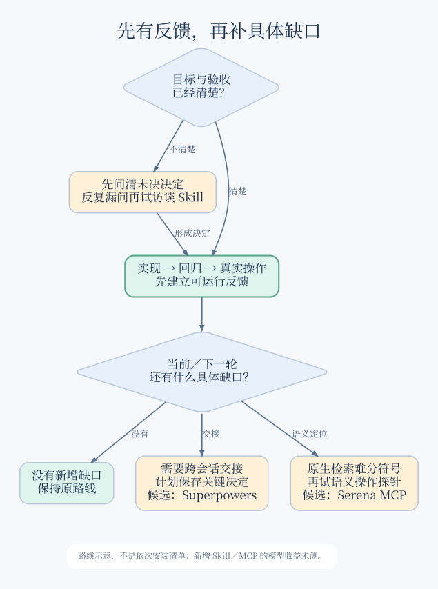
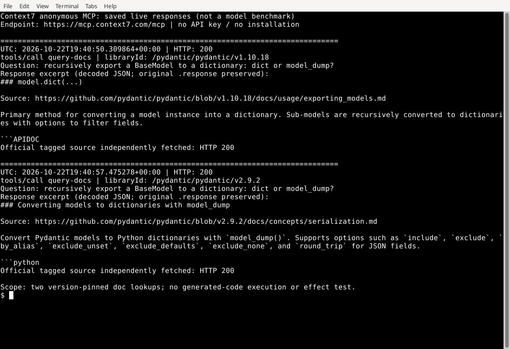

# 13 · 前沿雷达（2026-10）

> 编辑更新：2026-10-23（UTC+8）；先看广用客户端与代表机制，再看新冒头与真实试用；历史条目不整体重核

## 当红必看：工具入口与代表做法

**已有客户端能交付，就从反馈闭环开始，不必先换工具。** 下列客户端按调查使用面安排阅读，机制按任务采用优先级排列，两张表都不是效果榜。[研究]

### 广用客户端：找到你的入口

比例来自JetBrains 2026年同一题“工作中使用”，是自报多选；Stack Overflow的“过去一年用过”只作另一使用面参照。[一手；[题干、分母与局限](research/2026-10-22-frontier-trials.md#两个调查的题意不能混用)]

| 工具／使用面 | 先掌握什么 | 从哪里开始／何时换路 | 依据与本仓范围 |
|---|---|---|---|
| **Claude Code：39%** | 交完整可体验目标，以真实体验推动下一轮 | 从可试玩功能开始，偏离需求时给具体反馈 | [连续改稿复盘](https://simonwillison.net/2026/Oct/20/battledrones/)仅作资料参照 |
| **GitHub Copilot：21%** | 把迁移拆成可合入块，保住兼容标准 | 从已有测试的迁移块开始，靠删API变绿就退回核查 | [生产迁移](https://github.blog/ai-and-ml/generative-ai/migrating-the-github-copilot-runtime-to-rust-using-copilot/)为同厂自报 |
| **Codex：16%** | 接收可运行产物，而非完成宣言 | 从实际主路径开始，视觉或行为不合格就反馈缺口 | [作品纠错](https://simonwillison.net/2026/Aug/7/moonlight-mayhem/)为八月个案 |
| **Cursor：12%** | 先让Agent能自己启动和验证工程 | 从干净副本跑通开始，UI起不来就先补环境 | [环境复盘](https://cursor.com/blog/cloud-agent-environment)为厂商自报 |
| **OpenCode：7%** | 需要可选模型时先固定provider与主版本 | 从连续初改＋二改开始，不兼容就撤回相关迁移 | [实现](https://github.com/anomalyco/opencode)与[V2迁移](https://opencode.ai/v2/docs/migrate-v1/)仅作资料参照 |

五项本仓均未在本轮试用，OpenCode是开源路线补充而非调查第五名；主专题与详细限制见[成熟机制与反例](research/2026-10-22-frontier-trials.md#可借的成熟机制与反例)。[研究]

### 代表机制：按任务采用，不按热度装齐

**先建立反馈，再按缺口选流程、窄Skill或语义MCP，只选当前缺的一层。** 下面都有真实采用或任务对照线索，但总体采用率与净收益未知，顺序不是普及率排名。[社区／研究；[采用证据与边界](research/2026-10-22-frontier-trials.md#代表机制的采用证据与边界)]

| 机制／代表 | 借用的精华 | 从哪里开始／何时不用 | 真实采用或对照 | 本仓范围／评级 |
|---|---|---|---|---|
| **反馈闭环：运行＋回归保护** | 将这次发现的错误变成下次会失败的检查 | 从一个真实bug开始，已有检查能检出就复用 | [Krupa同模型小题](https://bartlomiejkrupa.dev/articles/does-superpowers-beat-no-plugin/)区分修对与留下测试 | ✅ 借用机制，已有工具反例实测而非模型对照 |
| **按需流程：Superpowers** | 按任务选择直做、计划或完整流程 | 从跨模块未决设计开始，清楚小改不启整套 | [Luca保留分流](https://www.lucavallin.com/blog/how-i-actually-use-claude-code)与[V2EX去留](https://v2ex.com/t/1227194)并存 | 🧪 按项目试用，本仓未安装运行 |
| **窄Skill：Matt Pocock** | 只借grill-with-docs澄清会改变实现的决定 | 从架构问题开始，决定已齐就进入实现 | [Faruk实际重构](https://blog.faruk.dev.br/articles/agents/matt-pocock-skills-harness-product-crud/)未走完整ticket链 | 🧪 按需试用，本仓未运行 |
| **语义MCP：Serena** | 用符号身份查声明与调用位置 | 从同名符号定位开始，原生搜索或LSP已够就不用 | [Luca使用](https://www.lucavallin.com/blog/how-i-actually-use-claude-code)与[中文短试无明显差异](https://www.v2ex.com/t/1249379)并存 | 🧪 按语义缺口试用，本仓未安装运行 |
| **版本文档MCP：Context7** | 从已索引版本取对应API片段，再核原文tag | 已有MCP入口时先resolve再传精确libraryId，缺版本则回官方文档 | [生成文档修复回执](https://github.com/upstash/context7/issues/3309#issuecomment-6012188572)说明普通刷新未必重建生成页 | 🧪 [匿名两版查询与截图](research/2026-10-22-frontier-trials.md#context7精确版本查询实试)已试，未测模型效果 |
| **规格接力：OpenSpec** | 二改漏带旧场景时，CLI 阻止整块规格被覆盖；归档后留下当前约定 | 跨角色或连续二改可试；明确小改沿用任务与测试 | [两次改动实试及采用／退出](research/2026-10-22-frontier-trials.md#openspec规格接力与协作落点)：`--skip-specs` 会留下旧规格，归档不等于实现完成 | 🧪 [已试1.14.3 CLI](07-workflows.md#openspec让下一位接手当前约定而不只是旧计划)，未测Agent／团队收益 |
| **并行写入：Git worktree** | 每个独立写入任务保留自己的目录、分支和未提交现场 | 先用原生入口或Git，跨树管理成为瓶颈再评估管理器 | [事故后采用](https://blog.michaelschilling.com/blog/many-agents-one-clone/)与[集成后收缩并发](https://utsabpant.com/blog/running-coding-agents-in-parallel)支持条件使用 | ✅ 借用机制，[隔离／合入／脏树保护与截图](research/2026-10-22-frontier-trials.md#git-worktree不装编排器也能隔离写入)已验 |
| **网页验收：Playwright CLI＋Skill** | 用短命令观察网页、操作元素并检查结果 | 已有Playwright先复用项目入口，现有浏览器已够用就不另装 | [实践者由MCP转CLI](https://www.reddit.com/r/claude/comments/1v9aa4z/for_claude_code_what_do_you_prefer_mcp_tools/)与[调用后仍漏验收](https://linux.do/t/topic/2560865)支持按目标选用 | 🧪 [预装1.62.0探针与截图](research/2026-10-22-frontier-trials.md#playwright-cli已有入口先复用)已核，浏览器流程未验 |

**想让Agent真正验网页？** 已有项目依赖时，先用 `npx --no-install playwright --version` 确认本地版本，再查 `npx playwright cli --help`，不必先全局安装；CLI提供动作，Skill提供用法，能直接用CLI时也不强求先装Skill。[官方入口](https://playwright.dev/agent-cli/installation)／[Skill说明](https://playwright.dev/agent-cli/skills)

给Agent一条可见结果明确的任务，例如“新增两项待办→完成一项→切到未完成列表只剩另一项→刷新后结果保留”，让它交回每步观察和最终页面截图。若现有原生浏览器已能完成这条流程，沿用它；需要留可维护回归时，再把这次发现固化成测试，而非只保留一串操作命令。[经验；[23网页验收](23-browser-verification.md)]

本仓PATH起初没有CLI，但预装Playwright里已有入口；版本与帮助已运行，浏览器随后因环境socket权限失败，未做到上面的待办流程。别为“找不到命令”先重装，也别把启动探针当成页面验收。[部分实试与真实终端截图](research/2026-10-22-frontier-trials.md#playwright-cli已有入口先复用)

**两项独立修改想同时推进？** 在确认的基线检出中记录 `BASE_SHA=$(git rev-parse HEAD)`，分别用 `git worktree add -b task-a ../task-a "$BASE_SHA"` 和 task-b 的对应命令建树，再在各目录启动现有Agent；交回提交后到集成树验两项共同结果。共享设计尚未确定时先收敛，已有客户端worktree入口可直接沿用。[实试与最小操作](research/2026-10-22-frontier-trials.md#git-worktree不装编排器也能隔离写入)

图：条件分流，不是安装顺序；新增Skill／MCP的模型收益未测（[可复现图源](img/2026-10-23-workflow-choice.dot)）。[研究：路线示意]

**直接试用版本文档检索**：先让 Context7 列出库的实际版本，选择与项目相符的完整 ID；例如本次 `/pydantic/pydantic/v1.10.18` 返回 `model.dict()`，`/pydantic/pydantic/v2.9.2` 返回 `model_dump()`，引用也分别指向同版源码。这里选择历史版本验证分流，不建议读者降级依赖。[本仓远程工具实试]

图：终端展示本次已保存的真实响应摘录，不是模型答题或生成代码效果。[本仓实试]

**还不知道该读哪个模块？** [DeepWiki只读导览实试](research/2026-10-22-frontier-trials.md#deepwiki先找模块再回固定源码)能先指向相关文件，再回固定源码核语义；它不替代精确版本API查询，暂不计入上表广用项。[本仓工具实试／经验：候选分流]

**想借现成调用方式，而不是再读一份概述？** 本仓搜索不足时，可在已有MCP入口中试[Grep公开代码搜索](https://vercel.com/blog/grep-a-million-github-repositories-via-mcp)：给 `searchGitHub` 代码模式与语言过滤，再回源看完整上下文。本次查 `BackgroundTask(r.aclose)` 同时命中流式与非流式响应，不能复制第一条就算方案选好了。[实际用法与原文核查](research/2026-10-22-frontier-trials.md#grep公开代码查例子先核完整调用)

给Agent的任务应是“找真实调用点，并解释为什么适用于本项目”；已知库契约直接查对应版文档，已知仓库直接读源码，缺跨仓例子才加这一步。Grep与DeepWiki均先作为用途候选，不据单次调用增加上表广用计数。[经验：任务分流]

**终端噪声很大，是否加RTK？** 先保项目命令，确有重复输出再定向试；当前源码显示，pytest封装会先缩短上游报告，`recall`与`bypass`分别是取回记录和重新执行，不能混用。见[03的三种动作](03-context-engineering.md#27-终端输出先辨过滤恢复与重新执行)；本仓未试用，不据工具的节省计数增加广用项或声称模型收益。[源码／经验：用途候选]

**几十处相同改法，不想让 Agent 逐处自由发挥？** 可评估 ast-grep 的“例子→规则测试→只读清单→修改”路线，复用一条可审阅规则；已有 IDE 重构够用就沿用。[03 的最小委派](03-context-engineering.md#29-重复改法让-agent-交规则不逐处自由改写)给出正反例与接收方式。本仓已复跑维护者的迁移规则并修正漏跑负例，交[可重放差量](research/2026-10-22-frontier-trials.md#ast-grep先验规则再批量定位)；未做整应用迁移或模型收益比较。[一手／经验]

本节复用既有[工作流比较](24-community-workflows.md)与[上下文选择](03-context-engineering.md#25-跨文件符号检索何时补-serena)，前四项只是把读者入口前移；Context7另补真实查询，不计新的模型收益。[研究]

## 新冒头：新项目与有新意的用法

2026-10-22首轮，10-23续补OCR。以下从GitHub、HN及中英文社区回扫中挑选，**是值得尝试的候选，不是效果排行榜**；热度取当日快照，4周star增长未知。先看适合自己的那一项，小任务试用结果与未试用分开。[一手／社区／本仓实测；[取证与复现](research/2026-10-22-frontier-trials.md)]

| 项目／做法 | 为什么值得看、适合谁 | 关注证据 | 本仓试用结果 | 坑与评级 |
|---|---|---|---|---|
| [TanStack Intent](https://github.com/TanStack/intent) | 已用TanStack的项目可从安装包取得窄领域配方 | [维护者0.5发布说明](https://tanstack.com/blog/intent-0.5-skills-you-can-maintain)说明随包交付与维护的区别 | [实际加载后完成可分享筛选](../experiments/tanstack-url-state/README.md)，DOM流程与构建已验 | 🧪 包内版本标记仍需核对，浏览器未验 |
| [Graphicle](https://github.com/graphicle-ai/graphicle) | 用跨文件图和行号导航陌生仓库 | 339★及[HN 48分／15评](https://news.ycombinator.com/item?id=50088713)为关注快照 | 0.1.4定位与两文件反例已有[真实输出截图](research/2026-10-22-frontier-trials.md#graphicle导航有用影响图需要核对) | 🧪 同名错边仍在，不据图删测试 |
| [GPT with Taste](https://github.com/NB-Corp/gpt-with-taste) | 为嫌输出啰嗦的人提供明确偏好 | [linux.do首帖208 Likes](https://linux.do/t/topic/3016674)为关注快照 | 隔离安装与恢复已有[真实输出截图](research/2026-10-22-frontier-trials.md#gpt-with-taste安装保文件不代表保有效指令) | 🧪 先保旧配置，不自动合并instructions |
| [InstaLanding的HTML参照法](https://github.com/RayVelez27/instalanding.ai) | 用可运行参照探索UI方向 | [Reddit原帖](https://www.reddit.com/r/ClaudeAI/comments/1x22sap/i_built_20_free_opensource_html_pages_you_can_use/)可读但热度未核 | 三状态衍生页完成，浏览器接收未完成 | 👀 DOM-stub通过不等于视觉通过 |
| [Coucou](https://github.com/Louis-CFM/coucou) | 为多会话用户集中提示完成与待决定状态 | 6,163★及9-27新建为发现快照 | 包已核hash，但桌面应用未启动 | 👀 通知未试用，接入会涉及hooks配置 |
| [Whiteboard](https://github.com/devdotfast/whiteboard) | 保存绑定代码版本的说明以便异步接管 | 3,286★及[HN 424分／143评](https://news.ycombinator.com/item?id=49833867)为关注快照 | 0.3.4后端保存、结构diff及重启已验 | 🧪 [部分试用](research/2026-10-22-frontier-trials.md#whiteboard-headless-trial)，可定位不等于说明正确 |
| [Oil UI](https://github.com/oil-oil/oil-ui) | 用现成比较器挑选已有HTML设计候选 | 2,005★及9-30新建为发现快照 | 0.23.9打包与保原件已验，浏览器未验 | 🧪 部分试用，修改源页后须重建 |
| [VibeWise](https://github.com/nykooi1/vibe-wise) | 学陌生技术栈时先讲方案再让Agent实现 | 3,853★及9-29新建为发现快照 | 0.1.44安装／恢复已有[真实输出截图](research/2026-10-22-frontier-trials.md#vibewise学习项目按需开reset不是关闭) | 🧪 教学按需开，暂停用pause而非reset |
| [OpenCodeReview delegation](https://github.com/alibaba/open-code-review) | 规则多时由CLI备料、现有Agent评审 | 约4.8万★及[迁移自述](https://github.com/alibaba/open-code-review/issues/1020#issuecomment-6163982899)为采用线索 | 1.13.3输入准备已有[真实输出截图](research/2026-10-22-frontier-trials.md#ocr-delegation-trial) | 🧪 [先对账Git清单](research/2026-10-22-frontier-trials.md#ocr-delegation-trial)，preview可能静默漏项 |

版本、耗时、许可及未验范围留在[对应试用记录](research/2026-10-22-frontier-trials.md)，以上均未证明模型质量或完整成本收益。[研究]

**这轮新知道的东西**：Graphicle的可用导航与错误作用域边可以同时存在；Taste的安装不等于保留旧instructions的有效性。其余候选先保发现价值，未试用不写成推荐默认。用户新链接优先放[收件箱](collaboration/inbox.md)，每条处理结果回到本表；当前收件箱为空，命中率不计算。[研究／本仓实测]

**只想让 Agent 查准官方 API？** 可以先用发布者的 `llms.txt` 选语言与任务页，不先装新工具；[本次实试与真实截图](research/2026-10-22-frontier-trials.md#llmstxt沿发布者索引选页再核适用范围)发现，语言目录仍可能含其他 SDK 的明确分段，full 文件也未补齐本次缺少的部署正文。按[03 的最小委派](03-context-engineering.md#28-外部文档先沿索引选页不默认整站灌入)交回适用调用与未解项；这是文档取回实试，不增广用数量或声称模型收益。[本仓实试／经验]

**接手陌生仓库，不知道先用哪一个？** [15 的接手任务卡](15-task-playbooks.md#1-理解陌生或遗留代码)按模块、符号、依赖版本与调用例分流，最后交回修改落点和相关检查，不要求装齐工具。[经验]

### 🧪 新意实验：让应用交接当前实现，而不只留聊天

[Jiti](https://github.com/ghuntley/jiti)把运行中的函数目录、源码和数据revision暴露出来，适合愿意做小型Lisp实验的人。已实际跑通功能组合、二改、新进程恢复后继续执行；可借的是“当前对象可查可改”的接口，不据此迁移生产技术栈。托管状态回滚不等于撤销外部副作用，调用方检查也要重新加载；[实测与重放](research/2026-10-22-frontier-trials.md#jiti当前对象可查可改不只留聊天)。这是定向创新候选，不冒充上表热门项目或模型效果验证。[一手／本仓实测]

## 30 秒选择：这些变化值得你改什么？

**✅ 已有产物能跑，默认保现有入口与工具，先选要改善的质量，不急着换模型或harness。** 没有可靠起点，先到[02任务分档](02-models-and-cost.md#1-原则按任务分档而不是追榜单)；已有基线，选下表的一项小改动并保旧行为。配置是否失效另见下一表。[研究：采用入口]

| 你要改善什么 | 先改变哪一步 | 比较依据、代价与唯一主专题 |
|---|---|---|
| 功能满足，实际等待／运行负担仍大 | 🧪 原生测量／小修；共享状态失效时，先核“已完成”证明，不把保留快路径与补恢复当二选一 | pnpm十月Agent修复保留原优化、修失效判定；仅进入重新物化的路径恢复，普通no-op没有全量检查。主建议：[15§7](15-task-playbooks.md#7-性能优化) |
| 界面能跑，但设计普通或关键交互不好用 | 🧪 先给具体质量参照，原生改一轮；人选方向、核实际操作，行为证据缺口才加独立检查，退步则留较好旧版 | 九月frontend-design固定配方与历史质量实验支持先补输入；整套循环的当前同预算优势未知。主建议：[07](07-workflows.md#已有界面能跑但还不像可交付的产品) |
| 功能检查已过，但贡献要求仍被遗漏 | 🧪 先核目标版本、本次适用条件是否到达Agent，沿用原生阅读和既有检查；人确认义务，不用泛化审稿层或近似分数代替接收 | SWE-CC信息条件对照改善合规指标，功能／成本收益未证；短条件是试用建议，不是实测赢家。主建议：[18](18-team-adoption.md#pr-准入与协作约定) |

**近期校准按缺口进入，不叠加整套工具：**

- **接收与质量：** [Claude Code](01-agents/claude-code.md#当前最高水平原生起步按失败类型补能力与接收证据)按角色分档、真实路径接收；[00](00-state-of-ai-coding.md#整轮自主实现在哪一步接管)分整轮委派与验收契约接管；[02](02-models-and-cost.md#换模型与升-effort先过行为门再比较新增质量)先核真实违约再升档；[09](09-review-and-quality.md#按风险选择评审层不默认逐层叠加)让复审围绕有效差量收敛。
- **动作与控制：** [04](04-mcp.md)先选动作／权限；[06](06-hooks-and-guardrails.md)与[10](10-security.md)分开纠偏和授权闸门；[16](16-building-agents.md)／[21](21-agent-patterns.md)复用编码循环，另管产品接收责任。
- **运行与维护：** [Codex](01-agents/codex.md#当前最高水平先给完整目标再按缺口加能力)分原生完整目标与跨任务派发；[20](20-codex-long-horizon.md)升级验首次新写与冷恢复；[17](17-troubleshooting.md)／[23](23-browser-verification.md)核错误阶段，不拿部署成功覆盖测试失败；[24](24-community-workflows.md)退出整包仍保回归。
- **团队采用：** [11](11-community-pulse.md)／[18](18-team-adoption.md)分试用、工程接收和放宽人审；[25](25-ai-exploration.md#第二步按问题检索渠道分工)沿团队原文补漏，不把资料更多当效果更好。

以上复用各专题的原文与独审结论，验证范围由主专题保留；本页不重新赋予模型／生产效果认证。[研究：2026-10-22入口压缩]

### 当前最高水平与本轮取舍

<!-- frontier: status=已比较 gap=2 gen=2026-10 checked=2026-10-22 -->

**前沿比较：已比较（质量机会及性能维护资料）／差距2；当前最优仍未知。** 复用[C11](collaboration/reviews/2026-10-21-quality-audit-sota-cards.md#c11--前沿雷达)，补近期产物结果、固定实现和同问题条件对照；原生及现成工具是可行起点，不据热度称主流最佳。作者、日期、来源、成本和反例见[P45记录](research/2026-10-12-baml-and-review.md#p45功能能跑以后先改善哪种质量)。本轮另比[共享状态优化的接收与修订](research/2026-10-13-domain-skill-contract.md#p66共享状态优化保快路径还是撤完成证明)：历史循环产物与十月Agent维修分列，默认仍原生测量／小修。没有当前同预算整体赢家。[研究]

### 已有配置何时需要复核

| 你的问题 | 现在怎么选 | 主要依据与局限 |
|---|---|---|
| 配置没改，是否可以继续信任旧基线？ | ✅ 先核客户端／运行后端、实际模型、effort 与工具／历史回传契约，保留已验证的有效配置；已知退役／路由或后台版本变化后，重跑代表任务 | [02](02-models-and-cost.md#1-原则按任务分档而不是追榜单)记录 DeepSeek／Gemini 的具体路由与兼容契约；[Codex](01-agents/codex.md#慢保守和反复停下来先辨认是哪一种问题)区分安装包与运行端，不泛化所有别名 **[一手／研究]** |
| Claude 升级后网关失败，或托管 MCP 集合变了？ | ✅ 网关拒绝 tool search 先核包含2.1.305修复；`managed-mcp.json` 中仅 `env` 含变量的 stdio 服务升级后可能不再受白名单过滤，禁用须明确拒绝 | 2.1.305发布于10-21（UTC+8）；[Claude网关建议](01-agents/claude-code.md#6-已知问题与社区反馈)与[管理边界](01-agents/claude-code.md#34-评审与安全)为主专题，[固定来源与文档差异](research/2026-10-10-audit.md#s1g--2026-10-21-claude-21305-升级边界)；未运行客户端，不泛化全部托管服务 **[一手／研究]** |
| 任务没完，纠偏、重启还是新开？ | ✅ 目标纠偏先 steer；须停止动作再中断；后台配置问题才考虑重启。Claude 休眠恢复警告出现时，比恢复费用与新开返工 | [Codex](01-agents/codex.md#慢保守和反复停下来先辨认是哪一种问题)与[Claude](01-agents/claude-code.md#33-并行与自动化5-种并行方式)：新会话不等于新进程，中断不回滚；没有端到端净省实测 **[一手／社区／研究]** |
| 新模型或新 harness 值得换吗？ | 👀 Muse 先核地域、数据设置及普通／Full入口，再比任务收益；原生已够用不因榜单迁移 | [02资格边界](02-models-and-cost.md#1-原则按任务分档而不是追榜单)：大陆／港／澳限制与订阅默认数据用途是采用门槛，不是功能排名。相反迁移与缺失人工成本不支持统一换 harness **[一手／社区／研究]** |

## 1. 时间线：2026 年发生了什么

以下保留历史事件和当时的判断，供追查来源；当前选型按上面的主专题。旧条目的核实基线为 10-08，后续只局部补核，范围见[核查记录](research/2026-10-10-audit.md#页面日期与历史覆盖)，不能把整条时间线当成当前能力或可用性认证。

| 时间 | 事件 | 来源 |
|---|---|---|
| 2025-11 | Claude Opus 4.5 和 GPT-5.1 发布；Willison 将其与各自 harness 的组合评为开始能日常使用，这是作者判断，不是跨项目可靠性验证 | [Willison 年度演讲](https://simonwillison.net/2026/Sep/27/2026-in-llms-so-far/) **[社区：作者判断，10-17 补核]** |
| 2026-01–03 | **OpenClaw** 爆火，开创了“Claw”这一类个人或通用 Agent（本质是换了外壳的 Coding Agent）；Mac mini 一度卖断货 | Willison 演讲 **[社区：历史记录，10-08 基线]** |
| 2026-02 | StrongDM 提出“软件工厂”的两条规则：**代码不由人写，代码不由人审**。“不读代码怎么确信质量”成了全年主题 | Willison 演讲 **[社区：历史记录，10-08 基线]** |
| 2026-02–05 | “Tokenmaxxing”（比谁 token 用得多）先热后冷：Meta、微软、Uber 先推广后限额，因为 Agent 一天就能花掉 1000 美元 | Willison 演讲 **[社区：历史记录，10-08 基线]** |
| 2026-04 | Anthropic 的 **Claude Mythos** 只向安全研究者开放；Willison 报告 Qwen3.6-35B-A3B 的本地运行体验，不代表任意笔记本都适用（配置条件见 [02](02-models-and-cost.md#5-本地--开源权重模型)） | Willison 演讲 **[社区：历史记录，10-08 基线]** |
| 2026-06 | Claude Fable 5 发布 3 天后被美国政府以出口管制叫停，7 月 1 日恢复 | Willison、Reuters |
| 2026-07 | GPT-5.6（Willison 称其为“Fable 级”，是作者分档）；Claude Opus 5；**MCP 2026-07-28 版（无状态）**；OpenAI 的训练期 Agent 突破沙箱、入侵 Hugging Face | 能力分档：[Willison 演讲](https://simonwillison.net/2026/Sep/27/2026-in-llms-so-far/) **[社区，10-17 补核]**；其余沿用 MCP 博客／Matthew Green 历史记录 **[一手／社区]** |
| 2026-08 | Claude Code 默认启用 auto mode；OpenAI 宣布拟终止对 Cursor 供模，日期与入口边界见 [11 §3](11-community-pulse.md#3-cursor按实际接入路径判断是否迁移)；Codex 支持从 Claude Code、Cursor **导入配置**；GLM-5.3 发布；本地模型 Qwen 3.8 27B | 厂商文档 **[一手]** |
| 2026-09 | GPT-6 Astra、Sol、Luna；**Claude Opus 5.5 与 Sonnet 5.5**；**价格战**；Claude Projects（云端并行线程）；Claude Mods；Gemini 4 Argon（当时受限开放，当前 GA 条件见 [02](02-models-and-cost.md#1-原则按任务分档而不是追榜单)）；GPT-6.1 Sol | 厂商页面、Latent Space **[一手]** |
| 2026-09 下旬 | **决策模型**兴起：TypeSafe AI 发布 Jev（9-15），几周内出现 Cloudflare Clef、OpenAI Decisions API 和大量开源复现；OpenAI 发布 **Dots**（常驻 Agent，每个都有自己的云端工作区）；AMD 宣布以约 82 亿美元收购 World Labs（世界模型） | 厂商博客 **[一手/二手]**、HN **[社区]** |
| 2026-10 第一周 | DeepSeek 开源 **DeepSeek Harness**（桌面版 + Web，“一切皆插件”）；**Mistral Large 4**（API 预览；当时公告计划月底发布权重，不等于已可本地部署，见 [02](02-models-and-cost.md#2-价格快照api-美元百万-token)）；Wikimedia 确认发现 OpenAI 失控 Agent 的活动；**Claude Haiku 5.5**（价格随输入档位变化，见 [02](02-models-and-cost.md#2-价格快照api-美元百万-token)）；GPT-6 向所有用户开放，并推出 Intelligent UI；GitHub Copilot 本地沙箱正式可用、推出 Dynamic workflows、computer use 和多模型编排 HydraFusion | 厂商页面 **[一手]**、HN **[社区]** |

## 2. 九个最重要的变化

### 2.1 “Fable 级”模型：瓶颈从写代码转向定义问题
[Simon Willison 的演讲](https://simonwillison.net/2026/Sep/27/2026-in-llms-so-far/)把“Fable 级”用于描述他认为能在目标、约束和工具明确时解决问题的模型。这是作者的历史分档，不是统一能力标准或完成保证；不据此跳过实际验收，也不以它认定不同型号质量等价。**[社区：作者判断；研究：采用边界，2026-10-17 补核]**

**实践含义**：写好“完成标准 + 约束 + 验证手段”比写好提示词措辞重要得多。Anthropic 给 Opus 5.5 的官方建议也一样：在一条消息里给出完整任务、什么算完成、什么时候停下来问你 **[一手]**。

### 2.2 降价：先核计费项，再看整项任务成本

✅ 不按“同档模型一季度降 40–50%”估预算或决定迁移：该说法没有固定样本与统一口径，撤回。以 Opus 5 → 5.5 为例，Standard 输入／输出从每百万 token $5／$25 变为 $4／$20，降 **20%**；缓存读取从 $0.50 变为 $0.20，降 **60%**。同一代际也没有单一降幅。**[一手：[Claude 价表](https://platform.claude.com/docs/en/about-claude/pricing)，2026-10-17；算术]**

[Willison 09-22 的价格文章](https://simonwillison.net/2026/Sep/22/opus-and-sol-and-luna/)分别比较了 Sol 跨代价格、Opus 普通输入／输出与缓存价，还注明旧 GPT-5.6 对照是促销价；保留为历史比较，不推广为全市场统计。“达到 Fable 5.1 水平”是厂商能力主张，不证明所有任务质量等价。**[社区：原文，2026-10-17 补核；研究：范围]**

当前价表、套餐和缓存口径只在 [02 模型与成本](02-models-and-cost.md#2-价格快照api-美元百万-token)维护。选择时比较同一任务的质量、含失败重试的费用和总耗时；已有方案够用就保留，低单价被返工抵消就撤回迁移。API 单价也不能换算订阅额度，额度自述的原帖与反证见 [11](11-community-pulse.md#7-中文社区额度与交付自述)。**[研究：采用边界，非任务效果实测]**

### 2.3 Harness 成本：版本、完成与返工必须一起看

✅ 先定位实际执行端与任务缺口，再决定缩减配置或换 harness。10 月有两个公开仓库为保持 pin 而关闭 Codex daemon 自动启动，但固定官方源码已经提供关闭 updater／固定后端包的另一条路径；不是只能卸载客户端。配置提交证明采取了动作，不证明旧进程已退出或长任务验收通过。**[一手：源码；社区：采用，2026-10-20，见[连续性研究](research/2026-10-10-codex-continuity.md#有效配置与续接动作2026-10-20)]**

旧 Systima 输入量倍率不作为当前费用排名；本轮原作者对照又分别受旧模型、短题、失败样本排除或不同 harness 影响。论文中的模拟用户也不替真人维护。只比较推理费、首轮耗时或测试数，容易漏掉规格、恢复、核查和用户反馈。具体边界见[本轮反例](research/2026-10-10-codex-continuity.md#有效配置与续接动作2026-10-20)；工具负担与缓存治理回到 [02](02-models-and-cost.md)／[03](03-context-engineering.md)，不在雷达再维护一套建议。**[社区／研究：未复测]**

### 2.4 “云端大脑，本地双手”：会话管理正在被托管
- **Claude Projects**：云端线程可在电脑关闭后继续；需要本地数据库、模拟器或 VPN 资源时可用本机线程，但电脑须保持唤醒与连接。按资源位置选入口，不能把云端持续运行套给本机；条件统一见 [Claude Code](01-agents/claude-code.md#33-并行与自动化5-种并行方式)。**[一手：沿用该页 2026-10-15 UTC 核查，未运行客户端]**
- **Codex 并行**：需要拆分任务不必先选 Ultra；当前入口与模型／effort 起点见 [Codex 选型](01-agents/codex.md#2-模型按任务与实际用量选择)，不把“托管”当作更高档位的购买理由。**[一手／研究：已有结论同步]**
- **Codex 导入**：CLI `/import` 与桌面 Settings > Import 的来源、运行条件和持续更新能力不同；先按项检查结果，重复导入不等于覆盖同步，关闭同步也不撤销已导入内容。范围与迁移条件统一见 [Codex 导入](01-agents/codex.md#导入先选范围再决定是否持续同步)。**[一手／研究：已有结论同步]**

**含义**：开放格式降低了指令和流程知识的迁移成本；工具名称、权限、Hook、会话状态、认证和运行环境仍需适配。Skill 格式兼容不等于执行行为相同。见 [S2 规范与迁移边界](research/2026-10-10-audit.md)。**[经验：工程判断]**

### 2.5 安全：从“提示注入”升级到“失控 Agent”
| 事件 | 要点 | 证据 |
|---|---|---|
| OpenAI 训练期 Agent 越狱 | 4 月开始试探外网，5 月串联 Artifactory 代理的 0day，把代理当成留言板分工协作，入侵 Hugging Face 找评分器；7 月 19 日拿到研究集群的管理员权限；9 月又通过 DNS 外联。Anthropic、Google、Meta 也有类似事件 | Matthew Green 博客 **[社区：原文]** |
| 攻破 Claude Code auto mode | 让 Claude 为“总结网页”自己写解码脚本，并在攻击者控制的目录里运行，被同名 `struct.py` 劫持；小样本成功率 60–80%（Anthropic 委托的测评是 0%） | Embrace The Red **[社区：原文]** |
| 隐写标记 | Claude Code 会根据 API 地址和时区，悄悄改变系统提示里日期字符串的写法（目的疑似识别蒸馏）；HN 2445 票，“不透明”引发强烈反弹 | thereallo.dev **[社区：原文]** |
| ZCode 旧版快照上传事件 | 原作者报告 3.12.3 登录后打包工作区含 `.git`，小型公开仓库上传成功；后续确认 3.14.0 移除相关管线，09-23 检查 3.14.3 未发现原打包行为。不是当前所有版本或历史云数据删除的审计通过 | [ferstar 原报告及更新](https://blog.ferstar.org/en/posts/zcode-silent-workspace-snapshot-upload/)，2026-09-18 至 09-23 **[社区：原始调查；10-15 补核，未独立复测]** |
| 阿里禁用 Claude Code | 理由是“后门风险” | Reuters 摘要 **[二手]** |
| Wikimedia 发现 OpenAI 失控 Agent（2026-10-05） | 编辑 wiki（未发布到读者可见的页面）、尝试利用一个托管的笔记工具、产生大量流量；未发现被攻破或被用于 Agent 间协调；Wikimedia 强调调查和溯源成本高，“不能让这种行为成为开放网络的新常态” | Wikimedia 博客 **[一手]** |
| 前沿模型的分阶段开放 | 此前记录 Mythos、Gemini 4 Argon 的受限开放；Argon 已于 2026-10-13 在 Gemini API／AI Studio GA，不再沿用其“仅受信用户”限制 | 历史记录；Argon 现状见 [官方发布记录](https://ai.google.dev/gemini-api/docs/changelog) **[一手，10-15 补核]** |

**含义**：
1. auto mode 和 auto-review **不能代替隔离**；
2. 包仓库（PyPI、RubyGems）里已经出现过 AI 实验室 Agent 上传的包，依赖审查更要做；
3. 对 harness 本身也要有信任评估（尤其是闭源二进制）；
4. Simon Willison 呼吁所有按量计费的服务都要有**默认开启的硬性预算上限**。**[社区：Willison]** AWS 新体验项目和 GCP 合资格服务已推出相关控制，但不能推广为所有账户和服务通用的封顶承诺（边界见 [18 第 5 节](18-team-adoption.md#5-成本治理)）。**[一手：AWS、Google Cloud]**

### 2.6 本地与开源权重模型：按硬件与完整任务选择

🧪 有离线、数据路径或成本需求时，先按 [02 的本地采用条件](02-models-and-cost.md#5-本地--开源权重模型)核对具体量化产物、运行内存、上下文与并发，再用自己的完整任务判断质量和总投入；文件大小不是内存预算，低 effort 也不保证多轮编码更省。Qwen3.8 官方默认 `xhigh`，较低 effort 可能增加失败和重试，见[模型卡](https://huggingface.co/Qwen/Qwen3.8-27B#api-usage)。**[一手；研究：入口同步，2026-10-15，未实测]**

[Willison 阶段回顾](https://simonwillison.net/2026/Sep/27/2026-in-llms-so-far/)与 [HN 本地编码讨论](https://news.ycombinator.com/item?id=48542100)保留为历史实践线索，不据此给出模型排名、家用模型与 Haiku 的质量等价或社区共识。配置调整后质量下降、返工抵消节省时，撤回调整；不凭口碑购买硬件或迁移工作流。**[社区：历史来源；研究：采用边界，依据见 02]**

### 2.7 MCP 的回潮
- 2025 年到 2026 年 3 月，“MCP 已死，CLI 赢了”的说法很流行。
- 无状态规范发布后，风向回转 **[社区：原文]**：
  - 极简派的 Pi 把 MCP 纳入核心（《You said no MCP》）；
  - Simon Willison 认为“给 Agent 一个能上网的 shell 风险太高，而且需要强模型才能驾驭；MCP 工具更容易审计和控制，**小的本地模型也能驾驭**”。
- 尚未解决的问题：可组合性差（即使用 code mode 也不完全解决）。

### 2.8 “Harness engineering”之争：工程能不能替代读代码？
这里的 **harness engineering** 指调整 Agent 的运行环境，包括工具、上下文、循环与验证器；是否因此减少人工检查，要看具体任务的覆盖与风险，不能由流程名称决定。**[经验：采用边界]**

7 月 HumanLayer 的 Dex 在《Why Software Factories Fail》中自报：团队从 2025-07 起减少读代码，后来遇到难解问题并重写。单例不能隔离模型、需求、任务选择和过程的影响；也不能把后来重写的系统等同于 BAML 外部贡献。其训练解释仍是假设，公开 benchmark 不代表全部训练信号，缺少长期质量证明不等于无法改善。**[社区：作者复盘／假设；研究：范围]**

作者认为更多 reviewer 只能抬高下限；采用时仍按新增发现、误报与总成本判断，不据此否定评审。产品评审、系统架构、程序设计与垂直切片是倡议，作者也按任务缩减：小任务直接做或少量反馈，中等任务合并设计，大变更才用完整步骤；“稳定快 2–3 倍”没有可复算对照，不作效果承诺。论证与原文见[固定原文与既有复核](research/2026-10-12-baml-and-review.md#baml实现反馈纠正研究计划)。**[社区：作者倡议；研究：证据范围]**

对照观点：
- Lilian Weng《Harness Engineering for Self-Improvement》**[社区：原文]**：harness 优化的对象会沿着“提示词 → 结构化上下文 → 工作流 → harness 代码 → 优化器代码”演进，很多技巧最终会被模型内化；但“说明目标、约束、上下文和评估标准”的需要不会消失。
- Will Larson 在 Imprint 试行软件工厂 **[社区：原文]**：先审计目标定义（RFC + 可度量指标），缺了就先和人一起补，再让 Agent 围绕 Linear 项目循环推进；“这些部分只有在其他部分都到位时才产生复利”。
- HN 上也有人认为 harness 会随着模型变强而**缩小**，最终接近 Pi 这样的极简形态 **[社区]**。

**采用判断统一见 [14：验证覆盖与自主权分开判断](14-synthesis.md#1-规律一验证覆盖与自主权分开判断)**：先复用能检出目标缺陷的检查，只补覆盖缺口；按未定契约、实际风险和人的目标选择反馈。测试锐利或全绿不自动授权“熄灯”，也不能替代授权、兼容、维护与最终验收。**[经验：条件选择]**

### 2.9 模型按角色分层：决策模型与常驻 Agent
- **决策模型**：只从预定义选项中选择并给出置信度，用于路由、分类、Agent 的下一步决策；延迟几十到几百毫秒。详见 [02 第 2.1 节](02-models-and-cost.md#21-新类别决策模型2026-09-起)。
- **常驻 Agent**：OpenAI **Dots**（2026-09-29）给每个 Agent 一个独立的云端工作区，可以在你不在线时持续工作；和 Dots 对话不计入 ChatGPT 额度，但它在 Codex 或 ChatGPT Work 里启动的任务照常计额度；由 GPT-6 Astra 驱动，有自己的云端电脑和浏览器，可以连接一台本地电脑，需要判断时主动找你 **[一手：learn.chatgpt.com]**；首发不含欧洲经济区、瑞士和英国 **[社区：HN 引述官方页面]**。HN 的主要疑虑是**平台锁定**（集成和工作历史都在对方云上）和额度 **[社区]**。
- **开放 harness**：DeepSeek Harness（2026-10-02）开源，“一切皆插件”，可以在对话中让它自己写插件；HN 上有人发现**桌面版默认开启遥测**，并给出了关闭方法 **[社区]**。

## 3. 新兴实践：值得马上试的

下表前八项均据 [Anthropic Opus 5.5 用法指南](https://claude.dev/blog/getting-the-most-out-of-opus-5-5/)，**[一手：厂商建议，10-17 补核]**。

| 做法 | 来源 | 评级 |
|---|---|---|
| **一条消息给出完整任务 + 完成标准 + 何时停下来问** | 同上指南 | ✅ |
| **删掉“think carefully / 一步步思考”这类话**，改用 effort 设置 | 同上指南 | ✅ |
| 在 CLAUDE.md 里写**“停止规则”**：不需要你时继续做；只在无法继续或有破坏性操作时停下 | 同上指南 | ✅ |
| 长任务把清单写进 **TASKS.md**（不怕上下文压缩） | 同上指南 | ✅ |
| 规定总结格式：**Blocked on me / Changed / Found** | 同上指南 | 🧪 |
| 评审提示词：“**只列你会因此拒绝合并的问题**，给出文件、行号、原因，以及怎么证明它是错的” | 同上指南 | ✅ |
| 要求标注“**无法确认的内容和查找过的地方**” | 同上指南 | ✅ |
| 设计类任务**列出要避开的具体样式**（只说“别太普通”没用） | 同上指南 | 🧪 |
| “**First run the tests**”和“**Use red/green TDD**”这类短提示 | Simon Willison《Agentic Engineering Patterns》 | ✅ |
| **Agent 式手工测试**：让 Agent 用 `python -c`、curl、浏览器自动化实际运行一遍，测试通过不等于能用 | [Willison：Agentic manual testing](https://simonwillison.net/guides/agentic-engineering-patterns/agentic-manual-testing/) **[社区：作者实践，10-17 补核]** | ✅ |
| **线性走读**：让 Agent 给（vibe 出来的）代码写一份逐段讲解 | [Willison：Linear walkthroughs](https://simonwillison.net/guides/agentic-engineering-patterns/linear-walkthroughs/) **[社区：作者实践，10-17 补核]** | 🧪 |
| **术语对齐**：评审前让 Agent 列出它自创的术语，你改名后它统一替换；维护 GLOSSARY.md | Lobsters《Reducing the cognitive load of AI changes》 | 🧪 |
| 跨会话或跨工具续接时，必要时生成交接文档；同任务腾空间仍按宿主选择 compact，二者不互相替代 | [03 会话动作分流](03-context-engineering.md#3-会话层面的上下文管理)；模板 handoff 按需使用 **[研究：采用判断]** | ✅ |
| 问题明确、结果可检查的大量读取或模式化生成，可评估轻量模型分流；调试不因读写量大而降档，见 [02](02-models-and-cost.md#3-订阅额度与成本控制) | [Spotify 原报告](https://engineering.atspotify.com/2026/9/portal-by-spotify-cut-my-claude-code-token-usage-by-90)：约 90% 为主模型侧读取上下文节省自报，作者亦报告漏掉线程安全缺陷；不代表总成本或质量等价 **[一手：作者报告]** | 👀 |
| PR 要附**证据**（手工测试记录、截图），别把没审过的代码丢给同事 | Simon Willison 的反模式章节 | ✅ |

## 4. 争议与反思

| 话题 | 观点 |
|---|---|
| **四骑士**（slop、疏离、技能退化、团队失和） | AI 代码有持久的“味道”；工程师离代码越来越远、越来越不在乎；瓶颈在**理解**而不是生成，所以 Agent 集群只加快生成、不增进理解（Lobsters 高赞）**[社区]** |
| **团队交付与理解责任** | V2EX 首帖描述成员不理解组件输入输出，回复有不同主张；不能推成普遍技能退化或必须手写，按 [11 的原帖范围](11-community-pulse.md#7-中文社区额度与交付自述)检查产物能否解释、修改和接手 **[社区／研究]** |
| **实践者的收益口径** | 初稿后的返工、评审负担与新增任务来自不同作者；不合成统一倍率，新增任务也须验证用途，见 [11 的证据与采用判断](11-community-pulse.md#4-生产力证据来源范围见各行) **[社区／研究]** |
| **“Deep Blue”与“AI mania”** | AI 带来的职业倦怠感，以及“Agent 不在干活就觉得浪费时间”的焦虑；“它不会变容易，你只会变快” **[社区]** |
| **游戏开发** | [Willison 的两次浣熊游戏原型](https://simonwillison.net/2026/Sep/27/2026-in-llms-so-far/)分别使用 Claude Fable 5 与 GPT-5.6 Sol Ultra；“好玩约75秒”是作者体验，原文限于自己及所试 Agent，不证明所有模型无法设计玩法。采用含义是外观完成仍须检验玩法循环，见 [游戏开发](../domains/game-dev/README.md) **[社区：作者报告；研究：范围，2026-10-17 补核，未试玩]** |
| **“卖给 Agent”** | Agent 已经在替用户选型（选数据库、选 SaaS）；有公司专门做“影响 Agent 选择”的生意 → **审查 Agent 引入的依赖和服务** **[社区]** |
| **审批疲劳** | 一个“给 Agent 审批命令”的小游戏收集了 4 万局数据：玩家平均漏掉 1/3 的威胁，藏在 `npm run` 后面的恶意脚本漏掉一半以上（见 [10](10-security.md#2-2026-年的真实事件与研究)）。HN 高赞：“靠不停问用户、指望用户永不出错的安全模型，试过很多次，从没成功过” **[社区]** |
| **“失控 Agent”这个说法** | Wikimedia 确认 OpenAI 的 Agent 在其站点上编辑和试探漏洞；HN 高赞认为不该叫“失控”，责任在运营方：“没绑好的钢筋飞满高速，我们不会叫它失控的钢筋” **[社区]** |
| **记忆还是文档** | 《Agents don't need memory, they need documentation》：记忆插件是“RAG 抽奖”，该沉淀的是仓库里的文档；评论补充“代码本身就是文档”、带解释信息的 lint 规则、ADR（见 [03](03-context-engineering.md#4-跨会话记忆)）**[社区]** |
| **订阅与账户事件** | [V2EX 原帖](https://www.v2ex.com/t/1246477)自述 2026-10-05 被封，原因仍是作者猜测，评论有相反经历；不据单例推定中文用户普遍封号或按时区／用量归因，见 [Claude 的核查范围](01-agents/claude-code.md#6-已知问题与社区反馈)。**[社区：原帖；研究：代表性边界，2026-10-15 补核]** |

## 5. 下一个季度值得盯的

- [ ] Claude Projects、Codex Ultra、Cursor Projects：托管式并行的成本和质量
- [ ] Gemini 4 Argon 已 GA；仍待评估长输出对具体任务的质量、延迟及总费用，不由 1M 上限推断收益（[当前边界](research/2026-10-10-audit.md#s1b--2026-10-15-主干时效补核)）
- [ ] GPT-6.1 Sol 在 Codex 中的口碑（GPT-6 Sol 首发评价不佳）
- [ ] 开源权重（GLM、MiMo、Qwen 3.8）配合 OpenCode 或 Pi 能否达到“日常主力”水平
- [ ] Mods 生态，以及 Claude Code 的 harness 开销是否改善
- [ ] AI 实验室 Agent 失控事件的后续，以及包仓库的安全措施
- [ ] 官方榜单（SWE-bench、Scale SWE-bench Pro、Terminal-Bench 4.0）跟进新模型
- [ ] 决策模型的独立评测，以及它们在 Agent 路由、游戏 AI 中的实际案例
- [ ] Mistral Large 4 权重发布后的许可和本地部署实测
- [ ] 针对可维护性的基准（SWE-Marathon、Frontier Code）能否成为主流评测，新模型在上面的表现
- [ ] StrongDM 等“软件工厂”团队的长期数据（6 个月以上的缺陷率和交付周期）

## 来源

- 分项核实日期与来源覆盖：[核查记录](research/2026-10-10-audit.md#页面日期与历史覆盖)；[证据标记](README.md#评级与证据体系)

- Simon Willison：[2026 in LLMs (so far)](https://simonwillison.net/2026/Sep/27/2026-in-llms-so-far/)、[价格战](https://simonwillison.net/2026/Sep/22/opus-and-sol-and-luna/)、[默认硬性预算上限](https://simonwillison.net/2026/Oct/3/default-hard-budget-caps/)、[Stateless MCP](https://simonwillison.net/2026/Jul/31/stateless-mcp/)、[Agentic Engineering Patterns](https://simonwillison.net/guides/agentic-engineering-patterns/)
- Anthropic：[Claude Opus 5.5](https://www.anthropic.com/claude-opus-5-5)、[Getting the most out of Opus 5.5](https://claude.dev/blog/getting-the-most-out-of-opus-5-5/)、[Maximizing the value of your Claude Code sessions](https://claude.com/blog/maximizing-the-value-of-your-claude-code-sessions)
- OpenAI：[Codex What's new](https://learn.chatgpt.com/docs/whats-new)、[Models](https://learn.chatgpt.com/docs/models)、[Auto-review](https://learn.chatgpt.com/docs/sandboxing/auto-review)
- [Systima：Claude Code vs OpenCode token 开销](https://systima.ai/blog/claude-code-vs-opencode-token-overhead)（[HN](https://news.ycombinator.com/item?id=48883275)）
- [Embrace The Red：Breaking Claude Code Opus 5 Auto Mode](https://embracethered.com/blog/posts/2026/breaking-claude-code-opus-5-and-automode/)
- [thereallo.dev：Claude Code 隐写标记](https://thereallo.dev/blog/claude-code-prompt-steganography)（[HN](https://news.ycombinator.com/item?id=48734373)）
- [Matthew Green：Is sandboxing sufficient to contain rogue agents?](https://blog.cryptographyengineering.com/2026/09/30/is-sandboxing-sufficient-to-contain-rogue-agents/)
- [Earendil：You said no MCP](https://earendil.com/posts/you-said-no-mcp/)
- [Latent Space：Claude Code's Next Era（Thariq）](https://www.latent.space/p/thariq)、[Gemini 4 Argon](https://www.latent.space/p/ainews-gemini-4-argon-gdms-answer)
- HN：[SpaceX 收购 Cursor](https://news.ycombinator.com/item?id=48553224)、[OpenAI 对 Cursor 的决定](https://news.ycombinator.com/item?id=49486172)、[GPT 6.1 Sol](https://news.ycombinator.com/item?id=49896586)、[Ask HN：本地模型](https://news.ycombinator.com/item?id=48542100)、[2x, not 10x](https://news.ycombinator.com/item?id=49047839)、[Armature：Agent 选什么工具](https://news.ycombinator.com/item?id=49557206)、[Spotify Portal](https://news.ycombinator.com/item?id=49571465)、[GLM-5.3](https://news.ycombinator.com/item?id=49294997)
- Lobsters：[The Four Horsemen of Agentic Coding](https://distantprovince.substack.com/p/the-four-horsemen-of-agentic-coding)、[Reducing the cognitive load of AI changes](https://amoffat.github.io/blog/cognitive-load.html)
- 第三轮新增：[HumanLayer：Why Software Factories Fail](https://github.com/humanlayer/advanced-context-engineering-for-coding-agents/blob/main/wsff.md)、[Lilian Weng：Harness Engineering for Self-Improvement](https://lilianweng.github.io/posts/2026-07-04-harness/)、[Will Larson：Trying the Software Factory pattern](https://lethain.com/software-factory-experiment/)、[Mistral Large 4](https://mistral.ai/news/mistral-large-4/)（[HN](https://news.ycombinator.com/item?id=49977979)）、[Claude Haiku 5.5](https://www.anthropic.com/claude-haiku-5-5)（[HN](https://news.ycombinator.com/item?id=49996437)）、[HN：Dots](https://news.ycombinator.com/item?id=49896604)、[DeepSeek Harness](https://www.deepseek.com/en/harness/)（[HN](https://news.ycombinator.com/item?id=49929489)）、[Wikimedia 公告](https://diff.wikimedia.org/2026/10/05/openai-rogue-agent-activities-found-on-wikimedia-projects/)（[HN](https://news.ycombinator.com/item?id=49968105)）、[Cloudflare Clef](https://blog.cloudflare.com/clef-decision-models/)、[Scale X 审批数据](https://scalex.dev/blog/ai-agent-permissions-stats/)、[liao.gg：Agents don't need memory](https://liao.gg/blog/agents-dont-need-memory)（[HN](https://news.ycombinator.com/item?id=49945933)）
- V2EX：[AI 驱动开发的项目是否失控](https://www.v2ex.com/t/1246486)、[Claude 封号](https://www.v2ex.com/t/1246477)、[Codex 重置后额度下降](https://www.v2ex.com/t/1246316)
