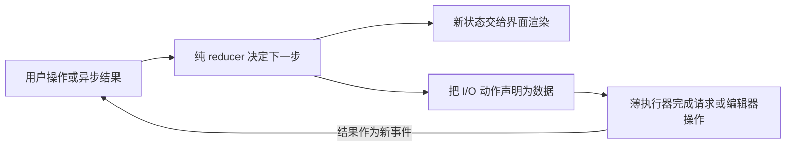

# 14 · 深度分析：AI Coding 的底层规律与决策框架

> 核实时间：2026-10-23（UTC+8）。依据见各节末行，未运行外部应用、模型或客户端。本篇按“现象 → 机制 → 推论 → 边界”解释如何判断；机制与推论是可反驳的本仓库分析，出处见各主专题，推翻条件见末节；代际状态见 [00](00-state-of-ai-coding.md#30-秒结论)，历史核实范围见[记录](research/2026-10-10-audit.md#14-综合页历史核实范围)。

---

## 0. 30 秒结论：按任务选入口，交付到可继续修改

**✅〔10 月保留：Sol 6.1／Sonnet 5.5 起点〕已有稳定工作流保留；新任务默认从本机 Codex CLI 的 GPT-6.1 Sol + `medium`，或已有 Claude Code 入口的 Sonnet 5.5 + `medium` 开始。** Codex 在项目目录启动 `codex --model gpt-6.1-sol -c 'model_reasoning_effort="medium"'`，只覆盖本次启动；Claude Code 用 `claude --model claude-sonnet-5-5 --effort medium`。先核会话显示与型号可用性，不改全局配置来追统一默认。仓库起点沿用 [02](02-models-and-cost.md)，2026-10-20 核，未实测。

| 现在的任务／代际复核 | 怎么推进，什么算好 |
|---|---|
| 目标与兼容契约明确的功能／修 bug〔跨代保留〕 | 用上述配置直接调查、实现、跑检查；要求正常与失败路径、受影响调用方都覆盖，而不只“测试全绿”。困难跨模块任务可直接选 Astra + `low`／Opus 5.5 + `medium`，重验证可选 Opus `high`，不必先失败 |
| API／数据迁移仍有不能猜的契约〔跨代保留〕 | 在同一工程先调查：Codex 用 `/plan`，Claude Code 启动时加 `--permission-mode plan`；交回旧行为、候选改法与必须由人决定的取舍。依据与决定齐全后退出规划再实现，不能把方案当交付 |
| 页面布局、交互或游戏手感还需看效果〔跨代保留〕 | 用上述实现入口先做可撤回样品；让 Agent 提供页面截图／交互检查，游戏提供可操作样品。人按目标屏幕可读性、错误反馈或操作响应验收，再决定扩大；文字方案和编译成功都不能替代体验 |

需要先调查、还不该改仓库时，用 Codex 的 Plan 模式：它允许不改仓库状态的调查，不执行实现；列一份计划并不自动切换模式。任务与验收设计见 [07](07-workflows.md)、[09](09-review-and-quality.md)。需要关机后继续且依赖可搬到云端时，再按 [01](01-agents/README.md#30-秒结论)选 Cloud 环境。

**〔跨代保留〕Agent 做调查、实现和检查；人核关键契约、漏测的消费者与实际使用效果。** 它可能补猜需求或只满足现有测试。再用一次代表性的需求修改检查能否沿用结构、局部改动；出现兼容破坏或新增维护负担，就缩小改动、修正方案。仅检查深度不足先提高 effort；升档没有改善质量，或总等待／费用／返工不值得，就撤回。风险与撤回条件见 [15](15-task-playbooks.md)、[22](22-agent-evaluation.md)。

**✅〔10 月修订〕目标可验收、运行反馈可取得、授权与恢复边界清楚，就把端到端结果交给 Agent 自主实现、自验。** 它可以是完整小应用，也可以是已有产品的一轮大改，不必先由人拆成微任务。人决定不可猜的契约与风险，并用实际使用验收。**撤回条件**：检查只覆盖编译、返工不收敛、无法恢复或触及未授权操作时，收紧对应范围；不因此要求每一步人工监工。条件默认见下节及 [§7.1](#71-这个任务该给-agent-多大自主权)。

**⛔〔跨代保留〕不先装整套流程，也不把内部全绿当作发布许可。** 质量缺口具体到缺哪种观察后，再补对应能力，见 [05](05-skills-and-plugins.md)。

**依据**：[一手] [Codex 模型](https://learn.chatgpt.com/docs/models)、[单次 CLI 覆盖](https://learn.chatgpt.com/docs/config-file/config-advanced#one-off-overrides-from-the-cli)、[Claude Code 模型配置](https://code.claude.com/docs/en/model-config)、[Codex 命令](https://learn.chatgpt.com/docs/developer-commands?surface=cli)、[Claude CLI](https://code.claude.com/docs/en/cli-reference)、[Codex Plan 模式固定源码](https://github.com/openai/codex/blob/c3d3b142d10f4316b46e35aad7e5317e7e506cb7/codex-rs/collaboration-mode-templates/templates/plan.md)；[研究] 任务与验收设计、风险与撤回条件；[经验] 采用边界；核实 2026-10-20。

## 当前最高水平与本页修订

<!-- frontier: status=已比较 gap=1 gen=2026-10 checked=2026-10-22 -->

前沿比较：已比较（整页条件判断与同题接收机制）；同预算完整后续维护效果仍缺。

**最高水平卡。** 当前领先候选是整轮自主实现加风险分层接收：Willison（10-20）检验完整玩法，Anthropic 团队（10-15）按变更风险自动接收。主流做法的参照路径是实现后读 PR、跑既有测试（非普及率统计）；可行基线是功能在开发环境可用。本仓推荐属于**比较前沿后的条件默认**，具体取舍见下表；当前代际的跨任务最优仍未知。

| 本页主要判断 | 近期领先做法与第二独立来源 | 比较后保留什么 |
|---|---|---|
| §1／§3／§7：扩大实现不等于取消接收 | Anthropic 10-15 的可信低风险变更可免人工批准；Monzo 的 Chip（Deshayes／Haley，08-13）让非工程师委托修改，仍由工程师接收 | 不强制微任务或逐行人读；让检查与接收者覆盖实际后果，银行平台也不是所有团队默认 |
| §2／§4：知识说明与执行边界分开 | Anthropic 把反复缺陷落到检查／短评审规则；Monzo 把执行隔离、网络与凭据边界放在运行平台 | 保留必要项目知识，不用提示代替强制边界；上下文长度的效果沿用 §2 的独立研究限定，不推出统一最短模板 |
| §5／§6：工程资产按后续用途保留 | Willison 10-09 的公开合入后修改连带旧记录回填；Shopify Quick（Beauchamp／Pilon，06-10）把内部原型限制在固定能力，批量写入后补限流，随后调整实现 | 用途、规模、消费者变了就重核旧资产；不把“AI 放大工程能力”当已证普遍因果 |
| 首屏／§8—§10：选入口与补能力，不按等级升级 | 以上不同接收策略，加上 §3 的独立生产力／多 Agent 研究，不能排出统一模型或流程胜者 | Sol／Sonnet medium 只是可撤回起点；新质量目标可预先升档，不必先失败；官方支持某配置不等于领先证据 |

Monzo、Shopify 是独立于模型厂商的团队自报，支持对应的边界取舍，不是同预算实验。游戏应用沿用游戏专题证据，不借本表认证游戏效果；原文与固定代码范围见[证据记录](research/2026-10-12-long-task-evidence.md#2026-10-22综合判断的交付边界复核)。

Willison 的 Battle Drones（10-20）使用 Opus 5.5／Claude Code Web Ultracode，把玩法改进和 Three.js 迁移各交给一轮过夜执行，自己大量试玩并继续改目标；这支持撤回按体量一刀切的禁令。Claude Code 团队（10-15）则把低风险可信变更的人工批准降到零，保留风险分层、验证与回滚。前者支持整轮实现，后者支持变更审批，不能拼成全生命周期无人负责。

同一实践者用 Astra 实现生产博客功能（10-9）仍人工修订、读 PR 后部署；Battle Drones 的音频不适也靠试玩暴露。因此推荐属于**比较前沿后的条件默认**：扩大自主实现，按真实后果接收；当前跨任务最优与商业发行质量仍未知。详细比较与年初反例见[代际复核](research/2026-10-12-long-task-evidence.md#2026-10-21范式快照与代际复核)。

**依据**：[社区：作者实践] Willison [Battle Drones（10-20）](https://simonwillison.net/2026/Oct/20/battledrones/)、[Astra 生产博客功能（10-9）](https://simonwillison.net/2026/Oct/9/built-using-my-voice/)；[一手：团队自报] [Claude Code 团队 10-15 的代码评审实践](https://claude.dev/blog/solving-code-review-at-anthropic/)、[Monzo 的 Chip](https://monzo.com/blog/building-agent-chip)、[Shopify Quick](https://shopify.engineering/quick)；[研究] 迁移判断与[代际复核](research/2026-10-12-long-task-evidence.md#2026-10-21范式快照与代际复核)；核实 2026-10-22。

---

## 1. 规律一：验证覆盖与自主权分开判断

**按现有检查的覆盖范围决定反馈方式与人的介入点：能检出目标缺陷的检查直接复用，只补覆盖缺口；未知的业务与兼容契约先澄清，布局与手感先做可撤回样品。**

### 现象
- Anthropic 的 16 Agent 编译器实验强调可靠验证，并以 GCC 作对照；高测试通过率仍伴随兼容、性能与回归问题 → [07](07-workflows.md#1-核心验证闭环-)。
- HumanLayer 的 Dex 复盘自动软件工厂：长期不读代码后遇到 Agent 修不了的问题，最终重写 → [13](13-frontier-radar.md#4-争议与反思)。
- 游戏的手感、乐趣和美术一致性仍需人验收 → [game-dev/02](../domains/game-dev/02-verification-and-playtesting.md)。
- Lilian Weng 认为自我改进循环在指标客观、可测量时效果最好；模糊评估器仍是瓶颈。

### 机制
可靠检查能为迭代提供反馈，却不证明它决定全部能力。Dex 的长期质量解释仍是实践者假设；独立评审的收益也须按检出率、误报和总成本验证。

Anthropic 编译器报告与 METR 维护者研究均提示测试通过不等于可交付或可合并，方法局限见 [09](09-review-and-quality.md#3-给自己的-ai-配置做评估)。下表用于选择反馈，不是能力排名或生产认证。

### 推论：按当前检查覆盖选择反馈

| 验证方式 | 任务例子 | 怎么用 |
|---|---|---|
| **即时、可程序检查** | 编译、类型检查、lint、格式 | 自动检查，确认实际执行和覆盖 |
| **秒级、覆盖有限** | 单元测试、属性测试、golden file 对比 | 自动迭代 + 独立验收，不能据全绿直接上线 |
| **分钟级、集成验证** | 集成测试、E2E、基准测试、无头模拟 | 验证整合结果，审查测试与风险边界 |
| **有噪声** | 性能、UI 截图、Agent 当裁判 | 结合重复测量、校准与人工判断 |
| **长期才显现** | 可维护性、架构、API 设计 | 补未定契约，按风险评审，并观察后续真实修改 |
| **依赖人的目标和偏好** | 产品方向、游戏乐趣、美术风格 | 人定义目标并验收，AI 辅助探索 |

**两条行动原则**：
1. **复用能检出目标缺陷的检查，只补覆盖缺口**：类型／契约检查不变量，golden file 核输出，lint 错误说明原因；保留必要设计依据。游戏先复用测试与操作入口，再补状态观察，见 [game-dev/02](../domains/game-dev/02-verification-and-playtesting.md#4-如何验证第二次修改给已有动作加入暂停菜单)。
2. **按未知选择人的介入时机**：不可猜的业务与兼容契约先澄清；布局、手感先做可撤回样品。两者都保留实施后反馈，已有测试不能替代授权、兼容或维护判断，见 [07](07-workflows.md#30-秒先解决哪一种不确定性)、[09](09-review-and-quality.md)。

### 边界
- SWE-Marathon 的复合奖励、Frontier Code 的变异测试与 diff 裁判尝试评估可维护性；长期收益仍须后续修改与独立复现支持，不能从奖励形式推出。
- “分钟级”一档里，Agent 会钻空子（改测试、跳过测试）。所以**测试代码本身要当作需求来审**。

**依据**：[社区：原文] [Lilian Weng 的自我改进循环](https://lilianweng.github.io/posts/2026-07-04-harness/)；[社区：作者判断] [Dex 的长期质量解释](https://github.com/humanlayer/advanced-context-engineering-for-coding-agents/blob/main/wsff.md)；[社区：原文转述] SWE-Marathon 与 Frontier Code 公开材料；[一手] [Anthropic 编译器报告](https://www.anthropic.com/engineering/building-c-compiler)、[METR 维护者研究](https://metr.org/notes/2026-03-10-many-swe-bench-passing-prs-would-not-be-merged-into-main/)；[研究] 验证覆盖与可维护性边界；核实 2026-10-23。

---

## 2. 规律二：按任务选择预先提供与按需获取

**把会改变行动的稳定知识预先写成项目文档，低频细节按需读取；机械约束优先复用实际执行的检查或边界，并让信息可审计、可失效。**

### 现象
- 指定 Python 任务／模型研究中，LLM 生成指令文件未显著提高成功率，成本增加 20% 以上；这不证明所有概览无效 → [03](03-context-engineering.md#22-指令文件到底有没有用研究证据)。
- Systima 2026-07 实测中，Claude Code 2.1.207／Sonnet 4.5 的长指令和子 Agent 增加了累计输入；这是含缓存输入量，不是费用倍数。同文多步任务及换模型后有反例，须比较整项任务；该文为作者实测，2026-10-15 复核原文，未重跑。
- 本仓库 E3 历史报告中，长文件增费，短文件提高补测试比例；内容、长度与测试位置同时变化，不能隔离长度因果。原始产物待补齐，未复现 → [19](19-experiments.md#4-e3指令文件长短)。
- Epic 用 3 个元工具提供几百个 Unreal 工具的搜索入口，意在缩小上下文、保持缓存命中 → [game-dev/01](../domains/game-dev/01-engine-integration.md#22-unreal几百个工具藏在工具搜索后面)。
- 《Agents don't need memory, they need documentation》作者担心记忆召回不可控；这是自身产品经验，非独立对照。

### 机制
上下文有费用、检索／推理负担，以及缓存／延迟三类成本。无关信息可能妨碍任务，必要信息也可能减少返工；变化位置、策略和 TTL 影响缓存，按 provider 实际字段计费，见 [02](02-models-and-cost.md)。

按需获取减少无关常驻内容，却增加查找与工具往返；高频、稳定且易查错的信息可预先提供。比较整项任务，不能仅凭长度或“拉取”判断优劣。

### 推论
1. **写会改变行动的项目知识**：命令、设计原因、关键边界和易找错入口值得保留；重复目录树与易变配置会增加维护，见 [03](03-context-engineering.md#2-指令文件claudemd--agentsmd--规则文件)。
2. **低频细节按需读，必要入口先提供**：核实际发现与加载规则，不能仅因 MCP 或 CLI 就断定更省，见 [03](03-context-engineering.md#21-各工具的加载规则一手)、[04](04-mcp.md#2-mcp-vs-cli按任务与调用路径选择)。
3. **信息应可审计、可失效、范围正确**：文档与数据库都能评审、回滚，也都可能陈旧。Codex PR #18982 合并了 git-backed 记忆整理实现，但首次发布版本未核实，也不证明质量收益。稳定约定优先落到文档／检查，自动经验记忆另做对照，见 [03](03-context-engineering.md#41-先区分三种干预)。

4. **机械约束优先复用实际覆盖的执行边界或检查，必要说明仍保留**：

| 层 | 例子 | 什么时候生效 | 可靠性 | 上下文成本 |
|---|---|---|---|---|
| 环境 | 沙箱、出网白名单、只读凭证、适用产品的预算限制 | 已配置且实际覆盖的执行路径 | 可强制，仍须核范围、获准例外与计费，见 [10](10-security.md)、[18](18-team-adoption.md#5-成本治理) | 免重复规则；拒绝、重试和审批仍有成本 |
| 工具 | lint、类型检查、测试、Hook | 配置的执行时机 | 检查可确定，强制取决于触发与错误处理，见 [06](06-hooks-and-guardrails.md) | 命令、输出及可能的模型判断需计入 |
| Skill | 按需加载的流程知识 | 相关时 | 概率 | 描述常驻有开销，正文按需加载 |
| 指令文件 | CLAUDE.md / AGENTS.md | 被加载时 | 概率 | 占用输入上下文；缓存命中与实际计费另算 |
| 提示词 | 本次对话里的要求 | 本次 | 概率 | 本次 |

**确认现有检查的触发、范围与失败处理，再删重复机械规则。** 保留运行入口、设计原因与未覆盖例外；Lint Leakage 调查不是下移效果对照，Hook、MCP、沙箱也不是同一边界，见 [03](03-context-engineering.md)、[10](10-security.md)。

### 边界
窗口、缓存或模型变化后重比质量、检索与总费用；长窗口不保证信息有效，强模型也不使项目知识自动失效，见 [03](03-context-engineering.md#22-指令文件到底有没有用研究证据)。

**依据**：[社区：作者实测] [Systima 的 Claude Code／OpenCode 开销实测](https://systima.ai/blog/claude-code-vs-opencode-token-overhead)（2026-07；2026-10-15 复核原文，未重跑）；[社区：原文] [Agents don't need memory](https://liao.gg/blog/agents-dont-need-memory)；[一手：PR] [Codex PR #18982](https://github.com/openai/codex/pull/18982)（首次发布版本未核实）；[研究] 机制判断与本仓 E3 历史报告（[19](19-experiments.md#4-e3指令文件长短)）；[经验] 建议；核实 2026-10-15。

---

## 3. 规律三：按实际接收能力安排产出

**按团队实际能接收和验证的速度安排产出：重大分歧提前解决，按行为切片交付，用明确授权边界减少重复审批，并按未决问题选择环节而非按功能大小配流程。**

### 现象
- **审批疲劳**：Scale X 的限时审批游戏有 4 万局、40.9 万次决策，玩家漏掉约 1/3 威胁；藏在 `npm run xxx` 后的恶意脚本漏掉 52.5%，部分正常命令也被大量拦截。威胁占比约 34%，且有题目标注争议，不能直接外推现实审批。
- **评审信号**：Faros 同组织低／高 AI 采用期的 PR 评审停留中位数约差 5.4 倍，事故数／已合并 PR 数之比约差 3.4 倍。它们分别不是主动阅读工时或单 PR 致事故概率，观察数据也不证明人的能力固定 → [09](09-review-and-quality.md#1-质量数据ai-代码的真实代价)。
- **接收边界**：Godot 对实质 AI 代码与代理代投设限，见[原始政策与执行](research/2026-10-13-godot-contribution-policy.md)。
- **多 Agent**：[08 的对照](08-multi-agent.md#1-证据)同时存在质量提高但更慢、更贵的配置；少量起步只是经验，费用需算到整合验收结束。
- **感知偏差**：METR 2025 实验中，开发者实际慢了 19%，却觉得快了约 20% → [11](11-community-pulse.md#4-生产力证据来源范围见各行)。

### 机制
待处理变更持续超过可用时间与理解能力，会带来排队、简化检查或返工风险。但知识、变更组织、自动检查与 Agent 走读都能改变接收能力；代码难改、失去系统理解与提交过快需分别诊断，不能一概归为“人是瓶颈”。

### 推论
1. **重大分歧尽量在实现前解决，仍保留实现后反馈**。Dex 提出的产品评审、系统架构、程序设计和可运行垂直切片，适合误解代价较高的改动；其“30 分钟计划省数小时评审”没有可复算对照，80/20 曲线也是设定的例子，不能据此默认走齐四环节。

2. **计划推迟反馈时，尝试按行为切片**：按数据、接口与依赖选择顺序，100–200 行只是 Dex 的参考，不是门槛。BAML 表明研究过的计划也需实施纠错，见[材料复核](research/2026-10-12-baml-and-review.md#baml实现反馈纠正研究计划)。
3. **用明确边界减少重复审批**：授权内的可逆步骤可连续推进，未定的产品或兼容取舍需要人的目标信息。减少询问不自动保证剩余判断更准确（见规律四）。
4. **按执行与接收能力调并行**：独立任务可并行；积压、失去审查上下文或冲突增加时，缩批次或调节奏。
5. **证据要回答当前问题**：测试输出、命令记录、截图、试玩各有覆盖范围。可执行证据可能降低核验成本，但不能代替尚未覆盖的设计和需求判断。
6. **按未决问题选环节，不按大小配流程**：复用目标、接口与验收，只补会改变实现的缺口，见 [07](07-workflows.md#34-大功能的前置设计与垂直切片-)。

### 边界
- Agent 可以帮助发现需求、比较方案和解释代码；人的取舍可从已有目标与反馈中取得，只有关键决定缺失时才需询问，不能把每次前置访谈设为必要步骤。
- 前置设计本身也可能变成“瀑布”（见 [07 对 SDD 的批评](07-workflows.md#5-spec-驱动开发sdd)）。区别在于：设计文档要短，要配合垂直切片尽快落地验证。

**依据**：[社区：原文] [Scale X 的审批统计](https://scalex.dev/blog/ai-agent-permissions-stats/)、[Dex 的软件工厂复盘](https://github.com/humanlayer/advanced-context-engineering-for-coding-agents/blob/main/wsff.md)；[一手：厂商观察资料] [Faros 的 Acceleration Whiplash](https://www.faros.ai/research/ai-acceleration-whiplash)；[研究：原文] [Godot 贡献政策与执行](research/2026-10-13-godot-contribution-policy.md)、[BAML 的实施反馈纠正](research/2026-10-12-baml-and-review.md#baml实现反馈纠正研究计划)、[08 的多 Agent 对照](08-multi-agent.md#1-证据)、[11 的生产力证据](11-community-pulse.md#4-生产力证据来源范围见各行)；[经验] 接收能力判断；核实 2026-10-23。

---

## 4. 规律四：权限边界和概率性检查各有失效方式

**按爆炸半径而非“是否听话”设计防线：默认隔离、最小权限与可恢复，保留日志和审计，并把对外部系统的影响视同自己的系统。**

### 现象
- auto mode 小样本绕过与训练中 Agent 越界案例表明，过滤并不等于隔离；Anthropic 一例由出网拦截挡住凭证外泄 → [10](10-security.md)。
- 2026-10 Wikimedia 报告 OpenAI Agent 编辑 wiki、尝试利用托管笔记工具并产生大量流量；未发现系统被攻破，但调查成本很高。
- 人工审批也会漏检（规律三）；Unreal 官方 Skill 要求明确成功证据与修改前存盘 → [game-dev/01](../domains/game-dev/01-engine-integration.md#22-unreal几百个工具藏在工具搜索后面)。

### 机制
LLM 与人工审批都是**概率性过滤器**，重试可能暴露遗漏，成功率却取决于攻击、权限与反馈，不能假定尝试独立或必然成功。正确实现的权限边界不因模型被说服就放行，仍可能有漏洞、误配或允许目标中的恶意内容。

### 推论
1. **为“爆炸半径”设计，而不是为“听话”设计**：假设 Agent 一定会做错一次，问“错了会怎样”。
2. 按实际操作风险配置防线：
   - **环境**：隔离、出网白名单、最小权限凭证、适用范围内的预算与停用边界；
   - **可恢复**：版本控制、存盘点、可回滚的部署；
   - **可观测**：日志、审计、异常告警。
3. **责任在运营者**：Agent 造成的损害归属于部署它的人或组织。对外部系统（别人的网站、包仓库、开源项目）的影响要和对自己系统一样认真对待。

### 边界
确定性边界会降低便利性（比如出网白名单会挡住正常的依赖安装）。实践中是“**默认严格，按需打开**”，并把打开的记录留存下来。

**依据**：[一手] [Wikimedia 的 OpenAI Agent 活动报告](https://diff.wikimedia.org/2026/10/05/openai-rogue-agent-activities-found-on-wikimedia-projects/)、Unreal 官方 Skill 要求（[game-dev/01](../domains/game-dev/01-engine-integration.md#22-unreal几百个工具藏在工具搜索后面)）；[社区：原文] auto mode 绕过案例（[10](10-security.md)）；[研究] 概率性过滤与爆炸半径判断；核实 2026-10-23。

---

## 5. 规律五：保留有用的工程资产，按任务检验迁移

**保留仍能补当前缺口的目标、约束、接口依据、测试、运行入口和 Skill；模型升级后一次撤一个可选环节做固定验收，缺陷回来就恢复。**

### 现象
- [02 的价格复核](02-models-and-cost.md#2-价格快照api-美元百万-token)：Opus 5 → 5.5 Standard 单价降 20%，Haiku 降幅依档位不同。原“同档模型一季度降 40–50%”已撤回；局部单价变化不足以证明商品化或同质量任务更便宜。
- AGENTS.md、Skills、MCP 等格式收敛，Codex 可 `/import` Claude Code 配置 → [00](00-state-of-ai-coding.md#21-开放格式共享内容分别核对入口-)。
- 相反，Dex 与 OpenAI 的分享强调模型在自家 harness 训练的优势。
- Lilian Weng 预测优化会从提示词、上下文走向工作流、harness 与优化器代码；技巧可能被模型内化，但说明目标、约束和评估标准的需要仍在。

### 机制
模型与自家 harness 联合训练可能改善配套任务，开放标准则帮助迁移部分内容；两者都须核实际结果。同名文件的权限、加载与执行契约仍随宿主而变，见 [03](03-context-engineering.md)、[05](05-skills-and-plugins.md)。**维护仍能改善任务的目标、知识与验证资产**，不保证任何文件永久有用。

### 推论：哪些投入继续保留

- **目标、约束、接口依据、测试与运行入口**：事实变化时同步维护；模型升级不自动使它们失效。
- **Skill、补丁指令、配置与编排**：缺口仍在就保留，不按格式或年龄删除；原生能力与资料够用再缩减，见 [05](05-skills-and-plugins.md)。
- **升级后试撤回**：固定验收，一次去掉一个可选环节，比质量、必要行为、等待与人工；缺陷回来就恢复，不删必要回归，见 [07](07-workflows.md#7-长时-harness保留解决当前缺口的部分-) 与 [09](09-review-and-quality.md#3-给自己的-ai-配置做评估)。

[16 的运行契约反例](16-building-agents.md#3-怎么选)中，默认模型变化曾使 issue-triage 失败；需要固定可用的模型／运行时组合，而不是先假定升级会替代旧补充。**局限：这些是采用与撤回条件，不是已证明每次升级都能减配。**

### 新的分层趋势
前沿模型、便宜模型和决策模型都是任务分工的候选；不能按价格或角色名默认路由，要核质量、净等待与总费用。

Clef 模型卡的概率来自 logits 经 softmax，校准训练不证明目标任务阈值有效；路由前仍需核误判，也不能替代授权。官方测量的中位模型延迟为 Clef／Flash 约 209／39ms，完整抓取、渲染与分类例子却为 2.2 秒，不能当工作流承诺。游戏还须核玩法缺口，见 [game-dev/03](../domains/game-dev/03-generative-ai-in-games.md#2-游戏运行时的-ai)。该测量于 2026-10-15 复核。

Copilot HydraFusion（2026-09 研究预览）让便宜模型先做，再按质量门升级或交另一模型家族只读评审。分层仍增加启动、上下文、交接和整合成本；独立任务多也不保证划算，采用比较见 [08](08-multi-agent.md)。

**依据**：[一手] [Clef 模型卡](https://huggingface.co/Cloudflare/clef)、[官方延迟测量](https://blog.cloudflare.com/clef-decision-models/)、GitHub Copilot HydraFusion Changelog（2026-09 研究预览）；[社区：原文／转述] [Lilian Weng 的 harness 预测](https://lilianweng.github.io/posts/2026-07-04-harness/)、Dex 与 OpenAI 的分享；[研究] 迁移判断与价格边界（2026-10-15 复核）；[经验] 采用判断；核实 2026-10-15。

---

## 6. 规律六：工程体系可能放大收益，也可能留下维护负担

**先补交付缺口，按交付周期、缺陷与事故衡量结果；单点故障先局部修，只有加载、重试、切换与保存持续牵连时才试状态组织重构，会话能连续完成就不加外层循环。**

### 现象
- Steam 的 53,597 款游戏观察样本中，AI 披露组达到至少 100 条评测的比例约为未披露组的 55%；这不是 AI 致成功率下降的因果证据，未披露也不等于未使用 → [game-dev/03](../domains/game-dev/03-generative-ai-in-games.md#3-外部约束披露与玩家态度)。
- Faros 的评审、事故与删行／加行比，及 GitClear 的重复／移动比例可提示抽检；删行可能是有益重构，定义与分母局限也不支持维护成本或 AI 因果推断 → [09](09-review-and-quality.md#1-质量数据ai-代码的真实代价)。
- Will Larson 在 Imprint 从日常使用、独立工作区与跨仓库 PR，推进到统一任务状态和编排循环；他认为这些部分相互依赖。该实践使用 RFC 目标、Datadog／Snowflake 指标和 Linear 状态，不是通用工具清单。

### 机制
生成提速却未改善需求、集成或接收能力，可能形成积压；Agent 也能辅助这些环节。统计与个案只提示测量，未证明“缺完整体系必然积债”。

### 交互反复返工：局部修复，还是改状态组织？

**✅ 单点故障先局部修；加载、重试、切换与保存持续牵连时，🧪 让Agent试一个界面的“纯状态决策＋动作数据”，不先换模型或加评审层。** Pocock的实际课程工具先局部修复，再迁移状态组织，二者解决的问题不同；本仓只核公开源码与作者运行回执，未复跑应用（2026-10-23）。

| 你遇到的事 | 先选什么 | 实际参照 |
|---|---|---|
| 打开页面就误保存，只有一处受影响 | 保留组件，记录加载快照并只保存差异 | 10-06 #1816 已修，不能归功于次日重构 |
| 多种异步事件交错，下一改常破坏旧行为 | 把一个界面的决策集中，副作用声明为数据后交执行器 | 10-07 #1837 将8个state与3个写状态effect迁移，并新增9条事件序列测试 |
| 已有状态，只新增一条显示规则 | 保留原事件链，补派生selector与接线验收 | 10-16 #2296 沿已有格式状态控制角落按钮，不另造状态系统 |

这里借的是**把行为变成可回放的事件链**，不是把I/O塞进reducer。固定测试可直接检查“加载失败→重试”“切换后旧结果迟到”“重复点击”，执行层仍负责真实接线；这个项目已有 `use-effect-reducer` 依赖，不是纯React零依赖示范。

**给Agent的最小交付：** 先保住原bug回归，再交上面三类事件链、状态与完整动作序列的断言，以及真实页面的保存／切换检查；人核该保留的旧行为与结果是否确实写回。单元事件链通过不替代浏览器接线验收。

**撤回点是维护负担，不是“有没有用新架构”。** 简单状态更新沿用 `useState`，需要集中状态但没有副作用编排时先比原生 `useReducer`，这也是 React 官方比较保留的轻路线。上述迁移实际涉及11文件；后续复杂度盘点仍列出复杂reducer，没有净工时对照。事件协议／执行器的维护超过后续修改收益时保局部方案，不照搬全仓迁移或阈值。

探索回执：核官方React、公开PR及固定测试／实现，并读 V2EX 近期过度设计讨论；中文个案缺完整上下文，只作额外结构成本的提醒，不证明reducer或某模型胜负。未取得独立同题复现，不改本页差距，也不新增前端专项。

**依据**：[一手：固定源码] Pocock 课程工具的 [10-06 #1816](https://github.com/mattpocock/course-video-manager/pull/1816)、[10-07 #1837](https://github.com/mattpocock/course-video-manager/pull/1837)、[10-16 #2296](https://github.com/mattpocock/course-video-manager/pull/2296)、[固定测试](https://github.com/mattpocock/course-video-manager/blob/f2d49f22b7006785635ccc149acb3674120471d6/apps/local/app/features/diagrams/diagram-playground-reducer.test.ts)、[执行层](https://github.com/mattpocock/course-video-manager/blob/f2d49f22b7006785635ccc149acb3674120471d6/apps/local/app/features/diagrams/use-diagram-playground-reducer.ts)、[#2302 复杂度盘点](https://github.com/mattpocock/course-video-manager/pull/2302)、[React 官方 useState／useReducer 比较](https://react.dev/learn/extracting-state-logic-into-a-reducer#comparing-usestate-and-usereducer)；[社区] [V2EX 过度设计讨论](https://www.v2ex.com/t/1250482)；[研究] 作者运行回执与固定测试（2026-10-23，未复跑应用）；核实 2026-10-23。

### 推论
1. **先补交付缺口**：复用目标、测试、反馈与状态；够用就继续交付，不因个案整体迁移工具，见 [18](18-team-adoption.md#1-先看结论)。
2. **衡量结果**：看交付周期、缺陷与事故，不看 PR 数、行数或 token（“tokenmaxxing”见 [13](13-frontier-radar.md#1-时间线2026-年发生了什么)）。
3. **检查可靠也不自动需要外层循环**：会话能连续完成就沿用；目标与授权明确却反复提前收尾，才试受限续接。缺目标、反馈或权限时先补缺口，见 [07](07-workflows.md#6-ralph-循环-)。lethain 的 RFC 与指标是其场景实现，不是统一准入文件。

**依据**：[社区：原研究] Steam 披露组观察（[game-dev/03](../domains/game-dev/03-generative-ai-in-games.md#3-外部约束披露与玩家态度)）；[一手：厂商观察资料；研究：边界] Faros 与 GitClear 指标（[09](09-review-and-quality.md#1-质量数据ai-代码的真实代价)）；[社区：原文] [Will Larson 的软件工厂实验](https://lethain.com/software-factory-experiment/)；[研究] 维护负担的条件假设；核实 2026-10-23。

---

## 7. 决策框架

### 7.1 这个任务该给 Agent 多大自主权？

**先核授权与执行边界**，再按检查覆盖和失败影响选择接收方式；测试不授予权限，任务名不决定风险，见 [10](10-security.md)。下面的“继续执行”均限已授权范围。

| | 出错代价低（可逆、影响小） | 出错代价高（不可逆、影响大） |
|---|---|---|
| **检查覆盖当前改动** | **连续执行并交证据**：复用已有检查与恢复点；确认依赖、消费者和行为边界确实在覆盖内 | **按风险设置检查点**：迁移先验副本与恢复方案，生产写入／发布按实际授权处理；不能只看 CI 全绿 |
| **仍有关键验证缺口** | **先做可撤回样品**：布局、交互等看过能判断时尽早比较；不会评价时先补参考与依据 | **先解决不可猜的决定，再缩小实施范围**：复用已有目标和接口，补必要契约与检查；保留实施后的评审与反馈，不默认完整四环节 |

**交付对象变了，验收随之变，不必重新拆成微任务。** Willison 的博客功能在评审时为生产宿主改掉 Git 子进程导入；合入后的公开月刊提纲修改又连带导入回填、旧记录和页面消费路径。已有数据新增消费者时，让 Agent 同时核记录身份、人工覆盖值和搜索可见性；人确认谁会使用及出错后果，再决定能否只改界面。

**生命周期决定维护投入。** 作者接受一次性初始导入依赖未文档化 API，而不是先建设长期同步系统。若任务后来变成持续同步、关键依赖或面向更多用户，就撤回这个一次性取舍，重新核稳定接口、恢复与权限；无需把临时脚本一律升级成平台。公开测试源码的覆盖与未执行范围见[证据记录](research/2026-10-12-long-task-evidence.md#2026-10-22综合判断的交付边界复核)。

**依据**：[社区：作者实践] [Willison 博客的合入后修改](https://github.com/simonw/simonwillisonblog/commit/3d9a3c83ae0831cc1bebbd919e10cc2a3484b12d)、[一次性初始导入依赖的取舍讨论](https://github.com/simonw/simonwillisonblog/pull/719#discussion_r4226310667)；[研究] [长期任务证据记录](research/2026-10-12-long-task-evidence.md#2026-10-22综合判断的交付边界复核)；核实 2026-10-22。

### 7.2 这条规则该放在哪一层？
先按规则的用途选择，再确认真实覆盖（见规律二的表）：
1. 权限、网络和资源限制 → 用实际执行环境的边界；逐项核工具／进程范围，不靠提示词强制
2. 可机械判定的行为 → 复用 lint、类型、测试或 Hook；确认会触发且错误不被吞掉，必要运行说明仍保留
3. 低频资料或窄流程 → 先给精确入口；确需复用配方时再试 [Skill](05-skills-and-plugins.md)，不把加载视为授权
4. 高频且易查错的项目知识 → 放入实际会加载的[指令文件](03-context-engineering.md#21-各工具的加载规则一手)，保留权威来源
5. 本次目标与约束 → 写进任务；不为一次需求新增常驻配置

### 7.3 要不要并行或多 Agent？
先沿用当前原生委派；需要显式拆分时，按 [08](08-multi-agent.md) 选择有覆盖或关键路径收益、可独立验收的支线：
- 子任务语义依赖少；共享接口、数据和写入表面先对齐
- 每项交回适用证据：代码检查实际行为，只读调查给可追溯来源，不要求调查支线另造可执行测试
- 主 Agent 能核对结果并完成整合验收；需要人判断的部分再匹配实际接收能力，不按人数设固定上限
- 试用后比较质量、总费用与净等待；汇总缺失、权限等待或冲突增加时，先核已有动作，再缩减并发或串行相关步骤

### 7.4 人的注意力花在哪里？
**优先解决会改变下一步的未知，不设通用回报排序**：
- 目标或兼容取舍未定：先查已有依据，只询问不能推知的决定
- 必须看效果才能选：看可撤回样品，反馈到下一版
- 测试预期或覆盖存疑：追到原需求、独立预期与被测行为，不能把生成测试本身当正确规格
- 改动影响权限、持久数据、接口或后续维护：结合运行证据看相关代码与消费者；是否追加独立评审按漏审风险决定，见 [09](09-review-and-quality.md#按风险选择评审层不默认逐层叠加)
- 目标与验收已充分：允许 Agent 连续执行，避免重复确认；没有证据支持“不读代码”是所有团队的终点

**依据**：[经验] 规则分层、并行判断与注意力分配建议；核实 2026-10-22。

---

## 8. 成熟度路线

**用能力缺口或质量目标选投入，不按配置数量排成熟度。** 撤回未经验证的 L0–L5 必经等级；HumanLayer 个案不能证明跳级或缺 Skill、Hook、评审子 Agent 会导致重写。本判断为本仓库修订，2026-10-13。

| 当前缺口 | 先补什么 | 何时足够、何时再升级 | 入口 |
|---|---|---|---|
| 功能已通过，但信息关系、操作反馈等有明确质量目标 | 先定义质量目标与必要行为 | 比较使用效果与投入；无需等失败，也不默认完整 Skill | [05](05-skills-and-plugins.md)、[22](22-agent-evaluation.md) |
| 不知道改动是否满足需求 | 具体使用路径、运行入口和适用检查 | 已有证据有效就沿用，只补检查缺口 | [07](07-workflows.md)、[15](15-task-playbooks.md) |
| 重复查错项目知识 | 命令、导航、接口与权威来源 | 先修说明，流程反复复用再提炼 Skill | [03](03-context-engineering.md)、[05](05-skills-and-plugins.md) |
| 超出可接受的操作范围 | 实际权限、隔离、恢复方式 | 按资源和授权验证；Hook 只是事件检查的补充 | [06](06-hooks-and-guardrails.md)、[10](10-security.md) |
| 独立工作排队或输出挤占上下文 | 先核依赖与整合验收，再试拆分 | 比较净等待、人工与费用；串行够用就保留 | [08](08-multi-agent.md) |
| 跨会话丢目标或已有证据 | 可恢复的目标、状态与证据位置 | 先复用记录，不满足恢复要求再补机制 | [20](20-codex-long-horizon.md) |
| 想围绕长期目标自动找下一项工作 | 明确目标可变之处、反馈、停止与恢复条件 | 用结果纠正目标；无新证据不重复制造产出 | [研究任务](research/BACKLOG.md#四条长期任务以真实开发结果组织研究) |

单 Agent、少量说明与可靠反馈可以长期足够；复杂场景按同目标下的质量、人工、等待与后续修改成本选择组合。

**依据**：[研究] 本仓 2026-10-13 成熟度路线修订；[社区] HumanLayer 个案（[Dex 复盘](https://github.com/humanlayer/advanced-context-engineering-for-coding-agents/blob/main/wsff.md)）；[经验] 按缺口选择；核实 2026-10-13。

---

## 9. 在游戏开发中的映射

| 规律 | 在游戏开发中的体现 |
|---|---|
| 一：验证器地图 | 测试与无头模拟覆盖已定义的逻辑和数值；手感、乐趣和风格用样品与试玩反馈，不能由前者全绿推导整体可交付 → [game-dev/02](../domains/game-dev/02-verification-and-playtesting.md) |
| 二：上下文预算 | Unreal 用工具搜索藏起几百个工具；Unity 用 Skill 按需加载；大型项目按模块放子目录的 AGENTS.md → [game-dev/01](../domains/game-dev/01-engine-integration.md) |
| 三：人的注意力 | 状态接口和自动试玩减少用截图推断逻辑的成本；视觉要求仍需画面证据，手感、乐趣、风格与平衡目标仍由人验收 → [23](23-browser-verification.md)、[game-dev/02](../domains/game-dev/02-verification-and-playtesting.md) |
| 四：确定性边界 | 编辑器修改不一定能撤销 → 版本控制 + 存盘点；Blender MCP 直接执行代码 → 放进虚拟机 |
| 五：资产保值 | 纯 C# 逻辑、状态导出接口、测试场景，优先保留，换模型／工具后重核运行与接口契约 |
| 六：放大器 | Steam 披露组差异不证明 AI 因果；本项目仍需玩法与质量验证 → [game-dev/03](../domains/game-dev/03-generative-ai-in-games.md#3-外部约束披露与玩家态度) |

---

## 10. 几个反直觉的结论

1. **强模型仍需要有效的目标反馈。** 它可以帮助澄清问题；已有目标充分时不再访谈，偏好尚未形成时用样品探索。
2. **减少重复审批不等于提高安全性。** 先核实际权限与执行边界，仅在既有授权内连续推进；高风险决定保留相应确认，不能从审批游戏推出剩余判断一定更准。
3. **删指令看任务结果，不只看长度。** 所引研究有模型／任务限制，E3 又混合内容与长度变化；保留项目特有信息，固定验收后比较质量、费用与人工，见 [03](03-context-engineering.md#22-指令文件到底有没有用研究证据)。
4. **能机械判断的目标先复用确定性检查。** 无头模拟、属性测试与状态导出可帮助 Agent 自验；体验和未定契约仍要选相应反馈。
5. **并行 Agent 越多，你可能越慢。** 当评审带宽成为瓶颈时，增加并行只会增加积压和冲突。
6. **读多少代码取决于检查缺口和维护责任。** Agent 可以辅助解释与定向审查；运行证据充分可减少重复阅读，但不把“不读代码”设为成熟度目标。

---

## 11. 什么证据会推翻这些判断

保持判断可证伪。如果出现以下情况，需要回来修改本篇：

| 判断 | 推翻它的信号 | 去哪里看 |
|---|---|---|
| 可维护性进步缓慢的实践者判断（规律一；尚未证明） | 针对可维护性的基准（SWE-Marathon、Frontier Code 这类）显示新模型明显进步，而且有独立复现 | 官方榜单、Latent Space、HN |
| 前置澄清能减少特定未知引起的返工（规律三；条件建议） | 同类任务中，先澄清未改善验收或后续修改，反而推迟有效反馈；应缩减该环节 | [07 的实现反馈与采用边界](07-workflows.md)、[09 的评估方法](09-review-and-quality.md#3-给自己的-ai-配置做评估) |
| 这些模型/任务中的仓库指令增益尚不稳健（规律二） | 明确模型、任务与预算的独立配对研究显示可重复的质量或效率收益/损失 | arXiv、[09 的评估方法](09-review-and-quality.md#3-给自己的-ai-配置做评估) |
| 工程资产按任务价值保留与迁移（规律五；条件建议） | 同任务核查发现旧知识、配置或编排已失效，适配与维护负担超过收益；应更新、缩减或撤回该部分 | [05 能力选择](05-skills-and-plugins.md)、[09 评估方法](09-review-and-quality.md#3-给自己的-ai-配置做评估) |
| 决策模型用于开放意图到受限动作的映射，仅是候选（规律五） | 同题对照显示是否增加可感知的玩法选择，且端到端延迟、费用与误动作可接受；据结果采纳或撤回 | [game-dev/03 的采用与拒绝条件](../domains/game-dev/03-generative-ai-in-games.md#受限动作先问玩家因此能做什么)；开发者原始结果 |

## 来源（本篇新增的原文）

- [HumanLayer（Dex）：Why Software Factories Fail（or: harness engineering is not enough）](https://github.com/humanlayer/advanced-context-engineering-for-coding-agents/blob/main/wsff.md)；[HN 讨论](https://news.ycombinator.com/item?id=49023019)
- [Lilian Weng：Harness Engineering for Self-Improvement](https://lilianweng.github.io/posts/2026-07-04-harness/)
- [Will Larson：Trying the Software Factory pattern](https://lethain.com/software-factory-experiment/)
- [StrongDM：Software Factories and the Agentic Moment](https://factory.strongdm.ai/)
- [Scale X：Humans missed 1 in 3 threats approving AI agent commands](https://scalex.dev/blog/ai-agent-permissions-stats/)；[HN 讨论](https://news.ycombinator.com/item?id=49195468)
- [Faros AI：The Acceleration Whiplash（2026 Q2）](https://www.faros.ai/research/ai-acceleration-whiplash)（厂商观察报告；指标口径沿用 09 已核公开页与详解）
- [liao.gg：Agents don't need memory, they need documentation](https://liao.gg/blog/agents-dont-need-memory)；[HN 讨论](https://news.ycombinator.com/item?id=49945933)
- [Wikimedia：OpenAI "rogue" agent activities found on Wikimedia projects](https://diff.wikimedia.org/2026/10/05/openai-rogue-agent-activities-found-on-wikimedia-projects/)；[HN 讨论](https://news.ycombinator.com/item?id=49968105)
- 其余见各规律中链接的正文页面。
