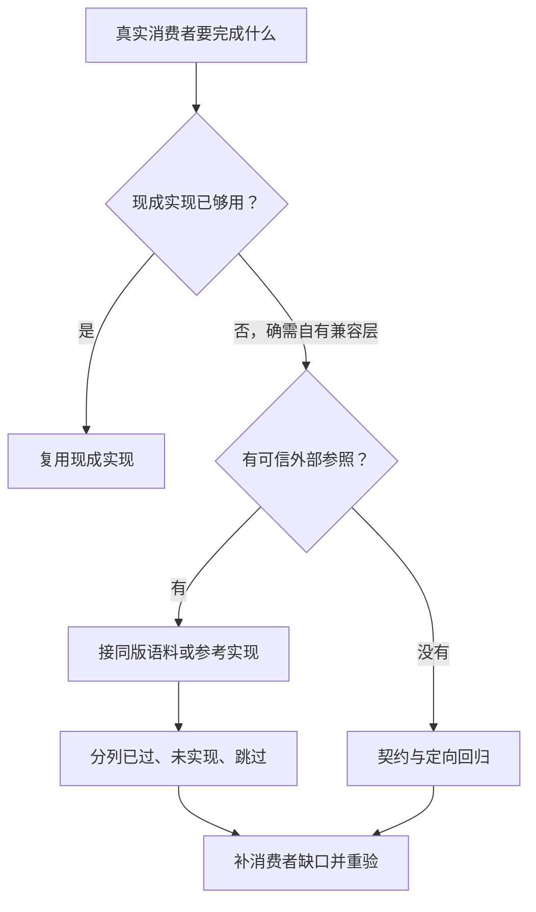

# 15 · 按任务类型的打法

> 更新：2026-10-23（UTC+8）。任务起点见下；Codex 的[五情境入口](01-agents/codex.md#五种情境先做最小改变)说明何时再加知识、工具或流程。版本与验证范围见各节研究链接。
> 依据包括 Anthropic 官方最佳实践与 Opus 5.5 指南 [一手]、Willison 与 HumanLayer 的公开实践 [社区]；组合建议标为 [经验]。除明确标注的局部实测外，案例据公开材料，仅支持局部机制，不代表当前产品推荐或 AI／固定 Skill 净收益；来源／反证见研究。

## 0. 总表

**代际：2026-10（GPT-6 Astra／6.1 Sol、Opus 5.5 与当代原生 Agent）。** “确认／修正”指下文同题资料比较；“保留”是当前最佳工程默认，未补该项当前模型对照，不代表所有任务都已证明最优。[研究；经验]

| 任务 | 最大的风险 | 关键动作 | 验证手段 | 自主度（见 [14 第 7.1 节](14-synthesis.md#71-这个任务该给-agent-多大自主权)） | 代际复核 |
|---|---|---|---|---|---|
| [理解陌生代码](#1-理解陌生或遗留代码) | 自信地讲错 | 只读探索 + 要求引用文件和行号 | 抽查引用 | 高（只读） | 2026-10 保留 |
| [调试](#2-调试) | 修症状不修根因、改测试让它通过 | 收证据、尽量复现，定位且获授权则修 | 回归＋实际路径，列未验项 | 按风险与授权 | 2026-10 确认 |
| [新功能](#3-新功能) | 把切片当完成、漏生产接手 | 目标明确做至可接收，不确定处用切片取反馈 | 用户路径＋实际交付入口 | 授权内推进，人定关键取舍 | 2026-10 修正 |
| [重构](#4-重构) | 行为悄悄改变 | 先核既有行为保护，缺时补特征测试 | 重构前后测试一致 | 中高 | 2026-10 保留 |
| [整项维护审计](#41-整项维护覆盖范围与补丁大小分开) | 短名单冒充查全、误删运行保护 | 按约定范围核覆盖，再分片修改 | 已查／未查及保留理由、实际消费者 | 审计与修改授权分开 | 2026-10 新增 |
| [大规模迁移](#5-大规模迁移与升级) | 漏例外、损依赖／状态 | 选迁移器／Agent 补丁，按机制扩量 | 消费者、重跑与恢复 | 按风险、覆盖与授权 | 2026-10 保留 |
| [补测试](#6-补测试) | 写出永远不会失败的测试 | 先选保护既有行为或查当前差异 | 已知 bug 验 red/green；未知核行为／意图 | 高 | 2026-10 确认实际路径 |
| [性能优化](#7-性能优化) | 凭感觉改、没有数据 | 测量瓶颈并确定不能改变的行为 | 基准数据 + 语义对照 | 按影响与授权 | 2026-10 保留 |
| [代码评审](#8-代码评审) | 挑刺、过度设计 | 先原生定向评审；需排除实现推理时用独立上下文 | 每条都要说明如何证明 | — | 2026-10 保留；详见09 |
| [文档与杂活](#9-文档提交信息发布说明) | 事实、权限或兼容说明写错 | 按推理需求和错误代价选模型 | 核对来源、命令和相关行为 | 按风险 | 2026-10 保留 |
| [原型和一次性脚本](#10-原型和一次性脚本) | 无人改用、原型直上生产 | 比现成、窄补充、全替代，按使用补差距 | 试验目标；真人／数据另验安全恢复 | 高（授权内） | 2026-10 保留 |
| [已有产品改进](#102-已有产品按问题选择改进) | 难用、改法伤原任务／维护 | 按交互／实现问题选改法 | 按机制验路径与撤回条件 | 按影响与授权 | 2026-10 保留 |

## 当前最高水平与比较范围

<!-- frontier: status=已比较 gap=1 gen=2026-10 checked=2026-10-21 -->

**维护覆盖与功能接收已比较，跨任务最优仍未知；差距1维持，不表示连续维护打法已获模型实测。** 近期领先参照是 OpenAI Core Experimentation 的[10-14维护实践](https://developers.openai.com/blog/maintaining-software-with-the-gpt-6-family)、Cursor 的[7-30环境复盘](https://cursor.com/blog/cloud-agent-environment)与 Willison 的[10-09生产功能](https://simonwillison.net/2026/Oct/9/built-using-my-voice/)。主流参照为按阶段交小补丁，采用率未知；本仓采用其中可迁移的覆盖核对和实际交付验证，不复制内部基础设施。[一手／社区；研究]

| 同一读者选择 | 比较与反例 | 本仓决定 |
|---|---|---|
| 整仓维护是否只交最安全的一小项？ | OpenAI把过期实验扩为完整清单核对，但简单flaky测试任务明确限范围；运行保护仍需人判 | **修正**：覆盖按请求，补丁可小；见4.1 |
| 新功能跑通一条路径就交付？ | Willison仍修生产导入；Amp按用户回归改判，VS Code不同渠道回执限制恢复范围 | **修正**：按任务范围接收；上线／恢复目标还须核目标渠道与实际结果，见3及[比较](research/2026-10-12-baml-and-review.md#修复合入后等待交付还是重新定位) |
| 自动测试通过是否足够？ | Cursor端到端执行与Willison[实际路径测试](https://simonwillison.net/guides/agentic-engineering-patterns/agentic-manual-testing/)都补运行证据 | **确认**调试／补测试的实际路径默认，不强制新增测试框架 |

这是公开实践的同题比较，不是随机流程实验。详细条件、读取回执见[任务打法代际研究](research/2026-10-12-baml-and-review.md#p52任务打法的覆盖范围与交付终点)；[C13卡](collaboration/reviews/2026-10-21-quality-audit-sota-cards.md#c13--任务打法)为输入参照。P23／P25已有真实应用状态继承和判据纠错，仍未比较Agent按两种打法连续修改同一产物；不拿局部应用运行给整页背书。[研究]

## 1. 理解陌生或遗留代码

**✅ 从要改的一个行为反向定位，先用项目已有搜索／LSP走通调用路径，再补缺的那一种检索。** 接手结果应是“改哪里、会影响谁、怎样确认”，不是整仓概览或四个工具都调用一遍。[经验；2026-10-23]

| 卡在哪一步 | 先补什么 | 返回修改前要核什么 |
|---|---|---|
| 不知道相关模块在哪 | 公共仓库可用 DeepWiki 目录找入口 | 回当前固定源码核路径，wiki不裁决旧版本API |
| 知道名字，不知道实际调用谁 | 先用原生搜索／LSP，已有 Graphicle 可辅助导航 | 核别名、局部同名与真实调用方，不按影响图删测试 |
| 不知道项目这版依赖怎么调用 | 先读对应版本官方文档，需要时补 Context7 精确ID | 以项目实际依赖版本为准，再核返回原文tag |
| 契约已知，但缺现成使用例 | 用 Grep 查公开调用点 | 看完整上下文、资源释放和许可，不复制首条命中 |

这些分流来自[已有工具实试](research/2026-10-22-frontier-trials.md#deepwiki先找模块再回固定源码)，不是安装清单；原生入口够用就直接推进。[本仓局部实试／经验：组合选择]

给现有 Agent 的接手任务可直接这样写：

```text
目标：在当前项目中定位“[要改变的行为]”，先只读，不改文件。
核当前提交、工作树差异及相关依赖版本，只读项目指令和相关实现。
沿一条真实输入到输出的路径给文件:行号，区分源码确认、运行观察与推断。
交回最小修改落点、必须保留的调用方／行为、现有相关检查及未解决条件。
已有搜索够用就不加工具；只有会改变实现且现有资料无法回答的问题才问我。
```

**例：同名的 `retry` 不一定是同一个函数。** Graphicle 0.1.4 在本仓两文件反例中，把 `shadow()` 内部局部 `retry` 连到外层导入函数；默认和 precise 都有这条错边。替换模块绑定 `app.retry` 后，`direct()` 报错而 `shadow()` 正常返回，说明应核作用域后再定影响范围。读者应交回这条区分依据，而非一张“看起来连通”的图。[已保存的反例与真实输出](research/2026-10-22-frontier-trials.md#graphicle导航有用影响图需要核对)，本轮未重跑。

定位完成后，已有明确修改授权就接[调试](#2-调试)或[新功能](#3-新功能)路径；仅要求解释时止于走读，不自行改代码。术语混乱才补带例子的词表，走读也不自动变成常驻指令，见[03指令研究](03-context-engineering.md#22-指令文件到底有没有用研究证据)。

**验证范围**：DeepWiki模块定位、Context7两版查询、Grep上下文对照及Graphicle反例分别已有局部实试；这条组合接手路线尚未做模型端到端对照，不声称更快或修改更准。[研究／经验]

### 1.1 完整示范：修复公开项目的 CSS 资源打包

**🧪 从调用者走到真实补丁：Oil UI 的合法 CSS 字符串续行原本无法打包，修复后同一输入生成离线比较页。** [本轮实测，2026-10-23]

1. **固定项目并复现。** 对 Oil UI `7002e1a3` 的真实 `build_explorer.py` 输入带续行的本地 `@import`／quoted URL，先确认 CLI 报资源不存在且保留旧产物，不另造替代打包器。
2. **检索后核调用语义。** `rg` 定位共享解码器，已有 Graphicle 列出 `embed_css`／`check_css` 等调用者；回源码和 CSS 规范区分字符串与裸值，只让 quoted string 开启续行处理。
3. **用反例收窄补丁。** 先加失败行为回归，再补实现；“先删续行、再解码”会误处理成对反斜杠，最终用单遍解码，并验证非法裸 URL 续行仍被拒绝。
4. **运行真实入口接收。** `python3 experiments/replay_oil_ui_css.py /path/to/oil-ui-checkout` 新建隔离副本，完成红→绿、58 个非浏览器测试与实际 CLI 产物检查，保留单 HTML、输入和结果；Graphicle 不是重放依赖。

[补丁、回归、操作命令与返工记录](research/2026-10-23-real-coding-demo.md)可直接复用。58 项是53项原测试加5项新增，另3项浏览器和1项Windows明确未运行；本次未另接模型、未提交上游，未测代码图相对 `rg` 的效率优势。修复限本地资源／import，拆开 `data:` scheme 的特殊 data URL 仍未修。[本轮实测／研究]

### 1.2 接收已有补丁：修文件保存，不重写同题方案

**🧪 先找上游已有的修复，再用旧代码反例、真实入口与失败注入接收。** python-dotenv #713 提出文件替换前缺同步，Imkkey 的未合并 #717 已有实现；本例复验现成补丁，不重复提交一份。[一手／本仓实试，2026-10-23]

1. **核意图与固定差量。** 旧实现先替换文件，补丁在替换前加入 `flush`／文件 `fsync`；不要把“原子替换”直接理解为掉电后仍在。
2. **让新测试先遇见旧代码。** 移入上游七项回归，旧实现六项失败；接收固定补丁后，项目295项测试及七项独立验收通过、无跳过。
3. **实际操作结果文件。** 真正子进程完成 set／get／list／unset，UTF-8内容正确、旧权限保留、缺键返回失败；另在进程内注入同步、替换和清理错误，核旧文件及原异常。
4. **把未解决的边界留清楚。** 清理失败会留下临时文件并警告，不能承诺无残留；补丁没有目录同步，测试不证明断电耐久，也不代表上游已经接受。

准备 POSIX、Python 3.12+、Git、网络及已有 pytest／Click／IPython 后，运行 `python3 experiments/replay_dotenv_acceptance.py --python .venv/bin/python`。入口不安装依赖，在新临时目录核固定源码并保留产物；[完整操作、原作者补丁与接收测试](research/2026-10-23-existing-patch-acceptance.md)可复用。它验证源码CLI而非包安装，未比较模型、Skill或代码图收益。[本仓实试／范围]

## 2. 调试

**✅ 已有明确失败就复现、定位、修复、重跑；缺什么证据再补什么。** [经验]

1. 优先稳定失败测试／脚本；不能复现则核日志版本、输入与环境，必要时补诊断
2. 根因不明做区分候选的小实验，已定位不必凑假设
3. 过滤日志后再读；稳定的回归脚本可交给 `git bisect run <复现脚本>`
4. 补回归，仅测试有独立错误才修；不为变绿削断言、删用例或改未授权行为
5. 先相关检查再按影响扩测，仓库必跑入口照做；curl／脚本／浏览器补实际路径

依据：[BAML 双 PR](research/2026-10-12-baml-and-review.md#baml实现反馈纠正研究计划)。[一手：历史补丁；研究]

**兼容修复按输入机制选范围，不只按版本高低。** 升级消费者或全局关闭能力前，先分清哪些输入仍需该能力。例见 OCRmyPDF 的[两种故障与取舍](research/2026-10-12-development-conditions.md#ocrmypdf兼容修复按输入机制分流)。修订不保证所有输入或旧文件恢复。[社区／一手；经验]

**局限**：无法复现时的局部修复仍有验证缺口；预期冲突、关键输入或权限缺失须说明具体阻塞并询问。

### 接管生成服务：先交能区分原因的证据

**✅ 让生成 Agent 先复用已有 trace／日志，按目标故障交判别表与取证入口（本例为正常、主动报错、依赖不可达）。** 沿源头异常→服务包装→API→用户提示追一遍，标清最早能区分原因的信号；只有现有证据不能区分目标故障，才补低敏结构化原因／来源。已有字段和入口够用就不再加埋点，也不默认另购诊断 Agent。[研究：可行层默认]

**为什么不能只交“有日志、有错误码”？** 固定 OpenTelemetry Astronomy Shop 中，付款故障注入抛普通 Error，API 却按字符串把这一路呈现为 payment decline；相同外层 Internal 又可包装错误目标的连接失败。Agent 容易照用户提示修卡信息，或凭缺少 Payment span 宣称服务宕机；维护人应核原始原因、当次目标、关联与导出链，再决定操作。[一手：源码与测试预期，未运行]

**当前最高水平参照（本项，2026-10-21核实）**：Tao 等7月可观测代码研究把可运行与故障信号分验；Cursor 团队9月 Rollouts 从 diff 制定发布观察计划、消费已有遥测。前者关注生成的诊断语义，后者关注发布后的判断；本仓先选低投入可行层，因为缺信号时观察 Agent 也无从判别，同题最优方案仍未知。[来源、三路固定证据与交付要求](research/2026-10-12-development-maintenance.md#p49生成服务的故障证据)保留比较和边界。[研究；一手：厂商自述]

**撤回条件**：取不到原始证据、相关性未核或只有顶层码，就交“付款路径失败，原因未定”，撤回自动根因结论；人核业务分类、数据最小化及重试／回滚权限。源码判别表不是运行验收，实际发布仍需接收者能取到同一请求证据。[经验]

## 3. 新功能

**✅ 目标明确就做到可接收；有关键未知时，用可运行切片尽早取反馈。** 切片不是默认停止条件：让 Agent 按约定目标核对界面、数据、调用者与实际交付入口，报告缺项；人决定业务取舍和发布权限。[经验：2026-10修正]

**✅ 任务包含上线或用户恢复时，收到“修过了但还不行”，先分尚未交付还是需要重新定位。** Agent核目标渠道、版本／构建和开关范围：修订尚未到就追交付；相关版本仍失败就重查当次路径，不用另一人的成功回执覆盖。只要求代码／PR的任务可以按该范围完成，不能因此声称目标用户已恢复。[研究；经验]

[VS Code GHE登录修复](research/2026-10-12-baml-and-review.md#修复合入后等待交付还是重新定位)合入后，一名原复现参与者确认Insiders恢复，随后仍有Stable等待及1.140失败报告。1.140固定源码含原修补，不能把所有后续反馈归为发布时差；也不能凭同症状就认定同根因、重复补丁或回滚原修复。[一手：源码与参与者回执；研究]

**已有错误指标未升高，却有用户可见回归，也应重新判断接收。** Amp的[10-13公开转录](https://ampcode.com/time-capsules/6)10:59描述所观察的inference errors指标未升高但出现用户回归，作者要求撤回。Agent整理实际结果，人按影响与既有权限决定暂停扩量、关闭开关、撤回或另修，不由本建议授予部署权。[一手：团队自报；经验]

默认复用现成发布信息和实际路径，不为小修强加观测平台。Willison的[10-09博客功能](https://simonwillison.net/2026/Oct/9/built-using-my-voice/)在预览可用后仍调整生产导入，说明交付入口也须符合目标；用户只要原型时仍按原型交。[社区；经验]

**✅ 从个人功能扩成协作，先保旧数据，分开共同属性、个人覆盖与原资源授权。** Agent追数据→服务→双端消费者；人定传播与退出语义。少量共享先用现成局部入口，不reset重做；Only me可能只管本次写，离组也不等于撤权，须在第一次产物上继续改并读回。见[两轮人物标注设计](research/2026-10-12-development-conditions.md#p26单人标注扩成多人协作)，仅源码与设计、未运行应用。[一手／研究]

| 尚未确定什么 | 做法 |
|---|---|
| 目标、接口和验收已有依据 | 在授权内直接做并验证，不因规模大补齐流程 |
| 业务规则或兼容契约未明确 | 先澄清会改变实现的取舍，再更新已有计划 |
| 跨层依赖或可运行反馈路径未清楚 | 梳理必要接口／调用关系，选能尽早试用的垂直切片 |

按真实接口／依赖实施，不统一规定前端与数据库顺序；100–200 行只是拆分参考。写清任务、验收和需询问的取舍，跨会话保留最新目标、约束、结果与下一步。[一手：Opus 5.5 指南；社区：HumanLayer；经验：切片建议，见 [07](07-workflows.md#34-大功能的前置设计与垂直切片-)]

**✅ 用户要求扩功能时，先还原任务并试用可能满足需求的已有入口。** 若只难发现，先改善入口／说明再决定扩混合视图，不凭源码已有就关闭需求。[Clink 用户实际改用历史弹窗](research/2026-10-13-product-feedback-contract.md#clink先试已有入口再决定扩功能)；入口改动后仍有人未发现过滤方式。[社区／一手；经验]

**✅ 新增视图先复用语义相同的业务组件，等具体需求出现再补窄扩展点。** 说明修改层与须检查的旧调用者。见 Discourse 的[前后源码](research/2026-10-12-development-conditions.md#discourse共享组件承接后续需求)；落地不等于上线或维护收益。[一手：源码与 PR；研究]

**已有设计系统改主题／密度，先让Agent保原primitive、token作用域和本地修复。** 主题局部应用不等于密度改版；下一轮组合Dialog时仍继承原表单、Portal与取消语义。优先窄差异或现成组件，只有新能力确需才迁底层库；人同时验视觉和实际目标数据，typecheck不能证明用户没被换方案。见[同一Users界面的两轮包](collaboration/reviews/2026-10-20-p24-ui-continuity.md)及[失败／固定实现](research/2026-10-13-domain-skill-contract.md#已有设计系统ui连续改版项目提议2026-10-20)。[一手／本仓运行：补丁与纯状态检查，浏览器未验]

**当前最高水平（本项）仍未知，目标不能止于编译通过。** 2026年的MT-Web2Code把目标改对与未改区域保留分验，Vision2Web另验视觉与交互；它们尚未给出本题既有React设计系统的最优路线。本仓窄差异属于可行推荐，两轮均构建通过，B2六项纯状态检查通过，浏览器交互和视觉矩阵仍待运行；出处、日期和差距见[最高水平卡](research/2026-10-13-domain-skill-contract.md#当前最高水平卡已有设计系统的两轮修改)。[研究]

**✅ 给已有业务加分组，先让Agent保旧身份、已填值和原流程，只局部更新未锁尾部。** Documenso真实S1→S2及恢复反序已跑到审批、签署和本地邮件捕获。改组后读回预期新顺序，并比对完整相关状态；仅改order不会产生原研究预期的更新审计，不能把没新增审计当保存失败。通知验角色与实际行动链接，不把token出现在正文当已正确邀请。[本仓运行]

人决定哪些阶段等齐，核旧ID/字段与最终产物；不能用全量重建或重seed冒充继承。必须移动已填/已完成步骤时撤回“小改分组”；要求并发去重、自动补偿时仍需另外验证，单人CAS或换队列不是答案。见[P25运行范围与原判据纠正](research/2026-10-12-development-feedback.md#真实主轨改变的选择2026-10-21)。[研究]

**当前最高水平未知；前沿比较仅候选，差距1。** 按审计[C13](collaboration/reviews/2026-10-21-quality-audit-sota-cards.md#c13--任务打法)的真实路径回归与选择比较，本次只补固定应用可行证据；尚未比较领先路线，也未按[C15](collaboration/reviews/2026-10-21-quality-audit-sota-cards.md#c15--agent-评估)做多trial模型效果评估。[研究]

**✅ 给在途业务加改稿／恢复时，先保原任务、逐人结果和内容版本。** 未开始先用原生编辑；暂停不等队列清空，检查点不等已成功名单。Agent须防克隆全量重发、丢旧附件或把unknown洗成未发；人决定旧稿补发与重复代价。[经验]

只有原生不能满足逐人审计／重试窗口时，才比较限时供应商幂等与持久账本，并计入版本、保留和对账成本。见[listmonk两轮继承与反例](research/2026-10-12-development-maintenance.md#p27发送中改稿与在途恢复)；当前仅源码与拟判据，未验证实际恢复效果。[一手／研究；经验]

**局限**：旧计划不能锁住新反馈，恢复时须核对当前代码与授权，见 [20](20-codex-long-horizon.md#4-恢复包必须包含最新任务而非最长历史)。

## 4. 重构

**✅ 先锁定行为，再做小步等价修改。** 特征测试保护必要行为（含奇怪行为），每步跑相关检查。机械改名先用 IDE／语言重构，重复规则优先现成 codemod；少量异质调用／业务判断交 Agent。评审查复制已有实现。两种实现都能用时，按[下一项确定修改](22-agent-evaluation.md#两种实现都能用用下一项确定修改决定保留谁)选保留路径。[经验]

**清 lint 先核真实调用契约。** 无 `await` 仍可能需要异步上下文／Promise 拒绝处理：有需要则保留、说明并窄豁免，否则改同步并验证，不机械删 `async` 或凑等待。Ruff／ESLint 反例见[契约边界](research/2026-10-12-development-conditions.md#清-lint保留异步调用契约还是删除-async)。豁免不能替代行为验证。[社区／一手；经验]

**局限**：GitClear 重复／移动信号只提示抽查复用／结构，不设配额或推断当前 Agent 复制倾向／维护成本；正确性看本项目行为对照。见 [09](09-review-and-quality.md)。[一手：厂商材料；研究]

### 4.1 整项维护：覆盖范围与补丁大小分开

**✅ 用户要清完整类遗留问题时，让 Agent 交覆盖账和可审查改动，而不只交“最值得改的几项”。** 先固定目录／对象范围与完成条件，复用已有配置、调用图和运行证据；审计结果区分可改、须保留、待人判断与未覆盖，再按依赖和所有者拆补丁。只授权审计时先交证据，不动实现或线上配置。[经验：当前可行默认]

与小步重构相比，这改变的是**是否查全**，不是一次删更多代码。近期OpenAI的[完整实验清理与窄修复对照](https://developers.openai.com/blog/maintaining-software-with-the-gpt-6-family)支持按任务定覆盖；永久开关的人工复核反例说明“无当前流量”仍不足以批准删除。[一手：内部团队自报；研究]

Agent容易漏动态引用、间接消费者和故障时才启用的保护；人核业务用途与保留理由。没有必要证据就明确留待判，补齐后续做；若用户只要一个问题的修复／试点，不自行扩到全仓。**交付时约定范围必须都有结论或明确缺口；有未覆盖项就报部分完成，不把所有候选删掉才算成功。** [经验]

## 5. 大规模迁移与升级

**✅ 先选改法，再按差异试点扩量。** 来源与形状明确的重复变换优先现成语法工具；跨文件引用、继承或类型缩窄优先类型／框架迁移器；例外交 Agent 补丁。见[维护链与源码](research/2026-10-12-development-conditions.md#重复代码迁移语法规则类型分析与第二次执行)。[一手／社区；经验]

- **依赖升级失败，先收窄坏组合，再决定是否扩大迁移**：ABI 不兼容可临时限传递依赖；直接依赖新版已补约束，优先排除坏旧版，按支持解释器分段设下限、保必要上限。缺兼容组件仍须限版或修构建。见 [Airflow 的分段修订](research/2026-10-12-development-conditions.md#依赖解析修复排除坏组合同时保留支持面)。[一手／社区；经验]

- **原生能力替换依赖**：核自有消费者的选项与错误契约，取消须验请求停止、业务识别和收尾／下一步。窄适配足够就无需仿造旧库整套错误；必要行为承接不了则保留成熟依赖。[GP2040-CE 的取消修复](research/2026-10-12-development-conditions.md#原生替换请求取消之后消费者能否继续)无最终版独立端到端复验，不证明少依赖更好。[一手／社区；经验]

**依赖与数据边界明确后，再选执行方式。** 脚本可用 `claude -p`；并行／`/batch` 只拆可独立验收的单元，共享接口、分析范围或持久状态相关步骤按依赖处理。worktree 不保证语义独立，检查不授权高影响操作。见[官方契约](research/2026-10-12-development-conditions.md#批量入口先选改法再选执行方式)与 [08](08-multi-agent.md)。[一手；经验]

**验收按机制选用，不设通用试点样本门槛；机械改名不必全套。**[一手／社区；经验，证据见本节链接]

- **试点与整合**：核跨文件行为、消费者与资源契约；依赖升级核实际解析组合及业务入口，批处理再验整合结果。退出成功仍须核漏改／跳过及原因
- **重试与复用**：核分片、调用次数、已改／跳过及原因，再跑首次产物看是否还变；一次性迁移器从固定可恢复起点重做。重复变换、覆盖不清或例外过多就停扩量、修规则或退局部补丁；契约变化须改规则并复验，零 diff 不证明语义正确

**从交互转脚本，保住所需项目知识与后台能力。** 普通 `claude -p` 加载项目上下文；`--bare` 跳过 `CLAUDE.md`、Skill 等自动发现，自 2.1.286 起不启动后台任务且超时命令会停止。可信已审项目需约束时保留普通模式或显式提供上下文／工具；后台构建须用支持该路径的方式。外来仓库先按 [10](10-security.md#3-防护原则)限制启动配置。见[契约与版本](research/2026-10-12-development-conditions.md#交互试点转脚本bare-不是等价加速)。[一手；经验，未运行客户端]

- **跨语言**：核“谁分配→返回后谁用→何时释放”及 allocator 绑定对象，补内容与清理回归。[VibeTunnel](research/2026-10-12-vibetunnel-maintenance.md)。[一手：维护补丁；经验]

- **混版本／降级**：可收窄默认写入、保留显式新格式；用旧版本读取新版本实际写过的状态，核恢复后后台任务是否再生成不兼容产物。[Git MIDX 默认格式回退](research/2026-10-12-vibetunnel-maintenance.md#持久状态回退git-midx-的旧读取者边界)缺原用户最终复测。[一手：非 AI 历史机制；经验]

- **退役实现**：分开实现选择器与入口禁用，保留必要禁用开关／窄适配；受支持扩展仍依赖旧行为或前置修订未到就延后删除。弃用通知／保留符号不保证兼容。见 [Jetpack 仪表盘开关](research/2026-10-12-development-conditions.md#退役实现选择器保留独立禁用能力)。[一手／社区；经验]

- **配置回退**：关新格式写入后，用开启前、开启期间和关闭后写入的混合数据，分别验正常服务与导出／恢复命令；同版本关开关不证明旧版可读。见 n8n 的[读写拆分与命令初始化修订](research/2026-10-12-development-conditions.md#n8n配置回退与独立导出入口)。[一手／社区；研究]

- **有数据应用**：✅ 保既有受支持迁移器；小表能核实全部停写且落在批准窗口内，先短停写，否则桥接。Agent先只读源码／产物审稿，diff／迁移CLI不等于无副作用；人另定映射语义与运行权限。⛔ seed／reset不替迁移。旧写者或回填未排空并封住重启，不开新状态；不可逆时保状态前进修复。见[两轮继承包与撤回门](research/2026-10-12-development-maintenance.md#p22有数据应用的两轮迁移)。[一手／研究；未实测]

- **Next应用换托管**：✅ 只改博客刷新／长文先保原Next及部署，明确迁出并选Node才自托管；Workers硬约束先评估OpenNext。Agent先核真实刷新入口，再继承内容／SEO；人定删文窗口。**交付须验生产消费者及完整构建**：固定shop的focused production两轮已过，全站构建仍失败；换webpack并补CSS适配也在依赖模块编译处失败，不作为默认恢复捷径。⛔ 不以dev或局部生产成功代替上线门；关键语义不保就退原实现并保新内容。见[固定shop继承包](research/2026-10-12-development-migrations.md#p23next应用迁出后仍值得保留吗)。[一手／本仓focused production运行；迁移对照未实测]
  - **只见外层失败，先查原进程。** 一次完整build的原生类型检查实际收到SIGKILL、没有类型诊断；Agent先保存退出／信号，人再判断需查资源还是代码，不能据此直接改类型或关闭检查。[补观察结果与未知原因](research/2026-10-12-development-migrations.md#完整build补观察原生检查进程收到sigkill2026-10-21)。[本仓运行／研究]


- **数据库默认值**：旧 schema 缓存与 ORM 省略 INSERT 字段并存时，先使相关写入者显式赋值／写列生效，否则延后或获准停写。验旧缓存落盘值，兼容窗口结束再清理；写列不决定默认值，也不保护遗漏的旧写入者。见 [GitLab 固定实现与测试](research/2026-10-12-development-conditions.md#数据库默认值写出字段不等于写对值)，未运行测试。[一手／研究]

- **恢复旧快照／删除新系统数据**：先明确恢复点与将丢的新增／修改，隔离验证后由负责人选保留、转换或接受损失；仅明确接受损失且恢复已验才可强制回退。[Grafana 历史记录](research/2026-10-12-development-conditions.md#grafana回退的恢复时间点与保护性拒绝)有清表启动但丢失警报的反例。[一手／社区；经验]

- **职责迁移**：职责改变后向当前负责服务查询，避免仍在旧层扫描或重建状态。见 [Scion 复盘与反例](research/2026-10-12-development-conditions.md#迁移后的事实归属与旧调用方式)。[一手：自述，未复测；经验]

## 6. 补测试

**✅ 先选保护已认可行为，还是查当前差异。** [研究]

- **保护行为**：用契约或独立依据定预期，测试可直接通过；已知 bug 验旧版失败、修后通过；关键断言用反例／变异检查
- **🧪 查未知回归**：对高风险差异，按改动意图与保留行为生成前后对照测试；旧版通过、新版失败后，先核行为变化是否预期，再修代码或弃候选；已覆盖就不扩生成
- 通过公共接口观察结果，测试名写行为，避免断言 mock 返回值或照抄算法；确认有长期保护价值才并入回归套件

依据：[公共边界测试](research/2026-10-12-community-source-records.md#3-matt-pocock控制权与领域语言)与 [JiTTest 目标比较](research/2026-10-12-development-conditions.md#生成测试先选保护未来还是查当前差异)。后者是内部部署自述，未证 Codex／Claude 净收益；保留 CI／人审。[社区／一手／研究]

**✅ 先核本次选中了相关消费者测试，再考虑新增选测。** 依赖、预打包配置或非模块夹具改变时，显式跑消费者测试或用已有映射；`changed`／`related` 成功退出不足为证，原生选测可靠就保留。

缓存以“代码未变”跳过原生环境检查就撤掉短路；配置、锁文件或共享设施使映射失效时，核已有扩大运行／重建路径及过滤范围后再恢复增量。见 [Vitest 与 Polylogue](research/2026-10-12-development-conditions.md#增量验证已有回归测试是否真的被选中)；选中通过不证明未表达的兼容要求。[一手／社区；经验]

**🧪 测试仍是瓶颈时**，先比修慢夹具／重复扫描和已有安全并行；常见改动能缩范围，计入映射维护与漏选补跑成本后再决定是否加选测。[remote-store 暂缓引入的试验](research/2026-10-12-development-conditions.md#新增选测能力先比较改动类型与完整运行成本)的种子试验不代表日常改动，也不授权撤检查、放宽隐私或全并行。[一手：报告；经验，2026-10-16 UTC]

外部格式／协议用目标版本生产者的公开、可脱敏产物校准预期，据独立证据修正旧断言。[RTK 编码修订](research/2026-10-12-development-conditions.md#外部生产者校准错误预期)也有旧预期错误。[一手；经验]

**预演须保住下轮边界。** 保持业务数据及下轮接受配置／判进度的状态不变，从已通过的正式基线验“修改→预演→普通执行”，该拒绝的仍拒绝；允许日志和隔离产物。见 rclone 的[修订与入口差异](research/2026-10-12-development-conditions.md#rclone预演不能替下一轮提交控制状态)；CLI 修复不保证 API 传参生效。[一手／社区；经验]

新增写入须验业务行与派生版本／审计状态；序列化判等须覆盖可接受类型及业务不同的值。[sqlite-chronicle 修订与固定 SQL 实测](research/2026-10-12-development-conditions.md#写入路径扩展与序列化判等sqlite-chronicle)有旧类型漏报。[一手；经验：局部实测与建议，未运行包 CLI]

**🧪 输入组合多、契约可表达且执行便宜时，补小范围属性测试。** 从文档／调用找不变量，在已有环境搜反例；先核属性和输入域，再固定输入、版本与随机条件。[NumPy 与 dateutil](research/2026-10-12-development-conditions.md#属性测试搜索反例不等于确认或修好缺陷)有跨构建修订与日历误报。[一手；经验]

**局限**：旧版无法运行则保留回归缺口；属性可能错误，通过不证明所有精度、分布或业务要求。

### 6.1 兼容实现：先借现成验收题，再补功能

**已有库能满足需求就复用；确定要维护自己的解析器、协议兼容层或运行时时，先让Agent接上外部行为标准，而不是只继续生成自己的测试。** 先选一个真实消费者和目标版本，再取同版上游套件或成熟参考实现；没有可信参照时，回到本节的契约与定向回归。[经验：条件采用]



**可以直接交给Agent的任务**：“让现有消费者完成这条具体任务；先接入目标版本的外部测试，报告已过、已知未实现和跳过项，再补阻碍消费者的能力；最后交回消费者结果和仍欠缺的支持范围。” 这是有外部标准时的任务起点，不是每个业务小改都要搭一套一致性平台。[经验]

- **验收题从外部来，接入方式仍要核。** Willison十月用现有MicroPython／JavaScript实验作为[pwasm续做目标](https://simonwillison.net/2026/Oct/1/pwasm/)；[PR12](https://github.com/simonw/pwasm/pull/12)接入官方WebAssembly语料和wasmtime对照，而不是只加自写断言。本仓核过[语料来源](https://github.com/simonw/pwasm/blob/3398e812b0fffe4db8dbf1eb2df2d7b60ec7dad7/tests/spec/README.md)及与固定上游的文件一致性，未运行该项目。[一手／源码核对]
- **把未实现当待办，不当通过。** [初始清单](https://github.com/simonw/pwasm/blob/69e3ba45a63333d3b3229827a12ed6ddea33fa78/tests/test_spec.py)用strict xfail，意外通过会要求清理旧标记；[发布树](https://github.com/simonw/pwasm/blob/3398e812b0fffe4db8dbf1eb2df2d7b60ec7dad7/tests/test_spec.py)清空清单，并用[四种执行模式](https://github.com/simonw/pwasm/blob/3398e812b0fffe4db8dbf1eb2df2d7b60ec7dad7/tests/conftest.py)检查同一语料。人核已过行为是否保持，不接受为变绿而扩大豁免。[一手；经验]
- **接收看消费者和支持范围，不只看清单清零。** 该[runner仍跳过无效／畸形模块](https://github.com/simonw/pwasm/blob/3398e812b0fffe4db8dbf1eb2df2d7b60ec7dad7/tests/spec_runner.py#L408-L484)，所以绿灯不等于完整标准或安全沙箱；作者也明确不信任这个alpha项目。要求Agent把跳过范围带回结果，若消费者必需行为未覆盖，就保留成熟实现或缩小承诺。[一手／经验]

这次借用的是“外部语料→显式缺口→真实消费者”的续做方式，非推荐pwasm替换生产运行时；维护投入还包括runner与版本更新。探索覆盖作者／GitHub、官方规范／pytest及V2EX／linux.do检索，未取得同题中文独立复现；模型名称仅据作者标注，未测本仓模型收益，不改变页级差距。[研究：2026-10-23]

## 7. 性能优化

**🧪 功能已满足却不知道下一步改什么，先找一项实际运行负担。** 让Agent从已有测量定位反复等待、交付物体积或冗余路径，复用现成profiler／测试做小改动；人确认用途与维护代价。OpenAI近期维护案例有同产物前后收益，也有不值得的复杂化建议；此处引用的产物收益不隔离模型贡献。[一手：作者自报；经验：采用]

只减少代码或测试时间、却未保实际行为，就保留旧方案；测试改mock还要核相应集成路径。[一手：作者自报；经验：采用，见P45记录](research/2026-10-12-baml-and-review.md#p45功能能跑以后先改善哪种质量)

**✅ 已有明确性能目标时，先给profiler／基准、实际规模输入与完整命令，写清不能改变的行为。** 一次改一项，保留前后数据，多次运行看中位数；运行正确性测试，并按改动机制补旧测试漏掉的行为。[经验]

**正确加速未达目标，按新热点与剩余预算续改。** native 入口不够就补内部耗时；保留各轮补丁／验证，按必要行为和目标负载选候选，不默认末版或单负载最高数。达标、无新依据或预算到限即停。[PerfAgent 评估与反例](research/2026-10-13-domain-skill-contract.md#性能续改观测层与候选选择)运行身份未完全对齐。[一手；研究]

**探索不同实现，先比轻量搜索，再决定是否接完整进化框架。** 计入无候选生成、重试与复评成本；波动评分先廉价筛选，再独立重测，预留预算和未参与选择的验收输入。见[比较与记账边界](research/2026-10-13-domain-skill-contract.md#竞争实现先比较轻量搜索并为复评留预算)；仅数学／AIME 结果，单线与多候选缺同条件净收益比较。[一手：论文与源码；研究]

**✅ 优化实现、适用入口与恢复义务分开决定。** 窄范围收益成立可保快路径，其他输入沿已有实现；接收者可保方向、换内核（[Roaring](research/2026-10-13-domain-skill-contract.md#性能候选接管可保方向换内核)）。共享分派退化按实际负载撤回，不拿大输入收益抵消小输入损失（[libc++](research/2026-10-13-domain-skill-contract.md#搜索赢家接管后保内核还是扩大分派)，历史RL／人工接管）。[一手／研究]

**共享状态不能只凭本项目旧记录判“已完成”。** pnpm v11十月标注Claude Code／Opus5.5的修复保留热装快路径，却撤回旧锁文件担保共享槽完整的判断；有fetch的安装才恢复相关链接，普通no-op仍不全检。Agent沿调用链核触发条件，人定恢复义务；若现入口不覆盖必需恢复，改走已验证恢复路径，无可用路径就暂停接收，不为修复重启整套搜索。[固定采用与修订链](research/2026-10-13-domain-skill-contract.md#p66共享状态优化保快路径还是撤完成证明)。[一手：作者标注与源码；研究]

**按 profiler／调用链热点选优化。** 转换／分配／复制明显先消冗余，再考虑缓存／快路径；算法或 I/O 主导则先处理。缓存反复补生命周期时，比继续补、退役后复用现成调用机制和局部实现，按目标负载判退化（[CPython 历史取舍](research/2026-10-13-domain-skill-contract.md#跨调用缓存反复修补时比较退役与局部实现)，人工优化）。删复制须保 [pandas](research/2026-10-13-domain-skill-contract.md#性能质量先消除表示转换与重复复制) 的缺失掩码与复制／别名语义，并核 [SGLang](research/2026-10-13-domain-skill-contract.md#消除复制前核对下游布局契约) 的下游布局契约；不能满足就保留必要物化或限制路径，`view` 换 `reshape` 不保证复制。[一手／社区；研究]

**批处理优化先定：只改批大小，结果是否应相同？** [alchemy-utils](research/2026-10-12-alchemy-utils-evolution.md)有 NULL／默认值随批大小变化的反例；先定缺失与显式 NULL 契约，再验跨批回滚、schema 推断、默认值与旧文档。全局推断和立即流式写入冲突时，由人选预扫、缓冲或接口变化，不必为优化安装完整流程。[程序与输出](../experiments/alchemy-batch-semantics/README.md)已核对，运行仅据对端报告，非本侧 API／性能复测。[经验：报告；一手：源码；研究]

**🧪 React 重复渲染是热点时，局部比自动 memoization，不批删手工 memo。** 核实际编译／发布入口、验原交互，不兼容处临时退出并追根因。分开测量开发等待／内存与生产收益，必要时保生产、收窄开发启用并验产物。[Sanity 局部退出与 Onyx 分阶段启用](research/2026-10-13-domain-skill-contract.md#前端自动优化按交互和构建阶段采用)的历史采用不证明当前版本全面更快。[一手／社区；研究]

**画布缩放迟迟不清晰，先分未算完还是在等屏外预绘。** 后者在可让出的异步路径先呈现可见结果再补周边，不默认换绘图库。[Penpot 的呈现／预绘拆分](research/2026-10-13-domain-skill-contract.md#交互画布先呈现可见区域再补屏外预绘)有固定实现，无独立延迟收益测量。[一手；研究]

## 8. 代码评审

**✅ 先遵守项目既有评审要求，再按09选择原生定向评审；确需排除实现推理时，用独立上下文审 diff。** 只报会阻止合并的具体问题，给评判标准，不灌入实现过程中的推理；每条包括文件、行号、失败条件及证明方式。工具可选 `/code-review`（`--max-findings`）、`/ultrareview`、Codex Security Cloud 或 CodeRabbit，见 [09](09-review-and-quality.md)。[一手：官方用法；经验]

[BAML 两条 PR 都获自动肯定](research/2026-10-12-baml-and-review.md#baml实现反馈纠正研究计划--4-自动评审和测试记录能证明多少)提醒回到具体行为核评审结论。

**局限**：追改每个挑刺会增加过度设计，评审“通过”也不能替代实际验证。

## 9. 文档、提交信息、发布说明

**✅ 按错误代价选能力，按内容核对证据。** 已核实信息的机械整理可先用低成本模型/非交互模式；涉及权限、架构、兼容或迁移时保留足够推理，核对来源、代码、命令与行为约定。[经验]

依据见 [03](03-context-engineering.md) 与 [19](19-experiments.md)。

**局限**：Markdown 格式本身不说明风险低，生成的仓库概览也不应自动进入常驻指令。

## 10. 原型和一次性脚本

**按任务选读**：原型的价值与替代范围尚待判断，读[10.1](#101-原型判断任务价值与替代范围)；已有明确改进目标，直接读[10.2](#102-已有产品按问题选择改进)。下列交付与证据边界适用于两类任务。

**交付已有用户的桌面原型**：把旧安装、未保存文档／后台队列一起给 Agent，先查保存、停机和下一次升级；旧入口或恢复未证时保同身份人工包与明确延期。人核不可丢工作与权限，详见[18的桌面更新选择](18-team-adoption.md#agent-交付桌面更新先保住旧工作)。[研究：资料设计，原生未测]

接入真人或持久化前补身份权限、数据隔离、迁移兼容、备份恢复、错误处理和回归；交付核许可、持续成本与接手者。交付失控先核部署版本，用虚构数据走跨角色路径；试用遵守隐私和授权，越界先问。见 [KPI 反例](research/2026-10-12-codex-delivery-cases.md)及 [23 前端验证](23-browser-verification.md)。[社区；经验]

**证据边界**：局部回执不证明全路径、留存、四步整体或维护降本；不同用户／案例不拼长期对照或补缺口。[研究]

### 10.1 原型：判断任务价值与替代范围

**✅ 先验证一条值得完成的任务，再决定补哪里、保留多少。** 以下四步按当前问题选用，不必加齐所有检查。[经验]

1. **定核心任务、推翻条件和替代范围。** 按须保留系统／输入输出比复用、窄补充与完整替代，先做独立有用的一步；接入丢必要语义、角色错配或须全流程才有用就重划范围。[Segment 与 Tract](research/2026-10-13-product-feedback-contract.md#替换哪一段工作流segment与tract的范围选择)支持比较，非“越小越好”。[一手／社区；经验]

   一次性任务一次可能够，重复任务再看下次；未迁移／付费或一次负反馈不能否定价值。原型可发现新需求，仍比较结果、可用性、数据边界与运行责任，不默认少代码／早停更好。见[创业试验及反例](research/2026-10-13-product-feedback-contract.md#需求成立与否试用也可以导向停止)、[Jules 替换](research/2026-10-13-product-feedback-contract.md#jules从自建常驻服务到现成运行能力)。[研究；一手／社区]

   **同仓新增命令，先比较复用完整命令还是底层操作。** 锁、错误、输出与参数难组合时，复用底层操作并保独立入口、必要分步及结果验证；契约合适仍用成熟 CLI，外部不调用私有 API。见 [Restic](research/2026-10-13-product-feedback-contract.md#restic复用命令还是底层操作)。[一手／社区；经验]

2. **用真人任务区分反馈。** 让试用者解释结果并完成任务：“尚无机会”延后，“没理解”核含义，“运行失败”复现，“没价值”查减负与必要选择。[Motif](research/2026-10-13-product-feedback-contract.md#原型复访尚无机会不等于不值得使用)仅短期自报；Agent 可提反例和试用顺序，但[模拟反馈](research/2026-10-13-product-feedback-contract.md#模拟用户可以帮助选测试不能单独否决需求)不能独自否决需求。[研究；经验]

3. **试用已指出改进目标时，选改法并复验。** 具体取舍见[已有产品改进](#102-已有产品按问题选择改进)，结果用于下一步范围判断。[经验]

4. **由负责人决定保留、缩小、复用或停止。** 需求仍在但维护不成立可暂停；现成能力变化后重比外部处理、窄集成与重建，核平台、格式、任务量、时效与失败可见性。[Mealie](research/2026-10-13-product-feedback-contract.md#mealie撤掉实现不等于撤掉需求)的单样本不证明整批替代。[一手／社区；经验]

### 10.2 已有产品：按问题选择改进

**围绕明确收益选改法。** 功能正确仍可改善层级、引导与响应；明确受益操作，复用已有状态和版面。步骤关系可见，并列能力不作装饰编号；品牌独特性另判。

**按机制复验**：用真实规模／依赖验看懂与完成，连续交互按正常速度验全路径。见 [CodeAid](research/2026-10-13-product-feedback-contract.md#修改版再使用可见性改善仍须通过真实任务)、[CodexBar](research/2026-10-13-product-feedback-contract.md#codexbar发布后的理解反馈)、[领域质量反例](research/2026-10-13-domain-skill-contract.md#质量提升领域依据目标与过程分开判断)。具体取舍如下。[研究／一手／社区；经验]

#### 交互与状态

- **输入可见却误发／丢字**：优先查组合输入保护和提交读取的状态，再选局部修复或兼容版本。Agent 写竞争回归，人用目标输入法验确认、取消、提交及约定草稿；真实候选路径不能只用字符串注入验收。见[浏览器验证入口](23-browser-verification.md#4-一次完整验证的顺序)与[两条修复链](research/2026-10-12-development-feedback.md#输入控件修改后先分开组合输入与业务提交2026-10-20)。**[一手／研究；原生未测]**

- **采集噪声**：先比准入／去重，再选搜索／整理；按实际来源验短输入误丢，分定过滤范围与默认值，重复可保旧对象并前移。[Buffer](research/2026-10-13-product-feedback-contract.md#buffer自动采集的噪声先改入库还是继续加功能)仅有适配版改善回执，不是隐私防护。[一手／社区；经验]
- **结果／确认对象错误**：选项可见仍错就核[实际参数与默认值](research/2026-10-13-product-feedback-contract.md#openwhispr选项出现后仍须核对实际参数)。搜索分准入、排序与输入次序，选场景排序、保序或放宽查询；全词命中不必关容错。过滤与整库检索分定延迟，正常速度验“输入→确认”，选缩时、提示或提交保护，不照搬延迟或放慢测试。见[搜索取舍](research/2026-10-13-product-feedback-contract.md#搜索改进结果准入排序与输入次序)、[连续操作](research/2026-10-13-product-feedback-contract.md#keepassxc连续筛选后确认的是哪个对象)。[一手／社区；经验]
- **看得见却不好用**：按辨认对象、核对输出或编辑数据，选摘要、预览或原编辑入口。

  短查找与持续结果集可分入口，须交接查询、结果及未完成搜索；可编辑预览另定保存／退出／撤销，关闭不等于放弃（[Zed](research/2026-10-13-product-feedback-contract.md#zed查找与编辑共用结果不等于共用退出语义)，fork 仅自用）。

  持续对照保条件／结果可见；阶段依赖可分步，说明预览范围、更新状态与返回路径。局部预览不替代全核，查数据未必先用图表；让熟悉后的原用户重做，保字段不等于保路径。见 [Zotero](research/2026-10-13-product-feedback-contract.md#zotero结果预览与原编辑入口如何取舍)、[Metabase](research/2026-10-13-product-feedback-contract.md#metabase同屏条件与分步预览的竞争取舍)、[Home Assistant](research/2026-10-13-product-feedback-contract.md#home-assistant字段保留与原操作路径是两回事)。[一手／社区；经验]
- **直观编辑 Markdown**：比原文＋预览、源上渲染和富文本。保特定语法先试可关闭的源上渲染、核保存差异；须直接改格式结构且目标格式能承接再试富文本。键盘／读屏不满足则保原入口。见 [Joplin 的表示与保存取舍](research/2026-10-13-product-feedback-contract.md#joplin直观编辑先选表示与保存契约)。[一手；研究]
- **连续输出跟不上**：追最新可合并过时进度；按序消费比队列、分批与取消，验积压、取消后新输出、短结果紧接提示符及大量输出。漏结果／难中断就撤统一策略、按任务／宿主重选，回看／跳过不替代自动阅读及必要结果。[NVDA 反馈与回滚](research/2026-10-13-product-feedback-contract.md#nvda追最新状态还是按序消费输出)的队列仍是候选。[一手／社区；经验]
- **连续缩放与定位**：常停固定倍率时，比软停靠、临时越界与自由缩放；实际设备验“放大定位→调整→越界后继续→返回”。按任务选默认，设置计入发现／维护负担。见 [darktable 的修订与复测](research/2026-10-13-product-feedback-contract.md#darktable连续缩放的停靠与自由越界)。[一手／社区；经验]
- **往返找位置**：比保位置、显式跳转与改布局；在目标浏览器／读屏组合验滚动、聚焦、快捷键和首次／重访／返回落点，追加／刷新不抢焦点。其他环境成功不替代。见 [Joplin 与 Discourse](research/2026-10-13-product-feedback-contract.md#joplin与discourse导航可达之后保留任务位置)。[一手／社区；经验]
- **省步后仍重复／难恢复**：自动结束验成功后下一次／失败恢复，丢重试就按结果收窄。反复补同一步则分一次性操作、持久偏好与全局默认，改入口／保存范围，验新对象、连续操作与重开，不必全回滚。见 [LocalSend](research/2026-10-13-product-feedback-contract.md#localsend省掉完成点击后为何收窄自动结束)、[GIMP](research/2026-10-13-product-feedback-contract.md#gimp一次性合并与记住工作流选择)（只验已有选项）。[一手／社区；经验]
- **重复提交／编辑后想反悔**：重存／重试／入队分核状态与排序，不凭调用来源猜意图。防丢失、检查点与可放弃试改分开选；核画布、草稿和发布边界，验“修改→试运行→放弃或保留”，命名版本／保存确认不替代此决定。见[Karakeep](research/2026-10-13-product-feedback-contract.md#karakeep重复对象不等于重复意图)、[n8n](research/2026-10-13-product-feedback-contract.md#n8n自动保存稳定检查点与可放弃的试改)；后者仍未恢复未保存试运行，不宜一律加设置或关自动保存。[一手／社区；经验]
- **协作中只撤回自己的操作**：复用本地历史、保无关远端贡献，另定同对象同属性冲突，验“本地改→远端改→撤销→重做”。同属性／组合对象仍可能覆远端值；单人整体回退可用快照，不默认加框架。见 [Excalidraw](research/2026-10-13-product-feedback-contract.md#excalidraw撤销自己的操作与恢复整份旧文档)。[一手／社区；经验]

#### 实现与维护取舍

- **退休旧实现**：默认采用与删旧路径分开，验交互及后台／批量；缺能力则比窄适配、兜底或缩支持。兼容开关不保证回旧实现，局部成功不足以退休，也不默认永久双实现。恢复旧绕路前核工作是否又不可达，比修复加取回入口、窄适配或缩支持并说明负担；关反馈不算成功。见 [GitHub Desktop](research/2026-10-13-product-feedback-contract.md#github-desktop保住工作与保留旧绕路)、[VS Code](research/2026-10-13-product-feedback-contract.md#vs-code默认采用与退休旧实现分开)。[一手／社区；经验]
- **减少组件**：核可选能力是否变硬依赖；仍支持不开功能的用户就验安装／启动／升级，再选合并、隔离或缩支持。开关未必隔离迁移。[Immich 历史变化](research/2026-10-13-product-feedback-contract.md#immich减少同步层也改变基础运行的依赖)非当前部署指南。[一手／社区；经验]
- **保留窄适配**：目录缺项先比配置更新／动态发现，参数／返回值／流式变化仍须改代码验证。必要任务反复手改且无人维护，就重比受维护连接、集中适配与缩支持；少容器不等于少负担。见 [Open WebUI](research/2026-10-13-product-feedback-contract.md#open-webui少一个服务之后谁维护协议适配)。[一手／社区；经验]

## 11. 一个通用的提示骨架

```
目标：<一句话，用户可见的结果>
完成标准：<可以运行的检查：哪些测试通过、哪个命令输出什么>
约束：<不能改的文件、不能引入的依赖、性能或兼容要求>
上下文：<相关文件、已知的坑、之前试过什么>
停下来问我的条件：<破坏性操作、需要我做决定的地方>
汇报格式：Blocked on me / Changed / Found；列出无法确认的内容和查过的地方
```

按任务删减；验证、边界与汇报见 [14](14-synthesis.md)。[经验]

**局限**：提示骨架不替代具体产品决定或工具权限，已有明确输入时不必重新填写一次。
