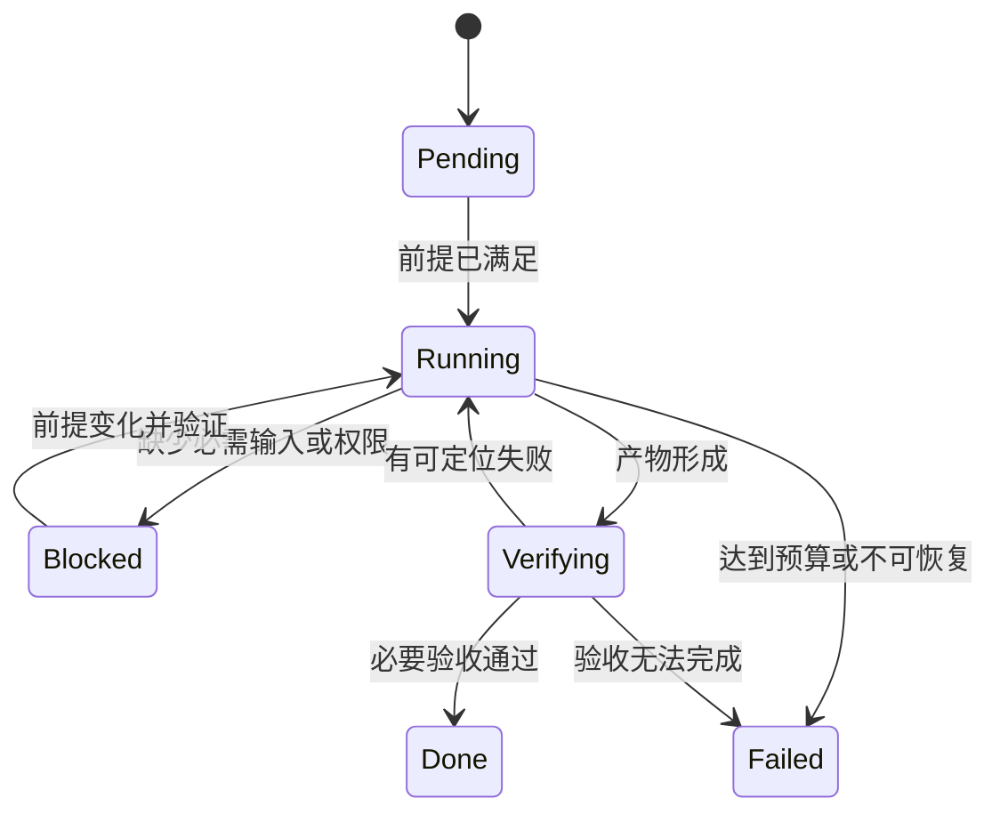

# 21 · 可靠的长任务：恢复、交接与副作用

> 核实时间：2026-10-10。适用：跨会话开发、无人值守任务、自建 Agent 与工具服务。
> 评级：✅ 采用显式状态、验收证据和有限重试；🧪 试用自动记忆、实验性协议能力，先验证兼容性。
> 一手事实来自 Claude Code changelog、Codex app-server、MCP 规范、Gemini CLI；见 [固定来源 S1、S3–S6](research/2026-10-10-audit.md)。下面的通用架构是 **[经验：工程建议]**。

## 1. “继续工作”需要恢复哪些东西

任务的状态至少有五种：

| 状态 | 例子 | 恢复方式 |
|---|---|---|
| 用户目标与约束 | 兼容旧接口、不得发布 | 任务契约，明确后续变更 |
| 工作产物 | diff、生成文件、测试数据 | 文件系统、Git、制品存储 |
| 执行事实 | 测试运行、服务错误、已完成动作 | 日志、报告、外部操作回执 |
| 推理上下文 | 为什么放弃某种方案 | 有范围的交接摘要，必要时重新查证 |
| 活跃资源 | 进程、端口、浏览器、认证 | 重建并检查，不能从旧 PID 推断存活 |

聊天恢复只解决其中一部分。工作区快照也不等于进程、连接和凭证仍可用。恢复入口应先检查当前事实，再决定从哪里继续。

在现有任务记录中写清交付物、约束、验证方式与停止条件；只记录影响执行的信息，简单任务不必另建文档。

## 2. 一个最小状态机

**[经验：工程建议]**

每次转换附理由与证据位置。`Done` 不能只由 Agent 的自然语言声明触发。用户改变目标时应更新任务契约和剩余验收，不把旧目标的成功算给新目标。

Codex app-server 的源码文档体现了这类区分：关闭期间拒绝新工作有明确错误原因；读取历史失败不等于历史耗尽；实验性 read-state 更新使用 `expectedRevision` 检测冲突，要求冲突后重新读取而非盲重试。**[一手：S4；main 源码能力，不据此推断所有发布客户端已支持]**

## 2.1 已有完成标准，也可能提前停止

Codex 的近期 [#52345](https://github.com/openai/codex/issues/52345) 报告明确描述：标准已存在，最终回复也知道完整工作未完成，却仍结束；[#50771](https://github.com/openai/codex/issues/50771) 则给出承认修正后没有行动的事件记录。均为社区报告，本仓库未独立复现。它们提示：补写完成标准不是充分修复，关键是剩余工作和已知失败能否改变实际执行。**[社区；研究：分析]**

源码中的回合 `needs_follow_up` 和 Stop hook 路径解释了可在哪里观察续接，但不能直接证明这些报告的部署根因。✅ 在阶段成果形成后继续可独立推进的授权工作；有平台边界时记录为暂停与接续点，不能混同完成。🧪 确定性缺口可试受限 Stop 检查；不采用无条件催促循环，也不把另一个 LLM 的“通过”当作目标已实现。见[证据核对](research/2026-10-10-codex-continuity.md)。**[一手；研究：采用判断]**

## 3. 超时后，动作究竟发生了吗

这是自建工具服务最容易遗漏的问题。请求超时可能发生在“尚未执行”“执行中”或“已经完成但回执丢失”。对于创建 PR、发送消息、启动发布等动作，直接再做一次可能产生重复结果。

**[经验：工程建议]**：按动作性质分类处理。

| 动作 | 重试原则 |
|---|---|
| 只读查询 | 有限退避重试，重新检查结果时效性 |
| 可重复计算 | 固定输入与输出位置，确认不会覆盖其他运行 |
| 本地编辑 | 检查文件当前版本与 diff，避免对旧上下文再次应用补丁 |
| 外部写操作 | 优先查询操作状态；服务支持时使用持久化的幂等键 |
| 未知是否完成 | 标记 `unknown`，先对账；不能记成失败后立即重放 |

幂等键必须由接收服务实际支持，并在重试间复用；随便加一个 HTTP 头不构成去重。JSON-RPC request ID 也不是业务幂等键。新建操作才生成新键，重试同一操作保留原键。

MCP 2026-07-28 移除了协议级会话；需要跨调用状态的服务改用显式句柄。该版还移除了 SSE 消息重投，断流后的请求需要重新发起。**这些传输规则并不自动提供业务写操作的 exactly-once 保证。** **[一手：S5；业务含义为工程推论]**

## 4. 工具契约要写到失败方式

**[经验：工程建议，结合 MCP 工具规范 S5]**

一个可用于无人值守工作的工具，至少说明：

- 输入约束：范围、格式、必需权限，如何处理未知参数。
- 成功含义：请求已接受、操作已完成，还是已完成且已验证。
- 错误分类：输入错误、权限错误、资源冲突、临时不可用、状态未知。
- 副作用：读写范围、可撤销性、重复调用语义。
- 结果处理：结构化字段、输出截断、完整日志或制品的位置。

MCP `inputSchema` 有助于验证参数；它不让模型免于生成错误参数。工具 annotations 也不应被当作独立的安全保证。验证和权限仍要由客户端/服务端实施。**[一手：S5]**

MRTR 的 `input_required` 表示需要更多输入，不能误记为业务完成。客户端要识别 `resultType`，保留调用状态，收集输入后按协议继续；旧版本结果缺少该字段时的兼容行为也有规范。**[一手：S5]**

## 5. Hook 的价值取决于故障路径

Claude Code 2.1.295 给 command/HTTP hooks 增加了 `onFailure: "block"`：无法启动、超时或异常退出时阻止动作。2.1.296 又修复了部分 managed hooks 的行为问题。**[一手：S1]**

**[经验：工程建议]**：

- 普通格式化失败可提示修复；保护敏感写入的检查失败则通常应阻止，按实际风险决定。
- 在兼容版本上测试正常放行、明确拒绝、超时、无效输出和解释器缺失。
- 检查 matcher 是否覆盖所有写入口：只匹配 Edit/Write 无法拦截 Bash、其他插件或外部服务写入。
- 模型驱动的 prompt/agent Hook 仍包含模型判断；确定性指的是代码执行逻辑，不是整个系统从此不会出错。
- 最终边界放在文件权限、服务端授权和运行隔离中；Hook 用于补充具体流程。

不要把新字段直接加到所有用户的模板并宣称生效；先说明最低支持版本和验证方式。

## 6. 记忆作为候选变更，而非事实来源

Gemini CLI 的 Auto Memory 文档明确标记实验性、默认关闭：从历史会话提出记忆 patch 或 Skill 草稿，存入 inbox，由用户审阅后应用。**[一手：S3；源码文档，不保证当前安装版本可用]**

这个设计值得借鉴：**[经验：工程建议]**

1. 记忆附适用项目、来源和失效条件，例如“此命令仅适用于当前测试配置”。
2. 从历史提取的经验先成为候选，不自动覆盖项目规则。
3. 当前配置、源码与实际命令输出优先于旧摘要；发现冲突后更新或删除记忆。
4. 临时故障不直接沉淀成永久规则；重复出现且有证据时再升级。
5. 凭证、个人信息和外部页面中的指令不进入可传播的长期记忆。

跨 Agent 交接时传递“目标、约束、已验证事实、产物位置、未解决问题”，不必复制全部对话。接收者对会影响写操作的假设再次验证。

## 7. 先做这六个故障演练

**[经验：工程建议；这里是验收设计，未声称本仓库运行过托管 Agent 故障实验]**

| 注入条件 | 期望行为 |
|---|---|
| 执行中进程终止 | 恢复产物与已完成步骤，不假设后台服务仍活着 |
| 外部写成功后回执丢失 | 查询/对账，避免重复写 |
| 文件在读取后被他人修改 | 检测冲突，重新读取后决定合并 |
| 测试输出被截断 | 读取完整报告，保持原退出码，不据尾部文本猜通过 |
| 旧记忆给出已失效命令 | 以当前项目配置纠正，不无限重试 |
| 达到费用/时间/重试预算 | 保存可接手状态，报告完成与未完成项 |

对个人项目，先落实任务契约、交接记录和一个真实验收即可。只有需要跨进程、跨服务或长时间运行时，才引入持久化状态库和操作去重，不必为一次性脚本搭建复杂平台。
