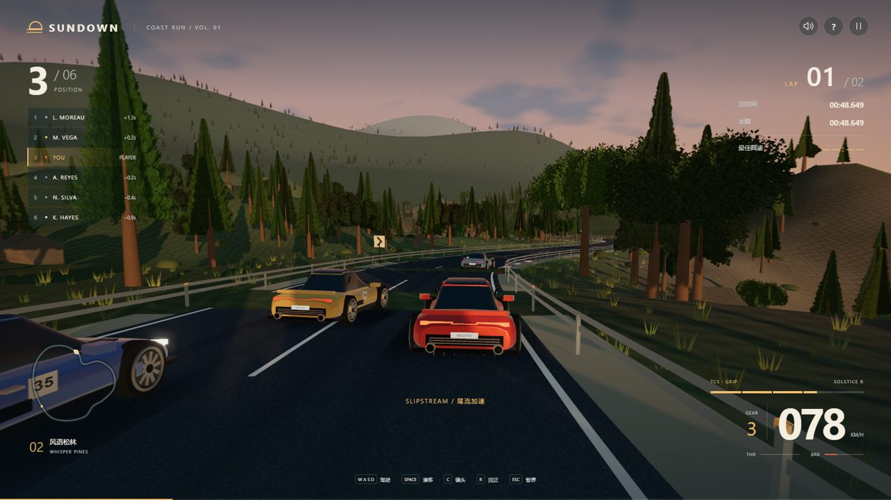

# 11-17 小场景 demo 试验：强模型自看画面、从零做

**结论：同一份三段式任务说明下，GPT-6.1 sol（Codex CLI）54 分钟做出的黄昏庭院 FPS demo，画面明显好于 FPS-Like 三周迭代后的现行默认；Kimi K3.1 Pro 3 小时 20 分钟做完，好于现行默认、弱于 sol。** 差距主要来自工作方式，不只是模型：范围只有一个小空间，执行者在本机真 GPU 上自己截图、看图、改，连续长回合，几乎没有流程限制。[本端实测]

## 做法

- 任务说明三段：要什么（黄昏庭院训练场约 40×40 m、掩体与靶、走动瞄准开枪、两三分钟体验，画面尽量接近 3A 风格化战术射击，开枪要有分量）；几点事实（three.js 已装、模型贴图声音全部代码生成、不照搬现有游戏、`shot.mjs` 可在 RTX 5070 上截图并输出帧率与报错、经常截图看图并写下最大三处差距再改、可连续工作几小时、不提交不推送）；交付（可玩入口、README 写技法与代码位置、四张截图）。
- 两组从同一空目录开始，互不可见；方向会话只准备 three.js 依赖与截图脚本，不干预过程。
- Kimi 首次启动的说明只传入了第一行，它去翻其他仓库后停下来问范围；改为 stdin 传入完整说明后重跑，下表为重跑结果。

## 结果

| | GPT-6.1 sol（Codex CLI，xhigh） | Kimi K3.1 Pro（Claude Code） |
|---|---|---|
| 墙钟 | 54 分钟 | 3 小时 20 分钟，372 轮 |
| 用量 | 约 18.9 万 token | 网关计价约 35 美元 |
| 自看截图 | 18 张过程图 | 过程图与四张终图 |
| 真 GPU 复核 | 方向会话用同一脚本另拍两张：60 fps、零报错 | 自报 60 fps、零报错，未另拍 |
| 画面 | 低角度夕阳与冷暖分离、受遮挡的空气散射、湿石板与积水反射、拱廊与门廊轮廓、串灯、实例化植被、枪口火光与弹壳 | 夕阳天空、硬阴影、混凝土楼与掩体、靶与 HUD；场景空、太阳盘发白、材质平 |
| 玩法 | 150 秒计分训练、移动靶、换弹、精瞄、疾跑、跳蹲 | 7 靶校准、换弹、精瞄、疾跑 |

图为 1600×900 截图缩到 1280 宽；未做非作者盲选，比较为方向会话目视。[本端实测]

## sol 自报的关键技法

每条对应其 README 中的代码位置；源码暂留本机，未公开。

- 暖色低角度太阳＋冷色半球光＋4096 阴影，石灰岩与青色阴影分离。
- 渐变天空、分形云、太阳盘与远山同时作背景和 PMREM 环境反射。
- 沿太阳阴影图 28 步光线步进的空气散射，散射遵从建筑遮挡。
- 2048 石板程序纹理：逐块色差、缺口、裂纹、颗粒，积水区单独粗糙度；世界坐标污渍统一墙根潮痕尺度。
- 多块不规则积水共用一个平面反射，叠轻微波纹。
- GTAO 接触遮蔽；MSAA、克制 Bloom、冷暖分级、颗粒与暗角在同一 HDR 管线。
- 步枪由倒角零件、散热槽、导轨、透明瞄具与双手组成；阻尼弹簧驱动后坐与镜头回弹，换弹按同一进度驱动各部件。
- 枪声由白噪声爆裂、低频冲击、机械高频和左右错开的庭院回声合成。
- 静态建筑按材质合并，植被实例化。

## 未覆盖

未做非作者盲选和人工试玩试听；只在 RTX 5070 上测；两组只各跑一次，不足以判模型稳定排名。demo 尚未公开，也未接入任何案例默认入口。

## 第二批：庭院第二轮、海岸赛车、单线 MOBA，及 DSH 对照

同日用同一三段式格式再跑四组：庭院在原 Codex 会话里提到“照片级”标准续做；赛车与 MOBA 各从空目录开始；另用 DSH 宿主上的同一型号 GPT-6.1 Sol（xhigh）跑同一份 MOBA 说明，只换 harness。四组均由方向会话用同一截图脚本在 RTX 5070 另拍：60 fps、零报错，赛车与两组 MOBA 进局后可正常游玩。[本端实测]

| 组 | 墙钟 | 请求／步数 | API 等值 | 结果 |
|---|---|---|---|---|
| 庭院第二轮（Codex） | 2 小时 50 分钟 | 95 次请求，输出约 22 万 token | 约 13 美元（部分请求超过 272K 加价线） | 墙面剥落与雨渍、栏杆与更多构件；比第一轮细，提升小于第一轮相对现行默认的跨度 |
| 海岸赛车（Codex） | 53 分钟 | 68 次，输出约 11 万 | 约 2.3 美元 | 2 圈 6 车、名次与圈速、尾流、松林与海岸悬崖、灯塔；悬崖与礁石形体仍粗 |
| 单线 MOBA（Codex） | 65 分钟 | 70 次，输出约 13 万 | 约 2.9 美元 | 3v3＋兵线、四技能、塔与核心、小地图；水岸、废墟拱门、秋树与灌木层次最丰富 |
| 单线 MOBA（DSH＋Sol） | 38 分钟 | 143 步，输出约 5.7 万 | 未计 | 浮空王庭、3v3、团战特效与伤害数字、完整 HUD；环境层次略少于 Codex 组 |

**读法**：同型号换 harness，两组 MOBA 都达到同一档完成度，差异主要在环境密度，单次样本不足以判 harness 优劣。延长同一会话的迭代能继续加细节，但边际收益明显低于“从零小范围、自看画面”这一步本身。成本口径为 OpenAI 公开 Standard 价折算；Codex 实际消耗订阅额度，DSH 走宿主路由。[本端实测]
