# 11-17 小场景 demo 试验：强模型自看画面、从零做

**结论：同一份三段式任务说明下，GPT-6.1 sol（Codex CLI）54 分钟做出的黄昏庭院 FPS demo，画面明显好于 FPS-Like 三周迭代后的现行默认；Kimi K3.1 Pro 3 小时 20 分钟做完，好于现行默认、弱于 sol。** 差距主要来自工作方式，不只是模型：范围只有一个小空间，执行者在本机真 GPU 上自己截图、看图、改，连续长回合，几乎没有流程限制。[本端实测]

**源码**：三个代表版本的精选源码公开在 [`experiments/demo-pale-signal`](../../experiments/demo-pale-signal/)（《雪线回波》11-23 封存版）、[`experiments/demo-afterpressure`](../../experiments/demo-afterpressure/)（《余压》r10）和 [`experiments/demo-aftertide-race`](../../experiments/demo-aftertide-race/)（赛车键盘修正版）。都由本机强执行者全 AI 制作，**未达发售级 3A**；只含代码、小素材和几张实机图，大素材按各目录的清单从原站获取。

## 做法

- 任务说明三段：要什么（黄昏庭院训练场约 40×40 m、掩体与靶、走动瞄准开枪、两三分钟体验，画面尽量接近 3A 风格化战术射击，开枪要有分量）；几点事实（three.js 已装、模型贴图声音全部代码生成、不照搬现有游戏、`shot.mjs` 可在 RTX 5070 上截图并输出帧率与报错、经常截图看图并写下最大三处差距再改、可连续工作几小时、不提交不推送）；交付（可玩入口、README 写技法与代码位置、四张截图）。
- 两组从同一空目录开始，互不可见；方向会话只准备 three.js 依赖与截图脚本，不干预过程。
- Kimi 首次启动的说明只传入了第一行，它去翻其他仓库后停下来问范围；改为 stdin 传入完整说明后重跑，下表为重跑结果。

## 结果

| | GPT-6.1 sol（Codex CLI，xhigh） | Kimi K3.1 Pro（Claude Code） |
|---|---|---|
| 墙钟 | 54 分钟 | 3 小时 20 分钟，372 轮 |
| 用量 | 约 18.9 万 token | 网关计价约 35 美元 |
| 自看截图 | 18 张过程图 | 过程图与四张终图 |
| 真 GPU 复核 | 方向会话用同一脚本另拍两张：60 fps、零报错 | 自报 60 fps、零报错，未另拍 |
| 画面 | 低角度夕阳与冷暖分离、受遮挡的空气散射、湿石板与积水反射、拱廊与门廊轮廓、串灯、实例化植被、枪口火光与弹壳 | 夕阳天空、硬阴影、混凝土楼与掩体、靶与 HUD；场景空、太阳盘发白、材质平 |
| 玩法 | 150 秒计分训练、移动靶、换弹、精瞄、疾跑、跳蹲 | 7 靶校准、换弹、精瞄、疾跑 |

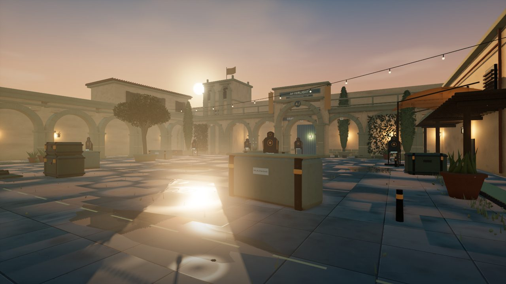
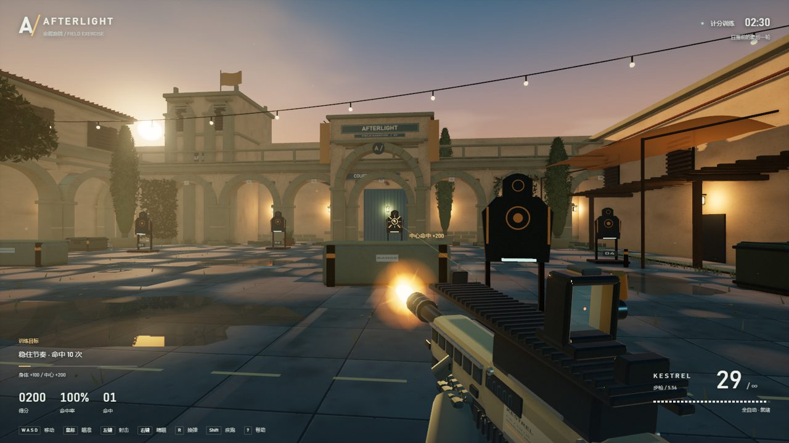
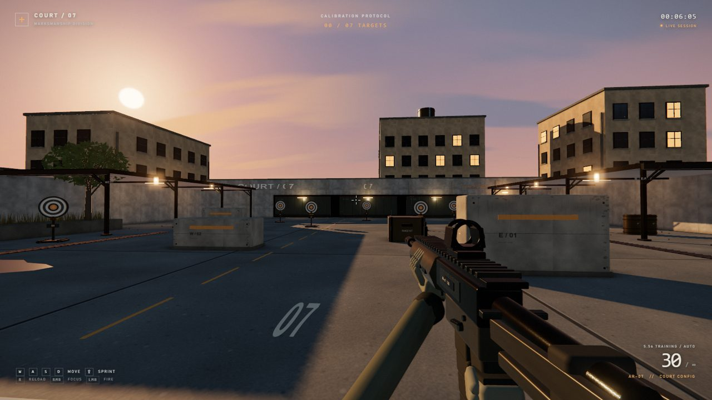
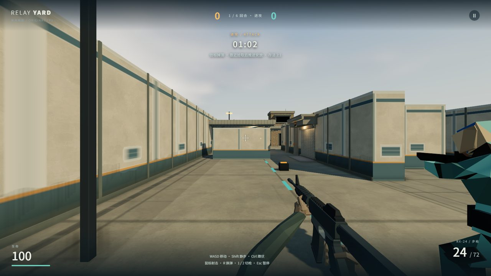

图为 1600×900 截图缩到 1280 宽；未做非作者盲选，比较为方向会话目视。[本端实测]

## sol 自报的关键技法

每条对应其 README 中的代码位置；源码暂留本机，未公开。

- 暖色低角度太阳＋冷色半球光＋4096 阴影，石灰岩与青色阴影分离。
- 渐变天空、分形云、太阳盘与远山同时作背景和 PMREM 环境反射。
- 沿太阳阴影图 28 步光线步进的空气散射，散射遵从建筑遮挡。
- 2048 石板程序纹理：逐块色差、缺口、裂纹、颗粒，积水区单独粗糙度；世界坐标污渍统一墙根潮痕尺度。
- 多块不规则积水共用一个平面反射，叠轻微波纹。
- GTAO 接触遮蔽；MSAA、克制 Bloom、冷暖分级、颗粒与暗角在同一 HDR 管线。
- 步枪由倒角零件、散热槽、导轨、透明瞄具与双手组成；阻尼弹簧驱动后坐与镜头回弹，换弹按同一进度驱动各部件。
- 枪声由白噪声爆裂、低频冲击、机械高频和左右错开的庭院回声合成。
- 静态建筑按材质合并，植被实例化。

## 未覆盖

未做非作者盲选和人工试玩试听；只在 RTX 5070 上测；两组只各跑一次，不足以判模型稳定排名。demo 尚未公开，也未接入任何案例默认入口。

## 第二批：庭院第二轮、海岸赛车、单线 MOBA，及 DSH 对照

同日用同一三段式格式再跑四组：庭院在原 Codex 会话里提到“照片级”标准续做；赛车与 MOBA 各从空目录开始；另用 DSH 宿主上的同一型号 GPT-6.1 Sol（xhigh）跑同一份 MOBA 说明，只换 harness。四组均由方向会话用同一截图脚本在 RTX 5070 另拍：60 fps、零报错，赛车与两组 MOBA 进局后可正常游玩。[本端实测]

| 组 | 墙钟 | 请求／步数 | API 等值 | 结果 |
|---|---|---|---|---|
| 庭院第二轮（Codex） | 2 小时 50 分钟 | 95 次请求，输出约 22 万 token | 约 13 美元（部分请求超过 272K 加价线） | 墙面剥落与雨渍、栏杆与更多构件；比第一轮细，提升小于第一轮相对现行默认的跨度 |
| 海岸赛车（Codex） | 53 分钟 | 68 次，输出约 11 万 | 约 2.3 美元 | 2 圈 6 车、名次与圈速、尾流、松林与海岸悬崖、灯塔；悬崖与礁石形体仍粗 |
| 单线 MOBA（Codex） | 65 分钟 | 70 次，输出约 13 万 | 约 2.9 美元 | 3v3＋兵线、四技能、塔与核心、小地图；水岸、废墟拱门、秋树与灌木层次最丰富 |
| 单线 MOBA（DSH＋Sol） | 38 分钟 | 143 步，输出约 5.7 万 | 未计 | 浮空王庭、3v3、团战特效与伤害数字、完整 HUD；环境层次略少于 Codex 组 |

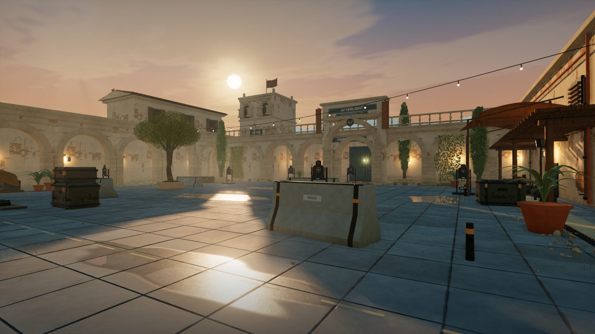

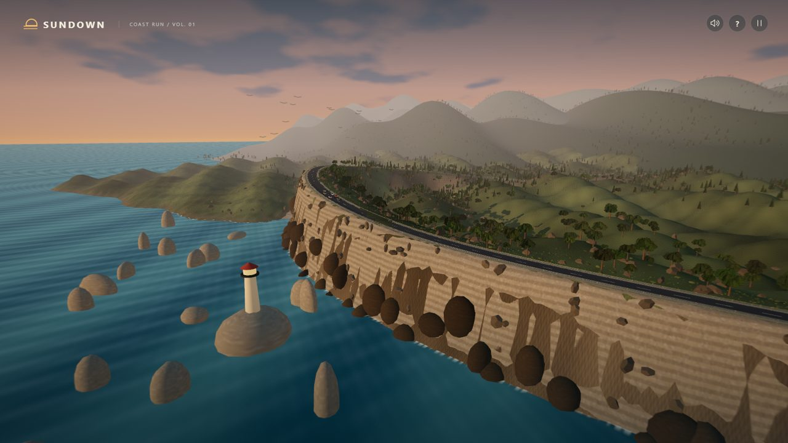
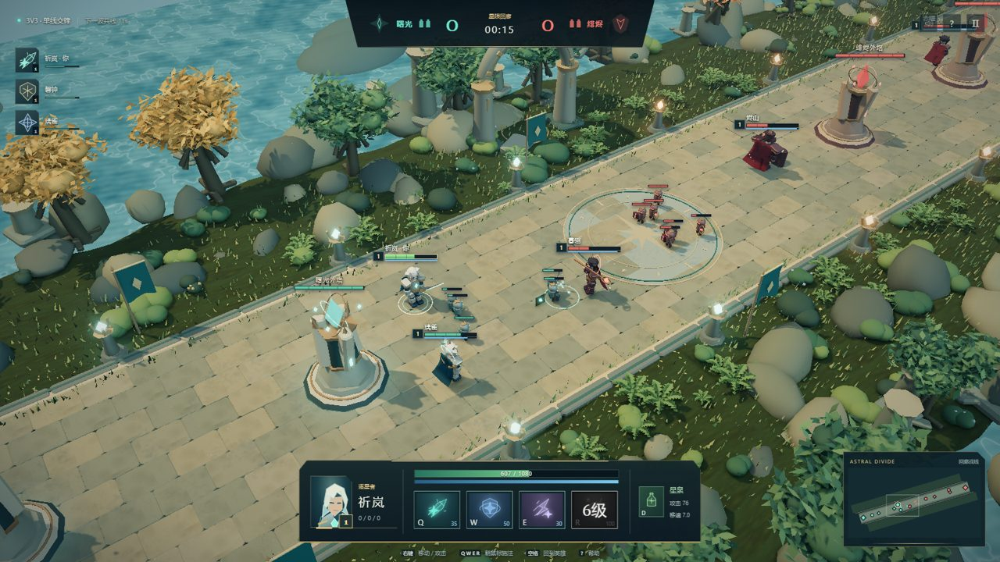
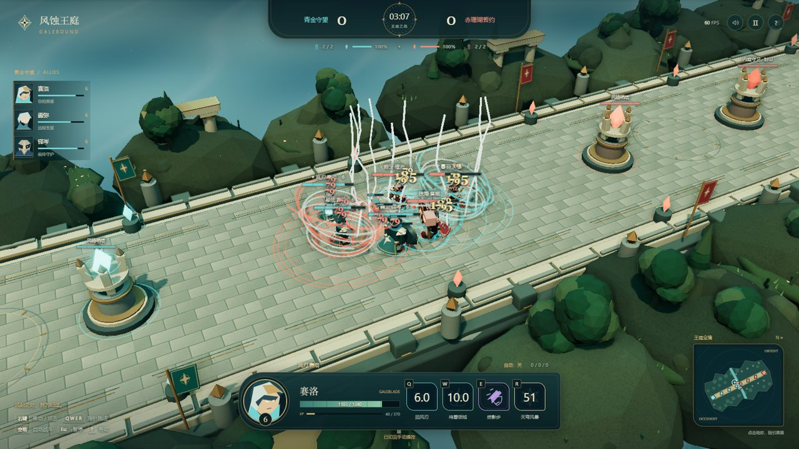

**读法**：同型号换 harness，两组 MOBA 都达到同一档完成度，差异主要在环境密度，单次样本不足以判 harness 优劣。延长同一会话的迭代能继续加细节，但边际收益明显低于“从零小范围、自看画面”这一步本身。成本口径为 OpenAI 公开 Standard 价折算；Codex 实际消耗订阅额度，DSH 走宿主路由。[本端实测]

## 第三批（11-18）：6.2 型号对照与“照片级”提示词

前两组沿用原任务说明换模型配置；照片级 FPS 另用一份更短的任务说明。截图均由方向会话在 RTX 5070 另行复核：60 fps、零报错。[本端实测]

| 组 | 改了什么 | 墙钟／输出 token | 结果 |
|---|---|---|---|
| FPS，GPT-6.2 astra（high） | 换型号，任务说明与 6.1 sol 第一轮一字不差 | 1 小时 47 分／约 7 万 | 场景物件更多（雪山、林带、泄洪口），但只自截 12 次图（6.1 sol 第一轮 43 次），跳跃、蹲下、环境音反而少；质感未提升 |
| 赛车切片，GPT-6.2 sol（xhigh） | 换型号，任务说明与 6.1 sol 一字不差 | 1 小时 55 分／约 11 万 | 海岸、远岛、车身曲面明显好于 6.1；用户试玩：左右方向反、轻打即打转 |
| 同上，手感修正 | 用户原话原样转交，要求经浏览器真实按键验收五项 | 约 40 分钟 | 执行者真实按键复测旧版证实 D 键向左偏航 30.8°；修正后五项通过，方向会话独立重跑同样通过；手感待用户复玩 |
| FPS，GPT-6.2 sol（xhigh） | 提示词仿 Saltline 三句：极致细节、能与 3A 比肩、范围很小、照片级；无参照、无评审、无时长要求 | 30 分钟／约 7 万 | 雨后水电站涡轮大厅：体积光、积水倒影、锈蚀机组、巡检无人机，氛围方向首次接近 Saltline；贴图噪声单一、武器与室外地形仍粗 |

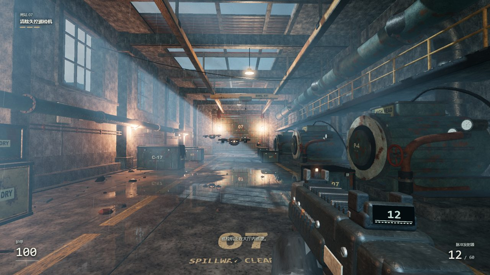
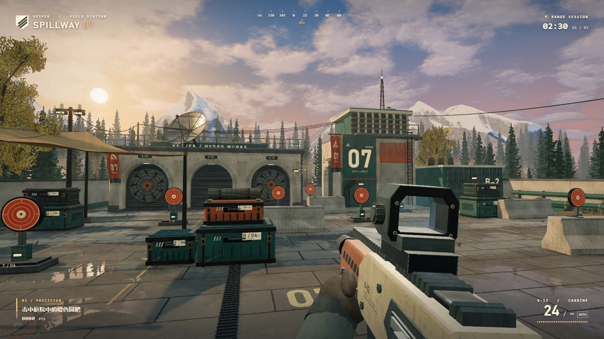
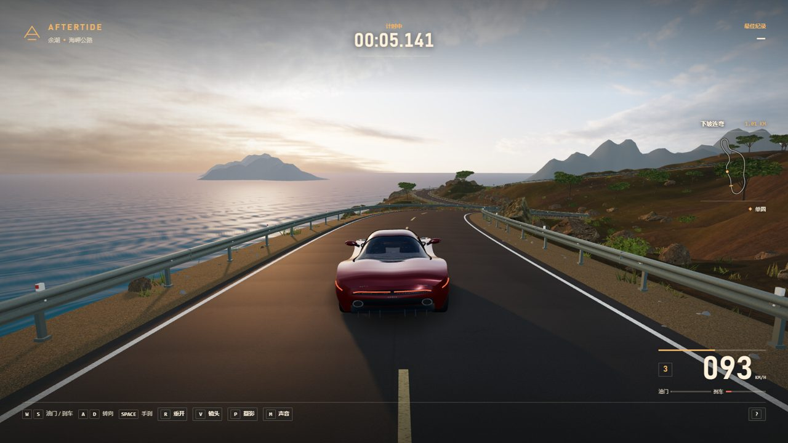

**读法**：照片级涡轮大厅证明这份短说明可以做出雨后工业空间的效果：持枪画面里可见窗光、湿地倒影和锈蚀机组。它可供 FPS 氛围参考，不是现行案例的同机位升级，也没有同一 6.2 sol 的风格化 FPS 对照来单独估计措辞贡献。Astra/sol 的自截图次数不同，但不证明这是表现差异的原因。与 Saltline 仍有材质分层、细节密度、骨骼敌人与工程量差距（原记录估计 Saltline 约 270 万输出 token，本组约 7 万）。赛车的浏览器按键复现与真人手感分开验。Saltline 截图只作本机对照，不入库。[本端实测]

## 第四批（11-18 晚）：照片级 FPS 续做成小关卡，赛车加类人合成玩家

两组都由本机 Codex CLI 上的 GPT-6.2 sol（xhigh）完成。FPS 每轮转交用户原话，另附方向会话写的三段式补充。r2 进行中用户追加了要求，方向会话中断 r2，在同一会话里以 r3 续跑。赛车任务说明是方向会话写的评估规格，包括延迟、按键时长、三个反例、延迟档和指标清单。复核在 RTX 5070 上单独进行，期间显卡上没有别的任务。[本端实测]

### FPS：从一个大厅扩成四段流程

| 轮次 | 补充了什么 | 墙钟／输出 token／看图次数 | 结果 |
|---|---|---|---|
| r2 | 用户试玩后的原话（“细看可以，光影看着还行，但是细节是不是还是差点？”），并要求画面、质量、功能都达到标杆级，体量不大 | 1 小时 32 分／约 7.2 万／5 次（被中断，未自行收尾） | 大厅加入三种巡检机、补给、蓄能提示和受击方向，近景武器与机组更细 |
| r3 | 用户原话：“虽然说体量不要很大，但是一个标准小关卡还是要有的？比如涉及到流程，转场，镜头，也就是更多功能内容。只是体量要减少，作为标杆，要尽可能包含更多高质量，3a标准内容展示能力？”方向会话补充：每样做精，宁少勿粗 | 1 小时 54 分／约 3.7 万／5 次 | 雨中栈桥 → 涡轮大厅 → 隔离门与控制室 → 下游观测台；三段双镜头演出、字幕、控制权交接、检查点、失败重试与结算 |
| r4 | 用户原话：“开一轮只修这些”。方向会话列出三项：新空间近景追平大厅；去掉开场交接卡顿，载入期间给出进度；修自测的下蹲断言。不加内容 | 17 分钟／约 2.3 万／5 次 | 涂层纹素密度提高，站房补扶壁与接缝，峡谷加密几何；载入进度约 0.3 秒出现，标题约 5 秒可用 |
| r5 | 用户原话：“再开一轮”。目标是新空间与大厅同档，写明完成标准（同图并排挑不出更粗、不能清单修完就停、可连续做几个小时） | 22 分钟／约 3.0 万／5 次 | 卷闸和隔离门的锈斑大多去掉；站房加窗洞进深、檐口和管路；峡谷改成灰色湿岩与圆石；控制室补仪表护罩与线槽 |
| r6 | 用户原话：“放开 CC0 再修”。允许正规素材站的 CC0／CC-BY 素材，记 CREDITS | 12 分钟后被中断／约 2.1 万／3 次 | 用户改变方向，成果并入 r7 |
| r7 | 用户原话：“保留四段流程，加深投入”；“还是不用独立评审？只是需要加大投入，还是让模型完全自己处理和完成整个内容？只是绝对要求 绝对3a高质量？”不设外部评审，全部交执行者自主，并告知前两轮约 20 分钟收尾、Saltline 的量级 | 29 分钟／约 4.3 万／8 次 | 接入 8 件 Poly Haven／ambientCG CC0 素材（锈蚀金属、混凝土、扫描岩壁与碎石、冷杉、HDRI、泡沫）；锈蚀沿钢片边缘与焊缝分布，峡谷改用扫描岩面 |

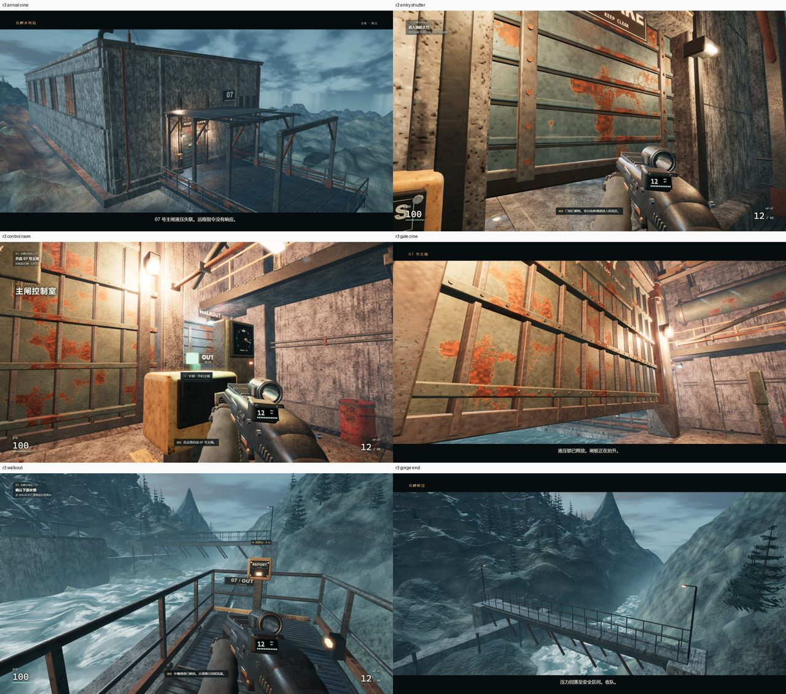

**复核**：6 项模拟测试通过。整关 GPU smoke 跑了 4 次，2 次完整走通开场、战斗、主闸、观测台与结算，零报错、零外部请求；另 2 次在下蹲断言处失败，该断言在松键之后才读状态。长帧探针记录到两处卡顿：页面载入时主线程阻塞约 8 秒，开场演出交还控制权时卡顿约 0.53 秒；其余时间未见超过 40 ms 的帧。

**读法**（单次样本）：扩到完整流程，确实补上了单个大厅证明不了的东西：开场、推进、交接和收尾都由同一套任务状态驱动。代价是质量被摊薄。大厅与 r2 同机位几乎不变；新空间近看明显更粗，室外楼体接近方盒，峡谷地形有棱角，卷闸、控制室和主闸近景的锈蚀贴图能看出像素块。这一次，“尽可能包含更多”让执行者先铺了广度，“宁少勿粗”这一句没压住。离 Saltline 的差距在室外纵深与雾、近景纹素密度、构件形体，以及敌人只有飞行机械。三轮共约 4 小时、输出约 18 万 token，对比原记录中 Saltline 的约 270 万。下一轮应只针对新空间的近景纹素和室外形体，并要求每段与大厅同机位对比，而不是继续加内容。[本端实测]

**r4 复核**：6 项测试通过；整关 smoke 连续 4 次通过。方向会话的独立长帧探针显示，进入关卡后没有超过 40 ms 的帧，原 0.53 秒卡顿已消失；超过 40 ms 的长帧只出现在载入阶段，最长 0.4 秒，这时已有进度显示。近景方面，1:1 下像素块确实没了，锈边更细。但卷闸上新出现一块模糊的大锈斑，跨过横档连成一片，不随构件走。站房仍偏方盒；峡谷岩面变成偏青绿的均匀色调。这些新空间离大厅的质感仍有一档距离。这一轮执行者 17 分钟就自行收尾：任务说明只列了要修的项、没写“做到能当标杆再停”，它修完清单就停了。“只修这些”这类收窄的说明要写明完成标准，否则执行者按清单交差。[本端实测]

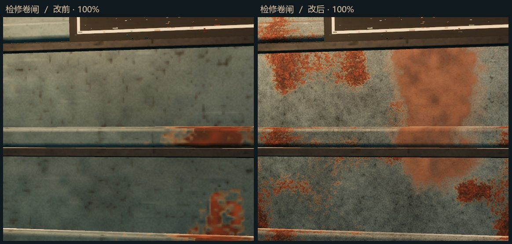

**r5 复核**：6 项测试通过，整关 smoke 连续 3 次通过，零报错；进入关卡后没有超过 40 ms 的帧。画面与 r4 同机位对比，变化如下：

- 模糊锈斑的处理是把锈蚀基本去掉，卷闸和隔离门因此变成干净的平面，旧化的层次反而少了；
- 站房仍是方盒体量，只加了局部构造；
- 峡谷从青绿的均匀色调改成灰色湿岩，但岩体像圆润的团块，水面纹理仍然重复。

新空间仍比大厅低一档。说明里写了完成标准，也写了可以连续做几个小时，执行者还是 22 分钟就自评达标收尾。

**读法**：连续两轮“收窄修质感”都在 20 分钟左右收尾，自评明显比方向会话宽松，遇到问题倾向删掉细节，而不是把细节做对。写明完成标准，不足以让它长时间打磨。另一个限制来自约束本身：方向会话写进说明的“所有贴图在代码里生成”，在室外岩体、植被、水面这类有机表面上上限明显。用户已授权可用 CC0／CC-BY 素材，海岸赛车用了 CC0 贴图与 HDRI，室外近景好于本关。下一轮更值得试的是改约束（放开 CC0 PBR 贴图与 HDRI，记来源），或由非作者逐轮给出差距，而不是再写一遍同样的完成标准。[本端实测]

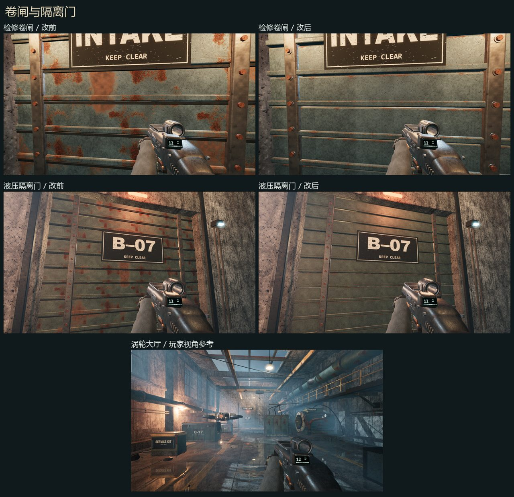

**r7 复核**：6 项测试通过；整关 smoke 连续 3 次通过，零报错，游玩、重试和交接阶段最长帧 33 ms；标题约 5.2–5.5 秒可用，素材 11 MB。与 r5 同机位对比：
- 卷闸和控制室的锈蚀终于跟着边缘、焊缝和挂水点长，旧化层次回来了；
- 峡谷换成扫描岩壁后，远景的真实感和氛围提升最明显；
- 站房的体量仍偏方盒，急流水面仍有明显的 CG 感。

这是几轮里提升最大的一次，但离 3A 仍有距离。执行者在收尾时自己写明“画面自评仍低于绝对 3A 门槛”，然后照样结束了。

**读法**：放开扫描素材这个变量，收益明确，尤其在岩体等有机表面上。但“不顾时间成本、做到达标再停”这类措辞，三轮都没能让单次执行变长：Codex 每次执行，以模型给出最终答复作为结束，模型在约 20–30 分钟后就会交付，哪怕它自评未达标。要想投入几个小时，需要有人在它停下后让它继续。这种继续不必附带外部评审意见，只要把它自己列出的差距接着做下去。[本端实测]

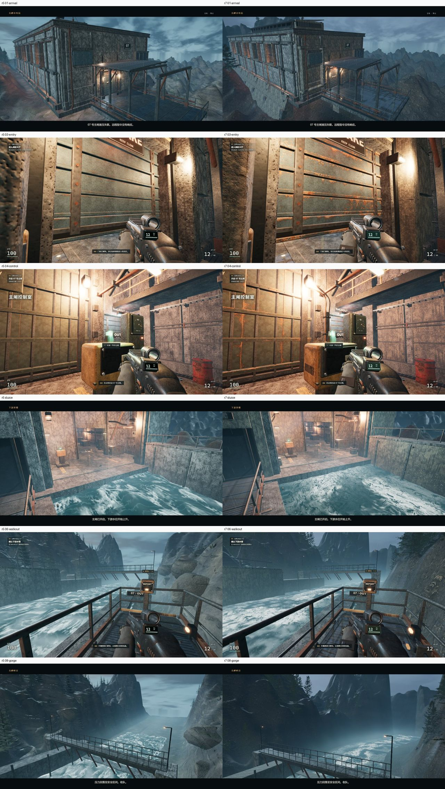

### FPS 大厅材质样板的收益边界（r8）

同机位近看，配电柜的几扇门有了不同的边锈、凹把和铭牌；涡轮端盖能辨出多层法兰。沿入口路线正常走，最容易看见的是暖灯在湿地面上的反光，开镜后的枪、目标和背景轮廓与前版很接近。方向席逐张看了 18 组整关原像素裁切和 10 组固定机位，并独立三次跑通原整关脚本。玩家反馈正常游玩仍与前版接近。该单例支持在正常速度确认整体收益，再用裁切定位增益或退步。[本端实测，2026-11-19；方法见游戏制作页](../../domains/game-dev/03-generative-ai-in-games.md#全-ai-制作怎样落到玩家的一次操作上)

### FPS 按整体作品目标自主续作（r9）

沿用 r8 与四段流程，执行者自行选择整关的主要差距。它在约 32 分钟后的首次交回里串起液压旁路、闸板、设备指示与下游流量，同时区分巡检机移动和攻击后的行为。门口可直接看到横跨机组的吊车，开闸后的放流延续到峡谷观测台。按源码，压力与涌浪来自交互进度和开闸后经过的时间；这是玩家操作的连续反馈，不涉及玩家管理新的压力资源。实际开镜时，机组和瞄具的基本轮廓仍接近 r8，近距离泡沫仍有纹样感。

方向席读完最终版 18 组原像素裁切，以 r8 原整关脚本在 RTX 5070／1080p 独立连续三次跑通，游玩最长帧 33.3 ms；另从可玩页面经真实输入进入交火、开火和换弹。执行者认为可展示且距已发售 3A 仍有差距。该结果支持自主改动能够跨系统产生可见变化；玩家对 r9 整体质感与手感的验收尚缺。此轮与从空工程首次生成的作品应分开比较。[本端实测，2026-11-19]

### 同型号在旧作续接与空工程首交中的表现

同型号 GPT-6.2 sol、xhigh、本机 RTX 5070。续作保留四段与历史上下文，只中性续接；独立制作另开新会话与空目录，只有 Three.js 和 Playwright 通用依赖。独立简报要求小型完整网页 FPS 达到已发售 3A 的整体品质，题材和实现由模型决定，允许数小时制作和重做。首次终答前没有人追加提示，首交原样保存。

| 起点 | 自主运行 | 玩家路径上实际看到了什么 |
| --- | --- | --- |
| 《余压》r9 → r10 | 43 分 30 秒，约 8 万输出 token | 从门柱后移出读卡器后，证件和读卡面可以同框；开闸时出现握杆动作，下游终端读数随放流更新。岸坡的纹理拉伸减轻，远岸水面仍有平行亮纹。 |
| 《雪线回波》从零首交 | 82 分 20 秒，约 12.5 万输出 token | 模型选择雪地中继站。天线是行进地标，供电、守上传、乘缆车撤离形成完整回路。首次能通关后仍继续补了机房路线图，调整撤离演出，并补拍地面敌机命中画面。最终近看的枪体和敌机仍以简化几何为主，大面积雪山表面也延续了首个可玩版本的圆滑轮廓。 |

普通入口经真实浏览器输入核到新作从 40 米走到 33 米，以及开火、换弹、暂停和恢复；完整路线在同一个试玩地址加只读状态观察参数，再以键鼠走完三波、撤离、重玩和失败后的检查点重试。1440×900 的独立通关样本约 49 秒，帧间隔 P95 为 16.7 ms；验证驱动会根据场景状态瞄准，时间和命中率不代表新人表现。r10 另从默认页面走入交火，并独立复跑整关；执行者无录制三次最长帧 33.4 ms，同时截图录屏有一次 283.4 ms 长帧。方向席逐张查看了 r10 的 18 组整关对照和新作的 10 张最终原像素裁切。两作的真人手感及整体验收待玩家判断。

**读法。** 一份开放目标足以让这个执行者在同一次调用里自己选题、完成游戏，并在成功通关后继续工作。方向席复核时，新作的地标和任务更容易辨认，旧作的工业近景更细。这两个样本都未达到方向席对已发售 3A 整体质感的判断。作品与机制、既有资产、前期投入不同，不能从此比较推断重开普遍比续作好，也不能把墙钟时长当作创作品质。[本端实测，2026-11-19]

### 赛车：类人合成玩家能否替代部分人工试玩

任务说明只要求做评估工具、不改手感。执行者用 65 分钟、约 5.6 万输出 token、看图 12 次完成。合成玩家的设计如下：

- 只发真实按键（核对了 61,864 条可信按键边沿）；读游戏状态当“眼睛”，但带 0.2 秒反应延迟与抖动、50–67 ms 最短按键、按键频率上限、感知噪声和偶发误判；
- 预瞄结构参照双点视觉模型（Salvucci & Gray 2004）、间歇式修正（Markkula 等 2018）与简单反应时测量（Woods 等 2015），具体参数为本工具设定；
- 分普通、熟练两档，每档三个种子各跑三圈；
- 以 120 Hz 模拟锁步录 60 fps 全帧率录像，叠加按键、车速、侧滑与横摆，执行者逐段回看。

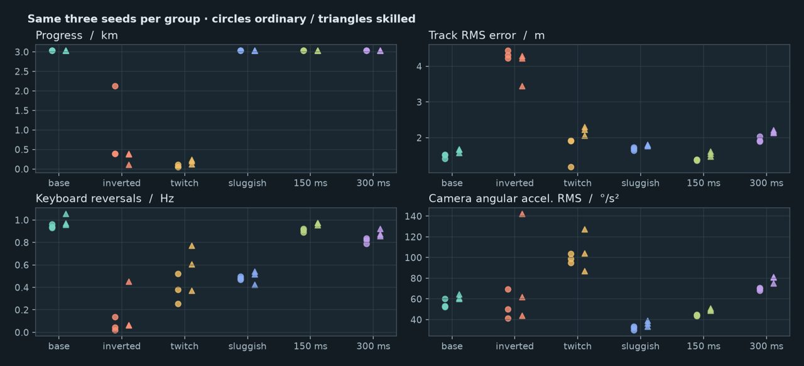

| 版本（0.2 s 延迟） | 整轮完赛 | 墙／出路／打转（两档合计） | 等输入探针 |
|---|---|---|---|
| 当前版 | 6/6，18/18 圈 | 8 / 6 / 0 | 100 km/h 按 D 1 s 偏航 +13.65° |
| 方向反（反例夹具，对应用户说的“左右反”） | 0/6 | 34 / 6 / 1 | −13.65° |
| 轻拨过敏（反例夹具，对应“一打方向就打转”） | 0/6 | 56 / 1 / 13 | 140 km/h 轻点横摆 28.45°/s（按旧版实测 28.5°/s 的量级设定） |
| 转向迟钝 | 6/6 | 40 / 33 / 0 | +5.72° |

**复核**：独立重跑了四版方向探针，以及当前版和过敏版各一轮三圈；锁步下数值逐项一致，过敏版同样停滞、打转。只改了副本里的测试开关和只读状态，原版未动。

**读法**：三个坏版本是执行者在当前版上加的反例夹具，强度按旧版实测量级设定，没有运行旧构建；合成玩家的闭环参数也只用当前版的一个种子调过。在这个前提下，结果与用户两次试玩的方向一致：

- 复现旧版问题的两个夹具，合成玩家都跑不完；
- 当前版完赛、零打转，对应“至少是能玩了”；
- 转向迟钝的版本也能完赛，只有碰墙和出路数暴露问题。所以不能只看完赛率，要几项指标一起看。

它找出的三处差距是：

- 轻点几乎无反馈，横摆峰值只有 0.44°/s，而且出现在松手后（66.7 ms 短拨的读数，待真人盲测）；
- 连弯和出弯要反复修线；
- 擦墙后路牌挡住镜头。这一处是回看录像才发现的，指标里看不出来。

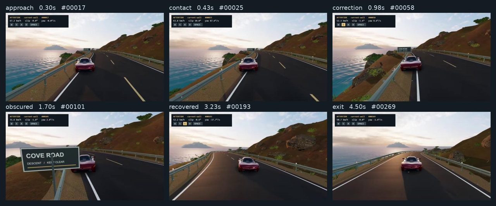

可以替代的是改控制或镜头后的重复回归：方向、轻点、三圈容错、变线、手刹退出、接触恢复。替代不了的是学习成本、何时失去抓地的可读性、信心、镜头舒适、声音、乐趣和手柄输入；合成玩家也不会像真人那样适应反向或迟钝的操控。0.3 s 延迟仍能完赛，但碰墙由 8 次升到 56 次。合成玩家提前读取赛道几何，不代表反应慢的真人也能控住。源码和录像留本机。[本端实测]

## 第五批（11-19～11-24）：《雪线回波》电影级、定向、限时与不限时阶段

执行者不变：同一个 GPT-6.2 sol（xhigh）会话从首交一路续接，自动试玩都在隔离窗口站内进行。用时按日志时间戳估算，输出 token 取自 Codex 会话记录。[本端实测]

| 阶段 | 依据的用户反馈 | 用时／输出 token | 结果 |
|---|---|---|---|
| 电影级重制，两轮 | 玩家认为流程完整，整幅画面明显弱于高品质同类作品，多次局部改进也没有改变这个印象 | 约 4 小时／约 23 万 | 重做机房、天线场和撤离峡谷；雪地和金属踏步换成实录；值班机房有了湿地面反射与冷暖分区。执行者自评：峡谷岩雪纹理重复，建筑近看像模块拼装，手部和乘员动作僵硬 |
| 定向重制 | 玩家通关截图；户外远景、枪与双手、射击反馈三项 | 约 2 小时 45 分／约 5.8 万 | 弹痕改贴到实际可见表面（旧版贴在简化碰撞盒上，被门板挡住）；枪壳、手套材质和换弹衔接重做；山谷可读性提升。大岩面仍偏平滑 |
| 限时一小时 | “我说的感觉动作，持枪，人物动作和手感，整个3c，以及如图的远景，还是很一般？并没有大幅度优化？人物的建模基本等于完全2没有？” | 60 分钟到时被截停 | 同时间内中途纠偏一次：撤回方向席自加的优先级排序，改为直接转交原话 |
| 不限时标杆，第一段 | “继续做一个完整阶段的优化，不限制时间，并且效果是让这个 3a 实例 完全标杆，完全是真的3a品质，画质” | 约 10 小时／约 10.8 万 | 用 CC0 MakeHuman 手部改成蒙皮手套；起停、转向、落地和脚步由同一套触地状态驱动；点射和连发后坐可区分；峡谷坡型重塑 |
| 玩家复查后修复 | “非瞄准开枪屏幕中间有黑色一条”“房间内甚至还在下雪”“人物建模，手还是质量很低”，以及撤离原图 | 11-24 01:14 起续接三次，06:34 按计划暂停并存快照 | 执行者报告黑条与跨门落雪已修；自评整部作品仍低于发售级 3A。方向会话尚未复核这一段 |

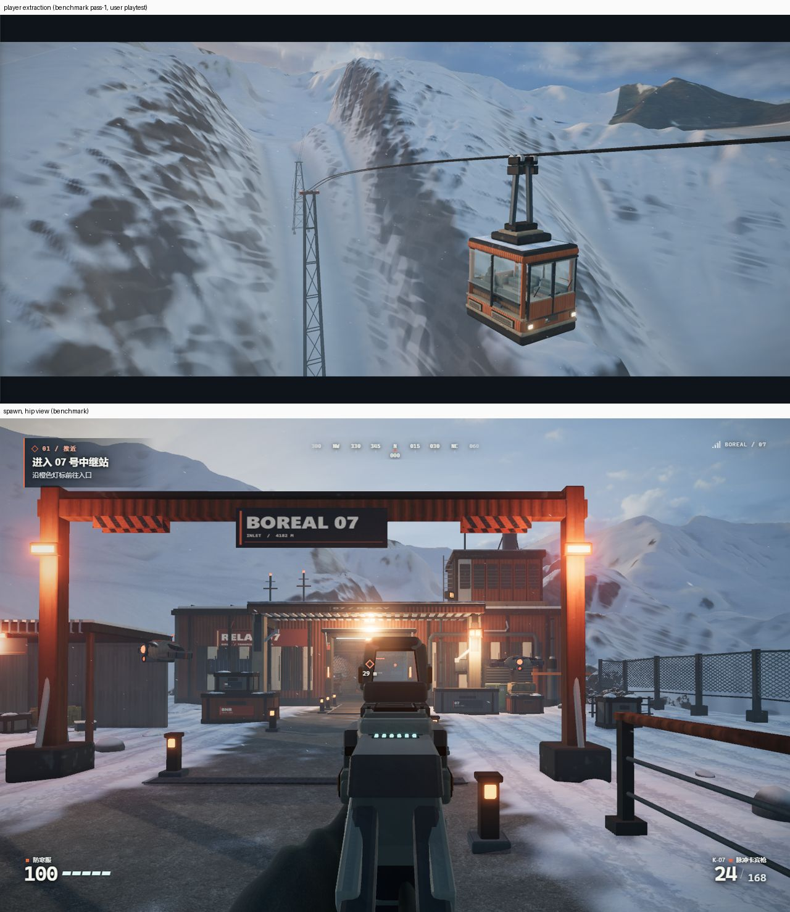

**复核**：方向会话看了玩家撤离原图和出生持枪原图。光照、天空和冷暖色调已经成熟；但雪山是平滑的高度场，加上沿坡向拉长的重复噪声；枪身由方块拼成，手的面数低。这一档的问题，从电影级阶段起就一直被执行者自己点名，五天、约 60 万输出 token 后仍在原地。

**读法**：投入大幅增加了（《余压》与《雪线回波》合计约 107 万输出 token，其中不限时阶段单段约 10 小时），但没有跨过这一档。所以瓶颈不在时长，在资产的生产方式：地形、枪、手、角色都由代码直接生成或拼装，没有建模、雕刻、扫描或烘焙环节。

还有一个前提没成立：不限时阶段的任务说明写了“本机已有 Blender”和“网关 Tripo、Hunyuan 已授权”，但执行者报告两者都调不到。方向会话 11-24 核实，本机确实没有安装 Blender，执行环境里也找不到网关生成命令。所以这一阶段实际上只能继续用代码生成，原先设想的“换生产手段”并没有被试到。这是单一作品、单一执行者的样本。[本端实测]

## 第六批（11-24）：换生产手段——用 Blender 重做枪、手和雪山

用户决定：“要，装 Blender 试”。方向会话在本机装了便携版 Blender 4.5 LTS，把路径和网关 3D 生成命令写进任务说明，交给同型号执行者（GPT-6.2 sol，xhigh）的一个新会话。起点是玩家试玩过的 11-23 封存版副本，只重做三样：第一人称的枪、戴手套的手和前臂、出生雪脊与缆车沿线的山体。玩法和流程不动。[本端实测]

| 资产 | 生产路线（执行者报告） | 制作约用时 | 计费生成 |
|---|---|---|---:|
| 枪 | Blender 截面放样、布尔切槽，分件倒角，烘焙接触遮蔽和磨损顶点色 | 16 分钟 | 0 |
| 手套和前臂 | MakeHuman 底模细分、雕出指垫与护腕，四权重蒙皮；衣袖用独立裁片、缝线和袖口织带 | 14 分钟 | 0 |
| 雪脊与峡谷 | 原 DEM 离线重采样，雕刻山脊和沟槽，按坡度与曲率烘焙露岩掩模；Blender 生成嵌入母岩的错层岩体 | 17 分钟 | 0 |

全程约 39 分钟，网关 3D 生成 0 次。同轮还修了玩家指出的腰射黑条（枪口闪光着色输入），并用屋顶覆盖遮蔽室内落雪。

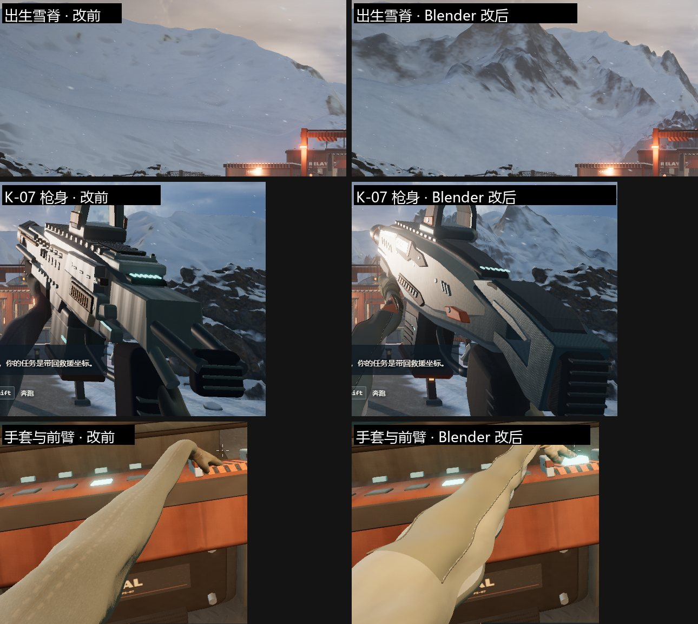

**复核**：方向会话逐张看了同机位原图和 1:1 裁切。

- **雪山**：明显跨了一档，山脊锐利，露岩面清楚。五天纯代码改进没做到的，这一轮做到了。
- **枪**：有进步，形体分件、倒角和磨损可读。但腰射视角有一块高光过曝，部分构件仍是方块感。
- **手和前臂**：只小幅提升。

**性能与成因复查**：显卡空出后单独复跑一次不录制整关，帧间隔中位 16.7 ms、P95 33.3 ms、最长 66.7 ms（与制作时一致；封存版 P95 16.8 ms、最长 50.0 ms），演出段 P95 仍为 16.8 ms。结合 11-25 基准与源码核查，跳档并非游戏逻辑拖慢（基准中前段 4 次长帧 `logicMs` 仅 `1.1–1.6 ms`、`newPrograms = 0`，而 `drawMs` 达 `36.1–67.9 ms`），而是三层叠加触发了 60 Hz 垂直同步的 `16.67 ms` 悬崖：① **渲染管线默认零余量**：基线已开 `3072×3072`＋`1024×1024` 双软阴影图每帧更新、MSAA 半浮点渲染目标、全分辨率 `GTAOPass`（12 采样＋2 环 10 采样降噪）、`UnrealBloomPass` 与反射渲染目标，基线第一人称即以 `P95 16.8 ms` 紧贴单帧阈值；② **高模多槽开启阴影投射**：引入 Blender 角色与岩壁后，多部件默认 `castShadow = true`（如技师 `58,524` 面／`21` 图元／`15` 材质槽、页岩 `110,583` 面／`4` 材质槽）令阴影与主通道提交翻倍，越过 `16.67 ms` 即整档落入 `33.3 ms`（二倍帧间隔）甚至 `49.9 ms`；③ **运行时延迟编译尖峰**：首帧 `MeshDepthMaterial`（`29–67 ms`）与首枪粒子 `SpriteMaterial`（`23.0–31.8 ms`）仍在首次触发时现场编译着色器。

**读法**：同一执行者换了生产手段后，39 分钟就让地形跨档，枪小幅跨档，说明前五天卡在“只能用代码生成”这一前提上。手部仍弱，原因是 MakeHuman 底模加细分雕刻仍要逐指约束，这一轮投入最少。只有单一作品、单次样本，尚未经用户试玩。[本端实测]

## 第七批（11-25）：质量实验四线推进（地形采样、人物资产、动作品质与关卡骨架）

在继续堆资产前，先在同一基线上拆出四条实验分支定位画面、动作与帧时问题（均为本端对照与实跑指标，尚未经外部玩家盲测）：[本端实测]

| 分支主题 | 关键实现与对照发现 | 实测表现与遗留问题 |
|---|---|---|
| **高精度 DEM 地形与斜坡消纹** | 基于 2 m DEM（`396×415` 顶点）与打包遮罩贴图（`1,046,900 B`）作五路消融：**仅按片段世界空间像素宽度衰减近距凹凸与平铺采样**能消除斜坡雪地条纹 | 开局就绪 `6.49 s → 5.68 s`，但首帧提交升至 `74.0 ms`（原 `39.6 ms`）；撤离段 P95 保持 `16.7 ms`，主游玩段 P95 仍为 `33.4 ms` |
| **人物＋自然岩体（Blender 管线）** | 技师角色（16 根骨骼、8 组动作）配手套及 33 处页岩露头接入整关 | 完整通关用时 `186.08 s`（58 枪／31 命中／10 击杀／2 次重开），中位 `16.7 ms`、P95 `33.4 ms`；多图元多槽 `castShadow` 仍是主帧时负担 |
| **动作质感、脚部 IK 与首枪响应** | 保留衣料局部形变、实景比对后移除过亮涂层边缘；子步脚部 IK 在 661 个采样点上把脚踝着地误差从约 `17–21.4 cm` 压到 **`< 0.001 cm`**，冲刺急停收敛从 `425 ms` 缩至 `211 ms`；将开枪音效提前到扣弹瞬间并预热曳光弹／烟尘材质 | 消除原 `45–48 ms` 音效滞后，首枪总提交 `drawMs` 从 `84–94 ms` 降至 `66–71 ms`；第三人称全套开影仍可落入 `49.9 ms`（三倍同步周期） |
| **冰斗关卡骨架重整与整局验证** | 按 `4.38 m/s` 基线录像重排冰斗灰盒掩体与视线节奏 | `114.78 s` 零重开完成整关，中位 `16.7 ms`、P95 `33.3 ms` |

**下一步判断**：视觉形体与物理手感的瓶颈已被拆开验证；若要把主游玩段稳回 60 帧（P95 `≤ 16.8 ms`），重点不再是降逻辑耗时，而是合并导出材质槽、限制高模部件阴影投射、对全分辨率后处理降采，以及将首次深度／粒子材质编译全部前移到加载预热期。[本端实测]

## 第八批（11-26）：性能回正与材质质感验证构建（本机 RTX 5070 实测）

基于第 7 批整合构建，在隔离验证副本独立验证“深度保留半分辨率 GTAO ＋ `2048 PCFShadowMap` ＋ 巨石 LOD/阴影分级 ＋ 中景衣料与近壁岩层质感着色器”四项组合改造，并在同一本机 RTX 5070 隔离桌面环境下跑通无录制纯性能（`perf-only`）与 30 帧截图采集（`screenshot`）整局对照，未并入演示默认分支，也未经外部玩家盲测：[本端实测]

| 构造与运行模式 | 帧样本数 | `median / P95 / P99 / worst (ms)` | `>50 ms` 长帧 | 第一／三人称／演出 `P95 (ms)` | 启动与绘制计数 |
|---|---|---|---|---|---|
| **未改基线 `perf-only`** | `4,879`（`83.46 s`） | `16.7 / 16.8 / 33.4 / 50.1` | `1` 次（`50 ms`，`z=-23.9`，`drawMs=36.1`） | `16.8 / 16.8 / 16.7`（3P `worst=50.1`） | `titleReady=5567 ms`，`firstDraw=43.5 ms` |
| **优化后 `perf-only`** | `4,950`（`85.01 s`） | `16.7 / 16.8 / 33.4 / 50` | **`0` 次**（`longFrames=[]`） | `16.8 / 33.2 / 16.8`（3P `worst=33.5`） | `titleReady=5194 ms`，`firstDraw=43.3 ms`；3P `3,693 calls / 7,770,741 tris`，1P `3,568 calls / 7,454,227 tris` |
| **优化后带 30 张截图** | `5,715`（`101.71 s`） | `16.7 / 33.3 / 33.4 / 66.7` | `8` 次（含 `0.02 s` 首帧 `MeshDepthMaterial` 编译及 `z=-10.1..-23.9` `drawMs=32.1–48.0`） | `16.8 / 33.3 / 16.7` | `titleReady=6111 ms`，`firstDraw=48.9 ms`；`errors=[]`，`retries=0` |

**视觉与结构核实**：
1. **半分辨率 GTAO 保全分辨率深度无雾效伪影**：将 `normalRenderTarget` 保持全分辨率（供下游大气雾效采样 `occlusion.depthTexture`），仅把 `gtaoRenderTarget` 与 `pdRenderTarget` 降为 `0.5×` 并把整合基线原本 `4.9` 的降噪半径折半到 `2.5`、采样减为 `8` 采样＋`1` 环，实拍 30 张成图（含 `C1`、`C2`、`C6`、`03`、`04`、`07b`）确认地面接触阴影自然、前景轮廓无雾效黑边或光晕。
2. **中景衣料可读性与近壁岩层消纹有效**：将衣料褶皱/斜纹/下摆污渍绑定到骨骼静止空间 `position` 并由蒙皮世界法线叠加肩头/头盔迎霜，使 2.5–4 m 第三人称（`C6`）与第一人称前臂（`04`）橘色护垫、外套和背包金属件明显拉开哑光织物与缎面复合材质质感；为 `boreal` 片段加入中频 3D 域扭曲与雪线边缘扰动后，近景峡谷壁平行层理被自然打断（极近陡立高度场本身垂直网格拉伸仍受几何分辨率限制）。
3. **诚实性能余量与下一步瓶颈**：优化版在 `perf-only` 下清空了长帧、缩短就绪耗时并把每帧总三角面从初改未分级巨石时的 `9,482,566`（3P）／`9,296,978`（1P）压低约 18%–20%（至 `7,770,741 / 7,454,227`），但因人物全身（`full+core`）仍有 `37` 个图元分件（其中上装 `27` 个，3P 比 1P 在三遍通道合计多 `125 calls / 316,514 tris`）且片元仍含 1 次 3D 程序噪声，60 Hz 垂直同步下 **`thirdPerson.P95` 从基线 `16.8 ms` 抬升到 `33.2 ms`**（`worstMs` 则由 `50.1` 降至 `33.5 ms`）。全帧 `3,568–3,693 calls / 7.45M–7.77M tris`（阴影＋GTAO 法线＋主通道三遍遍历）以及 `23k–29k` 面的高模走廊道具（如路障、发电机、工具车）是下一阶段合批与减面的明确靶点。[本端实测]

