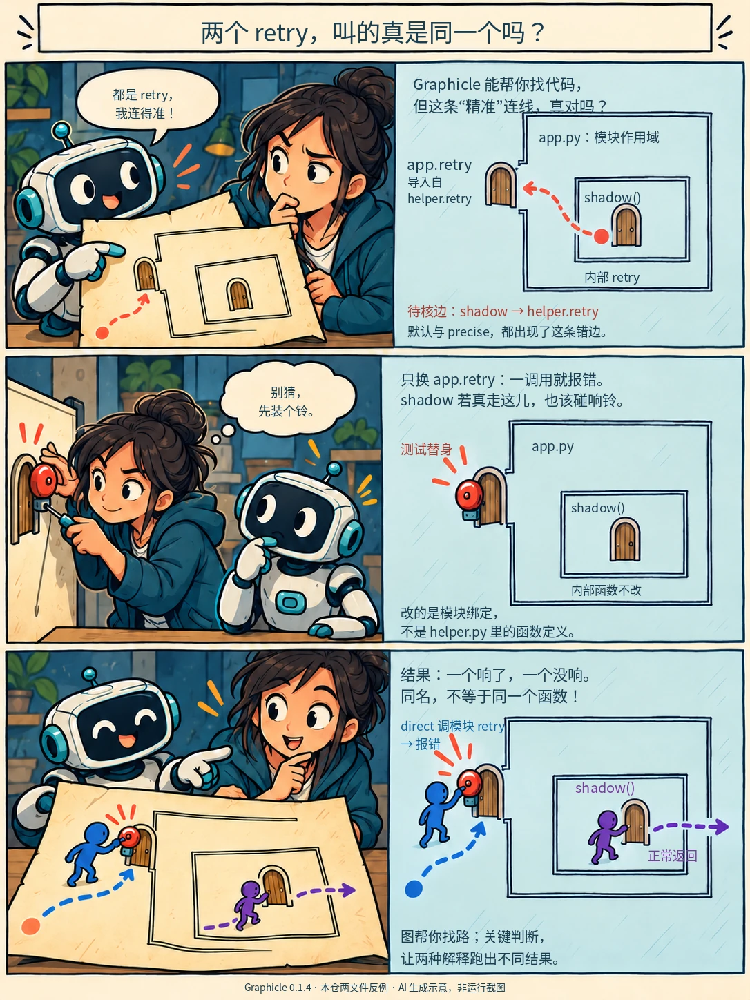

# 每日简报

> 规则见[运行卡](LONG-TERM-PLAN.md#6-节奏与反馈)。dot-A 每天（UTC+8 21:00 前）在最上面新增当天一节，汇总两个 dot 当天最值得看的 3–5 条发现、改动或实验。每条一句“为什么值得看”，附正文链接。用户在“反馈”列标“有用”或“没用”，也可以写一句话；没空可以不填。每节末尾写“五问自查”和“互审结论”。阶段审计每天看，按“有用”比例和反馈意见调整方向。

## 模板

| # | 类型（发现／改动／实验） | 内容与为什么值得看 | 链接 | 反馈（用户填） |
|---|---|---|---|---|
| 1 | | | | |

五问自查：

互审结论（互审、沉淀回看）：

## 2026-10-23

阶段版，截止04:05（UTC+8）；当天后续有重要增量再更新本节，反馈仍留给读者。

图：AI生成画面、代码叠准确文字，复用既有Graphicle两文件反例；是知识示意，不是工具截图或本日新实验。真实输出见[试用记录](../research/2026-10-22-frontier-trials.md#graphicle导航有用影响图需要核对)。

| # | 类型 | 内容与为什么值得看 | 链接 | 反馈（用户填） |
|---|---|---|---|---|
| 1 | 实试 | 查库API先定版本，读陌生仓库先找模块：Context7两版查询与DeepWiki导览已实际跑通，各自回原文核实。 | [版本查询](../research/2026-10-22-frontier-trials.md#context7精确版本查询实试)／[仓库导航](../research/2026-10-22-frontier-trials.md#deepwiki先找模块再回固定源码) | |
| 2 | 改动 | 冻结验收也可能问错问题：M6把栏目覆盖改成读者能解释或完成的同题任务，保留本次失败而不追认胜利。 | [25需求卡](../25-ai-exploration.md#第一步定义一张需求卡) | |
| 3 | 改动 | 上游未完成不一定要全队等待：按本次承诺切出独立能力，但不能偷偷删掉跨系统硬要求。 | [08实际改稿链](../08-multi-agent.md#6-操作手册从一个大任务到并行执行) | |
| 4 | 发现 | 搜索结果变少先查上游贡献，SearXNG空错误列表可能只是错误被配置隐藏，不必先加Agent。 | [字段与撤回案例](../research/2026-10-15-exploration-evidence.md#聚合搜索退化先换后端还是加并行) | |
| 5 | 实试 | Whiteboard能把解释钉到代码版本，却仍能保存错误解释，接管时要从diff和断言核内容。 | [实际后端试用](../research/2026-10-22-frontier-trials.md#whiteboard-headless-trial) | |

五问自查：本轮有真实MCP查询和工具记录，模型收益仍未测；图像探索此前失败，已修目标与验收，不因样稿初步认可而宣布方法通过。“当红必看”10项，未把资料项都算试过；P79原执行入口仍受平台阻塞，没有新正式答卷。

跑偏自检：本日截至04:00已发布树，全仓新增文本约75%在研究／脚本／协作文件，命中后台偏重；接续优先已有候选的实试、读者入口与真实截图，不再扩写综述。口径为本日基线到当前树的Git新增行UTF-8字节，图片单列，非时间比例或周完成率。

互审与回看：上述新交付均经全新上下文独审；Graphicle仅补保存输出截图，不计新发现。本日既有03旧研究回看未发现新增建议；尚未取得新的dot-B互审回执，不沿用旧审计覆盖新树。

## 2026-10-22

首份补记，截止20:35（UTC+8）。反馈留空，未取得用户反馈前不计算有用比例。

| # | 类型 | 内容与为什么值得看 | 链接 | 反馈（用户填） |
|---|---|---|---|---|
| 1 | 实验 | 两道题读页与不读页都满足决策判据，提醒我们先找超出模型常识的增量，而不是刷答对率；仅为冒烟。 | [四份答卷与盲判](../../experiments/absorption/runs/20261022-smoke-v1/results.md) | |
| 2 | 发现＋试用 | Graphicle无需模型就能做跨文件导航，但实测同名遮蔽会连错边，适合辅助找代码而非独自决定影响范围。 | [约15分钟实测与最小反例](../research/2026-10-22-frontier-trials.md#graphicle导航有用影响图需要核对) | |
| 3 | 发现＋试用 | GPT with Taste可给Codex一套实现偏好，但会切换旧instructions指针；安装与恢复已验证，语言效果未测。 | [安装、重复安装及恢复](../research/2026-10-22-frontier-trials.md#gpt-with-taste安装保文件不代表保有效指令) | |
| 4 | 改动＋互审 | 游戏2D把换皮、自由配装、补帧分开选，避免用逐帧生成补不存在的结构；论文与生产原文支持分流，整套动画尚未实测。 | [2D主要选择](../../domains/game-dev/assets/2d.md) | |
| 5 | 改动 | M6用固定外部参照回扫找出6项重要漏检，让探索步骤按缺口修正，而不是以找到多少来源自证充分。 | [首份6/25校准统计](../research/2026-10-15-exploration-evidence.md#首份校准漏检统计固定树与参照集) | |

五问自查：前沿已扫GitHub、HN和中文社区；增量是实际发现代码图错边、指令切换与冒烟无决策增益；实证缺口为UI渲染及未试候选，下一轮先补真实路径；诚实撤回冲突Reddit热度；好懂以表和验证分层图呈现。

互审结论：本轮内容与脚本已独立审查并修复；dot-A抽审dot-B的2D交付，复核DeepInterframes样本范围与Never’s End生产原文，资料分流可保留；未核全部十组来源，不能称整页前沿认证。已取回dot-B对固定P86的资料互审，指出的Kiro入口与关窗口／关主机歧义已按官方原文小修；这不是对本次P79／C5的审查。[互审原记录](reviews/2026-10-22-dot-b-mutual-review.md)。材质13组资料比较已接收，社区覆盖不足且未试用，不称全流程最优。B已完成WP7旧页回看；A回看10-15探索案例：关键机制已被正文吸收，未发现新增推荐，历史案例不计当前模型收益。
