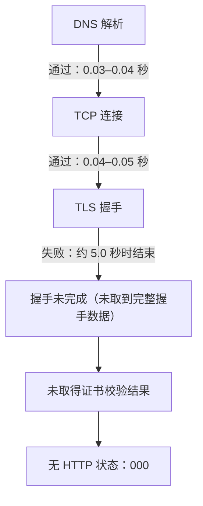

# A-PUBLIC-TLS-DIAGNOSIS-20261027 · 公开网页 TLS 分层只读诊断

诊断时间：2026-10-27 10:31:35–10:32:05 UTC（18:31–18:32 UTC+8）。对象：`https://linux.do/latest`、`https://www.v2ex.com/go/programmer`，对照 `https://github.com/`。方法：每个目标一次匿名 curl 请求，丢弃正文与响应头，20 秒硬超时，不跟随重定向，无重试；只在内存中提取分层指标，原始 stderr 未落盘、未回显。历史失败摘要（curl exit 35、Python unexpected EOF、Chrome connection closed）取自 A-COMMUNITY-PRACTICE-SCAN-20261027，本次未重跑同条件取页。

## 结论与最小解决动作

**故障点在 TLS 握手层：DNS 解析和 TCP 连接都成功，TLS 握手未完成，未取得证书校验结果，也没有任何 HTTP 响应。根因未知，现有证据不足以指向路径中间设备、目标侧或本机栈中的任何一个。** 需注意解析和连接成功不等于已抵达站点：历史摘要中改用公共 DNS（223.5.5.5／8.8.8.8）仍返回与企业 DNS 相同的内网出口地址（本次未重测，不记录具体地址），本次 DNS／TCP 计时对应的是该地址（按同一主机、同一网络路径推断）。

已排除的层、未能判定的层及依据：

- **不是 DNS 解析失败**：两个目标解析耗时 0.028／0.043 秒，均成功返回结果（结果指向同一内网出口，见上）。
- **不是 TCP 连接失败**：TCP 建连 0.037／0.050 秒完成，连接确实建立（到该出口地址，不证明已直达站点）。
- **不是本机 TLS 客户端整体失效**：同机、同 curl、同 Schannel 栈到 `https://github.com/` 在 1.216 秒内完成握手，返回 HTTP 200，证书校验通过。
- **不是 HTTP 层拒绝**：状态码为 000，没有收到任何响应，不能记为 403／429、登录要求或站点拒绝。
- **证书层未判定**：握手未完成，未取得证书校验结果，不能排除证书校验失败；本次没有证书错误可处理，保持证书校验开启。
- **不是本任务 20 秒硬超时触发**：连接在约 5.0 秒时结束，远早于本次上限；本机 TLS 栈自身的握手等待上限仍未排除（见“未知”）。

仍不能确定的两点：

- 约 5.0 秒结束是路径中间设备断开、目标侧断开，还是本机 TLS 栈自身的握手等待上限。两个目标分别为 5.039／5.053 秒，几乎一致，只能作为线索，不能当作归因。
- 是否收到 ServerHello 或 TLS alert、断开是 RST 还是 FIN，均未验证：本次未抓包，也没有逐字节握手记录。

最小解决动作，按证据分层：

1. **网络／管理员层（首选）**：请网络管理员按本次时间窗（2026-10-27 10:31 UTC）核对该主机到这两个目标 443 端口的 TLS 握手是否被网关、防火墙或安全设备重置或丢弃，以及是否存在按 SNI／目标网段的放行策略。核对范围还应包含 DNS 解析是否被内部接管，以及内网出口本身如何处理这些握手，而不只是外部防火墙／SNI 策略。在本次不抓包、不开 verbose 的约束下，只有网关侧记录能区分断开方式；这是能区分候选的最小新增证据。
2. **站点侧**：只有网络侧确认没有拦截后，才由能接触站点运维的人核对该时段来自本出口的 ClientHello 是否被丢弃。普通读者无法自查，也不应据此判断站点拒绝。
3. **证书与 HTTP**：证书层未判定，本次没有证书错误可处理，也没有 HTTP 响应；保持证书校验开启，不要因握手失败关闭校验或改信任链。
4. **不要**改 DNS、代理、VPN、系统证书或安全软件，也不要重复同条件探测；能改变判断的新证据是第 1 条的网关侧记录，或另一条已获准网络路径上的一次同条件结果。若获准抓包，逐字节握手记录也可区分断开方式，可作为本机侧的另一条最小待证。

云端可读只说明另一个网络能到达这些站点，不证明本机已修复；本次现象与历史失败同层，不能写成已恢复。

## 分层判定

| 层 | linux.do/latest | v2ex.com/go/programmer | github.com（对照） | 可下的结论 |
|---|---|---|---|---|
| DNS 解析 | 成功，0.028 s | 成功，0.043 s | 成功，0.024 s | 排除解析失败；结果指向内网出口，未证明直达站点 |
| TCP 连接 | 成功，0.037 s | 成功，0.050 s | 成功，0.047 s | 排除建连失败；连接对象为该出口 |
| TLS 握手 | 未完成，0.000 s；连接约 5.0 s 后结束 | 未完成，0.000 s；连接约 5.05 s 后结束 | 完成，1.216 s | 失败点在 TLS 握手 |
| 证书校验 | 未取得结果（握手未完成，`ssl_verify_result`=0 不能作为通过或未校验证） | 同左 | 通过（curl 未报证书错误，HTTP 200） | 证书层未判定；本次无证书错误证据 |
| HTTP 响应 | 无，状态 000 | 无，状态 000 | 200 | 无 HTTP 层证据 |
| curl 退出码／类别 | 35 / TLS 握手失败 | 35 / TLS 握手失败 | 0 / 正常 | — |

## 脱敏证据表

| 项目 | linux.do/latest | v2ex.com/go/programmer | github.com |
|---|---|---|---|
| 请求 UTC 时间 | 2026-10-27T10:31:36Z | 2026-10-27T10:31:48Z | 2026-10-27T10:31:58Z |
| 退出码 | 35 | 35 | 0 |
| 错误类别（仅类别） | TLS_HANDSHAKE_FAIL | TLS_HANDSHAKE_FAIL | NO_ERROR |
| DNS 耗时 | 0.027624 s | 0.043211 s | 0.024033 s |
| TCP 建连耗时 | 0.036748 s | 0.050030 s | 0.047223 s |
| TLS 握手完成耗时 | 0.000000 s（未完成） | 0.000000 s（未完成） | 1.216162 s |
| 总耗时 | 5.039021 s | 5.053087 s | 3.134614 s |
| HTTP 状态 | 000 | 000 | 200 |
| `ssl_verify_result` | 0（握手未完成，不能作为证书通过证据） | 同左 | 0（握手完成且有 HTTP 200，可判证书校验通过） |
| 重定向数 | 0（未跟随） | 0（未跟随） | 0（未跟随） |

本机工具：Windows 11；curl 8.22.0（Schannel、zlib 1.3.2、brotli 1.2.0、zstd 1.5.7、libidn2／libpsl 等），请求使用 `-q` 忽略个人 curl 配置。历史证据中的 Python 侧为 Python 3.13.5／OpenSSL 3.0.16，本次未重跑。

## 已有证据与本次补齐

| 证据 | 来源 | 本次处理 | 对分层的意义 |
|---|---|---|---|
| curl exit 35，Schannel 报握手阶段收不到握手数据 | 已有公开摘要 | 同层复现 | 指向 TLS 握手，但未量化阶段 |
| Python／OpenSSL `UNEXPECTED_EOF_WHILE_READING` | 已有公开摘要 | 未重跑，仅作旁证 | 两个独立 TLS 栈都在握手中收到连接结束，说明不是单一客户端库的缺陷 |
| Chrome headless `ERR_CONNECTION_CLOSED`，DOM 为空 | 已有公开摘要 | 未重跑 | 与 TLS 层断开一致，未获得页面 |
| HTTP 80：TCP 建立、请求发出后 `Empty reply from server`（exit 52） | 已有公开摘要 | 未重跑 | 80 端口同样没有应用层响应，但不能单独据此判定拦截方 |
| 公共 DNS（223.5.5.5／8.8.8.8）仍返回与企业 DNS 相同的内网出口地址 | 已有公开摘要（A-COMMUNITY-PRACTICE-SCAN-20261027/sources.md） | 本次未重测 | 解析可能已被内部接管，DNS／TCP 成功不能证明已直达站点 |
| 各目标 DNS／TCP／TLS 分段计时 | 本次新增 | 已测 | 证明前两层通过，失败落在握手阶段 |
| 连接结束点约 5.0 秒（早于 20 秒上限） | 本次新增 | 已测 | 排除本任务 20 秒硬超时；本机 TLS 栈自身的握手等待上限仍未排除（见“未知”），给出可核对的时间窗 |
| 同机到 github.com 的 TLS＋HTTP 200 基线 | 本次新增 | 已测 | 排除本机 TLS 栈整体失效和全部 HTTPS 出网阻断 |
| WebFetch 域名安全校验拒绝 | 已有公开摘要 | 未重试 | 属工具侧策略，不是站点 HTTP 拒绝 |

## 未知与缺失证据

- **根因未知**：未取得完整握手数据，是否收到 ServerHello 或 TLS alert 未验证（未抓包），也没有 HTTP 状态，无法区分路径中间设备、目标侧策略与本机栈等待上限。证书层未判定，没有证书校验结果，也不能排除证书校验失败。约 5 秒的一致时长是观察，不是归因。按 curl 退出码语义，35 只表示 TLS 握手失败，不细分协议版本、SNI 或对端断开；本次不能据此再往下归因。
- **断开方式未知**：未取得 RST／FIN 区分，也没有握手阶段的逐字节记录；按任务约束禁用 verbose、trace 和抓包。
- **出口路径未知**：未读取或输出代理配置。若请求经过代理，连接计时只能证明到代理的 TCP 建立，不能证明已直达源站；本次不对是否经代理作判断。历史摘要中公共 DNS 仍返回同一内网出口地址（不记录具体地址），说明解析可能已被内部接管，本次 DNS／TCP 计时对应的是该出口（按同一主机、同一网络路径推断），不能据此认为已直达站点。
- **历史证据的完整性**：Python 与 Chrome 的失败来自另一个任务，时间与本次不同，只能作为同层旁证，不能当作同一次分层的计时对照。
- **能改变判断的最小新增证据**：网络管理员在网关侧对同一时间窗内到这两个目标 443 的 TLS 握手记录（ClientHello 是否发出、是否有任何返回、断开方式），并核对 DNS 接管与内网出口的处理；或另一条已获准网络路径上的一次同条件请求。若获准抓包，逐字节握手记录也可区分断开方式与是否收到 ServerHello／TLS alert，可作为本机侧的另一条最小待证。以上都不需要关闭 TLS 校验、更换身份或绕过访问控制。

## 约束执行

- 仅使用既有 curl 与本机 Python 版本查询；每个目标只发一次请求，共 3 次；整体耗时约 30 秒，未超过 5 分钟，单次未超过 20 秒；无自动重试。
- 正文与响应头已丢弃，原始 stderr 未写入磁盘、未回显；仅保留工具版本、UTC 时间、公共域名、退出码、分段耗时、校验结果类别与 HTTP 状态。
- 未安装软件、未调用新服务、未注册或登录账号、未使用凭据；未读取私人会话、环境变量或代理配置；未修改 DNS、代理、VPN、证书信任、TLS 校验或安全软件。
- 未扩展目标域名、端口或入口，未跟随重定向；未对本机路径、网络地址或证书内容作输出。
