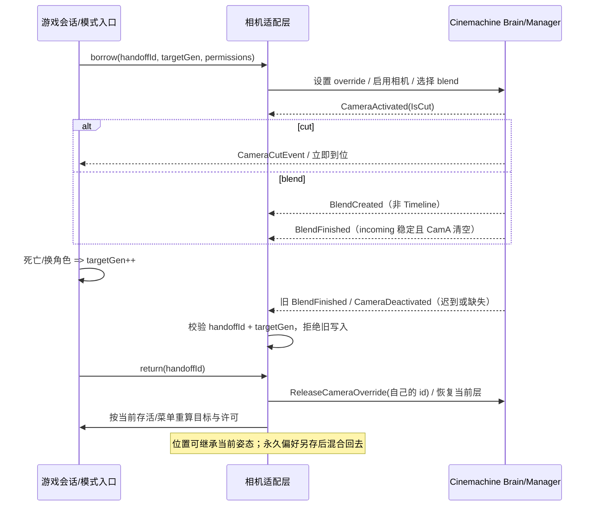

# 镜头借出归还：已核实来源与筛选（B-CORE-CAMERA-RETURN-SOURCES-20261104）

> 采集与核实：2026-11-04（Asia/Shanghai），读取截止同日。只读公开源码、官方文档和讨论；未安装 Cinemachine，未运行 Unity／Unreal／Godot，未做浏览器验收，也没有实机手感数据。
> 固定源码：`Unity-Technologies/com.unity.cinemachine@45728f3030787076f32930101d11d9ca96fe3a0f`。该 ref 的 `package.json` 是 `3.1.8-pre.2`（2026-08-04），不是稳定 3.1.7；本清单的源码行号只对该 ref 成立，接项目时要按实际 Editor／包版本重核。项目源码另固定：`EXOK/Celeste64@6edfe1ebd2a21a6134d7675a28e357891025407e`、`dbvv1/MOBA-Like@cb818773da66e6a8ee77a4576339f33457fba32d`。
> 统计口径：6 路收集 + 2 轮追链，按 URL 去重后 480 条；逐条核验“页面存在且内容就是候选所说的东西”后保留 450 条，淘汰 30 条。140 条渠道／页面不可达，按首因归类的数量见 §1.3；分类会重叠，数量只用于说明覆盖缺口，不代表各站总量。

**怎么读**：要直接开工，读 §0 的结论与第一步，再按 §3 找到对应问题；要判断某项证据该不该信，读 §2 的排序标准和该项在附录里的原始理由；要追版本或失败面，优先看 §4 的十二项。附录是 450 条完整台账，不必顺序读完。

## 0. 先给结论

**推荐契约：在现有 Session／相机模式入口保存交接身份，返回时只撤自己持有的那一层，并按当前菜单、存活身份和权限重新计算目标和许可；不要恢复借出前的 `enabled`／Follow 快照。** 这是任务既定决定（[`wp10-motion.md#camera-control-return`](../../../../research/wp10-motion.md#camera-control-return)）在源码层的落点，不是本轮新造的产品规则。

五问各一句：

- **Q1 cut／blend 完成**：官方把 cut 当零长度 blend。cut 会发 `CameraActivated(IsCut=true)` 和 per-brain 的 `CameraCutEvent`，但**不发** `BlendFinished`；`CameraDeactivated` 要等 blend 最后一帧之后。判断“完成”必须按 cut／blend／取消三条路径分开，不能只等 `BlendFinished`。
- **Q2 死亡／换角色后的迟到通知**：Cinemachine 事件经 `CinemachineCore` 全局广播，旧会话的完成回调可以在新角色生成后才到。游戏侧必须带交接 ID 与目标代次，在写入点拒绝过期回调；比较相机引用不够，因为同一个相机对象可能被复用。
- **Q3 嵌套菜单只撤自己持有**：用 `SetCameraOverride` 返回的 override ID 和 `ReleaseCameraOverride(id)`，或每层自己的相机／Timeline mixer；不要用 priority 数值快照或全局禁启 Brain 代替所有权。`Pause()` 会释放该 Timeline 的全部 override，`SetSpeed(0)` 不会；暂停还会触发 `OnGraphStop`，让 mixer 误判结束。
- **Q4 临时跟随结束保位置与永久偏好**：位置连续、永久偏好（轨道角度／距离／锁定目标）、输入许可是三份状态。`InheritPosition`／`FreezeWhenBlendingOut` 只解决画面过渡，不保存偏好；3rdPersonFollow 会按 Follow 目标重算，`ForceCameraPosition` 也可能被后续帧覆盖。按 body 类型选 `ForceCameraPosition`、`OnTargetObjectWarped` 或 `CancelDamping`。
- **Q5 主震关闭后的次级尾震**：`CinemachineImpulseListener` 的 `ReactionSettings` 会另生成一段有独立 `Duration` 的次级噪声；把主信号 `Gain` 设为 0 不会清掉它。包内没有“按源 Cancel”的调用，已发出的 impulse 只能等 envelope 到期或全局 `Clear`；后者会误伤其他源，不能当单玩家关闭手段。

**第一步（给下一个接线单元）**：选一个现有模式入口，先加 `handoffId + targetGen` 和 cut／blend／cancel 三路事件日志，再谈手感。先用固定源码的 `BlendManager.ProcessActiveCamera`（[L135-L194](https://github.com/Unity-Technologies/com.unity.cinemachine/blob/45728f3030787076f32930101d11d9ca96fe3a0f/com.unity.cinemachine/Runtime/Core/BlendManager.cs#L135-L194)）核对实际事件顺序，不要按教程或旧版本记忆接线。

**哪些情况不要照做**：单一、不可中断的入口可以保留简单状态，不必上通用相机栈；不要因为等 `BlendFinished` 而阻塞返回；不要把 3.1.7 或 2.x 的结论直接外推到 6.x／3.1.8-pre；不要用一个全局 `Clear()` 关某个玩家的震动；没有引擎运行时，不能把本清单的源码结论写成“已验收”。

## 1. 渠道覆盖表

### 1.1 按收集角度

“净得”指去重后、通过链接核验的候选数；追链轮只列新增。

| 角度 | 实际看了什么、怎么取 | 首轮净得 | 追链净得 |
|---|---|---:|---:|
| 官方团队与高质量项目 | Cinemachine 固定 ref 的 `Runtime/Core`、`Runtime/Impulse`、`Runtime/Timeline`、`Documentation~`；3.1／6.6／6.7 手册与 API；同仓 PR／issue；Celeste64、ATerribleKingdom、open-project-1、MOBA-Like、Timeline-Cinemachine-Test-Suite 固定 commit；GDC Vault 标题／讲者 | 46 | 34 |
| 头部覆盖 | GitHub 搜索（约 55 组中英文词）、topic 页、trending、5 个 awesome 列表、Claude 插件市场（315 项）、Unity 官方插件 skills、skills.sh trending；逐个对照 a1dbv 已覆盖项 | 32 | 47 |
| 英文从业者与技术社区 | Unity Discussions、Unreal 论坛（Discourse JSON）、GDC Vault、HN Algolia、Lobsters story JSON、dev.to、Godot 论坛、gamedeveloper、nalar.dev、Bevy 文档、Adventure Creator 论坛、NeoFPS／Phantom Camera 文档、GitHub raw | 31 | 38 |
| 中文社区 | 掘金、知乎、B 站、少数派、即刻、developer.unity.cn、CSDN、GameRes、indienova、V2EX；配合 Bing／百度 HTML 补充；能直读的逐页核标题与关键段 | 23 | 39 |
| 真实使用问题与反馈 | Unity Discussions 的 `search.json`／`t/<id>.json`（带浏览器 UA）、Issue Tracker API、GitHub issue／PR 评论、Stack Overflow API、Godot／Unreal 论坛；约 50 组故障词，顺帖内链接与维护者回复继续读 | 45 | 43 |
| 没人点名的新东西 | GitHub 近 3 个月新建／活跃仓库、topic:agent-skills、插件市场、Unity 6.6／7.0／CLI／Spark 等版本与产品线 | 25 | 47 |
| 合计 |  | **202** | **248** |

这轮的搜索预算在前段就用尽（WebSearch 200/200），所以后续主要靠各站 API／JSON、`curl` 直取、固定 commit 和候选页外链。没有把搜索摘要当来源，也没有把“链接能打开”当成“内容已读”。

代表性检索词：`cinemachine blend finished`、`cut`、`CameraDeactivated`、`InheritPosition`、`ForceCameraPosition`、`impulse cancel`、`camera stack`、`camera takeover`、`cutscene handoff`、`相机状态栈`、`镜头切换 回不去`、`Cinemachine 震动 残留`、`死亡 复活 相机`、`菜单 相机 优先级`、`MOBA 相机`。中文站另换“虚拟相机／混合／状态驱动／镜头回位／震屏”等同义说法；GitHub 侧同时用 topic 与 `created:>`、`pushed:>` 过滤近三个月。

### 1.2 按来源类型（450 条通过核验的候选）

| 来源类 | 条数 | 说明 |
|---|---:|---|
| GitHub | 189 | 其中 Cinemachine 同仓 72（固定源码／文档 36、PR／issue 36），其他项目 117 |
| Unity Discussions／旧论坛／Issue Tracker | 99 | Discussions 92、Issue Tracker 6、旧 `forum.unity.com` 1 |
| Unity 官方手册与 API | 62 | `docs.unity3d.com` 的 Cinemachine 3.1／6.7 手册、API、changelog |
| 中文社区 | 27 | 掘金 5、B 站 8、博客园 3、developer.unity.cn 4、CSDN／网易／个人博客等 |
| 跨域与从业者写作／Stack Overflow | 23 | nalar.dev 4、Stack Overflow 4、Cobo 2、Brutal Baguette 2 等 |
| 其他引擎／插件文档 | 20 | Godot、Phantom Camera、Composable Camera、klipp、NeoFPS、Bevy |
| Epic／Unreal | 12 | Epic 文档 11、Unreal 论坛 1 |
| Unity 官方博客／产品／版本 | 9 | Cinemachine 3、2D、Timeline Signals、Unity 6.6 升级指南、Spark、CLI 使用数据 |
| 视频／演讲 | 9 | YouTube 5、GDC Vault 4（多数只核到标题／摘要，未看正文） |

### 1.3 读不到的部分（140 条，按首因归类）

| 原因类 | 条数 | 代表渠道与处理 |
|---|---:|---|
| 其他（JS 渲染／许可／无原文） | 28 | 页面只有壳或仓库无 LICENSE；只读可读部分，许可不明的不当可复用 |
| Unity 论坛反爬／JSON 403 | 17 | 不带浏览器 UA 时 `Crawler is not allowed`；改用 WebFetch／带 UA 后读到一部分，仍有帖子正文未取 |
| WebSearch 配额耗尽 | 15 | 本会话 200/200 用尽，后续无法再做关键词检索或反链 |
| GitHub API 限流 | 13 | 未认证 60/hr 用尽（共享出口）；改用 raw／HTML／clone，部分 issue 评论未读 |
| YouTube／视频 | 10 | 页面与 oEmbed 返回 000／TLS 失败；只核到标题，未看内容 |
| 连接失败 000／TLS | 9 | GDC 幻灯片、archive.org、Medium、itch.io 等 |
| 页面 404／下架 | 7 | 旧手册页、仓库改名、教程下架；未用最新版替代 |
| 搜索引擎被挡／本地化 | 6 | DuckDuckGo／Google／Brave／Yahoo 000；Bing 只回中文本地化结果 |
| 知乎 403 | 6 | 专栏与搜索页均 403，未找到可用 API／镜像 |
| 其他站点 403 | 6 | gamedev.net、Playmaker、celemiao、Fab 等 |
| Issue Tracker SPA／登录 | 6 | 只服务端渲染出标题；Jira 票据需登录或为内部票据 |
| B 站风控／空正文 | 5 | 412、验证码、opus detail `-352`；仅个别 article API 可读 |
| Epic 文档 JS 渲染 | 4 | 只拿到 `Table of Contents` 外壳或 hCaptcha |
| 微信公众号验证页 | 3 | “环境异常，去验证”，正文不可读 |
| Reddit 000 | 3 | `www.reddit.com`／`old.reddit.com` JSON 连接失败 |
| CSDN 521 | 2 | 源站限流；只把可读的一篇作为线索，不采信其余正文 |

对本清单 450 条做一次 `curl` 状态复核：345 条返回 200；98 条对 `curl` 返回 403（Unity Discussions、Stack Overflow、知乎等反爬站，收集时改用浏览器 UA／API／WebFetch 读取）；6 条返回 000（YouTube、Godot 论坛）；1 条返回 521（CSDN）。所以“通过核验”指页面与该候选内容对得上，不等于每条都能用同一种 `curl` 打开；打不开的站点结论只按对应渠道实际读到的范围使用。

YouTube 的 5 条虽然保留在候选清单里（标题／作者可核），本机直连仍返回 000，播放器与字幕未读；它们只作设计线索，不能当行为证据。GDC Vault 的 4 条只到标题／摘要，trauma、衰减等细节未核。

另有几类渠道只有零产出或仅标题：HN 与 Lobsters 上直接讨论“相机归还／所有权”的帖子很少，主要收获仍在 Unity／Unreal／GDC；skills.sh API 返回 401、网页结果为客户端渲染，未取得 camera 类 Skill 排名与安装量；Unity Learn 的 Cinemachine Brain 教程已下架；Unity 官方博客两篇 Cinemachine 文章正文由 JS 渲染，只拿到外壳，未提取其中外链与示例仓库。

许可不明的几项单独标出：`SimulatedFlow/ue-plugin-FrameVolume` 无 LICENSE、README 自称商用 source-available；`LeahLee13/UnityCameraSystem_CC` 无 LICENSE；`HermeticOrmus/claude-code-game-development` 与 `Yuki001/game-dev-skills` 未见 LICENSE（前者页面标 MIT，未取原文）。这些只作机制阅读，不作为可复制依赖。

## 2. 筛选标准与排序

排序不是按 star 或搜索排名，而是按“能不能支撑接线决定”：

1. **固定 ref、可定位**：优先 `45728f3` 的源码行、`Documentation~`、官方手册字段或 changelog；能指到具体事件、方法、字段的排在前面。
2. **版本可适用**：先分 2.x／3.1.x／6.x。3.1.7 的报障不能直接当 3.1.8-pre 的现状；6.6 起 Cinemachine 成为 Editor 核心包，包版本与 Editor 版本绑定。每项都保留其版本语境。
3. **证据类型**：官方源码／文档 > 官方维护者回复、issue、PR（带复现和修复版本）> 固定 commit 的项目源码 > 跨引擎实现 > 教程／视频／索引。
4. **是否直接回答五问**：能给出“输入、状态所有者、原生入口、必须保留条件”的排前面；只重复“相机有跟随／混合职责”的排后面。
5. **正反都收**：同一问题至少保留一个失败或反例（事件丢失、快照残留、暂停释放全部 override、尾震残留），避免只收官方宣传。
6. **许可与可复用**：MIT／Apache／UCL／source-available／无 LICENSE 分开记；无许可或商用条款不明的只作机制参考。
7. **不重复既有成果**：a1dbv 已在 `04-client-modules.md#camera-contract`、`wp10-motion.md#camera-control-return`、`wp11-camera.md#s12-2` 写过的通用职责不重列；本清单只收能补源码入口、失败面或版本差量的项。

按这套标准，附录把候选分成 A1-A11 十一类；正文只展开最靠前的证据。附录保留原始链接与原始理由，便于逐条回查。

## 3. 五问的证据索引

### Q1：cut 与 blend 完成不是同一种通知

| 字段 | 结论与入口 |
|---|---|
| 输入 | 本次切换是 cut 还是 blend、期望时长／曲线、目标相机、所属 Brain／Channel |
| 状态所有者 | Cinemachine Brain／BlendManager 拥有当前 blend 和事件；游戏会话只拥有“这次交接”的 ID 与期望目标 |
| 原生回调入口 | `BlendManager.ProcessActiveCamera` 发 `CameraDeactivatedEvent`／`CameraActivatedEvent(IsCut)`／`BlendFinishedEvent`；per-brain helper 另发 `CameraCutEvent`；`CinemachineBrain.ActiveBlend`／`ResetState`／`IsBlending`；`CinemachineBlend.IsComplete` |
| 必须保留的条件 | 按 `Origin`／Brain／Channel 过滤；cut 不等 `BlendFinished`；Timeline blend 不发 `BlendCreated`；等待方要容忍事件丢失；`IsBlending` 在设置 priority 的同帧可能仍为 false；按实际包版本核 3.1.3／3.1.5／3.1.7／6.6 的修复 |
| 固定源码行 | [BlendManager.cs#L135-L194](https://github.com/Unity-Technologies/com.unity.cinemachine/blob/45728f3030787076f32930101d11d9ca96fe3a0f/com.unity.cinemachine/Runtime/Core/BlendManager.cs#L135-L194)；[CinemachineBlend.cs#L60-L68](https://github.com/Unity-Technologies/com.unity.cinemachine/blob/45728f3030787076f32930101d11d9ca96fe3a0f/com.unity.cinemachine/Runtime/Core/CinemachineBlend.cs#L60-L68) |
| 第一步 | 先用 `BlendManager.ProcessActiveCamera` 和日志确认 `CameraActivated(IsCut)`／`BlendFinished`／`CameraDeactivated` 三路实际顺序，再把“返回条件”分别写成 cut、blend、cancel 三个分支 |

首选来源：

- [BlendManager.ProcessActiveCamera（固定 45728f，L135-L194）](https://github.com/Unity-Technologies/com.unity.cinemachine/blob/45728f3030787076f32930101d11d9ca96fe3a0f/com.unity.cinemachine/Runtime/Core/BlendManager.cs#L135-L194)：实际顺序是先对上一帧 live 集合发 `CameraDeactivated`，再以 `IsCut = !IsBlending` 发 `CameraActivated`；只有 incoming 未变且 `CamA == null` 才发 `BlendFinished`。这是 Q1／Q2 最直接的源码入口。
- [Cinemachine Brain Events 文档（固定 45728f，L12-L16）](https://github.com/Unity-Technologies/com.unity.cinemachine/blob/45728f3030787076f32930101d11d9ca96fe3a0f/com.unity.cinemachine/Documentation~/CinemachineBrainEvents.md#L12-L16)：官方表写明 cut 是零长度 blend、`BlendFinished` 在零长度时不触发、`CameraDeactivated` 在 blend 最后一帧后发、`CameraCutEvent` 在零长度切换时发。
- [Camera Events 文档（固定 45728f，L3-L15）](https://github.com/Unity-Technologies/com.unity.cinemachine/blob/45728f3030787076f32930101d11d9ca96fe3a0f/com.unity.cinemachine/Documentation~/CinemachineCameraEvents.md#L3-L15)：按单个相机过滤的同一张表，适合只关心一台相机时使用。
- [CinemachineBlend.IsComplete（固定 45728f，L60-L68）](https://github.com/Unity-Technologies/com.unity.cinemachine/blob/45728f3030787076f32930101d11d9ca96fe3a0f/com.unity.cinemachine/Runtime/Core/CinemachineBlend.cs#L60-L68)：完成条件是 `TimeInBlend >= Duration || !IsValid`；相机销毁会让 blend 提前判完成。同文件的 `BlendTime` 对 `Styles.Cut` 返回 0。
- [ActivationEventParams.IsCut（固定 45728f，L55-L69）](https://github.com/Unity-Technologies/com.unity.cinemachine/blob/45728f3030787076f32930101d11d9ca96fe3a0f/com.unity.cinemachine/Runtime/Core/ICinemachineCamera.cs#L55-L69)：订阅 `CameraActivated` 时用 `IsCut` 区分 cut 与 blend，不必猜时长。
- [CinemachineBrain.ResetState／ActiveBlend（固定 45728f，L471-L491）](https://github.com/Unity-Technologies/com.unity.cinemachine/blob/45728f3030787076f32930101d11d9ca96fe3a0f/com.unity.cinemachine/Runtime/Behaviours/CinemachineBrain.cs#L471-L491)：`ResetState` 无混合重选当前相机；把 `ActiveBlend` 设为 `null` 可强制完成 blend。注意 `ActiveBlend` 的 setter 注释明确说只建议用来置 null。
- [CinemachineMixerEventsBase 的 CameraCutEvent（固定 45728f，L46-L96）](https://github.com/Unity-Technologies/com.unity.cinemachine/blob/45728f3030787076f32930101d11d9ca96fe3a0f/com.unity.cinemachine/Runtime/Helpers/CinemachineMixerEventsBase.cs#L46-L96)：`CameraCutEvent` 是 per-brain helper 收到 `evt.IsCut` 后另发的，`CinemachineCore` 没有独立 cut 事件。
- [Unity Issue Tracker 7994](https://issuetracker.unity.com/issues/7994)：连续打断多个 blend 会把最终时长从应有的 7-8 秒压到 0.7 秒；3.1.5 修复。说明重叠混合的时长状态会累积，不能只按单次 blend 估算完成时间。
- [Unity Issue Tracker 12352](https://issuetracker.unity.com/issues/12352)：blend 未完成就切回原相机时画面跳到缓存位置，3.1.7-pre.1 修复。返回不能直接复用旧快照。
- [3.1.7 BlendFinishedEvent 不触发（2026-10-30）](https://discussions.unity.com/t/in-cinemachine-3-1-7-brain-events-are-not-firing/1740780)：报告 3.1.6 升 3.1.7 后 `CinemachineCore.BlendFinishedEvent` 失效，帖内无结论。靠该事件判定完成再交还控制的接线会静默失效，必须按项目实际版本实核。
- [CinemachinePlayableMixer 只释放自己的 override（固定 45728f，L155-L162）](https://github.com/Unity-Technologies/com.unity.cinemachine/blob/45728f3030787076f32930101d11d9ca96fe3a0f/com.unity.cinemachine/Runtime/Timeline/CinemachinePlayableMixer.cs#L155-L162)：Timeline 在 `OnPlayableDestroy` 只 `ReleaseCameraOverride` 自己保存的 `m_BrainOverrideId`，是 Q1 退出路径与 Q3 所有权共用的官方实现。

### Q2：死亡／换角色后的迟到通知

| 字段 | 结论与入口 |
|---|---|
| 输入 | 所属玩家、目标代次、交接 ID、当前存活身份、旧通知所属的 Brain／相机 |
| 状态所有者 | 游戏会话拥有身份与权限；Cinemachine 只拥有相机状态和事件，不拥有“谁有资格控制新角色” |
| 原生回调入口 | `CinemachineCore.CameraDeactivatedEvent`、`CameraActivatedEvent`、`BlendFinishedEvent`；`CinemachineCore.OnTargetObjectWarped`；`CinemachineCamera.ForceCameraPosition`；`PreviousStateIsValid`／`CancelDamping`；`CinemachineBrain.ActiveBlend = null` |
| 必须保留的条件 | 事件全局广播；`CameraDeactivated` 延迟到 blend 末帧；打断时事件可能缺失；静态事件在加载时重建；旧相机引用可能复用；写入点必须校验 `handoffId + targetGen`；旧回调只可幂等结束自己的持有，不能提交新目标／许可 |
| 固定源码行 | [BlendManager.cs#L135-L194](https://github.com/Unity-Technologies/com.unity.cinemachine/blob/45728f3030787076f32930101d11d9ca96fe3a0f/com.unity.cinemachine/Runtime/Core/BlendManager.cs#L135-L194)；[CinemachineCore.cs#L220-L237](https://github.com/Unity-Technologies/com.unity.cinemachine/blob/45728f3030787076f32930101d11d9ca96fe3a0f/com.unity.cinemachine/Runtime/Core/CinemachineCore.cs#L220-L237) |
| 第一步 | 在每个借出／返回入口加 `handoffId + targetGen`，先在写入点拒绝旧回调，再接相机；用“死亡后重生为另一个角色，再送达旧完成通知”做最小复现 |

首选来源：

- [BlendManager.ProcessActiveCamera（固定 45728f，L135-L194）](https://github.com/Unity-Technologies/com.unity.cinemachine/blob/45728f3030787076f32930101d11d9ca96fe3a0f/com.unity.cinemachine/Runtime/Core/BlendManager.cs#L135-L194)：先发 Deactivated、后发 Activated 的顺序意味着“旧相机停用”和“新相机会话开始”可能跨帧；旧回调要按事件携带的 mixer／相机过滤。
- [CinemachineCore 四个相机事件（固定 45728f，L220-L237）](https://github.com/Unity-Technologies/com.unity.cinemachine/blob/45728f3030787076f32930101d11d9ca96fe3a0f/com.unity.cinemachine/Runtime/Core/CinemachineCore.cs#L220-L237)：`BlendFinished` 只在相机完成 blend-in 时发，`CameraDeactivated` 在相机停止 live 后发；两者都是全局静态事件。
- [PR #1028：第二个 blend 打断第一个时 Deactivated 丢失](https://github.com/Unity-Technologies/com.unity.cinemachine/pull/1028)：`(A→B)→C` 时 A 的 `CameraDeactivated` 从未发出，PR 补了单测。迟到通知不只是“晚到”，还可能根本不发。
- [Unity Discussions 1556716：三层 blend 吞掉首个 Deactivated](https://discussions.unity.com/t/1556716)：用户列出 `A→B→C` 的实际事件序列（缺 CamA 的 Deactivated），维护者确认 bug 并在 3.1.3 修复。最小复现。
- [3.1.3 changelog（固定 45728f，L89-L94）](https://github.com/Unity-Technologies/com.unity.cinemachine/blob/45728f3030787076f32930101d11d9ca96fe3a0f/com.unity.cinemachine/CHANGELOG.md#L89-L94)：记录“blend 被另一个 blend 打断时 `CameraDeactivated` 发送不一致”的修复；3.0.0-pre.5 才加入 `BlendFinished`／`CameraDeactivated` 与 `FreezeWhenBlendingOut`。旧项目不能按现状假设事件齐全。
- [Unity Discussions 1731465：静态重置让 Awake 订阅丢失](https://discussions.unity.com/t/cinemachinecore-resetstaticsonload-in-editor-makes-it-tedious-to-listen-to/1731465)：除 `CameraActivated` 外的 Core 事件在 Editor 加载时重建，早于 `Awake` 的订阅可能丢；维护者确认是 bug。跨场景／域重载要重新订阅并防重复。
- [PR #1122：静态重置提前到 SubsystemRegistration](https://github.com/Unity-Technologies/com.unity.cinemachine/pull/1122)：上述订阅丢失的根因与修复版本。
- [PR #1099：ForceCameraPosition 被后续帧覆盖](https://github.com/Unity-Technologies/com.unity.cinemachine/pull/1099)：修复 UUM-131870，让强制设置的相机位置／朝向在后续帧保持；死亡／换角色后“立即就位”最直接的底层入口。
- [PR #291：OnTargetObjectWarped 对 3rdPersonFollow 失效](https://github.com/Unity-Technologies/com.unity.cinemachine/pull/291)：附带“移出 20 单位再传送回原点”的复现脚本，正对复活／换角色、传送后的迟到同步。
- [CinemachineCore.OnTargetObjectWarped（3.1 API）](https://docs.unity3d.com/Packages/com.unity.cinemachine@3.1/api/Unity.Cinemachine.CinemachineCore.html)：该调用通知所有可能跟踪该目标的虚拟相机（含未激活者）目标已瞬移，使相机无缝 warp。
- [Celeste64 Player：死亡保存、重生恢复（固定 6edfe1e，L830-L842）](https://github.com/EXOK/Celeste64/blob/6edfe1ebd2a21a6134d7675a28e357891025407e/Source/Actors/Player.cs#L830-L842)：`Kill()` 保存 `cameraTargetForward`／`Distance`，`Added()` 在 `Respawned` 时恢复，每帧从当前位置平滑逼近；成熟项目把“旧状态”存成显式字段，而不是等相机自己恢复。
- [Chop Chop：玩家重建时重设 vcam + Warp（固定 608eac9，L105-L112）](https://github.com/UnityTechnologies/open-project-1/blob/608eac98df29cd97821a6115cd52dfb9027345b1/UOP1_Project/Assets/Scripts/Camera/CameraManager.cs#L105-L112)：玩家每次重新实例化时重设 `Follow`／`LookAt` 并调用 `OnTargetObjectWarped`，避免旧目标／位置瞬移。
- [Unity Discussions 947434：TargetGroup 的 Transform 变 null](https://discussions.unity.com/t/cm-2-10-0-cinemachinetargetgroup-everything-sometimes-breaks-when-transform-becomes-null/947434)：敌人死亡使 TargetGroup 成员变 null，而游戏代码不一定在死亡同帧切相机；官方承认缺 null 检查，是迟到通知的典型样本。

### Q3：嵌套菜单只撤自己持有

| 字段 | 结论与入口 |
|---|---|
| 输入 | 层 ID、父层 ID、要借用的相机／override、输入许可范围、所属 Timeline／Manager |
| 状态所有者 | 每层菜单拥有自己的 override／相机；Brain 或 Timeline 拥有栈顶选择，但不应替下层决定释放 |
| 原生回调入口 | `ICameraOverrideStack.SetCameraOverride`／`ReleaseCameraOverride(id)`；`CinemachinePlayableMixer.m_BrainOverrideId`；`CinemachineCameraManagerBase`／`CameraManagerEvents`；`VirtualCameraRegistry`／`Prioritize` |
| 必须保留的条件 | 只释放自己的 ID；不保存／恢复 priority 快照；`Pause()` 释放该 Timeline 全部 override，`SetSpeed(0)` 不释放；暂停触发 `OnGraphStop` 会让 mixer 误判结束；`timeScale=0` 不冻结相机输入；`InputProvider` 会缓存 `InputAction` |
| 固定源码行 | [CinemachinePlayableMixer.cs#L155-L162](https://github.com/Unity-Technologies/com.unity.cinemachine/blob/45728f3030787076f32930101d11d9ca96fe3a0f/com.unity.cinemachine/Runtime/Timeline/CinemachinePlayableMixer.cs#L155-L162)；[CinemachineCameraManagerBase.cs#L183-L215](https://github.com/Unity-Technologies/com.unity.cinemachine/blob/45728f3030787076f32930101d11d9ca96fe3a0f/com.unity.cinemachine/Runtime/Core/CinemachineCameraManagerBase.cs#L183-L215) |
| 第一步 | 给每层菜单分配一个 override ID，关闭时只 `ReleaseCameraOverride(自己的 id)`；用“依次打开两层菜单再关内层”验证外层仍在 |

首选来源：

- [ICameraOverrideStack（3.1 API）](https://docs.unity3d.com/Packages/com.unity.cinemachine@3.1/api/Unity.Cinemachine.ICameraOverrideStack.html)：覆盖按栈管理，最近的非空覆盖优先，按 `overrideId` 释放；`SetCameraOverride` 传 -1 返回新 ID。
- [CinemachinePlayableMixer 只释放自己的 override（固定 45728f，L155-L162）](https://github.com/Unity-Technologies/com.unity.cinemachine/blob/45728f3030787076f32930101d11d9ca96fe3a0f/com.unity.cinemachine/Runtime/Timeline/CinemachinePlayableMixer.cs#L155-L162)：Timeline 保存 `m_BrainOverrideId`，销毁时只释放它；官方自己的“只撤自己”样例。
- [Unity Discussions 686113：Pause 与 Timeline 优先级](https://discussions.unity.com/t/question-about-timeline-pausing-and-virtual-camera-priority/686113)：`Pause()` 会释放该 Timeline 的全部相机 override，`SetSpeed(0)` 不释放；多个 Shot 的 override 像栈一样“最近的非空者胜”，Timeline 结束时全部释放。
- [Unity Discussions 671512：暂停触发 OnGraphStop](https://discussions.unity.com/t/playable-ongraphstop-called-when-pausing-timeline-breaks-cinemachimixer/671512)：暂停 Timeline 会触发 `OnGraphStop`，`CinemachineMixer` 以为 Timeline 结束并释放全部 override，相机跳到随机相机。暂停不等于只保留自己那一层。
- [Unity Discussions 815794：manager vcam 可嵌套](https://discussions.unity.com/t/what-is-the-best-way-to-manage-different-camera-systems-in-game/815794)：BlendList／ClearShot／Mixing 等 manager vcam 对外像普通 vcam 且可嵌套，Brain 会让退出的 vcam 在 blend 结束前“人工续命”。
- [CinemachineCameraManagerBase 的嵌套事件归属（固定 45728f，L183-L215）](https://github.com/Unity-Technologies/com.unity.cinemachine/blob/45728f3030787076f32930101d11d9ca96fe3a0f/com.unity.cinemachine/Runtime/Core/CinemachineCameraManagerBase.cs#L183-L215)：manager 每帧 `ChooseCurrentCamera` 并以 `Origin=this` 补发子相机 `OnCameraActivated`，此处 `IsCut` 固定为 false；嵌套层的事件归属与 cut 语义要按这个边界处理。
- [VirtualCameraRegistry 优先级排序（固定 45728f，L37-L54）](https://github.com/Unity-Technologies/com.unity.cinemachine/blob/45728f3030787076f32930101d11d9ca96fe3a0f/com.unity.cinemachine/Runtime/Core/VirtualCameraRegistry.cs#L37-L54)：同优先级按 `ActivationId` 降序，启用分配新 id，禁用／销毁只移除自己；这也暴露“没有恢复旧 id”的边界。
- [CinemachineVirtualCameraBase.Prioritize（固定 45728f，L620-L647）](https://github.com/Unity-Technologies/com.unity.cinemachine/blob/45728f3030787076f32930101d11d9ca96fe3a0f/com.unity.cinemachine/Runtime/Core/CinemachineVirtualCameraBase.cs#L620-L647)：新启用相机自动置顶、同优先级最近调用者胜；适合每层只启停自己的相机，不适合当全局所有权栈。
- [Xenia Manager Modal Stack](https://xenia-manager.github.io/wiki/big-screen/modal-stack/)：只有栈顶收输入、只有栈顶能 pop、每个 modal 只释放自己的资源；嵌套菜单的 UI 类比。
- [Xenia ModalService.cs](https://github.com/xenia-manager/xenia-manager/blob/main/source/XeniaManager.BigScreen/Services/ModalService.cs)：`Close` 只在 `ReferenceEquals` 栈顶时弹栈，是“只能撤自己那一层”的可读实现。
- [Game Programming Patterns — State（pushdown automaton）](https://gameprogrammingpatterns.com/state.html)：push／pop 恢复上一层，不要在状态自己的 handler 里删当前状态；Q3 的通用模式。
- [RolandKaechele/StateManager](https://github.com/RolandKaechele/StateManager)：用 push／pop 状态栈管理 Paused／Dialogue／Cutscene，并暴露堆栈查询；配套的 [InputManager](https://github.com/RolandKaechele/InputManager) 用输入 profile 栈在过场／对话／菜单 push blocked 再 pop。
- [Unity Issue Tracker 12432](https://issuetracker.unity.com/issues/12432)：`Time.timeScale=0` 时相机仍会随鼠标移动；暂停没有冻结相机输入，菜单层必须自己收回输入许可。
- [Unity Discussions 1514851：InputProvider 缓存 InputActions](https://discussions.unity.com/t/cinemachine-inputprovider-caches-inputactions-so-overrides-do-not-work/1514851)：只禁用 `CinemachineInputProvider` 不生效，必须整个移除组件；输入持有不能用 `enabled` 开关干净归还。

### Q4：临时跟随结束保位置与永久偏好

| 字段 | 结论与入口 |
|---|---|
| 输入 | 当前屏幕姿态、永久偏好（轨道角度／距离／锁定目标）、是否重生／传送／换目标、body 类型 |
| 状态所有者 | 游戏设置／存档拥有永久偏好；相机组件拥有运行时姿态与阻尼历史；临时层只拥有本次覆盖 |
| 原生回调入口 | `InheritPosition`／`FreezeWhenBlendingOut`；`ForceCameraPosition`；`OnTargetObjectWarped`；`PreviousStateIsValid`／`CancelDamping`；`GetBlendOverride`；`SaveDuringPlay`（运行时要避开） |
| 必须保留的条件 | `InheritPosition` 对 3rdPersonFollow 不等效；`ForceCameraPosition` 可能被后续帧覆盖；OrbitalFollow 位置阻尼有已知回弹；构建／编辑器行为可能不同；偏好与位置分开存；运行时不要写资产 |
| 固定源码行 | [CinemachineCamera.cs#L175-L203](https://github.com/Unity-Technologies/com.unity.cinemachine/blob/45728f3030787076f32930101d11d9ca96fe3a0f/com.unity.cinemachine/Runtime/Behaviours/CinemachineCamera.cs#L175-L203)；[CinemachineFollow.cs#L116-L124](https://github.com/Unity-Technologies/com.unity.cinemachine/blob/45728f3030787076f32930101d11d9ca96fe3a0f/com.unity.cinemachine/Runtime/Components/CinemachineFollow.cs#L116-L124) |
| 第一步 | 先按 body 类型列出可用的复位入口（`ForceCameraPosition`／`OnTargetObjectWarped`／`CancelDamping`），把“当前屏幕姿态”和“永久轨道偏好”分成两份状态，再接临时的 `InheritPosition` |

**Q4 的取舍顺序**：短时观察／按住回看结束时，先保当前屏幕姿态（`InheritPosition` 或 `ForceCameraPosition`），再按 blend 回到永久偏好；死亡／重生／换角色时，清阻尼历史并按新目标重建，不继承旧姿态；菜单／过场返回时，只还输入与权限，目标和取景按当前状态重选。三种情况都不要恢复借出前的 `enabled`／Follow 快照。

首选来源：

- [CameraState.BlendHints 的 InheritPosition／FreezeWhenBlendingOut（固定 45728f，L93-L99）](https://github.com/Unity-Technologies/com.unity.cinemachine/blob/45728f3030787076f32930101d11d9ca96fe3a0f/com.unity.cinemachine/Runtime/Core/CameraState.cs#L93-L99)：`InheritPosition` 让新相机继承 outgoing 当前位置，`FreezeWhenBlendingOut` 用 outgoing 快照混合；是画面过渡开关，不是偏好存储。
- [CameraBlendStack 的快照分支（固定 45728f，L281-L296）](https://github.com/Unity-Technologies/com.unity.cinemachine/blob/45728f3030787076f32930101d11d9ca96fe3a0f/com.unity.cinemachine/Runtime/Core/CameraBlendStack.cs#L281-L296)：实现确认 `FreezeWhenBlendingOut` 或 incoming 已带 `InheritPosition` 时改用 `SnapshotBlendSource`，并处理“从进行中的 blend 反向退出”的时长。
- [CinemachineCamera（3.1 手册）](https://docs.unity3d.com/Packages/com.unity.cinemachine@3.1/manual/CinemachineCamera.html)：`Inherit Position`、`Freeze When Blending Out`、`Standby Update` 的准确语义。
- [CinemachineCamera.OnTransitionFromCamera（固定 45728f，L175-L203）](https://github.com/Unity-Technologies/com.unity.cinemachine/blob/45728f3030787076f32930101d11d9ca96fe3a0f/com.unity.cinemachine/Runtime/Behaviours/CinemachineCamera.cs#L175-L203)：当 `BlendHint` 含 `InheritPosition` 且 incoming 不在当前 blend 中时，取 `fromCam.State` 的最终位置／朝向并调用 `ForceCameraPosition`；这是“保位置”的真实入口。
- [CinemachineFollow.ForceCameraPosition（固定 45728f，L116-L124）](https://github.com/Unity-Technologies/com.unity.cinemachine/blob/45728f3030787076f32930101d11d9ca96fe3a0f/com.unity.cinemachine/Runtime/Components/CinemachineFollow.cs#L116-L124)：强制位置会写回 `TargetTracker` 的跟随状态，而不是只改 Transform；因此后续帧可能按目标重算。
- [Unity Discussions 905576：vcam 回旧位置](https://discussions.unity.com/t/cinemachine-virtual-camera-returns-to-old-position-from-when-it-was-last-disabled/905576)：禁用期间 vcam 停在旧 transform；`InheritPosition` 对 FreeLook 有效但对 3rdPersonFollow 无效，因为后者按 Follow 目标重算，`ForceCameraPosition` 会被立刻覆盖。保位置要按 body 类型选入口。
- [Unity Discussions 941333：回到原位的精细控制](https://discussions.unity.com/t/fine-control-of-camera-back-to-original-position/941333)：维护者说明 `InheritPosition` 开＝取最接近出镜相机的角度，关＝记住自己的设置并在重启时返回；用户最终在整段 blend 期间保存并用 `ForceCameraPosition` 恢复。位置与偏好是两套策略。
- [Unity Discussions 1717983：直接设置位置仍回旧位置](https://discussions.unity.com/t/setting-a-cinemachine-cameras-position-and-rotation-directly/1717983)：2026 反例，`PreviousStateIsValid=false` 与 `ForceCameraPosition` 都不生效；提示不能把“重置状态”当万能返回方案。
- [Unity Issue Tracker 24038](https://issuetracker.unity.com/issues/24038)：3.1.6／3.1.7 中带 `InheritPosition` 的相机混合回来会抖一下并退回自己的角度；官方绕法是关掉位置阻尼。返回资格会被旧状态覆盖。
- [Unity Discussions 1631445：构建与编辑器 InheritPosition 不同](https://discussions.unity.com/t/cinemachine-3-1-3-inherit-position-different-in-build-vs-editor/1631445)：编辑器无缝、构建里从侧面进入，用户发现构建中根本没继承；依赖 `InheritPosition` 的返回不可跨环境假定。
- [Unity Discussions 947037：运行时改 blend 会被永久保存](https://discussions.unity.com/t/cinemachine-blend-changes-in-runtile-change-setting-permanently/947037)：运行时改 blend 设置会被 SaveDuringPlay／资产写入永久保存；维护者明确说不要在运行时改资产，改用 `GetBlendOverride`。临时策略不能写回永久偏好。
- [Celeste64 Player（固定 6edfe1e，L830-L842）](https://github.com/EXOK/Celeste64/blob/6edfe1ebd2a21a6134d7675a28e357891025407e/Source/Actors/Player.cs#L830-L842)：死亡保存 `cameraTargetForward`／`Distance`，重生恢复并每帧平滑逼近；位置偏好显式存的样例。
- [Celeste64 Strawberry（固定 6edfe1e，L174-L215）](https://github.com/EXOK/Celeste64/blob/6edfe1ebd2a21a6134d7675a28e357891025407e/Source/Actors/Strawberry.cs#L174-L215)：临时解锁演出先存 `wasLookAt`／`wasPosition`，结束逐字恢复；单层临时镜头结束保位。
- [A Terrible Kingdom CameraManager（固定 02dab94，L47-L99）](https://github.com/UnityTechnologies/ATerribleKingdom/blob/02dab94353b3e6c3b6ab9a52200458d44b888d72/Assets/Scripts/Managers/CameraManager.cs#L47-L99)：切换 priority 0/100、复制 YAxis，返回时用 `ActiveBlend.BlendWeight` 移动 dummy 避免 snap；临时 framing 结束保位置的官方项目实现。
- [Chop Chop CameraManager（固定 608eac9，L105-L112）](https://github.com/UnityTechnologies/open-project-1/blob/608eac98df29cd97821a6115cd52dfb9027345b1/UOP1_Project/Assets/Scripts/Camera/CameraManager.cs#L105-L112)：玩家重建时重设 Follow／LookAt 并 warp，避免旧目标／位置瞬移。
- [MOBA-Like camera-follow（固定 cb81877，L1-L15）](https://github.com/dbvv1/MOBA-Like/blob/cb818773da66e6a8ee77a4576339f33457fba32d/src/render/camera-follow.ts#L1-L15)：永久偏好 `locked` 与临时所有权 `held` 分离，`setLocked`／`setCapture` 清 `held`；本卡要接的既有游戏侧契约。
- [MOBA-Like world：capture 保存／恢复 focus（固定 cb81877，L48-L96）](https://github.com/dbvv1/MOBA-Like/blob/cb818773da66e6a8ee77a4576339f33457fba32d/src/render/world.ts#L48-L96)：`setCaptureView` 进入时 clone focus、退出时 copy 回来，capture 期间清 held；临时镜头保位置的消费者实现。

### Q5：主震关闭后的次级尾震

| 字段 | 结论与入口 |
|---|---|
| 输入 | 震动源 ID、通道、强度、时长、主震／次级、暂停时钟 |
| 状态所有者 | `CinemachineImpulseManager` 拥有已发出事件；Listener 拥有主／次级反应；游戏会话拥有“哪个源还活着” |
| 原生回调入口 | `CinemachineImpulseSource`；`CinemachineImpulseListener.ReactionSettings`／`GetReaction`；`ImpulseManager.ImpulseEvent.Cancel`／`Expired`／`Clear`；`SignalCombinationMode`；`ChannelMask` |
| 必须保留的条件 | 主 `Gain` 只缩放主信号；次级 reaction 有独立 `Duration`；包内没有调用 `Cancel`；事件跨场景／禁用仍可存活；`timeScale` 语义分离；全局 `Clear` 会误伤其他源 |
| 固定源码行 | [CinemachineImpulseListener.cs#L150-L191](https://github.com/Unity-Technologies/com.unity.cinemachine/blob/45728f3030787076f32930101d11d9ca96fe3a0f/com.unity.cinemachine/Runtime/Impulse/CinemachineImpulseListener.cs#L150-L191)；[CinemachineImpulseManager.cs#L242-L265](https://github.com/Unity-Technologies/com.unity.cinemachine/blob/45728f3030787076f32930101d11d9ca96fe3a0f/com.unity.cinemachine/Runtime/Impulse/CinemachineImpulseManager.cs#L242-L265) |
| 第一步 | 给每个震动源分配 source ID 和 channel，先实测“主 `Gain=0` 后同一源是否仍有尾震、持续多久”，再决定是按源停发射、等 envelope 到期，还是用通道隔离 |

首选来源：

- [CinemachineImpulseListener.GetReaction（固定 45728f，L150-L191）](https://github.com/Unity-Technologies/com.unity.cinemachine/blob/45728f3030787076f32930101d11d9ca96fe3a0f/com.unity.cinemachine/Runtime/Impulse/CinemachineImpulseListener.cs#L150-L191)：主信号归零后，只要 `m_SecondaryNoise != null` 且 `m_CurrentAmount` 未衰减到阈值，仍返回 true 并按独立 `Duration` 衰减。关闭主震不等于关闭尾震的源码级证据。
- [Cinemachine Impulse Listener 的 Reaction Settings（固定 45728f，L38-L42）](https://github.com/Unity-Technologies/com.unity.cinemachine/blob/45728f3030787076f32930101d11d9ca96fe3a0f/com.unity.cinemachine/Documentation~/CinemachineImpulseListener.md#L38-L42)：`Reaction Settings` 的 secondary noise 有独立 `Duration` 作为 fade-out。
- [CinemachineImpulseManager.ImpulseEvent（固定 45728f，L242-L265）](https://github.com/Unity-Technologies/com.unity.cinemachine/blob/45728f3030787076f32930101d11d9ca96fe3a0f/com.unity.cinemachine/Runtime/Impulse/CinemachineImpulseManager.cs#L242-L265)：每个事件只有 `Expired` 与 `Cancel(time, forceNoDecay)`；包内没有调用 `Cancel` 的源码，组件层没有“按源关闭主震”的现成 API。
- [Cinemachine Impulse 通道过滤（固定 45728f，L8-L30）](https://github.com/Unity-Technologies/com.unity.cinemachine/blob/45728f3030787076f32930101d11d9ca96fe3a0f/com.unity.cinemachine/Documentation~/CinemachineImpulseFiltering.md#L8-L30)：用 channel mask 把不同 Impulse Source 与 Listener 隔离，关闭主震时避免误伤次级／环境震动通道。
- [PR #1065：Impulse Listener 信号合成模式](https://github.com/Unity-Technologies/com.unity.cinemachine/pull/1065)：新增 Additive／Use Largest 合成方式，决定多个尾震源是叠加还是只取最强。
- [PR #141：Impulse manager 在 play mode 开始时未清空](https://github.com/Unity-Technologies/com.unity.cinemachine/pull/141)：修复重进场景后 impulse 残留；震动状态是全局管理器持有，不是相机持有，归还时必须显式清理。
- [Unity Discussions 230553：cancel impulse](https://discussions.unity.com/t/cinemachine-cancel-impulse/230553)：生成 impulse 后重载场景它仍在，禁用／重启用 vcam 和 source 都停不掉，只有 `CinemachineImpulseManager.Instance.Clear()` 能终止；尾震会跨场景存活。
- [Unity Discussions 791091：持续 impulse 开关](https://discussions.unity.com/t/creating-a-constant-impulse-that-can-turned-on-off/791091)：持续震动只能靠不断发射短 impulse 叠加；改发射器参数只影响之后的事件，已发出的事件继续衰减。
- [Unity Discussions 839785：Hold Forever 与重叠事件](https://discussions.unity.com/t/impulse-event-hold-forever-vs-overlapping-events/839785)：按键开始／松开停止的震动，维护者建议用重叠短事件而不是 Hold Forever；取消持有事件并不可靠，尾段仍要等自然衰减。
- [Unity Discussions 755990：unscaled decay](https://discussions.unity.com/t/impulses-unscaled-decay-time/755990)：`timeScale=0` 时震动仍可能无限持续；关闭主震／暂停不证明整条震动通道停止。
- [Unity Discussions 878448：震动后不回原位](https://discussions.unity.com/t/cinemachine-impulse-shake-wont-return-to-original-position-after-shaking/878448)：父级世界空间被其他系统改变时不回原位；作者改为只改 localPosition／localRotation、Update 清上一帧、LateUpdate 加当前震动。
- [Bevy 2D Screen Shake 官方示例](https://bevy.org/examples/camera/2d-screen-shake/)：每帧先保存原始 transform，震动只写渲染用临时 offset，PreUpdate 再恢复；游戏逻辑始终看到未震位置。
- [Godot 论坛：apply the difference](https://forum.godotengine.org/t/game-feel-effects-that-stack-without-fighting-your-code-trauma-shake-real-time-hit-stop-and-apply-the-difference/146379)：每个震动源只移除自己上一帧的增量，结束时回到自己未加偏移的位置，三个震动同帧不会叠三倍。
- [Whumpkit Lite](https://github.com/pnscripts/unity-whumpkit-lite)：trauma 式抖动不接管相机控制器，hit-stop 结束后归还 `timeScale`，有纯 C# 核心与单测；“主震关闭后的次级尾震与时钟所有权”的近期实现。
- [Cinemachine 3.1 — Impulse Listener](https://docs.unity3d.com/Packages/com.unity.cinemachine@3.1/manual/CinemachineImpulseListener.html)：公开的 Gain／Channel／Secondary Reaction 配置面。

## 4. 挑出的前几项：为什么最值得先深挖

1. **[BlendManager.ProcessActiveCamera（固定 45728f，L135-L194）](https://github.com/Unity-Technologies/com.unity.cinemachine/blob/45728f3030787076f32930101d11d9ca96fe3a0f/com.unity.cinemachine/Runtime/Core/BlendManager.cs#L135-L194)**：一处源码同时给出 Q1 的事件顺序和 Q2 的延迟 Deactivated，是整份清单的锚点。先读它，能把“完成”“取消”“迟到”三种路径分开；其他教程都是在复述这张表。
2. **[Brain Events／Camera Events 两张官方表（固定 45728f）](https://github.com/Unity-Technologies/com.unity.cinemachine/blob/45728f3030787076f32930101d11d9ca96fe3a0f/com.unity.cinemachine/Documentation~/CinemachineBrainEvents.md#L12-L16)**：把 cut、零长度 blend、`BlendFinished`、`CameraCutEvent`、`Deactivated` 的触发条件写成可核对的契约。比任何二手教程更适合作验收表。
3. **[CinemachineBrain.ResetState／ActiveBlend／IsBlending（固定 45728f，L471-L491）](https://github.com/Unity-Technologies/com.unity.cinemachine/blob/45728f3030787076f32930101d11d9ca96fe3a0f/com.unity.cinemachine/Runtime/Behaviours/CinemachineBrain.cs#L471-L491)**：返回和打断最终要落到“强制完成／重置／查询进度”这三类操作；这里给出原生入口和 setter 的使用边界（`ActiveBlend` 只建议置 null）。
4. **[CinemachinePlayableMixer 只释放自己的 override（固定 45728f，L155-L162）](https://github.com/Unity-Technologies/com.unity.cinemachine/blob/45728f3030787076f32930101d11d9ca96fe3a0f/com.unity.cinemachine/Runtime/Timeline/CinemachinePlayableMixer.cs#L155-L162)**：Q3 的“只撤自己持有”在官方代码中的唯一直接样例；把它与 `ICameraOverrideStack` 一起读，能推出每层菜单该保存什么句柄。
5. **[PR #1107 与 CameraBlendStack 快照分支（固定 45728f，L281-L296）](https://github.com/Unity-Technologies/com.unity.cinemachine/pull/1107)**：解释“混合结束/取消后为什么回到旧位置或旧快照”。快照的生命周期是 Q4 返回失败的核心；这条修复记录比单看 `InheritPosition` 字段更能说明边界。
6. **[PR #1028＋Discussion 1556716＋3.1.3 changelog](https://github.com/Unity-Technologies/com.unity.cinemachine/pull/1028)**：Q2 的最小复现：`A→B→C` 时 A 的 `CameraDeactivated` 根本不发，3.1.3 才修。只读官方事件表会以为“总会发”，这组材料补上失败面。
7. **[PR #1099＋PR #1070＋CinemachineCamera.OnTransitionFromCamera（固定 45728f，L175-L203）](https://github.com/Unity-Technologies/com.unity.cinemachine/pull/1099)**：Q4 的三层证据：`InheritPosition` 调 `ForceCameraPosition`，`ForceCameraPosition` 又可能被后续帧覆盖；两条 PR 分别修“状态被 invalidate”和“强制位置不持久”。这是“保位置”最值得先核的代码路径。
8. **[CinemachineImpulseListener.GetReaction＋ImpulseEvent.Cancel／Expired＋PR #141／#1065](https://github.com/Unity-Technologies/com.unity.cinemachine/blob/45728f3030787076f32930101d11d9ca96fe3a0f/com.unity.cinemachine/Runtime/Impulse/CinemachineImpulseListener.cs#L150-L191)**：Q5 的四个关键事实（次级 reaction 独立、主 Gain 不清尾、包内无 Cancel 调用、事件跨场景存活）都在这里；比只读 Impulse 教程完整。
9. **[Celeste64 Player＋ATerribleKingdom CameraManager＋Chop Chop CameraManager＋MOBA-Like camera-follow](https://github.com/EXOK/Celeste64/blob/6edfe1ebd2a21a6134d7675a28e357891025407e/Source/Actors/Player.cs#L830-L842)**：四种项目级做法：死亡保存/重生恢复、dummy＋BlendWeight 防 snap、重建目标＋warp、locked/held 分离。它们回答“游戏会话该存什么”，正好补 Cinemachine 源码只讲相机状态的缺口。
10. **[Composable Camera System 的 context stack 与 FrameVolume 的反方设计](https://sulley.cc/ComposableCameraSystem-Docs/user-guide/concepts/context-stack/)**：一个是“上下文栈＋评估树”，一个是“没有 blend 栈，只保留 current/target/alpha”。把两者与 Cinemachine 对照，能判断“嵌套持有”是引擎必需还是可以被更简单状态机替代。
11. **[open-game-skills 的 cutscene-handoff＋nalar.dev 的 generation counters／fencing tokens＋Xenia 模态栈](https://github.com/jammyfu/open-game-skills/blob/main/skills/disciplines/cutscene-handoff/SKILL.md)**：这组不是相机实现，而是“幂等归还、过期回调拒绝、只撤自己”的通用契约；对 Q2／Q3 的验收断言最直接，适合用来写测试而不是抄代码。
12. **[Cinemachine 6.6／6.7 changelog＋3.1.7 BlendFinishedEvent 报障](https://docs.unity3d.com/Packages/com.unity.cinemachine@6.7/changelog/CHANGELOG.html)**：版本过滤器。6.6 起 Cinemachine 成为 Editor 核心包，6.6.0 修了“blend 取消时采用被取消相机最新状态”和“CameraBlendStack 完成后重置 stack-frame snapshot”；3.1.7 又有事件不触发的报告。先核版本，能避免把旧结论写成现状。

## 5. 推演时序与后续接线断言

下图是本清单综合出的推演，不是引擎运行记录；每个箭头都对应 §3 的来源。

后续接线断言（建议直接变成测试）：

1. **cut／blend 分流**：cut 只产生 `CameraActivated(IsCut=true)`；挂了 per-brain 事件组件时另发 `CameraCutEvent`；不产生 `BlendFinished`。blend 在 incoming 稳定后只产生一次 `BlendFinished`。用 `Origin`／Brain 过滤后计数。
2. **迟到回调拒绝**：在旧交接的 `BlendFinished` 到达前把 `targetGen` 加一；旧回调只能结束自己的持有，不能写入新角色的 Follow、输入许可或相机优先级。
3. **嵌套只撤自己**：依次打开两层菜单再关闭内层；内层只释放自己的 override／相机，外层仍持有；Timeline `Pause()` 不导致外层被释放。
4. **返回位置与偏好分离**：临时跟随结束不产生 snap；当前朝向连续；永久 orbit／distance／锁定目标不被临时值覆盖；重生清阻尼历史但保留玩家偏好。
5. **尾震按源收束**：关闭主震后，该源的次级 reaction 在限定时间内衰减到 0，不残留到新角色／新场景；其他源的震动不受影响，不使用全局 `Clear()` 代替。

## 6. 排除与未决

- **30 条未过核链的候选**没有列入：链接打不开或页面与候选描述不符。它们是收集阶段的线索，不是已核来源。
- **已覆盖项不重复**：a1dbv 的 [`04-client-modules.md#camera-contract`](../../../../../domains/game-dev/04-client-modules.md#camera-contract)、[`wp10-motion.md#camera-control-return`](../../../../research/wp10-motion.md#camera-control-return)、[`wp11-camera.md#s12-2`](../../../../research/wp11-camera.md#s12-2) 已写的通用职责与历史政策，这里只补源码入口、失败面与版本差量；Phantom Camera issue #522、Coplay／Unity MCP 等既有条目不再展开。
- **只读、未运行**：本清单没有安装包、没有跑 Unity／Unreal／Godot，也没有做 headless 浏览器验收；所有“事件会/不会触发”“返回会/不会 snap”的判断都来自源码、官方文档、维护者回复或项目代码，项目必须按自己的 Editor／包版本复现。
- **许可待核**：FrameVolume 无 LICENSE、README 自称商用 source-available；UnityCameraSystem_CC 无 LICENSE；HermeticOrmus／Yuki001 未见 LICENSE。它们只作机制参考，复制前另核条款。
- **仍未闭合**：3.1.7 `BlendFinishedEvent` 报障帖无结论；6.7 与 Unity 7 的 NRE 只读到标题；Issue Tracker 的受影响／修复版本无法从 SPA 页面取到；GDC／YouTube 只核到标题。下一单元若要用这些结论，先在目标版本复现。

## 附录：450 条已核验候选（按证据类分组，保留原始链接与原始理由）

> 分组顺序对应 §2 的筛选标准；组内按收集顺序，便于回查。每条的理由是收集者原话，未改写成结论。

### A1 固定 Cinemachine 源码与同仓文档（36 条）

- [Cinemachine Brain Events 官方事件表（固定 45728f）](https://github.com/Unity-Technologies/com.unity.cinemachine/blob/45728f3030787076f32930101d11d9ca96fe3a0f/com.unity.cinemachine/Documentation~/CinemachineBrainEvents.md#L12-L16) — 官方定义：cut 算零长度 blend，BlendFinished 在零长度时不触发，CameraDeactivated 要等 blend 最后一帧后才发；第 1/2 项先按这张表区分“完成”和“迟到通知”。
- [Cinemachine Events 事件总览（固定 45728f）](https://github.com/Unity-Technologies/com.unity.cinemachine/blob/45728f3030787076f32930101d11d9ca96fe3a0f/com.unity.cinemachine/Documentation~/CinemachineEvents.md#L1-L26) — 事件由 CinemachineCore 全局广播，Camera Manager 的嵌套 blend 也会发；第 3 项嵌套菜单监听时要按 evt.Origin 过滤，不能假定只有 Brain 会发。
- [Camera control and transitions 官方状态表（固定 45728f）](https://github.com/Unity-Technologies/com.unity.cinemachine/blob/45728f3030787076f32930101d11d9ca96fe3a0f/com.unity.cinemachine/Documentation~/concept-camera-control-transitions.md#L9-L21) — 官方状态定义：blend 期间两台相机都 Live，已停用或低优先级相机可继续 Live 到 blend 结束；第 2 项迟到通知与第 3 项嵌套切换的状态依据。
- [Control and customize blends / Blend Hints（固定 45728f）](https://github.com/Unity-Technologies/com.unity.cinemachine/blob/45728f3030787076f32930101d11d9ca96fe3a0f/com.unity.cinemachine/Documentation~/ControllingAndCustomizingBlends.md#L32-L36) — 官方说明 blend 可基于 outgoing 相机在 blend 开始时的快照，而不是 live feed；第 2 项死亡/销毁旧相机后仍完成混合的关键开关。
- [Manage grouped cameras（固定 45728f）](https://github.com/Unity-Technologies/com.unity.cinemachine/blob/45728f3030787076f32930101d11d9ca96fe3a0f/com.unity.cinemachine/Documentation~/CinemachineManagerCameras.md#L9-L19) — 官方 Manager Camera 可嵌套，子相机由 manager 选择、blend 由基类处理；第 3 项应把每层菜单的临时所有权限制在自己的 manager 子树，而不是全脑共享一个栈。
- [Cinemachine Blender Settings 文档（固定 45728f）](https://github.com/Unity-Technologies/com.unity.cinemachine/blob/45728f3030787076f32930101d11d9ca96fe3a0f/com.unity.cinemachine/Documentation~/CinemachineBlending.md#L1-L30) — 把 Cut 明确定义为 zero-length blend，并给出 Default Blend 与 Custom Blends 的匹配顺序；第 1 项判断某次切换实际走 cut 还是 blend 时用。
- [Cinemachine Impulse Listener 的 Reaction Settings（固定 45728f）](https://github.com/Unity-Technologies/com.unity.cinemachine/blob/45728f3030787076f32930101d11d9ca96fe3a0f/com.unity.cinemachine/Documentation~/CinemachineImpulseListener.md#L38-L42) — Reaction Settings 的 secondary noise 有独立 Duration 作为 fade-out；第 5 项主 impulse 结束后次级尾震的官方入口。
- [BlendManager.ProcessActiveCamera 事件顺序（固定 45728f）](https://github.com/Unity-Technologies/com.unity.cinemachine/blob/45728f3030787076f32930101d11d9ca96fe3a0f/com.unity.cinemachine/Runtime/Core/BlendManager.cs#L135-L194) — 实际顺序：先对上一帧 live 集合发 CameraDeactivated，再以 IsCut=!IsBlending 发 CameraActivated，只有 incoming 未变且 CamA 已空才发 BlendFinished；第 1/2 项的原生回调入口与触发条件。
- [CinemachineBlend.IsComplete 与 Cut 时长（固定 45728f）](https://github.com/Unity-Technologies/com.unity.cinemachine/blob/45728f3030787076f32930101d11d9ca96fe3a0f/com.unity.cinemachine/Runtime/Core/CinemachineBlend.cs#L60-L68) — IsComplete = 时间到或任一相机 invalid，相机销毁会让 blend 提前判完成；同文件 L206-215 对 Cut 返回 0 时长。第 1/2 项的边界条件。
- [ActivationEventParams.IsCut（固定 45728f）](https://github.com/Unity-Technologies/com.unity.cinemachine/blob/45728f3030787076f32930101d11d9ca96fe3a0f/com.unity.cinemachine/Runtime/Core/ICinemachineCamera.cs#L55-L69) — IsCut 的官方注释是“过渡瞬时”；订阅 CameraActivated 时用它区分 cut 与 blend，不必猜时长或等 BlendFinished。
- [CinemachineCore 四个相机事件定义（固定 45728f）](https://github.com/Unity-Technologies/com.unity.cinemachine/blob/45728f3030787076f32930101d11d9ca96fe3a0f/com.unity.cinemachine/Runtime/Core/CinemachineCore.cs#L220-L237) — BlendFinished 仅在相机完成 blend-in 时发，CameraDeactivated 在相机停止 live 后发；第 1/2 项区分全局 Core 事件与 per-brain helper。
- [VirtualCameraRegistry 优先级排序（固定 45728f）](https://github.com/Unity-Technologies/com.unity.cinemachine/blob/45728f3030787076f32930101d11d9ca96fe3a0f/com.unity.cinemachine/Runtime/Core/VirtualCameraRegistry.cs#L37-L54) — 同优先级按 ActivationId 降序，启用分配新 id，禁用/销毁只移除自己；第 3 项“只撤自己持有”的底层机制，也暴露没有恢复旧 id 的边界。
- [CinemachineVirtualCameraBase.Prioritize（固定 45728f）](https://github.com/Unity-Technologies/com.unity.cinemachine/blob/45728f3030787076f32930101d11d9ca96fe3a0f/com.unity.cinemachine/Runtime/Core/CinemachineVirtualCameraBase.cs#L620-L647) — 新启用相机自动置顶、同优先级最近调用者胜；第 3 项每层菜单只启用/禁用自己相机的做法。同文件 L820-838 的 CancelDamping 提供“保留阻尼从当前位置回”与“立即贴合”的选择。
- [CameraState.BlendHints 的 InheritPosition/FreezeWhenBlendingOut（固定 45728f）](https://github.com/Unity-Technologies/com.unity.cinemachine/blob/45728f3030787076f32930101d11d9ca96fe3a0f/com.unity.cinemachine/Runtime/Core/CameraState.cs#L93-L99) — InheritPosition 让新相机继承 outgoing 当前位置，FreezeWhenBlendingOut 用 outgoing 快照混合；第 4 项保位置与第 2 项删除旧相机后完成 blend 的官方 hint。
- [CameraBlendStack 的快照分支（固定 45728f）](https://github.com/Unity-Technologies/com.unity.cinemachine/blob/45728f3030787076f32930101d11d9ca96fe3a0f/com.unity.cinemachine/Runtime/Core/CameraBlendStack.cs#L281-L296) — 实现确认 FreezeWhenBlendingOut 或 incoming 已带 InheritPosition 时改用 SnapshotBlendSource；证明上述 hint 是真实执行分支而非文档口号。
- [CinemachineBrain.ResetState/IsBlending/ActiveBlend（固定 45728f）](https://github.com/Unity-Technologies/com.unity.cinemachine/blob/45728f3030787076f32930101d11d9ca96fe3a0f/com.unity.cinemachine/Runtime/Behaviours/CinemachineBrain.cs#L471-L491) — ResetState 无混合重置当前相机（注释直接说重开关卡用），把 ActiveBlend 设为 null 可强制结束 blend；第 1/2 项需要立即取消旧混合时的原生入口。
- [CinemachineMixerEventsBase 的 CameraCutEvent（固定 45728f）](https://github.com/Unity-Technologies/com.unity.cinemachine/blob/45728f3030787076f32930101d11d9ca96fe3a0f/com.unity.cinemachine/Runtime/Helpers/CinemachineMixerEventsBase.cs#L46-L96) — CameraCutEvent 是 per-brain helper 在收到 evt.IsCut 时另发的，CinemachineCore 没有独立 cut 事件；第 1 项别找错回调。
- [Cinemachine CHANGELOG 3.1.3/3.0.0-pre.5（固定 45728f）](https://github.com/Unity-Technologies/com.unity.cinemachine/blob/45728f3030787076f32930101d11d9ca96fe3a0f/com.unity.cinemachine/CHANGELOG.md#L89-L94) — 3.1.3 修复 blend 被另一个 blend 打断时 CameraDeactivated 不一致；3.0.0-pre.5 才加入 BlendFinished/CameraDeactivated 与 FreezeWhenBlendingOut。第 2 项必须按版本核，不能把旧版行为当现状。
- [官方 2D Platformer 自定义 Manager 样例（固定 45728f）](https://github.com/Unity-Technologies/com.unity.cinemachine/blob/45728f3030787076f32930101d11d9ca96fe3a0f/com.unity.cinemachine/Samples~/2D%20Samples/2D%20Platformer/Platformer%20Camera%202D.cs#L5-L84) — 用 CinemachineCameraManagerBase 自定义 ChooseCurrentCamera，由基类处理子相机 blend；第 3/4 项可作为“每层 manager 只负责自己子树”的官方写法。
- [Cinemachine 官方 PR 模板（固定 45728f）](https://github.com/Unity-Technologies/com.unity.cinemachine/blob/45728f3030787076f32930101d11d9ca96fe3a0f/.github/pull_request_template.md) — 要求自动测试、CHANGELOG、公开 API 注释与用户文档同步；说明本包 docs/source/changelog 可作为一手证据，同时提示手测与自动测试要分开记。
- [Cinemachine Camera Events 组件文档（固定 45728f）](https://github.com/Unity-Technologies/com.unity.cinemachine/blob/45728f3030787076f32930101d11d9ca96fe3a0f/com.unity.cinemachine/Documentation~/CinemachineCameraEvents.md#L3-L15) — 官方按单个 CinemachineCamera 过滤的事件组件；表中写明 Blend Finished 在零时长 blend 不触发、Camera Deactivated 在 blend 最后一帧后才发，是把 cut 与 blend 完成分开的直接契约。
- [Cinemachine Camera Manager Events 组件文档（固定 45728f）](https://github.com/Unity-Technologies/com.unity.cinemachine/blob/45728f3030787076f32930101d11d9ca96fe3a0f/com.unity.cinemachine/Documentation~/CinemachineCameraManagerEvents.md#L3-L16) — 管理器级事件组件额外提供 Camera Cut Event，并只报告该 manager 的子相机，嵌套菜单可只订阅自己那一层。
- [Timeline CinemachinePlayableMixer 释放自己持有的 override（固定 45728f）](https://github.com/Unity-Technologies/com.unity.cinemachine/blob/45728f3030787076f32930101d11d9ca96fe3a0f/com.unity.cinemachine/Runtime/Timeline/CinemachinePlayableMixer.cs#L155-L162) — Timeline 在 OnPlayableDestroy 只 ReleaseCameraOverride 自己保存的 m_BrainOverrideId，是“只撤自己持有”的官方实现样例。
- [CinemachineCameraManagerBase 的嵌套事件归属（固定 45728f）](https://github.com/Unity-Technologies/com.unity.cinemachine/blob/45728f3030787076f32930101d11d9ca96fe3a0f/com.unity.cinemachine/Runtime/Core/CinemachineCameraManagerBase.cs#L183-L215) — manager 每帧 ChooseCurrentCamera 并以 Origin=this 补发子相机 OnCameraActivated，且此处 IsCut 固定为 false，是嵌套层事件归属与 cut 语义的源码边界。
- [Cinemachine 官方 Timeline 与相机控制文档（固定 45728f）](https://github.com/Unity-Technologies/com.unity.cinemachine/blob/45728f3030787076f32930101d11d9ca96fe3a0f/com.unity.cinemachine/Documentation~/concept-timeline.md#L9-L29) — 官方说明 Timeline 覆盖 Brain 的优先级，Timeline 结束或无 clip 时控制权回到 Brain，多层 Timeline 逐层回退，是临时借出后归还的所有权模型。
- [官方 Portals 样例 Teleporter：传送角色并同步相机（固定 45728f）](https://github.com/Unity-Technologies/com.unity.cinemachine/blob/45728f3030787076f32930101d11d9ca96fe3a0f/com.unity.cinemachine/Samples~/Shared%20Assets/Scripts/Teleporter.cs#L58-L99) — 官方样例在传送/重生时先快照 CameraState，再用 OnTargetObjectWarped 处理平移、ForceCameraPosition 处理旋转，并注明只对直接 Follow 玩家的相机有效。
- [Cinemachine ImpulseReaction.GetReaction 次级尾震（固定 45728f）](https://github.com/Unity-Technologies/com.unity.cinemachine/blob/45728f3030787076f32930101d11d9ca96fe3a0f/com.unity.cinemachine/Runtime/Impulse/CinemachineImpulseListener.cs#L150-L191) — GetReaction 在主信号归零后仍按 Duration 阻尼返回 true，证明次级尾震会独立于主震继续存在，关闭主震不等于关闭尾震。
- [Cinemachine ImpulseEvent.Expired/Cancel（固定 45728f）](https://github.com/Unity-Technologies/com.unity.cinemachine/blob/45728f3030787076f32930101d11d9ca96fe3a0f/com.unity.cinemachine/Runtime/Impulse/CinemachineImpulseManager.cs#L242-L265) — 每个 ImpulseEvent 只有 Expired 与 Cancel(time, forceNoDecay)，而包内没有调用 Cancel 的源码，说明组件层没有“按源关闭主震”的现成 API，只能等 envelope 到期或全局 Clear。
- [Cinemachine Impulse 通道过滤文档（固定 45728f）](https://github.com/Unity-Technologies/com.unity.cinemachine/blob/45728f3030787076f32930101d11d9ca96fe3a0f/com.unity.cinemachine/Documentation~/CinemachineImpulseFiltering.md#L8-L30) — 官方用 channel mask 把不同 Impulse Source 与 Listener 隔离，可在关闭主震时避免误伤次级震动通道。
- [CM3 Cutscene 样例场景（固定 SHA）](https://github.com/Unity-Technologies/com.unity.cinemachine/blob/45728f3030787076f32930101d11d9ca96fe3a0f/com.unity.cinemachine/Samples~/3D%20Samples/Cutscene.unity) — 维护者在“过场结束如何交回玩家相机”的帖子中指向的官方样例，配套“最后一镜淡出到空、交回被覆盖相机”的做法。
- [固定源码｜CinemachineCamera.cs 的 InheritPosition](https://github.com/Unity-Technologies/com.unity.cinemachine/blob/45728f3030787076f32930101d11d9ca96fe3a0f/com.unity.cinemachine/Runtime/Behaviours/CinemachineCamera.cs) — 第 183 行起在 OnTransitionFromCamera 中按 BlendHint 调 ForceCameraPosition，说明临时跟随结束时的位置继承真实入口。
- [Cinemachine 3「New Events Architecture」说明（固定 45728f）](https://github.com/Unity-Technologies/com.unity.cinemachine/blob/45728f3030787076f32930101d11d9ca96fe3a0f/com.unity.cinemachine/Documentation~/whats-new.md#L97-L101) — 明确 3.x 只在 CinemachineCore 发全局事件、所有相机和 Brain 的监听者都会收到，解释死亡／换角色后迟到回调为何会串到新会话。
- [Cinemachine Sequencer Camera 文档（固定 45728f）](https://github.com/Unity-Technologies/com.unity.cinemachine/blob/45728f3030787076f32930101d11d9ca96fe3a0f/com.unity.cinemachine/Documentation~/CinemachineSequencerCamera.md#L3-L10) — 序列相机持有最后一个子相机直到 Brain／Timeline 停用外层，是嵌套持有与返回时机的官方语义。
- [Cinemachine ImpulseSource 的传播与耗散（固定 45728f）](https://github.com/Unity-Technologies/com.unity.cinemachine/blob/45728f3030787076f32930101d11d9ca96fe3a0f/com.unity.cinemachine/Documentation~/CinemachineImpulseSource.md#L38-L50) — Uniform／Dissipating／Propagating 与 Dissipation Distance／Rate 决定远处监听者更晚更弱，尾震会因距离分离成次级到达。
- [Cinemachine ImpulseDefinition 的 RepeatMode 与时间包络（固定 45728f）](https://github.com/Unity-Technologies/com.unity.cinemachine/blob/45728f3030787076f32930101d11d9ca96fe3a0f/com.unity.cinemachine/Runtime/Impulse/CinemachineImpulseDefinition.cs#L138-L200) — RepeatMode 的 Stretch／Loop 与 TimeEnvelope 缩放决定同一信号是重播、拉伸还是单次衰减，避免把多次震动误当尾震。
- [Q4｜CinemachineFollow.cs：ForceCameraPosition（L116-L124）](https://github.com/Unity-Technologies/com.unity.cinemachine/blob/45728f3030787076f32930101d11d9ca96fe3a0f/com.unity.cinemachine/Runtime/Components/CinemachineFollow.cs#L116-L124) — 固定源码：ForceCameraPosition 走 TargetTracker.OnForceCameraPosition，强制位置会写回跟随状态而非只改 Transform。

### A2 Cinemachine 官方手册、API 与 changelog（62 条）

- [公开手册：Cinemachine Brain Events（3.1）](https://docs.unity3d.com/Packages/com.unity.cinemachine@3.1/manual/CinemachineBrainEvents.html) — 同一事件表的公开可读页；第 1 项给不读 GitHub 的移植者，内容与固定 commit 的事件表一致。
- [公开手册：Camera control and transitions（3.1）](https://docs.unity3d.com/Packages/com.unity.cinemachine@3.1/manual/concept-camera-control-transitions.html) — 公开状态与优先级说明，含“停用相机在 blend 结束前仍可 Live”；第 2/3 项。
- [公开手册：Cinemachine Impulse Listener（3.1）](https://docs.unity3d.com/Packages/com.unity.cinemachine@3.1/manual/CinemachineImpulseListener.html) — 公开 Reaction Settings 说明，Duration 是 secondary noise 的 fade-out；第 5 项。
- [公开手册：Manage grouped cameras（3.1）](https://docs.unity3d.com/Packages/com.unity.cinemachine@3.1/manual/CinemachineManagerCameras.html) — 公开 Manager 可嵌套、子相机为 manager 子对象的说明；第 3 项。
- [公开手册：Control and customize blends（3.1）](https://docs.unity3d.com/Packages/com.unity.cinemachine@3.1/manual/ControllingAndCustomizingBlends.html) — 公开 Blend Hint 的 live/快照两种混合来源说明；第 2/4 项。
- [ICameraOverrideStack（Cinemachine 6.7 API）](https://docs.unity3d.com/Packages/com.unity.cinemachine@6.7/api/Unity.Cinemachine.ICameraOverrideStack.html) — SetCameraOverride 传 -1 返回新 ID，ReleaseCameraOverride(id) 只释放该 override，内部栈“最近的非空者优先”——只释放自己持有的原生入口（需核 3.1.7 固定版是否同签名）。
- [Cinemachine 6.7 CHANGELOG（6.6 起为 core package，含 blend 完成/取消修复）](https://docs.unity3d.com/Packages/com.unity.cinemachine@6.7/changelog/CHANGELOG.html) — 6.6.0（2026-05-08）起随 Editor 分发、该文件停更；两条与任务 Q1/Q2 直接相关的新修复：CameraBlendStack 完成时 stack frame snapshot 未重置、blend cancellation 未考虑被取消相机状态的更新；3.1.6 另修 ForceCameraPosition 视角锁死与域重载丢输入。
- [Cinemachine 6.7 文档入口（3.1.7 之后的 6.x 手册）](https://docs.unity3d.com/Packages/com.unity.cinemachine@6.7/manual/index.html) — a1dbv 固定来源仍停在 3.1.7；6.7.0 文档（2026-07-20）已重排，Reference 页可对照 Brain、Camera、事件组件的现行入口，避免拿旧版页面当现行契约。
- [Cinemachine 3.1 — Cinemachine Camera Events](https://docs.unity3d.com/Packages/com.unity.cinemachine@3.1/manual/CinemachineCameraEvents.html) — 原文写明 Activated 在混合开始触发、Deactivated 在混合最后一帧之后触发，且“cut 视为长度为零的 blend”，直接对应 cut/blend 完成区别与迟到通知。
- [Cinemachine 3.1 API — CinemachineCore.OnTargetObjectWarped](https://docs.unity3d.com/Packages/com.unity.cinemachine@3.1/api/Unity.Cinemachine.CinemachineCore.html) — API 说明该调用通知所有可能跟踪该目标的虚拟相机（含未激活者）目标已瞬移，使相机无缝 warp，对应死亡/换角色/重生后的迟到跟随问题。
- [Cinemachine 3.1 — Cinemachine Target Group](https://docs.unity3d.com/Packages/com.unity.cinemachine@3.1/manual/CinemachineTargetGroup.html) — 把多个 GameObject 当作单一跟踪目标并供 Group Framing 计算尺寸，是“临时加入一个目标、结束后移除并回到原构图”的原生结构。
- [Cinemachine Camera Manager Events（3.1 手册）](https://docs.unity3d.com/Packages/com.unity.cinemachine@3.1/manual/CinemachineCameraManagerEvents.html) — 补上 manager 层的 Camera Cut 与 BlendFinished 及各自触发时机，用来判断 BlendList／Sequencer 结束到底该等哪个回调。
- [CinemachineCamera（3.1 手册）](https://docs.unity3d.com/Packages/com.unity.cinemachine@3.1/manual/CinemachineCamera.html) — 给出 Inherit Position、Freeze When Blending Out、Standby Update 的准确语义，决定临时跟随结束是保当前位置还是回旧快照。
- [CinemachineCameraManagerBase API（3.1）](https://docs.unity3d.com/Packages/com.unity.cinemachine@3.1/api/Unity.Cinemachine.CinemachineCameraManagerBase.html) — ActiveBlend 可置 null 强制完成、ResetLiveChild 取消当前相机与所有混合，是嵌套管理器只撤自己那层的入口。
- [CinemachineBrain API（3.1）](https://docs.unity3d.com/Packages/com.unity.cinemachine@3.1/api/Unity.Cinemachine.CinemachineBrain.html) — 列出 SetCameraOverride／ReleaseCameraOverride 与 ActiveBlend=null、ResetState 的签名，对应覆盖栈的取用与归还。
- [Cinemachine Sequencer Camera（3.1 手册）](https://docs.unity3d.com/Packages/com.unity.cinemachine@3.1/manual/CinemachineSequencerCamera.html) — 序列结束不自动释放、停在最后一个子相机直到外部停用，是 CM3 对 BlendList 的替代及其完成语义。
- [CinemachineImpulseManager API（3.1）](https://docs.unity3d.com/Packages/com.unity.cinemachine@3.1/api/Unity.Cinemachine.CinemachineImpulseManager.html) — IgnoreTimeScale 让冲击在暂停／慢动作继续衰减，时间源与玩法时间分离，影响尾震关闭与暂停语义。
- [Q1/Q2｜Cinemachine Brain 组件（官方手册 3.1）](https://docs.unity3d.com/Packages/com.unity.cinemachine@3.1/manual/CinemachineBrain.html) — Brain 的 Update Method / Blend Update Method 与 Cut Event 语义，决定相机回调落在 LateUpdate 还是 FixedUpdate，是迟到通知排查的入口。
- [Q3｜Cinemachine State-Driven Camera（官方手册 3.1）](https://docs.unity3d.com/Packages/com.unity.cinemachine@3.1/manual/CinemachineStateDrivenCamera.html) — Wait 与 Min 的语义是：状态在 Wait 内结束会跳过该相机，Min 又让相机在离开状态后继续持有，直接对应嵌套菜单的持有与撤销。
- [Q4｜Save During Play（官方手册 3.1）](https://docs.unity3d.com/Packages/com.unity.cinemachine@3.1/manual/CinemachineSavingDuringPlay.html) — Save During Play 会把 Play 中改的相机参数在退出后写回场景（约一秒后保存，可 Undo），是临时调参变成永久偏好的实际路径。
- [Q5｜Cinemachine Impulse Source（官方手册 3.1）](https://docs.unity3d.com/Packages/com.unity.cinemachine@3.1/manual/CinemachineImpulseSource.html) — impulse 被定义为事件触发，Duration 由 Impulse Shape 决定，Dissipating/Propagating 决定随距离或时间衰减，尾震该挂在 Listener 而不是 Source。
- [Q1/Q2/Q4｜Cinemachine 3.1 Changelog](https://docs.unity3d.com/Packages/com.unity.cinemachine@3.1/changelog/CHANGELOG.html) — 记录 3.1.3 修 blend 被打断时 CameraDeactivated 不发、3.1.5 修回退 blend 时长与 InheritPosition、3.1.7 修 CameraBlendStack 完成时快照不重置，三处都直接命中五问。
- [Q3｜Cinemachine with Timeline（官方手册 3.1）](https://docs.unity3d.com/Packages/com.unity.cinemachine@3.1/manual/concept-timeline.html) — Timeline 运行时覆盖 Brain 的优先级决策，相邻 clip 是 cut、重叠 clip 是 blend、低轨道覆盖高轨道，用于判断嵌套菜单或过场谁持有相机。
- [官方手册｜Cinemachine Blending（cut 是零时长 blend）](https://docs.unity3d.com/Packages/com.unity.cinemachine@3.1/manual/CinemachineBlending.html) — 把 cut 定义为长度为零的 blend 并说明默认／自定义混合表，直接支撑“cut 与 blend 完成不是同一种通知”的判断。
- [官方手册｜Impulse 频道过滤](https://docs.unity3d.com/Packages/com.unity.cinemachine@3.1/manual/CinemachineImpulseFiltering.html) — 用 Channel Mask 把不同震动源分配给不同 Listener，可把主震与次级／环境震动分成独立通道而不是靠全局关组件。
- [官方手册｜Impulse 概览与事件生命周期](https://docs.unity3d.com/Packages/com.unity.cinemachine@3.1/manual/CinemachineImpulse.html) — 解释 Source／Listener 与脉冲事件的产生、衰减和过期，补 Cancel／Clear 语义所需的生命周期背景。
- [官方手册｜Basic Multi Channel Perlin（Amplitude Gain）](https://docs.unity3d.com/Packages/com.unity.cinemachine@3.1/manual/CinemachineBasicMultiChannelPerlin.html) — Amplitude Gain 设为 0 可静音、可动画斜坡，是与 Impulse 并行的第二套震屏通道，也是“主震已关但噪声仍有残留”的常见来源。
- [官方手册｜从 Cinemachine 2.x 升级](https://docs.unity3d.com/Packages/com.unity.cinemachine@3.1/manual/CinemachineUpgradeFrom2.html) — 列出 CM2→CM3 的命名空间、字段与数据格式变化，避免把 2.x 的 ActiveBlend／事件结论直接套到 3.x。
- [官方手册｜Known Issues（cut 后投影矩阵）](https://docs.unity3d.com/Packages/com.unity.cinemachine@3.1/manual/KnownIssues.html) — 记录 accumulation buffer 与 cut 同用时投影矩阵错误及 LateUpdate 重置 workaround，补 cut 路径的已知副作用。
- [API 参考｜CinemachineBlend.IsComplete](https://docs.unity3d.com/Packages/com.unity.cinemachine@3.1/api/Unity.Cinemachine.CinemachineBlend.html) — 完成由 TimeInBlend≥Duration 或混合无效判定，是比等待 Blend Finished 事件更直接、也不依赖事件送达的完成条件。
- [API 参考｜CinemachineVirtualCameraBase 的重置入口](https://docs.unity3d.com/Packages/com.unity.cinemachine@3.1/api/Unity.Cinemachine.CinemachineVirtualCameraBase.html) — 集中给出 PreviousStateIsValid、ForceCameraPosition、OnTargetObjectWarped 三个签名，对应重生／换角色后的位置归还与阻尼重置。
- [API 参考｜CinemachineImpulseManager.ImpulseEvent](https://docs.unity3d.com/Packages/com.unity.cinemachine@3.1/api/Unity.Cinemachine.CinemachineImpulseManager.ImpulseEvent.html) — Cancel(time, forceNoDecay) 与 Clear 的官方签名，说明取消震动是事件级时间包络操作，不是简单关 Listener。
- [Cinemachine 6.7 手册：Cinemachine Events](https://docs.unity3d.com/Packages/com.unity.cinemachine@6.7/manual/CinemachineEvents.html) — 官方事件总览明确 cut 是无混合的切换、blend 才有 start/finish，并说明事件由 CinemachineCore 全局派发而按 Brain/Camera Manager 归属过滤，是借出/归还状态机的官方边界。
- [Cinemachine 6.7 手册：Cinemachine Camera Events](https://docs.unity3d.com/Packages/com.unity.cinemachine@6.7/manual/CinemachineCameraEvents.html) — 给出 Activated→Blend Created→Blend Finished→Deactivated 的先后关系，并写明 cut 会跳过 Blend Finished、Deactivated 在混合最后一帧之后才发，直接回答 cut 与 blend 完成语义的区别。
- [Cinemachine 6.7 手册：Cinemachine Brain Events](https://docs.unity3d.com/Packages/com.unity.cinemachine@6.7/manual/CinemachineBrainEvents.html) — 补充 Camera Cut Event 与 Brain Updated Event，并说明 Timeline blend 不发 Blend Created、Brain 是唯一处理完所有相机并写主相机的入口，可用于确定迟到通知应该等哪个回调。
- [Cinemachine 6.7 手册：Cinemachine Camera Manager Events](https://docs.unity3d.com/Packages/com.unity.cinemachine@6.7/manual/CinemachineCameraManagerEvents.html) — 事件按单个 Camera Manager 过滤而不是全局，嵌套相机组合（ClearShot 等）只向自己的 manager 报事件，对应“嵌套菜单只撤自己持有”的所有权范围。
- [Cinemachine 6.7 手册：Samples and tutorials](https://docs.unity3d.com/Packages/com.unity.cinemachine@6.7/manual/samples-tutorials.html) — 官方样例索引列出 Cutscene、Running Race、Third Person With Roadie Run、Lock-on Target 等与镜头交接/归还直接相关的场景，便于按场景取源码。
- [Cinemachine 6.7 手册：Cinemachine Impulse Listener](https://docs.unity3d.com/Packages/com.unity.cinemachine@6.7/manual/CinemachineImpulseListener.html) — 说明 listener 的 Gain、Channel、Use 2D/Camera Space 以及 Secondary Reaction 的振幅/频率/淡出，正是“主震关闭后仍有次级尾震”的官方配置面。
- [Cinemachine 6.7 手册：Cinemachine Impulse Source Overview](https://docs.unity3d.com/Packages/com.unity.cinemachine@6.7/manual/CinemachineImpulseSourceOverview.html) — 明确 source 只负责发信号、listener 才作用于相机，impulse 不附带在任何 vcam 上，可用来划清震动事件与会话状态的所有权。
- [Cinemachine 6.7 手册：Cinemachine Impulse Filtering](https://docs.unity3d.com/Packages/com.unity.cinemachine@6.7/manual/CinemachineImpulseFiltering.html) — channel/layer/tag 过滤决定关掉主震后是否还会收到别的通道信号，是排查次级尾震残留的官方入口。
- [CinemachineCamera API（Unity 3.1）](https://docs.unity3d.com/Packages/com.unity.cinemachine@3.1/api/Unity.Cinemachine.CinemachineCamera.html) — `PreviousStateIsValid`、`ForceCameraPosition`、`CancelDamping`、`OnTransitionFromCamera`、`FollowTargetChanged`、`StandbyUpdate` 是“临时跟随结束保位置、不恢复旧快照”最直接的开关。
- [Cinemachine Events 总览（手册）](https://docs.unity3d.com/Packages/com.unity.cinemachine@3.1/manual/CinemachineEvents.html) — 说明事件经 `CinemachineCore` 全局广播、Brain 和 Camera Manager 都管理混合，是设计“只接当前交接”监听范围的前提。
- [Cinemachine Clear Shot](https://docs.unity3d.com/Packages/com.unity.cinemachine@3.1/manual/CinemachineClearShot.html) — 按镜头质量自动选子相机并有 Activate After/Min Duration 迟滞，是“何时允许换目标”的现成策略参考。
- [Cinemachine Mixing Camera](https://docs.unity3d.com/Packages/com.unity.cinemachine@3.1/manual/CinemachineMixingCamera.html) — 按权重平均子相机且权重可在 Timeline 动画，提供“叠加而非切换”的另一类混合所有权。
- [Cinemachine Multiple Cameras / Channels](https://docs.unity3d.com/Packages/com.unity.cinemachine@3.1/manual/CinemachineMultipleCameras.html) — 相机不绑定 Brain、由 Brain 动态发现并用 Channel 过滤，说明归还时“谁拥有这个 Brain”需要显式过滤而不是全局搜索。
- [What's new in Cinemachine 3（官方手册）](https://docs.unity3d.com/Packages/com.unity.cinemachine@3.1/manual/whats-new.html) — CM3 把全局事件移到 `CinemachineCore`、`CinemachineBlendListCamera` 更名 `CinemachineSequencerCamera`，移植时旧回调名不能照抄。
- [Cinemachine Impulse Source Overview](https://docs.unity3d.com/Packages/com.unity.cinemachine@3.1/manual/CinemachineImpulseSourceOverview.html) — 一个场景可放任意多 Source、每个 Source 独立触发，说明“尾震”是 Source 生命周期还是 Listener 混合结果需要分开。
- [Cinemachine Input Axis Controller](https://docs.unity3d.com/Packages/com.unity.cinemachine@3.1/manual/CinemachineInputAxisController.html) — 提供混合期输入抑制与 Cancel Delta Time，临时借出/归还时输入政策应与相机混合分开设置。
- [Q1｜Cinemachine 官方手册：Set up multiple Cinemachine Cameras and transitions](https://docs.unity3d.com/Packages/com.unity.cinemachine@3.1/manual/setup-multiple-cameras.html) — 给出多相机、Live 激活机制与过渡的配置步骤，补 Q1 的实操入口。
- [Q2/Q4｜Cinemachine 官方手册：Cinemachine Confiner 2D](https://docs.unity3d.com/Packages/com.unity.cinemachine@3.1/manual/CinemachineConfiner2D.html) — 用 2D 多边形约束相机位置，对应 Celeste 式房间/关卡镜头边界。
- [Q2｜Cinemachine 官方手册：Cinemachine Pixel Perfect](https://docs.unity3d.com/Packages/com.unity.cinemachine@3.1/manual/CinemachinePixelPerfect.html) — 解决 Pixel Perfect Camera 与 Cinemachine 争抢正交尺寸的问题，补 2D 像素镜头的接线约束。
- [Q2/Q4｜Cinemachine 官方手册：Samples and tutorials](https://docs.unity3d.com/Packages/com.unity.cinemachine@3.1/manual/samples-tutorials.html) — 列出 2D Platformer（Boss 房间整屏取景/边界约束）、Brain Update Modes、Cutscene、Clear Shot 等可运行样例，是列表型入口。
- [Q4｜Cinemachine 官方手册：Cinemachine Third Person Aim](https://docs.unity3d.com/Packages/com.unity.cinemachine@3.1/manual/CinemachineThirdPersonAim.html) — 第三人称 Aim 扩展覆盖相机旋转，用于临时跟随结束后恢复朝向偏好。
- [Cinemachine 6.6 changelog](https://docs.unity3d.com/Packages/com.unity.cinemachine@6.6/changelog/CHANGELOG.html) — 写明 6.6.0 的两条关键修复：blend 取消时采用被取消相机的最新状态、CameraBlendStack 完成后重置 stack-frame snapshot；补上 6.7 核心包之前的版本记录。
- [Cinemachine Position Composer（3.1 手册）](https://docs.unity3d.com/Packages/com.unity.cinemachine@3.1/manual/CinemachinePositionComposer.html) — 相机变 live 时会把目标拉回 dead zone 中心，这是 Q4 临时跟随后返回会碰到的原生重置行为。
- [Cinemachine Follow（3.1 手册）](https://docs.unity3d.com/Packages/com.unity.cinemachine@3.1/manual/CinemachineFollow.html) — 位置阻尼与 Lock To Target On Assign 的激活快照；Q4 临时跟随/恢复的基础组件。
- [Cinemachine Orbital Follow（3.1 手册）](https://docs.unity3d.com/Packages/com.unity.cinemachine@3.1/manual/CinemachineOrbitalFollow.html) — 球面/三环轨道、recentering 与 Lock To Target On Assign，对应 Q4 永久视角偏好与临时轨道切换。
- [Cinemachine Third Person Follow（3.1 手册）](https://docs.unity3d.com/Packages/com.unity.cinemachine@3.1/manual/CinemachineThirdPersonFollow.html) — 肩位/臂长/碰撞阻尼的第三人称 rig，但切目标后保位行为文档未承诺，需项目自管。
- [Q2｜CinemachineTargetGroup API](https://docs.unity3d.com/Packages/com.unity.cinemachine@3.1/api/Unity.Cinemachine.CinemachineTargetGroup.html) — 从 Target Group 页链到 API：AddMember/RemoveMember/FindMember 管理成员，IsEmpty 依赖 DoUpdate 缓存；角色死亡/换人时目标组成员的删除和缓存刷新要显式做。
- [Q3｜ICameraOverrideStack API](https://docs.unity3d.com/Packages/com.unity.cinemachine@3.1/api/Unity.Cinemachine.ICameraOverrideStack.html) — 从 Brain 的 override API 追到接口：覆盖按栈管理，最近的非空覆盖优先，按 overrideId 释放，是嵌套菜单“只撤自己”的原生依据。
- [Q5｜CinemachineImpulseListener API](https://docs.unity3d.com/Packages/com.unity.cinemachine@3.1/api/Unity.Cinemachine.CinemachineImpulseListener.html) — 从 Impulse 概览链到 API：Gain 只缩放主信号，ChannelMask 过滤通道，SignalCombinationMode 选 Additive/Use Largest，ReactionSettings 另行生成次级反应。
- [Q5｜ImpulseReaction API（次级反应）](https://docs.unity3d.com/Packages/com.unity.cinemachine@3.1/api/Unity.Cinemachine.CinemachineImpulseListener.ImpulseReaction.html) — 上一条的字段细节：次级噪声的振幅和持续时间由原始冲量大小驱动，有独立 Duration/AmplitudeGain/FrequencyGain，是主 Gain 归零后尾震仍在的源码级解释。

### A3 Cinemachine 同仓 PR／issue（官方修复记录，36 条）

- [Cinemachine 嵌套 blend 处理 PR #870](https://github.com/Unity-Technologies/com.unity.cinemachine/pull/870) — 规定嵌套 blend 应继续沿弧线求值而非分段，且嵌套到一定深度后改快照，直接约束嵌套菜单回退时的混合行为。
- [CinemachineDeactivated 事件在第二个 blend 打断第一个时丢失 PR #1028](https://github.com/Unity-Technologies/com.unity.cinemachine/pull/1028) — 在 (A→B)→C 时 A 的 CameraDeactivated 从未发出，PR 补了单测；这是迟到/丢失归还通知的直接修复记录。
- [Cinemachine 静态重置提前到 SubsystemRegistration 的修复 PR #1122](https://github.com/Unity-Technologies/com.unity.cinemachine/pull/1122) — 把静态重置从 AfterSceneLoad 提前到 SubsystemRegistration 的修复 PR，说明事件订阅丢失的根因和修复版本。
- [Cinemachine 相机完成 blend 后 snapshot 未重置的修复 PR #1107](https://github.com/Unity-Technologies/com.unity.cinemachine/pull/1107) — 取消 blend 时旧实现用快照保存中点，导致移动相机的 blend 位置过期，改为 FrozenBlendSource；对应给定 CameraBlendStack 快照分支的真实缺陷。
- [Cinemachine InheritPosition 失效修复 PR #1070](https://github.com/Unity-Technologies/com.unity.cinemachine/pull/1070) — InheritPosition 在部分场景失效的根因是 ForceCameraPosition 设置状态后又把它 invalidate，修复为 validate；临时跟随回位保位置直接依赖这条。
- [Cinemachine 事件设计 PR #844（CameraDeactivated/BlendFinished）](https://github.com/Unity-Technologies/com.unity.cinemachine/pull/844) — 新增 CameraDeactivated/BlendFinished 的设计 PR，评审明确说 BrainEvents 不会为 mixer 子相机触发、CameraEvents 会，划定了分层监听边界。
- [Cinemachine 伪 cut 事件修复 PR #887](https://github.com/Unity-Technologies/com.unity.cinemachine/pull/887) — 修复把 blend 误报成 cut 的问题，并指出 CinemachineVolumeSettings 未检查 evt.IsCut 就做 HDRP 时域重置；证明 cut 事件可能假阳性，不能单独当完成信号。
- [官方 RunningRace/GroupFraming 回 LeaderCamera 回弹 PR #857](https://github.com/Unity-Technologies/com.unity.cinemachine/pull/857) — 官方 RunningRace 加 GroupFramingCamera 后，从 group framing 回 LeaderCamera 在“blend 看似结束后”仍回弹/掉到平台下，并指出 ManagerCamera 没有 BlendHint，是临时跟随归还的现成反例。
- [Unity-Technologies/com.unity.cinemachine PR 840：Brain 与事件重构](https://github.com/Unity-Technologies/com.unity.cinemachine/pull/840) — 把 Brain/BlendManager/CameraBlendStack 分层，并让激活事件携带 IsCut、OutgoingCamera、IncomingCamera，是区分 cut 与 blend 的 API 分水岭。
- [Unity-Technologies/com.unity.cinemachine PR 1113：事件文档合并](https://github.com/Unity-Technologies/com.unity.cinemachine/pull/1113) — 把散落的 Camera/Brain/Manager 事件文档收敛为 CinemachineEvents.md 单一事实源，便于核对不同版本的事件契约是否漂移。
- [Unity-Technologies/com.unity.cinemachine PR 1099：ForceCameraPosition 被后续帧覆盖的修复](https://github.com/Unity-Technologies/com.unity.cinemachine/pull/1099) — 修复 UUM-131870，让强制设置的相机位置/朝向在后续帧保持，是“临时跟随结束后保位置”最直接的底层入口。
- [Unity-Technologies/com.unity.cinemachine PR 1084：传送修复与 Portals 样例](https://github.com/Unity-Technologies/com.unity.cinemachine/pull/1084) — 处理角色瞬移后相机状态如何续接，并加入 Portals 样例，可作为“换角色/换场景后位置归还”的官方实现参照。
- [Unity-Technologies/com.unity.cinemachine PR 841：blend out 时从快照冻结](https://github.com/Unity-Technologies/com.unity.cinemachine/pull/841) — 新增 FreezeWhenBlendingOut/从快照 blend out，提供“离场时冻结旧状态”与“继续实时更新”两种归还策略，直接影响临时镜头结束时是否保留位置。
- [Unity-Technologies/com.unity.cinemachine PR 836：blend 期间抑制相机输入](https://github.com/Unity-Technologies/com.unity.cinemachine/pull/836) — 给 InputAxisController 增加 blending 期间抑制输入的选项，避免归还后残留的 Orbit/PanTilt 输入继续推动相机。
- [Unity-Technologies/com.unity.cinemachine PR 703：Lock-on Target 样例](https://github.com/Unity-Technologies/com.unity.cinemachine/pull/703) — 用独立锁敌相机加 Brain blend 实现临时锁定，并在评审中记录 PositionComposer 方案会产生位置-旋转反馈抖动，是“临时跟随/归还”的正反例。
- [Unity-Technologies/com.unity.cinemachine PR 574：FreeLook ForcePosition 精度](https://github.com/Unity-Technologies/com.unity.cinemachine/pull/574) — 把 FreeLook 的 ForcePosition 求解改为最速下降并按 rig 反解角度，说明归还位置必须落到具体 rig 的插值参数而不是直接写 transform。
- [Unity-Technologies/com.unity.cinemachine PR 867：第三人称换肩样例](https://github.com/Unity-Technologies/com.unity.cinemachine/pull/867) — 演示同一相机 rig 内换肩而不切换相机所有权，可作为“只改自己持有的相机状态”的官方样例。
- [Unity-Technologies/com.unity.cinemachine PR 1065：Impulse Listener 信号合成模式](https://github.com/Unity-Technologies/com.unity.cinemachine/pull/1065) — 新增 Additive/Use Largest 合成方式，决定多个尾震源是叠加还是只取最强，直接回答主震关闭后的次级震动如何收束。
- [Unity-Technologies/com.unity.cinemachine PR 111：Impulse Listener 的 Apply After](https://github.com/Unity-Technologies/com.unity.cinemachine/pull/111) — 把 impulse 作用阶段做成可配置并默认放在 Noise 之后，是“尾震不被 Confiner/其他扩展裁掉”的官方开关，源头正是 Confiner 冲突帖。
- [Unity-Technologies/com.unity.cinemachine PR 88：Confiner 不再约束 noise/impulse](https://github.com/Unity-Technologies/com.unity.cinemachine/pull/88) — 记录 Confiner 错误裁掉 noise/impulse 的回归修复，补上 PR 111 之前的问题版本与行为边界。
- [Unity-Technologies/com.unity.cinemachine PR 141：Impulse manager 在 play mode 开始时未清空](https://github.com/Unity-Technologies/com.unity.cinemachine/pull/141) — 修复重进场景后 impulse 残留，说明震动状态是全局管理器持有而不是相机持有，归还时必须显式清理。
- [Unity-Technologies/com.unity.cinemachine PR 750：Impulse sample scene](https://github.com/Unity-Technologies/com.unity.cinemachine/pull/750) — 官方 impulse 样例场景，含多源/多 listener 的实操配置，可作为尾震叠加与通道过滤的对照基线。
- [Cinemachine PR #872: customizable blends](https://github.com/Unity-Technologies/com.unity.cinemachine/pull/872) — 新增 BlendCreatedEvent 与 IBlender，让游戏代码在 blend 创建时改时长/曲线/算法，是“只覆盖自己那次混合、不永久改资产”的可接线入口；Timeline blend 不触发，需改用 GetCustomBlender。
- [Cinemachine PR #964: Properly reset Snapshots when blending](https://github.com/Unity-Technologies/com.unity.cinemachine/pull/964) — FreezeWhenBlendingOut 后再次混回同一相机会用到空 snapshot 并跳到 (0,0,0)；说明“用完归还”时 snapshot 必须重置，否则回到原点。
- [Cinemachine PR #1066: Fix blend reversal logic](https://github.com/Unity-Technologies/com.unity.cinemachine/pull/1066) — 跟踪归一化混合位置并重算剩余时长，处理混合中途被反向/再次触发的情况，正是“取消当前镜头运动后立即反向”的时序实现。
- [Cinemachine PR #858: Fix blending bug due to un-updated state](https://github.com/Unity-Technologies/com.unity.cinemachine/pull/858) — framestack 第 0 帧未更新会把默认状态带进混合，RunningRace 样例表现为混合结束后镜头回弹；说明混合完成不等于状态已正确归还。
- [Cinemachine PR #1064: ForceCameraPosition cleanup](https://github.com/Unity-Technologies/com.unity.cinemachine/pull/1064) — 清理角色与相机同时传送时 ForceCameraPosition 与 OrbitalFollow、Decollider/Deoccluder 的交互，覆盖临时跟随结束后强制定位的多种绑定。
- [Cinemachine PR #584: ForcePosition FreeLook](https://github.com/Unity-Technologies/com.unity.cinemachine/pull/584) — 让 FreeLook 的 ForcePosition 在 Sphere、3Rig 两种轨道和 RadialAxis 下都成立，补齐“临时接管结束后强制回位”在 FreeLook 上的实现。
- [Cinemachine PR #291: OnTargetObjectWarped did not work for 3rdPersonFollow](https://github.com/Unity-Technologies/com.unity.cinemachine/pull/291) — 目标瞬移通知在 3rdPersonFollow 上失效的修复，附带“移出 20 单位后传送回原点再调用 VCam.OnTargetObjectWarped”的复现脚本，正对复活/换角色、传送后的迟到同步。
- [Cinemachine PR #189: Add CinemachineCore.OnTargetObjectWarped](https://github.com/Unity-Technologies/com.unity.cinemachine/pull/189) — 把逐个 vcam 通知收敛为一次 CinemachineCore 调用，明确“目标突然位移（不是普通移动）时调用者要主动通知所有可能跟踪它的相机”的契约。
- [Cinemachine PR #1078: Fix group framing reset bug](https://github.com/Unity-Technologies/com.unity.cinemachine/pull/1078) — PreviousStateIsValid 为 false 且启用阻尼时组取景不吸附到目标朝向；说明状态失效/重置后仍可能被旧阻尼拖住，是“归还后回到原位”的另一类残留。
- [Cinemachine PR #883: orbital recentering during transitions](https://github.com/Unity-Technologies/com.unity.cinemachine/pull/883) — 切换相机时不再强制把 OrbitalFollow 的 recenter 结果当作起点，否则 InheritPosition 失效；直接对应临时跟随/接管结束时的位置继承。
- [Cinemachine PR #882: OrbitalFollow.RecenteringTarget](https://github.com/Unity-Technologies/com.unity.cinemachine/pull/882) — 补回 CM2 有而 CM3 缺失的“向目标朝向回正”能力，是临时跟随结束后是否自动回正、以及偏好是否该保留的组件层开关。
- [Cinemachine PR #765: 3rdPerson Aim Noise Cancellation](https://github.com/Unity-Technologies/com.unity.cinemachine/pull/765) — 明确 ThirdPersonAim 开启噪声消除时会压掉相机 noise/旋转类 impulse，解释了候选帖 936116 中“第二个 vcam 收不到抖动”的根因，并给出可关闭的开关。
- [Cinemachine PR #52: Lookahead Reset When Still option](https://github.com/Unity-Technologies/com.unity.cinemachine/pull/52) — 候选帖 757958 的官方落点：新增 Lookahead Reset When Still 以恢复旧版“目标停下就重置前瞻”的行为，说明该现象后来被做成可选项而非默认修复。
- [Cinemachine PR #709: Add cutscene sample](https://github.com/Unity-Technologies/com.unity.cinemachine/pull/709) — Timeline cutscene 样例的评审争论是否应在 PlayableDirector 播放时禁用玩家移动并在停止时恢复，正好是过场相机借出/归还中“输入所有权”那一半。

### A4 Unity 论坛与 Issue Tracker（维护者回复与真实故障，99 条）

- [Unity Discussions：blend 期间不要销毁 vcam（701251）](https://discussions.unity.com/t/cinemachine-not-blending/701251) — 维护者 Gregoryl 明确：停用 vcam 可以，删除要等 blend 结束，因为 CM 需要 vcam 的 live feed；第 2 项换角色/死亡删除旧相机的直接告诫。
- [Unity Discussions：OnBlendComplete 与维护者 add-on（693562）](https://discussions.unity.com/t/oncameratransition-onblendcomplete-event/693562) — 维护者给出轮询 IsBlending 的 CmBlendFinishedNotifier，并解释核心不做完成事件是因为 blend 可嵌套、可由 brain 之外产生；第 1 项的官方替代方案，注意 2019 版“cut 算极短 blend”与 3.x 文档不同。
- [Unity Discussions：事件静态重置导致 Awake 订阅丢失（1731465）](https://discussions.unity.com/t/cinemachinecore-resetstaticsonload-in-editor-makes-it-tedious-to-listen-to/1731465) — 除 CameraActivated 外的 Core 事件在 Editor 加载时重建，Awake 订阅可能丢事件，维护者确认是 bug；第 2 项“迟到/收不到通知”的实际坑。
- [Unity Discussions：3.1.7 BlendFinishedEvent 不触发（1740780）](https://discussions.unity.com/t/in-cinemachine-3-1-7-brain-events-are-not-firing/1740780) — 2026-10-30 报告 3.1.7 中 BlendFinishedEvent 失效，帖内无结论；本卡固定 3.2-dev HEAD，必须实核目标版本，不能照抄 3.1.7 结论。
- [Unity Discussions：优先级 subqueue 规则（830062）](https://discussions.unity.com/t/not-sure-how-to-use-cinemachine-for-basic-camera-needs/830062) — 维护者解释最高优先、同优先级最近 Prioritize/启用者胜、Timeline 以栈覆盖；第 3 项 nested 菜单按启用顺序压栈的依据。
- [Cinemachine 3 End Blend Immediately - Options（Unity Discussions）](https://discussions.unity.com/t/cinemachine-3-end-blend-immediately-options/931825) — 维护者给出强制完成进行中 blend 的正确入口 brain.ActiveBlend = null（CM2.9 亦然），可用于把“结束混合”与“cut”分开处理。
- [How do I know programmatically when a BlendList camera has finished?（Unity Discussions）](https://discussions.unity.com/t/how-do-i-know-programmatically-when-a-blendlist-camera-has-finished/936648) — 提问者确认 BlendListCamera 没有完成回调，维护者建议改用 Timeline 在结束时自动交还控制——说明混合完成不能只依赖相机自身事件。
- [Timeline releasing Cinemachine override too late（Unity Discussions）](https://discussions.unity.com/t/timeline-releasing-cinemachine-override-too-late/927221) — 复现 PlayableDirector.Stop() 只排队销毁 graph，ReleaseCameraOverride 在 Brain 更新后才执行，画面多留一帧；stopped 虽立即触发但游戏侧拿不到 override ID，已提 IN-53123——迟到通知与释放顺序的精确反例。
- [Question about Timeline Pausing and Virtual Camera Priority（Unity Discussions）](https://discussions.unity.com/t/question-about-timeline-pausing-and-virtual-camera-priority/686113) — Pause() 会释放该 Timeline 的全部相机 override、SetSpeed(0) 不释放；多个 Shot 的 override 像栈一样“最近的非空者胜”，Timeline 结束时全部释放——嵌套菜单只撤自己持有的直接证据。
- [Transition back to previous active vcam when stopping Cinemachine in Timeline（Unity Discussions）](https://discussions.unity.com/t/transition-back-to-previous-active-vcam-when-stopping-cinemachine-in-timeline-803989/803989) — 缓存/恢复优先级的返回方案在“blend 中途停止 Timeline”时失效，维护者改用一条只含默认 vcam 的 Timeline、等 blend 时长后再停两条——临时跟随结束不能只恢复数值。
- [Interrupt active blend（Unity Discussions）](https://discussions.unity.com/t/interrupt-active-blend/812023) — 社区用禁/启 Brain 强行中断 blend，并报告切到新目标仍沿用上一段 blend 时长，CM3 才原生支持——中断/接管语义需要单独验证。
- [Cinemachine 3.1.3 is now available（Unity Discussions 发行帖）](https://discussions.unity.com/t/cinemachine-3-1-3-is-now-available/1593287) — 2025-01-31 发行记录修复“Timeline blend 引起的 CameraActivated 事件发送不一致”——说明相机激活/完成通知在 Timeline 路径上曾有缺口。
- [What is the best way to manage different camera systems in game?（Unity Discussions）](https://discussions.unity.com/t/what-is-the-best-way-to-manage-different-camera-systems-in-game/815794) — 维护者说明 BlendList/ClearShot/Mixing 等 manager vcam 对外像普通 vcam 且可嵌套，Brain 会让退出的 vcam 在 blend 结束前“人工续命”——嵌套持有与延迟释放的职责边界。
- [How to save rotation and position of cinematic camera and apply it to player camera?（Unity Discussions）](https://discussions.unity.com/t/how-to-save-rotation-and-position-of-cinematic-camera-and-apply-it-to-player-camera/1630566) — 维护者不建议复制电影相机 transform，而是把玩家放到结束位置、让最后一个 Shot ease out to nothing 由底层玩家相机接管——返回应走原生混合而非快照恢复。
- [Cinemachine Virtual Camera returns to old position from when it was last disabled（Unity Discussions）](https://discussions.unity.com/t/cinemachine-virtual-camera-returns-to-old-position-from-when-it-was-last-disabled/905576) — 禁用期间 vcam 停在旧 transform，回来会 180° 甩；InheritPosition 对 FreeLook 有效但对 3rdPersonFollow 无效，因为后者按 Follow 目标重算、ForceCameraPosition 会被立刻覆盖——保位置要按 body 类型选入口。
- [Fine Control of Camera back to original position（Unity Discussions）](https://discussions.unity.com/t/fine-control-of-camera-back-to-original-position/941333) — 维护者说明 InheritPosition 开=取最接近出镜相机的角度，关=记住自己的设置并在重启时返回；用户最终在整段 blend 期间保存并用 ForceCameraPosition 恢复——位置与偏好是两套策略。
- [How To Reset The Cinemachine Virtual Camera Transform Through Script?（Unity Discussions）](https://discussions.unity.com/t/how-to-reset-the-cinemachine-virtual-camera-transform-through-script/739062) — 长帖汇总 disable/reposition/re-enable、ForceCameraPosition、PreviousStateIsValid 等做法；有人报告 FreeLook 重新启用时回到旧朝向，维护者建议不要把相机 parent 到目标——返回失败的多种真实症状。
- [Setting a Cinemachine camera's position and rotation directly（Unity Discussions）](https://discussions.unity.com/t/setting-a-cinemachine-cameras-position-and-rotation-directly/1717983) — 2026 反例：无论 Standby 设置如何相机仍回旧位置，PreviousStateIsValid=false 与 ForceCameraPosition 都不生效——提示不能把“重置状态”当万能返回方案。
- [Skipping a cutscene（Unity Discussions）](https://discussions.unity.com/t/skipping-a-cutscene/682142) — 用户尝试停长 Timeline 再启短 Timeline 跳过过场，结果先切回游戏相机再混合——停止一个持有者不等于把画面平滑交给下一个。
- [Cinemachine Impulse Shake wont return to original position after shaking（Unity Discussions）](https://discussions.unity.com/t/cinemachine-impulse-shake-wont-return-to-original-position-after-shaking/878448) — 报告 ImpulseListener 在父级世界空间被其他系统改变时不回原位，作者改为只改 localPosition/localRotation、Update 清上一帧、LateUpdate 加当前震动——尾震残留与只撤自己增量的具体修复。
- [Impulse's Unscaled Decay time?（Unity Discussions）](https://discussions.unity.com/t/impulses-unscaled-decay-time/755990) — 即使 CurrentTime 稳定、CurrentTimeOverride 为 -1，timeScale=0 时震动仍无限持续，维护者让提 bug 后无结论——关闭主震/暂停并不证明整条震动通道停止。
- [Main menu camera versus game scene camera（Unity Discussions）](https://discussions.unity.com/t/main-menu-camera-versus-game-scene-camera/1564167) — 讨论持久 DDOL 主相机 + Brain 与按场景相机两方案，前者避免切换黑屏但手工管理 DDOL 会随场景组合变复杂——菜单/场景借出归还的工程取舍。
- [When new blend occurs, first blend's Deactivated event is muted](https://discussions.unity.com/t/when-new-blend-occurs-first-blends-deactivated-event-is-muted/1556716) — A→B 混合中再启动 B→C，CamA 的 Deactivated 事件被吞掉，维护者确认是 bug 并在 3.1.3 修复；证明打断场景下事件流会缺项。
- [Reading blending state of virtual cameras](https://discussions.unity.com/t/reading-blending-state-of-virtual-cameras/1670963) — 维护者给出的进度做法是轮询 CinemachineBrain.ActiveBlend.BlendWeight，且没有混合时 ActiveBlend 为 null；按住/松开这类临时借还只能靠轮询判断。
- [Cinemachine Overlapping Blends problem](https://discussions.unity.com/t/cinemachine-overlapping-blends-problem/899414) — 按住/松开/再按住且第一次混合未结束时，混合时长被忽略、镜头飞快切换；2.8.9 修复，说明反复临时借还相机必须专门处理打断。
- [Blend Issue with timeline from cutscene camera to gameplay camera](https://discussions.unity.com/t/blend-issue-with-timeline-from-cutscene-camera-to-gameplay-camera/887871) — Inherit Position 把想要的 cut 变成一段怪混合；维护者只能用 OnCameraLive 事件临时开关 InheritPosition 绕过，cut 与混合的边界并不由 blend 设置单独决定。
- [Camera view blend sharply when timeline with cinemachineshot was disabled by script](https://discussions.unity.com/t/camera-view-blend-sharply-when-timeline-with-cinemachineshot-was-disabled-by-script/854122) — 脚本直接禁用 Timeline 时混合被硬切断，维护者确认没有平滑退出，只能在结束前 seek 到 blend-out 或另播一个收尾 Timeline。
- [Blend out of aborted Timeline](https://discussions.unity.com/t/blend-out-of-aborted-timeline/847777) — 中断 Timeline 时相机会立刻 cut 回主相机而不是 blend，维护者给出另建收尾 Timeline 或 seek 到末尾两种绕法；取消路径与正常结束不同。
- [Cut between timelines](https://discussions.unity.com/t/cut-between-timelines/716228) — Timeline 完全接管混合，Brain 的 cut 设置被忽略；嵌套 Timeline 与 Activation Track 会互相抢，导致第一次 cut、第二次变 2 秒 blend。
- [Unity Issue Tracker 7994: blend duration becomes incorrect when interrupting multiple blends](https://issuetracker.unity.com/issues/7994) — 连续打断多个 blend 会把最终混合时长从应有的 7-8 秒压到 0.7 秒，3.1.3/3.1.4 可复现、3.1.5 修复；重叠混合的时长状态会累积污染。
- [Unity Issue Tracker 12352: blend snaps to cached position when switching back before blend completes](https://issuetracker.unity.com/issues/12352) — blend 未完成就切回原相机时画面跳到缓存位置，官方 3.1.7-pre.1 修复；缓存快照确实会跨混合残留，返回不能直接复用旧位置。
- [Unity Issue Tracker 1096: StateDrivenCamera transition glitch when the camera is changed during the transition](https://issuetracker.unity.com/issues/1096) — 按住右键拉近、松开后相机先抖一下再退回初始位置，而不是干净返回；这是 StateDrivenCamera 在过渡中更换相机造成的临时借出归还故障。
- [Cinemachine Camera Transition Not Blending Rotation](https://discussions.unity.com/t/cinemachine-camera-transition-not-blending-rotation/1634978) — StateDrivenCamera 过渡时位置平滑但旋转瞬间跳到目标相机，用户最后靠 Ignore Target 规避；状态切换中的旋转所有权没有被混合覆盖。
- [How to restore the camera while it was transitioning?](https://discussions.unity.com/t/how-to-restore-the-camera-while-it-was-transitioning/857922) — 玩家在约 10 秒过渡中死亡、复活后想恢复当时的镜头；维护者明确说无法恢复混合中间状态，只能 cut 到专用 revive 相机。
- [\[Resolved\] Reset virtual camera on respawn or reload](https://discussions.unity.com/t/resolved-reset-virtual-camera-on-respawn-or-reload/861597) — 重生时 OnTargetObjectWarped 会把阻尼一起带过去；维护者给出 PreviousStateIsValid=false 取消全部阻尼，说明重生要显式清历史而不是复用旧状态。
- [Reset the third person follow virtual camera in Starter Assets](https://discussions.unity.com/t/reset-the-third-person-follow-virtual-camera-in-starter-assets/905638) — PreviousStateIsValid、ForceCameraPosition、enable/disable 都无法复位 3rd Person Follow，因为它由 Follow Target 推导；复位入口必须落在目标或 Aim 上。
- [How to reset a virtual camera?](https://discussions.unity.com/t/how-to-reset-a-virtual-camera/838964) — 重生后相机坚持从上次死亡位置跟随，直接写 transform 无效，只有 ForceCameraPosition 能改；旧位置会一直留在相机状态里。
- [Cinemachine uses wrong snapshot when FreezeWhenBlendingOut is set](https://discussions.unity.com/t/cinemachine-uses-wrong-snapshot-when-freezewhenblendingout-is-set/1691763) — A→B 未完成就切回 A 时缓存快照未清，下一次混合先跳到旧快照；3.1.4/3.1.5 复现、3.1.7 修复，证明取消混合必须清快照。
- [Unity Issue Tracker 24038: camera jerks when blending back using InheritPosition with Orbital Follow position damping](https://issuetracker.unity.com/issues/24038) — 3.1.6/3.1.7 中带 InheritPosition 的相机混合回来会抖一下并退回自己的角度，而不是保留继承角度；官方绕法是关掉位置阻尼，属于返回资格被旧状态覆盖。
- [Unity Issue Tracker 17397: The view jumps when another Cinemachine camera is enabled/disabled](https://issuetracker.unity.com/issues/17397) — 3.1.4 中启用/禁用另一台 Cinemachine 相机会让画面直接跳过去而不是平滑过渡，说明其他系统改相机集合会破坏当前持有。
- [Cinemachine 3.1.3 inherit position different in build vs editor](https://discussions.unity.com/t/cinemachine-3-1-3-inherit-position-different-in-build-vs-editor/1631445) — 同一个 InheritPosition cut 在编辑器里无缝、在构建里从侧面进入；用户最后发现构建中根本没继承，依赖 InheritPosition 的返回不可跨环境假定。
- [Playable.OnGraphStop called when pausing Timeline. Breaks CinemachineMixer](https://discussions.unity.com/t/playable-ongraphstop-called-when-pausing-timeline-breaks-cinemachimixer/671512) — 暂停 Timeline 会触发 OnGraphStop，CinemachineMixer 以为 Timeline 结束并释放全部 override，相机跳到随机相机；暂停不等于只保留自己那一层持有。
- [Unity Issue Tracker 12432: Cinemachine camera moves when Time.timeScale is set to zero](https://issuetracker.unity.com/issues/12432) — Time.timeScale=0 时相机仍会随鼠标移动，暂停没有冻结相机输入；菜单层必须自己收回输入许可，不能假定暂停即锁定。
- [Player Camera still moving when paused](https://discussions.unity.com/t/player-camera-still-moving-when-paused/252481) — 打开暂停菜单后鼠标仍带动第一人称相机，因为鼠标输入没有受 timeScale 或模式门控；菜单层没有真正拿到相机输入的所有权。
- [Cinemachine InputProvider caches InputActions so overrides do not work](https://discussions.unity.com/t/cinemachine-inputprovider-caches-inputactions-so-overrides-do-not-work/1514851) — 只禁用 CinemachineInputProvider 不生效，必须整个移除组件，因为它缓存了另一份 InputAction；输入持有不能用 enabled 开关干净归还。
- [Force skip the Wait of a State Driven Camera](https://discussions.unity.com/t/force-skip-the-wait-of-a-state-driven-camera/940435) — StateDrivenCamera 的 wait 没有干净取消入口，禁用再启用会瞬时切换，最后靠 PreviousStateIsValid=false；状态机等待会拖住返回。
- [Make cinemachine acts in Standby the way it should at Live](https://discussions.unity.com/t/make-cinemachine-acts-in-standby-the-way-it-should-at-live/1715433) — 用户以为 Standby Update=Always 就能让备用相机按 Live 方式算好，结果还要改 Reference Frame；待机相机不产出与 Live 相同的姿态，返回前不能假定其状态已就绪。
- [First to third person camera transition problems](https://discussions.unity.com/t/first-to-third-person-camera-transition-problems/946206) — 按住右键临时切第一人称，松开回第三人称时 InheritPosition 把镜头放到轨道上离 POV 最近的点（角色前方），不是原来的身后；临时跟随结束要区分“保位置”和“回偏好”。
- [Keeping orientation when blending](https://discussions.unity.com/t/keeping-orientation-when-blending/947423) — 切换聚焦角色时想保留 Orbital 的水平/垂直角度，维护者只能建议代理目标或 InheritPosition，说明方向偏好与目标位置必须分开保存。
- [Cancelling a vertical camera rotation kick instantly, how to avoid the visual snap?](https://discussions.unity.com/t/cancelling-a-vertical-camera-rotation-kick-instantly-how-to-avoid-the-visual-snap/1720280) — 中途取消一个旋转 kick 要么视觉跳变、要么把剩余旋转永久加到玩家朝向上；临时旋转不能污染永久朝向。
- [Framing transposer look ahead stops when target stops, does not recenter until target moves again](https://discussions.unity.com/t/framing-transposer-look-ahead-stops-when-target-stops-does-not-recenter-until-target-moves-again/757958) — 目标停下后 look-ahead 冻结在偏心位置、不再回中，直到再次移动；相机在运动结束时保留旧偏移而不是回到构图基准。
- [Cinemachine blend changes in runtime change setting permanently?!](https://discussions.unity.com/t/cinemachine-blend-changes-in-runtile-change-setting-permanently/947037) — 运行时改 blend 设置会被 SaveDuringPlay/资产写入永久保存；维护者明确说不要在运行时改资产，改用 GetBlendOverride，说明临时策略不能写回永久偏好。
- [Cinemachine - cancel impulse](https://discussions.unity.com/t/cinemachine-cancel-impulse/230553) — 生成 impulse 后重载场景它仍在，禁用/重启用 vcam 和 source 都停不掉，只有 CinemachineImpulseManager.Instance.Clear() 能终止；尾震会跨场景存活。
- [Creating a constant impulse that can turned on/off?](https://discussions.unity.com/t/creating-a-constant-impulse-that-can-turned-on-off/791091) — 持续震动只能靠不断发射短 impulse 叠加；改发射器参数只影响之后的事件，已发出的事件继续衰减，所以关掉“主震”后仍有在途尾震。
- [Impulse Event - Hold Forever vs Overlapping Events](https://discussions.unity.com/t/impulse-event-hold-forever-vs-overlapping-events/839785) — 按键开始/松开停止的震动，维护者建议用重叠短事件而不是 Hold Forever；取消持有事件并不可靠，尾段仍要等它自然衰减。
- [Global shake/impulse independent of active Vcam?](https://discussions.unity.com/t/global-shake-impulse-independent-of-active-vcam/774144) — 玩家死亡时带 listener 的 vcam 被禁用，死亡震动完全没播；维护者说 impulse 事件与 vcam 无关但接收者必须在场，另一个 hack 是常驻低优先级 listener 相机。
- [Writing a custom cinemachine virtual camera that can work with impulse listener](https://discussions.unity.com/t/writing-a-custom-cinemachine-virutal-camera-that-can-work-with-impulse-listener/1625654) — 自定义 vcam 每接一次 impulse 就往下漂一点，原因是状态没有正确初始化/走完 Finalize 回调；震动残值会累积进相机姿态。
- [Confiner &amp; Impulse Listener don't play nice together?](https://discussions.unity.com/t/confiner-impulse-listener-dont-play-nice-together/802040) — Confiner 会跟 impulse 抢最终姿态，2.6.0 起把震动限制在边界内；维护者确认是执行顺序/版本行为变化，说明震动是后处理但会被其他约束覆盖。
- [Second virtual camera not receiving impulse](https://discussions.unity.com/t/second-virtual-camera-not-receiving-impulse/936116) — 瞄准相机的 ThirdPersonAim 会抵消旋转类 impulse，只有位置分量能保留；同一震动在不同相机 rig 上表现不同，关闭主通道不等于尾震消失。
- [讨论：Cinemachine 6.6? Major bump?（3.x→6.x 跳版与 fork 覆盖）](https://discussions.unity.com/t/1724486) — 2026-06-29 作者询问 3.1.7 到 6.6 的跳版意图，回答给出 core package 可被自定义 fork 覆盖的官方入口；维护自定义 Cinemachine 的项目升级路径由此改变。
- [讨论：Cinemachine 6.7 in Unity 7 causes an error（打开工程即 NullReferenceException）](https://discussions.unity.com/t/1738785) — 2026-10-09 起 Unity 7 搭配 Cinemachine 6.7 在打开工程或重编译时触发 InputSystem.RegisterProcessor 的 NRE；Unity 7 预发布与 6.7 不能默认兼容。
- [讨论：In Cinemachine 3.1.7 brain events are not firing（BlendFinishedEvent 失效）](https://discussions.unity.com/t/1740780) — 2026-10-30 报告 CinemachineCore.BlendFinishedEvent 从 3.1.6 升 3.1.7 后不再触发；靠该事件判定混合结束再交还控制权的接线会静默失效，正是任务 Q1/Q2 的失败面。
- [讨论：CinemachineCore ResetStaticsOnLoad() 让事件订阅很麻烦](https://discussions.unity.com/t/1731465) — 2026-07-19 指出 Camera/Blend 四个静态事件在 AfterSceneLoad 被重建、早于 Awake 的订阅会丢；跨场景与域重载后的迟到通知和重复订阅要显式处理。
- [讨论：直接设置 Cinemachine 相机位置和旋转（锁定结束回不到原位）](https://discussions.unity.com/t/1717983) — 2026-04-27 的锁定相机结束回位问题；回答指出 Standby Update 设为 Never 且相机被父物体带着走会破坏位置归属，正对应临时跟随结束后保位置的前置条件。
- [讨论：Unity 7.0 Alpha is now available](https://discussions.unity.com/t/1738310) — 2026-10-05 官方开启 Unity 7.0 公共 Alpha 与周更构建通道；6.x 之外多了一条需单独核对相机行为的预发布线。
- [讨论：Planned breaking changes in Unity 6.6](https://discussions.unity.com/t/1715134) — 官方列出 6.6 破坏性变更并说明 CoreCLR 主要在 6.8 落地；升级评估需把引擎级变更与相机包变更分开核。
- [讨论：Unity CLI 1.0.0-beta.15 is rolling out](https://discussions.unity.com/t/1740651) — 2026-10-29 版本面向 agent 工作流（脚本 token、离线文档缓存、MCP 长任务），并统一 JSON/ndjson 形状（items/total/nextPage），会破坏按旧字段解析的自动化脚本。
- [Unity Discussions：Gregoryl 的 CmBlendFinishedNotifier 轮询替代（693562 第 7 帖）](https://discussions.unity.com/t/oncameratransition-onblendcomplete-event/693562/7) — Gregoryl 给的 CmBlendFinishedNotifier 轮询 brain.IsBlending 并只在 vcam 仍 live 时发 OnBlendFinished，是可运行的社区替代实现，但明确把 cut 当极短 blend。
- [Unity Discussions：Gregoryl 提议 Brain 侧全局 blend 事件（693562 第 19 帖）](https://discussions.unity.com/t/oncameratransition-onblendcomplete-event/693562/19) — Gregoryl 提出改成 Brain 侧全局 OnBlendStarted/OnBlendFinished(brain, incoming, outgoing)，由各 vcam 自行过滤，是比逐 vcam 轮询更干净的归属设计。
- [Cinemachine 3.1.4 发行讨论](https://discussions.unity.com/t/cinemachine-3-1-4-is-now-available/1653631) — 维护者确认 Inherit Position 在两个相机交替时仍不继承（待修），同帖还记录 ForceCameraPosition 等修复，是临时镜头保位的已知缺口。
- [Cinemachine 3.1.5 发行讨论](https://discussions.unity.com/t/cinemachine-3-1-5-is-now-available/1691770) — 修复“backing out of a blend-in-progress 时混合时长不正确”与 InheritPosition 部分情形，直接对应打断与返回。
- [Transitioning out of a timeline animation（Unity Discussions 681392）](https://discussions.unity.com/t/681392) — 官方建议用第二条 timeline 的开／闭混合完成跳过再停原 timeline，说明停用顺序会改变 cut／blend 的返回结果。
- [Q1｜为什么 CinemachineCore 没有 Cut 事件（Unity Discussions）](https://discussions.unity.com/t/why-cinemachinecore-doesnt-have-cut-event/1556722) — 官方答复 cut 就是 IsCut==true 的 CameraActivatedEvent，CinemachineCore 没有独立 Cut 事件，程序判定要读这个标志。
- [Q3｜Cinemachine 3 的 Camera Deactivated 事件不触发（Unity Discussions）](https://discussions.unity.com/t/cinemachine-3-camera-deactivated-event-not-triggered/931467) — State-Driven Camera 属于 CameraManager，子相机的 Deactivated 必须用 CinemachineCameraManagerEvents 才收得到。
- [Q3｜State-Driven Camera 在快速动画切换时误切相机（Unity Discussions）](https://discussions.unity.com/t/cinemachine-3-state-driven-camera-erroneous-camera-transitions-for-quick-animation-changes/1721224) — Wait=5s 的 idle 相机在 move/idle 快速往返时不重置 pending，提问者定位到 CinemachineStateDrivenCamera.cs 的 m_ActiveInstructionIndex 条件并给出加中间状态的绕法。
- [Q4｜Inherit Position 在移动目标上回弹（Unity Discussions）](https://discussions.unity.com/t/cinemachine-inherit-position-blend-on-a-moving-target-bounce-back/1676228) — Inherit Position 加 Freeze When Blending Out 在移动目标上回轨道时出现明显回弹，说明保位置与回轨偏好会互相打架。
- [Q2｜传送后不靠清零 damping 更新相机位置（Unity Discussions）](https://discussions.unity.com/t/update-position-of-cinemachine-3rd-person-follow-virtual-camera-without-damping/1680887) — 官方建议传送或换角色后调 OnTargetObjectWarped 让相机随目标一起 warp 并保留状态，不必临时把 damping 清零。
- [Q2｜敌人死亡后 TargetGroup 的 Transform 变 null（Unity Discussions）](https://discussions.unity.com/t/cm-2-10-0-cinemachinetargetgroup-everything-sometimes-breaks-when-transform-becomes-null/947434) — 敌人死亡使 TargetGroup 的 Transform 变 null，而游戏代码不一定在死亡同帧切相机，官方承认缺 null 检查，是迟到通知的典型样本。
- [Q2｜Cinemachine 3.1 第一人称传送后旋转异常（Unity Discussions）](https://discussions.unity.com/t/cinemachine-3-1-issue-with-rotation-when-teleporting-first-person-camera-setup/1679207) — 官方让先调 CinemachineCamera.ForceCameraPosition，它是 warp 之外的另一条复位入口。
- [Q5｜2.8 简化版 Impulse Source/Listener 与次级反应（Unity Discussions）](https://discussions.unity.com/t/new-simplified-impulse-source-listener-in-2-8-0-exp-2/837574) — 2.8 改版说明明确 impulse 只是触发器，好看的抖动必须由 Listener 的 Secondary Noise 生成并随冲击强度缩放。
- [Q1｜用 brain.IsBlending 取混合双方（Unity Discussions）](https://discussions.unity.com/t/getting-both-transitioning-from-and-transitioning-to-with-brain-activevirtualcamera/821049) — 给出 brain.IsBlending 与 ActiveBlend.CamA/CamB 的读取方式，可在运行时拿到正在混合的双方。
- [Q3｜ClearShot 子相机混合权重取不到（Unity Discussions）](https://discussions.unity.com/t/possible-to-get-blend-weight-when-two-cameras-blending-within-cinemachineclearshot/842601) — ClearShot 的 mActiveBlend 是 private，子相机混合权重取不到，只能嵌包改源码或解析 Description，暴露嵌套 manager 的所有权边界。
- [Q1｜自定义 blend 的相机名缓存为空导致 cut 变慢 blend（Unity Discussions）](https://discussions.unity.com/t/cinemachine-blends-settings-occasionally-fails-m-cachedname-is-empty-string/1684106) — 自定义 blend 以相机名为 key，名字缓存为空时被当成“场景里没有该相机”，本该 cut 的切换退化成慢 blend。
- [论坛｜如何立即完成当前混合](https://discussions.unity.com/t/how-to-make-cinemachine-complete-current-blending-immediately/846028) — 维护者与用户给出 ActiveBlend=null、ManualUpdate、GetBlendOverride、SoloCamera 及反射 mFrameStack 多条路径和失败反馈，是 cut／blend 完成区别的实战补充。
- [论坛｜停止／暂停两台虚拟相机之间的混合](https://discussions.unity.com/t/stop-blending-between-virtualcameras/767653) — 记录 UniformDeltaTimeOverride 暂停混合、反射 mFrameStack 改 TimeInBlend／Duration 的做法，暴露公开 API 缺口。
- [Unity Forum：Target lock-on camera issues](https://forum.unity.com/threads/target-lock-on-camera-issues.1350320/) — 锁敌相机切换抖动的用户原帖，是 PR 703 的设计输入，补充实际使用者对临时镜头接管的反对意见。
- [Unity Discussions：How can I loop a Cinemachine impulse source](https://discussions.unity.com/t/how-can-i-loop-a-cinemachine-impulse-source/803600) — 讨论循环触发 impulse 的可行做法，对应持续尾震/循环震动在主事件结束后的处理。
- [Unity Discussions：How to stop impulses from getting stronger over time](https://discussions.unity.com/t/how-to-stop-impulses-from-getting-stronger-over-time/895741) — 讨论重叠 impulse 叠加导致震动越来越强，直接关联“主震关闭后次级尾震为何还在增强”。
- [Unity Discussions：A constant shake controlled via amplitude/frequency (CM3)](https://discussions.unity.com/t/a-constant-shake-which-is-directly-controlled-via-amplitude-frequency-maybe-cm3/936869) — 给出 Cinemachine 3 下用振幅/频率直接控制持续震动的替代做法，补充“无官方常驻震源”的另一条实现路径。
- [Unity Discussions：Simple shake over a specific duration](https://discussions.unity.com/t/how-do-i-do-a-simple-shake-over-a-specific-duration/930795) — 指定时长的一次性震动问答，可作为尾震衰减时长的最小实现参照。
- [Unity Discussions：Unity CLI 1.0.0-beta.16 is rolling out](https://discussions.unity.com/t/unity-cli-1-0-0-beta-16-is-rolling-out/1741044) — 候选里 CLI beta.15/使用数据博客的下一版入口，补上 agent 工作流侧的最新版本变化（非相机专用）。
- [Unity Discussions 1556716：三层 blend 吞掉首个 Deactivated](https://discussions.unity.com/t/1556716) — 用户列出 A→B→C 的实际事件序列（缺 CamA Deactivated），维护者确认 bug 并在 3.1.3 修复，是「迟到通知」的最小复现。
- [Q1｜Unity Discussions：如何立即结束当前 blend](https://discussions.unity.com/t/846028) — 社区给出 brain.ActiveBlend = null 立即完成混合，并记录了 2.9.4 及后续版本的可用性争议。
- [Q1｜Unity Discussions：暂停/加快正在进行的 blend](https://discussions.unity.com/t/767653) — 给出 UniformDeltaTimeOverride 暂停/恢复 Cinemachine 更新以及反射修改 blend Duration 加快过渡的做法。
- [Unity Discussions: Total impulse duration and looped impulse](https://discussions.unity.com/t/total-impulse-duration-and-looped-impulse/893279) — 确认 impulse 没有总时长/循环参数，只能靠发射器反复触发并调重叠；与“主震关闭后尾震”所需的可停止发射器直接相关。
- [Unity Discussions: How can I control impulse using Timeline track](https://discussions.unity.com/t/how-can-i-control-impulse-using-timeline-track/808623) — 没有专用 impulse 轨道，官方建议用 Timeline Signals 在指定帧调用 CinemachineImpulseSource/自定义 Start-Stop 发射器，补上 Timeline 借出抖动时的接线方式。
- [Unity Discussions: Keep camera shake repeated until collision source is in collision](https://discussions.unity.com/t/how-to-keep-camera-shake-effect-repeated-till-the-collision-input-source-is-in-collision/862407) — CinemachineCollisionImpulseSource 只在进入碰撞时发射，持续碰撞需自写按计时重复发射的 source；说明“持续震动”必须由游戏会话状态驱动而非组件自带。
- [Q3｜Unity Discussions 912266（状态混合输入）](https://discussions.unity.com/t/disabling-the-cinemachines-inputs-from-an-active-state-during-state-transitions/912266) — PR 836 的原始需求帖：状态混合会同时消费两台相机的输入，提议冻结出镜快照或按状态禁用输入；对应后来的 FreezeWhenBlendingOut 与 SuppressInputWhileBlending。
- [Q5｜Unity Discussions 750827（timeScale 反例）](https://discussions.unity.com/t/can-impulselistener-ignore-timescale/750827) — Impulse 时钟反例：Brain 忽略 timeScale 不代表 ImpulseManager 也忽略；FixedUpdate/AfterPhysics 在 timeScale=0 时停，需 IgnoreTimeScale 并把更新改到 LateUpdate。

### A5 Unity 版本、产品与升级背景（9 条）

- [Unity 官方博客：See what's new with Cinemachine 3](https://unity.com/blog/engine-platform/see-whats-new-with-cinemachine-3) — 官方团队 2023-03-27 的 3.x 改版说明（作者 Alice Gardner），用于区分组件命名与架构迁移；不是五场景行为证据。
- [Unity 官方博客：Cinemachine for 2D（Impulse 教程）](https://unity.com/blog/engine-platform/cinemachine-2d-tips-and-tricks) — 官方 2D 教程（Ethan Bruins）演示 Impulse Listener/Channel/Noise 配置；第 5 项的官方上手材料，但基于 CM 2.2，3.x 组件名需复核。
- [Unity 6.6 手册：Cinemachine（Core packages 分类）](https://docs.unity3d.com/6000.6/Documentation/Manual/com.unity.cinemachine.html) — 官方手册把 Cinemachine 收进 Core packages（6.6/7.0 同样），固定源码引用要按 Editor 版本而非包版本锁定；a1dbv 只写了结论，这里给可引用的官方路径。
- [Unity Spark：官方浏览器内做游戏的新入口（2026-10-07）](https://unity.com/blog/why-we-built-unity-spark) — CEO 原帖说明 Spark 面向无 Unity 经验者、在浏览器里做和分享游戏，并明确反对一句话生成；a1dbv 尚未提及这一产品线。
- [Unity Spark 产品页](https://unity.com/spark) — 实际入口页，可核对开放范围与使用条件；与博客配套，避免只看宣传文判断能力。
- [Unity CLI Usage Data: What 200 Million Events Reveal（2026-10-22）](https://unity.com/blog/unity-cli-usage-data-ai-coding-agents) — 2026-07-20 至 10-13 约 98% 的 CLI 运行来自 coding agent 或自动化，人工敲命令仅 0.2%；引擎操作已由 agent 主导的可核查数据。
- [How to use Timeline Signals（Unity 博客）](https://unity.com/blog/engine-platform/how-to-use-timeline-signals) — 用 Signal 在 cutscene 末尾发交接事件，避免 Timeline 与玩法直接耦合，是可落地的过场返回入口。
- [官方文档｜Unity 6.6 升级指南中的 Cinemachine](https://docs.unity.com/en-us/engine/6000.6/manual/upgrade-guides/upgrade-guide-unity66) — 官方说明 Cinemachine 成为核心包、CM2 项目会被自动升到 CM3、保留 CM2 需引用本地副本，是 CM2 停止支持的权威版本来源。
- [Unity 手册：Core packages](https://docs.unity3d.com/6000.5/Documentation/Manual/pack-core.html) — 说明核心包版本锁死编辑器安装版本且无法通过 Package Manager 换版本，直接约束 Cinemachine 6.x 的 fork/override 与“按版本核源码”的做法。

### A6 GitHub 其他项目源码、PR／issue（117 条）

- [Celeste64 Player：死亡保存、重生恢复相机（固定 6edfe1e）](https://github.com/EXOK/Celeste64/blob/6edfe1ebd2a21a6134d7675a28e357891025407e/Source/Actors/Player.cs#L830-L842) — Kill() 保存 cameraTargetForward/Distance，Added() 在 Respawned 时恢复（L240-241），每帧从当前位置平滑逼近（L474-478）；第 2/4 项成熟项目的状态保存/恢复做法。
- [Celeste64 Strawberry：临时演出保存并恢复相机（固定 6edfe1e）](https://github.com/EXOK/Celeste64/blob/6edfe1ebd2a21a6134d7675a28e357891025407e/Source/Actors/Strawberry.cs#L174-L215) — 临时解锁演出先存 wasLookAt/wasPosition，结束逐字恢复；第 4 项单层临时镜头结束保位的实现样例。
- [Celeste64 作者说明：两周 jam（固定 6edfe1e）](https://github.com/EXOK/Celeste64/blob/6edfe1ebd2a21a6134d7675a28e357891025407e/ReadMe.md) — 作者自述整作用不到两周、很多地方未优化；引用其相机代码只能当机制样例，不能当生产最佳实践。
- [A Terrible Kingdom：临时 framing 返回保位置（固定 02dab94）](https://github.com/UnityTechnologies/ATerribleKingdom/blob/02dab94353b3e6c3b6ab9a52200458d44b888d72/Assets/Scripts/Managers/CameraManager.cs#L47-L99) — Unity 官方 RTS 样例切换 priority 0/100、复制 YAxis，返回时用 ActiveBlend.BlendWeight 移动 dummy 避免 snap；第 4 项临时跟随结束保位置的官方项目实现。
- [A Terrible Kingdom README 与 Unite 演讲链接（固定 02dab94）](https://github.com/UnityTechnologies/ATerribleKingdom/blob/02dab94353b3e6c3b6ab9a52200458d44b888d72/README.md) — 官方样例说明与 Ciro Continisio 的 Unite Austin 演讲链接，属作者过程材料；本机 YouTube 读不到，不能据视频内容作证。
- [Chop Chop：玩家重建时重设 vcam + Warp（固定 608eac9）](https://github.com/UnityTechnologies/open-project-1/blob/608eac98df29cd97821a6115cd52dfb9027345b1/UOP1_Project/Assets/Scripts/Camera/CameraManager.cs#L105-L112) — Unity 官方 Open Project 在玩家每次重新实例化时重设 Follow/LookAt 并调用 OnTargetObjectWarped，避免旧目标/位置瞬移；第 2 项换角色/重生的写法。同文件 L72-83 清输入、L31 用事件触发 Impulse。
- [MOBA-Like camera-follow：locked 与 held 分离（固定 cb81877）](https://github.com/dbvv1/MOBA-Like/blob/cb818773da66e6a8ee77a4576339f33457fba32d/src/render/camera-follow.ts#L1-L15) — 本卡要接的既有契约：永久偏好 locked 与临时所有权 held 分离，setLocked/setCapture 清 held，未知/重复参数回 baseline；第 3/4 项的游戏侧状态。
- [MOBA-Like 临时跟随验收轨迹（固定 cb81877）](https://github.com/dbvv1/MOBA-Like/blob/cb818773da66e6a8ee77a4576339f33457fba32d/tests/client/capture-world.test.ts#L79-L97) — 现有断言：release 后停在当前 focus、永久 lock 优先、capture 拒绝 held；可作五问后续断言的输入。
- [MOBA-Like world：capture 保存/恢复 focus（固定 cb81877）](https://github.com/dbvv1/MOBA-Like/blob/cb818773da66e6a8ee77a4576339f33457fba32d/src/render/world.ts#L48-L96) — setCaptureView 进入时 clone focus、退出时 copy 回来，capture 期间清 held；第 4 项临时镜头保位置的消费者实现，可与 InheritPosition 对照。
- [MOBA-Like client：settingsOpen 与永久偏好（固定 cb81877）](https://github.com/dbvv1/MOBA-Like/blob/cb818773da66e6a8ee77a4576339f33457fba32d/src/client.ts#L78-L96) — settingsOpen 时 HUD 的 lock 切换被忽略，打开设置清输入并在关闭时重算 enabled；saved.view.cameraLocked 恢复永久偏好。第 3 项 nested 菜单只撤自己 + 第 4 项永久偏好的游戏侧代码。
- [MOBA-Like feel：临时跟随候选说明（固定 cb81877）](https://github.com/dbvv1/MOBA-Like/blob/cb818773da66e6a8ee77a4576339f33457fba32d/docs/feel.md) — 2026-11-02 记录只做一层临时状态、未引入通用相机栈，并列出释放保当前位置、不改永久锁定/capture；本卡五问正是其未覆盖的引擎接线差量。
- [MOBA-Like AGENTS：sim 与 render 分层（固定 cb81877）](https://github.com/dbvv1/MOBA-Like/blob/cb818773da66e6a8ee77a4576339f33457fba32d/AGENTS.md) — 规定模拟确定性、render/UI 只读状态只发命令；相机所有权属表现层，不能塞进模拟状态。第 2/3 项判状态所有者的项目约束。
- [Timeline-Cinemachine 官方手工测试场景集（固定 9968c50）](https://github.com/Unity-Technologies/Timeline-Cinemachine-Test-Suite/blob/9968c503ae11103047a384f8db280f987de0430c/README.md) — Unity 官方手工测试场景集（2020），仓库含 Blend Clips 与 Camera switch 场景；只能参考测试组织方式，不是自动 CI，也不构成本卡验收。
- [SimulatedFlow/ue-plugin-FrameVolume](https://github.com/SimulatedFlow/ue-plugin-FrameVolume) — UE5.8 相机取景体积，README 明确提出“没有 blend 栈”：只保留 current shot、target shot 与 alpha，中途改目标时从可见位置续接；按 priority 排序（同优先级取更小体积），另有 PushOverride/ClearOverride，离开最后一个体积后混合回原镜头并停止写入。几乎逐条对上“嵌套覆盖只撤自己”“临时跟随结束保位置”两问；但 0 star、仓库无 LICENSE 文件、README 自称商用 source-available，只能读码核对，不能当开源复用。
- [RolandKaechele/CameraManager](https://github.com/RolandKaechele/CameraManager) — Unity 相机 profile 栈：SetCamera / PushCamera / PopCamera、maxStackDepth=8、过场开始自动 push 结束自动 pop、章节切换复位默认相机，是“嵌套菜单只撤自己持有”的最小可读实现。0 star、MIT、2026-06 新仓，价值在栈语义而非成熟度。
- [526077247/GenshinGamePlay](https://github.com/526077247/GenshinGamePlay) — 489 star、2026-11-04 仍在更新；CameraManager 用 PriorityStack&lt;CameraState&gt;，栈顶变化时自动压入 BlenderCameraState 并在过渡完成后自弹，Head/Body/Other 三类 runner 含相机震动与遮挡前推，技能/剧情 push、结束 pop。中文《Book/2.Camera控制.md》给出完整流程，是“状态所有者 + 归还”最直接的整仓样例（MIT）。
- [littlesulley/ComposableCameraSystem](https://github.com/littlesulley/ComposableCameraSystem) — UE 相机框架分两层：context stack 管 gameplay/cinematic/UI 的宏观模式，evaluation tree 管同一 context 内的混合；过渡只传 pose，push 新 context 时用 reference-leaf 让旧 director 继续参与混合。对应“临时接管结束保留位置与永久偏好”。8 star、pre-1.0、仓库 GPL-3.0，商用前须核 Fab 条款。
- [DaedalicEntertainment/third-person-camera](https://github.com/DaedalicEntertainment/third-person-camera) — Unreal Fest 2018《Six Ingredients for a Dynamic Third-Person Camera》样例：自定义 PlayerCameraManager + Camera Modification Volumes + pitch-to-distance 曲线 + 预判视线；每个 volume 只撤自己的 modifier，是“嵌套只撤自己持有”的 UE 原生做法。192 star，代码 MIT、Content 受 UE EULA。
- [jammyfu/open-game-skills](https://github.com/jammyfu/open-game-skills) — Agent skill 集里有 cutscene-handoff（skip/complete 幂等、重复回调只恢复一次相机与控制、跨安全边界排队）和 lock-on-target（过期 revision 不能恢复已丢弃目标、重复请求幂等、相机辅助仍受相机所有权约束）；对 Q2/Q3/Q4 的概念覆盖最贴题。9 star、MIT、2026-11-03 新建，须逐条核来源。
- [Cobo-Makes-Games/godot-screen-shake](https://github.com/Cobo-Makes-Games/godot-screen-shake) — README 明确“每帧只取最强一次 shake”、第二次命中从当前 offset 接续而非回中、max_offset 硬上限、只移动画面不写相机位置/瞄准/物理；给“主震关闭后的次级/重复震动”一套可对照的请求合并语义。0 star、MIT、Godot 4.3+。
- [ewersp/CameraShake](https://github.com/ewersp/CameraShake) — 用拼接相机矩阵让多个 shake 叠加而不改 Camera transform，把震动与相机状态解耦，正是“多个震动请求谁持有、谁清理”的对照实现。56 star、MIT，但 2019 年 Unity 5.4 老代码。
- [gasgiant/Camera-Shake](https://github.com/gasgiant/Camera-Shake) — Unity 震动库：Perlin/Bounce/Kick 多算法、time envelope、按震源位置衰减；可作幅度/时长模型对照，但不处理请求所有权。238 star、MIT，仓库无近期更新。
- [hexdogstudio/screen-shake](https://github.com/hexdogstudio/screen-shake) — 宣称支持多请求合并、同时兼容内置相机与 Cinemachine；2 star、MIT、2025-08，仅宜当实现线索，不当作成熟依赖。
- [pmndrs/klipp](https://github.com/pmndrs/klipp) — Web 相机工具包，明确“受 Unity Cinemachine 启发”：虚拟相机 priority、blending、groups、noise/impulse、confiner；可作既定网页消费者的对照实现（卡片只把网页候选当消费者）。70 star、MIT、2026-11 仍在更新，自述 early-stage API 会变。
- [tjboudreaux/cc-plugin-unity-gamedev](https://github.com/tjboudreaux/cc-plugin-unity-gamedev) — Claude Code 的 Unity skill 包含 tools-unity-cinemachine，讲 priority 切换、Cut 与 EaseInOut 混合、ImpulseSource；但代码用 CM2 API（CinemachineVirtualCamera、GetCinemachineComponent），与固定源 3.1.7 的 CM3 不符，适合作“旧 API 反例”而不是参考实现。16 star、MIT。
- [IdoCohen560/claude-unity-game-studio](https://github.com/IdoCohen560/claude-unity-game-studio) — Donchitos 模板的 Unity 扩展版，含 unity-cinemachine skill 与 references/cinemachine-api.md，按 CM3 列 CinemachineCamera、Priority、BlendHint、IsBlending、ActiveBlend、CustomBlends、ForceCameraPosition；可作字段级速查，但没讲 Brain 事件与 cut 不发 BlendFinished。25 star、MIT。
- [IvanMurzak/Unity-AI-Cinemachine](https://github.com/IvanMurzak/Unity-AI-Cinemachine) — 包住 Cinemachine 3.1.6 的 MCP/RQL 工具，直接暴露 priority、DefaultBlend、noise、Deoccluder 等字段，并列出 Agent 实际会调用的 `cinemachine | get cameras` 查询；能帮助确认卡片的 CM3 入口面。13 star、MIT。
- [Nickk888SAMP/RTSCameraController-Cinemachine](https://github.com/Nickk888SAMP/RTSCameraController-Cinemachine) — 164 star、2026-01 仍更新，是“camera controller unity”搜索头部；含 InputProvider、边界、timescale 独立，但以 CM2 为主、无状态栈/归还语义，CM3 只在实验分支。适合列作头部对照，不宜作为五项问题的依据。
- [LeahLee13/UnityCameraSystem_CC](https://github.com/LeahLee13/UnityCameraSystem_CC) — 121 star 中文 Cinemachine 相机系统：五种视角切换、相机位置复位、动态换跟随目标、遮挡透视与防穿墙；对“换视角后复位”有可直接读的实现。Unity 2020.3 旧输入、仓库无 LICENSE 文件，只能读不能复制。
- [UnityTechnologies/ATerribleKingdom](https://github.com/UnityTechnologies/ATerribleKingdom) — 854 star 的 Unity 官方 Timeline 教学样例，场景内两套 FreeLook + GroupTarget + dummy 跟随，并用 Timeline 播过场；可对照 cut/blend 在 Timeline 上下文中的表现。年代较早，只作补充。
- [pofulu/TimelineTool](https://github.com/pofulu/TimelineTool) — 运行时改 PlayableDirector 的 Cinemachine 绑定与 clip，支持 SetCinemachineClips/SetBinding；对“过场结束后重新绑定并归还相机”有直接用处。87 star、2023，未更新。
- [lopespm/unity-camera-multi-target](https://github.com/lopespm/unity-camera-multi-target) — 动态把多个目标保持在画面内，适合核对“临时跟随的目标集合结束后，取景如何回退到永久目标”。234 star、Apache-2.0、2025-03。
- [leonardoraele/godot-gdirector](https://github.com/leonardoraele/godot-gdirector) — Godot 的 Cinemachine 仿制：虚拟相机 + 相机过渡 + 节点式行为组合，可作跨引擎“谁拥有当前相机”的对照。3 star、WIP，作者自述不完整。
- [bentoBAUX/Multimode-Camera-Controller-in-Unity](https://github.com/bentoBAUX/Multimode-Camera-Controller-in-Unity) — 最小示例：靠修改 Cinemachine 相机 priority 在一/三/RTS 视角间切换；正好用来说明“只有优先级、没有所有权栈与归还”会漏掉什么。10 star。
- [gamedev-skills/awesome-gamedev-agent-skills](https://github.com/gamedev-skills/awesome-gamedev-agent-skills) — 6764 star、2026-10-28 更新，77 个游戏技能 + router，覆盖 12 个引擎，含 disciplines/camera-systems（跟随、死区、轨道、多目标、震动 hook）与 game-feel；本身还是 Claude 插件市场（`claude plugin marketplace add`）。本仓完全未收，是本次头部扫描最大的缺口（Apache-2.0）。
- [Donchitos/Claude-Code-Game-Studios](https://github.com/Donchitos/Claude-Code-Game-Studios) — 约 3.5 万 star、2026-10-19，“game dev agent skills”与 topic:unity 双榜首：49 agents / 72 skills；带 docs/engine-reference/unity/plugins/cinemachine.md（CM3 优先级与混合）和 unreal gameplay-camera-system.md。本仓未收，属头部缺口（MIT），但相机内容只是参考文档、无归还流程 skill。
- [thedivergentai/Game-Dev-Agentic-Skills](https://github.com/thedivergentai/Game-Dev-Agentic-Skills) — 927 star；含 godot-camera-systems 与 bevy-camera-systems 技能，并附 ECS ownership 参考（谁在哪个 schedule 拥有相机状态），可作“状态所有者”写法对照。LGPL-3.0，复用须核条款。
- [HermeticOrmus/claude-code-game-development](https://github.com/HermeticOrmus/claude-code-game-development) — 77 star、22 个游戏插件；docs/02-core-game-concepts/camera-systems.md 给出 trauma 累积式震动与多事件叠加的具体代码，可对照 Cinemachine Impulse 的 max/additive 语义。仓库未见 LICENSE 文件，引用前须核许可。
- [RyanNielson/awesome-unity](https://github.com/RyanNielson/awesome-unity) — 7091 star 的 Unity awesome 头部索引；Camera 节很小（PixelCamera2D、付费 UFPS），说明头部索引对“相机归还/状态所有权”覆盖很薄，可作为本仓筛选入口。最后更新 2025-01。
- [baba-s/awesome-unity-open-source-on-github](https://github.com/baba-s/awesome-unity-open-source-on-github) — 4479 star、800+ 分类仓库索引；Camera 节列出 ewersp/CameraShake、IronWarrior/UnityCameraShake、多个 pixel camera，是本轮震动候选的来源之一。
- [insthync/awesome-unity3d](https://github.com/insthync/awesome-unity3d) — 2749 star、2026-11 仍更新；Camera 节含 gasgiant/Camera-Shake、lopespm/unity-camera-multi-target 等，可直接回查维护状态。
- [StefanoCecere/awesome-opensource-unity](https://github.com/StefanoCecere/awesome-opensource-unity) — 2300 star 的 UPM 友好开源 Unity 包索引，Camera 节按星标与最近更新时间标注，适合初筛可维护实现。2026-02 更新。
- [FronkonGames/Awesome-Gamedev](https://github.com/FronkonGames/Awesome-Gamedev) — 695 star 综合游戏开发索引，含相机数学、第三人称控制器、Cinemachine 教程条目；补足“头部索引”覆盖面。2026-06 更新。
- [wcai49/cinemachine_doc_Chinese](https://github.com/wcai49/cinemachine_doc_Chinese) — 92 star 的 Cinemachine 中文文档翻译，方便中文读者查概念；但很可能停在 CM2，引用字段前必须对照固定 3.1.7 原文。
- [ramokz/phantom-camera](https://github.com/ramokz/phantom-camera) — 3649 star、2026-11-03 更新，是 Cinemachine 搜索榜首（Godot 版）。本仓只在 wp11-camera 引用过其 issue #522（统一插值会延迟直接旋转），其 priority/tween/host 的相机切换模型尚未使用；可作为 Q1/Q3 的跨引擎对照，属“已覆盖但只一处”的补差项。
- [Celeste64 PR 45: Add functionality to center camera on player back](https://github.com/EXOK/Celeste64/pull/45) — 玩家要求一键把相机放回角色背后，因为手动转回去很烦；这是“临时观察后回到默认取景”的真实需求。
- [Celeste64 PR 48: Snap the camera to the nearest 90 degrees if we're close enough](https://github.com/EXOK/Celeste64/pull/48) — 相机常停在离正前方差几度的位置，影响对齐跳跃；作者提议靠近 90° 就吸附，NoelFB 认可相机难用但担心“不该在玩家没预期时吸回”，体现临时校正与永久偏好的冲突。
- [Celeste64 PR 60: Fix slight control issue](https://github.com/EXOK/Celeste64/pull/60) — 玩家左右移动会先朝相机方向绕一下，因为移动用了滞后的 World.Camera.Forward；修复把“相机目标方向”改为玩家自己持有，直接对应镜头状态所有权归属。
- [kooch issue 1413: The brain transposes, the vcams only compute](https://github.com/lobinuxsoft/kooch/issues/1413) — 项目把 Cinemachine 拆成“vcam 只算 CameraState、Brain 负责选优/混合/写渲染相机”，并指出自己的 camera driver 一次做四件事导致高帧率下步进；是状态所有权划分的实战对照。
- [overthehillcockpit issue 1: cockpit camera stays at chase view](https://github.com/segadreamcat/overthehillcockpit/issues/1) — 玩家在 Proton 下切座舱视角后画面仍停在追尾位，作者定位到 CinemachineBrain 等系统在 LateUpdate 之后又把 Camera.main 写回追尾姿态；说明混合结束后仍有其他写入者会覆盖返回结果。
- [ue-gameplay-cameras：UE 的数据驱动 gameplay/cinematic 相机插件](https://github.com/ludovicchabant/ue-gameplay-cameras) — 2026-10-03 新建、2026-10-22 仍在提交；给 Unity 之外一份可对照的相机模式/优先级实现，注意仓库未声明许可证。
- [Besty0728/Unity-Skills：839 个 Unity agent 技能（含 34 项 Cinemachine）](https://github.com/Besty0728/Unity-Skills) — 2026-01 建仓、2026-11-03 仍活跃，1.9k star，MIT；按 REST API 驱动编辑器，a1dbv 只覆盖了 IvanMurzak/Unity-MCP，未收录这一套。
- [open-game-skills：cutscene-handoff 技能（相机所有权交接契约）](https://github.com/jammyfu/open-game-skills/blob/main/skills/disciplines/cutscene-handoff/SKILL.md) — 明文要求接管前快照 camera owner、输入、时间缩放，释放时不得合成陈旧按键边沿，跳过/完成处理需幂等；与任务要回答的借出归还契约同题。
- [FineConfiner2D：Confiner 2D 的连续映射替代实现](https://github.com/ruccho/FineConfiner2D) — 2026-08 新版，指出内置 Confiner 2D 在阻尼后修正会过冲、凹角跳变，改为烘焙合法相机中心区域并连续映射；是镜头被限制后再归还位置的新做法。
- [ShotTools：把整段镜头运动存进 Spline marks，相机只保留时间](https://github.com/NullClone/ShotTools) — 2026-10 新版 MIT，明确相机只持有拍摄时间、运动存在 Spline 上，便于换相机重建而动作不丢；状态外置的直接样例。
- [Whumpkit Lite：把抖动与 timeScale 还给相机控制器](https://github.com/pnscripts/unity-whumpkit-lite) — 2026-10 的 MIT 包，trauma 式抖动不接管相机控制器、hit-stop 结束后归还 timeScale，并有纯 C# 核心与单测；对应主震关闭后的次级尾震与时钟所有权。
- [AI Director：LLM 运镜原型（自然语言→Action JSON→Cinemachine）](https://github.com/cola-code/AI-Director-LLM-Camera-Control-subjection) — 2026-05 建仓的原型，公开接口设计、示例与测试脚本而非完整工程；展示 AI 下发镜头意图时如何把动作与执行层分离。
- [CineShot Setup Lite：Unity 6 的免费运镜/预告片作者工具](https://github.com/wb-3dassets/cineshot-setup-lite) — 2026-08 发布，依赖 Cinemachine 3，用于快速搭临时镜头；可作为技能特写、过场这类临时接管的低成本对手方。
- [A Terrible Kingdom：手动镜头输入先撤销临时跟随（固定 02dab94）](https://github.com/UnityTechnologies/ATerribleKingdom/blob/02dab94353b3e6c3b6ab9a52200458d44b888d72/Assets/Scripts/Managers/InputManager.cs#L177-L180) — 任何手动镜头输入都先 SetPlatoonFramingMode(false) 再移动，示范玩家一接管就主动撤销临时跟随，避免临时模式与永久输入争夺所有权。
- [RolandKaechele/StateManager（pushdown 状态栈）](https://github.com/RolandKaechele/StateManager) — 用 push/pop 状态栈管理 Paused/Dialogue/Cutscene 等模态状态并暴露堆栈查询，正是“嵌套菜单只撤自己持有”的现成实现。
- [RolandKaechele/CutsceneManager](https://github.com/RolandKaechele/CutsceneManager) — 过场开始 push Cutscene 状态、完成/跳过时 pop，并提供 OnSequenceCompleted/Skipped 与 StopSequence，覆盖迟到与重复回执的接线。
- [Cobo — godot-hitstop（与 shake 配套的冻结）](https://github.com/Cobo-Makes-Games/godot-hitstop) — 强调第二击延长到较晚结束、每个 speed scale/process mode/AnimationTree 状态精确还原、冻结中被释放的角色安静丢弃，是“次级尾震/迟到结束”的同题实现。
- [JasonHein/Game-Eye-2D（组件式 2D 相机）](https://github.com/JasonHein/Game-Eye-2D) — focus/缩放/震动/触发器等组件组合的 2D 相机，提供另一种“焦点集合变化后回到谁”的实现模型。
- [Nice-Wolf-Studio/unity-claude-skills — unity-cinemachine skill](https://github.com/Nice-Wolf-Studio/unity-claude-skills/blob/main/skills/unity-cinemachine/SKILL.md) — 面向 AI 的 Cinemachine 3.x 摘要（blending、FreeLook、impulse、state-driven），是同类 AI 消费者理解这些 API 的直接样本，且由 IdoCohen 的 CREDITS 追出。
- [devdavv/unity-ai-workflow](https://github.com/devdavv/unity-ai-workflow) — 由 IdoCohen CREDITS 追出的 Unity AI 工作流，其 uw-game-feel-integrator 在写代码前先问 VFX/SFX/camera reactions，可作为 AI 接线流程的另一份参照。
- [Phantom Camera issue #522](https://github.com/ramokz/phantom-camera/issues/522) — 维护者反对对最终 Transform 统一插值（会拖慢直接旋转），并给出按速度平滑的替代，是“保位但不夺控制”的反证。
- [phantom_camera_3d.gd 的 _smooth_damp（固定 commit）](https://github.com/ramokz/phantom-camera/blob/5074a1d63782200f38145732f7ee4d347bc174b1/addons/phantom_camera/scripts/phantom_camera/phantom_camera_3d.gd#L1036) — issue 中给出的位置平滑实现位置，可对照“位置平滑、旋转直接响应”的临时跟随收尾做法。
- [Xenia Manager ModalService.cs](https://github.com/xenia-manager/xenia-manager/blob/main/source/XeniaManager.BigScreen/Services/ModalService.cs) — Close 只在 ReferenceEquals 栈顶时弹栈，嵌套菜单只能撤自己那一层，是“只撤自己持有”的 UI 侧实现。
- [Bevy 2d_screen_shake.rs（官方示例源码）](https://github.com/bevyengine/bevy/blob/latest/examples/camera/2d_screen_shake.rs) — 帧首恢复保存的 Transform、帧末再叠加，尾震结束自然回到基准且不累积，是次级尾震清理的直接实现。
- [TimelineSignalsTutorial CompleteGame 样例](https://github.com/Unity-Technologies/TimelineSignalsTutorial/blob/master/CompleteGame) — 可运行的 Timeline Signal 收发样例，可直接对照 cutscene 结束交接的实现。
- [CineCam（Godot GDExtension）](https://github.com/LumiToad/GDExtension_CineCam) — Godot 版 Cinemachine，明确区分无限混合与一次性混合，可作为跨引擎的混合生命周期对照。
- [配套工程｜SouthBegonia/UnityWorld Hero](https://github.com/SouthBegonia/UnityWorld/tree/master/Hero) — 博客园震屏文的配套 Unity 工程，可核 Impulse Listener／Collision Impulse Source 与 Raw Signal 的实际场景配置。
- [Celeste64 PR 77｜45° 步进旋转相机](https://github.com/EXOK/Celeste64/pull/77) — 肩键／键盘把相机按 45° 步进旋转，补“临时跟随结束后保留朝向”的输入侧做法。
- [MOBA-Like 测试｜camera-follow.test.ts](https://github.com/dbvv1/MOBA-Like/blob/cb818773da66e6a8ee77a4576339f33457fba32d/tests/client/camera-follow.test.ts) — 对 locked／held／capture 组合的现成断言，可直接转成镜头借出归还的接线测试。
- [Lumidi/CameraShakeInCinemachine](https://github.com/Lumidi/CameraShakeInCinemachine) — 用 Cinemachine noise profile 而非 impulse 驱动抖动，提供“主震关闭后仍保留噪声尾震”的另一条实现路线。
- [Bryce-Dixon/GodotVCamera](https://github.com/Bryce-Dixon/GodotVCamera) — Godot 的 Cinemachine 仿制实现，用 VCameraBrain 按 priority 过渡并把跟随/环绕/看向/震动拆成可组合节点，是分层所有权的另一语言样本。
- [kooch issue 1316：PrePhysics 阶段与 transform 传播顺序](https://github.com/lobinuxsoft/kooch/issues/1316) — 提出在 Update 与 Physics 之间新增 PrePhysics 并引用 Avian/Bevy/Rapier 的 transform 传播顺序，补上“相机在渲染前读到哪一帧状态”的引擎级对照。
- [kooch commit 5917469：落地震动与距离衰减爆炸震动](https://github.com/lobinuxsoft/kooch/commit/59174692cd19de6875150b78bb7e8012f0e43b6b) — 把“落地震动、远处爆炸震动”落到真实相机代码，是主震/次级震与距离衰减的实现样本。
- [segadreamcat/overthehillcockpit 仓库](https://github.com/segadreamcat/overthehillcockpit) — F11 座舱/追尾视角切换的 MelonMod 仓库，是 issue #1 的完整上下文，展示相机所有权被游戏 LateUpdate 抢回后如何在渲染前重写位姿。
- [原版 Celeste 的 CameraTarget 重算（固定 1b0ce45）](https://github.com/NoelFB/Celeste/blob/1b0ce45c75e05649ae91b44a8bb6b196684e4352/Source/Player/Player.cs#L1353-L1435) — 每帧从玩家状态、CameraAnchor 与 CameraLockMode 重算目标，没有独立 blend 堆，提供「状态所有者重算」而非「过渡对象持有」的对照。
- [open-game-skills：cutscene-handoff 技能](https://github.com/jammyfu/open-game-skills/blob/1bf9419d3aabd442e768bbdbc7bcae4cf53c6461/skills/disciplines/cutscene-handoff/SKILL.md) — 要求过场前快照 camera owner 等状态，重复 skip／自然结束／卸载只恢复一次，直接给出嵌套接管与幂等归还的验收契约。
- [open-game-skills：lock-on-target 技能](https://github.com/jammyfu/open-game-skills/blob/1bf9419d3aabd442e768bbdbc7bcae4cf53c6461/skills/disciplines/lock-on-target/SKILL.md) — 规定死亡或不可见即 drop lock、过期 target revision 不能复活已丢弃目标，对应换角色／死亡后的迟到锁与相机回调。
- [Klipp 的 Blending 文档](https://github.com/pmndrs/klipp/blob/22e51cfaf04152f7d51a2635f0e2f9e02f743516/docs/blending/introduction.mdx) — 把 cut 定义为 time:0、另有 hold-then-jump 的 cut 曲线，并区分 curve 与 damping，提供 cut 与 blend 完成的另一套语义。
- [Klipp 的 SequencerCamera 文档](https://github.com/pmndrs/klipp/blob/22e51cfaf04152f7d51a2635f0e2f9e02f743516/docs/groups/sequencer-camera.mdx) — 序列结束用 isFinished 返回其他相机、最后一步保持，说明嵌套序列如何把控制权交还外层。
- [Klipp 的 Impulse 文档](https://github.com/pmndrs/klipp/blob/22e51cfaf04152f7d51a2635f0e2f9e02f743516/docs/impulse/introduction.mdx) — impulse field 与 listener noise 的 duration／dissipation／propagation 可与 Cinemachine 对照，核查尾震是否由同一信号衰减产生。
- [RolandKaechele/StateManager：模态栈](https://github.com/RolandKaechele/StateManager/blob/ed60cd8af0ed937f4bc27359a4f115b4dabfe77f/README.md) — pushdown automaton 加 modal overlay 栈，pop 只回退自己压入的层，可作为相机菜单嵌套持有的工程类比。
- [godotengine/godot#98784（CameraAttributes changed 信号缺失）](https://github.com/godotengine/godot/issues/98784) — `CameraAttributes` 子类属性的 changed 信号不发，导致运行时换相机属性无法可靠通知，是属性归还的引擎级缺口。
- [phantom-camera#388（运行时属性只能直接改 Camera3D）](https://github.com/ramokz/phantom-camera/issues/388) — 维护者承认运行时只能直接改 Camera3D 属性、PCam 不能更新 Attribute 资源，并把直接赋值列为 workaround，暴露“相机状态归谁”的边界。
- [phantom-camera#643（切换 pcam 属性累积/发黑）](https://github.com/ramokz/phantom-camera/issues/643) — 切换 pcam 时属性未重置反而累积或发黑，是“归还时恢复旧快照 vs 按当前目标重建”的反例。
- [zhouyao/camera-director-godot-addons](https://github.com/zhouyao/camera-director-godot-addons) — `push_override`/`pop_override` 只撤本次覆盖并恢复 base zoom、follow 不可 pop，是“嵌套菜单只撤自己持有”的现成实现。
- [TD-but/CinemachineManager](https://github.com/TD-but/CinemachineManager) — `SwitchTo(id)` 的 ID 切换器没有栈，说明常见 Cinemachine 管理器只做“切到谁”而不记录借出者。
- [DevJamaly/CineMachine-Manager](https://github.com/DevJamaly/CineMachine-Manager) — 同类 ID 切换工具，作为“无所有权栈”的重复样本，避免把单个实现当通例。
- [skyzwrl/camera-system（Roblox-ts）](https://github.com/skyzwrl/camera-system) — 客户端相机栈，含模式混合、lock-on、trauma shake 与 FOV kick，跨引擎验证“栈 + 混合 + 震动”组合。
- [johanhelsing/bevy_trauma_shake](https://github.com/johanhelsing/bevy_trauma_shake) — trauma 累加/按秒衰减、`add_trauma` 多入口，提供“持续尾震”在 ECS 引擎的最小模型。
- [Andrewp2/bevy_camera_shake](https://github.com/Andrewp2/bevy_camera_shake) — 被 bevy_trauma_shake README 推荐的另一种 Bevy 相机震动实现，可比较 trauma 与直接 offset 两种叠加。
- [korahwolf/suntiger_shake](https://github.com/korahwolf/suntiger_shake) — 明确支持多层 shake 叠加的噪波节点，是“主震 + 次级震”在节点树中的分层实现。
- [filipbasara/trauma-gd](https://github.com/filipbasara/trauma-gd) — trauma 池化封顶 1.0、按 decay_rate 衰减，`add_trauma` 多次调用共享同一值，说明多源震动如何合并。
- [AwesomeProjectionGames/StressSystem](https://github.com/AwesomeProjectionGames/StressSystem) — 把 stress/trauma 独立成系统并驱动相机与手柄，展示“震动源与相机解耦”的所有权划分。
- [Q3｜Lyra 源码：LyraCameraComponent.h](https://github.com/Rimor4/LyraStarterGame/blob/main/Source/LyraGame/Camera/LyraCameraComponent.h) — Lyra 相机组件入口（DetermineCameraModeDelegate、CameraModeStack），是 Q3 源码对照起点。
- [Q3｜Lyra 源码：LyraCameraMode.h](https://github.com/Rimor4/LyraStarterGame/blob/main/Source/LyraGame/Camera/LyraCameraMode.h) — CameraModeStack 的 PushCameraMode 与逐层混合接口，核对嵌套栈的持有语义。
- [Q3/Q4｜Lyra 源码：LyraCameraMode_ThirdPerson.cpp](https://github.com/Rimor4/LyraStarterGame/blob/main/Source/LyraGame/Camera/LyraCameraMode_ThirdPerson.cpp) — 第三人称模式的穿透规避与混合实现，对应换角色后的临时跟随和位置保持。
- [Q3｜Lyra 源码：LyraPlayerCameraManager.cpp](https://github.com/Rimor4/LyraStarterGame/blob/main/Source/LyraGame/Camera/LyraPlayerCameraManager.cpp) — Lyra PlayerCameraManager 接入相机模式的调用点，补全死亡/换角色通知链。
- [Celeste64 PR #55: Add option to invert camera controls with MultiSelect](https://github.com/EXOK/Celeste64/pull/55) — 已合并的玩家设置项（None/X/Y/Both），把相机反转作为长期偏好放在选项菜单，与临时跟随/临时接管的瞬时状态区分开。
- [creepteks/cinemachineTimelineExtension](https://github.com/creepteks/cinemachineTimelineExtension) — 用自定义 Timeline track/clip/mixer 直接改 vcam priority；是第三方视角下“Timeline 借出镜头、只改自己那一层优先级”的接线样本。
- [Godot PR #94349 reset_smoothing 拆分](https://github.com/godotengine/godot/pull/94349) — 把 reset_smoothing 拆成位置/旋转两个重置并提供 reset_rotation_smoothing，对应 Q4 只恢复位置、不覆盖朝向。
- [Godot PR #114815 reset_smoothing 与物理插值](https://github.com/godotengine/godot/pull/114815) — PR 标题即为 reset_smoothing 补物理插值说明；瞬移后立即重置仍可能被插值拖一帧（正文待核）。
- [Phantom Camera issue #524 previous_camera 信号](https://github.com/ramokz/phantom-camera/issues/524) — 要求激活信号带 previous_camera 以复制第三人称旋转，Q4 交接身份需求的原帖。
- [Phantom Camera PR #527 became_active/inactive 信号](https://github.com/ramokz/phantom-camera/pull/527) — 最终以两个信号实现，消费方需缓存 inactive 再在 active 时应用，是 Q2 迟到通知的项目侧补偿。
- [Phantom Camera issue #554 look-at group 增删目标平滑旋转](https://github.com/ramokz/phantom-camera/issues/554) — 目标集合变化时希望平滑旋转，Q2 临时跟随中目标增删引起跳变的社区案例。
- [IronWarrior/UnityCameraShake](https://github.com/IronWarrior/UnityCameraShake) — Roystan 教程的完整 Unity 工程：trauma^exponent + Perlin + 每实例 seed，Q5 可运行实现。
- [Xenia ModalViewModelBase.cs](https://github.com/xenia-manager/xenia-manager/blob/main/source/XeniaManager.BigScreen/ViewModels/Modals/ModalViewModelBase.cs) — 每个 modal 每次打开新建、自带 WaitForClose Task、Back 只在 top 时消费，Q3「只撤自己」的配套基类。
- [RolandKaechele/InputManager](https://github.com/RolandKaechele/InputManager) — 输入 profile 栈，过场/对话/菜单 push blocked 再 pop，Q3 嵌套菜单不误放行输入。
- [RolandKaechele/StateManager — Runtime/StateManager.cs](https://github.com/RolandKaechele/StateManager/blob/main/Runtime/StateManager.cs) — 源码级 pushdown：maxStackDepth、OnStatePushed/Popped、Cutscene bridge，Q3 栈溢出与清理边界。
- [Nice-Wolf unity-state-machines SKILL](https://github.com/Nice-Wolf-Studio/unity-claude-skills/blob/main/skills/unity-state-machines/SKILL.md) — 把 stack-based 明确推荐给 UI/暂停/模态并给适用边界，Q3 的决策表；同 repo unity-cinemachine 之外的作者增量。
- [Q4｜MOBA-Like controls.ts（物理键持有）](https://github.com/dbvv1/MOBA-Like/blob/cb818773da66e6a8ee77a4576339f33457fba32d/src/input/controls.ts) — 同仓库：按下时记录物理键 code/key，keyup 只按该记录释放；失焦、页面隐藏、焦点进入输入框都会清临时持有。
- [Q4｜MOBA-Like side-release-acceptance.md（旁置验收边界）](https://github.com/dbvv1/MOBA-Like/blob/d563b78f4f0b68f589421bb57e7d0c3fb1cb45df/docs/side-release-acceptance.md) — 同仓库验收记录：hold-follow 只在旁置开关启用，Canvas2D 不支持临时跟随，真实视野/手感仍未验收，标明消费者证据的边界。
- [Q5｜kooch impulse.rs（确定性实现）](https://github.com/lobinuxsoft/kooch/blob/59174692cd19de6875150b78bb7e8012f0e43b6b/crates/kooch_camera/src/impulse.rs) — 从 kooch commit 5917469 追到实现：Rust 版 Cinemachine 风格 impulse，shape/collision 分离，冲击在姿态求值后应用以避免反馈漂移。

### A7 Epic／Unreal 文档与论坛（12 条）

- [\[Gameplay Camera System\] How to implement "Montage-like" Action Cameras?（Unreal 论坛）](https://forums.unrealengine.com/t/gameplay-camera-system-how-to-implement-montage-like-action-cameras/2717870) — GPC 作者 Ludovic 说明主 blend stack 不支持未到 100% 就 blend out，只能 sandwich/“always push”，base/global/visual 层可中途优雅退出；5.8 起 start/stop API 返回 ID 可停或查询是否仍在播，同帖并记录作者已离职的维护风险。
- [Unreal Engine 5.8 — Gameplay Camera System](https://dev.epicgames.com/documentation/unreal-engine/gameplay-camera-system?application_version=5.8) — Unity 之外的 director/上下文式相机系统，官方仍标 Experimental，用于对照 Cinemachine 的所有权与切换模型（版本文档入口已核）。
- [UE Gameplay Camera System Overview（5.8）](https://dev.epicgames.com/documentation/en-us/unreal-engine/gameplay-camera-system-overview?application_version=5.8) — rig／asset／director／transition 的职责划分，补 Unreal 侧“谁选相机、谁负责过渡”的官方定义。
- [Q3｜Gameplay Camera System Overview（Epic 官方文档，experimental）](https://dev.epicgames.com/documentation/en-us/unreal-engine/gameplay-camera-system-overview) — Epic 把相机行为做成 Camera Asset：Camera Rig + Camera Director 决定当前活跃 rig，是可对照的状态所有权模型（文档标注 experimental）。
- [Unreal Gameplay Camera System 官方文档](https://dev.epicgames.com/documentation/en-us/unreal-engine/gameplay-camera-system-in-unreal-engine) — 官方 GPC 页；论坛作者确认主混合栈不支持 montage 式 push/pop，临时接管要用 Global/Visual 持久栈，是“只撤自己持有”的对照实现（正文 JS 未渲染，语义据 Epic 论坛帖）。
- [Unreal UCameraModifier API](https://dev.epicgames.com/documentation/en-us/unreal-engine/API/Runtime/Engine/Camera/UCameraModifier) — 原生相机修改器栈按 Priority 0–255 排序、各有 Alpha in/out，可中途 Disable 并反向 blend，是“叠加层各自归还”的引擎级模型。
- [Unreal UCameraModifier_CameraShake API](https://dev.epicgames.com/documentation/en-us/unreal-engine/API/Runtime/Engine/Camera/UCameraModifier_CameraShake) — 震屏作为 modifier 挂在栈上、按实例增删，主震与次级震可分别停止，对应尾震问题。
- [Unreal APlayerCameraManager API](https://dev.epicgames.com/documentation/en-us/unreal-engine/API/Runtime/Engine/Camera/APlayerCameraManager) — `SetViewTarget`/`SetViewTargetWithBlend` 加 `PendingViewTarget`/`BlendTimeToGo` 是 UE 的借出/归还状态机，可与 Cinemachine ActiveBlend 对照。
- [Unreal SetViewTargetWithBlend API](https://dev.epicgames.com/documentation/en-us/unreal-engine/API/Runtime/Engine/Camera/APlayerCameraManager/SetViewTargetWithBlend) — 单一函数同时带目标和混合参数，说明 UE 把“换谁 + 怎么过渡”放在一次调用，不像 Cinemachine 由优先级隐式决定。
- [Unreal Camera Shakes 文档](https://dev.epicgames.com/documentation/en-us/unreal-engine/camera-shakes-in-unreal-engine) — Single Instance 重触发是重启而非叠加，且不给停止流程，Q5 与 Cinemachine 的语义差异。
- [对照｜Unreal Cameras（PlayerCameraManager）](https://dev.epicgames.com/documentation/en-us/unreal-engine/cameras-in-unreal-engine) — 同引擎对照：PlayerCameraManager 定义每个玩家的最终视图并可混合多个 ViewTarget，说明最终相机状态所有权在引擎层而非单个相机。
- [对照｜USpringArmComponent（碰撞臂／lag）](https://dev.epicgames.com/documentation/en-us/unreal-engine/API/Runtime/Engine/USpringArmComponent) — UE 跟随臂对照：碰撞球探测、SocketOffset、位置/旋转 lag 与 substepping，对应 Cinemachine Follow/ThirdPersonFollow 的碰撞与阻尼分工。

### A8 其他引擎与插件文档（Godot、Phantom Camera、Composable Camera、klipp、NeoFPS、Bevy，20 条）

- [Game feel effects that stack without fighting your code（Godot 论坛）](https://forum.godotengine.org/t/game-feel-effects-that-stack-without-fighting-your-code-trauma-shake-real-time-hit-stop-and-apply-the-difference/146379) — “apply the difference”让每个震动源只移除自己上一帧的增量，结束时回到自己未加偏移的位置，三个震动同帧不会叠三倍——同时覆盖“只撤自己持有”和“尾震残留”。
- [2D Screen Shake（Bevy 官方示例）](https://bevy.org/examples/camera/2d-screen-shake/) — 每帧先保存原始 transform，震动只写渲染用临时 offset，PreUpdate 再恢复，游戏逻辑始终看到未震位置——尾震不应污染永久位置。
- [Additive Transforms and Effects（NeoFPS 文档）](https://docs.neofps.com/manual/fpcam-additive-transforms-and-effects.html) — 多个 additive 效果每 tick 叠加为组合偏移，平移与旋转分开，避免一个效果的旋转改另一个的位置——多层持有可组合但需明确各层通道。
- [klipp 文档](https://pmndrs.github.io/klipp/docs/) — API 文档入口，可核对 priority、blend 与 group 的实际语义；仓库 README 自标 early-stage、API 可能变。
- [Godot Camera2D class reference（reset_smoothing / offset）](https://docs.godotengine.org/en/stable/classes/class_camera2d.html) — reset_smoothing() 立即把相机放到平滑目标处，且 offset 明确用于 shake 并可越过 limit，是 Godot 侧 cut/回归与震动叠加的官方契约。
- [Phantom Camera — Priority 文档](https://phantom-camera.dev/priority) — 说明最高 priority 的 PCam 接管场景相机并触发插值，是 Godot 生态里“临时相机借出/归还”的明确语义，可直接对照 Cinemachine 的优先级模型。
- [Composable Camera System — Context Stack 文档](https://sulley.cc/ComposableCameraSystem-Docs/user-guide/concepts/context-stack/) — UE 插件的两层结构（上下文栈 + 评估树），README 明确 push 新上下文时旧 director 在混合期间仍保持 live，是嵌套借出/归还的独立实现。
- [Composable Camera System — Cutscene Context 教程](https://sulley.cc/ComposableCameraSystem-Docs/tutorials/cutscene-context/) — 以教程演示过场上下文借用相机后回到 gameplay 的完整路径，可直接对照本卡的归还契约。
- [NeoFPS AdditiveTransformHandler 参考页](https://docs.neofps.com/manual/fpcamref-mb-additivetransformhandler.html) — 多个 additive 效果的位置／旋转分开累积后统一应用，是“只加自己那份、结束回基准”的组件化做法。
- [NeoFPS CameraShake 参考页](https://docs.neofps.com/manual/fpcamref-mb-camerashake.html) — continuous 与 one-shot 震动并存，但文档没有写归零与叠加优先级，可作为“关闭主震仍需核尾震”的反证。
- [ComposableCameraSystem：Transitions 文档](https://sulley.cc/ComposableCameraSystem-Docs/user-guide/concepts/transitions/) — transition 只接收两端 pose、不持有相机或 context 栈指针，把混合计算与状态所有权彻底分开。
- [Godot Camera3D 类文档](https://docs.godotengine.org/en/stable/classes/class_camera3d.html) — `current`/`make_current()`/`clear_current(enable_next)` 是引擎唯一输出权的原生交接，`clear_current` 明确要求“下一个可用相机”接管。
- [Phantom Camera 文档总览](https://phantom-camera.dev/overview/what-is-this) — 优先级 + Tween 的切换模型与 Cinemachine 相近，可作非 Unity 引擎的对照实现。
- [Phantom Camera Third Person 跟随模式](https://phantom-camera.dev/follow-modes/third-person) — SpringArm3D 旋转交接：先读当前角度再写回，是 Q4 临时跟随结束保朝向的现成写法。
- [Phantom Camera Host 文档](https://phantom-camera.dev/core-nodes/phantom-camera-host) — pcam_became_active/inactive 信号与 host_layers 过滤，Q2/Q4 谁在何时接管相机。
- [Phantom Camera Tween Director](https://phantom-camera.dev/secondary-nodes/phantom-camera-tween-director) — 按 From/To 覆盖目标相机的 tween，可多实例共存；Q1 过渡归属与覆盖顺序。
- [Phantom Camera Timeline Animation](https://phantom-camera.dev/timeline-animation) — 只靠 keyframe PCam priority 切镜，返回控制未文档化且 issue #99 记录大量报错；Q3 过场退出风险。
- [Composable Camera — Transitions &amp; Blending](https://sulley.cc/ComposableCameraSystem-Docs/user-guide/transitions-and-blending/) — 五级 transition 解析、A→B→C 中断、只有 OnFinished 完成钩子，Q1/Q2 的独立实现对照。
- [Composable Camera — Evaluation Tree](https://sulley.cc/ComposableCameraSystem-Docs/user-guide/concepts/evaluation-tree/) — Director 保存 last/previous pose，跨 context 用 live reference，collapse 时销毁左侧相机而非恢复快照，Q4 关键。
- [Composable Camera — Impulse System](https://sulley.cc/ComposableCameraSystem-Docs/user-guide/impulse-system/) — 重叠 shape 求和、无显式 cancel/priority、结束后靠 damping 回中，Q5 与 Cinemachine 的机制差异。

### A9 通用所有权模式、跨域工程写作与 Stack Overflow（23 条）

- [Generation Counters Reject Stale Async Results（nalar.dev）](https://nalar.dev/generation-counters-reject-stale-async-results/) — 把“完成工作”与“有权提交”分开：单调代次在写入点拒绝过期回调，且不能依赖取消一定赢——对应死亡/换角色后旧完成通知需按交接 ID 与目标代次校验。
- [Modal Stack（Xenia Manager Wiki）](https://xenia-manager.github.io/wiki/big-screen/modal-stack/) — 模态栈契约明确只有栈顶收输入、只有栈顶能 pop、每个 modal 只释放自己的资源——嵌套菜单只撤自己持有的 UI 类比。
- [Prototyping a Dynamic Camera System（Game Developer）](https://www.gamedeveloper.com/design/prototyping-a-dynamic-camera-system) — 作者在触发时记录相机关键帧、动画结束再交还控制，重置/过场期间关物理，并保留 pitch/yaw/zoom 默认值——临时借出结束保位置与永久偏好的实践。
- [Camera Orientation Problem After Cutscene（Adventure Creator 论坛）](https://adventurecreator.org/forum/discussion/comment/63513/) — 过场后第一人称相机按设计不更新，作者给出标记/信号把 MainCamera 的旋转、位置在结束前写回玩家（Teleport + SetLookDirection + SetTilt），并提醒玩家被移动后旧朝向未必有效——临时借出结束的恢复顺序。
- [Dynamic Dialogue Cameras in Unity with Cinemachine（Wayline）](https://www.wayline.io/blog/dynamic-dialogue-cameras-unity-cinemachine) — 对话相机切换时把上一台降到硬编码的默认优先级 10，而不是恢复它原来的值——临时相机覆盖永久偏好的反例。
- [97. Camera Trauma System (Screen Shake)（GitHub 笔记）](https://raw.githubusercontent.com/raduacg/game-mechanics-optimizations/refs/heads/main/97_camera_trauma.md) — trauma 到 0 时把 offset/rotation 清零、多次爆炸加 trauma 上限 1、持续源需衰减大于输入——震动是独立叠加层而非改相机位置。
- [Unity Camera Control Best Practices: Performance, Flexibility, and Feel（dev.to）](https://dev.to/exoa/unity-camera-control-best-practices-performance-flexibility-and-feel-5gd4) — 把相机分成输入/逻辑/输出三段，建议游戏逻辑只驱动 Cinemachine 属性而不写 raw transform，并明确 VR 由 SDK 拥有 transform、震动不要直接用 Camera.main——所有权边界的实践总结。
- [how to check if a virtual camera has fully transitioned or not in C#?](https://stackoverflow.com/questions/69180136) — 设置 priority 后立刻读 IsBlending 仍是 false（混合下一帧才开始），提问者要在混合完成后执行动作却无法用该布尔值实现。
- [Cinemachine 2D isn't following after respawning the player](https://stackoverflow.com/questions/59537378) — 重生时 Instantiate 新玩家、相机仍指向旧对象，导致不再跟随；换角色后没有重绑定目标引用。
- [How to stop cinemachine freelook camera rotation](https://stackoverflow.com/questions/72784689) — 做特技时要停 FreeLook，回答只有禁用整个组件或把轴速度清零，缺少“只暂停本次手动观察、松开恢复”的细粒度持有。
- [Cobo — Screen shake in games: how to make it feel good](https://cobomakesgames.com/blog/screen-shake-in-games/) — 作者逐条解释“只取该帧最强命中、从当前偏移继续、硬上限、只动画面不动相机/瞄准”，直接对应密集命中与尾震处理。
- [Roystan — Unity Camera Shake Tutorial](https://roystan.net/articles/camera-shake.html) — 基于 Eiserloh trauma/Perlin 的完整实现教程，给出强度、频率与衰减的控制方式，是“主震关闭后残留运动”讨论的经典来源。
- [Stack Overflow — 如何判断虚拟相机是否完成过渡](https://stackoverflow.com/questions/69180136/how-to-check-if-a-virtual-camera-has-fully-transitioned-or-not-in-c) — 社区原帖问混合完成检测，回答指向 CinemachineBrain.IsBlending，反映“等完成事件/看 IsBlending”在实践中的常见误区（经 Stack Exchange API 读取正文与回答）。
- [UE Gameplay Cameras Revived（Brutal Baguette）](https://brutalbaguette.com/2026/10/05/ue-gameplay-cameras-revived/) — 作者离开 Epic 后 GPC 由 Brutal Baguette 续作并提供赞助支持，修正“维护前景不明”的旧判断。
- [Fencing Tokens Reject Stale Lease Holders（nalar.dev）](https://nalar.dev/fencing-tokens-reject-stale-lease-holders/) — 单调令牌拒绝旧持有者的迟到写入，是换角色／重生后旧回调不能提交状态的通用模式。
- [Task Scopes Bind Child Lifetimes to Parent Operations（nalar.dev）](https://nalar.dev/task-scopes-bind-child-lifetimes-to-parent-operations/) — 子任务寿命绑定父作用域、取消按所有权传播，给嵌套持有的清理边界一个明确模型。
- [Cancellation Is a Protocol, Not a Thread Kill（nalar.dev）](https://nalar.dev/cancellation-is-a-protocol-not-a-thread-kill/) — 区分“完成”与“有权写共享状态”，补取消与迟到结果的协议层约束。
- [Whumpkit 完整版（unity-tresko）](https://pnscripts.com/marketplace/unity-tresko) — 在 Lite 之外提供 trauma shake、hit-stop、squash/stretch 与统一 Impact()，明确“加偏移、下一帧移除”的相机所有权模型，且声明不依赖 Cinemachine。
- [SimulatedFlow FrameVolume 在线文档（反方设计）](https://wiki.teufel-engineering.com/en/FrameVolume/documentation) — 明确反对 blend stack，主张单一 current／target／alpha，离开 volume 时 blend 回底层后停止写入，是「队列会漂移」反对意见的完整来源。
- [Cobo — How to make combat feel good（hitstop）](https://cobomakesgames.com/blog/how-to-make-combat-feel-good/) — hitstop 只冻结交战双方而非全局时间，屏震安排在冻结内，Q5 主震与冻结的时序配套。
- [UE5 Gameplay Cameras: Activations and Black Boxes](https://brutalbaguette.com/2026/01/15/ue5-gameplay-cameras-activations-and-black-boxes/) — standalone component 的 rig/modifier/shake 不跨 view target，集中到 PlayerCameraManager 才能保留，Q2/Q4 所有权关键。
- [UE5 Gameplay Cameras: Coda?](https://ludovic.chabant.com/blog/2026/03/30/ue5-gameplay-cameras-coda/) — GPC 创建者自述离开后数据驱动编辑器维护不明，Q2 能否依赖该系统的现实约束。
- [Game Programming Patterns — State（pushdown automaton）](https://gameprogrammingpatterns.com/state.html) — pushdown automaton 的经典说明：push/pop 恢复上一层，且不要在状态自己的 handler 里删当前状态，Q3 直接对应。

### A10 中文社区（27 条）

- [Q1｜Cinemachine系列——CinemachineBrain &amp; CinemachineVirtualCamera（博客园）](https://www.cnblogs.com/chenxiayun/p/18492570) — 把 Brain 的选择/混合/应用与 Live/Standby/Disabled、Blend Hint、Inherit Position 串成一条线，适合先建立状态所有权地图。
- [Q1｜Unity虚拟相机Cinemachine教程（掘金）](https://juejin.cn/post/7095290174606671909) — 中文教程中明确写出 Brain Events 在混合第一帧触发、Live Blend 显示进度，适合 Q1 的事件语义对照。
- [Q1/Q4｜Unity Cinemachine使用（掘金）](https://juejin.cn/post/6973963716207312933) — 给出代码创建 vcam、Priority 切换与 DefaultBlend 时长的最小例子，适合验证项目接线而非只改 Inspector。
- [Q3/Q4｜Unity – Cinemachine 虚拟相机管理（个人博客）](https://blog.iorishiroha.space/20260824_4954.html) — 把 Live/Standby/Disabled、Blend Hint、Inherit Position 与 Timeline 中 Priority 无效放在同一篇，适合 Q3/Q4 边界核对。
- [Q3｜如何在Timeline中使用Cinemachine？（B站专栏）](https://www.bilibili.com/opus/385148808564116377) — 中文社区版本，强调 Timeline 播放结束 Brain 接管，可用于核对过场层退出后的恢复路径；B站正文有验证码。
- [Q1｜Cinemachine 切换时 FOV 和位置变换不同步结束（Unity中文问答）](https://developer.unity.cn/ask/question/672cbd5bedbc2a6db5f6a0b5) — 真实用户报告切换时位置已到位而 FOV 未结束，直接对应 Q1“cut/blend 完成”的验收缺口。
- [Q1/Q2｜如何实现游戏动画中流畅的机位切换效果？（Unity中文问答）](https://developer.unity.cn/ask/question/5f9a7381edbc2a001f005278) — 问答给出 Cut 用于死亡瞬间、Custom Blends 分组过渡的操作建议，适合 Q1/Q2 的接线起点。
- [Q1｜unity Cinemachine 切换虚拟相机如何加快速度（Unity中文问答）](https://developer.unity.cn/ask/question/5ffbc3fbedbc2a41df3f6f95) — 讨论 Default Blend 时间/曲线与优先级切换，适合核对混合时长由谁决定。
- [Q1｜游戏原型系列 vol.3 The Cinemachine Brain（B站专栏）](https://www.bilibili.com/read/cv6568988/) — 中文专栏讲 Brain 默认混合约 2 秒、Custom Blends、ANY CAMERA 与曲线类型，适合 Q1 的混合配置核对。
- [Q1｜【Unity】Cinemachine---常用功能再整理（B站专栏）](https://www.bilibili.com/opus/860894639387836417) — 列出 None/Spherical/Cylindrical 混合路径与硬切，适合 Q1 区分 cut 与 blend 的路径选择。
- [Q1｜Unity3D Cinemachine 高级应用指南（B站专栏）](https://www.bilibili.com/opus/1064048048509812736) — 给出 CinemachineBlenderSettings.CustomBlend 与 CinemachineBlendDefinition 的代码示例，适合 Q1 接线。
- [Q3｜【Unity】TimeLine&amp;Cinemachine系列教程——动态赋值（B站专栏）](https://www.bilibili.com/read/cv29363/) — Timeline 动态绑定 CinemachineShot/ExposedReference 的做法，适合 Q3 过场层接管与释放。
- [Q3｜Lyra - Camera（个人博客）](https://vlicecream.github.io/lyra-camera/) — 源码导读指出 Ability 用 OwningSpecHandle 防误清别人设置的相机模式，是 Q3 归属校验的直接证据。
- [Q4｜Cinemachine部分详细参数的翻译和个人理解（博客园）](https://www.cnblogs.com/qing-xi/p/17603539.html) — 把 Inherit Position 定义为“变 Live 时继承当前 Unity 相机位置”，是 Q4 临时跟随结束后保位置的字段级依据。
- [Q4｜游戏相机位置如何安排？（个人博客）](https://swlt.work/archives/u9R9RU1V) — 把 2D 相机分成动作派/叙事派，说明固定与跟随各自适用条件，适合 Q4 的取舍背景。
- [Q4｜镜头（蔚蓝 WIKI）](https://wiki.biligame.com/celeste/%E9%95%9C%E5%A4%B4) — Camera Offset/Target/Smooth 的触发器语义，直接对应“临时跟随结束保位置、永久偏好另存”的 Celeste 侧机制。
- [Q4｜房间属性（蔚蓝 WIKI）](https://wiki.biligame.com/celeste/%E6%88%BF%E9%97%B4%E5%B1%9E%E6%80%A7) — 房间尺寸与 Camera Offset 决定固定房间镜头，适合核对 Celeste 固定源里相机边界归谁。
- [Q4｜如何实现像《蔚蓝》一样，在关卡之间的镜头移动（Unity中文问答）](https://developer.unity.cn/ask/question/60d6be1fedbc2a001f16685b) — 中文问答直接问“像蔚蓝一样关卡间移动镜头”，可看中文开发者对房间过渡的常见解法。
- [Q4｜Unity社区直播：通过2D3D实际案例学习Cinemachine虚拟相机（B站视频）](https://www.bilibili.com/video/BV1oa4y1s7gg/) — 用 2D 案例仿蔚蓝区域相机与平滑过渡，是中文视频里最贴近 Celeste 固定源的实操；视频页 412。
- [Q2/Q4｜Unity-2D-游戏开发教程-三- cameraManager（掘金）](https://juejin.cn/post/7401083060147945498) — 用 CameraManager 重新指定 virtualCamera.Follow 的简单例子，适合 Q2 死亡/换角色后重绑目标。
- [Q2/Q4｜基于Cinemachine的第一/三人称过肩/自由/斜45度/俯视角摄像机系统（B站专栏）](https://www.bilibili.com/read/cv17911011/) — 有可运行源码，覆盖动态挂载跟随目标、位置复位、视角切换，适合 Q2/Q4 的工程参照。
- [Q5｜Unity 相机抖动（博客园 SouthBegonia）](https://www.cnblogs.com/SouthBegonia/p/11891117.html) — 真实 2D 像素项目案例，但把 Gain 解释成信号数量，与固定版官方定义不符，正好作为“字段解释不可照抄”的反例。
- [Q5｜【Unity】基于Cinemachine的震屏效果（基础向）（B站专栏）](https://www.bilibili.com/opus/857457304046403586) — 用 Perlin 的 Amplitude/Frequency Gain 做震屏的代码路径，可与 Impulse 方案对照，避免把噪声残留误判为 Impulse 尾震。
- [掘金：Cinemachine 的应用-技能镜头特写（2026-08-14）](https://juejin.cn/post/7673508580561010723) — 中文实战：战斗技能特写用优先级切换临时接管，跑完再手动切回第三人称；文中明确写了记得切回这一步，是人工归还镜头所有权的现场记录。
- [掘金：Cinemachine 的应用-第三人称视角（2026-08-13）](https://juejin.cn/post/7673335822493745167) — 同作者的前一篇，给出第三人称基线配置，可与技能特写篇成对读，看清接管前后相机参数的差异。
- [Q4｜VirtualCamera(二)：Body 属性（CSDN，被掘金教程引用）](https://blog.csdn.net/zhenghongzhi6/article/details/104340502) — 被掘金教程正文引用：六种 Body 算法与 Target Group 配置，用于判断临时跟随结束时位置由哪个 body 保持（2.9 时代概念参考）。
- [中文社区｜Cinemachine 在 2D 游戏中的开发小技巧（网易转载）](http://dy.163.com/v2/article/detail/DNG18F7S0526E124.html) — 中文 2D 场景的距离衰减、跟随与正交设定技巧，补现有候选缺少的 2D 消费视角。

### A11 视频与演讲（9 条）

- [GDC 2016：Juicing Your Cameras With Math](https://gdcvault.com/play/1023557/Math-for-Game-Programmers-Juicing) — Squirrel Eiserloh 的相机抖动数学演讲，标题与讲者已核；作为第 5 项尾震/衰减的设计候选，视频正文未取，trauma/衰减细节需另核。
- [Math for Game Programmers: Juicing Your Cameras With Math（GDC 2016）](https://www.gdcvault.com/play/1023557/Math-for-Game-Programmers-Juicing) — 该 talk 是相机震动、平滑与取景数学的经典来源，多个实现把它当作 trauma 震动模型出处；GDC 页面只有摘要，具体公式需核视频/幻灯片。
- [The Cameras of Uncharted 3（GDC 2012）](https://www.gdcvault.com/play/1015933/The-Cameras-of-Uncharted-3) — Naughty Dog 用相机栈、fade in/out 与优先级方案管理多相机，并把相机震动做成独立 additive 层——栈式持有与“震动不拥有相机”的一手架构参照。
- [Unite Austin 2017 — Bridging Gameplay and Storytelling in an RTS Game（ATerribleKingdom 作者）](https://www.youtube.com/watch?v=nn3SnfNNEmk) — ATerribleKingdom 作者讲 Timeline 与玩法/过场衔接，案例 README 说明其用两套 FreeLook + GroupTarget 做半复杂 Cinemachine 方案（视频标题已核，未看内容）。
- [GDC — Math for Game Programmers: Juicing Your Cameras With Math](https://www.youtube.com/watch?v=tu-Qe66AvtY) — trauma 式相机震动的原始演讲，Roystan 教程与 IronWarrior 示例都以其为来源（视频标题已核，未看内容）。
- [Game Maker's Toolkit — The Challenge of Cameras](https://www.youtube.com/watch?v=bHdi5Ar8GXw) — 从设计角度讨论相机跟随与取景取舍，补足“相机归还后应恢复哪些玩法信息”的判据（标题/频道已核，未看内容）。
- [Designing and Implementing a Dynamic Camera System（GDC Vault）](https://www.gdcvault.com/play/192/Designing-and-Implementing-a-Dynamic) — Phil Wilkins 的早期系统级相机分层、状态机与过渡设计，可对照当前“谁拥有视点”的分工。
- [Q4｜Unity 官方 YouTube：Creating a Third Person Camera using Cinemachine](https://www.youtube.com/watch?v=537B1kJp9YQ) — Gregoryl 在首/第三人称切换讨论中直接推荐，示范 Transposer + Lock To Target 的正式配置。
- [Q5｜Jan Willem Nijman：The art of screenshake](https://www.youtube.com/watch?v=AJdEqssNZ-U) — Vlambeer 的震动分层、衰减与“睡眠”实践，补 Q5 的体验侧对照。
