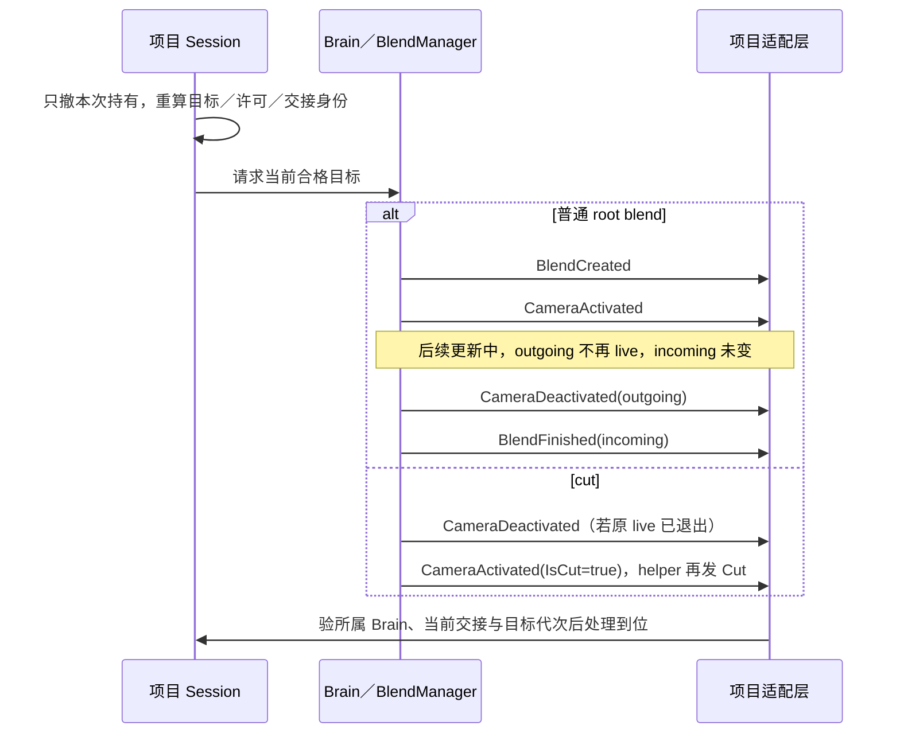

# 镜头归还：原生通知、持有权与尾震的接线边界

**沿现有 Session／相机模式接原生接口，归还权限留在项目层。** 本记录为[相机完整模块](../../../../../domains/game-dev/04-client-modules.md#camera-contract)补五个场景的源码落点，纠正[原回交 cba4c59](https://github.com/dbvv1/a1dbv/blob/cba4c5953dc31f77ad51693162f8ffd75cdfeff4/docs/collaboration/local-jobs/artifacts/B-CORE-CAMERA-RETURN-SOURCES-20261104/sources.md)的时序、覆盖优先级与冲击取消说法；不接原稿的广泛链接排序。

固定 Cinemachine ref `45728f3` 的 [package.json](https://github.com/Unity-Technologies/com.unity.cinemachine/blob/45728f3030787076f32930101d11d9ca96fe3a0f/com.unity.cinemachine/package.json) 为 **3.1.8-pre.2**，不是本仓稳定基线 3.1.7。以下为 2026-11-04 固定源码阅读和非作者核查；未运行 Unity／Celeste64，也未新增 MOBA 运行验证，不据此升级包或提高作品评分。

## 五种输入，分别由谁决定

| 场景／输入 | 原生所有者与入口 | 项目必须保留的条件 |
|---|---|---|
| 1. 归还时 cut 或正常 blend | Brain／BlendManager 发 Activated、Deactivated、BlendFinished；helper 从 Activated 的 IsCut 再发 Cut | 筛所属 Origin／Brain 和预期 incoming。cut 走直接到位路径；混合结束与取消分开，不能统一等 Finished，也不能把 Deactivated 当最终解锁 |
| 2. 交接中死亡、换角色，适配层随后消费旧通知 | Core 静态事件仅带 mixer／camera 或 activation 参数，没有玩家代次和交接 ID | Session 先使旧目标代次失效，保当前交接身份；同一 camera 引用不能证明仍属当前角色。迟到处理是项目要测试的风险，不是源码证明有异步回调队列 |
| 3. 外层菜单仍开，内层菜单／剧情结束 | override 栈按 priority 排序；首次 SetCameraOverride 用 -1 并保存返回 ID，退出 ReleaseCameraOverride(id) | 每个持有者只撤自己 ID；同 ID 更新不改变原 priority 或插入位置。摄像机 Priority 与 override priority 是两层选择，低优先级后来者不会自动胜出 |
| 4. 按住回看后松开，或同一目标传送 | MOBA camera-follow 保存 locked／held，controls 保存按下时物理键，world 消费 following；CM 姿态／历史接口见下节 | 松开只清 held、保当前焦点／位置，永久偏好不变；按旧物理键释放，失焦／交权也清 held。保位置、同目标历史迁移、换目标重新取景分别选择 |
| 5. 关闭主震或取消某个已发冲击 | Impulse manager 持有事件；每个 Listener 持有聚合 secondary 状态。CreateAndReturnEvent 可取得活动事件，事件 Cancel 可取消 | 保存本方仍有效的事件句柄；事件取消与 listener 已累积尾震分开。关闭镜头运动要覆盖直接与 secondary 输出，不能用全局 Clear 冒充按所有者停止 |

**通知顺序要按分支验。** 普通 root blend 先创建并通知 BlendCreated，再由 ProcessActiveCamera 通知 Activated。每次 ProcessActiveCamera 先检查上次 live、本次不 live 的相机并发 Deactivated，再处理 Activated 或 Finished；Finished 还要求 incoming 有效且未变、上次处于 blend、本次 CamA 已空。cut 可同时让 outgoing Deactivated，不能简写成“只发 Activated”。`IsComplete` 的失效分支是两端都无有效相机，销毁其中一端不保证立即完成。

依据：[root blend 创建](https://github.com/Unity-Technologies/com.unity.cinemachine/blob/45728f3030787076f32930101d11d9ca96fe3a0f/com.unity.cinemachine/Runtime/Core/CameraBlendStack.cs#L330-L345)、[Brain 调用顺序](https://github.com/Unity-Technologies/com.unity.cinemachine/blob/45728f3030787076f32930101d11d9ca96fe3a0f/com.unity.cinemachine/Runtime/Behaviours/CinemachineBrain.cs#L605-L611)、[事件判定](https://github.com/Unity-Technologies/com.unity.cinemachine/blob/45728f3030787076f32930101d11d9ca96fe3a0f/com.unity.cinemachine/Runtime/Core/BlendManager.cs#L135-L194)、[helper 的 Cut](https://github.com/Unity-Technologies/com.unity.cinemachine/blob/45728f3030787076f32930101d11d9ca96fe3a0f/com.unity.cinemachine/Runtime/Helpers/CinemachineMixerEventsBase.cs#L86-L96)、[有效性](https://github.com/Unity-Technologies/com.unity.cinemachine/blob/45728f3030787076f32930101d11d9ca96fe3a0f/com.unity.cinemachine/Runtime/Core/CinemachineBlend.cs#L60-L68)、[Core payload](https://github.com/Unity-Technologies/com.unity.cinemachine/blob/45728f3030787076f32930101d11d9ca96fe3a0f/com.unity.cinemachine/Runtime/Core/CinemachineCore.cs#L194-L236)。

**释放所有权用 ID，不靠暂停猜生命周期。** 栈实现按优先级插入，同优先级新建者后插，重复旧 ID 直接取旧 frame。固定 Timeline mixer 没有 OnGraphStop override；OnPlayableDestroy 只释放自己的 ID。ProcessFrame 若在 clip 不为 Playing 时执行，会写回空相机，而非删除全部 ID。该仓代码不足以保证 PlayableDirector.Pause／SetSpeed(0) 的完整生命周期，旧论坛情境不作为本版事实。

依据：[ID 与排序](https://github.com/Unity-Technologies/com.unity.cinemachine/blob/45728f3030787076f32930101d11d9ca96fe3a0f/com.unity.cinemachine/Runtime/Core/CameraBlendStack.cs#L123-L184)、[覆盖合成](https://github.com/Unity-Technologies/com.unity.cinemachine/blob/45728f3030787076f32930101d11d9ca96fe3a0f/com.unity.cinemachine/Runtime/Core/CameraBlendStack.cs#L386-L419)、[mixer 销毁](https://github.com/Unity-Technologies/com.unity.cinemachine/blob/45728f3030787076f32930101d11d9ca96fe3a0f/com.unity.cinemachine/Runtime/Timeline/CinemachinePlayableMixer.cs#L155-L162)、[clip 消费](https://github.com/Unity-Technologies/com.unity.cinemachine/blob/45728f3030787076f32930101d11d9ca96fe3a0f/com.unity.cinemachine/Runtime/Timeline/CinemachinePlayableMixer.cs#L209-L268)。

## 保位置与清历史不是同一个操作

| 原生接口 | 能做什么；怎样选 |
|---|---|
| InheritPosition | incoming 尚未 live in blend 时，从 outgoing 最终姿态 ForceCameraPosition，再更新管线；不是持续锁位 |
| FreezeWhenBlendingOut | 给混出端取快照；不能代替 incoming 的初始化或永久偏好 |
| ForceCameraPosition | 强设姿态并通知组件／扩展；body 随后仍可能按目标重算 |
| OnTargetObjectWarped | 同一 Follow 目标发生位移时迁移相机及历史；不是换角色或无条件清历史 |
| CancelDamping | 使 PreviousState 无效，下次按目标重新取位；updateNow 才立即更新，不能拿来保证保当前画面 |

依据：[Camera 的 warp、强设与入镜](https://github.com/Unity-Technologies/com.unity.cinemachine/blob/45728f3030787076f32930101d11d9ca96fe3a0f/com.unity.cinemachine/Runtime/Behaviours/CinemachineCamera.cs#L113-L200)、[混出快照条件](https://github.com/Unity-Technologies/com.unity.cinemachine/blob/45728f3030787076f32930101d11d9ca96fe3a0f/com.unity.cinemachine/Runtime/Core/CameraBlendStack.cs#L281-L292)、[取消阻尼](https://github.com/Unity-Technologies/com.unity.cinemachine/blob/45728f3030787076f32930101d11d9ca96fe3a0f/com.unity.cinemachine/Runtime/Core/CinemachineVirtualCameraBase.cs#L820-L835)、[ThirdPersonFollow 重算](https://github.com/Unity-Technologies/com.unity.cinemachine/blob/45728f3030787076f32930101d11d9ca96fe3a0f/com.unity.cinemachine/Runtime/Components/CinemachineThirdPersonFollow.cs#L228-L273)。

**MOBA 的松开保位置沿用当前 focus，不恢复按住前快照。** 固定实现将 `locked || held` 交给 world；只有捕获机位另有 savedFocus 保存／恢复，不应拿这条捕获分支说明 held 归还。Celeste64 Player 死亡时把观察方向／距离存入 static 字段，重生取回，是进程内保留，不是持久存档；Strawberry 正常协程末尾恢复 Position／LookAt 快照，不能推广成有嵌套、取消与迟到保护的机制。

依据：MOBA [状态](https://github.com/dbvv1/MOBA-Like/blob/cb818773da66e6a8ee77a4576339f33457fba32d/src/render/camera-follow.ts)、[物理键释放](https://github.com/dbvv1/MOBA-Like/blob/cb818773da66e6a8ee77a4576339f33457fba32d/src/input/controls.ts#L39-L61)、[跟随与捕获消费者](https://github.com/dbvv1/MOBA-Like/blob/cb818773da66e6a8ee77a4576339f33457fba32d/src/render/world.ts#L75-L107)；Celeste64 [死亡保存](https://github.com/EXOK/Celeste64/blob/6edfe1ebd2a21a6134d7675a28e357891025407e/Source/Actors/Player.cs#L836-L842)、[重生恢复](https://github.com/EXOK/Celeste64/blob/6edfe1ebd2a21a6134d7675a28e357891025407e/Source/Actors/Player.cs#L233-L244)、[草莓镜头恢复](https://github.com/EXOK/Celeste64/blob/6edfe1ebd2a21a6134d7675a28e357891025407e/Source/Actors/Strawberry.cs#L214-L216)。

## 关闭震动要分事件与监听器

**需要撤销本方冲击时显式保留活动事件，不把便捷包装的缺口当底层 API 的缺口。** ImpulseDefinition.CreateAndReturnEvent 返回事件，Cancel(time, forceNoDecay) 可终止或进入包络衰减；Source.GenerateImpulse 包装不返回句柄，也没有现成 CancelBySource。事件过期后可被池复用，不长期持有旧引用。

**Listener.Gain=0 只关闭直接输出，活跃主信号仍可激发 secondary。** GetReaction 在直接输出乘 Gain 前取未缩放输入；ReactionSettings.AmplitudeGain=0 关闭 secondary 输出，却不清其内部反应量，恢复增益可能再次显出尚存反应。ImpulseDefinition.AmplitudeGain 是另一字段，仅 Legacy 使用，且 Legacy 信号每次读取，不能概括成“改源参数只影响未来事件”。

**Clear 清的是全部活动事件，不是所有监听器尾震。** 它不按所有者或通道选择，也不触碰 Listener 的聚合反应量；改 ChannelMask 仅改后续采样，不能倒推出旧 secondary 的来源。Duration 参与受输入强度影响的阻尼，不是精确到秒的终止保证。项目若需按角色独立撤销尾震，必须明确各 listener 的作用范围和清理／静音政策，再在真实消费者验证，不能凭全局 Clear 声称完成。

依据：[创建并返回事件](https://github.com/Unity-Technologies/com.unity.cinemachine/blob/45728f3030787076f32930101d11d9ca96fe3a0f/com.unity.cinemachine/Runtime/Impulse/CinemachineImpulseDefinition.cs#L314-L354)、[事件 Cancel](https://github.com/Unity-Technologies/com.unity.cinemachine/blob/45728f3030787076f32930101d11d9ca96fe3a0f/com.unity.cinemachine/Runtime/Impulse/CinemachineImpulseManager.cs#L241-L260)、[Source 包装](https://github.com/Unity-Technologies/com.unity.cinemachine/blob/45728f3030787076f32930101d11d9ca96fe3a0f/com.unity.cinemachine/Runtime/Impulse/CinemachineImpulseSource.cs#L64-L91)、[Listener 采样合成](https://github.com/Unity-Technologies/com.unity.cinemachine/blob/45728f3030787076f32930101d11d9ca96fe3a0f/com.unity.cinemachine/Runtime/Impulse/CinemachineImpulseListener.cs#L240-L280)、[secondary 状态](https://github.com/Unity-Technologies/com.unity.cinemachine/blob/45728f3030787076f32930101d11d9ca96fe3a0f/com.unity.cinemachine/Runtime/Impulse/CinemachineImpulseListener.cs#L150-L191)、[Legacy 增益读取](https://github.com/Unity-Technologies/com.unity.cinemachine/blob/45728f3030787076f32930101d11d9ca96fe3a0f/com.unity.cinemachine/Runtime/Impulse/CinemachineImpulseDefinition.cs#L405-L440)、[全局 Clear](https://github.com/Unity-Technologies/com.unity.cinemachine/blob/45728f3030787076f32930101d11d9ca96fe3a0f/com.unity.cinemachine/Runtime/Impulse/CinemachineImpulseManager.cs#L487-L495)。

## 普通归还时序与后续断言

此图只描述所列普通分支，不覆盖 Timeline 外部覆盖或中途再切镜的所有事件组合；项目权限仍由 Session 决定。以下是**待执行接线断言**，不是本轮测试通过项：

1. **cut／blend：** 记录事件顺序与 Origin；正常 root blend 的 Created 早于 Activated，完成按有效 incoming 条件处理；cut 不等待 Finished，outgoing Deactivated 不单独解锁。
2. **死亡／换角：** 新代次生效后向适配层注入旧交接的完成处理；当前目标、移动许可与反馈不回滚。另测同一 camera 复用给新角色。
3. **嵌套持有：** 外层 A、内层 B 各保存一个 override ID；关 B 不撤 A。再验低优先级晚创建、同优先级新建、旧 ID 更新三种顺序，不把“最后调用”当最高优先级。
4. **临时跟随：** 永久自由观察时按住、改键／焦点转入 UI、松开；held 清除、locked 不变、沿当前 focus 回自由滚屏。传送与换角色分别验证选定 body 的历史政策，不共用一个 reset。
5. **主震／尾震：** 先配置非空 secondary noise、正的 AmplitudeGain 和含非零位置分量的主信号；活动源持续时置 Listener.Gain=0，仍能检测到 secondary。取消本方事件后核其他事件不受影响，并单独观察已有尾震。关闭两类输出后最终镜头无震动，恢复设置按项目政策处理旧反应量；不以 Clear 或等待固定 Duration 代替断言。
