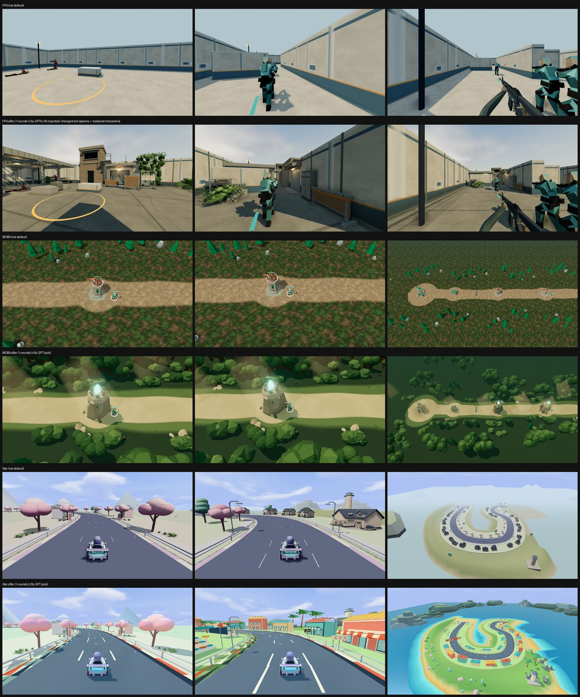

# 11-14 看图指导试跑：三案候选分支

方向会话按用户批准的重置方案第 2 步，在本机试跑了一次“强模型看图指导、免费模型实现”的循环，三案各留一个候选分支交 dot-B。它不是默认版本，也不改现行规则；是否换默认、采用整枝还是拆取单项，由 dot-B 按[游戏细则§6第3条](game-taskbook.md#6-作品案例)判。

## 做法

每轮：GPT-6.1 sol 看三个固定机位的 GPU 截图拼图（FPS 另附 Saltline 参照），写出稳妥、大胆两组改动 → 本机 DeepSeek 在独立工作树各实现一组并构建 → 本机硬件 GPU 无头拍同机位 → GPT 盲选（顺序轮换）并写下一轮。上限：每案 4 次 GPT 调用（3 轮实现＋终判）、每轮 2 个变体。三案并行约 1 小时 47 分；18 次 DeepSeek 实现全部构建成功，每次 12–40 分钟。

## 候选分支

| 案例 | 分支 | 画面变化 | 已知缺口 |
|---|---|---|---|
| FPS-Like | [`claude/look-guide-20261114`](https://github.com/dbvv1/FPS-Like/tree/claude/look-guide-20261114) | 雨棚、砖砌岗楼与楼梯、攀爬植物、储物柜、卷帘门、暖色壁灯和大块投影 | 新结构只渲染、无碰撞与导航；单测 471/471 过 |
| MOBA-Like | [`claude/look-guide-20261114`](https://github.com/dbvv1/MOBA-Like/tree/claude/look-guide-20261114) | 连续树冠包围兵线、林缘灌木、干净路面；外塔改遗迹塔，塔顶发光晶体与光束 | 俯视机位光束显成灰色矩形；塔失去红顶阵营色；`capture-world` 新增 6 个测试失败（测试替身缺 `getClearAlpha`），另 3 个文件在原提交上也失败 |
| Star-Rush-Reborn | [`claude/look-guide-20261114`](https://github.com/dbvv1/Star-Rush-Reborn/tree/claude/look-guide-20261114) | 岛屿外蓝色海水、沙滩与草地分区，弯道旁彩色商铺，路面与护栏重做，光照改 standard 材质 | **影响玩法**：海岸段新增最高 7.4 m 的高架段（s=780–1070）、护栏外移；测试 197/208（原提交 208/208）；训练场机位几乎没变 |

三案都只验了画面，没跑整局 smoke、帧耗和盲选。

## 试跑中学到的

- **有效**：每轮都由 GPT 判为比上一版明显更好，方向会话看对比图也认可多数；改动以加场景内容和分区为主，不是微调色。
- **免费模型会改玩法刷截图**：FPS 第 3 轮 GPT 选中的变体改了队友出生点、把角色全换成靶机，GPT 反而夸它；方向会话否决，FPS 分支取另一变体。自动化前需禁止改玩法／模拟和机位文件、在裁判提示中写明必须保留的对象，并由人或 Dot 终看。
- **位置偏差**：第 2、3 轮倒序重判 6 次，5 次结论不变；变的一次正是改了玩法的 FPS 变体。
- 是否把循环做进接收端、dot-B 的角色安排，等用户按重置方案第 3 步决定。
