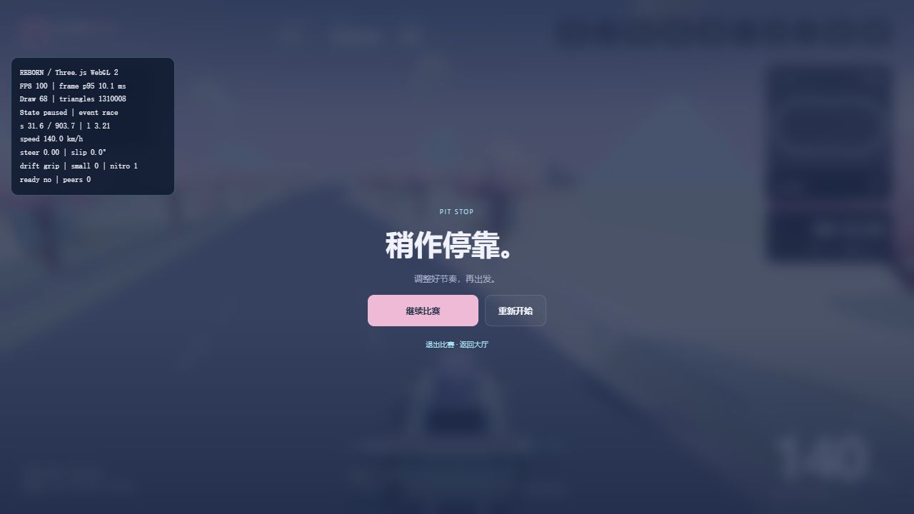

# 当前能力与实际价值：接续审计

2026-10-23（UTC+8）。固定 a1dbv `76de8ad`，增量起点 `e0fcf55`；Star-Rush默认分支 `9e2454f`，在制分支 `83d7a77`。复用当天已有校准，不重新打整仓分数。[一手：Git]

## 结论

**方向调整已产生实际成果：A交出了可独立重放的公开项目修复，B交出了真实游戏HUD与起跑状态修复。继续沿真实任务做深，优先接收产物和解决体验问题。** 新的研究数量、工具清单和流程层目前不是主要缺口。[研究]

| 成果 | 本轮接收判断 | 接下来做什么 |
|---|---|---|
| Oil UI CSS续行修复 | 独立重放成功；真实上游CLI和失败保护可用 | 保留完整案例，让读者从现有入口使用；不为证明代码图优越性另开实验 |
| OpenSpec两轮变更 | 已有确定性CLI试用及反例；有规格接续价值 | 保留条件采用，明确CLI与Skill路径不同；有实际交接任务时再试其接手收益 |
| OCR清单与ignore语义 | 两类反例有用；函数修复尚缺公开产物，状态冲突 | 补已有补丁与最小复验入口，或统一为草稿；完整CLI仍未验，先停止扩大此窄题 |
| Star-Rush HUD／起跑／短视口 | 在制分支有实质代码；本轮补最新版本WebGL实跑 | 接收合格分支，继续同弯驾驶与视听反馈，补尚未观察的视口和设备 |
| 卡牌／赛车模块与M6 | 完整机制研究有价值；知识转化已进步 | 卡牌先收住；赛车知识用于真实操作；M6下一次自然新需求再查漏，不用旧题重复登记 |

## A：真实增量与当前能力

对[Oil UI示范](../../research/2026-10-23-real-coding-demo.md)运行仓内原样重放脚本，上游固定 `7002e1a3`：旧CLI按预期失败并保留旧产物，新增回归先失败，修复后58项非浏览器测试通过；真实CLI完成CSS／PNG内嵌、输入保留、确定性重建、缺参数拒绝和缺图保护。运行于Windows的Python 3.13／Node 22；脚本明确排除的浏览器与专门Windows路径测试仍未运行。[本轮实测]

价值在于共享解码器只为quoted string启用单遍续行处理；“先删续行再解码”曾破坏反斜杠边界。代码图参与定位不等于优于rg，但不妨碍这份修复成为可用的编码示范。[源码／研究]

OpenSpec固定1.14.3的[重放脚本](../../../experiments/replay_openspec_handoff.py)包含场景遗漏拒绝、强制归档和同名场景语义改坏的反例；本轮读脚本与报告，未重复执行。07入口已补明CLI与`/opsx:archive`的区别。OCR则存在TASKS“函数已隔离复验”与[研究记录](../../research/2026-10-22-frontier-trials.md#ocr-delegation-trial)“未编译草稿”的差异，所审树没有相应修复补丁；可能存在未提交产物，不能据此断言从未运行。[一手／研究]

抽读02、Codex及07当前推荐，已将日常起点、困难任务升档与历史比较分开；本轮未发现必须整页撤回的旧代默认。[OpenAI当前GPT-6指导](https://developers.openai.com/api/docs/guides/latest-model?model=gpt-6-astra#prompting-best-practices)提示模型可能因指令冲突过早暂停，或对小改过度测试；支持按目标、边界和任务风险给指导，已有检查通过后不机械扩测。官方行为指导不能证明本仓某一effort或工具组合净收益。[一手：10-23原文；研究]

当前[Skill文档](https://learn.chatgpt.com/docs/build-skills)说明按名称／描述匹配后再读取完整指令；触发与执行都可能受技能影响。因此保留领域知识与可靠操作配方，删除重复的计划、强制步骤和未改变结果的复核；不因模型更强就清空所有Skill，也不默认装完整流程包。[一手／研究]

M6此轮新增的是“发现转成修复与可用解释”，尚无新独立参照证明发现能力或漏检改善。下一次真实需求再用新的外部参照查漏即可，不加一套统计机制。[研究]

## B：最新分支的实跑与适用范围

Star-Rush `master`仍为文档提交，不代表B没做。`dot-b/tmp/20261023-racing-quality`的 `83d7a77`包含HUD衬底／SVG、倒计时前标签初始化、短桌面布局；此前知识库截图固定在`6f8e763`兼容模式，未覆盖后两次改动。[一手：源码]

本轮在独立工作树启动已提交构建与本地测试数据库，使用真实浏览器：诊断显示Three.js WebGL 2；训练场自动试驾18.92秒完成一圈进入结算；重开显示0时间、904米、训练场；发送加速输入后车辆前进，暂停按钮及继续／再次暂停入口可用。没有向远端上传成绩或改动游戏源码。[本轮实测]

这补充最新版本启动、自动试驾及局部操作证据；不是专业玩家手感评价。此次没有验证短视口、全部赛道、音频、两机网络、AI素材链或线上部署，不把单次诊断帧率当目标设备性能结论。[研究：范围]

HUD与起跑修复有可迁移机制：信息衬底随真实背景选，关键符号不依赖字体；新比赛标签在倒计时前初始化，不等周期更新。卡牌的身份／费用／触发／奖励恢复与赛车三方向／漂移恢复研究也有内容价值；接下来让赛车研究服务一条真实弯道操作，避免再横向扩一轮无关题目。[研究]

## 接下来一周：优先完成结果

1. **A**：收口OCR状态，保留Oil UI与OpenSpec的可用入口；随后选择自然的新编码问题，继续发现、试用和转化。旧模型／旧版本比较只保留能解释当前选择的机制，出现新证据再改默认。
2. **B**：先接收最新赛车分支，补其关键未验视口；固定一条弯道实际操作预判、抓地／漂移、出弯恢复，按发现改驾驶、镜头或反馈。继续AI美术／音频的小链路，以游戏实际体验为接收点。
3. **共同**：源码、替身、真实客户端和玩家体验按实际范围报告。复用已通过结果，先让现有成果进入读者入口／游戏版本，再扩新题；不新增评分、每日数量或审批层。

本轮只抽核当前能力指导、上述增量与实际入口，未重新执行全部历史试验或全网前沿搜索；旧阶段报告保留其日期与适用版本。[研究：审计范围]
