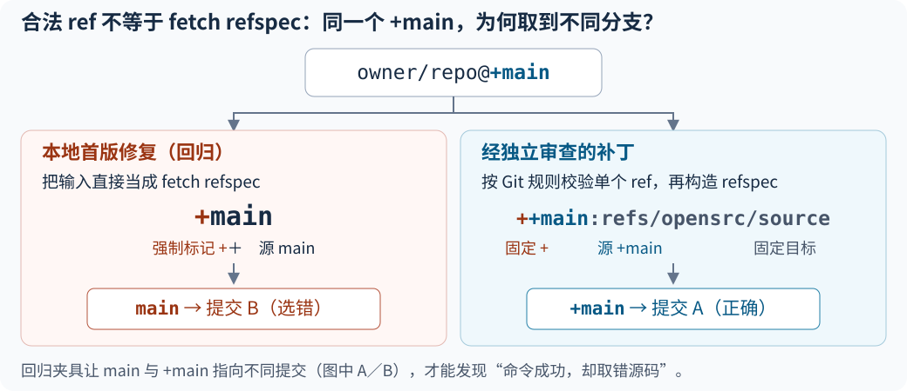

# Codex 过度防御、过度工程怎么治

**✅ 先把“不要过度设计”换成具体取舍：每个新增校验、兜底、重试和抽象，都要对应真实输入、失败路径或明确需求；用最少的新机制完成整个目标。** 保留已有外部输入、权限和兼容性契约，把任务外改善留在交付说明中。在已经能编辑并运行项目检查的 Agent 会话里使用下方任务片段，无需另装精简插件。

## 第一步：给当前任务加这段

填上目标、完成条件和必须保留的行为，直接开始；已有改动过大时，让 Agent 对当前 diff 做同样的取舍。

```text
目标：[本次要实现的行为]；完成条件：[能观察或运行的检查]。
必须保留：[已有输入、错误、权限和兼容性契约]。
沿用项目现有模式，用最少的新机制完成整个目标。
新增校验、重试、fallback、兼容层或抽象时，指出它解决的真实输入、失败路径或明确需求。
没有依据的机制先不加；任务外改善只报告。保留必要的外部输入与安全校验；按既有契约处理并报告错误，不把失败伪装成成功。
复用相关测试，验证新行为、真实失败路径和保留行为；通过项目要求的检查后交付，别自行追加审查循环。
```

**看 diff 时只问一句：这段新增机制保护了谁的什么行为？** 能指出调用方、契约或失败输入，就检查实现是否恰当；只能回答“以后可能需要”，先从本次方案移出。修 bug 要回放触发路径；新功能则按明确需求验收，预防性安全措施按威胁与信任边界判断，不必等事故发生。

**已有的输入容错也是要保留的行为。** ComfyUI 的 Flux 路径先把图像补到 patch 尺寸，再把输出裁回原尺寸；直接增加“尺寸必须整除，否则拒绝”会收紧它原本支持的输入。先辨明调用方允许的转换、默认值与错误处理，再决定保留、收窄或删除哪段防御。

**依据**：[一手项目规则](https://github.com/Comfy-Org/ComfyUI/blob/e7051b03758a1247e3adb84a5b784ffacb9a23bd/AGENTS.md#user-input-tolerance)、[固定 Flux 输入处理与输出裁剪](https://github.com/Comfy-Org/ComfyUI/blob/e7051b03758a1247e3adb84a5b784ffacb9a23bd/comfy/ldm/flux/model.py#L314-L408)；源码核实 2026-10-27，未实跑该图像模型。

## 为什么选这个做法

**借用 Codex 自己的审查尺度，而不是再叠一套流程。** OpenAI 的实际 review rubric 要求问题具体、可行动，严谨程度与项目匹配，指出确实受影响的其他代码，并交代触发场景。它有一条直接可借：

> The bug does not rely on unstated assumptions about the codebase or author's intent.

这份文件由 `review_request.rs` 读入，review task 再把它设为审查线程的基础指令。上面的任务提示是本页改写，把审查中的“证明影响”前移到实现时的取舍。

**依据**：[一手／实际配置] [Codex review rubric](https://github.com/openai/codex/blob/970111f6cb62cc02fe36a82ea7d71b37a2889c97/codex-rs/prompts/templates/review/rubric.md)、[读取入口](https://github.com/openai/codex/blob/970111f6cb62cc02fe36a82ea7d71b37a2889c97/codex-rs/prompts/src/review_request.rs#L8-L9)、[实际装配](https://github.com/openai/codex/blob/970111f6cb62cc02fe36a82ea7d71b37a2889c97/codex-rs/core/src/tasks/review.rs#L118-L139)；2026-10-26 重核，rubric 与当日 main 相同。

**真实反馈支持收窄到具体行为，效果仍要在自己的任务里看。** V2EX 的近期讨论中，#41 已写“不要过度设计”仍遇到扩写；#59 则认为有些安全边界正是自己需要的。LINUX DO #2 报告压制防御后代码质量下降，#5 建议控制功能范围。它们共同提示：单写禁令太含糊，按所需行为取舍更有针对性。

| 常见对策 | 本页选择 |
|---|---|
| 限定代码行数、禁止所有 fallback | 按契约删掉无依据机制；保留需要的错误处理与兼容行为 |
| 再加一个评审 Agent 反复精简 | 先审当前 diff 的新增机制，复用现有测试与评审 |
| 换模型或降低推理档 | 先把范围与完成条件说清，再用同一任务比较配置 |

**依据**：[社区／原帖] [V2EX：感叹 Codex 的过度设计](https://www.v2ex.com/t/1250482)（2026-10 月）、[LINUX DO：如何阻止 Codex 防御性编程](https://linux.do/t/topic/2678531)（2026-07-30）；核读 2026-10-26。取舍是本页综合建议；这些是个人反馈，提示词效果尚未做模型对照。

## 一个能照着判断的小例子：配置导出

**让错误输入明确失败，保留合法的空输入。** 本仓 [配置导出脚本](../../scripts/export_ai_config.py) 的 `filter_settings` 入口有这段真实代码：

```python
settings = parse_json(text)
if not isinstance(settings, dict):
  fail("settings.json 必须是对象。")
```

这里的对象检查有[明确输入契约](../../ai-config/README.md#文件白名单)，该保留。解析失败后返回空对象会把坏输入当成成功；对同一段坏 JSON 加重试也解决不了格式问题。另一方面，白名单字段都是可选项，缺省时返回空对象本来就是合法行为，不应擅自补“至少设置一个字段”的检查。

| 输入 | 已实跑行为 | 取舍 |
|---|---|---|
| `{"alwaysThinkingEnabled":true}` | 保留该字段 | 正常行为继续支持 |
| `{}` | 返回空对象 | 保留可选字段契约 |
| `[]` | 明确报错 | 保留入口形状校验 |
| `{"cleanupPeriodDays":true}` | 明确报错 | 保留整数类型约束，避免把布尔当整数 |
| 同一字段重复出现 | 明确报错 | 保留无重复键契约 |

可以在本仓根目录运行现有回归，查看正常、失败、缺失输入与安全检查：

```bash
python3 -m unittest discover -s tests -p test_config_export.py -v
```

**合法 JSON 是已有契约，所以非法数字常量值得拒绝，合法但很大的指数不应一并封掉。** 本仓随后用 `parse_constant` 补齐 `NaN`、`Infinity`、`-Infinity` 的入口检查：真实 `stage` 命令原来接收 6/6 份非法配置，修后为 0/6；8/8 份合法对照仍能完成 `stage → promote`。正常字符串、空设置与合法大指数照常保留。

**新读者也按本页完成了另一处真实修复。** Claude Code＋DeepSeek 读者修正文档检查器的 JSON 语法漏检，未新增依赖或校验框架；负责人独立重放，12 个非法输入从全过变为全拒，13 个合法 JSON／TOML 输入仍通过。读者无页面卡点，保留原操作步骤；[任务与全文输入](../collaboration/local-jobs/A-JSON-SYNTAX-READER-001.md)、[结果](../collaboration/local-jobs/artifacts/A-JSON-SYNTAX-READER-001/reader-friction.md)，2026-10-27。

**先辨清输入语言，再复用原生校验，并从公开入口验收。** JSON token 与“有限的 Python 浮点数”不是同一契约；同样，`owner/repo@ref` 接收单个仓库 ref，不是 `git fetch` 的 refspec：



最终补丁保留选项边界，支持完整 SHA 与 `+main`。回归还让非法输入经过已有缓存的 `opensrc path` 入口，确认它在返回路径前失败；只测 clone helper 会漏掉缓存绕过。两例验证的是代码行为，提示词或模型收益仍需另测。

**依据**：[本仓真实脚本／合成输入实跑] [实现](../../scripts/export_ai_config.py)、[21 项回归](../../tests/test_config_export.py)；[上游源码／本地修复与回归] [opensrc 补丁](../../experiments/opensrc-ref-integrity/source-ref-integrity.patch)与[复用说明](../../experiments/opensrc-ref-integrity/README.md)；[官方语义] [Python JSON](https://docs.python.org/3.12/library/json.html#json.load)、[Git ref](https://git-scm.com/docs/git-check-ref-format)、[fetch refspec](https://git-scm.com/docs/git-fetch#Documentation/git-fetch.txt-ltrefspecgt)；2026-10-26 核实。

## 何时不适用

- **安全加固、公开 API、支付、数据迁移或跨版本兼容本就是目标：** 把威胁、失败恢复和兼容矩阵纳入完成条件，保留对应检查；最少新机制仍须覆盖完整目标。
- **改动改变既有行为：** 先确认契约是否允许。rsync 维护者曾用测试保护目录别名下的名称过滤语义；直接阻断写入反而破坏该契约。具体见 [09：把保留决定写进回归](../09-review-and-quality.md#把不修这条告警变成可执行的保护)。
- **问题其实是反复请示或权限拒绝：** 按 [17：过度请示或提前停下](../17-troubleshooting.md#24-过度请示或提前停下)诊断授权与停止原因；减少代码机制与放宽执行权限是两件事。

现有工作流已稳定达标时保持原样。想继续排查范围蔓延，读 [17：范围蔓延和越权](../17-troubleshooting.md#23-范围蔓延和越权)。
