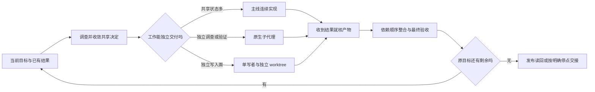

# 长程开发：怎样分工、接回并交付完整结果

**🟡 让一位主 Agent 持续负责完整目标，按需要拆出独立调查、实现或验证；每批结果回来就接收，交付后继续原目标的剩余部分。** 默认用已有会话、Git 和项目检查，不先装编排器。共享决定多的小改动由主线连续完成；可独立写入的目标才分 worktree。本仓已有真实委派、接回与串行发布实践；新读者已用本路线候选页接回一项真实已返回结果，完整实施、整合与消费者验收路线仍待验。

## 从当前任务开始，不重新搭工作流

**先确认目标、输入和执行环境，再把下面一段交给主 Agent。** 准备需求／issue、项目指引、当前版本与未提交改动、已有子任务入口和项目验收命令；只给本任务所需材料。Codex、Claude Code 等宿主须实际提供所用的委派工具；没有时按同样验收串行做。离开本机后仍需运行的工作，要预先选择已配置可用的远端或云端，不能指望关机后本地进程继续。

```text
继续完成 <现有需求或 issue>，最终让 <用户> 能 <可观察结果>。
保留 <必须留下的行为>；不做 <非目标／已取消项>。

先核最新需求、项目规则、实际版本及改动、已有结果和当前写者。
你保留完整目标、共享决定和最终验收；已有结果先接收，不重派。
独立调查或验证按需委派；实现先定接口、依赖与唯一写入归属。
每项交接给目标、必要输入、可写范围、验收和停点，不预定一套角色链。

结果回来后，核实际差量、运行输出与受检版本，判断接收、返工或阻塞。
按依赖整合，复用未受影响的有效检查，只重验受影响或影响不明的路径；
最终版本跑项目要求的交付检查和真实消费者入口。
已获准发布时串行提交并回读目标仓库／分支与实际内容，另核该版本 CI。
外部结果未知先查回执；明确拒绝只停对应动作，不换路重试。

每个阶段结束都回到原目标：还有可执行的实施、接收或验收就继续；
需要等子任务时保留原任务入口并接回结果，不重新派一份。
只有完整验收完成、没有可继续的授权工作且确实阻塞，或目标已取消才收口。
换人前确认旧写者停止，在现有记录留下可恢复产物、未完成项和下一步。
```

这段用于主线接回已有任务，也可给新任务起步；具体文件、依赖和停点由项目决定。同项结果和写者从项目已有任务入口、原调用与实际工作区核对；任务表没登记不等于没有写者。本仓入口是 [TASKS](../collaboration/TASKS.md) 与 [local-jobs](../collaboration/local-jobs/README.md)，其他项目用自己的入口。恢复时可直接采用[通用交接模板](../../templates/generic/.claude/skills/handoff/SKILL.md)，需要跨宿主迁移时再看 [checkpoint-resume](../../templates/codex/.agents/skills/checkpoint-resume/SKILL.md)。已有任务记录够用就不新增 JSON 台账。

## 按依赖决定怎么拆



| 眼前的瓶颈 | 先选 | 什么时候换 |
|---|---|---|
| 小改动、频繁来回、多个阶段共享大量状态 | **一位 Agent 连续完成**；重复流程写 Skill | 有自包含支线会淹没主上下文时，再委派 |
| 独立读代码、日志调查、来源核对或风险审查 | **原生子代理**，返回结论与关键证据 | 主线无法说清必要输入或接收结果时，先收窄问题 |
| 几个独立目标同时修改代码 | **每个写入面一个 worktree、一个写者** | 接口尚未定或会修改同一契约，先合回主线定决定 |
| 队员确需持续互相协调、自主认领共享任务 | **再评估 Agent Teams 等编排** | 只有一次交回需求，普通子代理更轻；恢复支持须符合任务 |
| 必须跨进程保存进行中的工具调用状态 | **才评估耐久宿主** | 原生继续与 Git 产物能接回时，保留现有工具 |

**写域不同仍要对齐共同契约。** 调查可以先并行，写入前明确接口、数据含义、错误行为和依赖版本；上下游有依赖就按顺序接回，不能因为文件名不同就同时改决定。worktree 只隔离检出，未跟踪资料、依赖、端口、数据库和服务所有权要另行准备。

已有工具出现具体缺口时才补：Worktrunk 可辅助[依赖准备](../../experiments/worktrunk-ready.md)；Portless 的代理要由单一协调者管理，独立实例同时隔离[端口与状态目录](../../experiments/portless-state-isolation/README.md)；gh-stack 适合依赖未合入父层的分支，带子模块先核[恢复状态](../../experiments/gh-stack-submodule/README.md)，失败可能已部分生效，不按退出码盲重试。这些是分支选项，不是整套路线的必装清单。

Claude Code Teams 当前仍属实验功能，默认关闭，`/resume`／`/rewind` 不恢复 in-process 队员。普通具名子代理也能在可用工具与目标明确时传消息；选 Teams 看共享协调需求，不只看能否互发消息。Pi Durable 的中断任务恢复还要区分可安全重跑的调用与应交回中断状态的调用，不能由耐久存储推定外部写入可重做。

**依据**：[官方能力] [Claude 子代理取舍](https://code.claude.com/docs/en/sub-agents#choose-between-subagents-and-main-conversation)、[Teams 比较与限制](https://code.claude.com/docs/en/agent-teams#compare-with-subagents)、[Pi Durable](https://earendil.com/posts/pi-durable/)，复核 2026-11-01；[真实使用反馈] [V2EX 的 worktree 资料缺失](https://v2ex.com/t/1243449)，原核实 2026-10-26。工具实试范围与原核实日在各入口；本仓未比较这些编排方式的同任务总收益。

## 交出去什么，收到后核什么

**交目标与契约，接产物与证据。** 实现者可以自行选择方法；主线不能把验收责任一起交掉。

| 交接最小输入 | 接收时实际核对 |
|---|---|
| 目标、保留行为、非目标与最新决定 | 产物兑现原需求；没有用缩小范围替代未完成项 |
| 必要文件／版本、接口与依赖、允许写域 | 实际 diff、完整产物及其他写者改动；不覆盖共享文件 |
| 项目检查、真实消费者与失败路径 | 命令、退出状态、输出及受检版本；零测试、skip、未运行分别处理 |
| 当前权限、外部动作和停点 | 操作是否已发生、结果是否可读回；不根据“已提交”自报判完成 |
| 原任务入口与回传位置 | 已回结果先验收；未知运行先查，换人前核旧写者确实退出 |

来源调查则交回主张、原文位置、版本日期及未读到的缺口，主线逐项核“来源支持哪个结论”；无需为纯来源核查跑代码套件。独立审查按风险加，已有有效审查复用，避免固定串行角色反复重读同一材料。

**按故障类型核真实落地，交互修复要走到下一轮。** 本仓接收已有补丁时，分别用实际消费者检查下面三层，而不是只看实现者的测试替身或退出码：

| 交回结果涉及 | 从真实入口查什么 | 本仓实测与仍有的边界 |
|---|---|---|
| 大范围依赖注入／装配迁移 | 打包后同连接读搜、错误后恢复、正常退出与保存内容 | [Repomix](../../experiments/repomix-mcp-receipt/README.md) 两版链路一致；本云完整套件仍有 1 失败，候选托管检查 52 成功、2 跳过 |
| 路径或持久化目标 | 回读目标及邻接对象，核既有状态是否保留 | [Aider](../../experiments/aider-git-receipt/README.md) 基线界面目标 A、exit 0 却暂存 B；候选实际核两仓 index 修正了该路径，完整套件仍失败 |
| 流式事件／审批生命周期 | 一次回答、回合完成、下一轮新请求、正常退出与会话落地 | [Goose ACP](../../experiments/goose-acp-receipt/README.md) 基线重复旧卡后退出；候选合成 Allow／Reject 两轮继续，SQLite 与 `/exit` 均通过，真实 provider 与取消恢复未验 |
| 持久化迁移／分批清理 | 中途与检查点失败后新进程恢复，再用真实读取接口核历史、重跑及后续新数据 | [OpenCode](../../experiments/opencode-migration-receipt/README.md) 原候选保留已提交清理批次，两版均恢复可读历史；仅合成 SQLite／SessionStore，未验原大库与服务启动 |
| 文档树／工作记录迁移 | 核每个源文件的去向、转换和备份，再让下一位生产工具读写读回 | [BMAD](../../experiments/bmad-migration-receipt/README.md) 预览版 exit 0 仍丢隐藏／tmp；窄修后完整保全并经 tickets 消费，冲突须读 JSON，完整 Python 套件仍有 7 个失败子例 |
| 审查回复／汇总判断 | 回到原回复逐条核 finding，再读缺失覆盖；保留独立接收记录 | [gstack](../../experiments/gstack-review-receipt/README.md) 候选挡住汇总改写、缺原回复和换文件；整条事件连同 finding 删除仍可 clean，只作一致性补充 |
| worktree 交接／测试摘要 | 核代码实际落点与包的净 diff，再读 runner 原输出、locale、零测试和失败路径 | [Superpowers](../../experiments/superpowers-worktree-receipt/README.md) 旧 main 正确 cwd 与候选 `-C` 均能接包；真实摘要补丁在 C.UTF-8 仍失败 3 项，误用 C 诊断写出的 complete 已纠正，修复未获接收 |

这些实测支持按风险选择消费者验收，不改变整套工具默认或本页读者状态；核实 2026-11-02。

**同机检查争用要测出来再调度。** 实现中跑定向反馈，交付时按项目要求验整合结果；只有观察到资源争用才错峰或排队，不统一降低 workers、放宽超时。n8n 的单 worker 定向入口与 Inspector 的排队比较是各自项目取舍，不能当所有仓库的配置默认。

**依据**：[强团队与项目] [Anthropic：共享状态的步骤留在主循环](https://claude.com/resources/articles/building-agents-when-to-fold-subagents-into-your-main-agent-loop)、[Cognition：并行判断与单线写入](https://cognition.com/blog/multi-agents-working)、[HumanLayer：先核验证证据、修失败再标通过](https://github.com/humanlayer/skills/blob/653b6411c1f70c275a18e37673b042ff99f67ceb/plugins/rpi/skills/rpi/references/implement-outline/process.md#L17-L39)、[Cursor：撤掉过强探索委派提示](https://cursor.com/blog/improved-token-efficiency)，原文复核 2026-11-01。这些支持减少无益交接、明确写入和验收责任；本页连续接收与交付路线是本仓采用组合，不是各家共同规定。项目检查取舍见 [n8n](https://github.com/n8n-io/n8n/blob/2e85535612dcdf6c641dca981814fba176244146/AGENTS.md#L344-L358) 与 [Inspector](https://github.com/modelcontextprotocol/inspector/blob/e3217388c8590bcf6796fd8d0528a875ade1ac1f/vitest.shared.mts#L81-L139)，原核实 2026-10-28。

## 接回之后，走到当前目标的终点

**先分类再行动，保留失败和仍有效的结果。**

| 收到的状态 | 下一步 |
|---|---|
| 实现／调查已回，尚未验收 | 当轮核产物；可接收就按依赖整合，有实质缺陷就给同任务返工要求 |
| 检查有效，但 main 或提交 SHA 已变 | 对比受检代码、输入、依赖与环境；无关变化复用原结果，受影响或影响不明的路径复验 |
| 只有一项权限、环境或人工判断阻塞 | 留具体目标、原错误和恢复条件；继续不依赖它的实施与验收 |
| 外部动作超时或回执缺失 | 先按原请求核文件、提交或服务状态；已生效只收结果，未知不重放 |
| 旧状态可靠、目标未变 | 沿原任务继续；需求变了先更新剩余目标，取消项不复活 |
| 旧写者或状态归属无法确认 | 保全现有差量，不接管同一写域；核清后再续接或另存重启 |

**输入收到、执行回合结束，都不等于原任务完成。** [DeepSeek Superagent 的本地接收实试](../../experiments/deepseek-superagent-receipt/README.md)把原任务与 assignment、输入的 delivered／read 分开：同一请求重投不多接一单，context-only 回执不改变原授权，已有执行者拥有的追问须交回后才能重路由。真实仓库检查结束后，跨进程重开 SQLite，并由适配器显式报告 assignment 中断后，只重排未读 trigger，另附恢复提示；适配器回读原输出才报完成，合成失败仍保持 failed。可借的是这些状态区别，不是安装整套宿主；核心相信执行者报告，不能自行保证产物正确或外部操作只发生一次。本次未启动 DSH／模型，不改变原生协调默认与本页 🟡 状态；核实 2026-11-02。

**最终接收分开看受验版本和实际落地。** 检查绑定其原版本，整合后的差量要能解释；发布则回读目标仓库、分支、精确提交与内容，CI 只按这个提交的实际运行报告。未找到 CI 运行证据时记未确认，确认未触发才记未运行；发布成功也不能替代必需消费者验收。批准范围内的实施、整合与接收仍有下一步时继续，不把“子任务结束”当整个目标完成。

本仓 Memos 的真实清单需求在独审时发现编辑器 raw Markdown 消费者遗漏，沿同一需求修复；组件检查和部分匿名浏览器路径已验；owner 编辑、写后焦点等未验，剩余产品 QA 已取消，仅跟维护者反馈。Sphinx 性能任务则在首轮负结果后重判错误前提，保留已有调查和失败，在同任务继续做真实 CLI 构建与输出比较。两例支持上述接回路线的可操作性，没有证明自动无人值守、固定提速或跨模型优势。

新读者另照本页接回已完成的 Foremerge 两版本试验，保留 0.5.1 的实际落地拒绝、0.6.0 的内容式核对及失败控制，判断不改变现有协调默认；负责人核产物并纠正建议文案，未重复有效实验。读者曾把模型阶段禁止提交当成交付未完成，负责人另核接收器随后发布的固定提交，而不是重派。该例只验证“接回已返回结果”这一段；读者补读的任务／写者入口已补在上方，完整开发路线仍待自然任务验证。

**依据**：[本仓真实任务] [Memos 采用与剩余验收](../../experiments/memos-reading-adoption.md)、[Sphinx 同任务接续](../collaboration/local-jobs/A-PERFORMANCE-ROUTE-001.md)，工程原核实 2026-10-25，Memos 匿名路径与取消状态核实 2026-10-31；[本仓实际发布] [prek 两文件交付](https://github.com/dbvv1/a1dbv/commit/c735c8ed27334f2d4cc9218fece214fa8f83c41b)，2026-11-01 已独审、检查并回读远端两文件，未确认 hosted CI。[本仓新读者] [真实任务与负责人接收](../collaboration/local-jobs/A-LONG-ROUTE-FOREMERGE-READER-20261101.md)、[原卡点记录](../../reader-tests/A-LONG-ROUTE-FOREMERGE-READER-20261101-u1.md)，2026-11-01；本次只补入口与实际接收范围，未把修订页再做一轮新盲读。恢复机制与强替代的已有比较见 [20 §3–4](../20-codex-long-horizon.md#3-完成条件来自验收原文不能由总结重新定义)。

## 什么情况不值得继续拆

**共享状态多、交接反复、主线已经接不完时，先缩回一位 Agent。** 看的是遗漏、返工、等待和最终结果，不能用代理数、调用数或运行时长作收益。只需一次交回就不用团队编排，只需保存产物就不用耐久平台；让流程围绕这次完整交付服务。
