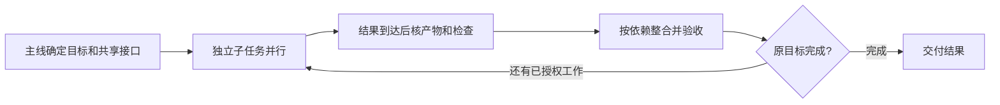

# 子代理怎么组织，长任务怎么无人值守

**✅ 一位主 Agent 持有完整目标与最终验收，独立调查和实现交给原生子代理；阶段结果验过就继续，直到完整目标完成。** 先用现有 Git、测试和任务记录，出现写入隔离或恢复缺口时，再加 worktree 或编排工具。收益算到整合验收结束。

## 第一步：拿当前仓库的一项需求这样派

**先写清验收和文件归属，再并行。** 下面用 CSV 导出演示；换成自己的需求，实际模块和检查命令从当前仓库确认。

```text
给当前项目的列表增加 CSV 导出：遵循当前筛选条件；空结果只含表头；
含逗号、引号和换行的字段能正确解析；原有列表行为保持不变。

你负责完整交付。读项目指引和现有代码，确定导出接口、列顺序、
错误行为、可写文件和测试入口，再派原生子代理：
- A 实现导出逻辑及其测试；B 接入列表入口及交互测试。
- 接口未定前，B 先调查消费者；接口确定后再写，别同时改共享文件。
交回完整改动、基线版本、实际检查结果与剩余问题。
结果到达就核对接收，继续独立工作；全部收齐后，在整合版本跑相关
测试并检查真实导出流程，按原验收交付。

我离开时继续已授权工作；现有记录保留版本、已验结果、待收子任务
和下一步。必须由我决定、权限不足或预算受限时说明恢复条件；
外部动作结果不明时先核对，别重复执行。
```

先跑通一次“交回→主线核产物→继续”，再放更长的同类任务到后台。

## 选原生子代理、worktree，还是团队编排

| 当前需要 | 选择 | 开始前确认 |
|---|---|---|
| 查代码、分析日志、独立审查，或已经切开写入面的实现 | **原生按需委派，默认** | 子任务能用短交接说清，主线会接收结果 |
| 多个独立目标同时改代码 | **每个写入面一个 worktree** | 测试依赖、端口和数据目标各自可用；所需未跟踪资料已准备好 |
| 队员需要直接协商、共享任务列表，原生短委派已经不够 | **再试 Agent Teams 等编排** | 当前客户端的权限、恢复和退出行为适合任务 |

**共享接口先定，再放开实现。** worktree 隔离检出，服务、数据库和权限仍需单独处理；V2EX 使用者还遇到未跟踪资料和项目 Skill 没随 worktree 带过去。

OpenAI 当前指南优先举读密集任务；Anthropic 10 月指南建议合并共享状态的串行角色。Reddit 使用者有保留调查与独立评审的，也有因收益小而取消逐提交评审的。**按缺口拆，不按人数配队；统一最佳规模未知。**



**依据**：[官方] [Codex 子代理](https://learn.chatgpt.com/docs/agent-configuration/subagents)、[Anthropic 10-22 迁移指南](https://claude.com/resources/articles/building-agents-when-to-fold-subagents-into-your-main-agent-loop)；[社区原帖] [V2EX：worktree 资料缺失](https://v2ex.com/t/1243449)、[Reddit：保留哪些子代理](https://www.reddit.com/r/ClaudeAI/comments/1xdwquj/anthropics_new_guide_oct_22_argues_most_agents/)；核实 2026-10-26。拆分和整合细节见 [08 §6](../08-multi-agent.md#6-操作手册从一个大任务到并行执行)。

## HumanLayer 的真实流程：实施交出去，验收收回来

**借接收方式，不必照装整套 RPI。** HumanLayer 的 `implement-outline/process.md` 从首个未完成阶段继续，主线给实施子代理文档路径和范围，让它自行读上下文；收到结果后要求：

> Review the agent's result and verification evidence.

主线核产物与检查，失败先修，再推进；获授权连续做多个阶段时，阶段间验证，人工检查保留到最终审阅。没有 outline 时也允许直接实施。

**依据**：[开源流程] [HumanLayer 固定源码](https://github.com/humanlayer/skills/blob/653b6411c1f70c275a18e37673b042ff99f67ceb/plugins/rpi/skills/rpi/references/implement-outline/process.md#L13-L25)，核实 2026-10-26，插件未试用；相近做法已有[本仓生产采用](../08-multi-agent.md#6-操作手册从一个大任务到并行执行)，原核实 2026-10-25，提速与节费待比较。

## 无人值守：先选能继续运行的入口，再保存能接回的结果

**把目标、执行环境和预算一起交代，再离开。** 本地执行电脑须在线，客户端进程须保持运行；离开后要关机，就在开跑前选已配置仓库与依赖的云端环境。确认测试、权限和预算可用。后台运行受客户端、宿主生命周期和额度限制，不能承诺 24/7 不停机。

- **Codex 多轮探索：🧪 试原生 Goals。** 支持的客户端输入 `/goal` 加目标、检查入口和约束；`/goal pause`、`/goal resume` 管理续接。官方注明 0.128.0 起支持，续接要求目标活跃、线程可续接、预算未耗尽；本仓未试用，已有入口够用就保留。
- **Claude Code：先用普通后台子代理。** 结果通过完成通知回来，权限请求显示在主会话。Agent Teams 仍属实验功能，`/resume` 与 `/rewind` 当前不能恢复 in-process 队员，恢复后须重查。

**按实际状态接回，别只看“后台”两个字：**

| 观察到的状态 | 下一步 |
|---|---|
| 子任务确实在执行 | 保留任务 ID；主线做独立工作，需要它的结果时等待 |
| 正等权限、输入或预算 | 说明具体条件，只停依赖这项条件的工作 |
| 子任务结束，主线尚未接收 | 读取产物和检查结果，整合后再标完成 |
| 任务或外部操作结果未知 | 先查原任务、当前文件与远端结果，再决定续接或重试 |

Codex #40932 的 10 月报告里，子任务完成、独立心跳活着，主线却到用户再次发消息才接收结果。**判断推进，看结果被接收和下一步实际执行；仅有心跳不够。**

中断前在**现有记录**留：最新目标与取消项、版本／未提交差量、已验结果、待收子任务、未知外部结果、下一步与停点。恢复时核当前状态，复用有效检查，只补剩余工作。格式用 [checkpoint-resume](../../templates/codex/.agents/skills/checkpoint-resume/SKILL.md)，恢复细节见 [20 §4](../20-codex-long-horizon.md#4-恢复包必须包含最新任务而非最长历史)。

**依据**：[官方] [任务与执行电脑](https://learn.chatgpt.com/docs/dots/tasks-and-memory#assigned-work)、[Codex Goals](https://developers.openai.com/cookbook/examples/codex/using_goals_in_codex)、[Claude 后台子代理](https://code.claude.com/docs/en/sub-agents#tools-permissions-and-results-of-background-subagents)、[Teams 恢复限制](https://code.claude.com/docs/en/agent-teams#limitations)；[社区单例] [Codex #40932 的 10-04 续报](https://github.com/openai/codex/issues/40932#issuecomment-5982019258)；核实 2026-10-26。该报告没有确定调度根因，不能换算成故障率。

## 何时不适用

**小改动、共享状态多、交接反复或整合积压时，用一位 Agent 连续完成。** 目标含糊先澄清，必须真人判断的决定留停点。确需跨进程保存执行中的工具调用时，再考虑[耐久宿主](../20-codex-long-horizon.md#3-完成条件来自验收原文不能由总结重新定义)。
