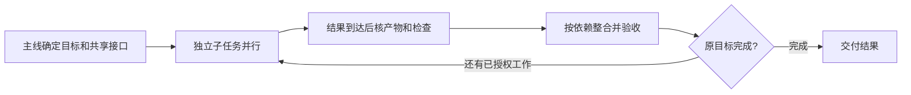

# 子代理怎么组织，长任务怎么无人值守

**🟡 一位主 Agent 持有完整目标与最终验收，独立调查和实现交给原生子代理；阶段结果验过就继续，直到完整目标完成。** 本仓已采用原生委派与接收，持续自动回收和补位尚未完成效果验收。先用现有 Git、测试和任务记录，出现写入隔离或恢复缺口时，再加 worktree 或编排工具。收益算到整合验收结束。

## 第一步：拿当前仓库的一项需求这样派

**先写清验收和文件归属，再并行。** 下面用 CSV 导出演示；换成自己的需求，实际模块和检查命令从当前仓库确认。

```text
给当前项目的列表增加 CSV 导出：遵循当前筛选条件；空结果只含表头；
含逗号、引号和换行的字段能正确解析；原有列表行为保持不变。

你负责完整交付。读项目指引和现有代码，确定导出接口、列顺序、
错误行为、可写文件和测试入口，再派原生子代理：
- A 实现导出逻辑及其测试；B 接入列表入口及交互测试。
- 接口未定前，B 先调查消费者；接口确定后再写，别同时改共享文件。
交回完整改动、基线版本、实际检查结果与剩余问题。
结果到达就核对接收，继续独立工作；全部收齐后，在整合版本跑相关
测试并检查真实导出流程，按原验收交付。

我离开时继续已授权工作；现有记录保留版本、已验结果、待收子任务
和下一步。必须由我决定、权限不足或预算受限时说明恢复条件；
外部动作结果不明时先核对，别重复执行。
```

先跑通一次“交回→主线核产物→继续”，再放更长的同类任务到后台。

## 选原生子代理、worktree，还是团队编排

| 当前需要 | 选择 | 开始前确认 |
|---|---|---|
| 查代码、分析日志、独立审查，或已经切开写入面的实现 | **原生按需委派，默认** | 子任务能用短交接说清，主线会接收结果 |
| 多个独立目标同时改代码 | **每个写入面一个 worktree** | 测试依赖、端口和数据目标各自可用；所需未跟踪资料已准备好 |
| 队员需要直接协商、共享任务列表，原生短委派已经不够 | **再试 Agent Teams 等编排** | 当前客户端的权限、恢复和退出行为适合任务 |

**共享接口先定，再放开实现。** worktree 隔离检出，服务、数据库和权限仍需单独处理；V2EX 使用者还遇到未跟踪资料和项目 Skill 没随 worktree 带过去。

OpenAI 当前指南优先举读密集任务；Anthropic 10 月指南建议合并共享状态的串行角色。Reddit 使用者有保留调查与独立评审的，也有因收益小而取消逐提交评审的。**按缺口拆，不按人数配队；统一最佳规模未知。**



**依据**：[官方] [Codex 子代理](https://learn.chatgpt.com/docs/agent-configuration/subagents)、[Anthropic 10-22 迁移指南](https://claude.com/resources/articles/building-agents-when-to-fold-subagents-into-your-main-agent-loop)；[社区原帖] [V2EX：worktree 资料缺失](https://v2ex.com/t/1243449)、[Reddit：保留哪些子代理](https://www.reddit.com/r/ClaudeAI/comments/1xdwquj/anthropics_new_guide_oct_22_argues_most_agents/)；核实 2026-10-26。拆分和整合细节见 [08 §6](../08-multi-agent.md#6-操作手册从一个大任务到并行执行)。

## HumanLayer 的真实流程：实施交出去，验收收回来

**借接收方式，不必照装整套 RPI。** HumanLayer 的 `implement-outline/process.md` 从首个未完成阶段继续，主线给实施子代理文档路径和范围，让它自行读上下文；收到结果后要求：

> Review the agent's result and verification evidence.

主线核产物与检查，失败先修，再推进；获授权连续做多个阶段时，阶段间验证，人工检查保留到最终审阅。没有 outline 时也允许直接实施。

**依据**：[开源流程] [HumanLayer 固定源码](https://github.com/humanlayer/skills/blob/653b6411c1f70c275a18e37673b042ff99f67ceb/plugins/rpi/skills/rpi/references/implement-outline/process.md#L13-L25)，核实 2026-10-26，插件未试用；相近做法已有[本仓生产采用](../08-multi-agent.md#6-操作手册从一个大任务到并行执行)，原核实 2026-10-25，提速与节费待比较。

## 无人值守：先选能继续运行的入口，再保存能接回的结果

**把目标、执行环境和预算一起交代，再离开。** 本地执行电脑须在线，客户端进程须保持运行；离开后要关机，就在开跑前选已配置仓库与依赖的云端环境。确认测试、权限和预算可用。后台运行受客户端、宿主生命周期和额度限制，不能承诺 24/7 不停机。

- **Codex 多轮探索：🧪 试原生 Goals。** 支持的客户端输入 `/goal` 加目标、检查入口和约束；`/goal pause`、`/goal resume` 管理续接。官方注明 0.128.0 起支持，续接要求目标活跃、线程可续接、预算未耗尽；本仓未试用，已有入口够用就保留。
- **Claude Code：先用普通后台子代理。** 结果通过完成通知回来，权限请求显示在主会话。Agent Teams 仍属实验功能，`/resume` 与 `/rewind` 当前不能恢复 in-process 队员，恢复后须重查。

**按实际状态接回，别只看“后台”两个字：**

| 观察到的状态 | 下一步 |
|---|---|
| 子任务确实在执行 | 保留任务 ID；主线做独立工作，需要它的结果时等待 |
| 正等权限、输入或预算 | 说明具体条件，只停依赖这项条件的工作 |
| 子任务结束，主线尚未接收 | 读取产物和检查结果，整合后再标完成 |
| 任务或外部操作结果未知 | 先查原任务、当前文件与远端结果，再决定续接或重试 |

Codex #40932 的 10 月报告里，子任务完成、独立心跳活着，主线却到用户再次发消息才接收结果。**判断推进，看结果被接收和下一步实际执行；仅有心跳不够。**

中断前在**现有记录**留：最新目标与取消项、版本／未提交差量、已验结果、待收子任务、未知外部结果、下一步与停点。恢复时核当前状态，复用有效检查，只补剩余工作。格式用 [checkpoint-resume](../../templates/codex/.agents/skills/checkpoint-resume/SKILL.md)，恢复细节见 [20 §4](../20-codex-long-horizon.md#4-恢复包必须包含最新任务而非最长历史)。

**依据**：[官方] [任务与执行电脑](https://learn.chatgpt.com/docs/dots/tasks-and-memory#assigned-work)、[Codex Goals](https://developers.openai.com/cookbook/examples/codex/using_goals_in_codex)、[Claude 后台子代理](https://code.claude.com/docs/en/sub-agents#tools-permissions-and-results-of-background-subagents)、[Teams 恢复限制](https://code.claude.com/docs/en/agent-teams#limitations)；[社区单例] [Codex #40932 的 10-04 续报](https://github.com/openai/codex/issues/40932#issuecomment-5982019258)；核实 2026-10-26。该报告没有确定调度根因，不能换算成故障率。

## dot 的同轮接收：先验产物，再把下一项接上

**🟡 把“结果回来后做什么”一起交给 dot：在当前轮读取产物，让非作者按原验收独立检查，处理反馈，再启动剩余的已授权工作。** 沿用已授权的一个心跳作兜底；当前轮能接续，就不等下一次心跳或用户再发消息。可在真实任务后加上这段：

```text
每个子任务交回时，先读实际差量、基线版本、检查结果和未完成项。
独立验收交给未参与实现的读者，给它目标、产物和原验收；
需要盲读时，不给历史答案。由你核对读者实际操作的结果，
有卡点就退回原作者修订，再验受影响部分。
验收期间继续不共享写入面的工作。接受本项后，在同一轮
派出下一项已有授权、输入齐备的任务；没有可做项就写明等待条件。
未知结果先查原任务和产物；旧写者停止未确认时，不接管同一写入面。
沿用已有交接和检查，不另建调度或为测试重复实施。
```

**ChatGPT dot 用户可从桌面端 dot 资料页 → Activity 打开任务，检查文件、结果和待处理请求；续接后再核新轮次里的实际动作。** 社区的 #49883 在 10 月 1 日报告：子任务轮次已标 `completed`，产物仍只是未达验收的预览，主线迟迟未续接；#52374 的 10 月 23 日续报则是历史可读，但续接报 `UNKNOWN`，回读未见新轮次。Nigel999 的原帖也报告进度承诺与实际停工不符，支持回复要求核 Activity、阻塞和审批。这些 ChatGPT dot 个案与上文 Codex 子代理报告属于不同场景，都不能估算故障率。

**依据**：[官方] [Activity 与完成后审阅](https://learn.chatgpt.com/docs/dots/tasks-and-memory#assigned-work)；[社区原帖] [dot #49883](https://github.com/openai/codex/issues/49883)、[dot #52374 的 10-23 续报](https://github.com/openai/codex/issues/52374#issuecomment-6364039681)、[Nigel999 与支持回复](https://community.openai.com/t/dot-repeatedly-reports-progress-but-fails-to-complete-tasks-or-clearly-disclose-that-work-has-stopped/1402528)；核实 2026-10-28，各个案根因未确定。

**接收看产物，续接看实际动作。** 仅有派发回执时记“已派发、执行待确认”；看不到子进程活动时记“进程状态不可观测”，静默时长不能单独用来判定卡死或已停止。请求取消后，须收到可核的终止结果或核实原运行已结束，才把原写入面交给新执行者；期间可继续互不冲突的工作。对于重复做错的任务，保留有效结果，收窄成只补缺项的任务，而不是把整套流程再跑一遍。

**社区的正向用法可借两点：让 dot 接走协调，让独立评审回到真实入口。** 两位使用者提供的是作者自报，适合决定下一步试什么：

| 卡在哪里 | 作者实际怎么做 | 本轮可借什么 |
|---|---|---|
| 人工切换多个开发线程 | SonicSubculture 原先人工协调约六条 Codex 线程，改用 dot 后自报协调负担降低；当时只用两三天，仍遇安全暂停，也未给质量对照 | 让主 dot 收回多项结果；并发按独立写入面与接收能力定，不照搬六条，也不采用绕过安全暂停的做法 |
| 实现者自报完成，实际使用仍有错 | Vymalgh 让 dot 打包定制提示与支持资料，交另一个普通 ChatGPT 会话做设计或评审，再带回结果；另述真实试玩能发现自报已测却不符要求的功能，需要多轮构建修正 | 已在途任务需要独立评审时，可试复用这种材料交接，再按原验收实际使用；会话评语只作反馈，不代替运行 |

两帖均未提供量化效率对照；后者原帖未给可复跑源码。先沿已有任务观察下表的合格交付、返工与协调投入，不为对照另开任务或据此改默认。

**依据**：[社区作者原帖] [SonicSubculture：多线程协调与暂停](https://www.reddit.com/r/ChatGPTPro/comments/1wwm3xt/your_dot_paused_out_of_precaution/)、[Vymalgh：独立会话评审与实际试玩](https://www.reddit.com/r/DotsAI/comments/1x1nnr4/been_using_my_dot_for_quite_a_few_things/)；核读 2026-10-28。本仓未复跑这两位作者的项目。

### 下一项真实任务怎样验证这条链

**用现有的两个独立工作单元自然跑一次，不造演示任务。** 选一个需要交付的单元和一个可以并行推进的单元，先固定原验收、写入面与下一项；本轮协调者接到首项结果后，按上面的片段交给新读者，核验、修订并接续。另一位非作者核对产物与原始工具结果；只读页面复述流程是可读性检查，实际验收仍须走任务入口。

**效率同时看合格交付和完整投入，不只看等待间隔。** 在现有交接或提交说明里写清 UTC 观察窗口、同类目标范围和原验收；同一目标的实现、审查、修订和提交只算一件交付。原始时点与所在协调轮取工具记录，不用 Git 提交时间代替执行时间；记录不完整的项写未知。

| 要观察什么 | 精确记法 |
|---|---|
| 结果有没有被及时接走 | `R`＝协调者收到产物通知；`A`＝独立读者首次实际读取产物／运行验收。进入独立验收的等待为 `A − R` |
| 验收后有没有续接 | `V`＝协调者核对最终产物与独立检查后接受；`N`＝下一单元首次实际执行。接受后空档为 `max(0, N − V)`；提前已启动则注明重叠 |
| 交付了多少合格结果 | 窗口内按原验收接收的同类目标数／观察时长；逐项给产物与接收证据，列出起点已有在途和期末未完成，跨窗任务注明 |
| 首次外部验收能否通过 | 首轮独立验收通过的任务数／首轮已有通过或失败判定的任务数；逐项保留原验收结果，未运行／待判断单列，分母为零时不计算 |
| 为原要求付出多少返工 | 一次汇总反馈后的实际修订重交算一轮；新增要求另列。分别记录负责人补做的实现／补验／修稿，以及派发／澄清／接收等协调动作和次数；有主动工时才记，不能用动作数换算时间 |
| 是否真的并行 | 同一观测时点列可核的执行任务及各自最近动作；派发、等待和状态未知分列，不从一次快照推算持续并行率 |

计数口径沿用 [22 §5：按任务计分、展示分母与完整投入](../22-agent-evaluation.md#5-如何计分而不自欺)（原核实 2026-10-22）。这些数先描述本次观察；没有任务范围、原验收、观察窗口和投入记录相匹配的基线，就不宣称提速或质量提升，未完整观测的历史不补作基线。

本次试跑到“结果已核验且下一项已有实际动作”，或出现需用户输入／授权的明确阻塞时收束观察；失败和未知也保留。持续在线率、全天无人干预成功率、吞吐或节费收益需要更长的可观测运行与可比任务，目前没有这些结果。这个自然实跑计划仍待执行，本页保持 🟡。

**现有实证**：本仓已有[共享指令页](https://github.com/dbvv1/a1dbv/commit/6d4936473a34319e2f745aab7d234896b1ffc3c3)、[模型委派页](https://github.com/dbvv1/a1dbv/commit/1b9be478347959f5a4edc6b9d5f6de2a220b4919)及[上下文页](https://github.com/dbvv1/a1dbv/commit/4b4534eb0cafb840b5465a5e0db852b425801d2c)经独立读者反馈后交付的结果；其中模型委派页明确修正了“取消指令”与“确认停止”的混用。另一次[CI 补项](../collaboration/local-jobs/A-CI-EXACT-SHA-READER-20261028.md#当前结果)连续两轮重复 GET、遗漏指定字段后被取消；所引记录未见停止回执，实际停止状态未知。这些记录支持按原验收接收和安全收回；完整“到达→独立验收→下一项”链的时延、持续自动补位效果尚待上述实跑。核读 2026-10-28。

## 何时不适用

**小改动、共享状态多、交接反复或整合积压时，用一位 Agent 连续完成。** 目标含糊先澄清，必须真人判断的决定留停点。确需跨进程保存执行中的工具调用时，再考虑[耐久宿主](../20-codex-long-horizon.md#3-完成条件来自验收原文不能由总结重新定义)。
