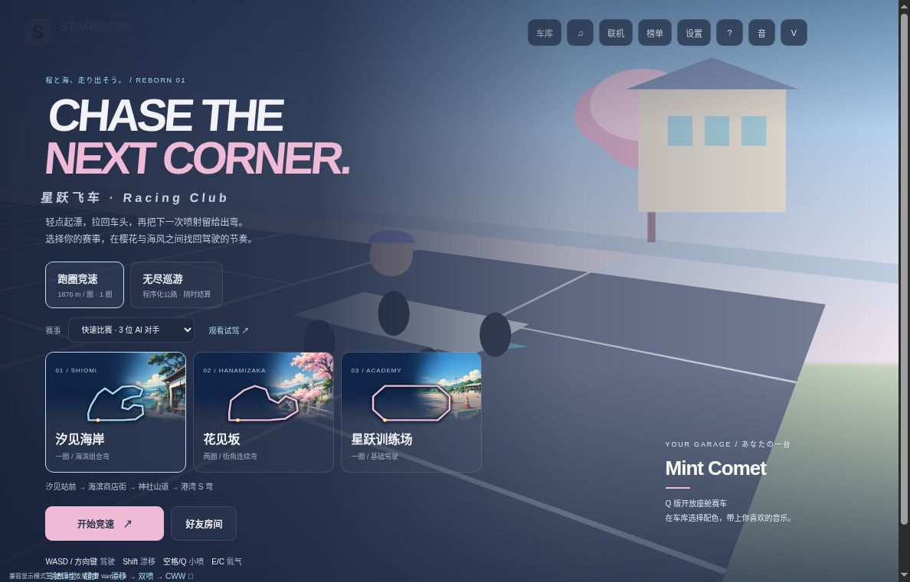

主线：二／三；G1 资产处理与第二次修改
改变的建议：[经验] 返工先定位缺陷；静态图在真实布局缩图后验收，程序化语义与装饰图分层；引擎资产默认经 Editor API 修改
新证据：[一手] Star-Rush 三张 AI 选卡插画已制作／接入，海岸实际缩图触发图片二改；历史 GLB／PNG 复核与引擎资料仍只支持各自范围

# 游戏资产编辑：引擎 API 不等于专用 Agent 接口

> 核实时间：2026-10-23（UTC+8）补选卡实作；2026-10-13 的引擎编辑研究只读官方文档与公开 issue，未运行 Unity、Unreal 或模型。**[一手：官方文档；社区：原始报告；经验：采用判断]**

**✅ 采用最小修正。** 撤回“编辑器操作必须走官方 Agent 接口”，按源码、文本序列化与二进制资产选择路径；资产默认经引擎 Editor API 修改。直接编辑 Unity 文本资产只作为项目验证过的受限例外，不反向承诺任意 YAML 修改安全。正文只修游戏 README/01 的对应表述，不重验其中所有工具版本。

## Unity：可读文本不等于安全写入契约

- [Unity 6.0 Text-based scene files](https://docs.unity3d.com/6000.0/Documentation/Manual/TextSceneFormat.html) 将工具生成/解析文本场景列为用途；同版本 [Prefab YAML](https://docs.unity3d.com/6000.0/Documentation/Manual/yaml-prefab-serialization.html) 明确提到手工解决合并冲突与编辑器外脚本，并说明 PrefabInstance、override、stripped object 和跨文件 GUID/fileID 的关联。**[一手]**
- 但同版本 [UnityYAML](https://docs.unity3d.com/6000.0/Documentation/Manual/UnityYAML.html) 又写明：“You cannot externally produce or edit UnityYAML files.” 并指出其实现不支持完整 YAML 规范。三页原文在本轮读取时存在直接冲突，不能只选支持直改的一页，宣称官方保证安全。**[一手；研究：交叉核对]**
- [Asset Serialization 设置](https://docs.unity3d.com/6000.0/Documentation/Manual/class-EditorManager.html#asset-serialization) 列出 Mixed、Force Binary、Force Text，后者为默认值；这个设置不是外部写入正确性的保证。**[一手；经验：采用边界]**
- [Asset metadata](https://docs.unity3d.com/6000.0/Documentation/Manual/AssetMetadata.html) 说明 `.meta` 保存唯一 ID 与导入设置；在 Unity 外移动或重命名资产时必须同步处理对应 `.meta`。丢失它会产生新的资产身份并断开已有引用。源码内容编辑与文件改名/移动因此不是同一风险。**[一手]**

**实用边界**：C# 源码按编码流程编辑；确需局部文本补丁时，范围应已在项目中验证，保留 GUID/fileID 与结构关系，审阅差异并在目标引擎中重导入/打开、核对引用。复杂 Prefab 结构修改优先交给引擎序列化；通用 YAML 解析成功不代替引擎验收。这些是保守建议，本次没有验证一组跨版本通用的“安全补丁”。**[经验]**

## Editor API 已能操作资产，无须推导为 MCP 必选

- [Unity 6.0 PrefabUtility.LoadPrefabContents](https://docs.unity3d.com/6000.0/Documentation/ScriptReference/PrefabUtility.LoadPrefabContents.html) 官方示例用 C# 加载隔离 Prefab、修改、`SaveAsPrefabAsset` 保存并卸载，明确适用于批处理。它提供引擎内的修改路径，不要求专用 Agent 接口。**[一手]**
- [Epic Python Editor scripting](https://dev.epicgames.com/documentation/en-us/unreal-engine/scripting-the-unreal-editor-using-python) 提供编辑器对象/属性操作；`set_editor_property` 会触发 pre/post edit 处理，直接赋 Python 属性不一定如此。API 能力取决于暴露范围与版本，Python 环境仅在 Editor 可用，不能推成打包游戏脚本能力。**[一手]**
- [Epic Perforce 文档](https://dev.epicgames.com/documentation/unreal-engine/using-perforce-as-source-control-for-unreal-engine) 明确 `.uasset` / `.umap` 是二进制，不能文本合并。普通 Agent 工作流应经匹配版本的编辑器/API 做语义修改与保存；C++ 源码不受此二进制边界约束。这不是宣称所有外部二进制处理工具在技术上都不可能。**[一手；经验：推荐范围]**

## 真实失败反例与证据限度

[JetBrains/resharper-unity #1461](https://github.com/JetBrains/resharper-unity/issues/1461)，2019-12-13 的原始报告：在 Rider 的 Unity Explorer 重命名 ScriptableObject 资产，没有同步重命名 `.meta`，随后 Unity 丢失该资产引用。issue 已关闭，本次未复现，也未推断当前 Rider 仍有该问题。它支持保留资产身份与配对的要求，不支持“所有外部编辑都不安全”。**[社区：历史报告；一手：机制与 Unity metadata 文档吻合]**

## 验证范围

已核同版本冲突原文与仓库四处绝对化表述；将来仅按目标项目的重导入、引用及运行证据扩大文本修改例外。**[研究：本轮范围]**

历史编辑边界检查：`python3 scripts/check_offline.py` 14 阶段、非空无 skip，`git diff --check` 通过；只证仓库离线入口，不覆盖下文上游修复或真实引擎。**[研究]**

## 生成网格：有损后处理不等于规格设置

2026-10-13 补充；改变游戏 03 §1.1 第 3 项：命名、明确单位换算与有损几何处理分开。**🧪 复用现成清理路线做受限试验**，不据此采用整套模型为正式资产方案；这一反例不否定常规批量设置。**[经验：采用判断]**

- 固定 `lyonsno/trellis2mlx@c0e66f782ac86f86212e049cf029478602b0e8d2` 的 [mesh_cleanup.py](https://github.com/lyonsno/trellis2mlx/blob/c0e66f782ac86f86212e049cf029478602b0e8d2/trellmlx/mesh_cleanup.py#L16-L98) 将小连通块过滤移到非流形边拆分之前；[generate.py](https://github.com/lyonsno/trellis2mlx/blob/c0e66f782ac86f86212e049cf029478602b0e8d2/generate.py#L790-L809) 在后续清理中禁用再次过滤，避免把已拆开的细薄表面误当碎屑。这是局部保留策略，不是与参考 CUDA 路线完全一致的保证。**[一手：源码阅读]**
- 同版本 [合成回归](https://github.com/lyonsno/trellis2mlx/blob/c0e66f782ac86f86212e049cf029478602b0e8d2/tests/test_mesh_cleanup.py#L71-L132) 包含相连细片及独立碎屑：新顺序要求保留前四面、删除碎屑，旧顺序对照要求结果为空；另覆盖反复清理与补洞开关。**本轮仅阅读，未执行上游测试或拆分算法。** **[一手：测试阅读]**
- [作者验证记录](https://github.com/lyonsno/trellis2mlx/blob/c0e66f782ac86f86212e049cf029478602b0e8d2/docs/validation.md) 报告 warrior 保存输入恢复此前误删的 207,391 面；补洞使最终面数从 961,732 增至 1,662,604，说明简化目标不是导出面数硬上限。数字为作者产物报告，不是本轮资产复测，也不是游戏通用预算线。**[一手：作者实验报告]**
- [产物清单](https://github.com/lyonsno/trellis2mlx/blob/c0e66f782ac86f86212e049cf029478602b0e8d2/docs/examples.json) 含参数、GLB 哈希和展示路线；本轮实际查看 bear 正面截图，文件 SHA256 与清单一致。完整固定 Git 树未包含对应 GLB 或原始网格，无法独立检查面数与修复前后差异；清单里的哈希不是已验证的 GLB，截图也不证明没有人工修补。**[一手：清单与截图；研究：本轮检查边界]**

**剩余边界**：未核实真实游戏采用或 Unity / Unreal 中的发布质量；展示渲染不替代目标硬件、相机距离、动画与资产预算验证。此例支持先区分生成缺陷与后处理损伤，不支持任何美术风格天然更适合 AI，也不证明风格一致性或完整无美术流程。**[研究：范围；经验：外推限制]**

## 生成资产返工：先判断缺陷来自哪一层

2026-10-13（UTC+8）；主线二／三。改变游戏 03 §1.1：先定位生成、后处理或运行时错误，再选修补或重生成。**🧪 采用这条诊断顺序，不采用整套管线作为零手修发售方案。** **[经验：采用判断]**

- **三种缺陷不能合算为模型失败。** 固定 [corosolto/client@3ce6485 的返工记录](https://github.com/corosolto/client/blob/3ce648572534e098c63b5b88ef367dc1e7833ea8/docs/reports/PR773-CONTINUATION.md)及[生成登记](https://github.com/corosolto/client/blob/3ce648572534e098c63b5b88ef367dc1e7833ea8/mint-assets.json)及[作者流程记录](https://github.com/corosolto/client/blob/3ce648572534e098c63b5b88ef367dc1e7833ea8/.claude/skills/fabrica-personagens/SKILL.md#L56-L96)分别记载脸部碎片修补未果后重生成、区域 UV 脚本修颜色、修正锁骨重定向。前一项是作者实验报告；原始／拒绝 GLB 存仓库外，未独立重现所有失败尝试，不能断言重生成总比修补有效。**[一手：作者记录；研究：范围核对]**
- **程序错误应先修程序。** [3435ddb 补丁](https://github.com/corosolto/client/commit/3435ddb93b25bf790c147e24592afaed1a012720)将锁骨移出 Arm/Hand 的绝对旋转路线，改用 rest delta；旧版约 179° 是作者报告，不是本轮前后测量。[纹理脚本](https://github.com/corosolto/client/blob/3ce648572534e098c63b5b88ef367dc1e7833ea8/tools/personagens/retoque-textura.mjs)按身体区域映射 UV、替换颜色，只处理首个 mesh/primitive，需资产特定阈值、颜色和 mask 视觉选择，不能称通用自动修复。**[一手：固定源码与报告]**
- **确有被运行时引用的产物。** [PR #773](https://github.com/corosolto/client/pull/773)于 2026-10-09 10:15:09（UTC+8）合并；固定 [glbchars.js](https://github.com/corosolto/client/blob/3ce648572534e098c63b5b88ef367dc1e7833ea8/public/js/glbchars.js#L322-L355)加载 Dama 角色并优先读取动画合包。这里的采用指合并源码引用，不是已验证线上部署或商业发售。**[一手：PR 与源码]**
- **实际复算。** 本轮用自有 Python 标准库解析固定[角色 GLB](https://github.com/corosolto/client/blob/3ce648572534e098c63b5b88ef367dc1e7833ea8/public/models/characters/dama.glb)、[独立 idle](https://github.com/corosolto/client/blob/3ce648572534e098c63b5b88ef367dc1e7833ea8/public/models/anims/dama/idle.glb)及[动画合包](https://github.com/corosolto/client/blob/3ce648572534e098c63b5b88ef367dc1e7833ea8/public/models/anims/dama.glb)，两次复跑一致：角色 678,684 bytes，SHA256 `34a33e1f0f0a6c3d74721452efe88aeae7888813d61f0b0e737491e4553b47ec` 与登记相符；合包 11 个命名动作。按[上游 OMB1](https://github.com/corosolto/client/blob/3ce648572534e098c63b5b88ef367dc1e7833ea8/tools/eval/ombro-check.mjs)定义读取 idle 两肩各 86 个旋转采样，以角色同名节点 rest 为参照，计算 `degrees(2*acos(min(1,abs(dot(q,q_rest)))))`：左肩最大 7.8169°、右肩 9.0393°，均低于项目 30° 线，独立文件和实际合包结果相同。解析额外核对 GLB 头、chunk/accessor 边界、两肩非空；采样四元数平方范数误差最大约 `1.80e-6`。只检查存储关键帧的局部数值，没有执行上游脚本、插值渲染、其他动作、模型或引擎。**[研究：真实文件的确定性计算，非模型实验]**
- **绿色检查仍可能保留已知缺陷。** [选择界面门槛复盘](https://github.com/corosolto/client/blob/3ce648572534e098c63b5b88ef367dc1e7833ea8/docs/reports/PR773-SELECT-GATE-2026-10-09.md)承认新十个角色超过旧全局蒙皮阈值，视觉接受后冻结逐角色债务；最终是 0/63 阻塞、22/63 冻结债务，不是全部通过原质量线。保留既有缺陷并防恶化是交付取舍，不应写成模型已修好。**[一手：作者报告；经验：验收含义]**

**反证与停止边界。** 单角色约 3,400 credits 的旧登记与作者后续纠正的十角色合计 11,756 credits 存在口径冲突，没有账单，故不比较净成本。未取得拒绝版本或真实引擎环境；不证明全程无人绘制、目标硬件表现、Unity/Unreal 可用性或第二次需求修改后的持续生产能力。这些缺口不能靠继续解析最终文件补齐；正文只采用故障分流，不扩大为工具推荐。**[研究：未闭合证据；经验：外推限制]**

## 2D：静态可用不推出角色动画可用

2026-10-13（UTC+8）；主线二／三。撤回游戏 03 §1.2 对“2D／概念图”统一写“成熟”；**🧪 静态资产按实际尺寸与真实修改验收，动画独立验证。** 这是一条采用条件，不是生成模型排名，也不是认定所有 2D 生成不可用。**[经验：采用判断]**

- **实际引入与撤回。** Little Apartment, Big City 的 [287b0d1](https://github.com/TechProGabe/little-apartment-big-city/commit/287b0d115055d6c16e0d6b77b12637d460ca5cd7) 引入 128px 生成角色和加载路径；作者明确新 idle 仍配旧 walk、侧背面尚未接成四向，源码也仅对右向镜像正面。[直接子提交 88c32e6](https://github.com/TechProGabe/little-apartment-big-city/commit/88c32e601d33f202980232eff9338ba8d03d7cbe)实际删除六张 PNG、`PC_SHEETS` 和玩家 PNG 绘制分支，复用 `addCharacter`，新增配色和长发覆盖层；通用图集加载器仍保留给世界／道具。风格不符是作者解释，撤回是可核查补丁，不能据此杜撰未提交的试验轮数或回退后的玩家收益。**[一手：Git 与源码；作者报告]**
- **尺寸正确只是必要检查。** 本轮只读六张固定 PNG 的头与哈希：四张静态图均 128×128、两张 walk 为 512×128，其中两张 walk 与 manifest 的 128×128×4 切帧规格相符，六张均有 alpha 通道。结构检查没有判定透明边缘质量、身份或动作；[作者美术记录](https://github.com/TechProGabe/little-apartment-big-city/blob/88c32e601d33f202980232eff9338ba8d03d7cbe/kb/art-direction.md)报告参考图锁姿态、去掉参考又可能身份漂移，不能把该路径的问题推广为所有图像模型的定律。复核可从引入提交的 `public/images/characters/` 读取 PNG 签名后 IHDR 的两个 big-endian uint32，与 `src/game/sprites.ts` 中帧宽／高／数比较；不需模型调用。**[研究：文件结构测量；一手：作者记录]**
- **反证：静态用途没有一起撤回。** 后续 [374038f](https://github.com/TechProGabe/little-apartment-big-city/commit/374038f44a042cde1029e7eaf0b318eeccb621c4)加入 14 个说话者肖像并更新游戏映射；[固定修名脚本](https://github.com/TechProGabe/little-apartment-big-city/blob/2acbbd04af72ca082bd43eed20972ea873db5523/scripts/fix-nameplates.mjs)覆盖四张肖像的指定姓名区域再绘制字体。[作者记录](https://github.com/TechProGabe/little-apartment-big-city/blob/2acbbd04af72ca082bd43eed20972ea873db5523/kb/art-direction.md)称图像编辑会串脸或改名失败；修正前 staging 输入未入 Git，未独立复现修图成功率。规则明确的文字可用程序处理，不能外推到姿态与蒙皮；大肖像采用也不能证明小图标／连续动画可用。**[一手：代码与作者报告；研究：范围限制]**

**验收含义。** 本轮核对的是 React/Canvas 游戏的采用／撤回历史，没有运行上游游戏、模型、修图脚本或 Unity，也没有独立美术评审、完整主动工时和商用授权链；公开可读不等于可复用这些资产。程序绘制回退依赖现有身体／配色模板，不能保证任何程序员零美术投入都能从头复刻。固定视角小资产在第二次需求修改后的前后产物、淘汰样本、实际尺寸与打包辨识仍缺；应保持条件化试用，而不是用本案例冒充该完整试验。**[研究：未覆盖范围；经验：停止外推]**

## 选卡插画实作：让真实缩图决定二改

**✅ 保留程序化功能层，只用生成图补环境身份；能否采用由真实卡片决定，不由母版的大图观感决定。** 2026-10-23，Star-Rush 做完三张大厅选卡插画的制作、处理、加载和一次海岸图二改。本例补上上文历史案例缺少的“自己制作 → 接入 → 在实际尺寸发现问题 → 再改同一资产”；不把菜单装饰通过扩成驾驶体验、动画或全游戏资产链完成。[一手：实作；研究：采用范围]

### 先比较三种来源，再决定生成什么

| 来源 | 本次选择及原因 |
|---|---|
| 原有程序化卡片 | 路线、标题、难度与选中态本已明确，继续作为功能基线与失败回退；不让模型重画这些精确语义 |
| Kenney 现成包 | 官方 [Racing Pack](https://kenney.nl/assets/racing-pack) 与 [Background Elements Remastered](https://kenney.nl/assets/background-elements-remastered) 均列 CC0；前者是俯视赛车瓦片／车辆，后者是背景组件，本次未接入，不能直接充当三张特定主题卡 |
| 原创图像生成／参考编辑 | 只补海岸、樱花、训练场的环境插画；主题辨识仍须在原卡尺寸验，未比较其他图像模型的同题质量 |

[一手：原卡源码、Kenney 官方包页；研究：任务匹配判断，2026-10-23核] 延续本页既有社区案例，不以这次小制作宣布当前最优工具；全流程零手修最高水平仍未知。

**输入与配方要能接手。** 本单元共4次内置 `image_gen` 调用：海岸首图、以其为风格参考的樱花／训练图，以及真正编辑海岸首图的 v2；工具未公开模型快照。前三张不同主题不是“同一资产三次修改”。未输入第三方图，提示要求不画文字、数字、箭头、路线或 UI 框；原始 PNG、完整提示词、风格／编辑参考、前后 SHA-256 与 `revises` 都保在[资源来源清单][course-art-manifest]和[提示词][course-art-prompts]。[一手：制作记录]

生成服务产物不是 CC0 素材；[OpenAI 条款](https://openai.com/policies/terms-of-use/)区分适用合同与地区，并不保证输出独特，本例不承诺独占版权或全部发行权利。[一手，2026-10-23核]

### 真正的问题在缩图后出现

**v1：海岸卡的树、屋檐和街景更显眼，海的身份不足。** 这是1188×761兼容模式大厅的原始截图；另外两张卡分别呈樱花与训练场，路线与文字仍是原 UI。

**v2：扩大蓝绿水面与浅色岸线，原卡布局不动。** 以 `coast-v1.png` 作编辑输入，保小店身份、同族配色和左侧暗色净空，简化远处房屋及细节；重新缩图、打包后，海岸比首版更容易从画面辨认。樱花／训练图、卡片 CSS、路线位置和路径都未改变；这是图片二改，不是改透明度或换裁切。[一手：同视口实际观察；这是作者目检，不是玩家识别率测量]

### 从母版到失败回原卡，只保这一条窄链

1. **保源再处理**：1774×887 PNG 保留；[处理脚本][course-art-processing]用 Pillow 12.3.0 转 RGB、Lanczos 最大512×256（不放大）、WebP quality=82／method=6，不手绘补图。初版三图合计41,958字节；仅换海岸 v2 后40,588字节。旧海岸 v1 与全部母版留源仓，不进当前运行包；另外两张仍用 v1。[一手：配方与文件]
2. **打包只认选中输出**：[构建入口][course-art-build]按赛道／文件白名单、180 KB 单图上限与简单 VP8 WebP 容器检查接收，内容哈希进 URL；同源客户端文件与 Worker 精确路由一起生成。输入缺失、非法路径／清单、截断图像与超预算失败时不悄悄发包；这不是完整压缩数据损坏检测。[一手：源码与回归]
3. **功能不等待装饰**：[加载器][course-art-loader]只加 `alt=""`／`aria-hidden` 装饰图；加载时仍可选卡，失败移除图片，保原色底、SVG 路线、按钮名称与点击行为。精确语义仍来自程序，不来自生成图。[一手：源码与回归]
4. **下一次修改只换目标图**：新增版本、更新 manifest 的母版／派生哈希与修改关系，重跑处理和构建，再用相同布局对照。主题仍不清楚或影响路线时退回原卡，而不是继续堆生成图或把三个主题一并重生。[研究：从本次失败提炼的做法]

**验收到哪里：** [资源验收说明][course-art-readme]记录：v1真实浏览器已看见三图，完成三赛道切换、练习自动选训练、进赛与返回；v2做海岸同卡视觉复验；最终整合版另核三卡加载、进赛与退出大厅，本文前后截图仍只用于图片二改对照。处理／DOM生命周期／构建输入／Worker路由有[离线测试][course-art-tests]；显式派发 `load/error` 不算真实浏览器网络失败实测。手机／短屏、真实加载失败、任意损坏图片、玩家收益和发布端尚未验，截图为兼容模式，不能代替WebGL赛中质量。[一手：实际验收与测试范围]

**探索回执：** 截止2026-10-23，复核上述官方包页与条款、固定项目源码／母版／提示词和实际大厅图；本轮是已有研究的实作续接，未另跑模型榜或社区全渠道搜索。读者可借这条“语义与图像分层、缩图验收触发二改”的做法，不应据此选出普遍最好的图像模型。[研究]

[course-art-manifest]: https://github.com/dbvv1/Star-Rush-Reborn/blob/07e18395bff8a172f7d552ccae0f6cefe7458fce/assets/course-art/manifest.json
[course-art-prompts]: https://github.com/dbvv1/Star-Rush-Reborn/blob/07e18395bff8a172f7d552ccae0f6cefe7458fce/assets/course-art/PROMPTS.md
[course-art-processing]: https://github.com/dbvv1/Star-Rush-Reborn/blob/07e18395bff8a172f7d552ccae0f6cefe7458fce/prepare-course-art.py
[course-art-build]: https://github.com/dbvv1/Star-Rush-Reborn/blob/07e18395bff8a172f7d552ccae0f6cefe7458fce/build.mjs
[course-art-loader]: https://github.com/dbvv1/Star-Rush-Reborn/blob/07e18395bff8a172f7d552ccae0f6cefe7458fce/course-art.js
[course-art-tests]: https://github.com/dbvv1/Star-Rush-Reborn/blob/07e18395bff8a172f7d552ccae0f6cefe7458fce/tests/course-art.mjs
[course-art-readme]: https://github.com/dbvv1/Star-Rush-Reborn/blob/07e18395bff8a172f7d552ccae0f6cefe7458fce/assets/course-art/README.md
