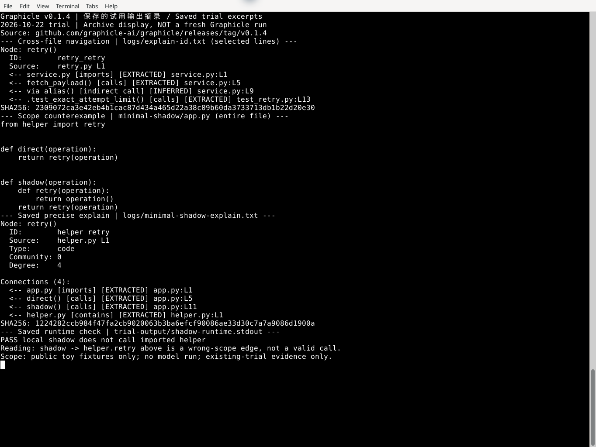
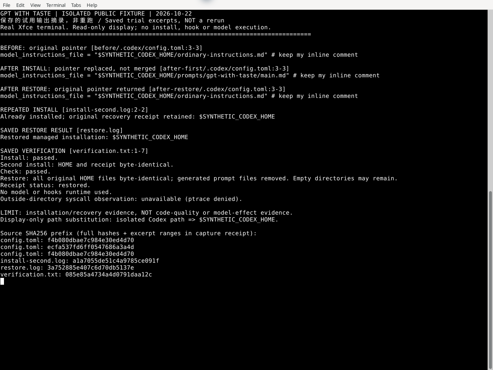
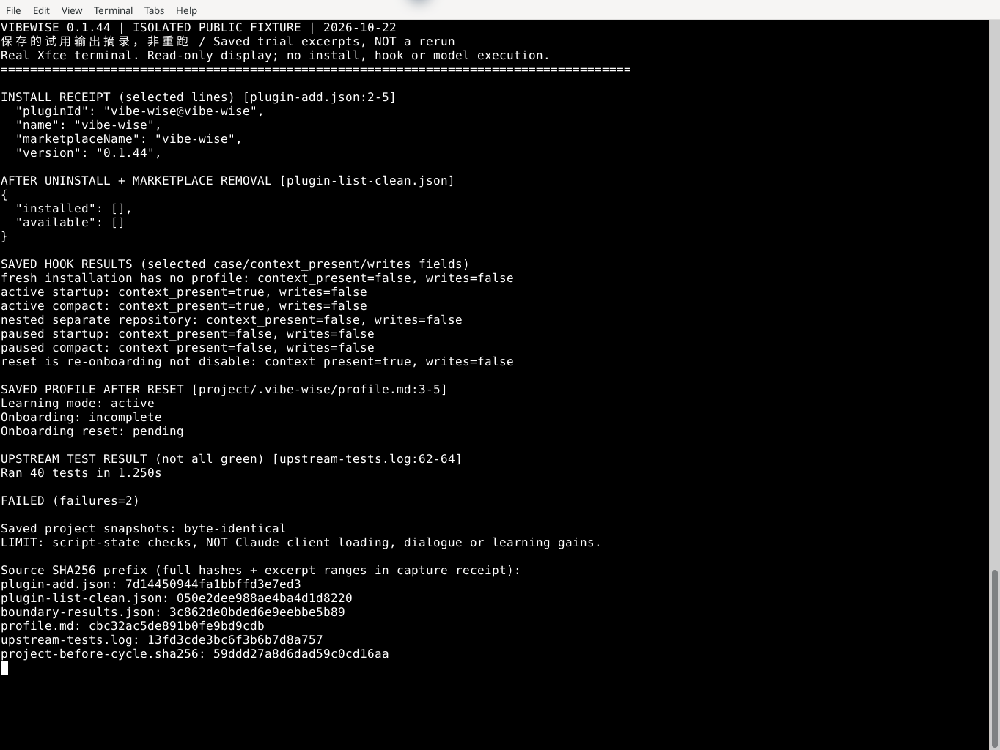
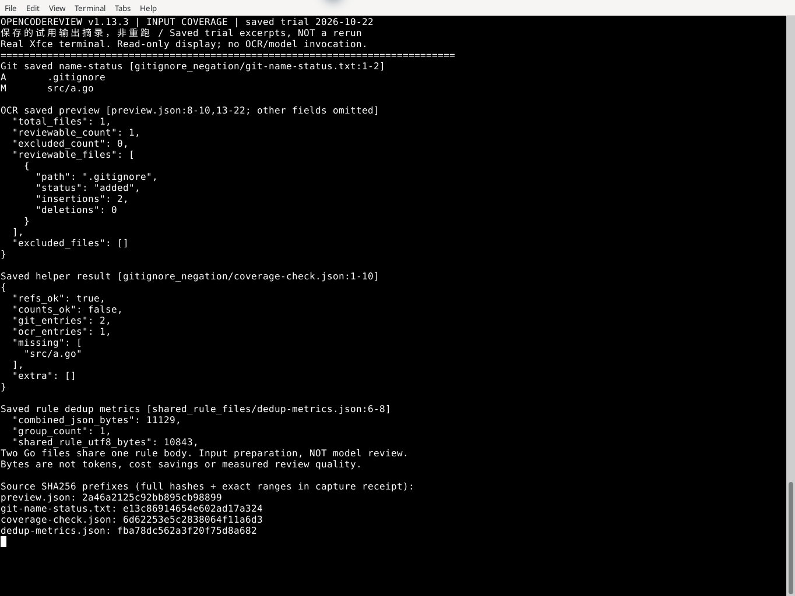
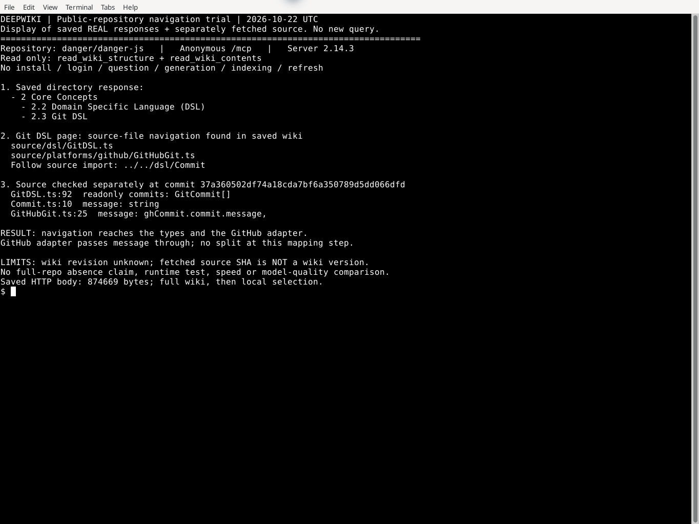
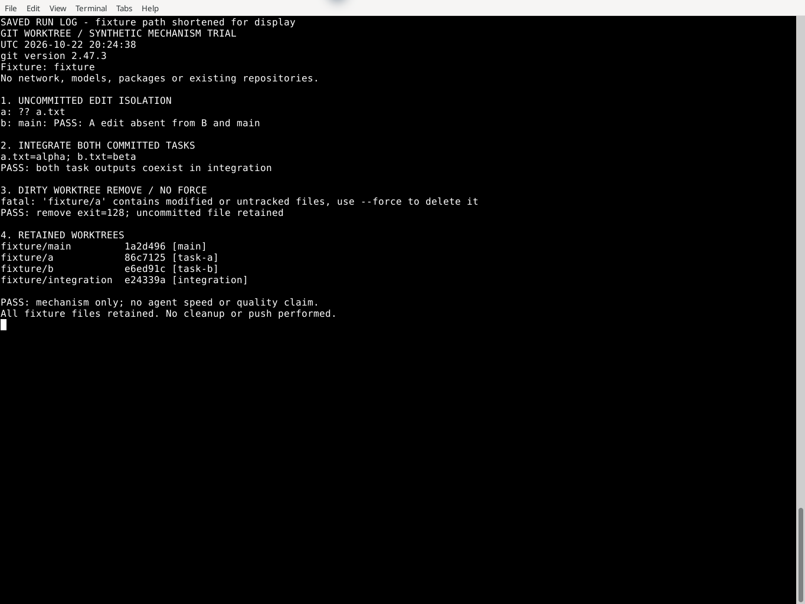
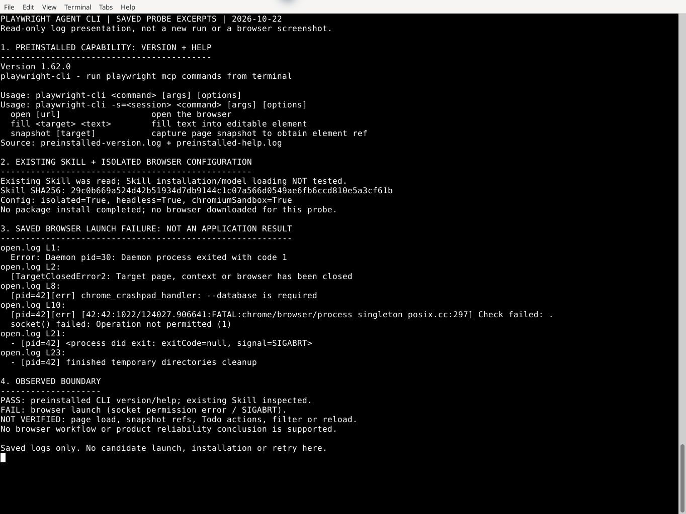
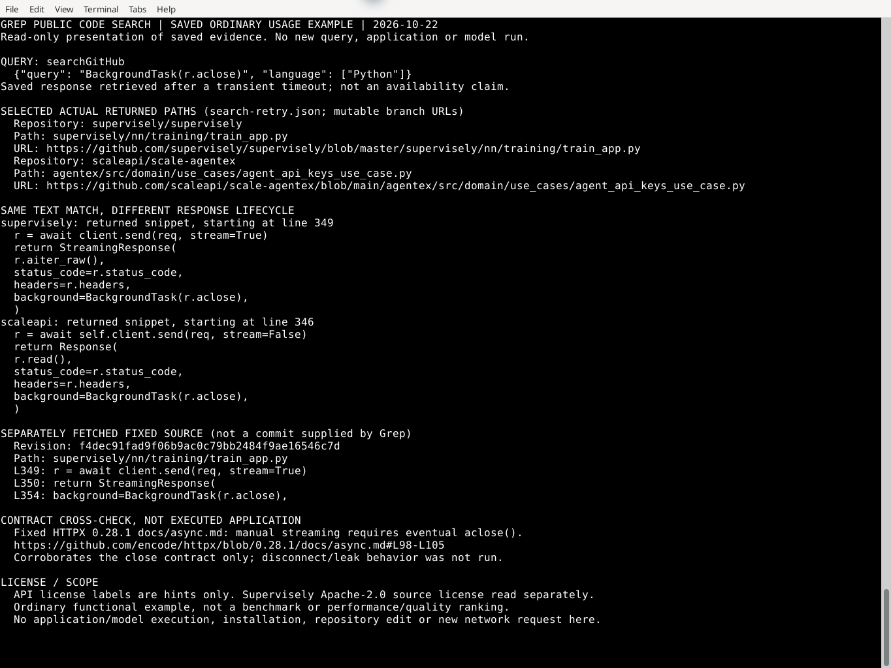
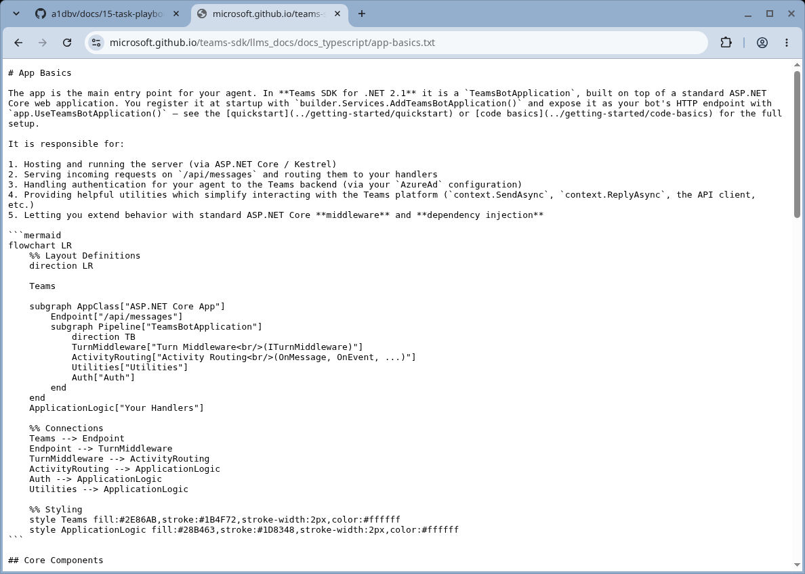

主线：二／三；C5前沿发现，供读者找到可上手的新工具与做法。
改变的建议：客户端之外先选反馈、流程、窄Skill或语义操作的具体缺口；Graphicle只作导航，Taste先保原instructions。
新证据：近4周社区原帖／GitHub快照，以及云端Graphicle代码图、Taste安装恢复、HTML参照部分试用的真实产物；不声称模型效果领先。

# C5 首轮：关注度与上手结果分开

核实：2026-10-22 UTC+8。首轮表见[13](../13-frontier-radar.md#值得一试近4周的新项目与做法)。当前最强效果未知；本轮先回答“新在哪里、值得谁试、实际卡在哪”，不把发现阶段改成必须先证明冠军的门。

## 回扫范围与发现时差

HN Algolia按9-24至10-22 19:20 UTC+8检索claude、codex、coding agent、MCP、Show HN agent／code、AI coding、github.com，各取相关性前100条，另核候选名称；读12个候选原帖与评论树。GitHub按claude／codex／coding agent／mcp及9-24至10-22新建、star降序各取前15名，读取14项目metadata／README、近期release和少量issue；不是完整全球热门普查。[一手：公开API]

GitHub星数约19:22–19:23快照，未取得历史star，增长均未知。部分扩大issue读取返回403后停止，已有回复范围保留；搜索接口超时与原帖可读分别记录。仓库创建日期不冒充开始热议日期。[研究]

中文与Reddit线读linux.do原帖及回复、V2EX和掘金页面，以及r/ClaudeAI／r/ChatGPTCoding／r/LocalLLaMA线索。linux.do JSON入口不可读而HTML可读；Reddit索引与直接页面的票数／日期存在冲突，未采信冲突值，回复总数未知。没有把转载、活动日期或已删除帖子当独立热度。[一手／社区]

在本轮基线1b7fca1前未检出入选项目的既有正文收录。按已获原帖日期至10-22计：Whiteboard 28天、Graphicle 8天、Taste 9天；这只是本轮读到的讨论日期，不证明社区首次热议。InstaLanding原帖绝对日期未确认；其余只有新建时间，发现时差未知；用户收件箱0条，命中率分母为0，不填0%或100%。[研究]

## Graphicle：导航有用，影响图需要核对

来源：[项目](https://github.com/graphicle-ai/graphicle)、[v0.1.4发行](https://github.com/graphicle-ai/graphicle/releases/tag/v0.1.4)、[HN原帖](https://news.ycombinator.com/item?id=50088713)。作者在评论中未声称已经证明Agent完成更多任务；正面回复关注代码关联失效，反面追问比rg是否更有用。Apache-2.0。[一手／社区]

**实测19:35:15–19:49:58，14分43秒。** Linux官方发行包SHA256与发布元数据一致，实际版本0.1.4；独立HOME和数据目录，未执行setup／hooks／MCP，不调用模型。四文件retry fixture中，定义、直接调用、测试三处行号正确，别名引用可见；改helper后显式graph update更新定义及下游边。无模型ask需要sync项目库，返回的是证据，不是生成回答。[本仓实测]

**默认漏边不等于工具全线做不到。** `--precise`在此例补回对象方法及callback边，但局部同名遮蔽仍会连错目标；错误边甚至标EXTRACTED。人工语义和运行时sentinel分别验证，不把程序退出0当正确性。[本仓实测]

最小反例为两个文件：[研究／本仓实测]

```python
# helper.py
def retry(operation):
    return operation()

# app.py
from helper import retry
def direct(operation):
    return retry(operation)
def shadow(operation):
    def retry(operation):
        return operation()
    return retry(operation)
```

把app.retry改为一调用就报错的sentinel，shadow仍返回，direct触发错误，确认两条运行路径不同；Graphicle默认及precise却都出现shadow→helper.retry错边。精确模式加no-dedup仍复现。另有不唯一输入时affected退出0而explain报歧义，脚本应核结果对象。[本仓实测]

四文件fixture使用`graphicle graph extract . --code-only`、`graphicle graph explain retry_retry --all`、`graphicle graph affected retry_retry`；修改后`graphicle graph update .`。上面的两文件最小反例节点改为`helper_retry`，使用`graphicle graph explain helper_retry --all`；对照提取为`graphicle graph extract . --code-only --precise --force`。全新隔离目录的18步重放及正反断言通过。完整node ID适合导航；影响范围须与源码、rg和测试交叉核，不据图自动删测试。未测大仓或模型收益。[本仓实测／研究]



图：10-23在真实终端展示10-22已保存输出的摘录，未重跑Graphicle、不计新发现；EXTRACTED标签本身不保证调用目标正确。[既有实试补证]

## GPT with Taste：安装保文件，不代表保有效指令

[linux.do原帖](https://linux.do/t/topic/3016674)10-13首帖208 Likes，读1–40楼；少量使用者称冗余减少，也有hook上下文负担及实测不足的质疑。它是兴趣信号，不是质量对照。[社区]

官方[固定079fb262](https://github.com/NB-Corp/gpt-with-taste/tree/079fb262b4d7932515ba4e6341fd57b6f2122f4a)，MIT、package0.1.0。19:45:21–19:52约7分钟，在合成HOME／CODEX_HOME运行官方prompt-only安装器，不启hooks或模型；安装、重复安装、check、restore及12项针对性测试通过。[一手／本仓实测]

实际改动是切换`model_instructions_file`；旧instructions和AGENTS文件字节不变，但旧指针不再被该键加载。重复安装不重复注入；restore恢复原文件字节，留下空目录及恢复记录。原本有自己的有效指令时，先保原配置再试，不能把“未删旧文件”理解为自动合并。语言／代码质量增益未测试。[本仓实测／研究]

首次可选ptrace观测因环境能力被拒，安装器当时未执行；停止该诊断后用既有Node文件访问限制正常运行已授权安装，不提升系统权限。目录外全量观测未完成，不把可选审计能力设成安装前置关。[本仓实测]



图：原隔离夹具的保存输出，路径仅在显示时替换为合成HOME占位；未重新安装，也未验证模型效果。[既有实试补证]

## InstaLanding：实际做了衍生页，未完成浏览器接收

[Reddit原帖](https://www.reddit.com/r/ClaudeAI/comments/1x22sap/i_built_20_free_opensource_html_pages_you_can_use/)正文提出用单HTML作为视觉参照。搜索索引的日期、票数和评论与直接页面不一致，未采信；当前关注度和绝对发布日期未知。项目[官方仓库](https://github.com/RayVelez27/instalanding.ai)MIT，数量已更新，不沿用发布时“20页”。[社区／一手]

选择Highlighter Markup页面，核其内联JS与Google Fonts，提取纸色／墨色／状态色、字体层级及间距，做成功／失败／空三状态retry-job离线衍生页；系统字体替代远程字体，未调用模型。约5分钟内完成JS语法、静态链接和15项DOM-stub检查。[本仓实测]

云端浏览器file协议导航被安全策略拒绝，未绕过；1280／390宽度渲染与截图均未完成。故只交“参照提取与状态逻辑部分试用”，不称视觉或AI生成质量通过。看中样式的读者仍须在自己的真实页面核移动端和交互。[研究]

## 其余候选与未试范围

- **Coucou**：[官方](https://github.com/Louis-CFM/coucou)，6,163★、9-27新建。Linux0.5.1官方AppImage已下载核hash；执行环境无桌面DISPLAY，桌面下载另遇网络及明确浏览器策略阻断，约4分钟后停。没有启动、通知或session路由结果。代码MIT但名称／Mochi／音效另有版权；不默认安装真实客户端hooks。[一手／本仓部分尝试]
- **Whiteboard**：[官方](https://github.com/devdotfast/whiteboard)，3,286★；[HN](https://news.ycombinator.com/item?id=49833867)9-24有424分／143评。作者澄清它是补充评审画布，不是完整IDE；评论既有看懂Agent修改的体验，也有为何不用Mermaid及大应用扩展性的疑问。MIT，当前安装范围不沿用旧帖平台限制；后续已补[后端部分试用](#whiteboard-headless-trial)，GUI仍未试用。[一手／社区]
- **Oil UI**：2,005★、9-30新建的发现快照不变；本轮已补免费比较器部分试用，见下节，未取得窗口内HN同名原帖。[一手／本仓部分实测]
- **VibeWise**：[官方](https://github.com/nykooi1/vibe-wise)，3,853★、9-29新建，MIT。官方支持Claude与Codex插件入口；人先表达方案的学习流程会增加交互，不能外推无人值守效率。未取得窗口内HN同名原帖；现已补安装／恢复脚本小试，见下节。[一手／研究]

未入表的代表：Jevgrep需provider及代码外发，不在本轮无模型小试；SPACE依赖较重；MuscleMemory仅少量关注且会下载搜索模型；RipIDE原帖被删且热度不足；Tervia有真实评审需求但平台仍在完善。掘金Trending转载不重复计独立关注，linux.do Aegis活动日期不误当发布日。候选及试用是发现结果，不以条目数证明效率或M6漏检率下降。[研究]


## Oil UI：先复用比较器，别把免费版当组件库

**已有HTML方向稿时，🧪先借免费比较器保留现状、并排比较独立候选，再由人选方向。** 固定[0.23.9源码](https://github.com/oil-oil/oil-ui/tree/7002e1a3b3e3bc19d4159e2a37917456dafd5ad4)，MIT。10-22（UTC+8）小试约9分钟，含安装、打包和撤回检查。免费版提供比较器，README所列19卡片原型属Pro，未购买或试用。[一手／本仓部分实测]

合成任务运行列表：现状标为baseline，加“行动优先”和“运行账本”两份独立HTML，复用官方生成器打包为自包含单HTML。16项CLI／产物检查确认本地CSS内嵌、原件不变、重复构建确定性、远程或缺失资源／双baseline失败时不覆盖旧产物；53项非浏览器生成器测试通过，明确排除3项浏览器及1项Windows测试。隔离安装后文件与固定源码一致，卸载技能后产物不变。[本仓实测]

准确的验证边界：上游全套测试因浏览器项失败而停止，没有全套通过摘要；Chromium报告socket权限错误，桌面／手机截图未产出，未关闭沙箱或换路绕过。这里只确认打包与静态保护，视觉、剪贴板、实际选择交互及模型设计效果均未验。三个输入稿为合成夹具，不是模型质量对照。[本仓实测]

10-24补接收仍未完成：原三候选与成品保留，云浏览器HTTP连接失败后页面绑定被URL策略拒绝，已停止；待该入口获准后续接视觉与选择反馈，不重跑已有生成器检查。[本仓执行记录]

最小使用方式：在独立试验项目按[官方README](https://github.com/oil-oil/oil-ui/blob/7002e1a3b3e3bc19d4159e2a37917456dafd5ad4/README.md)安装。本轮执行`npx skills add oil-oil/oil-ui --agent codex --skill oil-ui --yes`，CLI解析为1.7.4，安装后才核对上述源码SHA，该入口本身不锁版本。使用Python 3.10+；候选目录放HTML，将下列manifest保存为`<候选目录>/manifest.json`，调用`python3 .agents/skills/oil-ui/scripts/build_explorer.py <候选目录>`；生成后在浏览器打开`<候选目录>/style-explorer.html`；修改源页后加`--force`重建，输出不会自动更新。可只用两项，不必凑三个方向。[一手／本仓实测]

```json
{"round":"01","lang":"zh","candidates":[{"id":"baseline","source":"baseline.html","baseline":true},{"id":"a","source":"a.html"},{"id":"b","source":"b.html"}]}
```

[比较器说明](https://github.com/oil-oil/oil-ui/blob/7002e1a3b3e3bc19d4159e2a37917456dafd5ad4/references/style-explorer.md)中的“选择”只复制带轮次／编号的文字，需贴回Agent，不自动写回项目；这是文档／源码核对，未实际点击。远程字体／CDN需先本地化并核许可，或改用截图。需要验收真实交互、持久化或服务端数据流时，撤出静态比较器，回已有应用做验收；无法看图时只交打包结果，不判视觉合格。[一手／研究]


## Jiti：当前对象可查可改，不只留聊天

**🧪 值得小型Lisp应用试的是“现行函数目录＋源码＋可恢复数据”，而非更长的聊天交接。** [作者10-05原文](https://ghuntley.com/lisp/)及[固定70146a2源码](https://github.com/ghuntley/jiti/tree/70146a2236dcd34696807102028af943cf0be370)提供可运行实现；MIT，本轮只加载image-agent/store，不接模型或终端。10-22（UTC+8）约11分钟小试，真实完成已有函数→组合→二改→重开后继续使用和查看源码。公开维护收益、独立长期采用和最高水平未知。[一手／本仓实测]

| 本轮动作 | 实际结果 |
|---|---|
| uppercase与reverse组合 | Hello → OLLEH |
| 二改：加括号并记录运行次数 | Hello → [OLLEH]，runs=1 |
| 新进程恢复后继续调用 | World → [DLROW]，runs=2；参数、文档及含新逻辑的源码可查 |
| 预览／失败／显式回退 | 预览保原计数；非负检查拒绝-1；半途报错abort后恢复；回退保留历史，再重开仍能执行v1 |

五个独立SBCL进程的38条聚焦断言通过；最终相对路径脚本在另一临时目录重放同样通过。这里的“解释”是取得当前参数、开发者文档和真实源码，没有让LLM生成解释，也没测人理解速度；未运行上游完整测试、JSON工具分发、CLI或模型。[本仓实测]

**关键边界：受管对象回滚不是外部世界的沙箱，也不会自动恢复调用方验收契约。** 本轮preview计数恢复而临时文件写入保留；恢复时漏传非负invariant，先前拒绝的-1会被接受，随后已显式回退。另测源码描述超过4096字符会标截断，消费者须补齐再解释；同一SBCL版本恢复、直接命名函数与可读表数据才在本参考适配器范围。需要一般Web应用热更新或跨外部系统回滚时不直接采用。[一手／本仓实测]

可借到其他Agent应用的交接结构是：先查当前功能和实际实现；恢复代码／数据后真正调用验证；目标、检查和受管资源边界由可信调用方另行加载。相较只存摘要，本轮证明当前可执行对象与可查源码能一起恢复，不证明总维护成本更低。[研究]

### 复现确定性链

只在无重要文件的Linux amd64临时目录运行，需libc6≥2.38、libzstd1≥1.5.5及git、curl、dpkg-deb、timeout；不需要模型凭据。复制[测试脚本](../../experiments/jiti-stateful-trial.lisp)和[运行器](../../experiments/run-jiti-stateful-trial.sh)到该目录，保留文件名，再执行：

```sh
git clone https://github.com/ghuntley/jiti.git source
git -C source checkout --detach 70146a2236dcd34696807102028af943cf0be370
curl -fL https://deb.debian.org/debian/pool/main/s/sbcl/sbcl_2.5.2-1_amd64.deb -o sbcl.deb
printf '%s\n' 'c4153abbe1def77e5e2bd62d2f25295d60df80333ea1a13c44b53209d179ef67  sbcl.deb' | sha256sum -c -
dpkg-deb -x sbcl.deb runtime
sh run-jiti-stateful-trial.sh
```

预期5条SUCCESS和38条PASS，不只看退出0。运行器拒绝覆盖已有world，先保留并移走再重放；每阶段45秒上限。脚本会写一份合成临时文件来验证preview边界。包散列固定本轮字节，不冒充独立签名核验；读source/LICENSE及runtime中的版权说明。本轮源码实际由固定Git blob取回校验，运行时由上述Debian包解压，未做系统安装。[一手／本仓实测]

探索回执：这是核心“按需理解与接管”回扫后的定向新意试验，不是新增全网热榜；前序核心接管问题回扫读过作者、[HN讨论](https://news.ycombinator.com/item?id=50151036)及[中文V2EX](https://www.v2ex.com/t/1248455)可见回复；两帖讨论理解与接管，不是Jiti独立采用证据。核心00／01已有相同选择的材料不重复改写。此次只核固定源码、依赖并跑确定性接口，不声称新增社区共识或当前强Agent净收益。[研究]


## VibeWise：学习项目按需开，reset不是关闭

**🧪 在专门学习的项目启用；赶交付时用pause，而不是reset。** 固定[0.1.44源码](https://github.com/nykooi1/vibe-wise/tree/eefb53df406ab89e31444684ff32c1df205221f8)，MIT；10-22（UTC+8）约5分钟隔离安装与状态小试，没有模型对话。机制是技能说明＋项目学习笔记＋Claude恢复hook，不是独立学习评估器。[一手／本仓部分实测]

| 读者状态／入口 | 本轮确认的结果 |
|---|---|
| 只安装、项目尚未启用 | 未生成项目笔记；真实SessionStart脚本返回空 |
| Claude的已激活项目 | startup／resume／clear／compact／fork都会返回恢复上下文；同仓子目录可发现状态，独立嵌套Git仓不继承 |
| paused项目 | startup和compact均不返回恢复上下文 |
| Codex 0.1.44插件 | [manifest](https://github.com/nykooi1/vibe-wise/blob/eefb53df406ab89e31444684ff32c1df205221f8/.codex-plugin/plugin.json)没有注册恢复hook，[官方说明](https://github.com/nykooi1/vibe-wise/blob/eefb53df406ab89e31444684ff32c1df205221f8/skills/learn/codex.md)要求每会话手动`$vibe-wise:learn`；安装enabled不等于已加载 |
| reset暂停中的合成项目 | 官方helper预览后确认重置，保应用文件、备份旧笔记，但状态变成active＋incomplete，再次触发引导 |

Claude几行是实际Python hook输入输出，不是Claude客户端加载或模型依从性测试。源码约定显式learn后普通开发仍走学习回合，不能把它当一次命令的临时格式；hook按项目状态、不按任务语义决定恢复。Learn/reset声明`disable-model-invocation: true`，这不是学习回合在下一条开发请求自动结束的标记；各客户端实际执行仍待验证。没有测任意闲聊的实际行为。[一手／本仓实测]

可照用的选择是：先在可恢复的学习项目用[官方安装入口](https://github.com/nykooi1/vibe-wise/blob/eefb53df406ab89e31444684ff32c1df205221f8/README.md)，明确learn；赶交付要暂停时确认profile实际为paused，再开新会话核恢复状态。reset是重新入门，真实笔记仍须按helper预览后确认；不要为退出而重置。卸载不会删除项目学习笔记，也不证明当前会话已加载的上下文被清除。[研究／一手]

本轮用独立HOME／CODEX_HOME和Codex CLI0.163.0实跑本地marketplace添加、插件安装、重复安装、移除及marketplace撤回；技能文件与固定源码一致，撤回后注册／缓存清空，项目源文件与合成笔记字节不变。11项真实hook边界检查通过；上游40测38过，2项“无Git目录”前提被环境祖先Git标记破坏，未改环境或产品来凑全绿。源码用路径遍历而非Git命令，Git搜索上界设置不能修这个前提。Claude客户端不在环境中，未安装；学习提升、时间／代码质量收益及真实对话中的pause行为均未验。[本仓实测]

探索回执：本次是已有P90候选的定向上手；读固定README、许可、两端manifest、Learn／reset／恢复源码和开发测试说明。GitHub issues只获索引，未据此声称独立用户效果；不新增社区共识或前沿领先结论。[研究]



图：原脚本状态与安装记录的保存摘录，未重跑候选；两项上游失败及其环境前提按上文保留，不代表客户端加载或学习收益。[既有实试补证]


## 当红必看的使用面与成熟做法

**核心入口保留Claude Code、Copilot、Codex、Cursor和开源OpenCode，并补反馈闭环、按需流程、窄Skill与语义MCP。** 这是使用面支持的阅读优先级，不是全市场五强或净效果排名；OpenCode覆盖开源模型可选路线，不能隐去其他更高使用率工具。成熟做法复用／重读已有Willison、Toub、Cursor及Vinext材料，不计新发现。[研究：2026-10-22]

### 两个调查的题意不能混用

[JetBrains调查](https://blog.jetbrains.com/research/2026/08/ai-coding-agent-adoption-2026/)及[原图](https://blog.jetbrains.com/wp-content/uploads/2026/08/ai_coding_tools_workusage_dynamics.png)问“在工作中的编码及其他开发任务使用哪些AI工具”，可多选、图只展示工具子集。2026年5–7月，N=15,509；Claude Code39%、Copilot21%、Codex16%、Cursor12%、JetBrains AI/Junie9%、OpenCode7%、Antigravity6%。它不是付费、每日活跃或唯一主力，不能把同文另一题的“最常用”混进来。调查以8种语言招募、地区配额，按地区／就业／语言／JetBrains熟悉度重加权；厂商研究和自报偏差仍在，不代表客户端遥测。[一手：调查发布者]

[Stack Overflow数据](https://survey.stackoverflow.co/2026/ai/data/ai-code-agent)、[方法](https://survey.stackoverflow.co/2026/methodology)及[题目源码](https://github.com/StackExchange/Survey/blob/releases/2026/questions/ai/AICodeAgent.yaml)另问“过去一年用过／未来六个月想用”，可选且多选。本轮只看Used回答者子集n=12,255，不是总样本30,903；Claude Code65.5%、Copilot58.7%、Codex29.5%、Cursor25.5%、Antigravity16.0%、Gemini Code Assist14.6%、OpenCode13.6%。6-23至8-05收集、169国，经SO网站／博客／邮件推广，存在自选及社区可达性偏差，不是十月即时份额，不能和上段求平均。数据出处：Stack Exchange Inc., Stack Overflow Developer Survey 2026，[ODbL 1.0](https://opendatacommons.org/licenses/odbl/1-0/)；这里只引用选定题项数字。[一手：调查及问卷源码]

GitHub累计星数、近期提交和HN／V2EX讨论只补关注及活动信号，本轮没有统一的4周增长、去重活跃用户、付费／留存或全渠道讨论分母，因此不按它们伪造“口碑最好”总榜。[研究]

### 可借的成熟机制与反例

- **Claude Code整轮交付**：[Willison 10-20作品复盘](https://simonwillison.net/2026/Oct/20/battledrones/)保留可玩产物和反复试玩，支持少逐行阅读仍能推进的个案；不是当前模型普遍赢。[V2EX双持原帖](https://fast.v2ex.com/t/1249293)既有UI与节奏好评，也有偏离需求的反例，不能概括全部前端表现。[一手／社区]
- **Copilot渐进迁移**：[Toub生产复盘](https://github.blog/ai-and-ml/generative-ai/migrating-the-github-copilot-runtime-to-rust-using-copilot/)展示Agent实现、跟进评审和失败；也记录删SDK方法后用schema-break-ok豁免让CI通过，再由人要求恢复。借用可合入块与兼容判断，不把同厂自报当独立提效对照。[一手／研究]
- **Codex产物接收**：[八月同题游戏](https://simonwillison.net/2026/Aug/7/moonlight-mayhem/)中Agent读过截图仍漏掉巨大眼球，直到人指出；可借明确目标、可跑环境及真实反馈，不将八月型号比较升级为十月冠军。[一手／研究]
- **Cursor环境先行**：[7-30环境复盘](https://cursor.com/blog/cloud-agent-environment)用统一CLI／supervisor处理运行入口，单写Skills改善有限；[9-23成本复盘](https://cursor.com/blog/improved-token-efficiency)是多项harness改变的组合，不能只抄缩短提示就承诺省钱。[一手：自家生产；研究]
- **OpenCode可选模型执行器**：[Vinext](https://blog.cloudflare.com/vinext/)是较早成熟先例，作者仍用架构判断、测试和浏览器反馈纠错，不作当前最高水平认证。[V2文档](https://opencode.ai/v2/docs/migrate-v1/)说明V1/V2发行轨并行，但安装默认不隔离并存；先核主版本、provider及插件兼容；[V2EX Go讨论](https://s.v2ex.com/t/1250404)中的消耗个案带插件和模型组合，不能归因裸执行器。安装和当前V2连续二改本仓未试。[一手／社区／研究]

探索回执：10-22新核官方调查原图／问卷数据、产品契约、GitHub活动及中文双持／Go原帖；旧做事者复盘和[HN理解代码讨论](https://news.ycombinator.com/item?id=50151036)重读，不冒称新发现。另读[V2EX接管问题](https://www.v2ex.com/t/1248455)可见回复，部分正文缺失；Reddit局部抓取失败，linux.do本轮仅检索、X原帖不可读，不采信其摘要投票或未核事件。没有新客户端或模型运行，不调整核心差距分。[研究]


### 代表机制的采用证据与边界

**先补反馈，再按任务选择流程、单项Skill或语义MCP，不要求四层全装。** 此处是10-23（UTC+8）的入口整理：复用既有[P59小修复对照](2026-10-12-community-source-records.md#p59小修复的流程选择与回归交付)与[跨社区采用比较](2026-10-12-community-source-records.md#跨社区采用比较维护任务先选补什么)，重读关键原文，不新增研究计数或模型运行。[研究]

- **反馈闭环**：[Krupa 9-29同模型对照](https://bartlomiejkrupa.dev/articles/does-superpowers-beat-no-plugin/)中，Sonnet 5.5／Superpowers 6.4.2的负金额小题两臂都修对，但留下回归测试为整包8/8、原生4/8；“红测”评分曾误计命令失败，详细轨迹与边界沿用P59，而非把全部测试顺序当质量提升。本仓Graphicle作用域反例、OCR清单对账与Whiteboard错误说明证明的是各自工具边界，已有复现与回归可复用，不是新模型对照；读者从真实bug和已有检查开始，让旧错误触发失败后保留该断言。[社区：作者实验；本仓工具实测；研究：采用判断]
- **按需流程**：[Luca 9-16使用复盘](https://www.lucavallin.com/blog/how-i-actually-use-claude-code)仍保留Superpowers，按Direct／Plan／Full区分任务；[7-14中文讨论](https://v2ex.com/t/1227194)同时有卸载者和认可计划交接者，缺同任务、同版本可比成本，不能算好评率。固定[writing-plans](https://github.com/obra/superpowers/blob/bb92a77741419a4ab5f06e711a283343f1ada0c3/skills/writing-plans/SKILL.md)保存文件、接口、规格值与测试断言，只有无法据此确定的算法等才保实现正文，不能沿用“计划总是抄全套代码”的旧批评；[修订与发布记录](2026-10-12-community-source-records.md#计划变成实现先改变产物)不是本周新功能。可从跨模块未决设计借计划，简单明确的改动不全局强制整包；本仓未安装运行。[社区／一手／研究]
- **窄Skill**：[Faruk 8-02实际Java CRUD重构](https://blog.faruk.dev.br/articles/agents/matt-pocock-skills-harness-product-crud/)首次跳过架构，重新明确要求访谈后才通过grill-with-docs确认17项决定，随后直接实现，未走to-spec／to-tickets完整链。它证明真实采用及提示依赖，不隔离Skill净收益，也不是本仓模型试验；[固定配置与采用反例](2026-10-12-community-source-records.md#三条条件评级的采用理由)继续保留。读者只补会改变实现的问答，决定已齐就结束访谈；本仓未运行。[社区／研究]
- **语义MCP**：[Luca](https://www.lucavallin.com/blog/how-i-actually-use-claude-code)自述为声明与调用位置明确指定Serena，否则它可能闲置；[10-16中文短试](https://www.v2ex.com/t/1249379)未感明显差异，语言、规模与版本缺失，无法互比。只在同名符号身份、声明或引用查询有具体缺口时试，原生搜索或已有LSP足够就不加；技术限制沿用[上下文工具记录](2026-10-13-context-tool-choice.md#serena原生引用存在但封装过滤漏掉)。本仓未安装运行，其他项目对LSP集成的取舍不作为Serena效果证据。[社区／研究]

各机制的跨项目采用率、可比满意度及完整净收益仍未知；stars只作发现信号。客户端主专题分别见[Claude](../01-agents/claude-code.md)、[Copilot等入口](../01-agents/README.md)、[Codex](../01-agents/codex.md)、[Cursor工作流](../07-workflows.md)与[OpenCode](../01-agents/open-source-agents.md#opencode规划与撤回边界)，不因入口前移升级推荐等级。[研究]

探索回执：本次按阶段审计复用已有来源，再核Krupa、Luca、Faruk、V2EX两条原帖与Superpowers固定Skill；不是新的全渠道回扫，没有新增安装、模型或GUI试验。[研究：10-23 UTC+8]


## 模型与反馈组合：现成契约能帮到哪一层

**有现成行为反馈时，把轻量模型与反馈作为组合候选，不只给轻量模型安排格式化。** 没有现成反馈时，不为降低模型单价先重建harness；现有日常起点不变。[研究]
**本仓真实试到的是契约工具的反馈范围，不是模型收益。** 结构错误会被定位，但另设业务期望仍须独立断言。[本仓工具试用]
**先保同一接收标准，再算完整投入。** 作者实验的token等值估计不含构建、维护和人工；本仓没有运行模型对照。[研究]

### 当前代际的同题信号

[Naresh Jain 10-13原文](https://www.martinfowler.com/articles/are-harnesses-worth-the-cost.html)及[公开brief](https://www.martinfowler.com/articles/are-harnesses-worth-the-cost/application-brief.html)：单个Java绿地BFF，均low、每格10轮；作者外评178检查。独立核读确认下表口径。[一手：作者实验]

| 模型／条件 | 全部检查通过 | 报告耗时 | 每轮API等值估计 |
|---|---|---|---|
| GPT-6 Sol，无harness | 10/10 | 6分51秒 | $0.406 |
| GPT-6 Sol，有harness | 10/10 | 19分53秒 | $2.679 |
| GPT-6 Luna，无harness | 3/10 | 15分56秒 | $0.086 |
| GPT-6 Luna，有harness | 10/10 | 35分 | $0.273 |

harness同时加入指导、契约／故障样例、Skill／MCP、脚手架和测试反馈，并非单独增加传感器。作者是Specmatic创始人；外评独立及内环不见答案为作者的方法声明，本轮未找到40轮生成代码、逐轮日志和外评可执行包。估计费用不含harness建设／维护／人工，也不是同耗时；final-gate-only未测。只能提出组合试用方向，不宣称长期质量等价、关闭过程检查或取代本仓Sol 6.1／medium。[一手／研究]

### Specmatic最小真实试用

固定官方[2.55.3发行](https://github.com/specmatic/specmatic/releases/tag/2.55.3)与现有Java21；jar SHA-256为 `2026a53459794d01e0f11843f24ad55588098d2dfbfd3e9a27b7705e29b5734d`，与发行API digest一致，未验证可复现构建。按[官方CLI入口](https://docs.specmatic.io/getting_started/cli_quick_start)运行单GET合成Pet契约，只访问本地测试目标，不用Docker或模型；23:26–23:34（UTC+8）约8分钟完成。[本仓工具实跑]

| 合成响应 | CLI结果 | 能说明什么 |
|---|---|---|
| 正常200与约定字段类型 | exit0，1/1通过 | 这一操作符合契约 |
| id由数字变成字符串 | exit1，定位RESPONSE.BODY.id | 类型错误可变成可操作反馈 |
| HTTP200且类型不变，id/name/status违背另设业务期望 | exit0，1/1通过 | schema通过不等于业务期望满足 |
| body相同但HTTP500 | exit1，定位RESPONSE.STATUS | 状态码不符可被发现 |

可运行的[最小复现说明](../../experiments/specmatic_local_feedback.md)及[脚本](../../experiments/specmatic_local_feedback.py)接收已有固定jar，不自动下载安装；用临时目录、动态loopback端口，包含真实跑过的正反例与mock，成功及失败清理另经回归。同spec的mock实际请求返回200及预期example，证明样例重放可用，不是对业务实现的独立验收。普通Python业务断言另做正反：正常exit0，错误值exit1。该断言只覆盖本例人工设定的期望，不需商业matcher。[本仓工具实跑]

example本来不是精确业务断言，这不是工具缺陷。[默认检查范围](https://docs.specmatic.io/spec_driven_api_development/contract_testing)与[Matchers Commercial](https://docs.specmatic.io/features/matchers)应分清；不把MIT仓库推及全部商业功能。采用时先复用自己的业务测试，别把单operation报告中的100%当产品覆盖，或把这个OSS小例当作者完整HTTP／Kafka反馈的替代。[一手／研究]

测试以隔离HOME和最小环境正常运行，显式关闭可选遥测；额外网络namespace预检失败；ptrace观测在预设四场景各失败一次后停止，未提权或修改平台限制。没有网络层零外连证明，不称严格断网试验。未登录、调用商业功能或上传许可证；测试服务已停。[本仓：范围]

探索回执：按P51提示词从1de7635开始，复用既有00／01／14与P46材料；新读Jain、Cockroach做事者、HN及中文V2EX原帖、官方CLI/契约文档和开源样例。医院流水线与黑板例子未改变已有默认，不重复交付；linux.do及部分作者目录读取失败。没有合格独立冻结的应发现全集，不报全网漏检率；本例不合并旧M6三题或P79分母。[研究]


<a id="ocr-delegation-trial"></a>
## OpenCodeReview：规则包可复用，覆盖清单须对账

**规则多时，可让确定性工具准备规则包，现有Agent做判断。** 两个Go文件实测共用一份规则正文，不是再加一个review模型。[本仓工具实跑]
**preview不是独立覆盖分母。** 固定版本会把特定目录否定模式下的已跟踪文件从两份清单同时漏掉，先与同范围Git差异对账。[本仓工具实跑]
**保原生本地评审默认。** 未调用host Agent或OCR模型，未证明质量、token、费用或人力净收益。[研究：候选采用]

### 为什么值得试

[固定delegation文档](https://github.com/alibaba/open-code-review/blob/375f64cd6f67a48a135da83cfcf59c52669a09cb/pages/src/content/docs/en/integrations/delegate.md)与[Skill](https://github.com/alibaba/open-code-review/blob/375f64cd6f67a48a135da83cfcf59c52669a09cb/skills/open-code-review-delegate/SKILL.md)将文件选择、按路径匹配并合并相同规则放在CLI，评审留给已有Codex／Claude。[DevRev使用者](https://github.com/alibaba/open-code-review/issues/1020#issuecomment-6163982899)自述正在将多个仓从Claude Code PR review迁移，[moltar](https://github.com/alibaba/open-code-review/issues/1020#issuecomment-5991383817)自述纳入多工具、多模型Skill；没有公开同预算净收益，不能将迁移原因全归于delegation。仓库约4.8万star是关注快照，未取得增长序列。[一手：实现／使用者自述]

### 五种输入，区分规则收益与范围缺口

2026-10-23约00:09–00:16（UTC+8），现有Linux环境、临时合成Git仓，固定[官方v1.13.3](https://github.com/alibaba/open-code-review/releases/tag/v1.13.3)／源码375f64cd6f67a48a135da83cfcf59c52669a09cb。Linux二进制SHA-256为`843be0e56fdff0a5ca6f86c5866f942d6a372dff1c0ca19e7893d72495abf45c`，与发行校验文件及API digest一致；没有npm安装或升级Go。[本仓工具实跑]

| 固定Git范围的变化 | preview实际输出 | 采用含义 |
|---|---|---|
| 普通src/a.go改动 | 可审a.go，总数1 | 正常对照 |
| 同改动，另加`/*/`与`!/src/` | Git有2项；仅.gitignore可审，总数1、排除空 | a.go在报告分母之前消失，不能仅对内部计数 |
| JSON＋Markdown | JSON可审，Markdown显式unsupported_ext | 支持列表边界，不是静默丢失 |
| 真正空diff | 可审／排除都空，总数0 | 由Git确认no-op，而非由空preview倒推 |
| 两个Go文件共用规则 | 一组对应两路径，规则正文只出现一次 | 规则准备可去重，评审收益未知 |

同规则正文为10,843 UTF-8字节；两次单文件JSON合计22,218字节，合并调用11,129字节。这里只比较输出字节，不换算模型token或省钱比例。[本仓工具实跑]

[固定git.go](https://github.com/alibaba/open-code-review/blob/375f64cd6f67a48a135da83cfcf59c52669a09cb/internal/diff/git.go)跳过结尾为斜杠的否定模式，随后partitionDiffs又不把此类gitignore排除放入Excluded；实测与[#1793](https://github.com/alibaba/open-code-review/issues/1793)一致。Git自己不认为a.go被忽略，base/head也已固定，不是模型漏看或范围不同。另有[#1779](https://github.com/alibaba/open-code-review/issues/1779)支持列表问题及[#1752](https://github.com/alibaba/open-code-review/issues/1752)Action零评论隐藏warning问题，不能混为同一个bug；本仓未运行Action。[一手：源码／使用者报告；本仓工具实跑]

### 反向复测：清单齐了，也可能选错文件

**目录重新纳入与文件重新纳入必须分开验。** 10-23 用同一 v1.13.3 发行程序做配对夹具：先强制跟踪 `src/a.go`，固定两个提交且只修改该文件，再比较 Git 自身的 ignore 判定与保存的 preview；不调用模型。[本仓工具实跑]

| .gitignore 两行规则 | Git `check-ignore --no-index` | OCR preview | 既有清单 helper |
|---|---|---|---|
| `/*/`、`!/src/` | 不忽略 a.go | 可审／排除都空 | 退出1，发现漏项 |
| `src/`、`!src/a.go` | 仍忽略 a.go，父目录未打开 | 把 a.go 列为可审 | 退出0，原始差异清单一致 |

**清单对账通过不是 ignore 策略通过。** Git diff 仍包含已跟踪文件；若任务打算沿 gitignore 过滤评审输入，再逐项用 `git check-ignore --no-index -- src/a.go` 核规则：退出0表示忽略、1表示不忽略，其他结果是错误。是否实际评审该文件由任务意图决定，不能因 helper 退出0就声称过滤政策正确。[本仓复测／研究]

返工发现：`*`加`!*/`只重开目录，不重开被`*`排除的文件。现已公开[修复补丁](../../experiments/ocr-directory-negation.patch)与[最小重放入口](../../experiments/ocr-matcher-replay.md)：固定375f64c，精确提取源码函数，以显式Provider适配壳运行46项原有断言和18项Git oracle，原版58/64、修复版64/64，使用真实doublestar及race检测。完整SDK编译曾被signal killed阻断，未得到patched CLI，不称产品修复闭环；非Git WalkDir仍有目录误走文件接口的提前SkipDir边界，排除理由缺失亦未改。[本仓隔离源码实跑／源码范围；2026-10-23]

### 借用什么，何时不用

[最小复现与对账说明](../../experiments/opencode_review_delegation.md)给出已真跑的两份小脚本；路径含空格／换行、rename/delete及坏输入已有回归。helper只核清单，不认证排除理由或实际审完。

固定base/head，按同一merge-base范围比较Git原始路径与preview的reviewable_files＋excluded_files；缺项就以原始Git差异交给既有Agent，规则仅作可选清单。重要的显式排除文件也要由任务接收者安排评审。不要为了适配工具修改项目gitignore，也不要改用会调用模型的ocr review当成这个无模型复现。[研究：条件采用]

仅试了preview/rule准备步骤，隔离HOME与最小环境，没有模型runner、session或host Agent调用；telemetry源码默认关闭，未做网络跟踪，不声称零外连。没有实际审PR、检测缺陷或减轻人审的本仓效果证据。[本仓：验证范围]

探索回执：读官方固定实现／Skill／发行、上述使用者原帖与修复PR；[V2EX](https://www.v2ex.com/t/1248137)及[Reddit](https://www.reddit.com/r/codex/comments/1x9t6o1/does_anyone_even_review_code_anymore/)补评审负担与反方，不充当OCR效果评测。V2EX另一原帖正文不可读、部分GitHub网页失败后读同源固定文件；pair-review／herdr-reviewr未找到足够独立近期采用，不硬加候选。没有完整发现分母，不报全网漏检率或最优。[研究，10-23 UTC+8]




图：原Git清单、preview及对账结果的保存摘录；规则去重只量输入字节，不等于token、费用或评审质量收益，未重跑OCR。[既有实试补证]

<a id="whiteboard-headless-trial"></a>
## Whiteboard：无需桌面，也能保存绑定代码的评审说明

**需要保留、复读陌生改动解释时，可试固定Git版本的说明容器。** code_peek与call_stack_diff的保存、读回及正常重启在合成仓已跑通。[本仓工具实跑]
**引用能定位，不代表解释语义成立。** 不存在的文件被拒，附在真实代码上的故意错误说明仍被接受。[本仓人工负例]
**目前只验后端，不升级图形评审推荐。** 没有运行Desktop、自动关系发现或模型，未测人审收益。[范围]

### 真实入口与采用线索

[官方0.3.4发行](https://github.com/devdotfast/whiteboard/releases/tag/v0.3.4)有Linux remote包，[固定源码说明](https://github.com/devdotfast/whiteboard/blob/f33bd6620742fe65ccc1d5fef416fbe8254dcf79/packages/review/README.md)支持无Desktop的server；独立npm CLI不含画布，不把CLI启动写成图形通过。源码tag已解析为f33bd6620742fe65ccc1d5fef416fbe8254dcf79。[一手]

[HN讨论](https://news.ycombinator.com/item?id=49833867)中，用户指出展示图与代码的等待逻辑不符，作者承认原GIF是设计稿并替换；“期待试试”也不是采用结果。[bare clone/worktree问题](https://github.com/devdotfast/whiteboard/issues/1352)提示复杂仓布局另验。本次取普通checkout，不以期待评论或作者“不幻觉”说法证明有效。[一手：公开讨论／使用者报告]

### 两提交夹具与实际结果

10-23（UTC+8），固定官方whiteboard-remote-0.3.4-linux-x64.tar.xz，57,224,312字节；SHA-256 `073d56eb443574caf2607a58de012fb0087333a63b8c639e4a1a851509ada87a`与官方校验文件一致。只解包已有运行依赖，不全局安装或升级Go／Node。两文件夹具将policy从“仅admin”改成“admin或guest”，entry调用该函数。[本仓工具实跑]

| 检查 | 实际观察 | 能借用的能力 |
|---|---|---|
| 创建固定base/head的review | 返回pins与Git一致 | 说明绑定明确代码版本 |
| code_peek与手写call_stack_diff | 保存和完整读回成功 | 交接可复读的片段与解释 |
| 读取两侧完整文件 | 与git show逐字一致 | 从引用回到真实代码核对 |
| 原版diffr结构差异 | start/file/complete，成功1、失败0，包含guest变化 | 可获取真实结构diff，非模型摘要 |
| 引用不存在的文件 | 明确报unavailable at the pinned commit | 拦截不可定位引用 |
| 在真代码上写“拒绝所有guest” | 仍被保存 | 说明内容不是语义验收结果 |
| 正常停止、重启 | 完整快照一致，最终服务关闭 | 本例的持久保存与复读 |

[可运行回放与边界](../../experiments/whiteboard_headless_replay.md)含本次实际运行的小脚本；失败注入后的进程组清理、污染Git／代理环境下的正常回放也已验证。这里只用人工提供的图节点与说明，没有测模型幻觉，也不把接受错说明判为产品缺陷。[本仓工具实跑]

采用时，让Agent提供片段引用、变更说明与关键断言，人从固定diff核对解释；若需要自动发现关系或图形点击能力，先试相应GUI，不从本例升级。本仓不因此要求所有评审另建画布。[研究：条件采用]

最小环境、隔离HOME/XDG/state，DO_NOT_TRACK=1；启动前读取实际resolved config，确认summarize.enabled=false。未用Ask、login、trace、connect、share或模型。遥测／崩溃上传的退出设置不等于已验证零外连；原始状态及服务鉴权不公开。首次跨执行调用ECONNREFUSED，改在同一普通执行调用内启停与请求后成功，具体原因未知，未提权或改sandbox。[本仓：运行范围]

探索回执：读官方发行、headless/API实现、隐私与摘要配置、HN原评论及GitHub使用者问题；中文渠道复用本轮V2EX评审负担讨论，未找到Whiteboard独立中文实用效果对照。未补模型或GUI试验，不按star或图示宣称最佳。[研究]


## Context7：精确版本查询实试

**🧪 需要反复查库版本文档时，先从resolve的实际版本列表选精确ID，再查片段与原文tag。** 本轮把既有源码调查补到真实匿名远程MCP，不是新发现项目，也不宣称最普及或最优。[本仓实试／经验：2026-10-23 UTC+8]

[官方固定d980242](https://github.com/upstash/context7/blob/d980242a5b04be30ae8804124a8be259bcc2a227/README.md)说明MCP与CLI＋Skill两种入口；开源部分是MCP服务端，索引／抓取后端不公开。此前[V2EX工具作者](https://www.v2ex.com/t/1184881)展示过实际接入，这是1月历史采用；10-03[库维护者#3309](https://github.com/upstash/context7/issues/3309)报告旧默认值片段残留；10-06[服务维护者解释并关闭](https://github.com/upstash/context7/issues/3309#issuecomment-6012188572)：该页是Context7生成文档，按月重建，普通Refresh不触发，此次已从当前main重建。首次记录漏了这条修复回执，本轮经B互审补核；它说明两种刷新范围不同，不是当前未修复缺陷，修复后效果本仓未复测。10-23仓库约6.35万star仅为关注快照，不是使用率。[一手／社区]

**实际跑了什么**：10-22 19:40–19:43 UTC，用已有Python标准库向 `https://mcp.context7.com/mcp` 发公开JSON-RPC；未安装、登录或使用key。initialize、tools/list、resolve-library-id及两次query-docs共5次均HTTP 200，服务自报4.4.3。resolve确实列出下表两个版本；两次问相同的“递归把BaseModel导出字典用哪个方法，并给嵌套示例”。[本仓远程工具实试]

| query-docs的libraryId | 实际返回与独立同版核对 |
|---|---|
| `/pydantic/pydantic/v1.10.18` | 返回model.dict，2个不同源链接均属该tag，核[官方导出说明](https://github.com/pydantic/pydantic/blob/v1.10.18/docs/usage/exporting_models.md)一致 |
| `/pydantic/pydantic/v2.9.2` | 返回model_dump，3个不同源链接均属该tag，核[官方序列化说明](https://github.com/pydantic/pydantic/blob/v2.9.2/docs/concepts/serialization.md)一致 |

v1返回偏API描述，没有完整满足嵌套示例要求；v2包含示例。方法名与递归语义已核，未逐字复核全部摘要，也没有执行示例、测客户端自动选版或模型收益；缺失版本回退、长期新鲜度、匿名限额未测。匿名成功只覆盖本次MCP请求，不保证所有REST入口或以后无key都可用。[本仓验证范围]

[真实终端截图](../img/2026-10-23-context7-version-query.png)显示已保存响应的解码摘录，未在截屏时再请求；原始返回及元数据留作复核，公开图不含内部头、身份和本机路径。最小复用是 `resolve-library-id` 的 `libraryName`／`query` → 从返回选完整版本ID → `query-docs` 的 `libraryId`／同题 `query` → 核Source链接与对应官方版本；版本不在结果中时保留缺口，不猜closest match兼容。[一手／本仓实试]


## DeepWiki：先找模块，再回固定源码

**🧪 陌生公共仓库可先读wiki目录定位模块，再用源码回答实现问题；已有库的精确版本API查询仍走Context7或官方文档。** 本轮实际读到danger-js的Git DSL与GitHub适配器，不据此评为广用最佳或新增“当红”名额。[本仓工具实试／经验：2026-10-23]

[官方MCP](https://docs.devin.ai/work-with-devin/deepwiki-mcp)公开入口免认证；[官方仓库](https://github.com/CognitionAI/deepwiki)不是服务端实现，不能混用其他同名开源项目的能力。五月[实际研究记录](https://github.com/artyhoo/getff/blob/staging/docs/meta-factory/research-patches/2026-05-16-research-tooling-evaluation.md)用过问答接口，七月[LibreChat接入者](https://github.com/LibreChat-AI/LibreChat/issues/14440)用只读工具作控制；[中文用户](https://linux.do/t/topic/2243015)在Code Wiki对照讨论中表示仍用DeepWiki。这些支持试用线索，不是普及率或质量排名。[一手／社区]

**本轮真正执行**：匿名握手后只读`read_wiki_structure`与`read_wiki_contents`各一次，服务自报2.14.3；未调用问答、生成、建索引或刷新。目录的Git DSL主题把调查带到GitDSL.ts／GitHubGit.ts，再沿import找到Commit.ts；另取[固定37a3605的类型](https://github.com/danger/danger-js/blob/37a360502df74a18cda7bf6a350789d5dd066dfd/source/dsl/Commit.ts#L1-L17)与[适配代码](https://github.com/danger/danger-js/blob/37a360502df74a18cda7bf6a350789d5dd066dfd/source/platforms/github/GitHubGit.ts#L19-L36)，确认`message`在该映射步骤直接透传，不拆正文／trailer；这不是“全仓没有解析”的结论，也没运行应用测试。[本仓远程检索／一手：源码]

实际只读schema仅收repoName，未提供版本、章节或分页参数；该仓一次全文HTTP体874,669字节，取回后才本地选章节，不等同模型token或成本。wiki的部分行号链接为空目标，需回仓库核定位；wiki索引commit未知，37a3605是另取的核对树。[官方仓issue #8](https://github.com/CognitionAI/deepwiki/issues/8)另有指定旧版却混入新API的用户报告，因此旧版兼容问题不据当前wiki裁决。[本仓观察／社区]



图为保存响应与另取源码的真实终端展示；没有安装、认证、模型对照或速度收益测量。本轮探索读官方、公开采用／失败原帖及中文讨论；近期Reddit候选正文未取得，HN／V2EX未补到改变判断的近期MCP采用证据，不据数量填满名单。[研究／实试范围]


## Git worktree：不装编排器，也能隔离写入

**✅ 独立写入任务各有工作树；原生客户端已经能管理时沿用它，否则已有Git即可起步。** 这是一项成熟代表工作流的实际入口，不称新发明、最广用或已测Agent提效。[经验／本仓Git机制试用：2026-10-23]

[Schilling 10-06复盘](https://blog.michaelschilling.com/blog/many-agents-one-clone/)描述共享检出导致串分支与丢未提交改动，改为每会话worktree后仍保并行；[Pant 8-29实际使用](https://utsabpant.com/blog/running-coding-agents-in-parallel)则在三树干净合并后遭遇共享模块约定冲突，保留worktree、收缩耦合写入。只取两人的实际经历，不采用文中未独核的行业比例、固定人数或复制.env脚本。[社区：实践者自报]

[Git原生文档](https://git-scm.com/docs/git-worktree)与[Claude原生入口](https://code.claude.com/docs/en/worktrees)可直接复用；[Worktrunk](https://github.com/max-sixty/worktrunk)补分支寻址、聚合状态与生命周期管理，不是更强隔离。本轮未安装或试用管理器，也没有新增08已解释的端口／数据库隔离规则。[一手／经验：比较]

**实际运行**：10-22 20:24 UTC，已有Git 2.47.3，在新合成仓、临时HOME和空模板中验证三点：A未提交a.txt不出现在B／main；两支独立提交在集成树合入后a.txt=alpha与b.txt=beta共存；A再有未跟踪成果时，普通worktree remove退出128且文件仍在。全部现场保留，未推送、安装或调用模型；不是复杂合并正确性或运行环境隔离测试。[本仓确定性实试]

**读者最小操作**：在已确认的基线检出记录完整SHA，分别建task-a／task-b工作树；在各树完成独立验收并提交，交接提交SHA，在集成树按依赖合入后验共同结果。成果确认已合入、无活跃工作且树干净时才普通remove，遇脏树拒绝先保留检查，不默认force。原生客户端已经建树时不重复再套一层。[经验]



图为完整保存运行日志的真实终端展示，仅将临时绝对路径缩为fixture；没有实际Agent并行、质量或耗时收益对照。源码与旧配置夹具仅作复用，本轮新实证限上述三项Git行为。[本仓验证范围]


## Playwright CLI：已有入口先复用

**🧪 网页验收缺浏览器动作时可试CLI＋Skill，已有原生入口够用则保留。** 读者操作入口见[13](../13-frontier-radar.md#代表机制按任务采用不按热度装齐)。Reddit实践者自述由MCP、自写脚本转CLI以简化工具链；linux.do的7月个案却仍漏掉角色移动验收，不能把工具调用当成功。[社区：正文所链两篇原帖；Reddit仅显示约3个月前，不推定精确日期或所用版本]

本仓预装Python Playwright **1.62.0** 的Node driver包含agent CLI，实际运行版本／帮助并阅读已有Skill，未安装Skill或验证模型加载；[同版源码](https://github.com/microsoft/playwright/blob/e3950d9c140d007bd52853b45813c6274b24e36f/packages/playwright-core/src/cli/program.ts)也将 `cli` 接到CLI程序。19:40 UTC的浏览器启动使用隔离上下文与已装Chromium，保留沙箱，因 `socket() failed: Operation not permitted (1)`、SIGABRT失败；无页面、snapshot、过滤或刷新结果，不推断产品可靠性。[源码／本仓部分实试：2026-10-22；不是新一轮试跑]



图：只读展示已保存探针，不是成功页面截图。探索复核官方安装／Skill、固定源码、Reddit与linux.do；V2EX未获CLI特定实践，未获得采用率或模型收益比较。[取证回执：2026-10-23 UTC+8]


## Grep：公开代码查例子，先核完整调用

**🧪 缺跨仓真实调用点时补Grep，先保留现有项目搜索。** 本次只是按[官方MCP用法](https://vercel.com/blog/grep-a-million-github-repositories-via-mcp)查例子，不是服务快慢／准确率基准；使用受[服务条款](https://grep.app/terms)约束，源码另按各仓许可处理。[一手／本仓功能使用：2026-10-23 UTC+8]

已有Python标准库匿名访问 `https://mcp.grep.app`，列工具后用 `searchGitHub` 查询 `BackgroundTask(r.aclose)`、`language=["Python"]`；一次超时后同查询重试取回结果，无安装、登录、私有代码或模型调用。工具没有commit参数，返回的是分支链接，以下固定SHA来自另一次GitHub回源，不是已知索引版本。[本仓功能使用]

命中的 [supervisely实现](https://github.com/supervisely/supervisely/blob/f4dec91fad9f06b9ac0c79bb2484f9ae16546c7d/supervisely/nn/training/train_app.py#L339-L355)先 `send(..., stream=True)`，再用StreamingResponse并把关闭动作交给BackgroundTask；另一条scale-agentex片段则是 `stream=False` 加普通Response，同样含这个字面模式。后者不因此是错代码，只是不属于本题流式方案。另核[HTTPX固定文档](https://github.com/encode/httpx/blob/0.28.1/docs/async.md#L85-L105)中的手动流式关闭责任，未运行代理或模拟断连，不背书完整代理实现。[源码／文档核查]



图：保存响应与源文摘录，不是性能比较。选中supervisely的[同版Apache-2.0许可](https://github.com/supervisely/supervisely/blob/f4dec91fad9f06b9ac0c79bb2484f9ae16546c7d/LICENSE)已回原仓核对，不能只信返回的License字段。[本仓取证]

采用线索来自[当前公开配置](https://github.com/marcusrbrown/.dotfiles/blob/811acf3c7eb55306f9d4ea6130cd0d98b66e9003/.config/opencode/opencode.json)、[开源CLI接线](https://github.com/sudosubin/grep-app-cli/blob/14bde89bb256e44304629ace0ff1438aaf94d40a/src/mcp.rs)及[中文历史推荐](https://linux.do/t/topic/1516240)：配置不证明调用频率，客户端开源不等于托管服务开源。查官方／GitHub／linux.do及HN，未得更强近期采用率或模型效果证据，因此保用途候选；反复超时或上下文不匹配时回官方源码／已有搜索，不叠安装层。[一手／社区／探索回执]


## llms.txt：沿发布者索引选页，再核适用范围

**✅ 一次 API 查证先选相关页与前提，不默认把全文包常驻上下文。** 本次找到了 TypeScript 收消息与回复路径，也发现语言目录不保证每段只谈该语言、全文也未补上所缺部署正文。仅公开文档取回实试，未安装或运行 SDK／模型，不证明任务质量或总费用改善。[本仓实试／经验：2026-10-23]

**机制与采用。** [作者 v2 修订](https://llmstxt.org/changes.html)（2026-08）改为查看／搜索索引后跟随相关链接，移除提案中的上下文展开工具；[提案](https://llmstxt.org/)增加 Markdown alternate／索引 describedby 发现关系与子路径范围。[一手] 这是提案，不假定每个发布者或 Agent 已实现。与 Context7 的区别是直接走发布者导航，不提供精确版本 ID 的保证。

[linux.do 原帖第7楼](https://linux.do/t/topic/2556781)中用户名“OpenAI”的使用者（非官方声明）在7月描述将 Claude 文档下载到本地 Skill；版本对应仅为其自报。[社区] [HN iamwil](https://news.ycombinator.com/item?id=47372672)也描述将库文档放进仓库再指给 Agent，但显示约7个月前，不作为近期模型证据。[Dachary Carey 2月复盘](https://dacharycarey.com/2026/02/18/agent-friendly-docs/)记录手动指引索引后取回文档，以及长 Markdown 被工具截断、多种 UI 变体混排；这是旧模型观察，不外推当前自动发现能力。[一手：实践者自报] 当前最佳效果和消费者采用率未知，不增加“广用”数量。

**本仓实际取回。** 从[微软10月说明](https://learn.microsoft.com/en-us/microsoftteams/platform/teams-sdk/developer-tools/llms-txt)给出的[根索引](https://microsoft.github.io/teams-sdk/llms_docs/llms.txt)，跟随 [TypeScript 索引](https://microsoft.github.io/teams-sdk/llms_docs/llms_typescript.txt)的实际链接，取 Quickstart、Code Basics、App Basics、Listening To Activities、Sending Messages、App Authentication 六页。2026-10-23 00:46–00:48 UTC 用已有 Python 标准库匿名 GET；未执行文档里的安装、凭据或创建应用指令。[本仓实试]

选页找到了 `App`、`app.on('message', …)`、`send` 与 `app.start()`；发送页区分同线程不引用的 `send` 和带引用的 `reply`。Quickstart给出 Node≥22.12、项目依赖及开发入口，认证页区分本地开发与真实 Teams 请求。它们是实现依据，不是本仓已跑通的应用。[本仓文档核对]

六页正文37,997字节，加根索引4,643和语言索引15,305，共57,945字节；[TS全文](https://microsoft.github.io/teams-sdk/llms_docs/llms_typescript_full.txt)为303,089字节。另一次部署链接请求得到11,067字节404 HTML，不含在成功正文合计内；也未计HTTP头等传输开销。四页逐字包含在全文，两页仅绝对链接前缀不同；全文另有Trust Model等更多内容，不能据此称六页覆盖所有安全／部署前提，更不能换算token或模型收益。[本仓实际响应比较]

**两个会改变用法的观察。** [App Basics](https://microsoft.github.io/teams-sdk/llms_docs/docs_typescript/app-basics.txt)开头明确讲 .NET 2.1，后文才区分 TypeScript／Python 的 App／plugin；全文包含同段。正文并未声称这套 .NET API 适用TS，不判为SDK缺陷；使用者须按正文适用范围取片段，不能只信语言路径。[本仓取回与人工核读]



Quickstart与Code Basics的部署下一步都指向 `docs_typescript/running-in-teams.txt`，本次返回404；全文保留 `running-in-teams.txt` 这一相对链接名，也没有对应部署节；它相对全文URL解析的目标不同，本轮未测试，不称同一404。遇到这种断口应回官方导航找替代入口，不能把“已读full”当部署前提已齐；本轮止于查文档，未继续搭建。[本仓负结果]

响应修改日期不是SDK兼容声明；本次未取得目标工程安装版本，也未在所取索引发现精确包版本锁。Agent交回适用语言、调用与待解链接，人核项目版本和必要前提；选页缺相关上下文就补章节，无法对应则回固定源码／正式API参考。[经验：采用／撤回]

探索回执：读提案作者、Microsoft发布说明与实际文档、具名实践者、HN和linux.do原帖；根索引可能包含流程指示，始终只作外部资料而非本次授权。截图为真实公开页面，不是生成图、SDK运行或模型回答。无当前代际同题质量对照，保持候选机制，不改页面差距。[研究]

## RTK：输出变短与恢复能力分开选

**🧪 已试OSS 1.0.1的历史输出回放；本例保留原生命令，不默认全局启用，模型效果未测。** 10-23 UTC+8核[1.0.1发行](https://github.com/rtk-ai/rtk/releases/tag/v1.0.1)及固定4ef8730源码；读者动作与决定性代码见[03§2.7](../03-context-engineering.md#27-终端输出先辨过滤恢复与重新执行)。这是终端过滤支路，不评价新增的LLM代理／路由产品。[源码／研究]

采用与撤回并存：[linux.do七月原帖](https://linux.do/t/topic/2581436?tl=en)中Randy_Lee称一直正常使用，Popi因截断后反复换命令读取而卸载；[HN原讨论](https://news.ycombinator.com/item?id=49656471)亦有gh／docker场景保留和重试增多的自报。版本与任务不同，不算采用率或质量排名。[社区]

整任务对照不能和输出计数混用：[Quesma九月实验](https://quesma.com/blog/does-rtk-make-ai-coding-cheaper/)用RTK0.45.0、Fable5.0／DeepSeekV4 Pro0813跑Terminal-Bench2.1共1,740次；任务等权成本变化约+1%（无清晰差异）与+17%，不证明当前1.0.1必然变贵。[JetBrains七月](https://blog.jetbrains.com/ai/2026/07/rtk-claude-code-token-savings/)用0.43.0／Sonnet5，低effort成本中位增7.6%、高effort近持平，完整批每题仅一次；[RTK作者复测](https://www.rtk-ai.app/blog/rtk-on-skillsbench/)的0.45.0开发任务子集报告-4.8%，但p=0.305，亦未建立明确省钱信号。这些是各方自跑的不同试验，不是本仓复现。[一手：实验者报告]

当前恢复源码只支持有条件回取：默认SQLite普通成功不归档，非零退出且捕获至少500字节才走常规保存；显式列表截断另存相应段。记录可能受容量、存储失败及清理影响；`--full`只扩到已存内容，不能补上pytest未输出的traceback。[源码：正文所链实现与同文件测试，仅阅读]

当前[发行组件表](https://github.com/rtk-ai/rtk/blob/4ef8730cf3a0dea11c8d64a9b90bc0616fe52100/README.md#L124-L131)区分Apache-2.0的OSS包和含BUSL-1.1引擎的默认包，不能沿用旧教程的整包单许可说法。探索读官方源码／作者回应、HN、linux.do及两家实验原文；10-23阶段仅资料核查，10-24补下述独立安装／运行；未读取实际账户用量或私人会话日志。保留原生输出基线，不以字节缩短补“当红”数量。[一手／探索回执]

### 实际回放：先恢复诊断，再决定是否重跑

2026-10-24（UTC+8），安装官方发行的OSS Linux x86_64 musl包，并对照发行checksums核SHA-256 `a44e8ffc43981100b4ddf1710399a1649a6c874591aa6d0c0727fe6cbd983c41`。未安装全局Hook；配置与存储隔离，显式关闭遥测。[本仓工具实试]

输入取自本仓一次已解决的真实磁盘满故障：公开项目检查曾报告328项测试、11失败／175错误，随后正常检查已通过。先去除路径和身份信息，再由小脚本原样输出净化后的285,138字节及原退出状态1，运行 `rtk test python3 replay.py`；没有重新制造磁盘故障，也没有重跑测试。原日志已合并stdout／stderr，回放只重放合并流。[本仓实试：历史输出回放]

通用包装器按未知生态处理，只保末尾五行：280字节摘要仍有失败计数与后续阶段停止，但407处 `No space left on device` 全部不见。复制实际返回的 `rtk recall 76ad492840bb --full` 后，取得285,138字节，与净化输入逐字节一致，两份SHA-256同为 `90bb69da5953f14e2024877877f6725aa590c0ab057511fb499f689115db119c`；过滤命令退出1，recall退出0。HASH只属于当次记录，读者应复制自己输出中的ID。[本仓工具实试]

**取舍：这个unittest命令不默认加通用过滤；过滤后的失败缺原因时先recall，而不是bypass重跑。** 摘要加完整回读共285,418字节，比直接读取多280字节，未计调用开销；这不是token／费用测量，也不能由此否定其他生态的专用过滤。pytest的参数改写结论仍只有源码证据，不随此次回放升级。[本仓实试／经验]

## ast-grep：先验规则，再批量定位

**选择：重复 API 迁移先借维护者规则，核对匹配集合与回调语义，再批量应用。** [经验]
**增量：Pinia Colada 的现成规则漏跑负例；修正测试后暴露误改，收窄匹配后生成可检查差量。** [本仓实试]
**范围：2026-10-23，ast-grep 0.51.0；真实维护者规则与自建边界夹具，不是整应用迁移或模型收益对照。** [本仓实试]

[Pinia Colada 正式迁移说明](https://pinia-colada.esm.dev/cookbook/migrations.html#_0-21-1-0)把 `useQuery(factory, () => value)` 改为 `useQuery(() => factory(value))`；`useQueryState` 对应改为取工厂结果的 `.key`。固定 [e79a039 规则](https://github.com/posva/pinia-colada/blob/e79a039e1c236747e8551a6eec0524613e76d01e/codemods/rules/migration-0-21-to-1-0.yaml)同时匹配表达式、return 块和普通函数，不需要逐处自由改写。[一手]

**第一次返工是修测试，而不是调规则。** 固定[测试文件](https://github.com/posva/pinia-colada/blob/e79a039e1c236747e8551a6eec0524613e76d01e/codemods/rule-tests/migration-0-21-to-1-0-test.yaml)两处将 `valid` 拼成 `vaild`，CLI 没有拒绝，原四组19例全绿；只改键名后，两组失败。原规则会把副作用块 `() => { sideEffect() }` 拼进函数参数，产物未通过本次 Node 语法检查。[本仓实试]

给两条迁移规则的 `PARAMS` 增加以下约束后，四组27例及既有修复快照通过；自建夹具中的六个目标改写、六个非目标保留，产物语法与重复运行不再变化的检查通过。这些是有界夹具结果，不是总体准确率。[本仓实试]

```yaml
constraints:
  PARAMS:
    not: { kind: statement_block }
```

**可复制入口。** 准备 Git、Python 3、Node 24+、隔离安装的 `@ast-grep/cli@0.51.0`，以及检出上述固定 SHA 的 Pinia Colada 副本，再运行[重放脚本](../../experiments/replay_astgrep_migration.py)：[经验：操作]

```sh
python3 experiments/replay_astgrep_migration.py \
  --source ./pinia-colada \
  --ast-grep ./tool/node_modules/.bin/ast-grep
```

脚本不安装依赖或修改输入树，只复制固定迁移材料到临时目录，依次复现原版绿灯、修键名后的失败与收窄后的通过；输出可继续检查的规则、改写产物与摘要。借输出规则做自己的迁移时，先用 `ast-grep scan -r RULE FILE --json` 看清命中，再加 `--update-all` 改写、审 diff 并跑目标项目回归；不要把本次语法通过当业务接收。[本仓实试／经验]

**还要核两类语义。** 参数名同为 `useQuery` 的局部函数仍会被误改；普通函数返回 `this.value` 仍会转成箭头函数，改变绑定方式。因此确认导入身份还不够，需检查 `this`／`arguments` 与复杂回调，必要时手改或用语义重构。本次没有运行 Pinia 全项目类型／运行时套件，也没有证实这些边界在其真实业务中产生故障。[本仓实试／研究]

[官方 Skill](https://github.com/ast-grep/agent-skill/blob/main/ast-grep/skills/ast-grep/SKILL.md)的例子→规则→测试→扫描可以复用；[原生规则测试](https://ast-grep.github.io/guide/test-rule.html)中 `valid` 是不应报告、`invalid` 是应报告。先确认已知正反例确实被执行，再相信绿灯，并检查替换后的代码。[一手／经验]

既有采用与反例继续保留：[linux.do 原帖](https://linux.do/t/topic/3004044)报告批量脚本引错并有人推荐 ast-grep，未提供成功回执；[HN 的默认 locale 需求](https://news.ycombinator.com/item?id=47845429)是实际批量修改问题而非工具效果证据；[VT Code 作者](https://news.ycombinator.com/item?id=47898384)按查询分文本／结构搜索。[Matt Coles 的文档锚点实践](https://coles.codes/posts/anchoring-specs-to-code-with-ast-grep/)借结构定位代码，改名与 pattern 零命中仍需维护。[社区／一手]

[0.50 的 outline 更新](https://ast-grep.github.io/blog/new-ver-50)是既有能力来源，不是本次安装版本；[outline](https://ast-grep.github.io/guide/outline-code)不解析类型或调用图。探索续接既有 HN、linux.do 与作者原帖，新增正式迁移文档、固定源码和实际 CLI 检查；未发上游 issue，未运行模型。保持 🧪 按任务试用，不据这一例宣称最高水平。[一手／研究]


## OpenSpec：规格接力与协作落点

**选择：需要跨角色接手与连续二改时，试用当前规格＋本次差量；协作者主要依赖工作项系统时，不强迁仓库。** [研究]
**增量：从“先写计划”转向谁会复用它、交付后怎样维护，补07与21已有工具／验证说明没有覆盖的采用对照。** [研究]
**范围：2026-10-23 核对既有公开原文，并安装 OpenSpec 1.14.3，在隔离的合成 JSON 导出项目完成连续两次变更、归档与失败分支；未运行模型或原生客户端，未测团队效率／采用率。**

### 实际接力、持续采用与退出

- [Ilya Zakharau，09-05](https://ilyazakharau.com/blog/spec-driven-development-in-practice)：小团队已使用数月；PM迭代提案后提交分支，开发者接手设计、任务、实现与测试，再由变更材料生成发布说明及用户文档，最后同步归档。作者选择OpenSpec因为组织已有，不是工具比较胜出；项目为单仓、独立且尚未成为存量复杂系统的portal。明确小修、安全和evals仍走别的路径，作者也认为已知改哪里时整套流程费时费token。这是有下游读者的采用，不是净收益测量。[社区：第一人称]
- [Talk Think Do，06-01](https://talkthinkdo.com/ai-velocity-report/moving-away-from-openspec/)：团队曾采用后退出仓库中心流程，问题不是没有Git权限，而是客户、BA及交付经理需要把范围变化与估算、实际成本关联。改用协作规划与Azure DevOps工作项，保留规格及验收纪律。支持按协作者选择存放位置，不推出所有团队都应退出。[社区：团队复盘]
- [V2EX，07-14至30](https://v2ex.com/t/1227194)：#11自述持续使用，楼主认为OpenSpec粒度过粗，#13从它派生自有流程后不再沿用原包。正反都属于个人经历，不能换算采用率或当前版本胜负。[社区：原帖]
- [Reddit，08-31](https://www.reddit.com/r/SpecDrivenDevelopment/comments/1w3897j/new_to_openspec_is_this_multistep/)：一名senior与两名junior的新使用团队发现，PR批准后同步、归档及再次提交多了一轮往返；评论有保持同一change持续修订、提前审设计及逐任务批准的不同做法。不是官方唯一流程，提示试用时应把评审与最终同步的责任安排好。[社区：原帖]
- [Rapoport Studio，05-14／08-28更新](https://rapoport.studio/en/lab/the-openspec-method-in-production)：长期采用者要求当前能力规格与实现同PR更新，历史归档保留当时决策；曾遇到愿望式提案、错误任务顺序及规格陈旧。文内统计仍为五月窗口，不引用为收益证明；其自定义current目录不当官方路径。[社区：作者实践]

### 两次改动实试：差量合回当前规格，漏带旧场景会被拦下

**🧪 值得借用的是“二改必须带上仍有效的旧约定”，而不只是多写一份计划。** 首次增加 JSON 导出，第二次增加 pretty 选项；两轮归档后，下一位可直接读 `openspec/specs/record-export/spec.md`，找到当前需求和三个场景，不必从两份历史提案重拼。只证明此合成例子的规格接续，不证明开发速度更快。[经验：CLI 实试]

固定官方 [`@fission-ai/openspec@1.14.3`](https://www.npmjs.com/package/@fission-ai/openspec/v/1.14.3)，MIT；[发行及源码](https://github.com/Fission-AI/OpenSpec/releases/tag/v1.14.3) SHA 为 `c794978f4f8845ce59693373c9dd882ee776588c`。npm 发布 provenance 的 resolvedDependencies 同指该 SHA；读取并比对元数据，未独立验证签名。Node 24.19.0，临时目录安装，无全局配置、模型调用或付费服务；CLI telemetry 关闭。[一手：包／发布元数据；经验：环境]

| 实际操作 | 观察到的结果 | 接手时怎么用 |
|---|---|---|
| `init --tools claude --profile core`，再 `new change` | 写入 6 个 Skill、6 个命令和配置；新 change 仅创建元数据，`status` 指向先取 proposal instructions | CLI 不会替你写需求；本次四份正文均由试验者填写 |
| 首次 ADDED 两个场景并归档 | 当前规格出现顺序、空数组两个场景，差量进入带日期的 archive | 历史决策留在 archive，当前约定在 specs |
| 二次 MODIFIED 只填新增 pretty 场景 | `validate --strict` 与 `archive --yes --json` 均 exit 1，指出遗漏原场景；当前规格未变，change 仍在 | MODIFIED 是整块替换，不是只追加本次变化；复制仍有效的旧场景后再改 |
| 补回旧场景、实现并验证后归档 | 当前规格变为三个场景；本地测试先 3/4 后 4/4 | 合入同时检查实现测试和当前规格的 diff，不只看计划完成 |

以上均为确定性 CLI／合成代码实试，不是 Claude 或 Codex 执行 Skill 的效果。原拟“现有plan／任务记录”对照、真实接手者能否少返工，以及团队效率仍未测，不以本次成功替代。[经验]

**两个“成功”最容易误读。** 四份计划文件存在时 `status` 返回 `isPlanningComplete=true`、`isComplete=true`，但 `instructions apply` 仍显示 `complete: 0, remaining: 2`；`archive --yes --json` 又能把这两个未完成任务归档并更新规格。未带 `--yes` 时，同一分支会以 `archive_tasks_incomplete` 拒绝。因此计划齐备、归档完成，都不等于实现通过。[经验；[固定 archive 实现](https://github.com/Fission-AI/OpenSpec/blob/c794978f4f8845ce59693373c9dd882ee776588c/src/core/archive.ts)]

**归档也可能只收走差量，留下旧规格。** 同一二改用 `--skip-specs` 后 exit 0，返回 `specsUpdated:false`，当前规格逐字未变。另一个分支保留场景标题、把空数组输出从 `[]` 改成 `null`，验证和归档都通过：丢失场景检查不是语义回归测试。初次自动创建的 Purpose 也仍是 TBD，严格验证会报占位警告；直接补齐当前 spec 的 Purpose 后才通过。[经验]

可复制的接手顺序（既有项目中执行）：

```bash
openspec status --change add-pretty-export --json
openspec instructions apply --change add-pretty-export --json
openspec show record-export --type spec
openspec validate add-pretty-export --strict
node --test
# 核对任务、代码、测试和差量，再进行已决定的归档：
openspec archive add-pretty-export --yes --json
openspec show record-export --type spec
openspec validate --specs --strict
```

复现脚本需已安装的 1.14.3 CLI，自己只创建临时合成项目；不自动安装、不跑模型、不清理目录，每个子命令限时45秒。脚本覆盖上述正反分支并保留带退出码的输出。[经验；[可复制复现脚本](../../experiments/replay_openspec_handoff.py)]

注意两条路径不同：本次实跑的是确定性 CLI archive；生成的 `/opsx:archive` Skill 则指导 Agent 先评估同步、可选择不同步，再移动目录，`/opsx:sync` 是 Agent 编辑。不能把前者的场景遗漏拦截直接算成后者的运行保证。[一手：本次生成 Skill；未运行 Agent 路径]

探索回执：读官方固定文档／源码、英文团队原文、V2EX及Reddit原帖；linux.do本轮命中转引未作原帖证据。GitHub main历史页缓存较旧，改以发布页与固定发行SHA核实现。不采UVIK的50题排名，既有研究已记录日期及原始材料问题；不因star或数量目标提升评级。[研究]


## pwasm：把已合入的兼容工作交给真实消费者

核实／实跑：2026-10-23 UTC。续接[15§6.1](../15-task-playbooks.md#61-兼容实现先借现成验收题再补功能)，不是新增通用测试框架或推荐替换运行时。[本仓实试]

**先复用已被作者接收的工作。** [Willison 10月1日原帖](https://simonwillison.net/2026/Oct/1/pwasm/)希望把既有 MicroPython／micro JavaScript 实验跑在 pwasm 上并加速；[PR12](https://github.com/simonw/pwasm/pull/12)当天已合并。本次查询 main 仍为发行提交 `3398e812b0fffe4db8dbf1eb2df2d7b60ec7dad7`，没有再交重复 PR。[一手]

**实际消费者入口。** 从[固定 research 原例](https://github.com/simonw/research/tree/fe91d6d50a0cacfebae78ab186417109af3446ee/wasmi-python-sandbox/examples)提取两份文件各自首个多行 guest 程序，通过 pwasm 公开 API 执行；并未运行完整原脚本，后面的内存、递归、文件系统／import 循环未复跑。host 数据为合成价格与用户对象，无真实金融操作。[本仓实试／范围]

- QuickJS 完成 `host.lookup_user`→对象 JSON 输出→数组平方与布尔值／类型组合。同一 bundled `quickjs.wasm` 在 pwasm 0.2a0 与成熟 wasmtime 50.0.1 都返回 `[1,4,9,true,"number"]`，stdout逐字一致；参考状态为0、异常为空。wasmtime只加窄ABI适配，未另造通用运行平台。
- MicroPython 完成合成价格聚合84.0、类方法的异常捕获和集合排序0–6。CPython 3.12.14执行同一源程序作语言语义参照，**不是另一运行时执行相同MicroPython WASM**。
- MQuickJS 执行同一现代JS程序，在第2行报SyntaxError；不能因都叫JavaScript就直接替换，未改写程序强求通过。[本仓实试]

**真实返工是验收判据，不是运行时补丁。** 首次把MicroPython／CPython整个stdout判等失败：前者字典显示GOOG、AAPL，后者AAPL、GOOG。重验保留两份原文和 `raw_text_equal=false`，明确采用**本次自定的映射内容判等条件**，只解析映射／总额，剩余异常与列表输出仍逐行严格比较后通过。未取得原作者“顺序无关”契约；如果读者消费者依赖插入顺序，该差异仍须处理，不能用归一化隐去。[本仓实试／经验]

**负例与停止界线也可重复。** 同一QuickJS `null.x` 在两引擎产生相同TypeError；pwasm的语言错误及soft timeout之后，已有 `u.id * 2` 仍为2。hard fuel stop抛OutOfFuel后直接丢弃实例，不验收继续复用；不比较不同引擎的fuel数值。合成一页内存越界读取在两者都trap。另一个合成模块承诺返回i32却不压值：wasmtime拒绝验证，pwasm只解码成功，**未实例化或执行无效模块**。这不证明安全隔离；validator、SIMD、exception handling仍不能算已支持。[本仓实试／源码]

[保存的实际结果](../../experiments/pwasm_consumer_results.json)保留双方原始stdout、正常返回与各失败文本，可与重跑输出逐项对照。

**运行入口与来源。** Python 3.10+，先在隔离环境自行安装PyPI固定依赖 `pwasm==0.2a0 wasmtime==50.0.1`；Linux可运行：

```bash
timeout 60s .venv/bin/python experiments/replay_pwasm_consumer.py
```

[脚本](../../experiments/replay_pwasm_consumer.py)不安装软件；从固定官方GitHub下载两份原例，逐一核SHA256，再用AST提取字符串，不执行其宿主脚本。包版本和三个guest哈希也固定；默认在新临时目录保存输入与JSON结果，可用 `--output-dir` 指定产物目录，已有未改输入可用 `--inputs-dir` 离线重放。所有报告的正负结果、参考状态与继续使用状态均有断言；禁用`python -O`。参考引擎设100,000,000 fuel和32MiB上限，正常pwasm guest调用设10秒；外层60秒是整进程护栏，不是安全认证。[本仓实试]

包身份核对：PyPI的pwasm wheel SHA256为 `6bba3f1bea0bfb8d5b76ab5c3bba2f3cd6389c69cab44b2e6a20abf435bc17c0`，wasmtime Linux x86_64 wheel为 `cc14c3a17654e0394e0225b11813532ef0cd7bd1e222a0c5494cdedaabeddac4`，独审与官方发行元数据一致；pwasm全部25个包文件与固定源码一致。guest构建来源见[上游README](https://github.com/simonw/pwasm/blob/3398e812b0fffe4db8dbf1eb2df2d7b60ec7dad7/src/pwasm/guests/README.md)，本次未从C源码重建二进制。[一手／本仓核对]

[入口回归](../../experiments/test_replay_pwasm_consumer.py)使用同一依赖与正常重放保存的输入，运行 `python experiments/test_replay_pwasm_consumer.py --inputs-dir <输入目录>`；缺失、篡改输入、错误包版本和禁用断言四项均拒绝且不产出成功结果。[本仓实试]

**测试范围不能合并成全绿。** 既有三组guest测试36过；既有spec选 `i32 or call_indirect or memory`，11份WAST×4模式共44过、320未选；另用默认runner跑i32／memory／call_indirect为576通过、0失败、144跳过，跳的是内部WAST命令，不是pytest项。runner仍跳过无效／畸形及未知命令。独审重放消费者、80项测试及三文件runner，结果一致。曾尝试全套，在进度78%后退出137、无最终摘要，原因未确认；未盲重试，不称全套通过或推断OOM。[本仓实试／独立复验]

本例证明固定公开消费者及有限差异的可复跑结果，不证明一般CPython等价、完整标准、安全沙箱、生产替代、速度提升或模型收益；未新增中文独立复现证据。[范围]


## grill-with-docs：选择性记录不是完整交接

**保留其澄清用途，不把词汇表和ADR当全部决定的快照。** 固定源码区分持久术语、重要取舍与仍留在会话的其他决定；跨人接手还应核确定程度。[一手／研究，2026-10-23]
**没有本轮Skill实跑或收益比较。** 中文使用者给出具体接手失败，但未公开原ADR、对话或使用版本；不能证明确定性软件缺陷。[社区／范围]
**最小建议是复用已有规格核原回答，不安装新流程。** 已确认、暂定和未决分清即可；这项工程判断留待真实后续接手验证，不制造对照题。[经验]

### 固定源码与相反证据

读取固定于 `5beb35b040e3de97e54fa9e386d7e42d15c295c2`（提交2026-10-19 UTC）。[domain-modeling L62–74](https://github.com/mattpocock/skills/blob/5beb35b040e3de97e54fa9e386d7e42d15c295c2/skills/engineering/domain-modeling/SKILL.md#L62-L74)不让词汇表承担规格，并要求ADR同时满足难逆转、缺背景会困惑、真实权衡三个条件；不满足就跳过。它是选择性记录设计，而非保存失败。[一手]

[grill文档L33–39](https://github.com/mattpocock/skills/blob/5beb35b040e3de97e54fa9e386d7e42d15c295c2/docs/engineering/grill-with-docs.md#L33-L39)说明其余决定仍在会话，后续to-spec须继续同一会话；[L54–55](https://github.com/mattpocock/skills/blob/5beb35b040e3de97e54fa9e386d7e42d15c295c2/docs/engineering/grill-with-docs.md#L54-L55)也提醒顺序保证、负面要求与数值默认可能在下游弱化，应对照原回答检查。不能只传GLOSSARY／ADR就推定其流程完整。[一手／研究]

**上游并未要求省略理由。** [ADR格式L10–23](https://github.com/mattpocock/skills/blob/5beb35b040e3de97e54fa9e386d7e42d15c295c2/skills/engineering/domain-modeling/ADR-FORMAT.md#L10-L23)要求背景、决定与原因，但proposed／accepted等状态是可选项。文档存在不证明这次生成正确，也不能把论坛使用失败说成源码必然抹平状态。[一手／研究]

### 原帖里的失败与保留意见

[linux.do原帖](https://linux.do/t/topic/3048958)的#1／#7（10-20）与#13／#16（10-21）是同一作者接手他人文档时的观察：随手接受的AI建议、AI填补的理解与真正定案不易区分，暂定事项可能被写成裁决。#15评论反驳未提供原因就无法记录原因，此类问题并非AI独有，同时保留grill帮助完善边界的用途。该页及[完整JSON](https://linux.do/t/3048958.json)已读取，单帖/13、/15网页入口失败不等于正文缺失。[社区；读取时间2026-10-23]

[Reddit既有使用讨论](https://www.reddit.com/r/ClaudeCode/comments/1w89udt/matt_pocock_skills_grilling_and_wayfinder_how_is/)有产物改善、访谈／审查投入和多人上下文风险的不同报告，仅作为历史正反参照，不算本周新采用，也不能合并成净收益结论。[社区／范围]

### 本轮未转成安装推荐的候选

本轮按近一周续扫官方、实践者、GitHub、HN、Reddit、linux.do和V2EX，未找到足以替换当前原生流程的新安装默认。已覆盖的Battle Drones等不重复计发现。[研究：负结果]

- [Meta 10-19薄编排器](https://engineering.fb.com/2026/10/19/ml-applications/thin-orchestrator-ai-agent-architecture/)针对阶段固定、领域规则不同的重复接入，以固定定序和隔离领域知识组织工作；生产收益为作者自报，未找到公开实现或同题独立采用，不据此另造编排器。[一手／研究]
- [Xojo 10-20 Agentic Mode](https://blog.xojo.com/2026/10/20/use-ai-coding-agents-with-xojo-agentic-mode/)给该IDE增加编译反馈闭环，未取得足以改变已有Codex／Claude用户通用选择的证据。[一手／研究]
- Meta中文搜索主要为二次转述，不充作独立采用。更正：此前把 Claude 工作流文档的入口识别错误写成官方页读取失败；10-23 已读到正确的[官方 workflows 页面](https://code.claude.com/docs/en/workflows)。此前失败不证明该页不可访问；目前仅核文档，未运行原生客户端或验证收益。[范围]


## QMD纯词法检索：先找到原文，再判断证据

2026-10-24（UTC+8）。🧪 已试QMD 2.8.3的本地BM25检索与按行取回；已知关键词仍推荐原生搜索，多篇资料需要排序入口时才选用。未测模型收益，不把检索排名当证据等级。[本仓工具实试／经验]

**实际问题。** “接页面批注时已有的对象定位／状态与验收经验在哪里，哪些是真实改稿而非仅导出？” 本次只读索引公开仓库docs／experiments的207份Markdown；原生`rg`已找到关键来源。完整问句在`qmd search`零命中；关键词`页面 批注`前五依次为Agentation实验、Posts README、运行手册、Serena实验、03主专题。前两条摘要仍停在文档开头，须按docid／行号读取正文。[本仓实试]

取回原文后确认：Agentation只完成导出与定位观察；Posts确有源码审查驱动的修改及真实Chrome接收。二者不能拼接成已验证的批注改稿链。工具提供的是候选排序和可直接取回的来源位置，判断仍来自对应原文；本次没有证明它优于原生搜索的结果质量。[本仓实试／研究]

**最小入口。** Node24.19.0／npm11.9.0，安装前检查脚本，隔离目录安装时禁用脚本并省略可选推理二进制，只补SQLite平台扩展；不是通用跨平台安装指引：

```sh
# 在准备好的隔离目录中设置；不改全局配置
export HOME="$PWD/home" XDG_CACHE_HOME="$PWD/cache" XDG_CONFIG_HOME="$PWD/config" npm_config_cache="$PWD/npm-cache"
npm install --prefix tool --ignore-scripts --omit=optional --no-audit --no-fund @tobilu/qmd@2.8.3 sqlite-vec-linux-x64@0.1.9
# 将 public-repo 替换为已授权资料所在的仓库路径
./tool/node_modules/.bin/qmd collection add ./public-repo/docs --name docs --mask '**/*.md'
./tool/node_modules/.bin/qmd collection add ./public-repo/experiments --name experiments --mask '**/*.md'
./tool/node_modules/.bin/qmd search '页面 批注' --json -n 5
# 复制自己的搜索结果ID和所需行范围，不复用他人索引的ID
./tool/node_modules/.bin/qmd get '#实际ID:起始行:行数'
```

本次207份文件为docs161／experiments46；内建排除.git、node_modules等生成目录。包目录约194MB、索引18.1MB，首次索引耗时未测；不能用“无需模型”理解为零安装投入。状态显示0向量，隔离目录未发现GGUF／GGML文件；没有运行embed／query／vsearch／pull、MCP服务或全局Hook。只索引用户明确授权的资料，索引含原文，不宜把私有目录混入共享索引。[本仓实试／经验]

**来源与反例。** npm发布gitHead为[facd35e](https://github.com/tobi/qmd/tree/facd35e01359e59d938bc9418e93fb9318addee3)，[CLI](https://github.com/tobi/qmd/blob/facd35e01359e59d938bc9418e93fb9318addee3/src/cli/qmd.ts)的search走searchFTS，[模型入口](https://github.com/tobi/qmd/blob/facd35e01359e59d938bc9418e93fb9318addee3/src/llm.ts)延迟加载；本次安装后的dist亦已核。[一手源码／本仓实试]

英文使用者[#976](https://github.com/tobi/qmd/issues/976)报告2.8.3在大量中文笔记中的长CJK查询零结果，不能据此推断所有中文查询失败；[#331](https://github.com/tobi/qmd/issues/331)的正面体验属于旧版混合路线，不证明本次纯词法效果。[LINUX DO原帖与评论](https://linux.do/t/topic/1562457)有人关心模型资源，也有人仅安装尚未验证节省，本次不采用节省百分比。探索覆盖官方发布／实现、GitHub真实使用报告和中文社区，止于一个实际资料定位问题，不扩中文边界矩阵。[社区／探索回执]


**实际续接：改稿后更新索引。** 本轮后续主干确实增加QMD说明并停用简报，未改造测试夹具；旧索引查询仍返回旧简报标题／要求，找不到新增QMD入口。确认两个公开集合没有update命令钩子后，执行一次普通 `qmd update`：更新7份docs，154份docs与46份experiments未变。再次检索／取回得到“简报已停用”和运行手册当前停止要求，也能找到QMD读者入口。没有执行模型、向量或Git更新命令。[本仓工具实试]

因此把索引当可更新的资料副本，不把它当最新任务授权；先更新、再核当前源文件。若集合配了update-cmd，先检查其命令，不能照搬状态提示中的Git操作。[本仓实试／经验]

<a id="qmd-hybrid-intake"></a>
### 混合检索接真实交付：相关性不裁决当前状态

**本次交接继续默认用 `rg`／词法检索；已有常驻索引、确有同义表达缺口时，再试显式混合查询。** QMD 2.8.3 的语义检索与重排已经实际跑通，但在本次 CPU 环境中，11 份完整接收材料建向量用时 33m26s，一次带重排的查询用时 349.906s；没有表现出足以替换已知入口搜索的收益。常驻进程、GPU 和未知入口的大库收益未测。[本仓实际消费／条件选择]

**消费者与固定范围。** 本轮要接收正在交付的 Memoh 缓存依赖升级：找最终补丁、当前真正验证的层次，以及旧任务“等待批准”是否仍约束执行。输入是公开 main [`c11819a`](https://github.com/dbvv1/a1dbv/tree/c11819a) 的真实文件，没有改写材料或制造故障。先索引 docs 200／experiments 56／根约定 2，共 258 份；CPU 嵌入约 10 分钟仅落库 32 块、涉及 3 份文档，正常中止（exit 130），不能称全库语义检索完成。

随后按当前交付范围建独立 `intake` 索引：AGENTS、CLAUDE、07、15、TASKS、operations、Memoh 迁移任务、Memos 两份任务、MOBA 跨模块任务及 Memos 实验，共 **11 份完整文档、257,495 字节**。不是仅保留答案段，也不是全库未知入口检索；最终 **155 块、11 文档完整嵌入，exit 0，status 无 pending**。显式 CPU 模式，doctor 报 4 math cores，宿主显示约 9.8 GiB 内存；未测试 GPU。[本仓实试]

| 实际操作 | 结果与改变的决定 |
|---|---|
| 原生 `rg`＋文件导航；QMD `search 'Memoh 缓存'` | 已找到相关任务与 15；词法前列仍是旧任务。完整中文问句的 BM25 为零，不能把这一步写成语义失败。 |
| 首问：Agent 写 `intent`＋`lex: Memoh`＋中文 `vec`，保留重排 | 349.906s／exit 0；查询嵌入 8.7s，9 块重排 339.3s。`--explain` 确有 FTS、vector 和 rerank 贡献。旧任务过程第 1，当前 15 第 2，TASKS 第 3，Memos 续改第 4；语义单路把 15 排第 1，但融合后仍不能按首条裁决现状。 |
| 第二问：当前默认授权与旧待批准记录；显式 `--no-rerank` | 21.183s／exit 0，查询嵌入 13.4s；TASKS、AGENTS、operations 居前三。它是因 CPU 成本选择的另一问题，不是同题速度或质量倍率。 |

**实际接收按断言取源，而非整篇选新弃旧。** 对首问命中运行 `get`，从旧任务 76–99 行取得四文件补丁的校验值及 `21b44d1`／pnpm 10.27.0 的应用与回滚入口；从同快照 15 第 316 行核到后端 API／SQL 已验、这些请求不经过 Colada、bot 最终 failed、页面与旧缓存恢复未验，生产默认不变；从 AGENTS 36–47 行核当前默认授权与红线，不继承任务旧过程里的等待询问。固定补丁仍有效，不能因记录包含旧时态而整篇弃用。能否交上游还须核目标项目贡献规范，不能从“生产暂缓”推成“禁止开 Draft”。这是原生 Agent 对实际来源的接收，不是模型方法对照。[本仓实际消费]

**从现有 Agent 开始。** 先确认公开索引范围和当前源版本，按该版本自带 `qmd skills get qmd --full` 的指引自行写检索意图与词法／语义字段，取结果后继续按行读原文。已有索引时可用：

```sh
# intake 是本轮自建索引名；替换成自己的已配置索引
qmd --index intake query --json --explain -n 5 -C 12 \
  $'intent: 查Memoh依赖升级的最终补丁和当前真实验收范围，区分已执行结果与早期计划，排除其他应用\nlex: Memoh\nvec: 缓存依赖升级之后最终交付的补丁在哪里，实际验证了哪些功能，哪些页面和恢复行为仍待验证'
# CPU 不值得等重排时，可显式加 --no-rerank；这时只做融合排序
qmd --index intake get '#本次结果ID:起始行:行数'
```

新建索引先用 `collection add`，再 `embed`，用 status 核完整性；安装的 CLI 为 `@tobilu/qmd@2.8.3`，沿前节隔离 HOME／缓存的办法，不省略推理依赖，安装时 `--ignore-scripts`。本轮使用 `QMD_EMBED_MODEL=hf:Qwen/Qwen3-Embedding-0.6B-GGUF/Qwen3-Embedding-0.6B-Q8_0.gguf`、`QMD_FORCE_CPU=1`、`QMD_EMBED_PARALLELISM=1`，`embed --max-docs-per-batch 2 --timeout 60`。公开模型共下载约 2.56 GB：Qwen 嵌入和默认 Qwen 重排均为 Apache-2.0，默认扩写模型卡标 MIT；工具 MIT，没有账户、远端推理或 API 付费。本轮扩写模型已下载，但 `vsearch` 的尝试在 120 秒超时；**它也隐式调用扩写，不能把该超时归为短 embedding 失败**。成功的两问用 typed query，跳过自动扩写；不宣称扩写模型已完成消费。

**真实更新后，文本新了不等于向量齐了。** 后续公开 main [`3c1dc95`](https://github.com/dbvv1/a1dbv/tree/3c1dc95) 已整理 Memoh 当前后端状态。保持原 11 文件集合、核无 update hook 后执行 `qmd update`：4 更新／7 不变；词法查找与 `get` 已读到新的后端 API／SQL 记录及 UI 未验边界。此时 status 仍显示 155 向量，却同时有 **4 文档 pending、60 个 orphaned chunks**；没有再嵌入或运行混合查询，不称全向量更新成功。接收这种新回执先回当前文本即可，不为显示向量数量而反复重建。[本仓实际续接]

**探索与执行回执。** 官方当前包／版本 Skill／固定源码，与 GitHub 中文查询、混合使用和扩写反例及 LINUX DO 原帖交叉核查；中文帖子中的节省倍率未采用。实试窗口 2026-10-25 **19:40:23–20:37:53 UTC**；首次全库运行正常中止，11 文件嵌入 19:55:38 起、CLI 计 33m26s；首问 20:29:43–20:35:33、第二问 20:35:39–20:36:01。模型运行期间以异步等待为主，以上为运行墙钟，不是有人在线写作工时；首次计时包装因系统没有 `/usr/bin/time` 未启动查询，随后用 Python 标准库计时。检查与独审另行完成，不以提交时间冒充运行时间。

**依据**：[一手：固定实现／Skill] [QMD 2.8.3](https://github.com/tobi/qmd/tree/facd35e01359e59d938bc9418e93fb9318addee3)、[混合与向量查询实现](https://github.com/tobi/qmd/blob/facd35e01359e59d938bc9418e93fb9318addee3/src/store.ts)、[模型加载](https://github.com/tobi/qmd/blob/facd35e01359e59d938bc9418e93fb9318addee3/src/llm.ts)；[一手：模型卡] [Qwen 嵌入](https://huggingface.co/Qwen/Qwen3-Embedding-0.6B-GGUF)、[重排](https://huggingface.co/ggml-org/Qwen3-Reranker-0.6B-Q8_0-GGUF)、[扩写](https://huggingface.co/tobil/qmd-query-expansion-1.7B-gguf)；[社区：使用者原文，沿各帖原日期] [词法中文问题 #976](https://github.com/tobi/qmd/issues/976)、[混合使用与排名建议 #331](https://github.com/tobi/qmd/issues/331)、[扩写语言问题 #454](https://github.com/tobi/qmd/issues/454)、[LINUX DO 安装与资源反馈](https://linux.do/t/topic/1562457)；[本仓实试／研究] 真实接收、版本续接与条件选择；核实 2026-10-25 UTC。

## gh-stack：依赖分支与跨目录恢复

核实与实试：2026-10-24（UTC+8），P90／M6。独立任务的 worktree 隔离已验，本次只补有依赖分支的父层更新与接续，不把相同脏树保护重复算新成果。[研究：范围]

**需求来自实际多 Agent 使用者，而非先装管理器再找用途。** [norswap 的讨论 #473（8-24）](https://github.com/github/gh-stack/discussions/473)报告0.1.0每分支一个worktree时看不到共享栈、rebase受占用分支阻塞，只能自行detach再恢复。[官方0.2.0发布](https://github.com/github/gh-stack/releases/tag/v0.2.0)补共享catalog与跨树支持；[10-06公告](https://github.blog/changelog/2026-10-06-stacked-pull-requests-generally-available/)确认worktree入口。公告的仓库统计不当本题因果收益，旧问题也不外推新版仍坏。[社区：原帖；一手：发布]

**固定工具与试用输入。** 使用官方0.2.1、源码 `29a36d314be664583705f18e41cebdf2b61ad514`；官方linux-amd64二进制SHA-256为 `ffe9d48b6342faffc3b0cb420202ff1df32e24faf32693debd7423274bbdf859`，与发行API一致。实际直接调用发行二进制；正文采用官方扩展的 `gh stack` 命令拼写，未运行扩展安装。复制本仓公开长任务模板到隔离仓库，构造父契约与依赖消费者；不用私人配置／凭据，不提交远端或创建PR。这是明确的合成工作流演示，不是生产修复或同题模型比较。[本仓实试]

**实际结果：接续依据所属树，不依据当前目录。** 父层从v2改到v3后，`rebase --no-trunk` 在consumer产生真实Git文本冲突，exit3；换到有无关在制改动的主树过早`rebase --continue`，仍exit3且保留状态。随后只在consumer解决契约并更新其检查，再从主树continue成功。消费者脚本通过，`git merge-base --is-ancestor contract consumer`为0，恢复状态清除；主树的已跟踪改动与未跟踪文件前后哈希各自相同。[本仓实试]

给 Agent 的操作重点是：先明确父子依赖与写入负责人，父层变化后更新子层；恢复前查实际冲突目录，在那里选择同时满足父层契约与消费者的改法。CLI保留/定位恢复状态，不替代语义验收；不要把“从脏的无关目录发出continue可用”误写成“允许重写正忙或脏的目标树”。独立分支仍沿用普通Git，跨树依赖成为重复负担时再采用，退出前完成已有恢复并保留提交。[研究：选择与限制]

最短重放：从本仓根目录运行 `python3 experiments/replay_gh_stack_dependency.py --binary /path/to/official/gh-stack --output /path/to/new-trial`。先从[官方0.2.1发行页](https://github.com/github/gh-stack/releases/tag/v0.2.1)取得linux-amd64可执行文件；[脚本](../../experiments/replay_gh_stack_dependency.py)校验其固定哈希，只接受新输出目录，保留全部工作树、结果与日志，不下载安装、不清理旧现场。读者换平台时不能跳过哈希检查冒充本次同构复验。[本仓实试／可复制入口]

首轮脚本误把冲突退出码预期写成2，真实CLI返回3后中断；随后从保留状态接续，没有reset重造成功。最终脚本改正为3，并在全新目录完整重跑通过，缺少binary与已有output的失败路径均退出2。正式使用仍检查实际文件、消费者与父链，不只读旧提交标题；未测远端sync、PR、abort、断电与并发锁，不称全功能通过。[本仓实试／返工与边界]


## Context Hub：把库文档与已验证经验一起交接

**可借的是“按库条目取回项目经验”，不是自动变聪明。** 10-24（UTC+8）用官方 npm `@aisuite/chub@0.1.4` 将本仓已验证的 Next 库存／Suspense 经验保存为本地注记，新CLI进程取回同条目时生成了包含经验的文档。适合已经按库查文档、希望复用局部经验的人；只有一条项目约束时，直接保存在项目文档更省维护。[本仓实试／经验]

来源：[官方项目](https://github.com/andrewyng/context-hub)、[固定主干67dcbeb](https://github.com/andrewyng/context-hub/tree/67dcbeb2eb42c808549f08397920ad58be7c2206)、[npm发布包](https://www.npmjs.com/package/@aisuite/chub/v/0.1.4)。[中文原帖](https://linux.do/t/topic/1772603)的读者追问与Context7有何区别，属于发现线索，不证明使用收益，也不采用回复中的产品归属说法。[GitHub #74](https://github.com/andrewyng/context-hub/issues/74)的源码读者指出自动附注的信任风险；本轮只核备注行为，不把该帖其余风险当已复现。当前主干[注记文档](https://github.com/andrewyng/context-hub/blob/67dcbeb2eb42c808549f08397920ad58be7c2206/docs/feedback-and-annotations.md)与本次实际包行为不同，见下。[一手／社区]

最短复用路线：在独立试用目录安装精确包，隔离本地记录，搜索并核版本，再保存一条自己已验证的经验。下面对应本轮入口；`CHUB_DIR`隔离本项目备注，不是权限沙箱。[本仓实试]

```bash
export npm_config_cache="$PWD/npm-cache"
npm install --save-exact --ignore-scripts --no-audit --no-fund @aisuite/chub@0.1.4
export CHUB_DIR="$PWD/chub-data" CHUB_TELEMETRY=0 CHUB_FEEDBACK=0
./node_modules/.bin/chub search next/next --json
./node_modules/.bin/chub annotate next/next "本项目Next16.4.3：标题立即可见、库存保持实时。实际build失败后，将读取库存移入Suspense内的异步子组件，保留connection()，build通过；未验导航延迟。证据：https://github.com/dbvv1/a1dbv/blob/ddb18ac/experiments/next-static-shell.md"
./node_modules/.bin/chub get next/next --lang js --version 16.2.6 > handoff.md
```

本轮实际备注使用英文表述上述同一已发布经验，包含日期、项目版本、证据和build限定；不是新造代码问题，也未重跑Next构建。取回文档只提供16.2.6，标注2026-05-29、revision2；它不能为16.4.3的API行为背书。接手Agent应读备注中的固定案例，而不是混淆文档版本。[本仓实试]

| 真实操作 | 实际交付给下次读取的内容 |
|---|---|
| annotate后，独立进程单文档get重定向 | 12,484字节，原文及`[Agent note]`中的项目经验均在 |
| 改用get的`-o`选项 | 11,209字节，仅文档原文，项目备注未进入文件 |
| 照当前主干说明加`--with-annotations` | 发布包退出1、未知参数；本包默认自动附备注 |

这些字节只用于识别产物，不是token节省或收益。包内注记按entry ID保存一条JSON，写新注记替换旧值，不绑定项目／语言／版本；跨项目可分别指定CHUB_DIR，跨机器要明确交出必要文件。备注是本地可改内容，只保存核过的事实，不允许它提供新授权。[源码／本仓实试／经验]

安装包registry SHA1为`39fad45082d70f0067c352024b96eca20ba0e77c`；Node24.19.0、安装脚本关闭。未配置MCP、未运行feedback命令、未改用户全局配置；环境变量关闭该包遥测／反馈，未做抓包证明。仅确认CLI存储、跨进程读取和文件交接，不宣称Agent理解、模型收益、跨版本正确或胜过普通项目文档。[本仓实试]

探索回执：核官方GitHub／npm、源码、GitHub issue与中文原帖，当前核对截至10-24；中文讨论是旧发现线索，近期独立采用与净收益仍未知，不把新近核实写成新发布。[研究]
