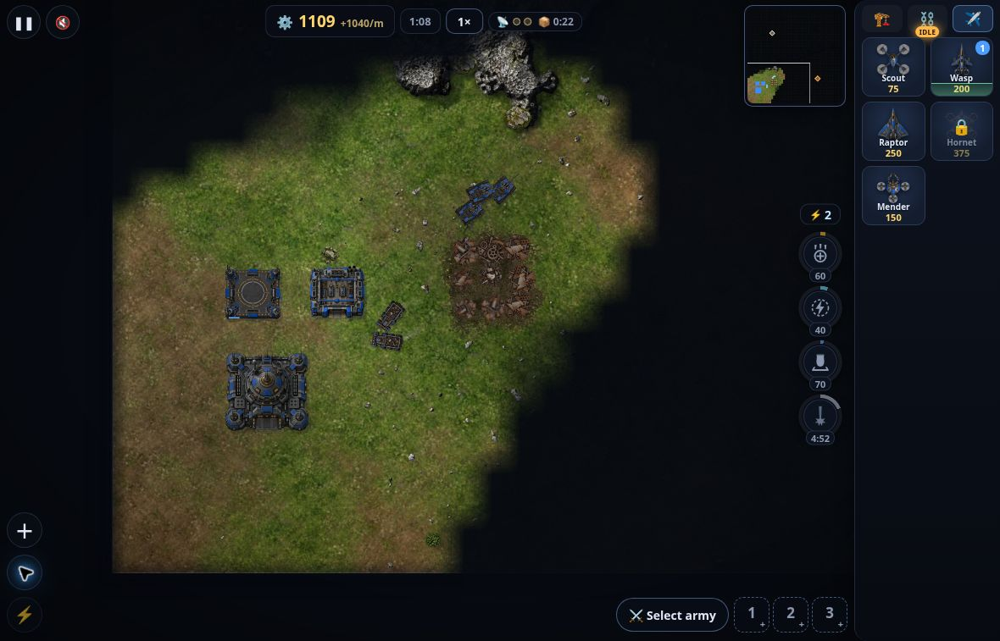

**先试需求／检索与小代码切片，已有 IDE 不为热度换栈；资产生成只从局部候选开始。** [研究]
**旧调查支持选题，新案例支持试法；目前没有足以排出 2026 年 10 月全行业质量冠军的同题证据。** [研究]
**本端做过精确版本检索和 Battle Drones v4 公开产物短试玩，未试用 AI 制作工具，未复现制作或测得净收益。** [经验]

# 游戏版值得一试与 AI 做游戏实例

第 1–7 节核实：2026-10-23（UTC+8）；试玩于 10-22 UTC，未指定模型版本不补猜。第 8 节补入 10-27 的作品过程核查。读者入口：[值得一试](../../domains/game-dev/README.md#游戏版值得一试)／[用 AI 做游戏](../../domains/game-dev/README.md#用-ai-做游戏)。[研究]

## 1. “用得多”能回答到哪一步

**本轮可核的广泛调查中，查资料／梳理需求的使用面高于资产生产，不能由此推出某工具生成游戏最好。** [研究] [GDC 2026 原报告](https://investgame.net/wp-content/uploads/2026/01/2026-01-29-dec052f4_d88e_48ce_9f83_a18ce2f2a6e5_541400_GDC26_PDF_SOTI_Report.pdf)为 1 月公布、2,300 多名跨岗位行业参与者调查：36% 工作中使用生成式 AI，在游戏工作室工作的受访者为 30%；在 AI 用户中，多选工具为 ChatGPT 74%、Gemini 37%、Microsoft Copilot 22%，用途为 research／brainstorming 81%、code assistance 47%、prototyping 35%、asset generation 19%、player-facing features 5%。这里的 Copilot 是 **Microsoft Copilot，不是 GitHub Copilot**；工具使用和用途不是质量投票。[一手：调查]

[JetBrains State of GameDev 2025](https://lp.jetbrains.com/the-state-of-gamedev-2025/)补充编码工具的候选面：问题是 **ever used or tried**，AAA／其他组织分别为 ChatGPT 59%／60%、GitHub Copilot 53%／49%、Cursor 23%／31%、Gemini 23%／22%。这是旧厂商招募样本，分组人数未明确，不能称日常采用率，更不能与 GDC 拼成同一排行榜。[一手：调查／研究]

## 2. 新近网页游戏数据：值得加入对照，不够宣布赢家

[Playgama AI Game Index](https://playgama.com/ai-game-index/)页面更新于 2026-10-21，新发布观察窗为 9 月 22 日至 10 月 19 日；“4,000+ games／110 万启动”是沙盒累计规模，**不是这四周的样本量**。同页 all-time 游戏份额表报 Claude Code 50%、Codex 20%；这是站内游戏归属，不是开发者市占率。每日新游戏只计首次发布，工具标签由创作者自报、可修改、未核验，且无模型版本。[一手：平台方法说明]

其效果指标先算每款游戏 **all-time、至少 30 秒的 plays** 的平均时长，再取工具组中位数，门槛为每游戏至少 20 次 plays、每工具至少 15 款游戏。Claude Code 为 4.6 分钟，Codex 与 Cursor 各 4.7 分钟，游戏间分位区间重叠（不是置信区间）；作者能力、题型、投入与流量来源没有被控制。不能写成 Codex／Cursor 胜 Claude Code，也不能把游玩时长当制作效率、稳定性或玩家口碑的完整指标。[一手／研究]

## 3. 需求、编码和 IDE：借步骤，不借营销收益

[游戏团队 Game Tactics 的 2026-10-09 复盘](https://www.gametactics.io/blog/ai-tools-for-game-development-2026)自述使用 Claude Code、Cursor 与 GitHub Copilot 处理 Unity C#、编辑器和迁移；一次输入迁移误改序列化字段，被人工评审抓住。它支持的实用动作是先保护字段与引用、拆小改动并核查第二次修改，不是“能编译就可合入”。文中的 20–40% 等获客数字没有公开任务账本，本记录不采用为验证过的收益；其人工最终美术路线也不移植为本仓零手修兜底。[一手：团队自述／研究]

中文 [Reddit 游戏 mod 原帖](https://www.reddit.com/r/youxi/comments/1wuesjo/)描述 ChatGPT 理需求→Claude **Cowork** 写 C# mod→作者在 Visual Studio 编译并进游戏核验，生成贴图仍需 Photoshop 手改。这是匿名作者自述，发布日期仅见相对时间，本记录只标核查日；不能把 Cowork 改叫 Claude Code，也不采用作者主观工具胜负。可借的是需求、代码、实际游戏接收各有一段，而不是一个提示完成全部工作。[社区／研究]

另一个中文 [linux.do 原帖](https://linux.do/t/topic/1772128)明确发表于 **2026-03-17**，作者用 Codex＋Unity MCP，并提到 FGUI 项目 UI 仍不足；这是旧反例，不装成近四周信号，也不转述其地区政策判断。两帖都不证明所有 AI 工具的当前上限，提醒的是代码助手接上引擎后仍有 UI、资源及人工制作成本。[社区／研究]

**读者首试题。** 选一个项目现有、可独立撤销的任务：需求助手把“暂停时不能继续蓄力攻击”写成状态、反例和来源；编码 Agent 实现后，再追加“恢复时必须重新按下，不能自动发射”。已用 Cursor 可沿其 Agent，其他 IDE 先比兼容的 Copilot；另选资源命名校验，二改提示与筛选范围。对照保持相同基线、需求、依赖版本和验收动作，检查 diff、原测试与实际交互；若只试一个候选，结果只能回答它能否用，不能回答胜过谁。[研究；试验建议，未执行]

原方案是手写／已有补全与直接查原文；新增成本包括整理上下文、审查 diff、纠错重试、重新运行和服务费用。记录到**第二次修改被接收**为止，而非只记生成等待时间；漏改与人工修复也计入。序列化引用受损、越界改目录、旧行为退步且局部修复不划算，就撤补丁回原流程；不为保住新工具再迁移引擎。[研究]

## 4. Battle Drones：确实玩到了什么

[Simon Willison 2026-10-20 原文](https://simonwillison.net/2026/Oct/20/battledrones/)描述主要由 Claude Code 制作的 TypeScript RTS，从 Phaser 到 Three.js，多轮输入与人工试玩迭代；v4 的乐趣改进和 v5 的 3D 移植各经历通宵 Agent 工作。作者感觉“好玩”属于其体验，不证明一句话就设计好，也没有给出可与 Codex 比较的主动工时、人工修复和费用账本。[一手：作者自述／研究]

**本端运行：** 2026-10-22 22:35–22:40 UTC，自身云 Chrome、1180×757 视口，先访问[当前版](https://simonw.github.io/battledrones/)。菜单与帮助可见，启动后空白；控制台为 `THREE.WebGLRenderer` 无法创建 context，`GL_VENDOR`／`GL_RENDERER=Disabled`。这是本端云图形环境故障，当前版核心玩法未观察到，不能据此判定游戏逻辑坏了。[经验]

作者链接的[历史 v4](https://simonw.github.io/battledrones/v4/)可运行：Easy／Proving Grounds／Blitz 玩至游戏内 **1:38**，观察到自动采集、3 辆坦克移动、Airpad 建造与放置、Wasp 排队完成；建筑拟放位置被单位挡住时提示 `Unit in the way`，换到空地后成功。暂停、恢复、退出菜单及重开可用，重开回到 0:00／600 scrap 与开局选择。没有打完一局，不能评价胜负、平衡和长期乐趣。[经验]

桌面资源、计时、建造价格、选中圈与进度反馈在此视口可读，建筑分类主要靠图标，需要学习；静音运行，未测手机／触摸、声音、无障碍、帧率、长局或离线。[经验] **截图只证明公开产物在该环境下的这段流程，不证明 Claude Code 制作效果、二改效率或当前 3D 质量。** [研究]

[公开仓库](https://github.com/simonw/battledrones)的 v4 标签指向 `2afb7cb953cb1bafa8dbecceb4c39aa3c9220c5e`；以下是该固定源码核读，网页部署的构建 SHA 未独立核实。[GameScene](https://github.com/simonw/battledrones/blob/2afb7cb953cb1bafa8dbecceb4c39aa3c9220c5e/src/game/GameScene.ts)调用 `tickAi`，其 [commander](https://github.com/simonw/battledrones/blob/2afb7cb953cb1bafa8dbecceb4c39aa3c9220c5e/src/sim/ai/commander.ts)为明确的建造、采集、进攻和骚扰策略，返回命令；[依赖](https://github.com/simonw/battledrones/blob/2afb7cb953cb1bafa8dbecceb4c39aa3c9220c5e/package.json)中运行时为 Phaser。此处查看的内置对手是固定策略，未运行生成模型、多人或麦克风；只读这些文件不构成全仓安全审计。[一手：源码核读／经验]

## 5. Context7：命中库名之后还有版本门

本端已有的真实窄试用见[固定 P98 记录](https://github.com/dbvv1/a1dbv/blob/1ae780868ba4d1bfeb7e322e5b89896f0c994320/docs/research/wp10-content.md#文档检索窄试用先辨版本再读源码)：2026-10-22 20:39 UTC，分别请求 **InputSystem 1.11.2** 与 **UniTask 2.5.10**，两次 `resolve-library-id` 都成功，但输出没有所需精确版本 ID。InputSystem 候选包含 1.15 文档，它不能替代 1.11.2；因此停止 `query-docs`，回固定 tag。只提交公开库名、版本和 API 问题，未发送项目内容或凭据。[经验]

回退到 InputSystem 1.11.2 的 [InputAction.cs](https://github.com/Unity-Technologies/InputSystem/blob/c8518694c7fdd2c755755e028e2ec19cdceda19b/Packages/com.unity.inputsystem/InputSystem/Actions/InputAction.cs#L916-L935)，可确认进行中动作 Disable 会在调用内触发 canceled；UniTask 2.5.10 的 [README](https://github.com/Cysharp/UniTask/blob/7c0f199fe0d3fc528024488ccd671e6c7b27745b/README.md#L339-L349)支持默认在 PlayerLoop 检查取消，不是一定立即或等完整延时结束。[一手：固定源码]

值得借用的是“把检索当入口、版本不明即回原文”的短路径。此次结果不证明 Context7 全库没有这些版本，也不证明取消行为在引擎运行中正确。读者先用一条项目锁定包的问题对照原文，若版本或时序关键字不吻合，就保留原文答案而非继续猜版本后缀。[研究]

## 6. 资产与声音：拆成局部，才能算清制作成本

[Reddit 开发者原帖](https://www.reddit.com/r/aigamedev/comments/1x6ql3o/2_weeks_of_work_now_im_fully_committed_on_the/)自述 Gemini 参考图→Claude 调 Meshy→Blender 脚本处理尺寸、绑定动画→UE，ElevenLabs 主要用于预告片旁白；同时承认约 90% 时间用于视觉、战斗不好且不关心发行，手指／握持／弓手肩部仍有问题。发布日期未独立核实，只标此次核查日；这是匿名作者的链路说明与自评，不是零手修生产证明。[社区]

**Meshy＋Blender 先试三件同族刚体，不从整队角色起步。** 已有合格资源族继续用；缺件才用合法参考生成三件候选，脚本统一尺寸、坐标和命名，再统一二改挂点而保主体轮廓，检查能否仍像同一套。对照是现成同族资源或参数化建模，不是只有不同生成服务互比；轮廓、关键孔洞／挂点或目标预算失败且程序处理修不好，就退回原路线或缩设计，不增加人工刷权重、补动画例外。[研究；未执行]

**ElevenLabs 先试有限文本，不承诺完整配音。** 在声音权利清楚的前提下，用同角色三句测试专名、情绪和衔接，然后只改中间一句并放回原顺序听；对照保留字幕或合法占位音频。补句接不上、台词改稿需要反复全量重生，或目标语言听辨不合格，就停在占位用途，不能用预告片旁白的成功代替游戏持续补句验收。[研究；未执行]

资产成本还须计淘汰、重生成、脚本、导入、接收及二改，声音还含审听；全链成本未知，未声称更便宜。采用前沿 [3D](../../domains/game-dev/assets/3d.md)／[音频](../../domains/game-dev/assets/audio.md)核当时的输入输出权利、计划与发布要求，作者能展示不代表读者可商用。[研究]

**探索回执：** 截至 2026-10-23（UTC+8），综合 GDC／JetBrains 原调查、Playgama 方法页、Game Tactics 与 Simon Willison 制作者原文、Reddit 英中文原帖及 linux.do；开源核到 Battle Drones v4 固定标签与 P98 固定包源码，官方契约复用既有 3D／音频页与版本检索记录。未独立取得两篇 Reddit 的绝对发布日期，未做账号工具制作、付费、安装、模型调用或 Unity／Unreal 运行，未使用用户电脑；没有可比较的全链成本和当前全行业口碑排名。[经验／研究]

## 7. pxl：让资产族共享源，但补丁不会自动跟着形状走

**🧪 新意首试：从零做小像素资产族时，可把“主体＋变体＋逐帧补丁”的文本源列入对照；只有换色需求不迁移现有管线。** 核实 2026-10-23；本轮为公开源码、许可与制作说明核读及公开产物观察，未执行工具、安装依赖或调用模型。[研究]

[上游 claude-pxl](https://github.com/crsolver/claude-pxl/tree/21fee41f7ecce00bc868d7567f24ffd0f3acc8fa)与 [uilianks fork](https://github.com/uilianks/pxl/tree/a012fc78b92e5deff27e56bba563f22895c3916c)分别固定于 10-15／10-22 提交；fork 的 [MIT 许可](https://github.com/uilianks/pxl/blob/a012fc78b92e5deff27e56bba563f22895c3916c/LICENSE)不替输入图片授予权利。[作者原帖](https://www.reddit.com/r/ClaudeAI/comments/1xc30xk/i_built_5_claude_code_skills_that_make_game/)展示像素、矢量、3D、材质与音频代码工具组合，说明标注后继续改源的做法；这是作者自述，没有独立生产效率对照或广泛采用证据，不据此排“最好用”。[一手／社区]

**可借的是依赖关系，而非换色功能本身。** [basics](https://github.com/uilianks/pxl/blob/a012fc78b92e5deff27e56bba563f22895c3916c/examples/basics.px.js)用同一 `slime` 派生红／蓝变体与眨眼补丁，宝箱另引用 `_lock` 部件。[build.ts](https://github.com/uilianks/pxl/blob/a012fc78b92e5deff27e56bba563f22895c3916c/src/core/build.ts)先复制引用基图，再执行局部操作；动画每帧重用公共内容并执行该帧补丁，不累计上一帧。[动画测试源码](https://github.com/uilianks/pxl/blob/a012fc78b92e5deff27e56bba563f22895c3916c/test/anim.test.ts)明确写有公共红底、逐帧改单像素和时长断言，本端未运行。这样主体改动有传播路径，但眨眼的 `grid(10, 5, ...)` 是绝对坐标：基型眼睛移位后，补丁并不自动跟随，仍要逐变体／全帧看图。[一手：源码核读／研究]

| 同一任务的对照 | 当前选择 |
|---|---|
| 合格 PNG 只换色、裁切或合成 | 保留既有 [Python 图像操作](https://pillow.readthedocs.io/en/stable/reference/Image.html)；没有证据表明迁入 DSL 更省工。[研究] |
| 已有 Aseprite 分层动画 | 沿 [CLI 批导出](https://www.aseprite.org/docs/cli/)、[脚本换色](https://aseprite.org/api/command/ReplaceColor)与 [linked cels](https://www.aseprite.org/docs/linked-cels/)；后者已能把一处修改传播到关联帧，共享修改并非 pxl 首创。[一手／研究] |
| 没有可编辑源，要持续新增同族小像素资产 | pxl 的增量是把基图引用、变体和帧补丁显式放进文本 diff；是否比既有脚本更好维护，尚待同题二改比较。[研究] |

**已有作品不等于二改实验。** [eldritch 最终源码](https://github.com/uilianks/pxl/blob/a012fc78b92e5deff27e56bba563f22895c3916c/showcase/eldritch.px.js)含局部反馈注释，但源码与 PNG 的公开路径历史均只有 [一次新增提交](https://github.com/uilianks/pxl/commit/4c2c0e900db4478cf03948384bf7f2ba216bbafb)，未取得可比较前后。另有 [polish 示例](https://github.com/uilianks/pxl/blob/a012fc78b92e5deff27e56bba563f22895c3916c/examples/polish.px.js)把两套画法并排；它是作者预制对照，不是本端修改结果。作者标注流程的返工次数、淘汰率与接受成本未知。[一手／研究] 本端实际查看固定版本 [eldritch 原尺寸 PNG](https://github.com/uilianks/pxl/blob/a012fc78b92e5deff27e56bba563f22895c3916c/showcase/media/eldritch_130x160.png)与 [polish 图](https://github.com/uilianks/pxl/blob/a012fc78b92e5deff27e56bba563f22895c3916c/docs/gallery/polish.png)：前者青绿触须与红眼可辨，后者右侧蘑菇有左上高光和右下暗紫，区别于左侧重黑轮廓与同心亮区；这只是公开产物观察，不是本端渲染或画质验收。[经验]

首试应固定三件同族资产和一段短动画，改一次公共主体，再改一个局部表情，核引用、尺寸、透明边界和全部帧；已有合格资源仍是对照。若补丁维护更贵或需要人工逐像素修补，就保留原路线。附带注意：[CLI 的 lint](https://github.com/uilianks/pxl/blob/a012fc78b92e5deff27e56bba563f22895c3916c/src/node/cli.ts)仅取动画首帧，发现问题仍返回 0，不能当全帧发布门。这是试验建议与静态边界，未执行，也未验证画质或引擎接收。[研究]

**本项探索回执：** 同步查 Reddit 的上游／fork 作者与使用者讨论、GitHub 实现，以及中文检索、linux.do、HN；中文命中以教程转述为主，未找到同题独立生产反馈。[另一 fork 的展示讨论](https://www.reddit.com/r/aigamedev/comments/1xb3k2l/opus_55_pixel_art_with_claude_pxl/)既有外观称赞，也有仪表不一致的反馈；它使用不同分支，不能把其新增能力或问题直接套给本次固定版本。未取得成套二改效率对照。[社区／研究]

## 8. 用 AI 做游戏：制作过程与采用边界

**本轮保留三条待试制作线索：Riposte 的建筑构造、FM1 的混合供给、DragonScape 的分类图标／二改保留。** 尚不足以据此确定三款游戏的品质目标。[研究]
本节仅核作者／玩家原帖与固定源码，未复现制作或完成新增作品体验。Battle Drones 旧试玩沿[第 4 节](#4-battle-drones确实玩到了什么)。
以下均为 🧪 候选，先在现有作品的一个完整局部验证。

### Riposte：建筑先有构造，再加材质

**待试顺序是先核角色与门洞的真实尺度、建筑体量及通行／视线布局，再选局部立面构造。** 给旧盒子贴百叶不等于形成完整场景。[研究]

作者自述由 Claude Code 编写几何与玩法，人给参考、逐武器／附件修改并试玩；一次要求全部地图重做，消耗大量并行工作却几乎无收益。瞄准、后坐与声音的打磨比加功能更费时。[社区：作者自述]

固定源为 `31ca050d8ce59f4885c01a3237f68cdf186c9b60`，README 标 **5.6.0 快照**，不与官网每次更新同步，也不含官方账号／大厅服务端。静读三个起点：[一手：源码]

- [`02d-archi.js`](https://github.com/BenDBSS/Riposte-Frontline-Source/blob/31ca050d8ce59f4885c01a3237f68cdf186c9b60/src/02d-archi.js)：局部立面坐标、洞口深度、窗框／百叶／门板；视觉洞口与整块碰撞盒分离，接入时仍须核能否通行。
- [`02c-materials.js`](https://github.com/BenDBSS/Riposte-Frontline-Source/blob/31ca050d8ce59f4885c01a3237f68cdf186c9b60/src/02c-materials.js)：按米铺纹理、世界空间大尺度变化、墙根污渍；它补表面，不替代建筑比例。
- [`02-relief.js`](https://github.com/BenDBSS/Riposte-Frontline-Source/blob/31ca050d8ce59f4885c01a3237f68cdf186c9b60/src/02-relief.js)：共享地面高度与道具底部局部整平。可作为路侧物接地的候选，而非已验的赛车道路方案。

**转用限于已核授权部分。** 固定版代码为 MIT；NOTICE 排除名称／图标、Suno 免费方案音乐、Mixamo 烘焙动画及部分声音。不要整包搬资产；贴图、动画、音效分别回其来源条件。作者报告约一个月制作、订阅从 €20/月换到当月 €90/月；总工时与费用未知。玩家回帖既有好评，也有 RX580 约 20 FPS 和 Mac 长停顿，不能用作者设备的帧率保证目标设备。[社区／研究]

依据（核实 2026-10-27 UTC）：[作者制作帖与玩家回帖](https://www.reddit.com/r/aigamedev/comments/1x79hnz/i_vibe_coded_a_free_multiplayer_fps_for_the/)、[固定 README](https://github.com/BenDBSS/Riposte-Frontline-Source/blob/31ca050d8ce59f4885c01a3237f68cdf186c9b60/README.md)、[LICENSE](https://github.com/BenDBSS/Riposte-Frontline-Source/blob/31ca050d8ce59f4885c01a3237f68cdf186c9b60/LICENSE)／[NOTICE](https://github.com/BenDBSS/Riposte-Frontline-Source/blob/31ca050d8ce59f4885c01a3237f68cdf186c9b60/NOTICE.md)。

### Formula Minus One：混合供给仍需设计与清理

**待试线索是先定视觉主题、再组合资源；图像转 3D 尚不能当作免清理生产线。** 六个月复盘明确写出铅笔草图→图像生成→Tripo→Blender 清理瑕疵，音乐先在 MIDI 键盘起稿再生成，声音还用现成资源。作者重写半低模／双色风格指南，重做角色、菜单与关卡。它支持混合供给和持续设计；清理是否全由 Agent 完成未交代，尚不能作为“无需人工美术修补”的完整样板。[社区：作者自述]

对 Star 可试的是一个弯道里路面、路肩、近景件与远景共享主题和尺度，属于流程启发，尚无实画面定标。反重力赛车的操控也不能直接套给公路车。原帖玩家指出手机转向太敏感、反复撞墙仍赢，作者承认要改；其视频自称 trailer，不充当连续实机。[研究／社区]

作者在四个月时估计约 $200，同时说明订阅混用于其他用途；没有专项账本、清理工时或累计重试费。未核到可供本项目复用的全仓／资产许可，仅留过程线索。[社区／研究]

依据（核实 2026-10-27 UTC）：[六个月制作原帖](https://www.reddit.com/r/ClaudeCoding/comments/1x4fyc1/vibecoded_a_futuristic_racer_demo_like_many_but_i/)、[四个月原帖及成本／玩家回帖](https://www.reddit.com/r/vibecoding/comments/1vvhi7t/vibe_coded_this_game_in_four_months/)。

### DragonScape Idle：分类风格与保留已验图片

作者自述按游戏数据生成静图；通用风格在 **32px 暗底**失效，后来按 UI、物品、敌人分类定风格。二改把 **content hash 与 style hash 分离**：文案变可保留已采用图，风格变显式标旧，不能用批量更新掩盖。待试线索是先验实际尺寸／背景，再扩图标族；不外推三维角色或动作。[社区／研究]

仍需人选图和重生成，总成本未知；未复现脚本，也未核素材复用许可。依据（核实 2026-10-27 UTC）：[作者制作帖及修订回帖](https://www.reddit.com/r/aigamedev/comments/1wgfhfp/solo_dev_1000_hours_ai_art_and_aiassisted_code/)。

### Warpact：输入图的“低模感”不等于几何简化

**待试线索：先拆开几何删减与照明修正，别把暗部当结构送进图生 3D。** 作者复盘两次失败：只要求“简化”，结果主要变成分面外观；改为明确减少几何复杂度，并逐项去掉轮圈凹陷、内凹车窗、凸出格栅等非轮廓细节。之后“单色、无阴影”仍留下发射筒间和底盘下的 AO 暗块，作者担心生成器把它们建成凹腔，再做一次**仅去阴影／AO、保持几何、机位与背景**的图像修改。[作者自述]

这只是生成前的输入修订，不是实际减面结果。后续仍有人手删隐藏面、审批 Agent 选出的倒角；不能据此宣称无人工修模。对本仓的窄启发是：参考图分别验轮廓与暗部，网格另验实际面数和结构；当前未复现，不推导网关支持图生 3D 或通用成功率。未试玩、未听音、未看完整实机，不提升作品品质评级。[研究]

依据：[Warpact 作者 2026-09 管线原文 §2／§4](https://playwarpact.com/blog/lowpoly-hybrid/)；本次核读 2026-10-29 UTC。已有源包线索来自原 `B-AI-GAME-SUPPLY-SOURCES-20261027`，本次只补上述失败处理，不重计作品发现。

### 其余只保留改变选择的反例

- **Ascend From Nine Mountains**：[作者早期原回帖](https://www.reddit.com/r/aigamedev/comments/1ojio3t/has_anyone_published_a_game_yet/)明说生成后手动抠背景和修正。保留为角色姿态供给候选，当时有手修，当前是否消除仍待核。
- **Remnants of R’lyeh**：[作者原帖](https://www.reddit.com/r/aigamedev/comments/1mriom7/i_used_meshy_ai_to_generate_3d_models_and/)说模型生成后精修／动画，回帖承认拓扑仍不足。不要由怪物宣传图推导可直接替换近景角色。
- **Codex Mortis**：[demo 作者原帖](https://www.reddit.com/r/aigamedev/comments/1pidb5g/my_first_vibecoded_game_codex_mortis_demo_is_live/)说明角色动画没达到目标，改用 shader 摇摆；这是美术取舍，不是完整动作链已解决。旧 demo 的说法不当成当前正式版状态。

上述原文核实于 2026-10-27 UTC；均未完成本端当前版体验。未能形成新的、可复验的“生成声音到游戏内混音无需人工处理”完整样板，声音选择继续沿[音频页](../../domains/game-dev/assets/audio.md)。[研究]

**体验缺口与恢复条件。** 本轮 Riposte／FM1 官方 HTTPS 返回连接拒绝；Riposte 本地文件入口另受浏览器管理员策略阻断；之后支持浏览器退出，候选录像未加载出游戏帧。DragonScape 与原生 demo 未启动。这是访问／观察失败；待合法入口恢复或取得同版完整实机后，再比较完整局部的视听、操作与反馈。

**探索回执。** 回源 Reddit 作者／玩家原帖、Riposte 固定代码与许可；中文反馈沿第 3 节，本次未新增检索。未重做 Battle Drones 或用宣传截帧补体验；完整成本与品质排名未知。[研究]
