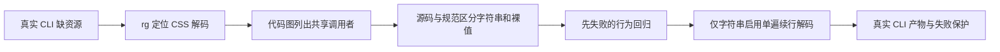

主线：一／三；把代码图的导航机制用于真实公开项目的修复。
改变的建议：从报错定位到共享解码器后，区分调用者语法，再写能穿过真实 CLI 的回归。
新证据：Oil UI 固定源码补丁、先失败后通过的回归与可移植 HTML 产物；不推断代码图优于原生检索。

# 真实编码示范：修好 Oil UI 的 CSS 续行资源打包

核实：2026-10-23。**读者可以重放一次公开项目修复：合法 CSS 字符串续行导致离线打包失败，改后同一输入生成真正的比较页，错误输入仍保护旧产物。** 图用于找到调用者；修改范围由语法、源码和测试共同决定。[本轮实测]

## 这次到底做了什么

目标是 [Oil UI](https://github.com/oil-oil/oil-ui) 实际使用的 `scripts/build_explorer.py`，不是另造一个简化打包器。固定提交 [7002e1a3](https://github.com/oil-oil/oil-ui/tree/7002e1a3b3e3bc19d4159e2a37917456dafd5ad4)，Skill v0.23.9；10-23 07:06 UTC 用 GitHub API 查询 main，仍返回该 SHA。不是上游已确认的 issue，补丁尚未提交上游。[一手／本轮实测]

已有[Oil UI 试用](2026-10-22-frontier-trials.md#oil-ui先复用比较器别把免费版当组件库)完成了安装／打包检查，这次继续修改它的真实实现。使用既有 Graphicle 0.1.4 与 Python／Git／Node，不再安装候选、接入模型或启动浏览器。HTML、CSS 和单像素图片是验收输入夹具，不冒充真实用户项目或模型生成设计。[研究／本轮实测]

| 读者操作 | 本次实际结果 |
|---|---|
| 给本地 `@import` 文件名、quoted `url()`、`image-set()` 字符串加合法续行 | 原实现把续行当成路径字符，报告本地资源缺失 |
| 先添加行为回归，保原实现 | 三个行为测试方法失败，包含 LF／CRLF／CR／FF、双／单引号和错误资源路径 |
| 修改解码器与 quoted-value 调用点 | 同输入通过；新增反斜杠边界测试也通过 |
| 调用上游真实 CLI | 输出单 HTML，CSS import 与 PNG 已内嵌，输入不变、重复构建字节一致 |
| 去掉输入参数／删除图片后重建 | 分别退出 2／1；缺图时原比较页字节不变 |

这是代码与 CLI 接收结果，不能代替浏览器视觉接收。[本轮实测]

## 从检索到补丁，哪里真的用上代码图

先用 `rg` 看资源处理入口，再对隔离的公开源码执行下列命令；`graphicle` 指向已经准备好的官方 0.1.4 二进制。提取使用 code-only，不需要模型。[本轮实测]

```sh
graphicle graph extract . --code-only
graphicle graph explain scripts_build_explorer_css_unescape --all
graphicle graph affected scripts_build_explorer_css_unescape
```

提取报告 11 个代码文件；`explain` 从 `css_unescape()` 导向 `embed_css()` 内的 `value()`，也给出 `check_css()`／`check_resource()` 的调用。**这促使修改前明确：同一个解码器还处理标识符和未加引号的值，不能全局删掉反斜杠换行。** 调用关系再用源码和 `rg -n 'css_unescape|def value' scripts/build_explorer.py` 核对，不把图的边标签当真值。[本轮实测／研究]



没有设置“只有 rg”的对照组，不能声称这次图提高了速度、成功率或降低 token。该项目也可以用原生检索完成；本次可借用的是从共享 helper 回到不同调用语义的操作，而不是必须安装图工具。[研究]

## 补丁为什么不能只是一次 replace

CSS Syntax [字符串消费](https://www.w3.org/TR/css-syntax-3/#consume-string-token)允许反斜杠接换行作为续行；[裸 URL 消费](https://www.w3.org/TR/css-syntax-3/#consume-url-token)不是同一规则。CRLF／CR／FF 与 LF 的关系见[输入预处理](https://www.w3.org/TR/css-syntax-3/#input-preprocessing)。这些规则是行为依据，不根据本次实现反推答案。[一手]

实施选择：[本轮实测]

- 为共享 `css_unescape` 增加默认关闭的 `string` 选项，仅已识别为 quoted string 的 `value()` 开启。
- 在同一轮正则替换中消费续行及普通转义，不先全局删除续行。
- 保留非字符串路径和原有 hex／引号转义行为；本次不是完整 CSS tokenizer 重写；非法裸 URL 的 LF／FF 续行仍被拒绝并有 `embed_css` 回归。quoted data URL 若连 `data:` scheme 本身也用续行拆开，后续 `check_css` 仍可能拒绝，这是既有未修限制，不在本次本地资源／import 修复范围内。

**实际返工发现：** 单独试过“先删除续行、再解码转义”的候选算法。对于两个连续反斜杠后接换行，它会误删第二个反斜杠和换行；后续 `b` 还可能被解释成十六进制转义。单遍实现先消费成对反斜杠，保留剩余换行。回归因此覆盖一／二／三个反斜杠，不只覆盖“文件找到了”；双反斜杠后原始换行的断言只保护解码边界，不声称该 CSS 字符串有效。该反例探针运行过，错误候选没有进入交付补丁。[本轮实测]

改后执行 `graphicle graph update .`，再次 explain 显示 `value()` 的调用位置从 L260 刷新至 L266。图更新用于继续导航，不能替代测试。[本轮实测]

## 可复制入口与实际产物

需要 Python 3.10+、Git、Node。脚本不安装依赖；Node 用于原有两项 JavaScript 单元测试，不可把它缺失后的 skip 当通过。先自行准备上述固定 Oil UI checkout，然后在本知识库根目录运行：[本轮实测]

```sh
python3 experiments/replay_oil_ui_css.py /path/to/oil-ui-checkout
```

脚本从输入 checkout 新建隔离副本，检出固定 SHA，不改原件；按顺序执行基线 CLI、只加测试的失败回归、实现补丁、58 个非浏览器测试、正常／重复／缺输入／缺资源 CLI 接收。输出位置会打印出来，保留 `case/style-explorer.html`、输入与 `evidence/summary.json`，供自己打开检查；每次运行用新目录。[本轮实测]

直接可用的文件：[研究]

- [实现补丁](../../experiments/oil-ui-css-continuation.patch)：两个局部修改点。
- [回归补丁](../../experiments/oil-ui-css-continuation-tests.patch)：3 个行为测试方法，加 1 个新选项／转义边界测试方法及 1 个非法裸值续行拒绝测试；其中转义边界测试会因旧 API 不支持 `string` 参数失败，不能单靠它证明原 bug；裸值拒绝测试在基线也通过。
- [重放脚本](../../experiments/replay_oil_ui_css.py)：应用两份补丁，验证真实 CLI 与产物，保存日志。
- [MIT 许可](../../experiments/oil-ui-LICENSE.txt)：保留上游版权与许可；原有源码和模板不重复搬进本仓。

结果：53 个原有非浏览器测试加 5 个新测试通过；明确不运行 3 个真实浏览器测试和 1 个 Windows 专属测试，不报“上游全套通过”。重放脚本自己的缺参数、无效 checkout 也已检查，均失败退出。生成页实际视觉、交互、Windows 和上游接收仍未验证。[本轮实测]

探索回执：本轮是已有研究续接，读取既有 Graphicle／Oil UI 试用与上游源码，定点核 W3C 语法、GitHub main SHA；没有重做社区热度全扫或最高水平排名。GitHub commits 网页读取失败后，官方 API 经连接器读到 SHA；无模型收益比较。[研究]
