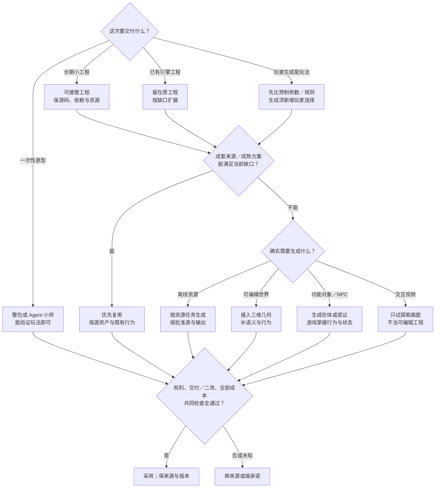
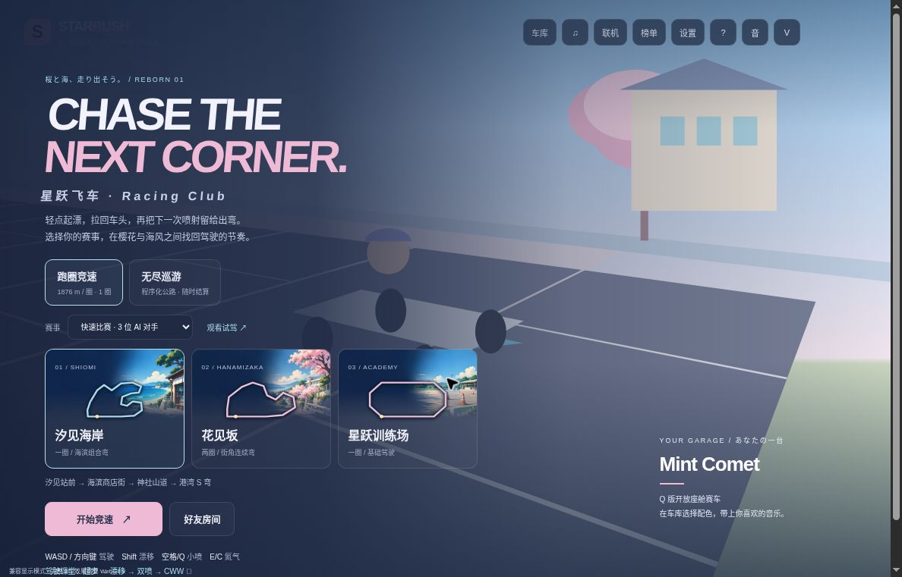

# G1 资产管线总览：授权门槛、采用条件与外部约束

> 核实时间：2026-10-23（UTC+8）。基准为单人程序员、没有美术和音频人员，不靠人工修图、刷权重或补动画，按玩法和目标设备定规格；资源型号和合同沿各节核查日期，不把历史条款当作今天的全面放行。除 §1.1 选卡插画窄链已实际生成、接入与二改外，其他生成平台／引擎路线均未试用；本文为资料比较，不是效果排行榜。按阶段进入详见[独立游戏路线图](06-indie-roadmap.md)。

## 30 秒结论：先决定要验证什么，再决定是否需要资产管线

**只想验证一个玩法，可以先生成可玩小样，不必先搭资产管线；准备长期保留代码，才把二改与接管成本纳入选型。** 验证的是规则时，先用简单形状／程序化声音；验证角色辨识、氛围或反馈时，仍需相应质量的资源。

| 这次要交付什么 | 当前首试与对照 | 什么时候换路 |
|---|---|---|
| 一次性玩法原型，允许扔掉代码 | 🧪 整包生成／托管试玩，与原生 Agent＋最小网页工程比较；浏览器能让目标试玩者验证玩法即可 | 多轮修复仍不能验证核心机制，或素材制作反而主导时间；不为未来可能接管先建完整管线 |
| 可长期接管的小工程 | 先用熟悉的原生 Agent＋最小工程／合适模板；🧪 整包平台只有在其二改与交付符合需要时采用 | 想改规则却只能重生成，或所需源码、依赖、资产不能接手；已知会离平台时尽早试实际导出 |
| 已有 Unity／Unreal 工程扩展 | 留在原工程，按缺口生产资产或复用窄能力；参考 [WP13原生入口／模板](../../docs/research/2026-10-14-game-wp13-agent-config.md#5-p32原生入口拆借模板还是整套游戏管线) | 新工具要求重搭原有行为／存档／资源引用且收益不明；网页整包不作为引擎迁移凭证 |
| 玩家生成就是玩法 | 先比预制部件＋参数，陌生形体表达确有价值再试运行时生成 | 生成没有增加玩家选择，等待／失配或旧对象二改破坏体验；见[玩家造车比较](../../docs/research/2026-10-14-game-wp11-gameplay-architecture.md#p63玩家造车生成的是形体还是新玩法) |

四种用途不是每个原型必须走完的四道关。以上平台路线均**未试用**，默认是用途判断，不是总质量／省时排名。下文资源、许可和[游戏02](02-verification-and-playtesting.md)的设计／实现／呈现分验仍适用于相应交付。

**候选怎样用：** 🧪 Phaser Game Agent 已公开 Web／桌面打包路径，Rosebud 另声称可下载可编辑项目源码；两者均未试用，分发包不等于完整源码接管。Rosebud 免费版不用于商业项目原型（包括内部使用），浏览器编辑、代码下载和商业权按不同套餐区分，多人还可能依赖外部服务。官方原文、作者导出修复、中文实践及成本边界见[WP13整包原型证据](../../docs/research/2026-10-14-game-wp13-agent-config.md#57-p93整包原型的交付与退出证据)。

### 一张选择图：要交付的不是同一种“生成游戏”

**所有路线共用三项检查：先清权，再验交付，最后按全部成本决定采用；任一项不通过或未知，就换来源或缩承诺。** 图只选入口，三项检查另行完成。

- **权利与退出（所有用途）**：按所选版本核代码、权重、输入、输出、运行时提供权，另核正式导出与发布渠道；付费或开源不代表整条路线放行（§1.3、§3）。
- **交付与二改（按承诺验）**：原型验核心玩法；长期内容还验接管、第二次修改与旧内容兼容。可编辑场景、可使用对象和交互视频分别验收，互不替代；运行时生成不接管游戏状态权威（§2）。
- **全部成本与撤回**：按§2末三路成本表逐项计入采购／许可、调用与淘汰重试、筛选处理、存储接入、设备性能、每玩家全程运转（含上下文／语音、安全审核与等待）、托管退出、分发更新和后续维护；实际交付不达标、二改破坏旧内容或总成本超预算，就换源或缩范围，保来源、版本与批准产物（§2末）。

这是**条件选择，不是必经流水线**：纯原型不必提前承担长期迁移；细目与候选比较见下表及各节。图中路线未全链试用，仅§1.1 的离线插画是已实际制作窄例，其他路线按各节未试用范围理解。

**依据**：[研究] 本节资料比较；[一手／社区／研究] WP13 整包原型证据；核实 2026-10-23。

## 当前最高水平：按主要选择比较，不按一个生成演示排全页

<!-- frontier: status=已比较 gap=1 gen=2026-10 checked=2026-10-23 audit=2026-10-22 -->

**按主要选择逐项比较，不把一次生成演示当成整页结论；当前比较强调结构控制与交付边界。** 整页独审支持资料差距 1，全流程零手修的最优做法未知；以下比较支撑默认与撤回条件，不是同题实测冠军。

| 主要选择 | 近期领先替代／对照 | 当前决定与撤回条件 |
|---|---|---|
| 原型还是长期工程 | Phaser Game Agent／Rosebud 整包，对照原生 Agent＋最小工程 | 按上表四用途选；二改或接管失败就回原工程，不为可抛弃小样先造完整管线 |
| 资源供给与风格 | 现成完整包、参数化源，对照多参考生成／局部编辑 | 首版＋下次扩展一起选；完整包不满足近看规格或新类别兼容时，换源或缩表现目标（§1.7） |
| 2D 与 UI | 原生参考／分层编辑，对照现成图标、引擎布局 | 独特静态缺口才生成；文字布局留引擎，精灵动作不由静态图通过代验（§1.4） |
| 3D 与动画 | 原生低模／分件，文本动作／视频动捕，对照成熟模块与骨架 | 刚体可试新生成；角色保已验骨架与动作，减面或自动 rig 无法补正确变形（§1.5、1.8） |
| 材质、特效、音频、视频 | 共同结构／局部重绘／可控镜头，对照参数图、成套声音和引擎镜头 | 生成补明确缺口，事件与状态留运行时；二改破坏其他通道、时序或表演即换路（§1.6、1.9–1.10） |
| 玩家创建功能对象 | Dream Racers／Roblox 语义部件＋行为，对照预制参数、离线入库 | 陌生形体表达是核心才试实时生成；新增能力必须兼容旧作品，词语影响数值不证明需要新几何（§2） |
| NPC 对话与行为 | Teammates、Smart Zoi 的受限行动，对照 authored 叙事、效用／FSM／BT | 自由表达确实增加可感知选择才加模型；只需菜单或稳定规则时保基线（§2） |
| 世界与场景 | Marble 可编辑几何、Genie 交互视频；Atlas／WorldMind 属不同前沿分支 | 要工程内对象就选可接入几何并补语义；只测探索画面可试视频世界，不承诺可编辑游戏工程（§2） |
| 权利与退出 | 正式导出／接口合同，对照仅能在平台播放或有条件套餐 | 代码、权重、输入、输出、运行时提供与渠道逐项准入；不因付费或开源一并放行（§1.3、§3） |
| 二改与完整成本 | 保源局改、版本化旧对象，对照整件重生／每人每轮调用 | 比到第二次修改及玩家全程；等待、淘汰、接入或后续维护超过预算就缩生成范围（§2末） |

**探索回执：** 截至 2026-10-23（UTC+8），已复核 World Labs／Google 发布、NPC 产品更新与研究方法，并读 V2EX 和 Reddit 原帖及 Spark 标签源码；资源专题、P93 四用途和 P63 造车比较继续作为证据。新来源与可访问范围见[世界输出与NPC补研](../../docs/research/2026-10-14-game-wp11-gameplay-architecture.md#p97世界输出npc与整页供给选择)。

**依据**：[研究] 本节比较；[一手／社区／研究] World Labs／Google 发布、NPC 产品更新、V2EX 与 Reddit 原帖、Spark 标签源码，见世界输出与 NPC 补研；核实 2026-10-23。

## 1. 资产管线：Agent 负责搬运和规范

**采用起点**：先让 Coding Agent 编排规则明确的下载、导入、参数和来源记录；是否更快、更稳按实际产物验证，有损几何处理不能当作普通规格设置。

### 1.1 推荐流程（跨引擎）

**✅ 定玩法／设备规格 → 清权选源 → 保原件与配方 → 脚本接入 → 实际质量验收 → 批准入库。** 生成物先与正式资源隔离，同目录保存来源、版本、日期与许可；占位资源也要有替换计划。

命名、单位、导入参数可以批量设置；简化、补洞、删除小部件属有损处理，先保原网格再验最终画面。代码／UV 缺陷先试程序修正，语义、姿态或蒙皮错误不能靠改格式修好。细薄表面误删的反例见[资产返工边界](../../docs/research/2026-10-13-game-asset-editing-boundary.md#生成资产返工先判断缺陷来自哪一层)。生成数量、费用设上限，仍把淘汰重试算入总成本。

**实作：先看缩到真实卡片尺寸的图，不先批准漂亮大图。** Star-Rush 的海岸／樱花／训练三张选卡插画已生成并接入；首版海岸缩图更像屋檐街景，于是以同一母版做图片编辑，扩大蓝色海面与岸线，保留小店身份、暗色净空与另外两张图，沿用相同 CSS。下图是同一 1188×761 兼容模式大厅的 v2 实际画面，卡内插画为 AI 生成，不是赛道实景。

**可直接借走：让模型画环境，让代码继续画路线、文字与选中状态；保 PNG 母版、提示词、引用关系和缩图配方，只把选中版本的 WebP 打包到同源哈希 URL，图片失败就移除装饰、保留原卡。** 本例三张运行图共 40,588 字节；[前后原图、配方与验收范围](../../docs/research/2026-10-13-game-asset-editing-boundary.md#选卡插画实作让真实缩图决定二改)可复查。若缩图仍认不出主题或抢走路线，就撤回插画而不重做功能层；本例未测手机、真实网络失败或玩家收益，不能外推到游戏全链。

**依据**：[经验：采用建议] 本节流程；[研究] 本节判断；[一手／研究] 资产返工边界；[一手：制作与浏览器观察] Star-Rush 选卡插画二改与验收；核实 2026-10-23。

### 1.2 先按资产任务判断，不按品牌整体推荐

**🧪 静态、连续动作和完整供给分验，采用摘要见§1.4–1.10。** 当前质量／性价比／本地三档在各资源专题维护，不在这里另造品牌总榜。

Unity 原生生成器可作小批原型对照；正式生产仍核兼容包、Cloud／credits、点击条款与供应商，Promote 后重验旧引用。已核入口见[01 §6](01-engine-integration.md#6-unity-内生成器少量原型资产的候选入口)，内置不等于商业总放行。

**依据**：[研究] 资源任务分验与三档维护；[一手／研究] Unity 原生生成器入口与商业化边界见 01 §6；核实 2026-10-23。

### 1.3 授权与商用门槛总表（WP1）

**✅ 先过商业生产门槛，再比较质量。** 对选中的具体版本分别核代码、权重、输入、输出和发布渠道；“开源”“付费”或“输出归用户”都不能单独放行整条管线。

| 你准备做什么 | 先取得什么证据 |
|---|---|
| 使用现成素材 | 具体包的商用、改造、嵌入发行与署名许可 |
| 本地运行模型 | 代码、指定权重及实际依赖均允许该生产用途 |
| 使用商业生成服务 | 实际账户、地区、计划、生成时间与正式导出符合合同 |
| 将资源装入游戏 | 输入、人物／声音及输出用途已清权，完成渠道披露 |
| 向玩家开放生成或分发模型 | 重新核服务提供、权重分发、终端用户与内容安全义务 |

以下为入口级筛选，详细许可、固定 SHA 和条款日期见 [WP1](../../docs/research/2026-10-14-game-wp1-licensing.md)。本节以离线生成后交付资产为主；许可准入仍不保证独占版权、无侵权或平台接收。

#### 生成路线的关键排除项

| 路线 | 已核版本／合同怎样影响选择 |
|---|---|
| 本地图像 | Qwen-Image-2512／Edit-2511／Layered、FLUX.2-klein-4B／base-4B 可进入商用评估；Qwen-Image-2.1研究版、FLUX.2-klein-9B／FLUX.2-dev 免费权重不作默认商用生产，新型号不继承旧许可 |
| 云端图像 | 按地区、实际模型／供应商和合同；Firefly自有与第三方、ChatGPT与API snapshot分开，输出归属不保证独占 |
| 本地3D／动作 | TRELLIS.2主模型MIT不覆盖推荐安装的非商业NVIDIA依赖；Hunyuan3D-2.1／HY-Motion-1.0／Lite有含Output的地域排除；GVHMR和MoCapAnything V2默认组合不作免费商用默认 |
| 3D与角色服务 | Meshy／Tripo／Rodin按生成时套餐与正式导出；Mixamo／Spine／ActorCore素材嵌入权和原始文件再分发权另核，升级不自动清除旧资产限制 |
| Meshy社区 | 免费输出CC BY 4.0；Community的Customer Output为CC0，其余社区内容如参考上传图为CC BY-NC 4.0，按具体资产身份核 |
| 音效／配音／音乐 | Eleven TTS／SFX与Music协议不同，声音克隆另需表演者与用途授权；Suno付费仍须正式Download，平台Remix及免费旧歌不自动商用 |
| 本地音频及下载 | 按权重与依赖核，Stable Audio有注册／收入条件、TangoFlux不默认商用；Udio沿已核下载关闭且ToS未完整提取的范围，暂不选作新供给，不取消旧合法下载权 |
| 视频服务 | 商用成片、网页自动化与向玩家开放API是不同权利；Runway／Google API按模式、地区、合同使用，Web订阅不替API费用；Sora历史服务不作新供给 |
| 本地视频 | 已核Wan2.2三个指定权重可评估；LTX-2.5社区许可有合并营收、依赖与机器生成披露条件；必须保存合法导出的母版，临时链接不是资产 |

以上为[WP1](../../docs/research/2026-10-14-game-wp1-licensing.md)的一手核查入口摘要，型号不构成今天的无条件放行。

**Eleven Music另核发行增长。** 已核Indie条件：单游戏累计净收入低于US$50万，实体及关联方上一财年全部游戏净收入低于US$100万；Studio Game需合格Enterprise Music，Lite不覆盖。具体计划、人数、下载和存续见[条款细目](../../docs/research/2026-10-14-game-wp1-licensing.md#核对后的采用判断)。

按实际任务核[图像／视频版本](../../docs/research/2026-10-14-game-wp1-licensing.md#图像与视频精确版本服务入口和输出分开)、[3D／动作依赖](../../docs/research/2026-10-14-game-wp1-licensing.md#3d绑定与动作主模型许可不是整条管线许可)、[音频产品](../../docs/research/2026-10-14-game-wp1-licensing.md#音频具体产品下载与生成时间决定授权)及[视频导出／接口](../../docs/research/2026-10-14-game-wp1-licensing.md#wp7追加视频编辑正式导出与自动化入口)；原生SDK、运行时用户生成与跨引擎出口都须另核，不能从离线产物许可推得。

**依据**：[研究] 本节门槛判断；[一手／研究] WP1、条款细目；核实 2026-10-23。

#### 现成资源、程序化工具与编排基线

**✅ 可修改的现成资源和参数化工具是正式生产来源，不只是占位。** 先挑符合玩法与风格的具体包；软件开源许可不能替包内素材清权。

| 来源 | 要保留的条件 |
|---|---|
| Kenney、Quaternius、Poly Haven 已核包 | 保存具体包的 CC0 证据；站点、API、商标和外部内容另核 |
| game-icons 已核作者图标 | CC BY 3.0，保作者、来源、许可与改造说明 |
| Material Maker、Effekseer | 主代码／运行时许可与社区材料／样例许可分别核；旧 Effekseer 样例不默认可换运行时或售包 |
| Substance、EmberGen 等商业工具 | 核软件席位、素材与 trial／教育版范围；Substance 库资产的 AI 训练／改进限制另保留 |
| ComfyUI 与网格处理工具 | 编排器、节点、权重、输入各自清权；输出不因经 GPL 软件处理就自动 GPL |

MatLat 的已核免费权重为非商业许可，不作商用生产默认。Unity 原生包与 Infinigen 配方也应沿实际引擎／依赖与素材条款判断。

逐项固定版本见 [复用证据](../../docs/research/2026-10-14-game-wp1-licensing.md#现成资源和编排工具)、[3D 工具](../../docs/research/2026-10-14-game-wp1-licensing.md#wp3追加现成3d资产与处理工具)和 [材质／特效增补](../../docs/research/2026-10-14-game-wp1-licensing.md#wp5追加材质特效与素材复用)。

**依据**：[研究] 本节来源判断；[一手／研究] WP1 复用证据、3D 工具、材质／特效增补；核实 2026-10-23。

### 1.4 2D采用结论：先可修改，再生成

**✅ UI 文字与布局留在引擎，图标／瓦片先找匹配现成资产。** 独特静态资产再🧪生成，先保批准母版、原生参考和独立图层。按透明精改、无 alpha 变体或本地小批任务选方案，具体三档见 [2D 专题](assets/2d.md)，授权与质量依据详见 [WP2](../../docs/research/2026-10-14-game-wp2-2d-assets.md)。

自动 QA、透明通道和 sprite sheet 导出仍不能证明动作与瓦片连接正确；几百件成套资产及二改零手修没有充分公开证据。

**依据**：[一手／研究] 2D 候选、授权与质量依据见 WP2；[研究] 自动 QA、透明通道与成套资产二改证据不足；核实 2026-10-23。

### 1.5 3D采用结论：原生低模与可修改结构

**✅ 成套模块／角色优先，独特刚体再🧪原生低模T2.5并锁面数；旧合格T2配方保留，高细节近景对照7.1／Rodin2.5。** 不再默认密网格强减面，但目标面数不是硬上限，quad 与自动绑定也不证明变形合格。场景保门、挂点和碰撞边界，角色保已知骨架。处理、二改、许可与成本见[3D专题](assets/3d.md)；零手修发售通过率未测。

**依据**：[一手／研究] 3D 路线、处理、二改、许可与成本见 3D 专题；零手修发售通过率未测；核实 2026-10-23。

### 1.6 音频采用结论：离线资产，运行时调度

**✅ 短反馈先用成套CC0／jsfxr，保合格子集，缺口才换源或生成。** SFX 按事件、配音按台词ID 离线交付；音乐按出场密度选择相容曲目／段落。循环、切换、生命周期和持续补录一起验；局部 repaint 和下载商用权都不保证未来同声音供应。三档、版本与程序处理边界见[音频专题](assets/audio.md)。

**依据**：[一手／研究] 音频三档、版本与程序处理边界见音频专题；核实 2026-10-23。

### 1.7 跨资源风格：首版与下次扩展一起选供给

**✅ 先选能持续补齐的成套来源，再承诺风格；能复用形体就别为图标重生一遍。** 同源模型渲染图标，颜色、文字与角标改参数；新增身份、主题、体型或动作先查配套来源。SNKRX 的语义资源扩展与 Vampire Survivors 的后续美术替换说明，首版包可用并不自动解决后续供给。见[成套供应二改](../../docs/research/2026-10-14-game-wp8-style-consistency.md#成套供应二改先选扩展承诺再选生产路线)。

| 扩展目标 | 采用与对照 | 撤回条件 |
|---|---|---|
| 同类增量，质量优先 | 保批准母版、共享形体和多参考／分件源，不从提示词重新造全套 | 局部修改持续串改身份、轮廓或挂点 |
| 性价比／快速本地 | 已有合法资源、同源参数变体；硬件合适才试已清权本地模型 | 重试、筛选、环境维护与二改总成本超过复用 |
| 新职业／体型 | 比新 rig 的旧装备／变身兼容与既有类别内扩能力；Wildermyth 采用过后者 | 必要组合不能程序补齐就缩范围；可复用持物图不必逐 rig 重做 |
| 高清／新版本 | 比完整供给＋局部 UI、高低规格混合与缩表现目标；OpenGFX2 Classic／High Def 是具体对照 | 低清回退破坏近看目标、辨识或风格，或目标版本玩法仍缺图 |

类别和完整供给的反例见[WP8类别兼容](../../docs/research/2026-10-14-game-wp8-style-consistency.md#类别扩展补研新类别不只增加一件资产)与[OpenGFX2版本源](../../docs/research/2026-10-14-game-wp8-style-consistency.md#完整供给不等于高规格覆盖opengfx2的二改选择)。它们支持按扩展承诺选来源，不证明任意新内容零手修。

**🧪 反复漂移且训练源清权、成本能摊销才加 LoRA。** 少量换色类有效，不推出人物、门、UI 同样有效；保留未训练类别与旧资产作比较。

**✅ 保配方和批准输出，换模型先旁路比较。** ComfyUI 保存输入／权重、节点依赖版本与执行参数，seed 或 PNG workflow 不能独立复原环境；配置变了重新判断缓存和 QA。最终画面混排新旧资产，由人验敌我、危险、稀有度等语义，Agent 列图标、声音、说明和引用差异；改武器长度同时重看持握、碰撞与图标。几百件跨资源及二改零手修仍未获充分公开证明。固定源码与例外详见 [WP8](../../docs/research/2026-10-14-game-wp8-style-consistency.md)。

**依据**：[一手／研究] 成套供应、类别兼容、OpenGFX2 版本源与固定源码见 WP8；[经验] LoRA 仅在反复漂移、训练源清权且成本可摊销时加入；核实 2026-10-23。

### 1.8 动画采用结论：骨架、位移、循环与接触分验

**✅ 已绑定角色与完整动作组优先；文本表演、视频动捕、数值控制移动按缺口选。** 固定骨架和位移权威；清零 root 不等于 loop，首尾姿态相同不等于接触正确。自动 rig、IK 或 FBX 不能补缺失动作／蒙皮，仍需手修就换源或缩范围。三档与固定源码反例见[动画专题](assets/animation.md)。

**依据**：[一手／研究] 动画三档与固定源码反例见动画专题；核实 2026-10-23。

### 1.9 材质与特效采用结论：共同参数源与可控时间

**✅ 同风格材质／参数图优先，玩法特效先用原生粒子；贴图或视频只补缺口。** PBR 各通道由共同结构驱动；蓄力、取消、命中留运行时，flipbook 可承内部烟火，six-way 需正确多方向源。三档、源码、实际采用与许可见[材质与特效专题](assets/materials.md)；CLI 故障不外推工具全不可用，发售案例不证明零手修。

**依据**：[一手／研究] 材质与特效三档、源码、实际采用与许可见专题；核实 2026-10-23。

### 1.10 视频采用结论：可编辑镜头先行，生成只补固定片段

**✅ 引擎镜头或静态图＋程序运动优先，无叙事收益就删；🧪生成补外观固定、少分支短镜头。** 按局部编辑、首尾控制和对白选路线，非目标画面不变仍需验。字幕、音轨与进度独立，结束／跳过／恢复走幂等出口；三档、成本、许可和二改见[视频专题](assets/video.md)。

**依据**：[一手／研究] 视频三档、成本、许可与二改见专题；核实 2026-10-23。

### 1.11 入库与推荐的最低记录

资产登记保留：具体模型/snapshot 与下载来源、代码和权重许可证版本、生成日期、当时套餐/商业许可凭据、输入/声音权利、官方许可下载状态、必要署名与披露、程序处理和筛查记录。换版本/提供商、进入新发行地区、跨营收门槛或转为运行时生成时先重查 WP1，未查清只作候选。

准入不等于质量通过；再按 WP2–8 比较可控性、成本与引擎可用性。

**依据**：[经验：根据 WP1 条款差异制定] 入库最低记录；[一手／研究] 许可重查见 WP1，质量比较见 WP2–8；核实 2026-10-23。

## 2. 游戏运行时的 AI

**固定叙事仍是默认起点。** Heaven’s Vault／Pendragon 的 ink 状态叙事与 Suck Up! 的开放说服分别支持不同玩法选择；这些案例没有证明生成对话普遍更好或更省。来源详见[运行时叙事研究](../../docs/research/2026-10-14-game-wp11-gameplay-architecture.md#运行时叙事开放表达知识解锁与离线承诺)。

**先决定断网时保留什么玩法。** 可选闲聊可回到固定内容，核心开放说服则应定义暂停／恢复或另验本地版本。Vaudeville 的历史调整说明本地也有设备与语言支持成本，不能直接当免费兜底。

**台词生成和剧情提交分开。** 角色只收到当前可知信息；关键词可提议解锁，实际进度与权限由游戏核验。Vaudeville 编辑器提供此类配置参照，但提前泄题风险仍需自己的场景验收。

### 功能道具：生成形体，复用已定义行为

**✅ 有限改装先用预制模块与参数；玩家创造本身是核心才试运行时生成。** Dream Racers 的三词造车提供近期实际采用参照；但同样的词语也可以映射到已批准部件和数值，先比较生成几何额外带来的表达价值。运行时路线不等于更省开发费。

**行为仍由游戏定义。** Roblox 指南将多部件生成与 retargetable scripts 分开；形状变了，驾驶、挂点与合法能力仍须接入和验收。Agent 可编排生成与检查，人决定功能、性能预算和体验。当前接口支持范围按项目核实，文档快照不足以承诺任意自定义对象。

**二改要验旧作品，而不只验新生成。** Trailmakers 给旧铰链加模式仍保旧默认，随后热修又处理旧蓝图回归，说明预制路线也有兼容成本。给车增加能力时保对象身份、行为版本和旧默认；保存后重载、取消后迟到结果与失败回退一并验。批准车辆可保当前局可玩，但未必保住创造玩法。

来源、三路成本取舍与未执行的接受设计详见[同题研究](../../docs/research/2026-10-14-game-wp11-gameplay-architecture.md#p63玩家造车生成的是形体还是新玩法)。原有授权、设备、人工质量与渠道披露检查继续适用；未证明 Roblox 产物可直接用于 Unity／Unreal。

**依据**：[一手：开发者访谈] Dream Racers；[研究] 本节判断；[一手／研究] Roblox 指南、Trailmakers；[研究] 同题研究；核实 2026-10-23。

### 受限动作：先问玩家因此能做什么

**✅ 已知状态足够决定行为，就保留规则。** 固定规则用脚本，连续需求用已有评分，任务组合与打断用已有行为树；仅需“跟随／等待”菜单时不增加模型。Factorio 的目标规则调整支持从具体玩法倒推行为，而非追求任意指令理解。

**👀 模型只提议高层动作和对象，既有逻辑负责执行。** Mantella 的 Follow 由游戏脚本落实，固定实现中缺参还可能回退为整场会话动作。因此执行边界须拒绝缺失／失效对象及过期请求，兼容路径不能扩大作用范围。

**⛔ 没有新增可感知选择，或模型说完成却未改变世界，就缩回菜单／规则。** 同场景对照实际对象状态、取消后迟到回复、延迟、费用及玩家理解；AI People 的公开开发记录也出现过说已交物却未交付的问题。详细固定链与后续预注册见 [受限动作研究](../../docs/research/2026-10-14-game-wp11-gameplay-architecture.md#受限动作补研开放意图不等于更强战斗-ai)。

**近期采用把“会说”推进到“能触发行动”，但尚无通用胜率。** Ubisoft Teammates 是语音队友的可玩研究；inZOI v0.10.0 已把位置／活动等上下文用于 Smart Zoi 行为并标记所选动作。玩家既报告自然反应，也报告行为理解与设备问题；采用时验真实状态与玩家能否理解，不拿一条好评替代菜单／规则对照。V2EX 的作者实践可借“合法候选→模型选择→schema 与业务校验→执行”，其源码实现与许可未核，不作可复制底座。原文和范围详见[NPC 证据](../../docs/research/2026-10-14-game-wp11-gameplay-architecture.md#p97世界输出npc与整页供给选择)。

**依据**：[一手：开发者复盘] Factorio 目标规则；[一手：固定源码；研究] Mantella Follow 与缺参回退；[一手／研究] 受限动作固定链与 AI People 记录；[一手／社区／研究] Ubisoft Teammates、inZOI v0.10.0 与 V2EX 作者实践，见受限动作研究与 NPC 证据；核实 2026-10-23。

### 世界输出：可编辑场景、功能对象与交互视频分开

**🧪 需要三维空间，可把 Marble 与模块化场景作对照；需要可开门、可驾驶、可存档的世界，还要自己的对象语义与行为。** Marble 的 Chisel 用粗布局约束结构、提示控制风格，并支持编辑／扩展／组合；导出的 splat、粗 collider 和视觉 mesh 服务不同用途。场景几何可编辑不等于门与车辆已成为独立功能对象，Unity／Unreal 接入仍要验导出、碰撞、导航、材质与设备预算。

**👀 Project Genie 可试短时探索，但 Revisit 不是恢复旧世界状态。** 官方帮助页面允许 Google AI Ultra 可用地区的 18+ 订阅者使用，每次探索 60 秒；Revisit 以同提示重新生成、结果可能不同，另可下载体验视频。需旧状态续玩就不能把该入口当存档恢复。Atlas 2026-09 公告仍属未来 Marble／early access 能力。

**👀 前沿研究值得借分层，不值得直接替换引擎。** WorldMind 把紧凑状态、NPC 决策、时序控制与视频生成分开；Orchestrated Reality 让模型提议 JSON 差异，经校验后提交世界状态。前者不交付 Unity NPC SDK，后者仍是小规模 WIP、玩家研究待做；schema 外叙述漂移、模型调用回放与并发费用仍有缺口。

**先走完整个目标区域，再改一扇门。** Clarence Dadson 的 2026-09 Marble 亲测报告中心外质量下降、所见派生 mesh 不理想，以及其 Unity／UE 组合的深度、碰撞和性能问题；版本、插件、设备与样本未完整列明，不外推所有实现。

据此与模块场景比较实际行走区域、splat／mesh 表示、混合几何深度与碰撞、目标设备和接入总成本；达不到就缩可走范围、限为背景或换模块供给。二改门的位置／规则仍须保旧身份、状态和非目标外观；视频组另验反馈与连续性。以上是接受设计，未执行，详见[世界输出补研](../../docs/research/2026-10-14-game-wp11-gameplay-architecture.md#p97世界输出npc与整页供给选择)。

**依据**：[一手：2025-11 发布；研究] Marble Chisel、splat／collider／mesh 用途与场景几何边界；[一手／研究] [Project Genie 官方帮助](https://support.google.com/labs/answer/16875695?hl=en)；[研究] WorldMind、Orchestrated Reality 与视频组接受设计；[一手：作者报告] Clarence Dadson 的 2026-09 Marble 亲测（[原文](https://design4real.de/en/world-labs-marble-practical-test/)）；核实 2026-10-23（UTC+8）。

### 完整成本与第二次修改：按交付承诺算账

**✅ 比“完成一次真实交付＋下一次变更”的总投入，不比单次生成价。** Agent 记录全部候选、失败、人工筛选和接入工时；人决定质量、创造收益和等待是否值得。

| 路线 | 首次与持续成本 | 第二次修改必须保住什么 |
|---|---|---|
| 现成／程序化／离线生成 | 采购或许可、调用、淘汰重试、处理、存储、接入与设备性能；程序化也有维护费 | 批准源、身份与引用；新旧资源混排、旧存档和目标设备；不因新模型可用全量重生 |
| 运行时对象／NPC | 每玩家全程调用与重试、上下文／语音、安全审核、等待；本地计最低设备和分发更新 | 行为与schema版本、合法能力、旧作品；取消后迟到结果、断网／停服的承诺 |
| 世界生成／托管原型 | 生成之外的编辑、几何接入、行为重建、托管与退出成本 | 已交付内容能否重开／继续编辑；仅视频下载不能当工程退出 |

模型调用放可替换接口后，测试可用固定回复；要复演就记录实际调用与状态结果，而非再采样同一提示。可选闲聊可回固定台词，核心开放说服／创造则须明确暂停、保作品或退出模式，不能宣称降级后玩法未损。规则可无头验，真实呈现与玩家选择沿[02验证选择](02-verification-and-playtesting.md#1-30-秒结论这次改动什么结果还没有证据)分验；运行时输出过滤、分级和披露见下一节。

候选的商业生产、导出和运行时服务权仍须按§1.3逐项准入。

**依据**：[研究] 本节成本比较，未运行同题体验、二改或成本对照；[一手：开发者说明] 运行时叙事研究；[一手：开发者历史复盘] Vaudeville；[一手／研究] 台词生成与剧情提交分离；核实 2026-10-23。

## 3. 外部约束：披露与玩家态度

**✅ 生成许可与发布渠道分别检查。** 以下沿用 2026-10-14 官方规则核查；来源与未访问后台的边界见 [WP1 发布渠道](../../docs/research/2026-10-14-game-wp1-licensing.md#发布渠道不能被生成许可替代)。

- **Steam**：Content Survey 重点是随游戏交付、玩家消费的 AI 内容，区分预生成与运行时生成；后者还须说明防止非法内容的措施。普通开发效率工具并非重点，披露也不豁免其他规则
- **Unity Asset Store**：AI 内容说明适用于资产销售提交，不是所有 Unity 游戏的统一发行条款
- **Fab**：Standard License 摘要允许商业整合、禁止独立再分发；购买时仍核完整 EULA 与具体商品许可
- **Godot**：引擎贡献与 Asset Store 按各自渠道规则判断

行业统计与历史争议的核实日期如下；相关性不能决定某类资产一律采用或不用：

| 事实 | 来源 |
|---|---|
| GDC 2026：36% 的受访从业者在工作中用生成式 AI；但 **52% 认为它对行业有害**，视觉与技术美术（64%）、游戏设计与叙事（63%）、游戏程序开发（59%）组内负面看法比例较高。2026 年扩大受访角色并调整问卷，不把历年结果当同一群体追踪 | GDC 官方摘要 |
| Steam：研究称到 2026 年中的新发行游戏约 1/3 带 AI 披露；按相同发行月份比较，披露组达到 ≥100 条评测的比例约为未披露组的 55%。另一组披露文本比较中，失败组更常提及 AI 美术，成功组更常提及配音和本地化；**这是关联，不证明用途导致成败，未披露也不等于未使用 AI** | 作者对 2023-07 至 2026-07 的 53,597 款 Games 类别发行普查；用途比较另取成功组 138 款（≥1,000 评测）与失败组随机 400 款（<50 评测、上市 ≥9 个月） |
| 2025-12，当时报道记载《光与影：33号远征队》因开发中使用生成式AI，被撤销 Indie Game Awards 年度游戏与首作奖；Sandfall 在原采访页补充澄清称，相关占位贴图在发售后五天内移除，而非发售前 | [原采访页中的开发方澄清](https://elpais.com/cultura/2025-06-28/la-revolucion-creativa-low-cost-cuando-la-tecnologia-pone-el-arte-al-alcance-de-todos.html)；[当时报道所引撤奖声明](https://www.gamesradar.com/games/rpg/clair-obscur-expedition-33s-controversial-goty-wins-at-the-indie-game-awards-retracted-after-the-rpgs-use-of-generative-ai/) |
| Godot 于 2026-06-30 公告收紧贡献政策，完整规则 08-26 合并；有限辅助与实质生成分开，Asset Store 另有规则 | [官方政策及执行案例](../../docs/research/2026-10-13-godot-contribution-policy.md) |

**对制作与交付的含义**：

| 用途 | 建议 |
|---|---|
| 代码、工具、管线、测试、本地化 | ✅ 优先探索工程用途；按项目／接收渠道政策使用并验证，不能把披露当作准入 |
| 配音、辅助文本 | 🧪 有授权、经人工审核、如实披露 |
| 正式美术（角色、主视觉、宣传图） | 🧪 先过 §1.3 授权与具体显示/一致性验收；不符合时选择重生成、程序处理或现成资源，不以人工修图兜底 |
| 向开源引擎或插件贡献代码 | 先读对方的贡献政策 |
| 商店披露 | 如实、具体地写明用途和人工审核环节 |

**依据**：[一手／研究] 发布渠道规则见 WP1 发布渠道；[一手] GDC 官方摘要、Clair Obscur 开发方澄清、Godot 官方政策；[社区：原文] Steam 发行普查；[二手：媒体转引] 撤奖报道；核实 2026-10-23（行业统计 2026-10-20 补核）。

## 来源

- 外部约束：[GDC 2026 State of the Game Industry](https://gdconf.com/article/gdc-2026-state-of-the-game-industry-reveals-impact-of-layoffs-generative-ai-and-more/)、[Sulka Haro：Three years of AI on Steam](https://fragwyz.substack.com/p/three-years-of-ai-on-steam)、[Godot 官方贡献政策](https://contributing.godotengine.org/en/latest/development/contribution_rules.html#ai-assisted-contributions)；Clair Obscur 的开发方澄清与撤奖报道见上表
