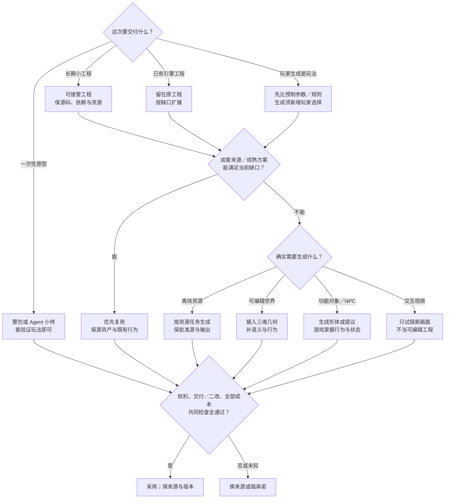

# G1 资产管线总览：授权门槛、采用条件与外部约束

> 核实时间：2026-10-23（UTC+8）；资源型号与合同沿各节依据行的日期。
> 基准：单人程序员、无美术音频、不靠人工修图／刷权重／补动画；按玩法和目标设备定规格。除§1.1选卡插画外，其他生成路线未试用。阶段路线见[路线图](06-indie-roadmap.md)。

## 30 秒结论：先决定要验证什么，再决定是否需要资产管线

**只想验证玩法，先生成可玩小样，不必先搭资产管线；准备长期保留代码，再把二改与接管成本纳入选型。** 简单形状／程序化声音够用就先用，验证辨识、氛围或反馈时才需要相应质量资源。

| 这次要交付什么 | 当前首试与对照 | 什么时候换路 |
|---|---|---|
| 一次性玩法原型，允许扔掉代码 | 🧪（未试用）整包／托管试玩，对照原生 Agent＋最小工程；浏览器能让目标试玩者验证玩法即可 | 多轮修复仍不能验证核心机制，或素材制作主导时间；不为接管先建管线 |
| 可长期接管的小工程 | 原生 Agent＋最小工程／模板；🧪（未试用）整包平台只在二改与交付合适时用 | 想改规则只能重生成，或源码／依赖／资产不能接手；预计离平台就早试导出 |
| 已有 Unity／Unreal 工程扩展 | 留在原工程，按缺口生产或复用窄能力；参考 [WP13 入口／模板](../../docs/research/2026-10-14-game-wp13-agent-config.md#5-p32原生入口拆借模板还是整套游戏管线) | 新工具要求重搭行为／存档／引用且收益不明；网页整包不作迁移凭证 |
| 玩家生成就是玩法 | 先比预制部件＋参数，陌生形体有价值再试运行时生成 | 生成没增加玩家选择、等待／失配，或旧对象二改破坏体验；见[玩家造车比较](../../docs/research/2026-10-14-game-wp11-gameplay-architecture.md#p63玩家造车生成的是形体还是新玩法) |

资源、许可和[游戏02](02-verification-and-playtesting.md)的设计／实现／呈现分验继续适用。

**候选怎样用：** 🧪（未试用）Phaser Game Agent 可打包 Web／桌面，Rosebud 称可下载可编辑源码，但分发包不等于完整源码接管；Rosebud 免费版不用于商业项目原型（包括内部使用），编辑、下载和商业权按套餐区分。证据见[WP13证据](../../docs/research/2026-10-14-game-wp13-agent-config.md#57-p93整包原型的交付与退出证据)。

**依据**：[研究] 四用途与交付检查；[一手／社区／研究] [WP13 整包原型证据](../../docs/research/2026-10-14-game-wp13-agent-config.md#57-p93整包原型的交付与退出证据)（2026-10-22 核，均未试用；多人使用可能依赖外部服务）；核实 2026-10-23。

### 一张选择图：要交付的不是同一种“生成游戏”

**所有路线共用三项检查：先清权，再验交付，最后按全部成本决定采用；任一项不通过或未知，就换来源或缩承诺。**

- **权利与退出（所有用途）**：按所选版本核代码、权重、输入、输出、运行时提供权与发布渠道；付费或开源不单独放行（§1.3、§3）。
- **交付与二改（按承诺验）**：原型验核心玩法；长期内容还验接管、二改与旧内容兼容；场景、对象和视频分别验收（§2）。
- **全部成本与撤回**：按§2末成本表计入采购、调用与淘汰重试、处理、存储接入、设备性能、每玩家全程运转（含上下文／语音、安全审核与等待）、托管退出、分发更新与维护；实际交付不达标、二改破坏旧内容或总成本超预算，就换源或缩范围，保来源与批准产物（§2末）。

**依据**：[研究] 权利、交付与成本三项检查；路线分工见§1–§3；核实 2026-10-23。

## 当前最高水平：按主要选择比较，不按一个生成演示排全页

**按结构控制与交付边界选型。**

| 主要选择 | 近期领先替代／对照 | 当前决定与撤回条件 |
|---|---|---|
| 原型还是长期工程 | Phaser／Rosebud 整包，对照原生 Agent | 按四用途选；二改／接管失败回原工程，不为小样先造管线 |
| 资源供给与风格 | 现成包／参数化源，对照多参考生成 | 首版与扩展一起选；不满足近看／新类别就换源或缩表现目标（§1.7） |
| 2D 与 UI | 原生参考／分层编辑，对照现成图标 | 独特静态缺口才生成；文字布局留引擎，静态图不代验动作（§1.4） |
| 3D 与动画 | 原生低模／分件、动作／动捕，对照成熟模块 | 刚体可试生成；角色保已验骨架与动作，减面／自动 rig 不补变形（§1.5、1.8） |
| 材质、特效、音频、视频 | 共同结构／重绘／可控镜头，对照参数图、成套声音 | 生成补明确缺口，事件与状态留运行时；二改破坏其他通道、时序或表演即换路（§1.6、1.9–1.10） |
| 玩家创建功能对象 | Dream Racers／Roblox 语义部件，对照预制参数 | 陌生形体是核心才试实时生成；新增能力须兼容旧作品，词语影响数值不证明需新几何（§2） |
| NPC 对话与行为 | Teammates、Smart Zoi，对照叙事、效用／FSM／BT | 自由表达确实增加可感知选择才加模型；菜单或稳定规则够用就保基线（§2） |
| [世界与场景](../../docs/research/2026-10-14-game-wp11-gameplay-architecture.md#p97世界输出npc与整页供给选择) | Marble 几何、Genie 视频；Atlas／WorldMind 属不同分支 | 要工程内对象就选可接入几何并补语义；只测探索画面可试视频世界，不承诺可编辑工程（§2） |
| 权利与退出 | 正式导出／接口合同，对照平台播放 | 代码、权重、输入、输出、运行时提供与渠道逐项准入；付费／开源不一并放行（§1.3、§3） |
| 二改与完整成本 | 保源局改、版本化旧对象，对照整件重生 | 比到二改及玩家全程；等待、淘汰、接入或维护超预算就缩范围（§2末） |

**依据**：[研究] 选择与撤回条件；[一手／社区／研究] World Labs／Google 发布、NPC 产品更新与研究方法，见[世界输出补研](../../docs/research/2026-10-14-game-wp11-gameplay-architecture.md#p97世界输出npc与整页供给选择)；核实 2026-10-23。

## 1. 资产管线：Agent 负责搬运和规范

**先用 Coding Agent 编排规则明确的下载、导入、参数和来源记录；速度与稳定性按实际产物验证，有损几何处理不当作普通规格。**

**何时不用：** 已有成套资源或只需一次性样机时，不走完整管线。

**依据**：[经验] 采用建议；核实 2026-10-23。

### 1.1 推荐流程（跨引擎）

**✅ 定玩法／设备规格 → 清权选源 → 保原件与配方 → 脚本接入 → 质量验收 → 批准入库。** 生成物与正式资源隔离，同目录保存来源、版本与许可；占位资源须有替换计划。

导入参数可批量设置；简化、补洞、删小部件属有损处理，先保原网格再验画面。代码／UV 缺陷先试程序修正；语义、姿态或蒙皮错误不能靠改格式修好。误删反例见[资产返工边界](../../docs/research/2026-10-13-game-asset-editing-boundary.md#生成资产返工先判断缺陷来自哪一层)。生成数量与费用设上限，淘汰重试算入总成本。

**实作：先看缩到真实卡片尺寸的图，不先批准漂亮大图。** Star-Rush 三张选卡插画已生成并接入；首版海岸缩图更像屋檐街景，用同一母版扩海面与岸线，保留小店身份、另两张图与 CSS。

**可直接借走：让模型画环境，代码继续画路线、文字与选中状态；保 PNG 母版、提示词、引用关系和缩图配方，只打包选中版本的 WebP，图片失败就移除装饰、保留原卡。** [原图与配方](../../docs/research/2026-10-13-game-asset-editing-boundary.md#选卡插画实作让真实缩图决定二改)可复查。缩图认不出主题或抢走路线时，撤回插画，不重做功能层。

**依据**：[研究] 入库流程与有损处理边界；[一手／研究] 误删反例；[一手：制作与浏览器观察，2026-10-23] 选卡插画实作（三张运行图共40,588字节；未测手机、真实网络失败或玩家收益）；核实 2026-10-23。

### 1.2 先按资产任务判断，不按品牌整体推荐

**🧪 静态、连续动作和完整供给分验。** 三档见各资源专题。

Unity 原生生成器可作小批原型；正式生产仍核兼容包、Cloud／credits、点击条款与供应商，Promote 后重验旧引用。入口见[01 §6](01-engine-integration.md#6-unity-内生成器少量原型资产的候选入口)。

**依据**：[研究] 分任务采用；[一手／研究] Unity 内置生成器入口与商业许可边界（内置不等于商业总放行）；核实 2026-10-23。

### 1.3 授权与商用门槛总表（WP1）

**✅ 先过商业生产门槛，再比较质量。** 对选定版本分别核代码、权重、输入、输出和发布渠道；开源／付费／“输出归用户”各只解决一项，不能单独放行整条管线。

| 你准备做什么 | 先取得什么证据 |
|---|---|
| 使用现成素材 | 具体包的商用、改造、嵌入发行与署名许可 |
| 本地运行模型 | 代码、指定权重及实际依赖均允许该生产用途 |
| 使用商业生成服务 | 实际账户、地区、计划、生成时间与正式导出符合合同 |
| 将资源装入游戏 | 输入、人物／声音及输出用途已清权，完成渠道披露 |
| 向玩家开放生成或分发模型 | 重新核服务提供、权重分发、终端用户与内容安全义务 |

入口筛选见 [WP1](../../docs/research/2026-10-14-game-wp1-licensing.md)；本节以离线资产为主，平台接收另核。

**依据**：[研究] 商用门槛与版本拆分；[一手／研究] [WP1](../../docs/research/2026-10-14-game-wp1-licensing.md) 许可核查（准入不保证独占或无侵权）；核实 2026-10-23。

#### 生成路线的关键排除项

**按路线核已选版本与依赖，再判断能否商用。**

| 路线 | 已核版本／合同怎样影响选择 |
|---|---|
| 本地图像 | Qwen-Image-2512／Edit-2511／Layered、FLUX.2-klein-4B／base-4B 可评估商用；Qwen-Image-2.1 研究版、FLUX.2-klein-9B／FLUX.2-dev 免费权重不作默认商用，新型号不继承旧许可 |
| 云端图像 | 按地区、模型／供应商和合同；Firefly 自有与第三方、ChatGPT 与 API snapshot 分开，输出归属不保证独占 |
| 本地3D／动作 | TRELLIS.2 主模型 MIT 不覆盖非商业 NVIDIA 依赖；Hunyuan3D-2.1／HY-Motion-1.0／Lite 有含 Output 的地域排除；GVHMR 和 MoCapAnything V2 默认组合不作免费商用 |
| 3D与角色服务 | Meshy／Tripo／Rodin 按生成时套餐与正式导出；Mixamo／Spine／ActorCore 的素材嵌入权与原始文件再分发权另核，升级不清除旧限制 |
| Meshy社区 | 免费输出 CC BY 4.0；Community 的 Customer Output 为 CC0，其余（如参考上传图）为 CC BY-NC 4.0，按资产身份核 |
| 音效／配音／音乐 | Eleven TTS／SFX 与 Music 协议不同，声音克隆另需表演者与用途授权；Suno 付费仍须正式 Download，Remix 及免费旧歌不自动商用 |
| 本地音频及下载 | 按权重与依赖核；Stable Audio 有注册／收入条件，TangoFlux 不默认商用；Udio 下载关闭且 ToS 未完整提取，暂不作新供给，旧合法下载权保留 |
| 视频服务 | 商用成片、网页自动化与向玩家开放 API 是不同权利；Runway／Google API 按模式、地区、合同使用，Web 订阅不替 API 费用；Sora 历史服务不作新供给 |
| 本地视频 | Wan2.2 三个指定权重可评估；LTX-2.5 社区许可有合并营收、依赖与机器生成披露条件；保存合法导出的母版，临时链接不是资产 |

入口摘要见 [WP1](../../docs/research/2026-10-14-game-wp1-licensing.md)。

**Eleven Music 另核发行增长。** Indie 条件：单游戏累计净收入低于 US$50 万，实体及关联方上一财年全部游戏净收入低于 US$100 万；Studio Game 需 Enterprise Music，Lite 不覆盖。见[条款细目](../../docs/research/2026-10-14-game-wp1-licensing.md#核对后的采用判断)。

逐项核[图像／视频](../../docs/research/2026-10-14-game-wp1-licensing.md#图像与视频精确版本服务入口和输出分开)、[3D／动作](../../docs/research/2026-10-14-game-wp1-licensing.md#3d绑定与动作主模型许可不是整条管线许可)、[音频](../../docs/research/2026-10-14-game-wp1-licensing.md#音频具体产品下载与生成时间决定授权)及[视频导出](../../docs/research/2026-10-14-game-wp1-licensing.md#wp7追加视频编辑正式导出与自动化入口)；原生 SDK、运行时生成与跨引擎出口另核。

**依据**：[一手／研究] 各路线版本、合同与依赖差异，见 [WP1](../../docs/research/2026-10-14-game-wp1-licensing.md)（离线许可不外推运行时或跨引擎出口）；[一手／研究] Eleven Music 发行增长条件；核实 2026-10-23。

#### 现成资源、程序化工具与编排基线

**✅ 可修改的现成资源和参数化工具是正式生产来源，不只是占位。** 先挑符合玩法与风格的包；软件开源许可不替包内素材。

| 来源 | 要保留的条件 |
|---|---|
| Kenney、Quaternius、Poly Haven 已核包 | 保存包 CC0 证据；站点、API、商标与外部内容另核 |
| game-icons 已核作者图标 | CC BY 3.0，保作者、来源、许可与改造说明 |
| Material Maker、Effekseer | 主代码／运行时许可与社区材料／样例分别核；旧 Effekseer 样例不默认可换运行时或售包 |
| Substance、EmberGen 等商业工具 | 核软件席位、素材与 trial／教育版；Substance 库资产的 AI 训练／改进限制另保留 |
| ComfyUI 与网格处理工具 | 编排器、节点、权重、输入各自清权；输出不因经 GPL 软件处理就自动 GPL |

MatLat 免费权重为非商业许可，不作商用默认；Unity 原生包与 Infinigen 配方按引擎／依赖与素材条款判断。

逐项固定版本见[复用证据](../../docs/research/2026-10-14-game-wp1-licensing.md#现成资源和编排工具)、[3D 工具](../../docs/research/2026-10-14-game-wp1-licensing.md#wp3追加现成3d资产与处理工具)和[材质／特效增补](../../docs/research/2026-10-14-game-wp1-licensing.md#wp5追加材质特效与素材复用)。

**依据**：[研究] 现成资源与参数化工具作为生产来源；[一手／研究] 各包与工具许可，见 [WP1](../../docs/research/2026-10-14-game-wp1-licensing.md)；核实 2026-10-23。

### 1.4 2D采用结论：先可修改，再生成

**✅ UI 文字与布局留在引擎，图标／瓦片先找[匹配现成资产](../../docs/research/2026-10-14-game-wp2-2d-assets.md)。** 独特静态资产再🧪生成，先保批准母版、原生参考和独立图层。按透明精改、无 alpha 或本地小批任务选方案，三档见 [2D 专题](assets/2d.md)。

自动 QA、透明通道和 sprite sheet 导出仍需人工验动作与瓦片连接。

**依据**：[一手／研究] 采用顺序、三档与固定源码，见 [WP2](../../docs/research/2026-10-14-game-wp2-2d-assets.md)；[研究] 自动化验收边界；核实 2026-10-23。

### 1.5 3D采用结论：原生低模与可修改结构

**✅ 成套模块／角色优先，独特刚体再🧪原生低模T2.5并锁面数；旧合格T2配方保留，高细节近景对照7.1／Rodin2.5。** 目标面数不是硬上限；场景保门、挂点和碰撞边界，角色保已知骨架。处理、二改、许可与成本见[3D专题](assets/3d.md)；quad／自动绑定仍须验变形。

**依据**：[一手／研究] 3D 采用、处理与许可，见 [3D专题](assets/3d.md)；[研究] 零手修发售通过率未测；核实 2026-10-23。

### 1.6 音频采用结论：离线资产，运行时调度

**✅ 短反馈先用成套CC0／jsfxr，保合格子集，缺口才换源或生成。** SFX 按事件、配音按台词 ID 离线交付；音乐按出场密度选择相容曲目／段落。循环、切换、生命周期和持续补录一起验；新批次仍另核同声音供应。三档与版本见[音频专题](assets/audio.md)。

**依据**：[一手／研究] 音频采用、版本与处理边界，见[音频专题](assets/audio.md)；核实 2026-10-23。

### 1.7 跨资源风格：首版与下次扩展一起选供给

**✅ 先选能持续补齐的成套来源，再承诺风格；能复用形体就别为图标重生。** 同源模型渲染图标，颜色、文字与角标改参数；新增身份、主题、体型或动作先查配套来源。SNKRX 与 Vampire Survivors 的替换均需单独承诺后续供给。见[成套供应二改](../../docs/research/2026-10-14-game-wp8-style-consistency.md#成套供应二改先选扩展承诺再选生产路线)。

| 扩展目标 | 采用与对照 | 撤回条件 |
|---|---|---|
| 同类增量，质量优先 | 保批准母版、共享形体和多参考／分件源，不从提示词重造 | 局部修改持续串改身份、轮廓或挂点 |
| 性价比／快速本地 | 已有合法资源、同源参数；硬件合适才试已清权本地模型 | 重试、筛选、环境维护与二改总成本超过复用 |
| 新职业／体型 | 比新 rig 的旧装备／变身兼容与类别内扩；Wildermyth 采用过后一种 | 必要组合不能程序补齐就缩范围；持物图可复用，不必逐 rig 重做 |
| 高清／新版本 | 比完整供给＋局部 UI、高低规格混合与缩目标；OpenGFX2 Classic／High Def 是对照 | 低清回退破坏近看目标、辨识或风格，或目标版本玩法仍缺图 |

反例见[WP8](../../docs/research/2026-10-14-game-wp8-style-consistency.md)、[WP8类别](../../docs/research/2026-10-14-game-wp8-style-consistency.md#类别扩展补研新类别不只增加一件资产)与[OpenGFX2](../../docs/research/2026-10-14-game-wp8-style-consistency.md#完整供给不等于高规格覆盖opengfx2的二改选择)。

**🧪 反复漂移、训练源清权、成本能摊销才加 LoRA；先用于少量换色，人物／门／UI 另验，保留未训练类别与旧资产作比较。**

**✅ 保配方和批准输出，换模型先旁路比较。** ComfyUI 保存输入／权重、节点依赖版本与执行参数；seed 或 workflow 不能独立复原环境，配置变了重跑缓存与 QA。混排后由人验敌我、危险、稀有度等语义；改武器长度同时看持握、碰撞与图标。

**依据**：[一手／研究] 成套供应、类别兼容与版本源，见 [WP8](../../docs/research/2026-10-14-game-wp8-style-consistency.md)；[经验] LoRA 适用范围；[一手／研究] 配方与固定源码（零手修未证）；核实 2026-10-23。

### 1.8 动画采用结论：骨架、位移、循环与接触分验

**✅ 已绑定角色与完整动作组优先；文本表演、视频动捕、数值控制移动按缺口选。** 固定骨架和位移权威；清零 root 不等于 loop，首尾姿态相同仍需验接触。缺动作／蒙皮时手修或换源、缩范围；自动 rig、IK 或 FBX 不补缺失内容。三档与反例见[动画专题](assets/animation.md)。

**依据**：[一手／研究] 动画采用、三档与反例，见[动画专题](assets/animation.md)；核实 2026-10-23。

### 1.9 材质与特效采用结论：共同参数源与可控时间

**✅ 同风格材质／参数图优先，玩法特效先用原生粒子；贴图或视频只补缺口。** PBR 各通道由共同结构驱动；蓄力、取消、命中留运行时，flipbook 可承内部烟火，six-way 需正确多方向源。三档、源码、实际采用与许可见[材质与特效专题](assets/materials.md)。

**依据**：[一手／研究] 材质与特效采用、许可见[材质与特效专题](assets/materials.md)；核实 2026-10-23。

### 1.10 视频采用结论：可编辑镜头先行，生成只补固定片段

**✅ 引擎镜头或静态图＋程序运动优先，无叙事收益就删；🧪生成补外观固定、少分支短镜头。** 按局部编辑、首尾控制和对白选路线。字幕、音轨与进度独立，结束／跳过／恢复走幂等出口；非目标画面不变仍需验。三档、成本与二改见[视频专题](assets/video.md)。

**依据**：[一手／研究] 视频采用、成本与许可，见[视频专题](assets/video.md)；核实 2026-10-23。

### 1.11 入库与推荐的最低记录

**入库逐项登记；换版本／提供商、新地区、跨营收门槛或转运行时生成时重查 WP1。** 保留：模型／下载来源、代码与权重许可版本、生成日期、套餐／商业许可、输入／声音权利、下载状态、署名与披露、处理与筛查。未查清只作候选；准入后按 WP2–8 比较质量、成本与引擎可用性。

**依据**：[经验] 按 WP1 条款差异制定；核实 2026-10-23。

## 2. 游戏运行时的 AI

**固定叙事仍是默认起点。** ink 状态叙事与开放说服各适其玩法；见[叙事研究](../../docs/research/2026-10-14-game-wp11-gameplay-architecture.md#运行时叙事开放表达知识解锁与离线承诺)。

**先决定断网时保留什么玩法。** 可选闲聊回固定内容，核心开放说服须定义暂停／恢复或本地版本；Vaudeville 本地也有设备与语言成本，不能当免费兜底。

**台词生成和剧情提交分开。** 角色只收当前可知信息；关键词可提议解锁，进度与权限由游戏核验。Vaudeville 编辑器可作配置参照；提前泄题风险须自行验收。

**依据**：[一手：开发者说明；研究：采用判断] 固定叙事与开放表达；[一手：开发者历史复盘] Vaudeville 的离线与语言成本；[一手／研究] 台词提交边界；核实 2026-10-23。

### 功能道具：生成形体，复用已定义行为

**✅ 有限改装先用预制模块与参数；玩家创造本身是核心才试运行时生成。** Dream Racers 三词造车是近期参照；同样词语也可映射到已批准部件与数值，先比较生成几何的表达价值；运行时路线不等于更省开发费。

**行为仍由游戏定义。** Roblox 指南把多部件生成与 retargetable scripts 分开；形状变了，驾驶、挂点与合法能力仍须接入验收。人定功能、预算与体验；接口范围另核。

**二改要同时验旧作品。** Trailmakers 给旧铰链加模式后仍保旧默认，又热修旧蓝图回归，预制路线也有兼容成本。加能力时保对象身份、行为版本和旧默认，并验保存重载、取消后迟到结果与失败回退。批准车辆可保当前局可玩，但未必保住创造玩法。

**依据**：[一手：开发者访谈；研究] Dream Racers 与预制模块取舍；[一手／研究] Roblox 行为接入与 Trailmakers 兼容成本（未证明 Roblox 产物可直接用于 Unity／Unreal）；[研究] 三路成本与接受设计，见[同题研究](../../docs/research/2026-10-14-game-wp11-gameplay-architecture.md#p63玩家造车生成的是形体还是新玩法)；核实 2026-10-23。

### 受限动作：先问玩家因此能做什么

**✅ 已知状态足够决定行为，就保留规则。** 固定规则用脚本，连续需求用已有评分，任务组合与打断用已有行为树；仅需“跟随／等待”菜单时不增加模型。

**👀 模型只提议高层动作和对象，既有逻辑负责执行。** Mantella 的 Follow 由游戏脚本落实，缺参时可能回退为整场会话动作。执行边界须拒绝缺失／失效对象及过期请求，兼容路径不扩大作用范围。

**⛔ 没有新增可感知选择，或模型说完成却未改变世界，就缩回菜单／规则。** 同场景对照对象状态、取消后迟到回复、延迟、费用及玩家理解；见[受限动作研究](../../docs/research/2026-10-14-game-wp11-gameplay-architecture.md#受限动作补研开放意图不等于更强战斗-ai)。

**近期采用把“会说”推进到“能触发行动”，但尚无通用胜率。** Ubisoft Teammates 是语音队友的可玩研究；inZOI v0.10.0 用位置／活动上下文驱动 Smart Zoi 并标记所选动作。采用时验真实状态与玩家理解，不以单条好评替代菜单／规则对照。V2EX 实践可借“合法候选→模型选择→schema 与业务校验→执行”，源码与许可未核，不作可复制底座。

**依据**：[一手：开发者复盘；研究] Factorio 规则倒推；[一手：固定源码；研究] Mantella 执行边界；[一手／研究] AI People 与同场景对照；[一手／社区／研究] Teammates、Smart Zoi 与 V2EX 实践，见[受限动作](../../docs/research/2026-10-14-game-wp11-gameplay-architecture.md#受限动作补研开放意图不等于更强战斗-ai)；核实 2026-10-23。

### 世界输出：可编辑场景、功能对象与交互视频分开

**🧪 需要三维空间，可把 Marble 与模块化场景作对照；要可开门、可驾驶、可存档的世界，还要自己的对象语义与行为。** Marble 的 Chisel 用粗布局约束结构、提示控制风格，支持编辑／扩展／组合；导出的 splat、粗 collider 和视觉 mesh 用途不同。几何可编辑不等于门与车辆已成为独立功能对象；Unity／Unreal 接入还要验导出、碰撞、导航、材质与设备预算。

**👀 Project Genie 可试短时探索，但 Revisit 不是恢复旧世界状态。** [当前官方帮助](https://support.google.com/labs/answer/16875695?hl=en)允许 Google AI Ultra 可用地区 18+ 订阅者使用，每次 60 秒；Revisit 以同提示重生成，结果可能不同。需旧状态续玩就不能当存档恢复。

**👀 前沿研究值得借分层，不值得直接替换引擎。** WorldMind 分开状态、NPC 决策、时序与视频生成；Orchestrated Reality 让模型提议 JSON 差异，校验后提交世界状态。前者不交付 Unity NPC SDK；后者仍是小规模 WIP、玩家研究待做；schema 外漂移、调用回放与并发费用仍有缺口。

**先走完整个目标区域，再改一扇门。** Clarence Dadson 的[2026-09 Marble亲测](https://design4real.de/en/world-labs-marble-practical-test/)报告中心外质量下降、派生 mesh 不理想，以及 Unity／UE 组合的深度、碰撞和性能问题。

据此比较行走区域、splat／mesh、混合几何与碰撞、目标设备和接入总成本；达不到就缩范围、限背景或换模块。二改门仍须保旧身份、状态和非目标外观；视频另验反馈与连续性。

**依据**：[一手：2025-11 发布；研究] Marble 可编辑几何与工程接入；[一手／研究，2026-10-23 UTC+8 核] [Project Genie 官方帮助](https://support.google.com/labs/answer/16875695?hl=en)（Atlas 2026-09 为未来能力）；[研究] WorldMind／Orchestrated Reality 分层，接受设计未执行；[一手：作者报告，2026-10-23 UTC+8 核，样本未完整列明] [Marble 亲测](https://design4real.de/en/world-labs-marble-practical-test/)；核实 2026-10-23。

### 完整成本与第二次修改：按交付承诺算账

**✅ 比“一次真实交付＋下一次变更”的总投入，不比单次生成价。** Agent 记录候选、失败、筛选和接入工时；人决定质量、收益和等待是否值得。

| 路线 | 首次与持续成本 | 第二次修改必须保住什么 |
|---|---|---|
| 现成／程序化／离线生成 | 采购／许可、调用、淘汰重试、处理、存储、接入与设备性能；程序化也有维护 | 批准源、身份与引用；新旧混排、旧存档与设备；不因新模型全量重生 |
| 运行时对象／NPC | 每玩家全程调用与重试、上下文／语音、安全审核、等待；本地计最低设备和分发更新 | 行为与schema版本、合法能力、旧作品；取消后迟到结果、断网／停服承诺 |
| 世界生成／托管原型 | 生成外的编辑、几何接入、行为重建、托管与退出 | 已交付内容能否重开／续编；仅视频下载不算工程退出 |

模型调用放可替换接口，测试用固定回复；复演记录实际调用与状态。可选闲聊可回固定台词；核心开放说服／创造须明确暂停、保作品或退出模式，不能宣称降级后玩法未损。规则可无头验，真实呈现与玩家选择沿[02验证选择](02-verification-and-playtesting.md#1-30-秒结论这次改动什么结果还没有证据)分验；运行时过滤、分级和披露见下节。

**依据**：[研究] 全部成本与第二次修改；[研究] 成本表；本节未运行同题体验、二改或成本对照，商业生产与运行时服务权按§1.3；核实 2026-10-23。

## 3. 外部约束：披露与玩家态度

**✅ 生成许可与发布渠道分别检查。** 后台未访问的边界见 [WP1 发布渠道](../../docs/research/2026-10-14-game-wp1-licensing.md#发布渠道不能被生成许可替代)。

**何时不用：** 权限或渠道未清时不用；美术不符合授权与一致性验收时，改用重生成、程序处理或现成资源。

- **Steam**：Content Survey 重点是随游戏交付、玩家消费的 AI 内容，区分预生成与运行时生成；后者还须说明防非法内容措施；普通效率工具不是重点。
- **Unity Asset Store**：AI 内容说明适用于资产销售提交，不是所有 Unity 游戏的统一条款
- **Fab**：Standard License 允许商业整合、禁止独立再分发；购买时核完整 EULA 与商品许可
- **Godot**：引擎贡献与 Asset Store 按各自渠道规则判断

行业统计：

| 事实 | 来源 |
|---|---|
| GDC 2026：36% 的受访从业者在工作中用生成式 AI；**52% 认为它对行业有害**，视觉／技术美术 64%、设计与叙事 63%、程序开发 59% 组内负面较高 | [GDC 官方摘要](https://gdconf.com/article/gdc-2026-state-of-the-game-industry-reveals-impact-of-layoffs-generative-ai-and-more/) |
| Steam：到 2026 年中的新发行游戏约 1/3 带 AI 披露；同发行月份比较，披露组达 ≥100 评测比例约为未披露组的 55%。失败组更常提 AI 美术，成功组更常提配音和本地化；**仅关联，不作因果** | [Sulka Haro 普查](https://fragwyz.substack.com/p/three-years-of-ai-on-steam) |
| 2025-12《光与影：33号远征队》因开发使用生成式AI 被撤销 Indie Game Awards 年度游戏与首作奖；Sandfall 澄清占位贴图在发售后五天内移除，而非发售前 | [开发方澄清](https://elpais.com/cultura/2025-06-28/la-revolucion-creativa-low-cost-cuando-la-tecnologia-pone-el-arte-al-alcance-de-todos.html)；[撤奖声明](https://www.gamesradar.com/games/rpg/clair-obscur-expedition-33s-controversial-goty-wins-at-the-indie-game-awards-retracted-after-the-rpgs-use-of-generative-ai/) |
| Godot 2026-06-30 收紧贡献政策；有限辅助与实质生成分开，Asset Store 另有规则 | [Godot 官方贡献政策](https://contributing.godotengine.org/en/latest/development/contribution_rules.html#ai-assisted-contributions)、[核查记录](../../docs/research/2026-10-13-godot-contribution-policy.md) |

**对制作与交付的含义**：

| 用途 | 建议 |
|---|---|
| 代码、工具、管线、测试、本地化 | ✅ 优先探索工程用途；按项目／接收渠道政策使用并验证，披露不是准入 |
| 配音、辅助文本 | 🧪 有授权、经人工审核、如实披露 |
| 正式美术（角色、主视觉、宣传图） | 🧪 先过 §1.3 授权与显示／一致性验收；不符合就重生成、程序处理或用现成资源，不以人工修图兜底 |
| 向开源引擎或插件贡献代码 | 先读对方的贡献政策 |
| 商店披露 | 如实、具体地写明用途和人工审核环节 |

**依据**：[一手／研究] 发布渠道与披露（2026-10-14 官方规则核查），见 [WP1](../../docs/research/2026-10-14-game-wp1-licensing.md#发布渠道不能被生成许可替代)；[一手；2026-10-20 补核] [GDC 2026](https://gdconf.com/article/gdc-2026-state-of-the-game-industry-reveals-impact-of-layoffs-generative-ai-and-more/)（2026 年扩大受访角色并调整问卷，历年结果不作同群体追踪）；[社区：原文；2026-10-20 补核] [Sulka Haro 普查](https://fragwyz.substack.com/p/three-years-of-ai-on-steam)（2023-07 至 2026-07 共 53,597 款 Games 发行；用途比较取成功组 138 款（≥1,000 评测）与失败组随机 400 款（<50 评测、上市 ≥9 个月））；[一手] [Clair Obscur 开发方澄清](https://elpais.com/cultura/2025-06-28/la-revolucion-creativa-low-cost-cuando-la-tecnologia-pone-el-arte-al-alcance-de-todos.html)、[Godot 官方贡献政策](https://contributing.godotengine.org/en/latest/development/contribution_rules.html#ai-assisted-contributions)；[二手：媒体转引] [撤奖报道](https://www.gamesradar.com/games/rpg/clair-obscur-expedition-33s-controversial-goty-wins-at-the-indie-game-awards-retracted-after-the-rpgs-use-of-generative-ai/)；核实 2026-10-20。

## 来源

**依据**：[一手] [GDC 2026 State of the Game Industry](https://gdconf.com/article/gdc-2026-state-of-the-game-industry-reveals-impact-of-layoffs-generative-ai-and-more/)、[Godot 官方贡献政策](https://contributing.godotengine.org/en/latest/development/contribution_rules.html#ai-assisted-contributions)；[社区：原文] [Sulka Haro：Three years of AI on Steam](https://fragwyz.substack.com/p/three-years-of-ai-on-steam)；[二手] Clair Obscur 撤奖报道见上表；核实 2026-10-20。
