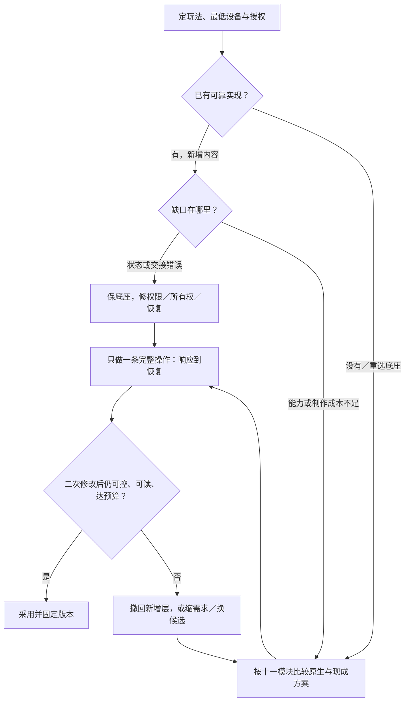
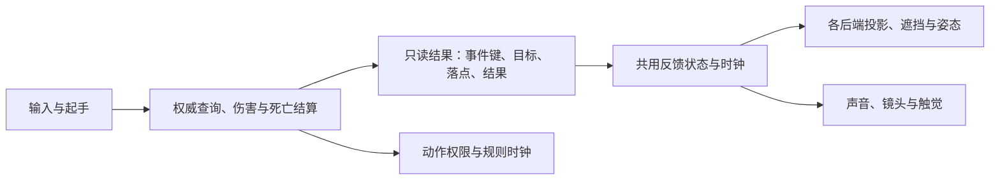
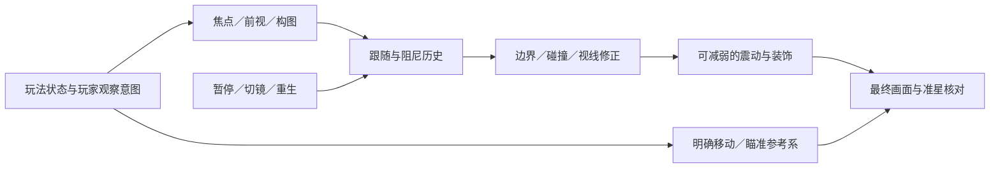
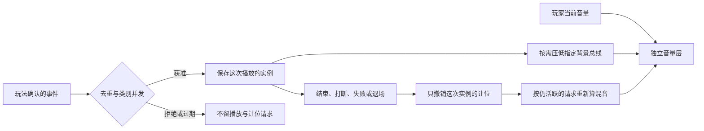
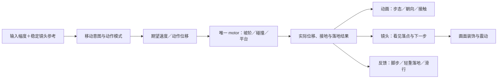
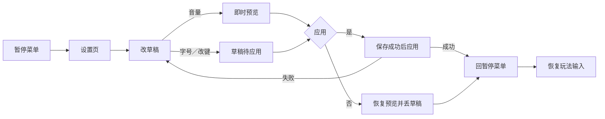
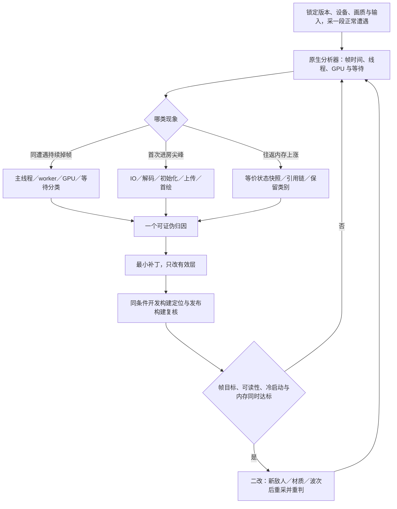

# 客户端核心模块：让操作有回应，让体验连续

> 编辑更新：2026-10-26（UTC）。单人程序、无人工美术／音频修补；Unity 主线、Unreal 对照。资产导入见 [01](01-engine-integration.md)，资源供给见 [03](03-generative-ai-in-games.md)。本页结合资料、固定源码、网页案例与 Godot 原生发布包验证；各节标明实测范围，Unity／UE 未运行，最高体验水平未知。资料核实时间及版本见 [WP10](../../docs/research/2026-10-14-game-wp10-client-modules.md)。

## 30 秒结论：先把核心动作做舒服

**新项目按需求选成熟底座；已有项目先保可玩契约，再补缺口。** 第一步是定玩法、最低设备与授权，再判断已有实现能否承担新增内容。布局密集 UI、分支对白或复杂平台运动可直接选现成方案，不必先实现不合适的原生方案。



- **选型：** [十一模块对照](#当前最高水平新增能力仍保住原来的控制契约)给替代、默认与成本。
- **AI 分工：** 接组件、补回归；[人验手感、视听与译义](#2-十一个模块的最低交付线)。
- **完整控制：** 从[起停、转向、空中落点到坡阶平台](#character-control)，用轨迹定义手感，再接动画与镜头。
- **完整镜头：** 从[预判、跟随到遮挡与震动](#camera-contract)，先保玩家控制，再加镜头语言。
- **串成一局：** [准备关卡](#scene-loading-production)→[输入／HUD 命令](#input-production)→规则确认→[声音与反馈](#audio-lifecycle)→[同一片段打包交付](#release-delivery-production)；需要联机时由[会话与网络权威](#coop-production)接管入场和共享状态。
- **二改：** [按症状选读](#3-按当前任务选择实现与验收)，重点守取消、暂停、旧档和设备。
- **证据：** 各节区分资料／固定源码、网页案例与 [Godot 原生存档消费者](#native-save-consumer)等实跑；Unity／UE 的接入研究不计作原生验证。

## 1. 单人项目先借引擎，再补确实缺少的一层

**先定帧率／分辨率、内存、保存失败与菜单政策，再决定引入哪些层。** 联网只在玩法需要时接；ECS／跨引擎框架没有明确需求就暂缓预建。

### 当前最高水平：新增能力，仍保住原来的控制契约

**十一模块按需求比较；“领先”指特定能力，不是全能质量排名。** 单人、零美术／音频修补的默认选择如下，收益未复现，版本、生产案例与反例见各行。

| 主要选择 | 领先替代／什么需求使它胜出 | 当前选取；新增成本与撤回 |
|---|---|---|
| 渲染与性能 | HDRP／UE 高阶渲染、DRS、GPU 粒子：光照、规模或波动负载确需 | ✅ Unity URP／UE 原生质量档；按[设备预算](#设备预算量最坏场景不抄通用面数)先定位。新增平台、内存与内容负担；提示变糊／帧间隔恶化就退回 |
| 资源与内存 | Addressables／UE Asset Manager：分组驻留、独立内容发布；UniTask：组合等待与 PlayerLoop | ✅ 小常驻内容直接引用／已有异步；按需求直接选现成层；增打包、所有权与版本维护，[取消／驻留](#切换关卡与释放资源)失控先修底层 |
| 动画 | IK／Playables：接触与编排；Motion Matching：已有大动作集的选姿 | ✅ Animator／UE AnimBP＋Montage，按[动画页](assets/animation.md)选供给与控制。新增动作数据、重定向与调参；接触／变形不合格就换资产或缩动作 |
| 物理与运动 | ECM2／KCC 等 motor：平台、贴地与可预测控制；UE Mover：模块化运动／回滚 | ✅ 常规角色 CharacterController／CMC，力学玩法选 Rigidbody／Chaos；[运动对照](#3d-角色运动先选想要的控制再选碰撞求解方式)。承担许可／兼容或实验性迁移；旧连段／推动／落点受损就退回 |
| 输入 | UI vs Game Input、PlayerInput／Enhanced Input＋LocalPlayer：交接与多人 | ✅ 原生映射、override／UserSettings 保存；按[输入与暂停](#接入手柄暂停与多人菜单)补权限／身份。样例有混用及嵌套缺口；确认穿透、恢复误发或错玩家就撤回交接政策 |
| UI | UI Toolkit：数据／布局密集、文本化样式；UE CommonUI：反复出现的模态、返回与设备提示 | ✅ 稳定 uGUI／UMG 保留，新项目按需求直接试 UITK／CommonUI。迁移增控件／绑定／焦点重建，不为一次换肤换框架；[当前版本与生产对照](../../docs/research/wp10-content.md#整页选型回流ui-toolkit-新能力与迁移成本)不证明零手修或性能胜出 |
| 音频 | FMOD／Wwise：交互音乐和音频作者工作流；复杂传播另选专业方案 | ✅ [原生事件与混音](#audio-lifecycle)：AudioSource／Mixer／DSP 或 UE Audio／MetaSounds；[音频页](assets/audio.md)比较供给与互动。新增许可、事件库及构建维护；省不下制作成本就保原生 |
| 存档 | Newtonsoft：字典／树迁移；Easy Save：多类型／工具支持；ink：叙事状态 | ✅ 小 DTO＋JsonUtility／UE SaveGame；已用库继续复用。[存档](#保存续玩与升级旧档)仍需内容身份、AOT／授权与迁移；进度错就回退原档 |
| 本地化 | ATG／RTLTMPro：复杂文本；TMS：反复增量协作；6.7 新内置 Localization 模块 | ✅ 锁定引擎的 Localization／FText 与文本表，[语言检查](#增加语言与推进对白)分显示、编辑与译义。换版本／字体增回归；不可读／无法审译就缩覆盖 |
| 平台发布 | 远程 Addressables／Play Asset Delivery：独立内容或首包分发；自动诊断：现场证据 | ✅ Build Profiles／UE build-cook-stage-package，Steam 随版更新先平台差分。远程路线多目录、离线／旧版兼容与运维成本；[更新](#发布更新下载量与安装重写分开看)和[诊断](#发行后诊断先保反馈再接自动报告)必须保首局、隐私及恢复 |
| 编辑器扩展 | Yarn Spinner／ink 等作者环境：分支、预览和内容语义；UITK：复杂编辑工具 | ✅ 机械转换用脚本、参数用 Inspector，专门内容直接比较成熟环境；[内容作者工具](../../docs/research/wp10-content.md#104)。学习、命令桥接、生成维护不值时用窄工具 |

**版本改变选择，不强迫迁移：** UITK 6.7 的动画、ATG、本地化能力不套回 6.3。Unity 当前 6000.7 手册仍标 Beta，runtime 总表仍荐 uGUI；官方与生产案例并不支持统一换栈。

**AI 检索也锁版本。** 两次 Context7 resolve 未给所需精确版本 ID，未接 query-docs，改读固定 tag 核 InputSystem 回调／UniTask 取消时机；这不证明运行正确或模型提升。

**角色控制从体验目标开始：** [完整模块](#character-control)把起停、转向、空中落点、坡阶平台与镜头／动画一起调；新增冲刺／二段跳再复用 [P35 接续契约](../../docs/research/wp10-motion.md#p35新增移动能力后保住控制契约)。

来源：[研究] 十一模块比较与默认取舍；版本差异用 Unity 6000.7 手册、runtime 总表与官方发布说明核对，核实 2026-10-22 UTC，[核实与反证](../../docs/research/wp10-content.md#整页选型回流ui-toolkit-新能力与迁移成本)；窄检索回执见[文档检索窄试用](../../docs/research/wp10-content.md#文档检索窄试用先辨版本再读源码)（经验／一手）。

### 先做完整动作：响应、反馈和顺滑分别解决什么

**先补一条完整动作：按下有响应、命中看得懂、镜头跟得上，再谈顺滑。** 按缺口查下表，不先加震屏，也不先做通用性能优化。

| 缺口 | 先做什么；撤回条件 |
|---|---|
| 短按没响应 | Unity Dynamic Update 读输入、物理消费保存值，离散按下只消费一次；需要才加有期限缓冲／宽限，过期补发就收窄 |
| 转身迟滞／姿态弹跳 | 调转场、Exit Time 与打断；接触缺口才加 IK，命中被混合冲淡就退回 |
| 命中不清楚 | 按[完整反馈模块](#打击感与反馈先让命中有含义再让重击有分量)分结果、力度与通道，别先加震屏 |
| 回合演出拖沓 | 缩普通反馈／可选快放，保原完成条件与重要结果 |
| 移动抖／首次停顿 | 分姿态连续与长帧；Interpolate 落后一步，Extrapolate 可能越界纠正 |

卡边角先查碰撞表达，有界纠偏不得改路线／推入危险，[空间容错](../../docs/research/wp10-motion.md#69)。转向发黏分平滑、限幅和插值，保玩法所需转身承诺，[不同玩家反例](../../docs/research/wp10-motion.md#99)。

插值确为热点才按所有视口／尺度筛呈现，保模拟与必要屏外取样；入屏突跳就扩大范围。OpenRCT2 未测该项性能，VVVVVV 有屏外取样反例，[插值预算](../../docs/research/wp10-motion.md#102)；镜头实施见[完整模块](#camera-contract)。

来源：[研究] 缺口表与撤回条件为本页综合；空间容错、转向反例与插值预算见 WP10 对应语义节。

### 打击感与反馈：先让命中有含义，再让重击有分量

**✅ 由一次权威判定给出结果，现有动画、声音、特效和镜头只消费它。** 第一步让轻击／重击、未命中／格挡可辨，再加顿帧和触觉；动作仲裁仍决定伤害、霸体、死亡与恢复。已有两个渲染后端时，共用结果和表现时钟，不各自重算命中。

#### 作品参照：不是把每次命中都放大

| 代表作与证据 | 借什么；不照搬什么 |
|---|---|
| **Monster Hunter Wilds（AAA，2024-12 发行前修订）**：开发者解释，曾因《World》反馈过重而降低 hitstop，Beta 后又强化终结／强攻击 | 一手转引／研究：按动作地位分力度，而非统一延长所有命中；公告没有给可抄的毫秒值，转引不代表实机复测 |
| **Dead Cells（优秀独立，2017 开发者访谈）**：暴击用一帧冻结、随后短时减速，配血花与专属声音 | 一手／研究：同一事件的节奏与声画一起设计，先做少而明确的重击层；历史描述不是当前版本常量，更不能换算为固定 16.7 ms |
| **Warframe（2025-10 官方修订）**：后坐镜头恢复引起晕动反馈；关闭屏震时移除相关镜头位移，用准星形状传达后坐 | 一手／研究：信息与镜头运动可拆开，减镜头仍保命中／后坐提示；随后玩家仍要求分开设置，不是“眩晕已全部解决” |

这三例给的是分层、组合和可关闭通道，不是统一最佳配方。单人无手工美术修补先用许可清楚的短受击姿态、接触点特效、少量分层音效；姿态方向／接触仍错就换资产或缩动作集合，不能靠强震屏遮住。



#### 已采用：同一发子弹，两个画面都说真话

**实现起点是把已有射线的结果带出来，而不是在特效层再射一次。** FPS-Like 的 `Physics.traceDetailed` 从射击当刻眼位查询墙体和角色，取最近交点；`Game.shoot` 扣血后记录本次是否致死。已有射击记录保存目标、部位、伤害和时间，新增的只读字段如下：

```ts
type ShotImpact = {
  origin: { x: number; y: number; z: number };
  end: { x: number; y: number; z: number };
  kind: 'actor' | 'world' | 'range';
  killed: boolean; // 本次结算致死，不从稍后的目标 HP 反推
};
```

FPS 用累计射击列表的消费游标收取新结果；短命逐步事件批则按 [05 技能接入](05-gameplay-architecture.md#skill-event-consumer)逐步收取。接到播放器时：

1. **落点与确认分开。** `actor`／`world` 在真实终点画短反馈，`range` 只到射程上限，不画假火花；命中标记读实际目标和结果，中心留空以免盖住远目标。旧记录缺落点就不补猜。纯观察字段只有在不参与后续玩法时才能排除在规则哈希外，并用旧命令回放验证。
2. **各后端仍验遮挡。** Three 世界落点保深度测试，CPU 落点复用墙体列深度裁剪；共用命中数据不等于共用正确画面。CPU 角色曾因横轴取世界 X 而在侧视变成零宽，改为相机 right 后，四正交视角等宽、墙前可见／墙后被挡才同时成立。
3. **结算立即，演出短留。** 死亡立即更新生命和碰撞；当它触发回合结束时，停止玩法输入／推进，场景反馈保留 700 ms 再显菜单。存活／暂停时反馈年龄用模拟时钟，已结算回合才加有界实时时间，不能让暂停中的粒子自行过期，也不能为倒下动画延长生命。重开清反馈和计时。700 ms 是此例参数，不是通用推荐。
4. **静音处理正在播放的声音。** `Soundscape` 持有活动声源，关声音立即逐个 `stop()`，而不只禁止下一次 `play()`；静音期间仍推进消费游标，重开清声源与游标，恢复声音不补播旧枪声。资源、混音和退出归 [声音模块](#audio-lifecycle)。

**适用范围：** 这是单次即时射线、无联网预测的实现起点；穿透／弹跳须输出有序多接触，实体弹体在真实接触时产出结果。联网起手可及时反馈，关键命中／击杀默认等确认，再做预测收敛。若尸体还承担碰撞或复活玩法，寿命归规则层，不能按本例纯表现尾段删除。

案例依据：[可玩 FPS-Like](https://dbvv1-fps-like.pretty-llama-9945.chatgpt.site)，固定源码 `2e318db` 的 `src/sim/{physics,game}.ts`、`src/render/{feedback,canvas,scene,audio}.ts` 和对应测试，核实 2026-10-26；公开源码尚未同步，上述接口可在现有工程实现。旧逐帧规则哈希、落点／遮挡、死亡尾段与静音回归已通过，正常浏览器操作和非作者实图评估接受可见增量；仍未达到 CS2 参照品质，连续动作节奏与实际试听未评。

**逐步事件接到首个可见帧，还要跨过死亡清理。** MOBA 的[已采用消费者](https://github.com/dbvv1/MOBA-Like/blob/69d1588e62d4530a1eb5e3606b99e764fa9c7db5/src/render/impact.ts)暴露了两个普通接线测试容易漏掉的反例：0.1 秒短反馈若在首次绘制前先累计长帧，就会出生即删除；致死攻击的目标已被同一步 cleanup 移走，按当前实体表找端点会吞掉关键一击。实现起点是让仍在并发预算内的新反馈先绘制再计龄，并逐步消费、按事件键去重；被移除端点只从同批权威死亡事件的身份／位置补全，不回看旧快照猜死亡。已有系统能直接给出事件当刻落点，就保现成接口。`basicAttack` 只证明出手承诺，英雄命中仍读 `heroDamaged`，不以连接线代替命中，也不为画飞行效果延迟真实伤害。二改先验长帧、致死 cleanup、同阶段互杀、重复消费、并发上限与重开释放，再看正常比例：此例窄连接让源与目标的联系可见，但方向、目标侧确认仍弱；只把代码语义接对不能代替[基本战斗品质复评](https://github.com/dbvv1/MOBA-Like/blob/main/docs/quality.md)。

#### 调力度：保原动作契约，再逐通道加

| 先定什么 | 失败时改哪里 |
|---|---|
| 采样→接受→判定→首反馈时点，接触点／法线、受击方向与动作窗口 | 起手迟、命中声抢先或混合冲淡接触，先修时序和姿态，不扩大粒子 |
| 顿帧作用于谁、倍率／时长、恢复时钟；多目标取最大、合并或限额 | 全世界连停破坏连贯就缩范围；改变反应／判定窗口的冻结归玩法，纯尾音／粒子不锁下一动作 |
| 事件键含动作、段、目标、代次、结果；每通道去重并封顶 | 全局 cooldown 会吞合法下一击；无界叠加会爆音／过曝；输入缓冲 TTL、接受／拒绝／消费一次仍归输入 |
| 轮廓、结果层级与必要信息；声音／镜头／触觉的可关闭通道 | 先减遮挡、闪光和运动，不能以无障碍设置暗改规则性停顿；轻／重固定两档后逐通道 A/B |

回合制缩普通反馈或提供快放，仍等原完成条件且只结算一次；快速路径保死亡清理、回血、随机消耗和奖励，见[回合等待预算](../../docs/research/wp10-motion.md#4)。

#### 现成实现：先复用播放器，只补项目语义

| 路线 | 当前决定；接入成本与边界 |
|---|---|
| **Unity 原生＋Cinemachine Impulse** | ✅ 已有 Animator、AudioSource、Particle System 就继续用；需要方向性镜头冲击再接 Impulse。Brain 的忽略 timeScale 不代 ImpulseManager 时钟；多事件叠加不自带总强度封顶，项目按通道管预算 |
| **Feel 多通道编排** | 👀 多个动作反复绑定声音／形变／相机时评估 Inspector 编排，别先自建通用反馈平台。Feel 6.3（2026-10）要求 Unity 6000.5+，本页 6000.3 基线不直接升级；付费依赖、场景绑定和停止／复位政策另验，未购买或试用 |
| **项目已有 Tween** | ✅ 少量闪色、形变和 UI 数值沿用现有库；DOTween 停止、完成、复位不同，Sequence 生命周期在根序列管理。PrimeTween 可作替代候选，许可和中断语义先核，不为一次受击迁库 |
| **Unreal 原生** | ✅ AnimBP／Montage、Niagara、Audio、Camera Shake、Force Feedback 各司其职；Camera Shake Single Instance 是重启不是事件去重。已用 GAS 才接 GameplayCue／PredictionKey，一次性 Burst 不能承担 latent 持续流程，不为反馈单独引入 GAS |

停止按动作／对象／玩家所有者执行，不用全局 Clear／KillAll 清一击；停止序列未必停子效果或复位。暂停先停持续写入者，再按政策暂停／结束通道；销毁、退局、重开使旧代次失效。换设备沿[输入与暂停](#输入与暂停先定动作权限再切输入)，联网沿[预测与确认](../../docs/research/wp10-motion.md#8)，拒绝结果撤成功提示，同击收敛不重播。

#### 交给 AI：先保基线，再用反例验第二次需求

AI 沿现有输入、判定、渲染入口改绑定与配置，不先造通用反馈平台。锁引擎／包、目标设备、资产许可及轻／重／落空／格挡预期；保旧命令轨迹，记录事件键、四时点、通道播放次数、时钟及停止原因。

| 用例 | 自动可核；另由实玩判断 |
|---|---|
| 同击重复、两次真击、多段／多目标、先伤后死 | 去重不吞合法事件，旧伤不变击杀，预算不无限刷新；轻重与结果可辨 |
| 同落点换观察侧、四方向看目标、换渲染后端 | 落点不移、墙挡正确、轮廓不消失、快照不改；目标与下一威胁读得清 |
| 起手／停顿／恢复时暂停、取消、死亡、换设备、退局／重开 | 无旧代次写入／悬挂震动／过期补播；原控制和必要提示保留 |
| 30／60／120 显示率、长帧、密集命中、首次播放；联网确认／拒绝／重演 | 记录帧间隔与首反馈；目标机听爆音、看接触与遮挡，静音／关镜头后仍可判断 |

此表是验收任务，非全项实测结果。先姿态＋短声，再分别加特效、顿帧、镜头和触觉；非作者看同输入前后片段。力度增强却损失连贯、可读或舒适性，就减档或撤该通道。

资料依据：[WP10 反馈](../../docs/research/wp10-motion.md#hit-feedback)收录上述作品、引擎／库版本及原始来源，核实 2026-10-23；参数契约和验收表为综合推导，未运行 Unity／UE、未试用上述反馈库。

<a id="camera-contract"></a>
### 镜头完整模块：先看清下一步，再让跟随有性格

**默认复用 Cinemachine／UE 原生相机，只补玩法需要的取景与控制规则。** 第一步用无震动基线完成一次起跳、转弯或绕掩体，再逐项加前视、阻尼和冲击。更顺滑却更晚看见危险，便不是升级。

#### 作品给的标准：看到角色，不等于看到决策

| 公开实践 | 可借机制与代价 |
|---|---|
| **Lonely Mountains: Snow Riders**：团队因镜头反馈新增第三人称选项，并调整全部山地／路线适应新视角 | 一手／研究：导演构图可展示捷径，追随视角利于前方判断；先选发现节奏与控制目标，别到内容完成后只换相机。作者认为新模式有趣，不证明所有玩家更喜欢 |
| **Celeste64 固定源码**：纵向跟随依据着地、下落与高度窗；攀爬转角保留持续输入方向，松回阈值内才重算 | 一手／研究：竖直跟随与水平移动不必共用阻尼；切镜也不能无意反转持有中的操作。借局部规则，不搬 jam 级单体控制器或受限美术 |
| **Warframe 2025 后坐修订**：关屏震时移除相关镜头位移，保留准星反馈 | 一手／研究：力度信息与画面运动可拆开；减镜头仍应分清命中／后坐。不是舒适度已经普遍解决；详见[反馈模块](#打击感与反馈先让命中有含义再让重击有分量) |

#### 六个职责分开调，不让避障或震动抢走控制



图示是职责，不强制替换包内流水线；实际扩展顺序仍按版本核对。装饰后再验近裁剪与瞄准，不能假定先前避障已保证最终画面安全。

| 职责／要交给 AI 的参数 | 当前默认；失败时先改什么 |
|---|---|
| **跟随参照**：目标点、世界／角色局部轴、更新阶段 | 跟可靠的移动参照，不盲跟呼吸骨骼或漂移装饰节点；抖动先分目标采样、物理呈现、相机更新与帧间隔，不先堆阻尼 |
| **前视**：方向来源、预测秒数、最大偏移、反向／低速政策 | 缺前方信息才启用有限前视；速度预测不认识急弯、墙或落点。先减噪声／缩预测，再考虑区域焦点；加平滑会增加预测滞后 |
| **构图与阻尼**：屏幕锚点／死区、各轴响应、最低目标尺度 | 死区保参照，阻尼缓突变，二者都可能推迟信息；先分别调水平／垂直，再调 FOV。远敌加入使人物太小，就缩目标组而非无限拉远 |
| **遮挡**：碰撞层、半径、允许位移、遮挡持续／回退时间 | 防穿墙、看见目标、枪口通路分验。连续绕柱反复抽动就调整策略／恢复；没有可用视点时改局部显隐或几何，不继续加射线预算 |
| **震动**：来源、空间、幅度／频率／包络、合并与强度档 | 先借原生冲击；密集事件比较最大信号与叠加。关闭项要覆盖主冲击和次级尾震，必要信息另留声音／姿态／准星；不改变伤害或操控规则 |
| **控制与交接**：鼠标／摇杆单位、回正、cut／blend、历史政策 | 鼠标 delta 不重复积分，手动观察不与回正争轴；交接按下表重算许可，cut／blend 与保留／迁移／清历史分别决定 |

**按玩法取舍。** 平台跳跃优先起跳前落点与下落参照；高速行驶优先弯入口／出口，区分车身朝向、速度与路线；越肩瞄准优先手动观察、准星与枪口一致。它们可共用组件，不能共用一套“最佳阻尼”。

#### 现成实现：先补一层，不重造整套相机

| 路线 | 采用／撤回 |
|---|---|
| **Unity Cinemachine** | ✅ Position Composer／Follow 做跟随，Orbital Follow／Third Person Follow 按视角选，Confiner／Deoccluder 按缺口加；Impulse 已有 `Use Largest`，不先自建合并器。新增区域、绑定和回归成本；看见目标仍抢控制就改政策，不把全部扩展叠上 |
| **已有窄跟随／区域工具** | ✅ 简单固定镜头已达标就保留；按 Celeste64 等局部机制补纵轴／输入交接。Pro Camera 2D 可比较房间与前视作者工作流，但本轮未闭合当前 Unity 兼容性，不因功能多而换栈 |
| **Unreal 原生** | ✅ CameraComponent＋SpringArm＋PlayerCameraManager，冲击用 Camera Shake；SpringArm 收臂防碰撞不是通用可见构图搜索。Gameplay Camera System 5.8 仍标 Experimental，仅复杂多模式图编排确需才试；已有可靠路线不为新名词迁移 |

**版本会改变接入方式。** Unity 6.3 基线核 Cinemachine 3.1.7；6.6 已将其变为随 Editor 的核心包，CM2 升 CM3 有 API／数据迁移。升级不是每个项目必变手感，但必须重放已调好的急转、绕柱和切镜；不能把主干预发布修复当稳定包已修。

#### 借出镜头后，按当前资格返回，不恢复旧快照

**沿现有 Session／相机模式入口协调输入、目标和反馈；镜头到位只是返回条件，不是恢复权限的命令。** 菜单／剧情可中断时，按以下顺序处理；机制依据与推导反例见本节末来源。

| 阶段 | 给 AI 的实现约束 |
|---|---|
| 借出 | 记所属玩家、目标代次和交接 ID；先改移动／观察／回正许可，再切输入与请求镜头。反馈只播放，不负责解锁 |
| 返回 | 只撤本次持有，按剩余菜单／剧情、存活身份重新选目标与许可；不写回旧 `enabled`／Follow 快照 |
| 到位或打断 | 需要等画面时，只接当前交接、所属 Brain、期望目标的结果；cut 有直接就位路径，取消／死亡另行终止，不只等混合结束 |
| 反馈收尾 | 换角色使旧代次写入／尾震失效，不补播旧命中；同目标正常返回复用原历史政策，不统一 reset |

单一无中断入口保简单状态即可，不必搭通用锁框架；允许边走边观察的模式不因混合一律停控。新增成本是交接身份与终止分支，不能靠更长混合掩盖错目标。

#### 交给 AI 的实施与二改验收

以下可作任务清单，未执行。AI 交配置、绑定与轨迹检查，人接收预判、操控、可读性和舒适度。

- [ ] **冻结基线：** 引擎／包、设备／宽高比、输入单位；选一段同时含急转、遮挡和恢复的路线，标出玩家做决定前必须看见的落点／出口／威胁，保原移动和命中规则。
- [ ] **逐层接入：** 无装饰跟随→有限前视→遮挡→震动，每次只改一组；导出模式、目标与更新阶段、期望／实际相机姿态、焦点屏幕坐标、遮挡修正及输入参考方向，附同段录屏。
- [ ] **核控制：** 鼠标与手柄各测低速试探、急反向、持续按方向切镜、开关瞄准与回正；近墙换肩对照准星、枪口和实际命中，不能只验角色仍在屏内。
- [ ] **核交接：** 剧情返回混合中死亡／重生，再送达旧完成通知；当前目标与权限不回滚、旧尾震不落到新角色。另测 cut、嵌套菜单、取消、失焦、传送和无替代目标的销毁；历史接口复用[历史管理](../../docs/research/wp11-camera.md#s12-2)。
- [ ] **第二次需求加窄门与连续多击：** 保第一版开阔路线；验最低分辨率／目标宽高比、30／60／120 Hz 与长帧。关镜头运动后关键信息仍可辨，开启时不穿墙／失准；记录查询与帧时间、每房特例及调参工时。
- [ ] **接收或撤回：** 更早看见必要信息、持续输入可理解且负担可接受才保留；只变得电影化却更难控制就减前视／阻尼／震动或改构图。自动轨迹通过不替人玩，不适时停止试玩，不强求完成路线。

来源：[研究] 作品证据为作者复盘与固定源码（一手）；职责拆分、交接顺序与清单为本页综合，[既有取景与控制证据](../../docs/research/wp11-camera.md#s9-2)、[版本分流](../../docs/research/wp10-motion.md#camera-version)、[版本、反证与实现细节](../../docs/research/wp10-motion.md#camera-contract)、[交接说明](../../docs/research/wp10-motion.md#camera-control-return)。交接说明核实 2026-10-23，其余证据与版本见 WP10 对应节。

### 刚移动就查询：先确认物理状态已更新

**查询旧位置先查写入顺序。** Unity 6.3 内置 **3D** 改 Transform 后，在批量修改结束、依赖查询前才 SyncTransforms；它不推进模拟或完成 MovePosition，全局 auto-sync 不作配方。UE 物理结果用 TG_PostPhysics，更新依赖用 tick prerequisite。

来源：[一手] Unity 6.3 与 UE 物理查询契约，见 [WP10 物理查询](../../docs/research/wp10-motion.md#3)；不套 Unity 2D。

### 街机车辆：先比控制模型，再决定抽离规则

**先比较现成街机车辆，不从“不要逼真轮胎”直接跳自建。** 许可／版本／网络绑定合适就复用；不合才窄取漂移、加速与恢复规则。Netick 样例根 MIT 不覆盖依赖和项目专属资产，轻库无网络绑定也未必更省验收。

AI 可拆读写与补规则，先定按住式／定时式，人验连锁 boost、离地松漂移、擦墙／落地与翻车复位；旧连段受损就撤回改动。均未实测，不推荐整包直接商用。

来源：[研究] 两底座与生产取舍见 [WP10 街机车辆](../../docs/research/wp10-motion.md#arcade-vehicles)；未实测。

### 呈现节奏：动作已执行，画面仍不顺

**原生同步先建立基线，帧间隔和响应一起验。** Unity 6.3 桌面先比较 VSync（非零时忽略 targetFrameRate）；Android 用 Optimized Frame Pacing／UE Swappy（UE 5.2 起默认）。UE 排队确为热点才试 low-latency syncing，缩 pipeline 减少长帧余量；掉帧或发黏就退回。

基础响应达标再试帧生成，分应用帧／呈现帧。AMD UE 插件 4.1.1 Slate Redraw 重复 NativeTick，UI Extraction 可能损半透明 UI；副作用／HUD 错无法修就撤回。Unity 上采样入口不证明同类帧生成。

来源：[一手／研究] 版本与反例见 [WP10 呈现节奏](../../docs/research/2026-10-14-game-wp10-client-modules.md#呈现节奏补研平均-fps-与实际看到的动作不是同一个承诺)；设备收益未测。

### 运动中的清晰度：关键提示不能只在截图里看得清

**拖影先核矢量与 AA／上采样路径。** Unity 6.3 URP 对象矢量限 opaque／alpha-clipped，透明烟雾不适用，跟随角色也可能需 Per Object Motion。关键边界先用稳定大形状，再比较减少历史或 SMAA／FXAA，闪烁／模糊更坏就退回；STP 隐式开 TAA，连 render scale／Filter 一起查，调试绿色未必错误。

来源：[一手] [运动可读性](../../docs/research/wp10-motion.md#52)。

### 信号取舍：减掉演出后，仍看得懂下一步

**先保危险方向、时点、范围与命中；频繁共用信息并列，低频规划信息可按需查。** 先减装饰／改表达，仍读不清才缩规则；切页打断操作或挤常用信息就改布局。关键颜色／声音另有表达，呈现设置与减伤等辅助规则分验。加敌人后比默认、静音、减粒子、自定义配色，辨识变差就撤回演出。

来源：[研究] Into the Breach／Dead Cells 对照见 [WP10 信息可读性](../../docs/research/wp10-motion.md#63)。

### 像素风慢速移动：先分清画面网格与模拟运动

**先找取整层：严格像素网格与慢速连续运动有取舍。** 旋转／缩放确需时试提高呈现分辨率或过滤，模糊／轮廓不稳就撤回。Unity 6.3 URP Pixel Perfect 先统一 PPU、分辨率与缩放；Pixel Snapping 不改 Transform，平滑最终画布未必平滑内部物体，Cinemachine 混合可能失去对齐。

来源：[一手] [像素网格与拾取回归](../../docs/research/wp10-motion.md#59)；不作 UE 配方。

## 2. 十一个模块的最低交付线

**AI 默认接现成组件、补项目规则与检查；人验体验。** 选型见上表，这里只列交付与典型失败，不重复推荐。风险项不是模型实测出错率。

| 模块 | AI 可交付的最小实现／必须挡住的错误 | 接收检查 |
|---|---|---|
| 渲染与性能 | [场景光照与两档画面](unity/07-scene-rendering-and-lighting.md)；采样、质量档，平均 FPS 不能掩盖首用尖峰 | 目标机帧间隔、内存；人看运动提示，换色／受损按[材质参数](assets/materials.md#同资产换色或受损先分共享预设与对象参数) |
| 资源与内存 | 所有者、代次、清理；取消后仍收尾 | 往返切场注入迟到结果，核身份、释放与驻留 |
| [动画运行时](unity/04-animation-runtime.md) | 状态、打断与唯一位移路由；防 root motion 双算 | 核复位、坡阶接触及步态；二改验[范围与屏外更新](assets/animation.md#换动作后消失或突跳先分包围范围与屏外更新) |
| 物理与碰撞（[道具与机关制作](unity/06-physics-interaction.md)） | 碰撞层、查询顺序、幂等命中 | 移动后查询、高速接触、同次攻击结算次数 |
| 输入 | 映射、改键持久化、冲突检查、稳定绑定身份；结构改变迁移旧设置，保失焦／断连和玩家权限 | 按住开菜单不误发，双人不串目标；[改键依据](../../docs/research/wp10-content.md#103) |
| UI | 绑定、有效焦点、返回与新局同步 | 换肤后一局→重开→再操作，核空态／反馈形状、手柄返回及变窗口点击 |
| 音频 | 按事件接实例、并发、分组与退出恢复 | 交错结束不误恢复；密集触发不吞新警告，人听起音与威胁辨识 |
| 存档 | DTO、稳定 ID、逐版迁移和失败反馈 | 两次内容修改后核剧情／库存／奖励，失败保唯一原档 |
| 本地化 | 语境、译文候选、稳定 key、变量／复数／缺字检查，可用伪本地化先查布局 | 旧名字、长文与编辑可用，人审译义／可读性 |
| 平台发布 | 构建配置、路径／资源／权限检查 | 干净目标机启动、续玩、旧版升级；Play／Cook 成功不够 |
| [编辑器与内容作者工具](unity/05-content-authoring-tools.md) | 机械批处理、预览与窄工具 | 副本上先预览、二次执行不增副本、故障能恢复；见[01](01-engine-integration.md) |

⛔ 自动检查不代手感、视听或翻译验收；失败时修实现、撤回新增层或缩小委派。

**作者工具不替项目写玩法。** Yarn 等可借分支语义、预览与本地化检查，项目仍接命令、世界状态和演出；简单线性对白不用必加框架，作者预览与实机分别验。

来源：[研究] 十一模块交付线与拒绝边界；作者工具依据见 [WP10 内容工具](../../docs/research/wp10-content.md#104)。

<a id="audio-lifecycle"></a>
<a id="声音事件播完以后谁解除让位"></a>
### 声音事件：从玩法事实接到声源、混音和退出

**✅ 用现有播放器和混音器，先接通“命中一下、机器持续运转、对白压低音乐”这一组完整声音。** 玩法提供已确认的事实，音频层决定素材、空间位置、并发和混音；素材制作沿[音频制作链](assets/audio.md#先采用什么)，不把音频管理器变成第二套战斗规则。Unity 从 AudioSource／AudioMixer 开始，UE 沿 AudioComponent、Sound Concurrency 与已有混音工具；只有反复编排事件／音乐成为作者瓶颈，才比较 FMOD／Wwise，已有中间件则继续用。

#### 首版：一张事件表，接通五个职责

| 步骤 | 交给 AI 接出的内容 | 可操作的首版 |
|---|---|---|
| 定义声音 | 用稳定声音 ID 映射素材与变体、类别、总线、位置政策、并发／过期、暂停和停止政策；授权源件与处理配方仍由资产链保存 | `Impact` 跟命中结果；声音 ID 选配置，本次事件键做去重，多段／多目标按反馈政策合并；`MachineRunning` 跟活动状态；`Dialogue` 跟台词 ID。变体共用类别额度，不按文件名决定玩法 |
| 准备资源 | 在关卡准备阶段加载将用到的短反馈；短而常用的声音先比较预解码，长音乐比较流式，按目标平台核内存／解码成本 | Unity 检查 `AudioClip.loadState`；关闭预加载时提前 `LoadAudioData`。数据未就绪的瞬时事件立即用已就绪替代或丢弃，不先交给会延后起播的原生请求；持续机器则按当前仍活跃的状态恢复 |
| 绑定声源 | UI／非定位音乐走 2D，承担方向信息的世界声源接真实位置、衰减和既定听点；移动循环跟发声对象，命中尾音按项目选择留在落点或跟随 | Unity 用 `spatialBlend`、`outputAudioMixerGroup` 等原生设置。需要独立停止／跟随的播放各占一个可管理的 AudioSource；普通共享 UI 短音可用 `PlayOneShot`，它不会取消此前声音，也不返回逐次实例句柄 |
| 驱动实例 | 事件声源预制体先关闭 `playOnAwake`；池对象先配置／绑定，获准请求再显式 Play。请求经去重与类别预算后建立实例身份；循环进入启动、活动值更新、退出停止 | 机器转速改变同一实例的参数，而非每帧 Play。回池前停止并清理该实例；池化重用时按本次配置完整复位位置、loop、pitch、增益、空间化、总线与暂停策略，旧回调按代次丢弃 |
| 形成混音 | 先分必要类别，再把用户音量与游戏让位分层；对白／危险才压低选定背景，普通短反馈不默认全局让位 | `Music → GameMusic → UserMusic → Master`；UI／SFX／Voice 按实际控制需求分组。并发决定谁获准，混音决定获准者能否分清；抬高警报 priority 不会自动给背景降音量 |

**空间感先服务信息。** 定位核心与空间宽度分别选源，不统一强制 mono；听点的位置、朝向与速度沿镜头政策，切镜不能隐藏危险或重播误报。持续声的范围、淡化、暂停后续播／重启一起选：Unity maxDistance 未必归零，UE 静音续播可能仍占 voice。音乐／场景交接取消过期目标，长音乐的乐句／层切换继续沿[音乐状态](assets/audio.md#音乐先定出场密度再定循环和状态切换)，无需给所有短音增加节拍等待。

#### 结束与让位：只撤销这一次播放的影响



两段对白交叠时，A 结束只撤 A 的请求，B 仍有效；重叠是叠加并封顶、只取最强还是按状态优先，要由项目选定。最终恢复到**用户此刻的设置**，不是播放前快照。自然结束、抢占、打断、失败、销毁和切场都接清理；循环一轮不算整次播放结束，暂停也不直接当成退场。播放器结束、snapshot 退出和淡出尾部分别处理，旧实例回调不能停掉重生后的新循环。

**Unity 用户增益与游戏让位用不同参数。** 6.3 的 `SetFloat` 接管 exposed 参数后，snapshot 不再控制该参数；设置滑条与暂停／对白 snapshot 不争同一推子。按声音信号让位可用原生 Send→Duck Volume；按玩法阶段让位则由该阶段明确进入／退出。需要突出警报时先减音乐或装饰环境，保留其他必要警告。

#### 二改：机器开始移动，再增加第二种警报

**把静止机器变成移动载具，先改声源绑定与状态参数，不重做素材库。** 发声点跟随载具，转速更新同一循环；销毁／回池终止，重新出现按当前状态创建新实例。远离再靠近时按原续播／重启政策恢复，核方向与起音是否制造“又启动了一次”的误报；仅不承担独立定位的环境层才考虑合并。

**增加第二种警报，先定义共存关系，再调音量。** 明确两警报能否同播、谁替换谁、各自表达什么；同一警报换素材变体仍用同一类别预算。让它们穿插密集命中与对白，分别查入口重触发、类别限额、全局声部／虚拟化；高 priority 不能挽救已被前置类别拒绝的事件。若已听清仍判断错，改触发／含义而非只减频率。

**交给 AI 交付事件表、资源准备点、原生组件配置与两轮接线；人听真实混音。** 自动核触发次数、当前实例、参数和清理，再走“两段对白交叠→先停第一段→调用户音量→打断第二段→退场”检查误恢复。起音迟到分提交／首用／输出，一次只改一项缓冲，爆音即退回。最后在目标设备听方向、警告辨识、对白可懂度与循环耐听；已有纯控制／离线合成检查不能代签真实声音。

来源：[一手／研究] 正常接线与 Unity 6.3 加载／声源 API 于 2026-10-25 核；默认、参数和二改为项目建议，未运行引擎或听验。[WP10 同节](../../docs/research/wp10-motion.md#audio-normal-production)集中实现入口；既有 Unity 增益、FMOD／Wwise／Howler 差异、制作案例及窄控制实证见[事件生命周期研究](../../docs/research/wp10-motion.md#p117-audio-lifecycle)，原日期与范围保持。[并发](../../docs/research/wp10-motion.md#45)、[持续声](../../docs/research/wp10-motion.md#50)、[响应](../../docs/research/wp10-motion.md#96)、[警报语义](../../docs/research/wp10-motion.md#51)按对应症状查。

### 墙门后的声音：先选可听规则，再选遮挡

**直达／被挡先低通＋音量，经开门可听则复用房间连接。** Unity 用目标 AudioSource／Mixer 滤波，必要时 Linecast；Listener 会影响全部声音。UE 先 Attenuation Occlusion，simple 误挡才比 complex。门边跳变、开门仍闷／起音丢失先查几何和过渡，明确复杂传播需求才升级。

来源：[一手／研究] Homebody／Barotrauma 对照及许可见 [WP10 遮挡音频](../../docs/research/wp10-motion.md#88)。

### 高速碰撞：先分运动与错误，再选检测方式

**按漏碰／误接触选原生检测。** Unity 6.3 内置 **3D** 线性运动在 Speculative 失败时比 Continuous（静态）／Continuous Dynamic（动态刚体）；sweep 不补旋转，Speculative 含角运动却可能漏碰／误弹。UE Chaos CCD 与 ProjectileMovement 扫掠／细分分开，开物理后由物理接管；substep 不替检测算法，回调按攻击 ID 去重。破坏反弹／推动就退回。

来源：[一手／研究] [版本反例](../../docs/research/wp10-motion.md#95)。

#### 穿过触发区：要的是阻挡、经过，还是仍在里面？

**保现有碰撞模块，先按玩法分三条路径；不要把“升 CCD”当统一修复。**

| 玩法需要 | 先选什么；什么情况另查 |
|---|---|
| 撞墙停下／反弹／推动 | 沿上面的 motor／刚体检测；不要为了报伤害把无响应触发区改成实体墙 |
| 高速穿过拾取物／检查点，只需知道经过 | 先核安装版原生连续 sensor／运动 sweep；没有相应契约才用 ray／shape cast，过滤与唯一结算沿原模块 |
| 持续区域伤害／贴身开攻击窗口，需要当前占据 | 当前姿态 overlap 查询负责候选；路径 cast 补跨步经过，不能代替起始已重叠；命中时段与结算仍归技能 |

**[实验] Box2D 3.2.0 的新能力可以省掉一类自写检测，但不能把经过当停留。** 同一静止薄 sensor 的真实 C 库对照：3.1.1 漏掉一步完整穿越，3.2.0 在穿越步报 begin、下一步报 end；穿越步末圆已在区外，`sensor_data` 仍有该圆。用于一次拾取合适，不按这段回调间隔推算实际停留时长。移动 sensor／旋转近战不在此次验证范围。

**Unity 能力按安装版核，不随上游升级自动获得。** 6.3 的 LowLevelPhysics2D 明确 trigger 无连续检测；3D `SphereCast` 的初始重叠也需另查。UE 则分 blocking 与 overlap、双方开启事件；不支持跨引擎一刀切。

来源：[实验] Box2D 固定版本、源码与六组实跑，[对应官方契约](../../docs/research/wp10-motion.md#p127-sensor-crossing)；[一手／研究] Unity 6.3 与 UE 5.8 物理契约。核实 2026-10-23；仅 Box2D 对照实跑，未在 Unity／UE 中验证。

<a id="character-control"></a>
### 3D 角色运动：先选想要的控制，再选碰撞求解方式

**常规第三人称动作从“代码决定自由移动，成熟 motor 处理接触，动画与镜头解释实际运动”起步。** 第一步让玩家能预估停在哪里、转弯要多少空间、空中还能修正多少，再增加身体惯性和装饰。已有好用控制器继续用；需要承诺式转身、物理肢体或动量技巧时改目标，而非把所有角色调成瞬停。本节为资料／固定源码综合，**未运行引擎或试玩，最高体验水平未知**。

#### 先选操控性格，再把形容词换成可见轨迹

| 目标 | 玩家应当能学会什么 | 默认取舍与代价 |
|---|---|---|
| **精确动作／平台** | 短推微调、落点可救，松手后的距离可预期 | 起步直接、制动较强，地面反向与空中修正分开调；过强会抹去动量挑战 |
| **动量跑酷／高速探索** | 速度可以积累，弧线、刹车和接招是技巧 | 保留超速与离台动量，速度越高可要求更大转向空间；关卡、镜头与教学必须让失败原因可读 |
| **持武器战斗／瞄准** | 移动方向、朝向和瞄准不互相抢夺 | 探索面向移动，锁定／瞄准用侧移；攻击承诺独立声明，不为脚步漂亮拖迟瞄准 |

Penny’s Big Breakaway 的 GDC 2025 作者复盘强调动量与动作组合；Celeste64 则把地面低速修正、高速转向、急反向 skid 和空控分别实现。**两者支持“按目标分曲线”，不支持照抄某个加速度或宽限秒数。** Holden 的 2026 模型进一步分离加减速、方向性加速、转向和速度平滑，适合确需更多轮廓的项目；简单线性响应仍是更易解释的起点。

**先画三个尺度：常速停距、反向轨迹、空中可达落点带。** 在无坡、无碰撞、常速 `v`、恒定制动 `b>0` 的理想模型，`停时=v/b`、`停距=v²/(2b)`。例如仅作设计算例：`v=6 m/s`、希望松手后约 `0.6 m` 停住，起算 `b=30 m/s²`、停时 `0.2 s`；这不是最佳手感参数，实际离散步、摩擦或弹簧须重新测。把速度翻倍而不改制动，理想停距变四倍——“加个冲刺”同时改变道路宽度与镜头预判需求。

#### 六组参数一起构成控制，而不是一个 smooth 数

| 调校项 | 明确的实现起点 | 看哪条轨迹，怎样改 |
|---|---|---|
| **输入表达** | 摇杆经径向死区后保留幅度，键盘斜向限幅；慢走／跑步与曲线分明。移动按选定水平参考基投影，垂直俯视退回稳定朝向 | 小推能走、回中不漂，斜向不额外加速；检查 Control 与 Action 是否重复加死区。鼠标位移与摇杆视角速率不共用积分公式 |
| **起步／松手** | 分 `maxSpeed / groundAcceleration / groundBraking`；从目标速度趋近起步，归零时明确停止阈值。先不叠输入平滑＋速度平滑＋动画等待 | 短按也有可见位移；测到达目标速度比例的时间和松手停距。响应慢先查采样到接受，滑远才改制动 |
| **转向／朝向** | 位移方向与角色朝向分开；先试目标速度趋近，需高速保速转弯才分方向／速率。180° 可直接制动再反向，也可有明确 skid 状态 | 90° 看切角／半径，180° 看继续前冲距离；只转模型不能修运动发黏，强转向也可能破坏动量玩法 |
| **空中／落地** | 地面速度带入起跳，单独设空中加速、无输入阻力及超速保留；用跳高／到顶时间推起跳速度与重力初值，短长跳另定 | 同一起跳分别保持、松手、反向，看落点带；松键不默认抹水平速度。落地保水平连续，普通落地默认立即可走，重落地硬直才是明确玩法代价 |
| **坡阶／平台** | 定义可走坡、阶高、下坡贴地与陡坡滑落；明确坡面路程速度还是水平投影速度。平台跟随、旋转、离台继承各自选择 | 上下坡速度、坡顶离地、台阶镜头抖动分别看；起跳解除吸附，不能靠加大 snap 把跳跃拉回。旋转平台看接触点速度而非只看线速度 |
| **接续与身体感** | 跳／冲刺／击退按轴保留、叠加或覆盖；轻重落地看碰撞前相对支撑面的接近速度。身体倾斜／压缩先作表现，不改胶囊 | 连招能接原动量，轻落地不会反复打断；先验基础轨迹，再加声画。需要受阻突进时让 motor 限制位移，再让姿态解释结果 |

跳高公式仅作恒重力、无碰撞、无持有追加的起点：给高度 `h>0` 和到顶时间 `t>0`，重力大小 `g=2h/t²`、初速度 `vy=g*t`。变重力、跳跃切断或平台继承会改轨迹，不能沿用公式声称落点已匹配。输入缓冲／离地宽限复用[已有三份契约](../../docs/research/wp10-motion.md#三个机制参数要跟行为一起交给-agent)，是容错补充，不代替上述正向运动设计。

<a id="unreal先扩展-charactermovement不搬-unity-的-motor-调度"></a>
#### 选底座：样例、接触 motor、运动风格不是同一种东西

| 现成路线 | 本模块采用单位与选择 |
|---|---|
| **Unity 内置 CharacterController／当前 Starter 系列** | ✅ 简单直立动作：已有 CC 保留；空项目可评估官方第一／第三人称样例快速接输入、相机、角色。CC 的 Move 不加重力，最近 Move 的接地结果不等于完整平台策略；样例不是游戏手感终稿。 |
| **ECM2／Philippe St-Amand KCC** | 🧪 复杂贴地、台阶、旋转平台组合优先比较现成 motor；只补控制性格和动画。ECM2 为商业候选，KCC 需自担现代版本兼容；不为普通平地移动引入整包。 |
| **OpenKCC／Character Movement Fundamentals** | 🧪 需要许可清楚、可读可改的接触／速度政策时比较。OpenKCC 可借 snap、平台与 grounding，CMF 可借 momentum 与传感器分工；依赖、老版本维护及旋转平台能力须按已有源码核查，不承诺即插即用。 |
| **Unity Entities Character Controller** | ✅ 已有 ECS／Unity Physics 才沿官方样例扩展；不是 GameObject CC 的新版本，也不是为了一个角色迁移整个项目的理由。 |
| **力驱动／速度驱动 Rigidbody** | 🧪 质量、冲量、物理肢体本身是乐趣时选力驱动；需要接触求解但速度可控时可沿已有速度驱动，并统一外力／平台贡献。持续抵消物理只是为了走稳，改比 kinematic 路线。 |
| **UE ACharacter＋CMC／Mover Smooth Walking** | ✅ 常规 UE 胶囊角色先扩 CMC；自定义 mode、平台和 root motion 沿引擎职责。👀 Mover 5.8 当前仍 Experimental，确需模块运动／回滚才试；Smooth Walking 的新参数模型值得借鉴，不构成整体迁移理由。 |

**Starter 名称需辨认：** 2026-10-24 核实的官方条目 `196526` 已名为 **First Person + Third Person | Character Controllers**，2.0.1／2026-09-17，列 6000.3 URP；旧合并条目 `267961` 标弃用，**不是整个 Starter 系列弃用**。当前页列 Non standard EULA，未安装或核包内条款，因此仅作评估入口，不把免费等同可公开复制或任意输入 Agent。ECM2/KCC 的许可、开源固定 SHA 和历史兼容核查见[来源与选型边界](../../docs/research/wp10-motion.md#control-foundations)。

**何时自己写：** 比较后只缺曲线、朝向或动作接续，就在原 motor 上写窄策略；只有形体／接触规则确实无法表达，才评估自定义求解。自研 sweep、去穿透、阶梯与平台系统会把主要工时从玩法调校转到接触维护。单人项目先把少量动作做好，不预建全类型运动框架。

#### 和镜头、动画、反馈一起做：同一个身体，不是四个追随器



- **镜头参照与画面装饰分开。** 自由探索通常允许玩家主动旋镜改变移动方向；导演切镜可选择持有输入暂保旧基、松回后切新基。落点要在还能修正前可见，跳跃不要让镜头追每一级台阶或脚骨摆动；震动／自动避障不应暗改移动基。完整实现接[镜头模块](#camera-contract)。
- **实际速度与动作意图都给动画，但不混用。** 自由移动用实际地面相对速度选 walk/run、用意图预告启动；撞墙时不能继续全速跑腿，站在移动平台上也不该仅因世界位移开始跑。没有匹配姿态先换许可清楚的动作或缩步态，不靠巨大播放倍率掩盖。需要 root-motion 攻击时由动画提议位移，仍交唯一 motor 约束；[动画供给与接触](assets/animation.md)。
- **落地先让人读懂，再让人感到重。** 落地事件配短姿态、声音和可选压缩；足音随真实接触／步态，滑行声随状态。重落地若有操作限制先写进规则，普通视觉恢复不锁输入；力度分层复用[反馈模块](#打击感与反馈先让命中有含义再让重击有分量)。

#### 交给 AI 的完整实施任务：交轨迹，也交可试玩的调校场

下列是可复制任务模板，**尚未执行的引擎验收**。不另开游戏：在项目现有测试场／关卡中放平地停线、90° 弯、折返线、窄落台、坡阶及一个移动平台；没有对应玩法的平台可删。人先选上面一种操控性格和动作资源，AI 再接实现。

1. **交第一版可操作基线。** 固定引擎／包与许可；列输入、移动、动画、镜头的现有写入者。保 motor，仅增加一个参数配置和窄控制策略；提供按键／手柄操作说明、场景入口与默认值含义。先不加震动和多层平滑，已有底座不用重造。
2. **按一个变量组迭代。** 起停→转向→跳跃落点→坡阶平台→动画→镜头／反馈；每次保同路线、同初始状态与输入记录，给前后录屏与轨迹差异。改变可达路线时同时调整关卡，不把所有差异判回归。
3. **交最小诊断数据。** `sampleTime / acceptedTime / mode / inputMagnitude / inputBasis / desiredVelocity / actualVelocity / supportVelocity / grounded / position / facing`；落地另记碰撞前接近速度。停止阈值、坐标系和采样步长写明，不用“帧率一样”代替时序检查。
4. **交第二次需求。** 给同一角色加“跑速提高＋窄台落地”或切换瞄准侧移，复用原停线、反向和空中轨迹；分别说明调过哪组参数、旧动作保留什么、新内容需改什么。不要把变更扩大成全新 controller。

| 实际验收动作 | 自动记录／可查结果 | 必须由人操作判断 |
|---|---|---|
| 轻推、短按、满速松手、90°／180° 转向 | 输入幅度、达速时间、停距、继续前冲距离；斜向速率不额外变大 | 微调可用、重量与响应符合目标，能靠练习预估停止 |
| 同一点跳：保持、松手、反向、短／长按 | 顶点、飞行时间、落点带；次数／接受时刻与设计相符 | 落点看得清，空控是可学技巧而非无意漂移 |
| 坡顶、下坡、台阶、旋转平台起跳 | 接地切换、坡速、平台点速度和离台贡献；起跳不被吸回 | 镜头稳定、坡阶不绊脚，平台动量可理解 |
| 撞墙跑、瞄准横移、轻重落地 | 真实地面相对速度、朝向、动作恢复和反馈触发 | 脚步不明显滑、身体朝向可信、声音不误报、普通落地连贯 |
| 目标设备不同显示率、长帧；关闭震动再走原路线 | 采样→接受→位移→首反馈分段，允许的轨迹误差由项目给定 | 低帧仍能操控，必要信息不依赖震动；实际外设到屏幕延迟另测 |

**接受标准是“玩家能预估并重复做出想要的动作”，不是跑完测试场一次。** 同一段新手能理解失败、熟练者能稳定提速，才有继续加内容的依据；本仓未做用户测试，不给通用成功率门槛。轨迹合格而手感仍差时，先定位信息、输入表达或动画错配；撤回无贡献的平滑／装饰，而不是再加一层。

来源：[一手／研究] [作品与新模型](../../docs/research/wp10-motion.md#control-evidence)、六组参数与平台选择见 [WP10 角色控制](../../docs/research/wp10-motion.md#character-control)、[证据边界](../../docs/research/wp10-motion.md#control-foundations)；移动扩展接续见 [P35](../../docs/research/wp10-motion.md#p35新增移动能力后保住控制契约)。核实 2026-10-24。

<a id="3-先验收五条跨模块边界"></a>

## 3. 按当前任务选择实现与验收

**按症状选读，先交一条完整链，再做第二次需求。** 新增内容后的检查均为后续验证设计。

<a id="scene-loading-production"></a>
### 切换关卡与释放资源

**先按消费者寿命持有资源，再决定等待语法；同资产被两处使用，不等于必须自建共享缓存。** 第一步分清谁持有、何时释放：小常驻内容保直接引用；需要按需驻留／内容交付才用 Addressables。原生负责加载、依赖和引用计数，项目只补接收资格、场景交接与失败恢复。

#### 首版：从启动壳进入一间可玩的关卡

**先做“菜单→关卡 A→出口→关卡 B→回菜单”，把准备与正式进入分开。** 默认保一个小型启动壳，独占转场协调者、加载界面、输入路由和公共镜头／监听者；关卡只提供环境、出生点及本关内容。少量本地关卡可用 `SceneManager`＋直接引用；下表演示已有 Addressables 项目的单机关卡接线，新增它的理由应是按需驻留／内容交付，而不是换一种 `await` 写法。

**联机复用这些职责，不并行跑两套入场。** [合作模块](#coop-production)的网络场景流程接管同步场景加载，权威生成流程接管网络角色；各玩家同步就绪后，还须本地依赖／HUD／输入绑定完成并获当前玩法阶段准入。资源准备、UI 等待与引用释放仍沿本节，客户端不再另外载入同一同步场景或生成第二份网络角色。

| 放在哪里 | 最少交付什么 | 运行时由谁用 |
|---|---|---|
| 启动壳 | 一份协调者、当前关卡持有、输入／镜头与加载界面；不随关卡卸载 | 菜单和出口只提交目的地；协调者串行执行，不各写一套加载器 |
| 每关作者源 | 一个 `SceneEntry`：稳定关卡 ID、命名出生点、覆盖本关渲染／碰撞／玩法的 `GameplayRoot`、需绑定的场景对象 | 加载成功后只从返回的 Scene 找入口并核唯一；不用全局查找误取仍在内存的旧关卡 |
| 本次交接 | `requestId`、目的地、出生点、恢复数据、阶段、旧／新场景加载句柄 | 本次请求持有准备结果；提交后才把新关卡的持有交给当前世界 |

`SceneEntry`、`GameplayRoot` 和下表的 Prepare／Enter 是项目接口，不是引擎组件。作者源让 `GameplayRoot` 初始关闭，连同本关渲染／碰撞一起等待；其余对象从 Awake 起也只做局部初始化，不自动刷怪、发奖或写存档。入口握有序列化引用，统一准备和启用本关规则；组件在关闭期间可显式 Prepare，后续 Awake／OnEnable 不覆盖已恢复数据，也不自行发出 Enter。已有成熟关卡入口就补这些责任。

| 正常顺序 | 首版实际接线 | 玩家何时能看到或操作 |
|---|---|---|
| 1. 收请求 | 菜单／出口交 `sceneKey` 和出生点，记录旧世界恢复点；停止旧世界玩法推进及其输入，显示加载遮罩 | 加载界面的返回／重试仍可操作，旧世界保持可恢复 |
| 2. 载入 | 常驻协调者调用 `Addressables.LoadSceneAsync(key, LoadSceneMode.Additive, activateOnLoad: true)`，保返回句柄并查完成状态 | 进度分下载、场景准备、进入；进度条完成不自行解除遮罩 |
| 3. 准备内容 | 从 `handle.Result.Scene` 的根对象取得本关 `SceneEntry`，核关卡 ID／出生点；取得依赖，在关闭玩法的状态下生成本关角色、应用恢复数据并准备规则 | 新对象未获准行动；恢复失败仍能返回旧世界 |
| 4. 接好归属 | 关卡局部新实例明确挂到本关根；需改场景的根对象用 `MoveGameObjectToScene` 指定已载入的新 Scene。准备公共镜头、HUD 和输入的目标引用，保留旧绑定供恢复 | 遮罩仍在；到此完成会失败的准备，不靠动画完成回调交权 |
| 5. 正式进入 | 再核本次资格与 `SetActiveScene(newScene)` 成功；在主线程、不跨等待点地切镜头／HUD／输入绑定、关闭旧内容根，提交 current world 后打开新内容根并 Enter，最后交还输入和撤遮罩。Enter 只消费已准备好的数据 | 玩家能在正确出生点行动；提交以后“返回”是新转场，而不是撤销已经开始的世界 |
| 6. 卸旧 | 当前世界接走新句柄；协调者清旧订阅／池，再以旧加载句柄调用 `UnloadSceneAsync` 并观察结果 | 新世界继续；卸载失败留待清理状态，不重做进入或重新发奖 |

**三个“激活”分开接。** Additive 载入不会自动换 Active Scene；`SetActiveScene` 影响默认新建对象归属和光照设置，不负责选择哪些场景渲染，也不启动游戏规则。已有对象不会因它自动搬家；`MoveGameObjectToScene` 只能移动根对象到已加载场景。准备阶段显式指定新实例归属，提交再切 Active Scene；若提交前已改镜头／活动场景却中途失败，要恢复旧 Active Scene、旧根和旧镜头／HUD／输入绑定后再撤遮罩。把可能失败的恢复／资源工作留在 Prepare，而不是在 Enter 中再加载。

#### 场景切换：取消等待不等于取消工作

| 当前问题 | 默认选择 | 必须保住的边界 |
|---|---|---|
| 加载头像／预览时关闭，再立即重开 | 每次打开新请求；先撤旧请求接收资格，完成后不再写 UI | 取消等待、放弃使用、停止底层工作是三件事；存活的收尾者释放旧持有 |
| 两个窗口用同一资产，各自退出 | 各调用 `Addressables.LoadAssetAsync<T>(key)`、各保一份加载引用并释放 | 原生可复用同位置／类型的加载操作；复制 handle 不增引用，别把两次合法获取合成一次释放 |
| 已有一份 handle 由多人借用 | 共同所有者保引用，以 `Completed` 分发；消费者退出只退订自身 | 最后一个使用者退出后才结束共同持有；不要给同一份引用绑两个取消释放者 |
| Addressables 4 单所有者、需要生命周期等待 | 🧪 `ToAwaitable(token)`；旧项目没有缺口就保现有等待 | 每轮新 token；成功后取消仍释放，失败清异常的 `e.Handle`，不能再叠原引用无条件释放 |

前两种共享是不同所有权模型，不按 handle 相等或全局 `ReferenceCount` 判断“我是否拥有”。`AssetReference.LoadAssetAsync` 实例方法不能在未释放时重复加载；独立消费者走上述静态 API。等待／UniTask 取消差异沿用[已核版本契约](../../docs/research/2026-10-14-game-wp10-client-modules.md#addressables4-native-await)。

返回按钮先撤销本次交接资格、恢复可操作反馈，未完加载由协调者继续收尾；连续点击只更新待处理目的地，不并发修改一个 `currentScene`。预算放不下双场景时，改为常驻小读条场景→卸旧→载新，失败退到读条中的重试／菜单；必须保存可重建状态，不能再承诺立即回原现场。`activateOnLoad=false` 会阻塞异步队列，不能一边卡激活一边等卸载腾内存；普通路径先用 `true`＋项目玩法门。

FPS-Like 已发布的 [a97d572](https://github.com/dbvv1/FPS-Like/commit/a97d57281dd6c6d941c6a6bef732dadf2953f2f4)把 `pagehide` 清理注册移到首个 `await` 之前：离页后迟到的 Game 成功则释放，迟到拒绝不写旧 HUD，重开沿同一资格判断。独立实际资源 CPU 反例与正常 Canvas 结算→下一局→重开已验；渲染源码未变，沿此前 Three 结果，不代表本轮 WebGL 实跑（2026-10-27）。

#### 资源释放：所有权、驻留、总内存分别看

- **跨场景对象另有持有者。** `DontDestroyOnLoad` 不是依赖保活；优先把常驻 UI／角色依赖单独加载并持有，确需保整场景依赖才 Acquire 场景句柄并承担其驻留。加载成功的场景用 `UnloadSceneAsync` 收尾，不能套资产的 `Release` 模板。
- **实例和资产分开归还。** `InstantiateAsync` 配 `ReleaseInstance`；`LoadAssetAsync` 后自行 Instantiate 的多个实例，由池／所有者保资产引用至全部不再使用。池归还先取消旧任务、解绑和复位；不是每次隐藏就卸载底层资产。
- **内存规则先认后端。** AssetBundle 共包会耦合卸载，按相近寿命分组；Unity 6.6+／Addressables 4 的本地 content directories 可逐资产卸载，远程／内容更新仍按 AssetBundle 路线。旧工程不默认迁移。
- **只为测到的反复卸载重载加有界驻留。** 先看 Addressables Profiler 的引用／依赖，再用 Memory Profiler 看实际内存与切场峰值；缓存无上限或双场景超预算就撤回。UE 仍区分 LoadPrimaryAssets 显式卸载与 PreloadPrimaryAssets 活动句柄保活，不能逐窗口 Unload 当消费者计数。

**网页案例：释放渲染器资源与终止独占上下文不是同一件事。** MOBA 每次重开拥有一个独立 Three.js renderer；实际连续三次重开后，旧 canvas 已移除、`renderer.dispose()` 已调用，但弱引用观察的旧 WebGL context 仍未 lost。这只证明该时点仍活，不证明无限泄漏，也不能把页面 crash 归因于它。最终退出的[已采用实现](https://github.com/dbvv1/MOBA-Like/blob/eb4a906b8d1cb3ac5f72f2bfba26efb2791bf805/src/render/owned-renderer.ts)在资源清理后依次 dispose、尝试 `forceContextLoss()`、移除 canvas，以 finally 保前序异常不跳过最终出口、弱集合防重复释放；不承诺一个资源抛错后其余场景资源都已清理。Three.js 0.186.1 的该关闭调用依赖 `WEBGL_lose_context` 扩展。真实复测观察三旧上下文 lost、新世界仍渲染，以及模型加载失败时已建上下文关闭；正式重开 smoke 另跑通过，旧 crash 记录仍保留。第二次需求是共享 renderer／设备时，退出只归还本消费者资源，不能沿用“关上下文”：Unity／UE 的设备由引擎管理，更不能按关卡退出直接强制关闭 GPU。

#### 二改：提前准备下一关，或让同一角色跨关

**沿同一套 Prepare→Enter 增量修改，不另建“预加载器”。** 若只想减少下载等待，提前下载依赖后仍要正常载入／初始化；磁盘缓存不是内存保活，也不保证首绘已准备。若要把下一关完整留在内存，就以另一个仍关闭玩法的关卡准备它，并明确旧关＋预备关＋共享源＋临时上传的峰值预算；不再用 `activateOnLoad=false` 挂住队列。离开候选路线便卸掉未使用关卡，同一时刻只保约定数量的候选。

角色二改为跨关常驻时，把角色实例、资产持有及池的所有者一起移到启动壳：卸旧关前解除旧触发区／事件、重绑新出生点和镜头，角色仍只存在一份；不要仅给旧实例加 `DontDestroyOnLoad`。新旧关都使用的图集／音频各按下面的独立引用或共同所有者持有，谁退出就归还谁的份额。普通关卡对象仍随本关卸载，不能因为一个常驻角色把整张旧地图永久留住。

#### 交给 AI：从两个窗口做到一次可恢复转场

给 AI 实际引擎／包版本、资产 key、窗口和常驻协调者脚本，以及目标内存预算；沿现有实现改。先实现上面的正常六步，再用[独立引用示例与交接表](../../docs/research/2026-10-14-game-wp10-client-modules.md#resource-lifecycle-example)落实以下结果，再接第二次需求“同资源多窗口＋返回重试”：

| 操作 | 必须观察什么，而非只看 await 结束 |
|---|---|
| 首版：菜单→A→B→菜单 | 出生点／存档状态正确，局部实例属于本关；只有当前关推进，镜头／HUD／输入指向同一世界，旧关可释放 |
| A 开始加载→关闭→重开 B；强制 A 最后完成 | B 只显示自己的结果；A 无界面写入，自己的获取最终各释放一次 |
| 两窗口同 key；退出一个，再退出另一个 | 剩余窗口仍可用；获取／释放按持有者对账，不把系统总引用数当业务人数 |
| 切 A→B 时返回、失败、再试；缓存命中也跑 | 交互目标与玩法启用至多提交一次；晚到 B 卸载；失败后能返回或重试，不留永久读条 |
| 二改：共享预览改为常驻角色／池实例 | 保活范围随真实寿命改变；场景卸载后依赖仍在，最终归还后无业务持有残留 |

真实构建验冷／热加载、失败和往返峰值。Chop Chop 的常驻协调可借，但缺失败恢复；2024 开发者原帖显示 Editor 与 Player 卸载差异。当前最高生产表现未知，本轮未测性能或 AI 收益。

来源：[一手／研究] 既有等待、共享、内存及 Chop Chop／开发者反例沿 2026-10-24（UTC+8）的 [WP10 资源生命周期](../../docs/research/2026-10-14-game-wp10-client-modules.md#resource-lifecycle-workflow)，原日期与未验范围不变；2026-10-26（UTC+8）补核 Unity 6.3 的 [SetActiveScene](https://docs.unity3d.com/6000.3/Documentation/ScriptReference/SceneManagement.SceneManager.SetActiveScene.html)、[根对象入口](https://docs.unity3d.com/6000.3/Documentation/ScriptReference/SceneManagement.Scene.GetRootGameObjects.html)、[MoveGameObjectToScene](https://docs.unity3d.com/6000.3/Documentation/ScriptReference/SceneManagement.SceneManager.MoveGameObjectToScene.html)与 Addressables [2.9.1](https://docs.unity3d.com/Packages/com.unity.addressables@2.9/manual/LoadingScenes.html)／[4.1.1](https://docs.unity3d.com/Packages/com.unity.addressables@4.1/manual/LoadingScenes.html)场景接口。启动壳、六步及二改是项目实现建议，未引擎验证，不将引擎版本和两个包版本假定为任意兼容组合。

### 保存、续玩与升级旧档

**小型单人游戏默认用显式进度 DTO＋引擎存储，在结算边界保存；项目负责恢复对象和玩家决定。** 首版走完“清房间→领奖→安全出口保存→退出→重开续玩”，二版再加持久门／容器。下面给选型、数据、保存／恢复顺序和二改验收，可直接交给 AI 接入现有 Session／场景协调者。

先定产品承诺：本例在弹体与奖励结算结束后保存角色、房间访问／完成、奖励与检查点。永久死亡也可以允许中途退出，但是否能回更早检查点另定；任意一帧恢复需要额外保存瞬态。安全边界太远就缩段或加检查点，已有死亡／重试政策保持不变。

<a id="存档复用借序列化与存储能力自己决定哪些进度能恢复"></a>

#### 先写清保存什么，再选序列化工具

| 默认／替代 | 实现起点 | 何时不适用或需要补什么 |
|---|---|---|
| ✅ Unity 显式 DTO | 小档用 `JsonUtility`；字典／JSON 树沿已安装的 Newtonsoft 包 | 不直接保存运行对象引用；项目自己把数据应用回玩家、门和敌人 |
| ✅ UE 显式进度 | 自定义 `SaveGame`＋平台槽接口 | 读回 SaveGame 不会自动重建 Actor 世界，仍需下文恢复阶段 |
| ✅ 复用已有 Easy Save | 保现有、已满足需求的保存接口 | 几份 DTO 不值得另购；复杂对象图还要承担类型、引用与迁移维护，许可比较见来源 |
| 🧪 场景快照库 | 确需多对象／资源恢复才看下节原生消费者 | 节点路径、缺省字段与场景新增／删除政策必须适合产品，少量检查点优先显式状态 |

| 状态 | 本例如何处理；读者能继续做什么 |
|---|---|
| 角色与本局进度 | 保存必要属性、库存实例、已提交奖励与检查点；恢复后继续同一局，而非只回同一张地图 |
| 房间与持久对象 | 保存稳定房间／摆放对象 ID、门状态、容器剩余内容及已取走标记；已清遭遇不再产敌或发奖 |
| 动态持久对象 | 保存独立实例 ID、定义 ID、必要位置和状态；恢复时创建，再解析对象间引用 |
| 当前动画、弹体、短时特效 | 本例只在没有未完成玩法结算的边界保存，恢复为约定的待机状态；不能把丢弃瞬态说成任意时刻恢复 |
| 局外进度、设置与叙事 | 各自所有者提供数据；涉及同一奖励的状态必须属于同一一致代次。设置不随读档回滚，叙事状态不能替代世界／库存 |

稳定 ID 来自内容作者与实例创建规则，不用数组下标、物体显示名或当前运行对象引用。关卡内手放门／箱在作者源中保存唯一 ID，复制时生成新 ID，构建前查重；运行时新增持久对象在第一次创建时分配并随档保留。沿现有场景注册表做 ID 查重、注册与解析。

来源：[一手／研究] 原生／商业工具与许可比较见 [WP10 存档工具](../../docs/research/wp10-content.md#30)，核实于 2026-10-14；[Epic SaveGame 流程](https://dev.epicgames.com/documentation/en-us/unreal-engine/saving-and-loading-your-game-in-unreal-engine)于 2026-10-25 补核。

<a id="native-save-consumer"></a>
#### 原生采用：显式进度与场景快照，先选承诺再接库

**用真实旧档决定是否采用场景保存库。** [官方 JSON demo 与 SaveKit 的可运行比较](../../experiments/native-save-adoption/README.md)已由 Godot 新进程加载原档并继续操作；入口与反例如下，详细字段轨迹保在 [WP10](../../docs/research/2026-10-14-game-wp10-client-modules.md#native-save-consumer)。

| 需求 | 现成起点与采用判断 |
|---|---|
| 少量明确进度 | 官方 `save_load_json.gd`／原保存与加载按钮恢复玩家位置、血条、剩余敌人并能继续移动；教学例的直接写文件需另补目标存储的提交保障 |
| 多对象、资源与删除状态 | MIT SaveKit 固定 `9ca2dabd` 的 `SaveManager.save_scene_tree_to_disk`／`load_scene_tree_from_file`，原 demo 的交互计数、笔记、位置和已移除对象恢复后仍能继续操作 |
| 二改默认值并保旧进度 | SaveKit 省略等于脚本默认值的字段；新局默认 0→1 后，未迁移旧档虽返回 OK，却将旧绿框改成 1。项目沿原 `load_from_dict` 补已知旧版含义、`save_to_dict` 显式写活状态后，旧档 0／新局 1 都通过 |

**何时保显式 DTO：** SaveKit 按节点路径找对象，并删除快照未包含的 `saveable` 节点；关卡经常重排、持续补新内容或只存检查点时，稳定 ID＋显式状态更便于维护。缺字段既可能是默认值被省略，也可能是版本没有该内容，按已知版本迁移，不能一律补 0。AI 接原序列化 hook 并保真实旧档；人决定旧进度、新奖励和新增对象的政策。

依据：官方固定序列化 demo、MIT SaveKit `9ca2dabd` 源码与原生实跑，以及近期开发者旧档更新反馈见上述 WP10／实验；核实 2026-10-26。原生范围是本例合成存档与场景消费者，目标存储耐久、云同步、目标构建与真人操作按本节末验收。

#### 正常保存：捕获的是一次决定之后的世界

```text
SaveEnvelope
  schemaVersion, contentVersion, runId, revision
  roomId, checkpointId, visitedRoomIds
  playerState, inventoryRecords, completedEncounterIds, claimedRewardIds
  worldRecords[]       // instanceId, definitionId, state, referenceIds
  removedWorldIds[]    // 明确已取走／删除的持久对象
  storyCheckpoint     // 仅有叙事时；和世界同代
```

字段是本例实施起点，不是要求每款游戏都保存这些集合。`revision` 标识同一局中已捕获状态的新旧，不能单独证明持久化或跨文件原子性。定义参数通常保在内容中，档里存必要活状态；玩法确需历史值时才存其值，不保存一份完整资源副本。

正常保存沿一条串行路径：

1. **确认一致边界。** 奖励、库存、遭遇完成已提交，当前没有尚待执行的关联命令；否则先完成／取消到约定边界，并给玩家明确反馈。简单小档可短暂冻结本局写入后复制，捕获结束即恢复操作。
2. **捕获独立数据。** 各所有者把同一代状态写入 DTO。深拷贝可变集合，不把仍由玩法修改的 List／对象引用交给后台。Unity JSON 可在后台处理独立 DTO；UE 异步保存的序列化仍在 game thread，不能由“Async”推断整个过程离开主线程。若捕获本身卡顿，先减少保存范围／调整边界，别把不一致的跨帧采集当优化。
3. **序列化并提交。** 复用平台／现有存储适配器管理暂存、有效副本与备份；每槽串行，防止旧请求晚到覆盖新快照。写前保住有效档，只有目标快照按适配器契约提交成功才切换有效版本；失败／未验证产物不能替换它。
4. **向玩家交回结果。** 分清“保存中”和“已保存至哪个房间／回合”。保存退出等待覆盖本次目标状态的结果，而不是先前自动保存成功；失败保当前可玩状态，让玩家重试或明确放弃退出，不静默回主菜单。

关联状态优先放在一份快照；分文件设计必须有代次／提交协议，各文件独立成功不等于同代提交。检查点在游玩过程中保存，挂起／强杀不保证调用 `OnApplicationQuit`。`.bak`、替换文件与 try/catch 的耐久性纳入节末目标平台验收。

来源：[研究] [续玩边界](../../docs/research/wp10-content.md#35)，2026-10-15；[保存响应与线程／退出契约](../../docs/research/wp10-content.md#36)，2026-10-16。

#### 网页案例接入：保存失败不能仍显示已保存

**Star-Rush 已采用：复用现有本机成绩与最快幽灵，只补显式读写结果。** 原实现吞掉写异常，结算仍显示本机保存说明；[自包含模块与接线](../../experiments/local-race-save/README.md)保原键名、最近 100 条、最快幽灵和 `road-v2`／旧街机隔离，失败保旧数据，部分成功分别显示，不新增中局续玩。

[正式接线 `1dd89d3`](https://github.com/dbvv1/Star-Rush-Reborn/commit/1dd89d3931196cb08f7b9a00541a54a6715dfe1d)已验证两种模式的真实源码消费者及 Canvas 公路自然完赛、榜单、再玩、重载；受控写失败与恢复后只重试失败项也走过实际界面。新读者发现短屏提示藏在下方后，同一回执／重试移至标题后，首屏可见；上传状态不复制保存状态，原昵称来源保留。两个键仍不是事务，无跨标签锁或断电耐久；未验证真人驾驶、Three、手机及 Unity／UE。本包说明区分原 Node 探针与实际采用，核实 2026-10-27。

#### 网页中局续玩：重开前等保存权真正归还

**同一页面换局，只等待自己正在释放的保存锁，再以 `ifAvailable: true` 申请下一局；其他标签占用就立即进入“不保存”模式。** 本例单槽协调器按 document 建一次，放在 `boot()` 外，同槽所有标签使用同一稳定锁名；不能每局新建而丢掉旧释放记录，也不改成排队等别人、`steal` 或固定延时重试。未获权、不支持 API 或请求失败时，手动保存、自动保存和删档都关闭，原档不变；玩家明确选择“替换旧档”也必须先获权。

**实现起点：** MOBA 的[候选 `ea7a064`](https://github.com/dbvv1/MOBA-Like/commit/ea7a06451cba085da8107fca634e51d5a2bb25bf)提供独立的 [`src/save/ownership.ts`](https://github.com/dbvv1/MOBA-Like/blob/ea7a06451cba085da8107fca634e51d5a2bb25bf/src/save/ownership.ts)，`createSaveOwnership(() => navigator.locks)` 返回 `acquire(signal)`，结果是幂等释放函数或 `null`。锁只协调同一存储作用域内遵守协议的写者，不替代快照校验、存储提交或云端冲突控制。上游 `LocalMatch` 用原固定步长、玩家命令与机器人重演恢复完整会话，核哈希再接输入／表现；只有已有确定性基础的短局才借这种恢复方式，普通关卡保本节 DTO。

关键不是“调用过 release”，而是区分下面两个 Promise；这是该 helper 的持有段，完整取消与失败处理仍沿链接源码：

```ts
// 内部 waiting promise 保持持有；resolve 它只是请求释放。
const released = locks.request(slotName, {ifAvailable: true}, async lock => {
  if (!lock || releaseRequested) { deliver(null); return; }
  await new Promise<void>(unlock => {
    finishHold = unlock;
    deliver(release); // 交给本局释放函数，不把 request() 当成“获锁完成”。
  });
});
// released 是 request() 的返回值；settled 后才越过本页交接屏障。
released.then(complete, failed);
```

`deliver`／`complete`／`failed` 是上述 helper 回调职责的示意名，不是 Web Locks API。完整接线保三条顺序：

1. **释放先登记，下一局才可能等待。** `release()` 幂等地标记本次已退出，把“原生 request 已 settled”的完成信号加入本页 `releasing` 集合，再调用 `finishHold()`；只有 `request().then(成功, 失败)` 收尾时才完成信号并移出集合。下一次 `acquire` 循环等集合排空、复核取消，再发自己的 `ifAvailable` 请求；两次申请之间若别的标签获权，仍返回 `null`，不能抢回。
2. **取消撤资格，迟到的锁仍归还。** `ifAvailable` 与原生 `signal` 选项不能合用，所以 `signal` 由 helper 自己监听：等待本页交接时取消，立即结束本次等待，但不删除旧释放记录；申请已经发出、回调尚未到时取消，也走同一幂等 release，先标记退出、把该 request 的完成信号登记进 `releasing`，再向调用者返回 `null`。迟到回调直接返回、不交保存权、不提前删屏障，仍等原 request 收尾。已持有时取消同样 release；同步抛错、异步拒绝都结束等待并返回 `null`。
3. **旧代清理只动旧资源。** `boot` 在同一段不跨 `await` 的清理中使旧代失效、停旧帧循环／输入／保存订阅并请求归还锁，再开新代。每次 `await` 后核代次；刚获得的释放函数先登记进本代 lifetime，再核资格，已关闭的 lifetime 要立即执行迟到清理。新世界还须在最后一次资源等待之后、挂载 canvas 之前核取消，旧 catch／finally 不能清新 HUD 或解开新一轮按钮。完整接线见同提交 [`src/client.ts`](https://github.com/dbvv1/MOBA-Like/blob/ea7a06451cba085da8107fca634e51d5a2bb25bf/src/client.ts)，资源归还沿[本页生命周期](#切换关卡与释放资源)。

**最容易漏的负例：旧锁已收到释放请求，但浏览器还未完成释放。** 此时立即申请的新局会被自己的旧锁拒绝；玩家能玩新英雄却不能保存，刷新又回到旧英雄。用“回调返回就同步解锁”的 mock 会把这条错误测成通过。测试夹具必须分别控制回调交付、内部等待结束、原生释放完成，至少核下表：

| 触发 | 应有结果 |
|---|---|
| A 保存→页内 New match B，延迟原生释放 | 完成释放前不发第二次 request；之后 B 能自动／手动保存，刷新续玩还是 B |
| 第二标签打开／重开；或交接空隙被它先获权 | 败者立即可玩但不写、不删；不排队、不抢锁，当前 owner 继续保存 |
| 等释放时取消；grant 回调迟到；快速重复重开／双清理 | 旧屏障保留至 request 收尾；迟到 grant 归还；只有最新代能绑定、保存与更新界面 |
| API 缺失／getter 抛错／请求拒绝／存储写失败 | 明确“不保存／保存失败”，旧字节保留；失败不能卡住下一次合法尝试 |

测试入口为同提交 [`save-ownership.test.ts`](https://github.com/dbvv1/MOBA-Like/blob/ea7a06451cba085da8107fca634e51d5a2bb25bf/tests/client/save-ownership.test.ts) 与 [`save-lifecycle.test.ts`](https://github.com/dbvv1/MOBA-Like/blob/ea7a06451cba085da8107fca634e51d5a2bb25bf/tests/client/save-lifecycle.test.ts)。回归已先红后绿；云端真实浏览器走过 Veyra 保存→页内换 Morrow→自动／手动保存→刷新 Continue 仍为 Morrow，第二标签不写而原标签仍能保存。**这是候选的窄功能验证，尚未进入 main／网站，完整 smoke 未运行；清理期另有原因未明的浏览器退出，不能据此宣称整体稳定性通过。**

**页面生命周期另有边界。** 定期／进入 hidden 时保存已提交状态；`pagehide` 提前注册清理，`pageshow.persisted` 重建新会话，不复用已释放的 owner。Chrome 官方生命周期建议在 freeze 前释放影响其他标签的锁；接这个入口也要先停保存者，恢复后重新申请，不假定原权仍在。强杀未必触发退出回调，冻结后也不能依赖异步收尾继续运行，因此本页交接屏障不是退出落盘保障。Unity／UE／Godot 只借“撤销旧代→归还实际所有权→新代接管”的责任划分，各沿原生存档与资源 API，不存在可直接照搬的 Web Lock；本修复未在这些引擎中运行。

依据：[一手] [Web Locks 的 waiting／released promises](https://w3c.github.io/web-locks/#locks)、[`ifAvailable` 与 `signal` 契约](https://w3c.github.io/web-locks/#api-lockmanager-request)、[Chrome 官方生命周期实现示例与各状态建议](https://developer.chrome.com/docs/web-platform/page-lifecycle-api#developer-recommendations-for-each-state)；[经验] 上述固定候选源码、受控异步回归与真实浏览器窄复测。核实 2026-10-27。

#### 重新进入：先恢复对象关系，再把世界交给玩家

读档不是把 JSON 填回当前正在运行的世界。主菜单的槽位信息只帮助选择；metadata 可读不代表完整实体、内容版本与进度有效。默认在常驻加载壳内完成以下步骤，失败停在壳里提供其他副本／重试，不回写默认新局覆盖原档：

```text
Resume(slot):                         // 项目伪代码，非已运行实现
  candidate = ReadValidateAndMigrateCopy(slot)
  room = PrepareRoom(candidate.roomId, gameplayEnabled=false)
  index = RegisterAuthoredObjects(room)          // 稳定 instanceId；重复 ID 报错
  ReconcilePersistentObjects(index, candidate)   // 持久删除、已有对象、动态新增
  ApplyValuesWithoutGameplayEvents(index, candidate)
  ResolveReferencesById(index, candidate)        // 所有需引用的对象已存在
  ValidateRequiredRelationsAndCheckpoint(index, candidate)
  BindPresentationFromState(index)              // 门外观、箱子内容、HUD，不重新领奖
  CommitCurrentRunAndCamera(candidate, room)
  EnableGameplayAndInput(room)
```

`gameplayEnabled=false` 必须由工程实现：初始脚本只注册和建立依赖，刷怪、自动交互、发奖励由显式开始入口控制。**实例化之后再禁用可能已经太晚。** Unity 6.3 `Instantiate` 保留原对象激活状态，活跃实例可在调用中执行 Awake／OnEnable。可以使用原本未激活的制作源，或确保启动回调尊重恢复门；不能在恢复后一次激活又被 Awake 的“默认初始化”覆盖。UE 同样沿项目的生成／初始化入口补恢复阶段，不能假设读回 SaveGame 就已经恢复 Actor 世界。

**“档里没有”必须有明确含义。** 对既有房间摆放内容，本例以作者默认值为基线，记录改动和明确的删除标记：已取物／删除对象先抑制生成；未改变的对象才保作者默认。动态生成的持久对象则以保存记录为准，没记录不凭上次生成逻辑再补一份。已清遭遇另由完成状态抑制刷怪／结算，不能只靠“场上没有敌人”推断。新增内容在旧档里自然没有记录，须由迁移决定是否出现在已访问房间，不和“已经被玩家拿走”混为一谈。

**先注册身份，再解析依赖。** Mindustry 固定版先读内容映射与地图，再创建、读取并注册实体，之后调用 `afterReadAll`；CommandAI 在此阶段按单位 ID 找回攻击目标。可借此依赖顺序；它的读取会重置并修改实际世界，不是隔离事务，GPL Java 对象图不作为本例移植起点。

来源：2026-10-25 补核 [Unity 6.3 Instantiate 激活契约](https://docs.unity3d.com/6000.3/Documentation/ScriptReference/Object.Instantiate.html)，以及 Mindustry 固定 `17012d6` 的[读取顺序](https://github.com/Anuken/Mindustry/blob/17012d61d9e4c3cbd9820d87e81c24495486ac53/core/src/mindustry/io/SaveVersion.java#L64-L75)、[实体注册与后处理](https://github.com/Anuken/Mindustry/blob/17012d61d9e4c3cbd9820d87e81c24495486ac53/core/src/mindustry/io/SaveVersion.java#L495-L553)、[目标引用恢复](https://github.com/Anuken/Mindustry/blob/17012d61d9e4c3cbd9820d87e81c24495486ac53/core/src/mindustry/ai/types/CommandAI.java#L519-L524)。[一手] 固定源码。

恢复后，玩家应看到检查点位置、库存、开门状态和当前目标相互一致，并能立即继续行动。房间物理布局或出生点已变时，不能用同一个旧坐标硬塞进去；沿明确的检查点迁移／安全恢复点处理，恢复位置与已完成进度分别说明。场景准备、资源引用及失败卸载复用[资源生命周期](#切换关卡与释放资源)，不要再写第二套加载器。

#### 第二次修改：增加持久门和容器，不重做保存系统

保首版续玩路线，再让玩家开门、从容器取物、保存退出。AI 只接四处差量：保存捕获、内容注册、恢复赋值、引用解析；职责如下：

- **内容作者**给门／箱稳定摆放 ID，定义默认关闭、初始内容和恢复后的外观；同定义多箱必须是不同实例。箱内剩余库存与玩家库存写入同一快照，转移后不各存各的中间状态。
- **实现者**在原记录中加入门状态、容器剩余内容／已领取状态；载入用“赋最终状态”而不是调用会扣钥匙、播放奖励或发成就的 `Interact/Open` 命令。开门动画可省，门碰撞和外观不能不一致。
- **版本处理**增加 schema／content 迁移：本例首版已保存 `visitedRoomIds`，二版新增门／箱按房间访问事实迁移：未访问房间用作者默认；已访问房间的新门设为已开放、新箱记为不补发，避免重新阻断旧路线或生成未承诺奖励。首版没有持久门／箱，不声称能恢复其历史开合／剩余物。若接手的更旧档连访问事实都没有，须明确保守迁移／章节恢复政策，不能从当前房间或空字段猜全程访问；已有门箱记录则按其实际记录迁移，不覆盖为此默认。其他游戏可有意补发，但应单独说明，不靠缺字段默认值偷偷决定奖励政策。
- **接收**交同一存档重开两次的预期轨迹；人检查保存位置是否清楚、回来是否多走无意义流程、箱内外物品与目标是否一致。

最低接收覆盖门开／关、箱取走／剩余、已清／未进房间，再验同定义多个实例、引用目标已删除、仅备份可用和写入失败。必要引用缺失就停止该候选并解释；可选目标按规则清空，不凭列表顺序绑到另一对象。

#### 旧档升级：版本可读之外还要进度正确

保留 `schemaVersion`／`contentVersion` 与逐版本迁移，迁移在副本进行，失败保唯一原档。Mindustry 的槽列表主要读 metadata；Thrive 固定版普通档有版本化读取，但遗留 JSON upgrader 入口并不适用于新 archive，不能只凭类名复用。Easy Save `CreateBackup` 会覆盖已有备份，迁移前副本与普通轮换分开。核完整读取、剧情、库存、已领状态及恢复后再次保存，不只验解析成功。

关卡改名、地址／位置互换要连附属进度迁移；几何连接改变时比较迁移与受限旧实现。保旧世界运行、允许旧模板继续生成、允许新旧混建是不同承诺，不能靠同一 ID 保证；维护负担过高就收窄更新／支持边界，不静默损坏进度。

ink 只保存叙事执行状态，不负责世界／库存；内容改动后可能失败或近似恢复并给 warning，必须捕获后决定迁移／回退章节，不能将故事 JSON 成功当整局恢复。

**发行前补验：** 用真实构建重启验证目标存储、保存失败、断电恢复与长局成本；云同步另验冲突与提交政策。Unity／UE 路线为文档、固定源码和设计推导，2026-10-25 补核正常载入链，未原生运行；Godot 消费者实跑不覆盖这些平台与耐久保障。

来源：[研究] [存档来源与边界](../../docs/research/wp10-content.md#30)（2026-10-14）、[旧布局取舍](../../docs/research/2026-10-14-game-wp10-client-modules.md#旧内容升级补研保旧世界不等于放行旧模板生产)（2026-10-19）、[ink 存档格式反证](../../docs/research/2026-10-14-game-wp10-client-modules.md#3-ink存档格式兼容不等于剧情修改兼容)（既有 2026-10-14 核查）；[一手] 固定源码。

<a id="input-production"></a>
### 接入手柄、暂停与多人菜单

**先让同一角色用键盘和手柄走完“移动→跳跃／交互→打开菜单→返回”，再加改键和第二位玩家。** Unity 沿 Input System 的 Action Asset＋PlayerInput，UE 沿 Enhanced Input＋所属 LocalPlayer；已有输入层可靠就保留。项目只补玩家命令、模式权限与设置接线，不为支持第二种设备重写控制器。下面以移动、跳跃和交互为首版，模拟、镜头与动画仍沿各自模块。

#### 从设备到一次游戏动作

| 层 | 首版交什么 | 实际消费者 |
|---|---|---|
| 作者配置 | 一份版本化 Action Asset，分 Gameplay 与 UI；Move 为 Vector2 连续值，Jump／Interact／Pause 为按钮；UI 有导航、确认与返回。键盘移动组合与完整 stick 各绑一条，按动作选按下／长按语义 | 控件可换，玩法仍引用 Move／Jump 等含义。跳跃若应立即响应，就不因套模板加成“长按完成才 performed” |
| 玩家实例 | 给角色配置 PlayerInput、默认 map 与控制方案，从该实例的 `actions` 取动作；输入适配器只接所属玩家和当前角色 | 同一输入不会通过全局资产和玩家实例两路重复进入；设备切换刷新提示，不随意把角色交给最后活动的手柄 |
| 输入采集 | 低延迟普通玩法可从 Dynamic Update 处理输入起步；连续 Move 保存最新值，离散按钮在选定回调阶段生成一次请求，复制所需值和玩家／角色代次 | 回调只更新意图，不直接同时驱动物理与动画。持有时长、释放与取消依动作语义处理，不把所有 `performed` 都当一次新按下 |
| 规则消费 | 在现有角色／motor 的唯一更新入口读取 Move，并逐次消费离散请求；核当前角色、权限、冷却及动作窗口。需要落地缓冲才给请求有效期与明确时钟 | 连续值可供多个模拟步读取，跳跃请求消费后移除；未执行的有效缓冲按规则保留，不因一次渲染帧清空，也不在每个固定步重复执行同一请求 |
| 呈现与交接 | 控制器的实际运动交动画／镜头；交互确认后再播成功反馈。开菜单先改变玩法权限，再切 Gameplay／UI map 和焦点；返回仍保可达入口 | 按钮响应、动作获准、实际运动三者可分别定位；暂停、失焦和换角色不会把旧请求交给新身体 |

输入更新与物理更新可分别选择：一帧可能没有或有多个 FixedUpdate，输入回调也可能在同帧发生多次。“最新连续值＋有序一次性请求”适配现有更新时序，固定输入时序足够就保留。[HUD 按钮](#hud-production)、设备与 AI 共用规则命令入口；单机交本机规则，[联机](#coop-production)按既定权威提交。确认状态刷新 HUD，成功[声音](#audio-lifecycle)与命中[反馈](#打击感与反馈先让命中有含义再让重击有分量)跟确认事件；按下反馈仍可先在本地显示，恢复／首次同步状态不重播历史提示。记录／回放也从同一命令入口接，不各写一遍角色状态。

**按住自动连发等定时重复动作，跨步补算时要保留按下／松开边沿，而不只读最新 held 值。** 在每次发射截止点恢复当时的 held 与视角：随后才发生的松开不能抹掉此前合法的尾发，松开之后的模拟时刻也不能继续发射；切枪、换弹、弹药与冷却仍交原规则。暂停、失焦或重开清掉未消费的输入历史，内部边沿不必改成新的回放命令。

FPS-Like 已发布实现 [12ac526](https://github.com/dbvv1/FPS-Like/commit/12ac5264b186498716f849aec3325ab41d29f4aa)（网站 v11）提供了失败反例：同样在 10 ms 按下、120 ms 松开，60／30／20 fps 修复后均保留 10／110 ms 两发；该例规定 109 ms 或恰在 110 ms 松开只发首发。正常 Chromium 软件 WebGL2 实按六次短连发，原版五次丢尾发，候选六次均保留。这里使用浏览器回调的 `performance.now()`，不是硬件采样时间或网络 sub-tick 等价实现；验证范围为浏览器输入层与原模拟，不是 Unity 实跑（2026-10-27）。

已采用的 [MOBA 输入适配器](https://github.com/dbvv1/MOBA-Like/blob/a7d66054ae5885e38af43f88c4472a58cb765d89/src/input/controls.ts)直接把实际拾取到的可攻击敌人交给既有 `Attack` 命令，地面交给 `Move`；菜单事件留在 UI，不穿透到场景。正常操作已走通点敌追击至真实普攻、点地移动和菜单阻断，目标选择与攻击资格仍由原规则分工；实现与画面见[案例质量页](https://github.com/dbvv1/MOBA-Like/blob/a7d66054ae5885e38af43f88c4472a58cb765d89/docs/quality.md)（2026-10-26）。

已采用的 [FPS 鼠标采样消费者](https://github.com/dbvv1/FPS-Like/blob/239df5badd8c43e14f57d381af379805910a1232/src/input/controls.ts)只在指针锁定时把原生位移乘一次当前有效倍率，再将当时视角交给既有瞄准／开火命令；回放消费已记录视角，不再叠加浏览器灵敏度。默认倍率保留原转向，实际双后端同输入扫过范围见[案例品质页](https://github.com/dbvv1/FPS-Like/blob/239df5badd8c43e14f57d381af379805910a1232/docs/quality.md)；这不提供跨设备物理距离换算或 CS2 数值等价。

#### 二改：改交互键，再加入第二位玩家

先沿下方[设置草稿与保存](#菜单也是控制的一部分)增加交互键一行：先撤该动作的玩法权限、停用目标 action，再捕获该玩家、目标 binding 与允许的设备／控件类型，UI 保留取消入口。完成或取消都释放 `RebindingOperation`，是否重新启用按当前菜单／玩法模式决定；用 `OnApplyBinding` 截获候选仅存草稿，应用才提交运行绑定；若采用原生临时覆盖，完成取出候选后和取消时都还原进入前的 override。应用后按稳定 binding 身份保存 override JSON、更新提示并实际操作；恢复默认也同步清掉已保存 override，重开不反弹旧键。新增／删除绑定属于配置版本变化，不能只靠恢复旧 JSON 迁移。

**网页实现也沿原动作链，键位、输入消费者与提示共用一份绑定。** [MOBA 键位候选与接线说明](../../experiments/moba-keybindings/README.md)把有效值／草稿接到原 `createControls → SimCommand → Simulation`，保 QWER 默认和逻辑 `key` 语义，冲突先拒绝、明确选择才交换；进入设置释放旧瞄准，应用成功后再更新提示和操作。源码 CPU 已验真实命令消费，设置 UI 尚未接入；不覆盖组合键、非拉丁键、手柄与多人，不据此改变原生引擎选择。

再加第二位玩家时，保原动作定义，给新玩家独立的 PlayerInput／命令缓存／角色绑定；设备分配、改键设置和反馈都跟所属玩家。共享暂停页明确谁操作，确需同时操作两套 uGUI 才接独立 module 与 MultiplayerEventSystem。让 A 改键、开关菜单、断连或退出时 B 仍能移动和确认；不要复制一套全局 `Gamepad.current` 读取或退出时禁掉所有人的 action。

交给 AI 的首版产物是 Action Asset、一个玩家输入适配器及现有控制器／菜单绑定；二改只扩设置行和玩家实例。核正常键鼠／手柄路径，再核快按、低幅摇杆、一帧多模拟步、按住开关菜单、换角色、改键取消／应用／重开与两人同时操作。自动输入检查核动作次数和归属，真实设备验响应、漂移、提示与恢复手感。来源与时序依据见 [WP10 正常输入链](../../docs/research/wp10-content.md#input-normal-production)，新增接线核实 2026-10-25；下面各项保留原核实日期和具体条件。

#### 模拟输入：保留轻推幅度，再调死区与响应

**保摇杆幅度，先核原生处理链。** Unity stick 默认死区，重复 processor 会叠加，勿套键盘 DigitalNormalized；UE 分核 mapping／action modifiers。有缺口再调，过大失微调、过小露漂移；换手柄核回中、低幅、满幅与斜向。

来源：[一手] SuperTuxKart 反例见 [WP10 输入处理](../../docs/research/wp10-content.md#26)。

#### 输入与暂停：先定动作权限，再切输入

**先更新模拟／动作权限再禁输入；系统取消不是松手发射。** Unity 进行中动作 Disable 同步 canceled，须允许重入；战术暂停可保下令，世界继续的菜单仅转本地权限。持续值按恢复政策重读，失效缓冲／蓄力清理，已提交命令另处理；UI 不自动挡 gameplay，timeScale 与音频暂停分开。

震动短脉冲有时限，旧命中不补播；换设备／退局取消所属玩家旧工作，旧设备可达则发停止。Unity 1.20.1 PauseHaptics 保速度、不挡后写，Reset 清除；UE 按 PlayerController 的 Tag／循环／Play While Paused 管理。先停持续写入者，不误停别人。

来源：[一手] [输入交接](../../docs/research/wp10-content.md#21)、[蓄力计量](05-gameplay-architecture.md#7-战斗与技能先统一结算再决定-gas)、[反馈依据](../../docs/research/wp10-content.md#22)。

#### 本地多人：设备归谁，菜单由谁操作

**承诺多人后按实例接输入／菜单，共享菜单先定操作者。** Unity 读 PlayerInput.actions，Gamepad.current 非身份；独立 uGUI 配各自 UI module／MultiplayerEventSystem，playerRoot 不隔任意脚本。UE LocalPlayer 后另核 owning player、用户焦点、视口，AddToPlayerScreen 只管显示。双人同时导航／开关菜单串目标就修归属，别再复制 Canvas。

来源：[一手] [多人契约](../../docs/research/wp10-content.md#23)。

#### 菜单也是控制的一部分

**先保已有菜单，走完“暂停→设置→改音量并试听→应用或取消→继续战斗”。** 键鼠和手柄都要找得到入口、看懂修改结果，返回时不丢值。只需一两个设置就沿用具体行适配器；扩成完整设置页时，再补定义、草稿与保存，不为设置换 UI 框架。

**沿同一路径二改。** 加字号档、改键、按条件隐藏当前项及放弃更改／重置确认层，保入口与返回路径；本示例不实现显示模式／分辨率切换。

##### 底座选择：保留现有菜单，只补缺的链

| 底座（锁定版本） | 这个菜单直接有什么 | 还要项目补／作者成本 | 迁移代价 | 默认 |
|---|---|---|---|---|
| **uGUI**（Unity 6000.3） | Selectable 的 Automatic／Explicit 导航、EventSystem、TMP 值文本；现有暂停菜单可直接加页 | 设置定义、草稿和保存要项目补；动态隐藏后要重接导航；背景点击默认清选择 | 无（已用 uGUI） | ✅ 已有 uGUI 项目保留 |
| **UI Toolkit 6.3** | UXML／USS、运行时数据绑定、ListView、焦点控制；层级重建后要重设焦点 | 设置模型同样要项目补；行控件、样式和焦点要重做；6.7 的新能力不套到 6.3 | 高（重建现有页） | 🧪 新项目且团队已用 UITK 时直接试；不为设置页单迁 |
| **UMG 5.8＋CommonUI** | UMG 控件与导航；CommonUI 的激活栈、目标焦点和返回处理；`bAutoRestoreFocus` 与焦点恢复；Lyra GameSettings 提供可借的定义、编辑条件和注册表模式，但它是示例插件不是引擎内置 | 仍需项目设置会话；CommonUI 的激活、返回和焦点策略要学；小菜单照搬整套插件会增维护 | 中到高 | ✅ 已有 UMG 保留；🧪 多层模态／设备提示反复出现才加 CommonUI |

官方 UI vs Game Input 样例可借显式 UI 交接和选择保存；它明确不支持 mixed models，也没有嵌套弹窗栈，不能当完整菜单底座。CommonUI 不包办 UMG 导航；uGUI 的 Deselect on Background Click 默认清选择；Toolkit 禁用 `UIDocument` 的 GameObject 后层级会重建，重新启用时须再次设置焦点。选择底座看现有项目缺什么，不按 API 数量换框架；[整页选型与迁移案例](../../docs/research/wp10-content.md#整页选型回流ui-toolkit-新能力与迁移成本)保留版本差异和作者成本。

**实现起点分两条。** 单项设置先看下面已采用的 FPS 具体行；完整原生设置页看后面的 `SettingDef` 表、`SettingsSession`、音量行适配器与可观察完成／失败的存储层。二改只在同一会话加定义和行适配器，确认层与焦点回退留在菜单层。

[FPS 的单行灵敏度设置](https://github.com/dbvv1/FPS-Like/blob/239df5badd8c43e14f57d381af379805910a1232/src/input/sensitivity.ts)沿原暂停菜单走通改值、保存／取消、重载、恢复默认及回到开火换弹；浏览器保存失败时保留原运行值和草稿；恢复默认也先写入草稿，保存并应用时只删除自身覆盖键，取消不改存储。异步指针锁获准时仍核未提交草稿，不能只在“继续”点击时检查一次；未提交就留在菜单供保存或取消。

**网页已有 DOM 菜单，优先借原生模态隔离背景，再补游戏自己的返回语义。** 用带可访问名称的 `<dialog>` 配合 `showModal()`／`close()`，让浏览器处理背景 inert 与导航范围，不先手写 Tab 循环。首次打开聚焦进入／继续／下一回合；内容更新后只在原焦点已隐藏、禁用或离开菜单时回有效主按钮，保住仍有效的滑块焦点。尤其要测“下一回合替换按钮→指针锁失败”：菜单还开着，不代表旧焦点仍能操作。菜单关闭与玩法恢复权限分别处理；外层致命错误出现前先释放模态，避免错误被顶层菜单遮住。Unity／UE 仍沿本节自己的原生 UI 与输入路由，不套 DOM API。

**返回按层处理，不把取消草稿等同于继续游戏。** 对需要指针锁的桌面 FPS，可让设置内 Esc 取消未应用草稿并返回原设置入口，暂停层则由继续按钮确认；用局部 `keydown` 消费 Esc 并执行这条动作。支持时设 `closedby="none"` 禁止浏览器自行关闭，不能只靠 `cancel.preventDefault()`：连续关闭请求可能已不可取消。验收既走 Tab／Shift+Tab、保存／取消、退出锁定与再次进入，也看窄屏与放大后真实控件；固定诊断入口若压住设置正文，就放回正常布局流。

**兼容要分两层核。** `showModal()` 与 `closedby` 不是同一支持范围；可用 `'closedBy' in HTMLDialogElement.prototype` 检测后者。缺少 `closedby` 时保留明确返回按钮、菜单内键盘处理与可取消事件兜底，并在目标浏览器验平台返回动作；键盘回退不等于手机返回手势已覆盖。缺少原生模态能力则沿已验证的现有模态组件，不把 `aria-modal` 当作背景输入隔离。浏览器自身导航可拿走焦点，游戏要保证的是它不落到背景对局控件。

来源：[一手／经验] [HTML dialog 与 close watcher](https://html.spec.whatwg.org/multipage/interactive-elements.html#the-dialog-element)、[连续关闭的取消条件](https://html.spec.whatwg.org/multipage/interaction.html#close-watcher-infrastructure)、[Chrome 134 发布说明](https://developer.chrome.com/release-notes/134#dialog-light-dismiss)、[MDN closedBy 支持范围](https://developer.mozilla.org/en-US/docs/Web/API/HTMLDialogElement/closedBy)，核实 2026-10-26；MDN 当前仍标 Limited availability。本端真实键盘与菜单图检查在 Chromium 155 CPU 后端，下一回合拒权另用真实 Hud 组件与受控失败验收。

**提示随当前设备。** 键盘显示可读键名，手柄显示对应键位图标；换设备后重取确认／返回／应用提示，不退出菜单。缺图标时回退到文字，不让玩家猜当前按什么。



##### 三类生效时机与返回

| 类型 | 典型设置 | 玩家看到什么 | 取消与返回 |
|---|---|---|---|
| **即时预览** | 主音量、音乐、语音 | 推滑块立即听到，值文本同步 | 取消恢复本次编辑开始时的快照；有未应用改动时返回，先问“放弃更改？” |
| **按应用提交** | 字号、界面缩放、部分画质、改键 | 改的是草稿，点“应用”后整页生效 | 取消不写运行时；改键恢复原 override；未应用改动返回同上 |
| **需重启** | 渲染后端、输入后端、部分平台画质 | 保存后行标“重启后生效”，本局不变 | 返回不撤销已保存值；保存成功即不再问“未保存” |

音量的即时预览写 AudioMixer.SetFloat 的暴露参数（调用后快照不再接管该参数），取消时写回本次编辑开始前的值。OpenTTD 的设置描述表把 `NewgameOnly`、`NotInSave`、`NotInConfig`、`startup` 写成定义字段，配置保存与游戏存档分开；可借它把时机放进定义，而不是散落在每个 UI 回调里。显示模式的引擎契约只在 WP10 设置到保存保留，不进入本节确认层。

**改键复用[前节的捕获与取消规则](#二改改交互键再加入第二位玩家)，接同一草稿／保存链。** 应用前另查同动作与全局快捷键冲突；组合键按子 binding 索引改，不能把组合根当一个键。显示用 `GetBindingDisplayString`／当前设备的按键名，不硬编码“A／×”；换设备后重取提示。GUID、冲突和迁移边界继续沿用[改键持久化](../../docs/research/wp10-content.md#103)。

**隐藏项与确认层的默认。** 可见性由定义里的条件决定，例如未启用语音时隐藏语音音量行；不要删数据，也不要每帧重建整页。当前焦点行被隐藏时，焦点移到下一条可见行，没有就上一条，再没有就本节第一行；滚动位置和已改值保留。确认层默认焦点放在最不破坏当前状态的动作：放弃更改层选“继续编辑”，重置层选“取消”。关闭确认层回到打开它的那一行；该行已隐藏就按上面的顺序找最近可见行。关闭设置页只撤本层；关闭暂停菜单才释放本层暂停持有，其他暂停来源仍由各自持有者管理；第二个菜单重复同一政策才抽共享菜单层，不为首版先建框架。

**大字档。** 用一个 `fontScale` 作用于菜单标题、标签、值和键位摘要，不给每个控件单独改字号。放大后标签和值都要在：窄宽度先把值换到标签下一行，再让列表滚动；不把值裁掉，也不用缩小字号换空间。焦点环、滚动条和底部“确认／返回／应用”摘要一起放大；验收走同一路径的 100% 和 150% 两档，最长标签和最长值都要看。

##### 设置责任与导航接口

设置本身有七项责任：定义、当前有效值、已保存值、草稿、预览、应用与保存、绑定；下表另列导航焦点与输入路由，避免把它们塞进某个控件回调。

| 职责 | 谁持有 | 默认做法 |
|---|---|---|
| 设置定义 | 项目设置表 | 每个设置一条：稳定 id、默认值、控件类型、生效时机、读有效值／写运行时、可见条件、标签和值格式。Unity／UE 都没有覆盖全部设置的通用定义／草稿模型（UE 的 `UGameUserSettings` 只覆盖部分用户设置），这张表是项目自己的。 |
| 当前有效值 | 设置会话 | 最近一次提交后已生效的值；启动时从已保存值应用，缺项用默认值。预览期间运行时可能暂时不同，快照另存。 |
| 已保存值 | 存储层＋设置会话 | 上次成功保存的值；可能含“待重启”项，和当前有效值不同。 |
| 草稿 | 设置会话 | 打开设置页时从已保存值复制；玩家改动只写草稿并按值语义标脏，不直接写存档。 |
| 预览 | 设置会话 | 只给需要即时反馈的项（主音量、音乐、语音）写运行时输出，同时保留本次编辑开始时的有效值快照；应用成功后把快照推进到新的有效值。预览不是保存。 |
| 应用与保存 | 设置会话＋存储层 | 应用把草稿中按提交生效的项写运行时；保存只写文件／平台存储，并返回可观察的成功、失败或不确定结果。两者分开调用。 |
| 控件绑定 | 行适配器 | 每种控件一个适配器，只读定义、显示值和转发改动；不持有存档键，也不复制事件链。 |
| 导航焦点与输入路由 | 菜单层＋输入层 | 菜单层管当前层、初始焦点、隐藏项后的焦点和返回目标；输入层管 UI／玩法模式切换，UI 消费输入不自动挡 gameplay，沿用[输入与暂停](#输入与暂停先定动作权限再切输入)。 |

**扩展型原生设置页的实现示意。** 按前面的三类生效时机接定义、会话与存储；下面是项目约定，不是 Unity／Unreal 内置类。

```csharp
enum ApplyTiming { Preview, OnApply, OnRestart }

sealed class SaveResult {
    public bool Ok;          // 只表示存储层观察到写入并替换／移动完成，不是引擎内建返回值
    public bool Uncertain;   // 替换阶段异常，盘上可能是新值或旧值
    public string Message;
}

sealed class SettingDef<T> {
    public string Id;                          // 稳定存档键，不用行号或显示名
    public T Default;
    public ApplyTiming Timing;
    public Func<SettingsRuntime, T> Read;      // 打开／刷新时读有效值
    public Action<SettingsRuntime, T> Apply;   // 只改运行时
    public Func<T, string> Validate;           // 返回 null 表示通过；改键冲突等
    public Func<SettingsContext, bool> VisibleWhen;
    public string LabelKey;
    public string Format(T value);             // 值文本、单位和特殊状态
    public Func<T, T, bool> ValueEquals = (a, b) => EqualityComparer<T>.Default.Equals(a, b); // 可覆盖；浮点按落盘精度
}

// 打开设置页：一次会话，不把事件和存储塞进每个滑块
var effective = runtime.CurrentValues();       // 最近一次提交后已生效的值
var stored    = store.LoadOrDefaults(defs);    // 上次成功保存，可能含待重启值
var draft     = stored.Clone();                // 本次编辑，保留待重启项
var preview   = effective.Clone();             // 取消时恢复本次编辑开始时的运行时值
var previewTouched = new HashSet<string>();    // 本次会话实际改过运行时的预览项

void OnRowChanged<T>(SettingDef<T> def, T value) {
    draft.Set(def.Id, value);
    if (def.ValueEquals(draft.Get(def.Id), stored.Get(def.Id)))
        dirty.Remove(def.Id);                  // 50→60→50：回到已保存值，不再算未保存
    else
        dirty.Add(def.Id);                     // 只和 stored 比，不和 effective 比
    if (def.Timing == ApplyTiming.Preview) {
        def.Apply(runtime, value);             // 预览随实际值，不受脏状态影响
        previewTouched.Add(def.Id);            // 取消时按实际碰过的项回快照
    }
    row.Refresh(def, value);                   // 行显示随实际值；dirty 只控制未保存提示
}

SaveResult ApplyAll() {
    // 未保存与待应用分开：重开后 stored=draft 也可能仍不同于运行时。
    var applyDefs = defs.Where(def => dirty.Contains(def.Id)
        || (def.Timing != ApplyTiming.OnRestart
            && !def.ValueEquals(draft.Get(def), def.Read(runtime)))).ToArray();
    foreach (var def in applyDefs) {
        var invalid = def.Validate?.Invoke(draft.Get(def));
        if (invalid != null) {
            status.Show(invalid);
            return new SaveResult { Ok = false, Message = invalid }; // 保留草稿与待应用值
        }
    }
    var result = store.Save(draft);             // 可观察的完成／失败，来源见下
    if (!result.Ok) {
        status.Show(result.Uncertain
            ? "保存结果不确定；当前更改仍在，重开会丢弃草稿，可先重试"
            : "保存失败，更改还在，可重试");
        return result;                          // 不关页、不清 dirty、不丢 draft、不改运行时
    }
    foreach (var def in applyDefs)
        if (def.Timing != ApplyTiming.OnRestart)
            def.Apply(runtime, draft.Get(def)); // 包含已保存但尚未应用的 Preview／OnApply 项
    stored = draft.Clone();
    effective = runtime.CurrentValues();       // 重新读实际已生效值，OnRestart 仍保持旧值
    preview = effective.Clone();                // 下一次取消回到刚应用的值
    previewTouched.Clear();
    draft = stored.Clone();
    dirty.Clear();
    return result;
}

void Cancel() {
    foreach (var def in touchedPreviewDefs())
        def.Apply(runtime, preview.Get(def.Id)); // 按实际碰过的预览项恢复，不依赖 dirty
    draft = stored.Clone();                       // 保留已保存的待重启值
    dirty.Clear();
    previewTouched.Clear();
}
```

**保存结果从哪来。** `store.Save` 的 `Ok` 不能直接取引擎调用：Unity 的 `PlayerPrefs.Save()` 返回 void，UE 的 `save_settings()` 返回 None，正常返回只说明调用发生，不说明已经可靠落盘，更不能用它清 dirty；只有 PlayerPrefs 的工程也不能把 `Save()` 包装成永远成功。项目已有返回错误或完成事件的存储（存档服务、平台云存档）就直接接；没有就把 `draft` 转成 DTO，用一个最小文件适配器把可观察边界收在三步：

```csharp
sealed class FileSettingsStore {
    readonly string path;
    string Tmp => path + ".tmp";
    string Bak => path + ".bak";

    public SaveResult Save(SettingsDraft draft) {
        string json;
        try {
            var data = draft.ToSettingsData();       // DTO 只用可序列化字段／List，不用字典或接口
            json = JsonUtility.ToJson(data, true);   // 1. 序列化完成
            var normalized = json.Trim();
            if (normalized.Length == 0 || normalized == "{}" || normalized == "null")
                return new SaveResult { Ok = false, Message = "序列化结果为空，未写入" };
        } catch (Exception e) {
            return new SaveResult { Ok = false, Message = "序列化失败，未写入：" + e.Message };
        }

        try {
            using (var fs = new FileStream(Tmp, FileMode.Create, FileAccess.Write, FileShare.None))
            using (var w = new StreamWriter(fs, new UTF8Encoding(false))) {
                w.Write(json);
                w.Flush();
                fs.Flush(true);                       // 2. 写入并刷出中间文件缓冲
            }
        } catch (Exception e) {
            TryDelete(Tmp);
            return new SaveResult { Ok = false, Message = "写入失败，原文件未替换：" + e.Message };
        }

        var replacing = File.Exists(path);
        try {
            if (replacing) File.Replace(Tmp, path, Bak); // 3. 替换完成
            else File.Move(Tmp, path);
            return new SaveResult { Ok = true };
        } catch (Exception e) {
            return new SaveResult {
                Ok = false,
                Uncertain = true,                     // 可能已换或未换，不能报告成功
                Message = "替换阶段异常，盘上可能是新值或旧值：" + e.Message
            };
        }
    }

    static void TryDelete(string file) {
        try { if (File.Exists(file)) File.Delete(file); } catch { }
    }
}
```

`Ok` 的边界在文件系统，不等于引擎级持久化。它只表示本进程观察到“序列化成功、临时文件写入并 `Flush(true)` 返回、目标文件替换或移动返回”。序列化成功也只表示 `JsonUtility.ToJson` 没抛异常且结果非空，不证明所有字段都进了 JSON；它不保证断电／系统崩溃后仍可读，不覆盖同步盘、杀毒软件或另一进程同时写，也不证明盘上内容能再次反序列化；`File.Replace` 还要求源和目标同卷，部分平台不支持时会抛异常。读取层遇到无法解析或缺失的目标文件应回退 `.bak` 或上次有效档并提示，不能静默用默认值覆盖。承诺的是可观察的完成／失败反馈，不是引擎级持久化成功。

**统一顺序：校验草稿 → 保存 → 应用运行时。** 改键冲突、数值范围等在 `store.Save` 前拦截，失败只提示并保留草稿。本示例不实现显示模式／分辨率切换；若项目另做，它需要引擎自己的确认／回退和超时，不能把这条分支混进本示例的保存流程。

**一次应用按状态转换，不按弹窗顺序记忆。** 行显示按三层取值：脏项（draft 与 stored 按 `ValueEquals` 不等）显示草稿；`OnRestart` 且已保存值不等于有效值时显示已保存值并标“重启后生效”；非 OnRestart 项若 stored 与当前运行时不同，显示 stored 并标“已保存，待应用”；其余显示有效值。取消回到已保存值，而不要回到旧有效值，否则上次保存的待重启项会被丢掉。启动时先把已保存值应用到运行时，再让 `effective` 等于它；`OnRestart` 项在 `ApplyAll` 里只更新 `stored`，不改运行时。

| 状态／动作 | stored | draft 与 dirty | 运行时／effective 与预览 | 页面与下次打开 |
|---|---|---|---|---|
| **应用成功** | 推进到草稿 | draft 回到 stored，dirty 清空 | 非 OnRestart 项写入运行时，`effective` 重读运行时；`preview` 重置为 `effective`，`previewTouched` 清空 | 行显示生效值；OnRestart 且已保存值不等于有效值时显示“重启后生效”，下次打开仍是待生效值，不是旧的有效值；取消回到刚应用值 |
| **保存失败** | 不变 | 草稿、dirty 都不动 | 运行时与 `effective` 都不变；OnApply 项不写，Preview 项仍是试听值 | 不关页、不清 dirty、不丢草稿，提示可重试；不自动重试或自动关页 |
| **保存结果不确定** | 不变 | 草稿、dirty 都不动 | 同上 | 不显示“已保存”，保留页面并提示可先重试；要重开确认盘上结果，先说明重开会丢弃草稿 |
| **取消** | 不变 | draft 回到 stored，dirty 清空 | 按 `previewTouched` 恢复本次碰过的预览项；已保存待重启值保留 | 未保存改动丢弃，待生效标记保留 |
| **重开**（盘上有保存值） | 从盘载入 | dirty 为空 | 不自动改运行时；非 OnRestart 的 stored 与运行时不同时显示“已保存，待应用”，OnRestart 且已保存值不等于有效值时仍显示“重启后生效” | 玩家明确应用时，即使 dirty 为空，也把这些项纳入校验和提交 |
| **真正重启** | 启动时应用到运行时 | — | `effective` 等于 stored | 待生效标记自然消失 |

**`dirty` 只回答“草稿和已保存值是否不同”。** 50→60→50 回到原值就清掉，返回时不再弹未保存；只和 `stored` 比，不和 `effective` 比，因为已保存的待重启值本来就与当前有效值不同，拿有效值比会把“已保存但尚未生效”误报成未提交。应用集合另含非 OnRestart 且草稿不同于实际运行时的项，与 dirty 无关；因此重开后的已保存字号 150%、运行时 100% 即使 dirty 为空，也能在明确应用后生效。集合先固定，再校验、保存和提交。`ValueEquals` 默认用 `EqualityComparer<T>.Default`，浮点／改键等由定义覆盖：浮点按实际落盘精度或滑块步长量化后比较，枚举按枚举值，改键按 binding id 加 override 路径，字符串按序数；不用对象引用或 UI 原始浮点噪声。

**新增一个设置只做三步：** 在表里加一条定义；给它的控件类型注册或复用一个行适配器；补一条“打开→改→应用／取消→再打开”的回归用例。存档键、脏标记、应用、保存和返回都走同一会话，不要为每个滑块再写一套回调和存储。

##### 交给 AI 的首版与第二次需求

| 轮次 | 给 AI 的目标、现有入口和约束 | 要求返回的差量 | 人验收 |
|---|---|---|---|
| **首版：音量** | 目标：暂停→设置→主音量→试听→应用／取消→返回。入口：现有暂停菜单、AudioMixer 的暴露参数、现有设置文件。约束：一条定义、一个会话、一个行适配器；预览与保存分开。 | 新增 `SettingDef` 表、`SettingsSession`、音量行、存储返回值；覆盖应用成功、保存失败、取消三条路径。 | 键鼠和手柄各走一遍；推滑块能听到且取消后回到原音量；保存失败时页面不关、值还在；返回后战斗输入恢复。 |
| **二版：大字＋改键＋隐藏＋确认** | 在首版上追加：字号档、跳跃改键（含冲突）、按条件隐藏当前行（如未启用语音时隐藏语音音量）、放弃更改／重置确认层。入口和会话不变。 | 加字号定义和 `fontScale`；加改键定义、捕获、冲突检查和 override 恢复；加 `VisibleWhen` 与焦点回退；加确认层和默认焦点。 | 100%／150% 下标签和值都可读；改键取消不改变原键；隐藏当前行后焦点落到相邻可见行；确认层取消回到原行；保存失败仍保留草稿。 |

上述 Unity／UE 设置页是文档与实现起点，尚未在引擎里构建；键鼠／手柄导航、手感、读屏、实际音量和游戏内效果待验。Web 实跑范围见前面的独立段落。

来源：[一手] 保存与文件边界：[PlayerPrefs.Save](https://docs.unity3d.com/6000.3/Documentation/ScriptReference/PlayerPrefs.Save.html)、[UE 5.8 UGameUserSettings](https://dev.epicgames.com/documentation/en-us/unreal-engine/python-api/class/GameUserSettings?application_version=5.8)、[JsonUtility.ToJson](https://docs.unity3d.com/6000.3/Documentation/ScriptReference/JsonUtility.ToJson.html)、[.NET FileStream.Flush(Boolean)](https://learn.microsoft.com/en-us/dotnet/api/system.io.filestream.flush?view=netstandard-2.1)、[.NET File.Replace](https://learn.microsoft.com/en-us/dotnet/api/system.io.file.replace?view=netstandard-2.1)；音频预览：[AudioMixer.SetFloat](https://docs.unity3d.com/6000.3/Documentation/ScriptReference/Audio.AudioMixer.SetFloat.html)、[AudioListener.volume](https://docs.unity3d.com/6000.3/Documentation/ScriptReference/AudioListener-volume.html)；改键：[Input System 1.20 保存／载入改键](https://docs.unity3d.com/Packages/com.unity.inputsystem@1.20/manual/save-load-rebinds.html)、[Input System 1.20 API](https://docs.unity3d.com/Packages/com.unity.inputsystem@1.20/api/UnityEngine.InputSystem.InputActionRebindingExtensions.html)；底座与焦点：[uGUI 2.0 Navigation](https://docs.unity3d.com/Packages/com.unity.ugui@2.0/manual/script-SelectableNavigation.html)、[UI Toolkit 6.3 焦点 FAQ](https://docs.unity3d.com/6000.3/Documentation/Manual/UIE-faq-event-and-input-system.html)、[UI Toolkit 6.3 display／visibility](https://docs.unity3d.com/6000.3/Documentation/Manual/UIE-USS-SupportedProperties.html)、[Lyra Sample Game Settings 5.8](https://dev.epicgames.com/documentation/en-us/unreal-engine/lyra-sample-game-settings-in-unreal-engine)、[CommonUI Input Guide](https://dev.epicgames.com/documentation/en-us/unreal-engine/commonui-input-technical-guide-for-unreal-engine)、[CommonUI 焦点接口](https://dev.epicgames.com/documentation/en-us/unreal-engine/API/Plugins/CommonUI/UCommonActivatableWidget)、[Input System 1.20 UI Input Module](https://docs.unity3d.com/Packages/com.unity.inputsystem@1.20/manual/ui-input-module-reference.html)；[一手：固定源码] [OpenTTD 设置描述表](https://github.com/OpenTTD/OpenTTD/blob/cb7027538ccd8c4c15a592fc8f43b623b3fdf3f8/src/settings_internal.h)、[配置读写](https://github.com/OpenTTD/OpenTTD/blob/cb7027538ccd8c4c15a592fc8f43b623b3fdf3f8/src/settings.cpp)；[研究] 定义／草稿／预览／保存拆分、脏标记只与已保存值比较、三类时机、焦点与二改流程为本项目建议，显示模式不在本示例范围；文件适配器为项目示例，只核了 .NET Standard 2.1 API 存在与异常边界和 JsonUtility 的公开字段／序列化规则，未实机写盘；沿 [WP10 设置到保存](../../docs/research/wp10-content.md#settings-pipeline)。核实 2026-10-25。

### 压低卡顿与设备耗用

**先把三类现象分开：同一遭遇持续掉帧、首次进房尖峰、往返后内存上涨。** 第一步固定引擎／平台／管线／构建／画质／输入，采一段正常遭遇；再按主线程、worker、GPU、等待分类，加载按 IO→解码→初始化→上传→首绘拆，内存按等价状态快照追引用链。只改证据指向的一层，最后在发布构建复核。帧率目标、画面可读性、冷启动、稳态与峰值内存一起约束；单张 Profiler 截图、平均 FPS 或源码支持都不算收益。不要先扩池、关 GC、转 ECS、开 DRS 或堆监控。



#### 设备预算：量最坏场景，不抄通用面数

**按最低设备／分辨率／帧率分预算，量冷启动、首次进房、首技能、峰值战斗与关卡往返。** 记录帧间隔分布（p50、p95、p99、最长帧与次数）、尖峰、稳态与峰值内存、加载到可见／可操作的时长、音频和包体；开发构建定位，发布构建复核。60 fps 的 16.67 ms 是整帧，CPU／GPU／等待不简单相加。设备预算、DRS、呈现节奏、粒子和闲时选择沿用已有结论，本节只把它们接进同一条采集与复核路径。呈现节奏与持续长帧另见[平均 FPS 与实际看到的动作不是同一个承诺](../../docs/research/2026-10-14-game-wp10-client-modules.md#呈现节奏补研平均-fps-与实际看到的动作不是同一个承诺)，它管呈现同步与排队，不替代这里对工作耗时的归因。

静止菜单确为渲染耗用才试 OnDemandRendering，保所需更新、输入／异步到达恢复绘制；耗用未降或首反馈变迟就退回。[Unciv 与 Android 延迟反例](../../docs/research/2026-10-14-game-wp10-client-modules.md#闲时预算少画几帧不等于整个应用一起慢)。

**先固定降采样定位，再决定 DRS。** GPU 时间受益且负载波动才试有可辨下限的动态档；稳定负载保固定档，到下限仍超预算就修实际热点。Unity 6.3 URP 缩放示例非自动预算器，HDRP 17.3 有组件；UE 核平台原生预算。HUD 清楚不代场内警告，DRS 不保证避突发尖峰；[Fortnite 与管线对照](../../docs/research/2026-10-14-game-wp10-client-modules.md#分辨率预算固定档动态档与内容取舍)。

<a id="native-script-profile"></a>
#### Godot 实采：先拿到有效脚本样本，再决定是否优化

**✅ 沿既有 Profiler；让 AI 离线读 Godot 脚本报告时，可用官方本地调试器，而非先加 AI 性能平台。** [原生应用实验](../../experiments/godot-export-adoption/README.md#脚本采样把实际回合交给官方-profiler)的可选 `--profile` 已从真实 debug 包采到原回合和内容二改。它补的是“采集→归因→二改复采”，既有 Unity／UE 的时间轴、目标设备与发布复核仍沿下文。

1. **锁同一操作与版本。** 保开局、移动、刷怪、碰撞死亡、重开及玩法结果；先分清取的是源工程、debug 包还是 release 包。已有正常操作自动化就沿用，不为产生热点偷偷加负载。
2. **启用并在对象仍活着时收尾。** 本地命令使用 `--debug --profiling`；本例在回合接收完成、场景销毁与测试清理前调用 `EngineDebugger.profiler_enable("scripts", false)`。只加 `--profiling` 实际无报告；快速退出后才看累计，曾只得到 `ACCUMULATED: total: 0.0`，不是“游戏不耗时”。
3. **先认样本，再读排行。** 必须有本轮玩法函数及非零调用数；区分 `total`（含嵌套）、`self` 与 `tcalls`。累计页的 `total` 是脚本 self 之和，不是整帧／总运行时；嵌套百分比不能相加。测试探针也在表中，先标出它，不拿探针等待／调度去优化玩家代码。
4. **按内容变化解释复采。** 同一原生消费者中，v1／v2 的 `player._process` 都为 406 次；更密波次使原刷怪回调从 2→5 次，原位移、死亡和重开仍过。先判断新增工作是否正是需求；没有目标设备热点证据，就不因排行第一或百分比上升改算法／上对象池。

本次是 Linux headless 固定步回合的脚本采样接入，不测实际帧率、GPU、目标机预算或优化收益；release 的原玩法回归另过，但不因此继承 debug 采样。要解决真实掉帧，换成目标设备上同条件、同采样方式的正常操作，再按后文分类定位与复核。

依据：官方 4.7.2 `LocalDebugger`、`GDScriptLanguage`、主循环清理源码与原生包实跑；官方 Profiler／Tracy、现成 benchmark 与中文作者工具对照见 [WP10](../../docs/research/2026-10-14-game-wp10-client-modules.md#native-script-profile)。核实 2026-10-26。

#### 采集：四个建议标记串一条正常遭遇

**用 `PrepareEncounter`／`ActivateEncounter`／`SpawnWave`／`ReleaseEncounter` 标真实工作边界；它们是项目建议语义，不是 Unity／UE 内置 API。** 标记只圈一段可解释的工作，不逐函数加；先四个够用，证据指向某段再嵌一个子标记。

| 建议标记 | 圈住的真实工作 | 最少记录 | 不能据此判断 |
|---|---|---|---|
| `PrepareEncounter` | 选内容、读盘／加载、初始化、上传准备；玩家已可操作后的持续更新不放在这里 | 开始／结束、资源集合、线程、冷／热缓存 | 标记长不等于这段都在耗 CPU；可能含等待 |
| `ActivateEncounter` | 提交遭遇状态、首绘、首个预警与首个可操作反馈 | 首个可见帧、首个可操作帧、首技能时刻 | 加载完成不等于能回应 |
| `SpawnWave` | 每次波次生成、实例化、AI／导航注册 | 波次规模、实例数、分配、主线程／worker 占用 | 平均生成时间会掩盖单波尖峰 |
| `ReleaseEncounter` | 离场、释放、回池、卸载；沿用现有生命周期 | 释放前后对象／原生资源、句柄、驻留 | 调用了释放不等于资源已归还 |

**同步采样与阶段经过时间分开。** 原生 CPU scope 只圈同一次同步执行片段，返回／异常前成对关闭；Unity 的 `ProfilerMarker`（含 `Auto()`）不能跨 `await`／`yield`，UE 的作用域计时也只承诺当前作用域工作。加载等待、跨帧首绘、异步释放完成沿已有遭遇／阶段身份分别记开始与完成的时间或帧号，再与原生时间轴对齐；它们是经过时间，不冒充 CPU 耗时。四个建议语义名保持，表中的阶段工作按同步片段采样，不用一个 scope 包完整异步过程。[Unity 官方标记说明](https://docs.unity3d.com/6000.3/Documentation/Manual/profiler-add-markers-code.html)

Unity 用 `ProfilerMarker`（`static readonly`，`Begin()`／`End()` 或 `Auto()`）；`Begin/End` 带条件编译，在非 Development 的 Release 构建中被编译掉，发布包不能靠这些自定义标记定位。UE 用 `TRACE_CPUPROFILER_EVENT_SCOPE` 家族，trace channel 默认关闭，需在 Development／Test 构建显式开启；动态字符串名有额外 CPU／内存开销，优先静态名。两端都先记构建类型、平台、图形 API、画质、分辨率、是否冷缓存；Unity／UE 与 Editor／Player 的同名标记不是同一机制。

#### 分类：主线程、worker、GPU 与等待

**先看同一时间轴上的线程，再看单个标记。** Unity 6.3 CPU Usage 默认 Timeline 显示所有线程；Hierarchy 一次只看一个线程，Inverted Hierarchy 用来看许多小样本的累计。UE 5.8 Timing Insights 按线程分 CPU／GPU 轨道，Callers／Callees 给出调用关系。

| 看到的信号 | 先查什么 | 不能据此下结论 |
|---|---|---|
| 主线程项目代码样本占主导 | 主线程 Hierarchy／Inverted Hierarchy，按方法与分配下钻 | 不先归因到“引擎慢” |
| worker／job 轨道忙，主线程出现 `JobHandle.Complete`／`WaitForJobGroupID`／`Semaphore.WaitForSignal` | Timeline 同刻的 worker 工作与依赖链 | 等待标记不是该函数在耗 CPU；也不是把工作搬回主线程的理由 |
| GPU 轨道忙，主线程出现 `Gfx.WaitForPresentOnGfxThread` | GPU 模块／Frame Debugger／平台 GPU 工具；过绘制、draw call、分辨率、着色器 | 不要优化主线程热点来解 GPU-bound |
| `Gfx.WaitForCommands`／`Gfx.WaitForRenderThread` | 渲染线程命令与主线程提交；是否多线程渲染 | 不能把等待直接算到某个渲染函数 |
| `WaitForTargetFPS` | 限帧／VSync／实际刷新率；Editor 用它模拟 VSync | 不是“应用在忙”，也不代表玩家构建同样空闲 |
| `Physics.Processing` | 同刻 worker 物理任务；对象数与 job stealing | 不一定是物理求解本身重 |
| `GC.Alloc`／`GC.Collect` | 分配调用栈、收集频率与峰值 | 零分配不等于低驻留；关 GC 不是修复 |

**CPU 与 GPU 不能简单相加。** 60 fps 的 16.67 ms 是整帧，game／render 线程与 GPU 可以重叠，主线程上的 GPU 等待不是可再加一次的 GPU 时间；`FrameTimingManager` 在 Metal 上甚至可能报告 GPU 时间大于整帧。**采样本身也有开销。** Unity GPU Usage 默认关闭（开销高），Deep Profile 记录所有 C# 调用且开销高，内存快照要数秒；UE trace channel 默认关闭，动态事件名更贵。先用粗粒度模块定位，再对短时复现开深采；比较时保持同一采集方式，不拿带 Profiler 的数和不带的数直接比。等待、版本与采样细节见 [WP10 采集与分类](../../docs/research/2026-10-14-game-wp10-client-modules.md#首发帧时间补研从资源已加载到动作可见)。

#### 首次技能：准备到能回应，而不只是加载完成

**把首次进房／首次技能拆成 IO、解码／解压、初始化、上传、首绘五段；`PrepareEncounter` 准备下一遭遇必要内容，`ActivateEncounter` 记录首个可见帧与首个可操作帧。** 加载完成不等于能回应；未就绪用明确转场或已准备的等价反馈。关键预警与伤害不能靠延后绘制换顺滑，装饰可以降级。

| 阶段 | 先看什么 | 常见假象 | 最小修法／撤回 |
|---|---|---|---|
| IO | Unity File Access 模块的 Thread 列、Asset Loading 模块的 AsyncReadManager 字节分类；UE AssetLoadTime 与 Asset Loading Insights 的包顺序／异步加载 | 主线程等待就以为读盘在主线程；实际可能在 worker | 合并小读、避免同步 `Resources.Load`；先修路径与批量，不先加监控 |
| 解码／解压 | Asset Loading 分类与 CPU 标记；`Texture2D.LoadImage` 同步 | 把解码算进“初始化” | 提前／拆分加载、降规格或换压缩；不靠提高 backgroundLoadingPriority 解决同步解码 |
| 初始化 | `Application.Integrate Assets in Background`、`backgroundLoadingPriority`（仅 Player）、Awake／OnEnable／Instantiate | 读条结束就认为对象可用 | 分批初始化，非关键挪后；池要有上限与耗尽政策 |
| 上传 | `QualitySettings.asyncUploadTimeSlice` 只调上传；`AsyncUploadManager.AsyncBufferResized` 警告 | 把上传算进后台读或 background priority | 预上传、拆大纹理、避免缓冲反复扩容；不删玩法数据换资格 |
| 首绘／PSO | `Shader.CreateGPUProgram`／`CreateGraphicsGraphicsPipelineImpl`；UE PSO Precaching | 资源已加载就不会卡首绘 | 按平台／API 采 GraphicsStateCollection 或补 bundled cache；覆盖新材质／keyword，计内存 |

`allowSceneActivation=false` 时停在 0.9、`isDone=false` 并阻 AsyncOperation 队列，随后卸载也不能运行；把旧场景、新数据与预热的并存峰值计入内存。旧 WarmUp 在 DX12／Vulkan／Metal 不保完整 PSO；UE PSO Precaching 可能延迟 proxy／默认材质而丢关键预警，先准备必要组件，遗漏再补 bundled PSO。新材质／keyword／画质补采、严格匹配查缺包，验冷首发、再发、重启、切档；无改善或等待／内存超预算就撤回扩大预热／池；[版本与反例](../../docs/research/2026-10-14-game-wp10-client-modules.md#首发帧时间补研从资源已加载到动作可见)。

#### 往返内存：等价状态、引用链和五类保留

**对照等价状态，不拿两个不同时点的总数直接比。** 同一场景、同一位置、同一已加载内容、同一预热与回收时机下取快照：进房稳定后、离场释放稳定后、再次进房稳定后。要么都在自然时点取，要么都执行同样的显式回收并写明；Editor 快照含编辑器自身内存，只用于迭代，最终在 Player 构建核。不同会话的快照不保证可比，其他进程也会影响总量。

| 保留类别 | 怎么认 | 常见误判 | 处理 |
|---|---|---|---|
| 有界缓存／池 | 第一轮升到上限后持平；每轮对象数不增 | 把预热或缓存当泄漏 | 核上限、淘汰与耗尽政策；`defaultCapacity` 只是容量，`maxSize` 限闲置而非借出并发；无上限或随波次增长才是问题 |
| 托管堆保留 | live 对象／used 已回落，reserved／committed 或空闲堆仍高；等价状态多轮看是否趋稳 | 把扩张后保留的空闲堆当成活对象泄漏，或只看 OS 总量 | 先核是否稳定及超预算，追峰值分配／碎片化；不是直接清引用，归还 OS 的时机不保证 |
| 真实对象增长 | 托管 live 对象或 Unity Objects 数量／大小持续增加；UE 按 LLM tag／asset／class 分组 | 把临时对象、有界缓存或空闲堆算成泄漏 | 仅对超出既定寿命仍存活的对象追创建者、静态字段／事件／闭包等引用与所有者；沿现有生命周期修正 |
| 原生资源 | Native Objects／Native Allocations；Unity 需开 `NativeObjects`／`NativeAllocations`；图形大小按对象报告 | 把快照当 GPU／驱动全量 | 与平台工具交叉核；区分 Unity 原生内存与驱动／GPU 私有内存 |
| 临时峰值 | 转场、解压、上传缓冲、render target、场景重叠的峰值 | 只看稳态或只看离场后 | 记录峰值时刻与持续时间；保并存上限与内存预算 |

[Unity 托管内存说明](https://docs.unity3d.com/6000.3/Documentation/Manual/performance-managed-memory-introduction.html)指出扩大的堆即使大部分为空也会保留，归还 OS 的间隔不可靠；先分清 used/live 与 reserved，再决定是否追存活对象。追引用用 Memory Profiler 的 References 面板（选中对象的引用与被引用）；UE 用 Memory Insights 的 LLM tag、asset metadata 与 callstack 分组，memory channel 必须从进程开始就开。`UnloadUnusedAssets` 会查场景对象／组件与静态变量，但不查脚本执行栈，栈上引用不保对象；这是判断“谁还持有”的线索，不是新的释放协议。资源生命周期、所有者与卸载入口沿用[切换关卡与释放资源](#切换关卡与释放资源)。

#### 只改一层：一个可证伪归因与最小补丁

**把归因写成可被推翻的一句话，再做一个最小补丁。** 例：在同一构建／设备／输入下，`SpawnWave` 的主线程分配占该波长帧的主要部分；若把每波新建改为复用，`GC.Alloc` 与 p99 应下降，而峰值内存和可读性不恶化。若 p99 不降或内存／画面变差，归因错误或补丁应撤回。

| 证据 | 最小补丁 | 同条件应看到 | 撤回／警戒 |
|---|---|---|---|
| 主线程每波分配 | 复用／减少分配，池只扩到实测并发 | `GC.Alloc` 与长帧下降 | 关 GC／无限扩池只是移走症状；峰值或卡顿变差就退回 |
| worker 等待 | 减少依赖、合并 job、调整批大小 | 等待样本与主线程长帧下降 | 等待标记本身不是 CPU 成本；别把 worker 工作搬到主线程 |
| GPU 过绘制／粒子 | 缩装饰并发、透明覆盖和大烟片；必要时固定降档 | GPU 时间与长帧下降 | HUD 清楚不代表场内预警可读；提示丢失就退回 |
| 上传缓冲扩容 | 预分配／拆批／提前上传 | `AsyncBufferResized` 与首用尖峰消失 | 提高 background priority 不解决上传 |
| 首绘 PSO | 采状态／预热／补 bundled cache | 首绘标记与首次尖峰下降 | 需覆盖新材质／keyword；内存超预算或遗漏就收窄 |
| IO／解码／初始化 | 提前、拆分、降规格、移出主线程 | 加载到首可见／可操作时间下降 | 冷启动变差或关键反馈延后就不算成功 |
| 超出既定寿命的托管活对象仍被引用 | 清静态／事件／闭包持有者 | 每轮对象 diff 持平 | 不要用定期全量卸载掩盖所有者错误 |
| GPU-bound 且负载波动 | 有上下限的 DRS／固定低档 | 帧间隔改善且可读性达标 | 稳定负载、CPU-bound 或已到可辨下限时不选 DRS |

**✅ 黑线与条纹先查几何和受光模型，再决定增加阴影预算。** 固定相机、主光与曝光，先分清缺面、外露底面、亮面自阴影和背光面的明暗噪声；缺面先走[绕序与法线检查](assets/3d.md#减面uvlod与碰撞借成熟工具做小处理)。暗部提亮可能只是掩盖伪影，全关投影又会失去接地感。让 AI 只改一个可解释的变量，保留旧画面，比较主车／角色、通路和危险提示，而不是只盯一块干净的背景。

**连续表面出现黑檐，先核交界环与内部封口。** Star-Rush 原雪帽是独立闭合锥体，雪线处山体局部 x／z 半宽为 21／18，雪帽为 25／22，外露向下底面形成黑檐。实现从 `scenery.js::mountainLower`／`mountainSnow` 开始：切分同一侧面，让交界顶点逐点一致，保留侧面法线与共同变换，不生成内部封口；测试核坐标、朝向与多余水平面，再同灯同相机复看。两处海岸实图的黑檐随几何修正消失；真实屋檐或分离部件仍保留需要的底面。

Star-Rush 的 Three r186 Toon 渐变 `[95,145,195,245]` 在负 `N·L` 仍给直射亮度，阴影采样会调制这部分亮度。把渐变前两档临时置零后，树背颗粒消退，但明暗交界过硬；改用原生 `MeshLambertMaterial` 的 `max(N·L,0)` 连续受光，才保住较自然的过渡。已采用的公路候选配合环境补光 0.7，保主光、1024 阴影图与默认背面投影；此前单加到 2048 只让影边更硬，主要条纹仍在，不值得为此增加四倍阴影像素。四倍是阴影图面积，不是整帧耗时。

实现从**入口显式选择、初始化透传、后端按 opacity 复用材质**开始，不在共享 shader 中全局改色。下面是该项目接口；同一 `options` 传入 `createThreeBackend`，Canvas 兼容路径保持原样：

```js
const options = roadCandidate
  ? {shading: 'lambert', hemisphereIntensity: 0.7}
  : {shading: 'toon', hemisphereIntensity: 2.2};
const rendering = initializeRendering(canvas, options);
```

需要刻意包裹光或卡通分阶时保留 Toon，不把 Lambert 当通用风格升级；错误绕序、亮面自阴影和投影偏移仍各自修。该案例三处固定视角与正常起步／短转向／制动支持的是降噪和层次改善，硬件帧率仍按本节预算路径量。当前车尾偏暗、树云塑料感等差距留在作品的 [quality](https://github.com/dbvv1/Star-Rush-Reborn/blob/master/docs/quality.md)，不靠更大阴影图替代材质与构图。

来源：[已采用受光实现](https://github.com/dbvv1/Star-Rush-Reborn/commit/ecbb4843923b2fe12f994dd9862042c60d40fe5c)（`build.mjs` → `render-init.js` → `render-three.js`）；[雪线几何与回归](https://github.com/dbvv1/Star-Rush-Reborn/commit/c4c7d658f57f5afe9e26ccf0e47dfb4aa307b9b8)（`scenery.js`、`tests/landscape-snow.test.mjs`）；[Three r186 渐变采样](https://github.com/mrdoob/three.js/blob/r186/src/renderers/shaders/ShaderChunk/gradientmap_pars_fragment.glsl.js)、[Lambert 直射项](https://github.com/mrdoob/three.js/blob/r186/src/renderers/shaders/ShaderChunk/lights_lambert_pars_fragment.glsl.js)。源码与软件 WebGL 实测 2026-10-26；Unity／UE 选目标管线对应受光材质，不能照搬本例强度值。

**发布构建复核不能用开发构建的自定义标记冒充。** Unity 的自定义 `ProfilerMarker.Begin/End` 在非 Development 的 Release 构建被移除；`Auto()` 调用本身保留但不产生采样，并有少量开销；改用 `FrameTimingManager`（Release 需开 Frame Timing Stats；结果延迟四帧，Linux OpenGL／WebGL 无 GPU 时间，Metal 上 GPU 时间可能大于整帧）或 `ProfilerRecorder` 的内置计数器（可用于 Release Player，附着期间才测量，需 `Dispose`）。UE 的 Insights／`stat` 的可用性按构建配置与目标版本核；Shipping 是否保留 tracing 要按 `UE_TRACE_ENABLED`、断言与项目源码确认，不假设可用，发布包用已有计数器或平台工具。两侧都记录构建类型，不把 Development 的数当 Release 收益。同条件比较帧间隔分布（p50／p95／p99／最长帧次数）、加载到首可见／可操作、稳态与峰值内存、目标设备可读性与输入反馈；平均 FPS 或单张截图不算。AI 可以给数值与差量，最终可感知品质、最低设备体验和是否保留由人判断。

#### 密集粒子：先找预算花在哪里，再选 CPU 或 GPU

**分实例／更新与透明覆盖，先缩装饰并发、大烟片和无贡献尾部；池不免活跃成本。** Unity 小反馈用 Particle System，规模确需再试 VFX Graph，核 compute／SSBO／管线（17.3 不支持 OpenGL ES）；UE Niagara Effect Type 缩档，GPU 模拟仍有 System／Emitter CPU 开销。画质只裁演出，可点燃碎片的规则留玩法层；提示丢失或性能／内存恶化就退回。

来源：[一手] [Factorio 反例与迁移成本](../../docs/research/2026-10-14-game-wp10-client-modules.md#粒子预算补研模拟规模与透明覆盖不能互相代替)。

#### 第二次需求：新敌人、材质或更大波次后重判

**同一路径重采，不假设旧瓶颈还在。** 新敌人可能把成本从生成移到 AI／导航／绘制；新材质可能新增 shader variant／PSO／上传和原生内存；更大波次可能抬高实例峰值、粒子／音频并发和 GC，也可能让原来的池上限或 DRS 下限变成新问题。

| 二改变化 | 先重查 | 旧补丁怎么处理 |
|---|---|---|
| 新敌人 | 生成／AI／导航／动画／绘制／音频；每波峰值 | 原生成优化仍有效就保留；若瓶颈转到 GPU 或 AI，按新热点另改，不叠加旧调参 |
| 新材质／keyword | 变体覆盖、首绘 PSO、上传、原生内存、首次进房 | 原 PSO 集合不够就补采；预热内存超预算就收窄覆盖或缩材质组合 |
| 更大波次 | 实例数、粒子／音频并发、GC、峰值内存、帧间隔尾部 | 原池上限导致生成卡顿就重新定上限；原 DRS 模糊新预警就改内容或退回固定档 |
| 往返更多次 | 每轮对象／原生资源 diff、缓存是否到顶 | 原缓存无界就设上限；真正的所有者泄漏不能用扩池解决 |

验收同时含新内容首用、峰值波次、往返和旧内容回归；如果旧补丁让新瓶颈更差，撤回或缩小范围，不能因为第一版有效就保留。只有新工作边界需要时才加标记。

#### 交给 AI 的两轮实施任务

| 轮次 | 给 AI 的目标、入口与约束 | 要求返回的差量 | 人验收 |
|---|---|---|---|
| **首版：正常遭遇** | 目标：同一遭遇从采集到最小补丁。入口：现有场景／遭遇代码、引擎 Profiler／Insights、目标设备。约束：四个建议标记、不新建监控平台、先归因后补丁、一次只改一层。 | 标记位置与 diff、采集条件、线程／等待／加载／内存证据表、一句可证伪归因、最小补丁、同条件前后数据、发布构建复核方式。 | 目标机帧间隔与尖峰、首次进房等待、画面可读性、冷启动和内存峰值；人判断是否可接受。 |
| **二版：新敌人／材质／更大波次** | 在一个入口加新内容，保留首版基线与补丁。约束：复用原标记，只在新边界补；先重判再改，不把旧补丁当默认。 | 瓶颈是否转移、旧补丁保留／缩小／撤回的理由、新最小补丁或明确不改、二改前后同条件数据、旧内容回归。 | 新敌人／材质是否可读、峰值波次是否可玩、目标设备体验与内存；人决定是否保留。 |

Unity／UE 的采集、解释与修改是实施蓝图，帧率、内存与体验收益仍待目标机验证。已有的资源生命周期、呈现节奏、DRS、粒子与发布材料按链接复用，不另造平台。

来源：[一手] Unity 6000.3 [Profiler markers reference](https://docs.unity3d.com/6000.3/Documentation/Manual/profiler-markers.html)、[CPU Usage module](https://docs.unity3d.com/6000.3/Documentation/Manual/profiler-cpu-introduction.html)、[Profiler window](https://docs.unity3d.com/6000.3/Documentation/Manual/ProfilerWindow.html)、[Frame Debugger](https://docs.unity3d.com/6000.3/Documentation/Manual/FrameDebugger.html)、[ProfilerMarker](https://docs.unity3d.com/6000.3/Documentation/ScriptReference/Unity.Profiling.ProfilerMarker.html)、[ProfilerRecorder](https://docs.unity3d.com/6000.3/Documentation/ScriptReference/Unity.Profiling.ProfilerRecorder.html)、[FrameTimingManager](https://docs.unity3d.com/6000.3/Documentation/ScriptReference/FrameTimingManager.html)、[Asset Loading module](https://docs.unity3d.com/6000.3/Documentation/Manual/profiler-asset-loading-module.html)、[File Access module](https://docs.unity3d.com/6000.3/Documentation/Manual/profiler-file-access-module.html)、[Memory Profiler 1.1.11 window](https://docs.unity3d.com/Packages/com.unity.memoryprofiler@1.1/manual/memory-profiler-window-reference.html)、[snapshot comparison](https://docs.unity3d.com/Packages/com.unity.memoryprofiler@1.1/manual/snapshots-comparison.html)、[CaptureFlags](https://docs.unity3d.com/6000.3/Documentation/ScriptReference/Unity.Profiling.Memory.CaptureFlags.html)、[memory overview](https://docs.unity3d.com/6000.3/Documentation/Manual/performance-memory-overview.html)、[Resources.UnloadUnusedAssets](https://docs.unity3d.com/6000.3/Documentation/ScriptReference/Resources.UnloadUnusedAssets.html)；[一手] UE 5.8 [Unreal Insights](https://dev.epicgames.com/documentation/en-us/unreal-engine/unreal-insights-in-unreal-engine)、[Timing Insights](https://dev.epicgames.com/documentation/en-us/unreal-engine/timing-insights-in-unreal-engine)、[Memory Insights](https://dev.epicgames.com/documentation/en-us/unreal-engine/memory-insights-in-unreal-engine)、[Trace developer guide](https://dev.epicgames.com/documentation/en-us/unreal-engine/developer-guide-to-tracing-in-unreal-engine?application_version=5.8)、[stat commands](https://dev.epicgames.com/documentation/en-us/unreal-engine/stat-commands-in-unreal-engine)；[研究] 四标记命名与工作边界、等价状态取点、五类保留归并与二改判断为本项目建议，不是引擎内置 API；线程／等待语义、快照与版本差异按上述官方页。[一手／研究] PSO、加载、池化、DRS、粒子与呈现节奏沿用 [WP10 首发帧时间补研](../../docs/research/2026-10-14-game-wp10-client-modules.md#首发帧时间补研从资源已加载到动作可见)。核实 2026-10-25，Unity／UE 部分未运行引擎或目标设备。

### 修改界面与拾取交互

<a id="hud-production"></a>
#### 局内 HUD：先把状态、操作与结果接成一条链

**✅ 保留已有 uGUI／UMG，用一个只读呈现层接生命、技能与选中目标；新项目的数据／布局密集界面再直接试 UI Toolkit。** 小型固定 HUD 先用明确的控件引用和更新函数，省去一套通用绑定框架；已有 Toolkit 则使用原生运行时绑定。Unity 6.3 的只读数值设 `BindingMode.ToTarget`，按钮走命令回调，不用默认双向绑定去写生命或冷却。UE 可先用事件驱动更新 UMG；5.8 的 UMG Viewmodel 仍标 Beta，已有复杂绑定需求才评估其 FieldNotify 和实例管理成本。

首版完成“受伤看见生命变化→选择目标→点技能→看到成功或不能施放的原因→重开仍可操作”。素材 ID、文本 key 与布局样式从现有目录取，AI 接控制与绑定，不重新生成整套图标。按下反馈可以先显示，伤害、消耗和冷却以玩法确认的状态为准。

| 层 | 实现起点 | 本例交付 |
|---|---|---|
| 玩法状态 | 从当前玩家／世界读取稳定对象 ID、生命与上限、技能资格／结束时刻、目标状态 | 技能能否使用由既有规则判断；HUD 不再维护第二份血量或冷却计时器 |
| 呈现数据 | 小型 `HudState` 将玩法值和素材／文本映射成条形比例、数值、技能图标、可用原因、目标摘要；名称为项目建议 | 生命比例按有效上限计算；冷却读玩法时钟，固定步示例 `max(0, readyAtTick - nowTick) / tickRate`。暂停、倍速和在线校时沿该时钟，不拿 UI 墙钟当裁决 |
| 界面组件 | 建一棵可复用的 HUD：数值与条、技能按钮及提示、选中面板；静态皮肤和变化数据分开 | 初次绑定完整呈现，随后只改变化值；冷却显示按所需显示精度更新。生命条拖尾可独立做表现动画，不能把缓动值回写规则或据此放行技能 |
| 玩家命令 | 原生按钮／键位入口交同一命令接口，带当前玩家、角色和技能／目标 ID，再由规则核资格与目标 | 按钮灰显解释当前原因，执行时仍复核；成功后的状态刷新条与冷却，拒绝则显示对应原因。同一指针交互由 UI 或世界处理，不双发命令 |
| 生命周期 | 在统一 UI 更新点绑定当前玩家／世界，注册通知后读取最新状态；解除时取消本次订阅、回调和表现任务 | 换角色或重开换绑定代次并完整刷新；迟到图标／回执只作用于匹配代次及当前对象／槽位内容。清旧界面的选中／提示／等待状态，不把清界面当撤销已提交的游戏命令 |

MOBA 的[实际血条消费者](https://github.com/dbvv1/MOBA-Like/blob/c517bef500ca601f52808390ff9483fcb4038b10/src/render/health.ts)给当前敌方 `targetId` 加两侧括号，沿原血条位置与显示资格；停止／移动、死亡和终局撤去，不把追击目标说成已在射程或命中。正常跟兵→A→S→重新 A 的原尺寸画面支持敌方英雄目标更易辨认；贴身多敌和远距小兵尚未覆盖，仍需实际密度下复看。

**绑定不是自动知道所有变化。** Toolkit 普通源默认会轮询；数据多时由适配层接 `INotifyBindablePropertyChanged`，变化字段才通知，派生数值的依赖也一起更新。初次呈现与重新启用仍要拿当前完整状态，不能只等待下一次伤害。UIDocument 重建后重新取当前视觉树、注册本次事件，停用时解注册；uGUI／UMG 同样避免每次显示都多挂一份按钮或状态回调。布局、绑定和绘制热点的定位沿下文，不用每帧重建 HUD 掩盖同步错误。

#### 二改：加入护盾，再把一个技能改成充能

**护盾单列，充能沿技能规则扩字段，不改显示层的权力。** 增加 `shield` 显示和“护盾吸收／生命下降”的独立反馈；不能把护盾混进生命比例后还沿用原“剩余生命”标签。再为指定技能提供 `charges/maxCharges` 与下一次恢复时刻：还有次数时不因下一次恢复倒计时尚未归零而禁用，其他施放资格仍由规则判断；旧单次冷却技能保留原语义。能否恢复、一次恢复几层由技能系统提供，HUD 只消费；换角色后旧技能的图标、计时和提示一起换。

**交给 AI 的接收路径是同一局的完整操作，不是多截几张静态图。** 首版与二改都从真实按钮／键位走受伤、选择、可用／不可用技能、暂停恢复、切角色、结束重开；核命令次数、数据和实际显示。新护盾／充能之外，复验原生命、普通冷却、目标摘要，再加大字与长标签检查信息仍可达。自动断言可核关系和回调，人看关键状态能否及时辨认；这是一份实现蓝图，未运行引擎或实际 HUD。

来源：[一手／研究] 2026-10-25 原生绑定方向、更新通知、UIDocument 生命周期及 UE Viewmodel 状态补核见 [WP10 正常 HUD](../../docs/research/wp10-content.md#hud-normal-production)；既有框架取舍、生产案例、版本与迁移成本沿[整页 UI 比较](../../docs/research/wp10-content.md#整页选型回流ui-toolkit-新能力与迁移成本)，不刷新原证据日期。下面的远端入口、放大、换肤、动态成本与坐标规则继续适用。

**远端界面分监看、局部命令与连续编辑：先摘要／预览，细节操作才进入；移镜、选中、下令分清。** 概览误选就收窄，反复切换才扩大（[Factorio／Zero-K 依据](../../docs/research/wp10-motion.md#66)，未测收益）。本地暂停设置菜单的完整实现见[菜单也是控制的一部分](#菜单也是控制的一部分)；本节保留远端入口、放大、换肤、动态 UI 和拾取，不重复设置会话。

#### 放大 UI：先保信息，再选重排或折叠

**先列不可隐藏的决策信息，用现有布局重排；仍挤占玩法视野才折叠次要面板。** 不从全局放大直接跳到藏菜单，也不为此迁框架。

| 放大后遇到的冲突 | 先选什么／何时撤回 |
|---|---|
| 只需大字，却连装饰也占满屏 | 分开文字与装饰尺度，先换行／重排列；挤掉关键状态就改布局，不偷偷缩回正文 |
| 面板可收起，但状态仍需随时知道 | 入口保容量／新事件等摘要，保已有快捷键／拖放路径；只留一个无状态图标不够 |
| 完整模态能换回视野 | 仅在可中断查询时采用；日志遮危险、教程消失或反复开关就退回半模态／常驻 |

Unity 先核已锁版本原生能力：uGUI 2.6 有最大尺寸，已核 6000.3.15f1 无此字段；多处 flex／wrap 缺口才评估 uLayout，未试用。已有可用原布局时保留回退；Agent 二改新增物品／长标签后，在同一“查看状态→连续操作→返回”任务比较普通与大字档，并核新提示和旧操作仍可达，切档／重启按项目承诺。暂停设置菜单的大字档沿用同一原则：一个 `fontScale` 作用于标签和值，值换行或下移但不消失；列表滚动、焦点环和键位摘要一起验，100%／150% 各走一遍，见[菜单模块](#菜单也是控制的一部分)。

来源：[研究] 近期重排候选、Cogmind 旧案例与边界见 [WP10 放大 UI](../../docs/research/wp10-motion.md#放大-ui保信息与连续操作)；未运行引擎或真实游戏，不声称体验收益。

#### 换肤后重开：规则清空不等于画面恢复

**Agent 换图／动画后，走“一局结束→重开→再次操作”：核规则、控件／缓存同步、实际画面。** 首屏截图或直接调用 reset 不代真实按钮路径；反馈要指对透明留白内的形状，不只控件矩形。

Tytarenko 2026-09 Unity 制作复盘报告二改旧图残留、胜线覆盖不足，支持保旧 UI、补同步／可见结果回归，而非迁框架。Toolkit 绑定与 UE 布局／绘制失效不同，不规定通用 reset／invalidate 顺序；数据未同步重绘仍旧。只能靠全树每帧刷新／移位遮掩就撤回优化或素材。

来源：[一手／研究] 案例与验收见 [WP10 换肤后二改](../../docs/research/wp10-content.md#换肤后二改新局恢复与反馈形状一起接收)。

#### 动态 UI 变贵：先找谁使它反复重建

**先修重复写入，再分重建／绘制热点。** 动态牵静态才拆 uGUI Canvas，代价是独立 batching；UITK 视觉移动用 translate／DynamicTransform，真重排走布局。UE 先 Invalidation，全局启用不叠局部 Box，draw-call 仍紧才 Retainer。CPU 无改善或 GPU／内存／延迟更差就退回；二改验显隐、焦点、点击。设置页的值文本和按条件显隐也按这条先修重复写入；隐藏当前焦点行前先把焦点移到相邻可见行，别用整页重建掩盖失效，见[菜单模块](#菜单也是控制的一部分)。

来源：[一手] CanvasScaler 反例与修复版见 [WP10 动态 UI](../../docs/research/wp10-content.md#83)。

#### 显示正确但拾取偏移：先核位置来自哪里

**普通按钮用原生事件，先核空间、原点、单位与相机／面板。** Toolkit position 已是 panel 坐标，localPosition 属接收元素；uGUI 用对应 RectTransform／事件相机，平面命中未必矩形内；UE Pixel／Viewport Position 用途不同。额外缩放／裁剪／重显示才映射，改窗口／小地图验中心、边缘、区外，原生仍错先查版本。

来源：[一手] [拾取契约](../../docs/research/wp10-content.md#79)。

### 增加语言与推进对白

**AI 译文是候选，追加内容重新验。** 小项目文本表，反复多语言增量再比 TMS；只改说话人／玩法条件也需回审。未验新文可延期、明确回退或缩语言，不继承旧验收。

**首版用一个作者源串起菜单、数量提示和两位说话人的短对白；导出的运行表是产物，不是唯一作者源。** 菜单键与对白 lineID 各用各的稳定身份：菜单用可读 key，对白用脚本里的 `#line:` 标签；标签后缀只是脚本写法，运行 ID 是带 `line:` 前缀的完整 key（`#line:hangar_02_010` → `line:hangar_02_010`），文本表、资产表和 sidecar 都用完整 ID，Provider 直接用 `line.ID` 不补前缀；只在运行层按当前 locale 汇合。

| 层 | 所有者 | 最小做法 | 不能做什么 |
|---|---|---|---|
| 作者源 | 内容作者 | `content/ui.yaml` 或 CSV：key、原文、类型化参数 schema、语境、布局上限；`content/dialogue/*.yarn`：说话人、`#line:`、可选语音引用 | 不把导出的运行表当唯一源；不在译文里写参数类型 |
| 翻译输入 | 译者／审校 | 按 key／lineID 的待译表：原文、语境、说话人、参数说明、长度；译文与状态分列 | 不改 key／lineID 来“修”译文；不拿原文占位 |
| 运行表 | 导入脚本 | Unity String Table Collection（每 locale 一张）、UE String Table、Yarn 文本／资产表 | 运行表不反向成为作者源；二进制表不手工合并 |
| 运行绑定 | 项目代码 | `LocalizedString`／`FText::FromStringTable`／Yarn LineProvider；参数在调用时填 | 不从译文反推参数；不把格式化结果当事实存档 |
| 保存 | 存档／日志 | 消息 ID＋类型化参数＋当时值；当前语言显示另行重译 | 不只存渲染后的字符串 |

实施顺序：先写作者源与待译表，再导出到原生表并接运行绑定，最后接显示、推进、切语言和二改队列；不要先做自建平台。

**正常接收先看玩家能否读懂并操作。** 菜单按当前语言显示；HUD 显示“还需要 2 支箭（已有 1/3）”；对白显示说话人和字幕，有语音就播，没有就按字幕阅读；第一次按键补全文字，第二次推进；设置里切语言后，菜单和数量提示立即更新，对白按本节后面的切语言策略处理。不要求双语并排。

项目已用 ink 或 Yarn 就保留现有栈；下面的 Yarn 接线只示范 lineID 与语音表如何被真实消费者找到，不要求迁后端。语音制作、响度与许可沿用 [assets/audio](assets/audio.md)／WP6；对白触发的玩法事实与命令沿 [05](05-gameplay-architecture.md)，本节不改这些模块。AI 可整理语境、产候选译文、查参数与占位符一致性并写最小绑定；人审意思、口吻、文化语境与读听，格式检查不代译义验收。

#### 云端采用：先把作者源、译文和说话人交给真实消费者

**已有 Yarn Project 先用官方 Export Strings and Metadata／Update Existing Strings Files；已有 Unity Localization 集合保原导入。** 官方 CSV 已有行 ID、上下文和变化检查，原文修改会标 `NEEDS UPDATE`，不必先建自己的翻译平台。人物／语境在外部数据里改变时，项目仍要补上对应审校影响。

[可运行作者到消费者链](../../experiments/yarn-localization-production/README.md)使用官方 YarnSpinner.Compiler／YarnSpinner 3.2.2：`CompilationJob → Compiler.Compile` 取得真实行表与程序，`Dialogue.SetProgram/SetNode/Continue` 派发真实 `line.ID` 和替换值，原生 `LineParser.ExpandSubstitutions` 填译文；同一行再按导出的 sidecar 接人物显示名。云端已跑中文／英文六句，不是遍历表假装执行；无需启动 Unity 就能先发现丢 ID、漏参数与人物绑定断裂。

**二改只送有影响的行复审，再让运行消费者读新值。** 实验把 020 的零件改保险丝，040 的句子不变但改说话人，050 只改语境，另增 070；待审恰为这四行，010／030／060 继续有效。旧译表先被拒，第二版固定译表进真实 VM 后输出 `We need 2 fuses to open the hatch.`，040 显示 `Navigator: Too late.`。这比“两个 JSON 格式正确”多验证了实际身份、变量与人物消费者。

**选项翻译、隐藏和排序只改展示，选择交回原 `Option.ID`。** Unity 保官方 OptionsPresenter／OptionItem；自定义消费者按 `Option.Line.ID` 查译文，提交时在本组选项中核 ID 与 `IsAvailable`，不用过滤后的按钮下标代替。原实验已复现“隐藏不可用的第 0 项后，首按钮显示楼梯却误入舱门”，保原 ID 后才进入楼梯分支；双语重排、拒绝不可用项及无可用项的明确继续政策见[实际选项消费者](../../experiments/yarn-localization-production/README.md#choice-identity)（2026-10-27）。选项 ID 只属本组，不作跨会话存档身份。

实验 JSON／作者快照签名只用于这个预检，**不是可直接导入 Unity 的表，也不是语言质量评分**。译文 fixture 的签名是合成约定；不能让 AI 自动重算签名就宣称审过。正式项目仍用原生导入器进入下文 Runner／Provider／Presenter；行外剧情、变量语义、字体、字幕布局、语音与推进另验，不能拿终端行替代。这里运行的是核心 NuGet 3.2.2，下面 Unity 插件 3.2.8 的接线仍是固定源码研究。

来源与范围：[实际调用点、二改与社区对照](../../docs/research/wp10-content.md#yarn-compiler-vm-localization)，官方／固定源码／云端 Compiler＋VM 为[一手]，审校选择为[研究]；2026-10-26。未运行 Unity 表导入、字幕或语音。

<a id="unity-localization-version-choice"></a>
#### Unity 语言菜单：保现有 1.5，6.7 Beta 才接内置新路线

**✅ 已有 Unity 6.3＋Localization 1.5.13 保原表、绑定与 Yarn 接线；👀 已经评估 6.7 Beta 的项目，再试内置 Localization Runtime。** 不为省一个语言下拉框升级引擎。两条路线都能让作者改译文、运行菜单随语言刷新，但新模块不是把旧包版本号改成 2.0：命名空间、表和加载接口已有变化，第三方 Provider 的兼容性须单独验证。

| 你正在做的项目 | 正常接入起点 | 不要混用 |
|---|---|---|
| 已有 6.3／1.5.13 | 原 String／Asset Table＋`UnityEngine.Localization`；UI Builder 给 text 绑定 LocalizedString，动态字段沿现成 SetBinding／StringChanged。完整界面可参照官方 Dragon Crashers 的 Settings 语言选择与动态选项 | 保已核 Yarn 3.2.8 接线；不据新模块同名类型声称 Provider 已兼容 |
| 已在 6.7 Beta 评估新模块 | Project Settings → Localization 创建设置、添加 enabled locales；建 Resource Table Collection，在 Resource Tables 为 key 填各语言值；UI Builder 绑定 LocalizedString。内置类型在 `Unity.Localization` | 这是内置 Runtime 的版本分流，不是在旧工程里复制新 UXML 后补几个 using |
| 6.7 只需随包的文本／资产 | 先用 Direct references；确需 Addressables 或 CSV／XLIFF 导入导出，再按该版本官方文档接 2.0 包 | 内置不等于所有作者导入工具都不需包；不要为小菜单先搭远程内容系统 |

**先用现成语言控件，再接项目的保存政策。** 6.7 UI Builder 的 `LanguageDropdown`／`LanguageRadioButtonGroup`（`Unity.Localization.UI`）会列出 enabled locales、写入 SelectedLocale，并跟随其他界面的语言变化。沿官方语言菜单示例放进现有面板即可，不另写“遍历语言→回调→刷新所有标签”的框架。原菜单外观和焦点顺序仍由项目配置；控件存在不证明长译文能放下。

想让下次启动保留选择，在 startup selectors 中把 `PlayerPrefLocaleSelector` 放在 System Locale Selector 前；若项目保留命令行测试覆盖，明确它与保存偏好的优先级。没有可用保存选择才交给下一 selector；不是每次启动先强设系统语言再改回来。偏好来自异步存档时，先加载偏好，再按官方 defer initialization／`InitializeAsync` 接入。不要将文档中名为 SaveFileLocaleSelector 的示例误认成已实现文件存储：其当前代码仍调用 PlayerPrefs，真正存档适配归项目。

**一次正常接收要看见并能操作。** 作者改一个菜单条目与带数量参数的提示，运行时从入口切语言，确认绑定取到新值、字体和断行可读、当前焦点仍可到达返回按钮；退出再开验证偏好。二改加长译文／放大字号后，先调整现有布局的换行、伸缩或滚动，不逐语言硬编码坐标；再加一种 locale，检查菜单自动出现新项且旧语言和当前游戏状态未丢。UI Builder 预览、Play 和目标包分别接收，字体／RTL／编辑的既有验收继续适用。

AI 可沿锁定版本的官方示例接表、控件和绑定，列出需要重排的界面；人决定语言质量、字号和溢出时保留什么信息。让 AI 同时给旧／新两套 namespace 的“兼容代码”，或只验译文值而没有实际界面，均不算完成。

来源与范围：[官方手册、固定 6.7.0b6 实现和完整社区回复](../../docs/research/wp10-content.md#unity-localization-version-choice)，2026-10-26；本节是源码核对后的接入研究，未运行 Unity／迁移旧项目。6.7 仍为 Beta，不替代上述稳定工程默认。

#### 首版：少量菜单、数量提示和两位说话人

**先做 2 个菜单键、2 个数量提示状态、2 位说话人的 6 句对白，其中 3 句有配音、3 句只有字幕。** 这是完整链路的最小切片，不把“表能导入”当验收。

**按需展开示例。** 以下 YAML、sidecar 和组件说明作者字段与运行绑定怎样接上，不替代前面的官方导出／更新入口。作者源只写一遍，翻译输入按身份对齐。首版语言对用 `zh-Hans` 原文和 `en` 译文；加第三种语言只加 locale 列和对应资产，不改 key／lineID。

```yaml
# content/ui.yaml — 作者源；导出的 String Table 是产物
- key: ui.menu.inventory
  source: 背包
  params: {}
  context: 主菜单；按钮宽 320，最多一行
- key: ui.menu.settings
  source: 设置
  params: {}
  context: 主菜单；与暂停菜单同名
- key: ui.hud.arrows_needed
  source: "还需要 {need} 支箭（已有 {have}/{target}）"
  params: { need: int, have: int, target: int }
  context: "HUD；目标随难度；need = max(0, target - have)；need=0 改用 ui.hud.arrows_ready"
- key: ui.hud.arrows_ready
  source: "箭够了（{have}/{target}）"
  params: { have: int, target: int }
  context: HUD；need=0
```

```yarn
title: hangar_02
---
Navigator: 舱门卡住了。 #line:hangar_02_010
Mechanic: 让我看看。 #line:hangar_02_020
Navigator: 别碰那根线。 #line:hangar_02_030
Mechanic: 已经太晚了。 #line:hangar_02_040
Navigator: 先切断电源。 #line:hangar_02_050
Mechanic: 你来切。 #line:hangar_02_060
===
```

脚本 `#line:hangar_02_010` 编译后的运行 ID 是 `line:hangar_02_010`；`hangar_02_010` 只是标签后缀，不是任何表的 API key。文本表、资产表、sidecar 都用完整 `line:` ID；Provider 把 `line.ID` 直接当 entry key，不会补前缀；clip 文件仍可命名 `vo/hangar_02_010_en`，路径不是表 key。`line:hangar_02_010`、`_020`、`_050` 配 `en` 语音；`line:hangar_02_030`、`_040`、`_060` 首版无语音。对白文本与语音分别按完整 ID 查表，不靠音频文件名猜。

**编译表保留 `Navigator:`／`Mechanic:` 前缀；只有项目导出或译文主动只留句子时，才需要显式承接人物信息。** 原生译文保留角色前缀／标记也可沿默认姓名解析，不是所有 Yarn 项目都需要 sidecar。默认 `LinePresenter` 的 `line.CharacterName` 来自本地化文本里的 `character` 标记（如 `[character name="Navigator"]` 或 `Navigator:` 前缀）；译文表只写句子时它为空，姓名／头像会丢。本例选 sidecar：导出时把 speaker 写成 sidecar 行，项目 `SpeakerPresenter` 按完整 `line.TextID` 查 `speaker`，再绑定本地化显示名、头像和颜色；不靠作者表有 speaker 就假定 Runner 消费到了。

| 表示 | 例子 | 谁消费 |
|---|---|---|
| 脚本标签后缀 | `#line:hangar_02_010` 的后缀 `hangar_02_010` | 只用于作者源／导出识别 |
| 运行 lineID＝文本／资产表 key＝sidecar key | `line:hangar_02_010` | Provider 的 `line.ID`、String／Asset Table、sidecar |
| 稳定 speaker ID | `navigator`／`mechanic` | sidecar → `SpeakerPresenter` 绑本地化名／头像／颜色 |
| 本地化显示名 | UI 表 `character.navigator.name`：`领航员`／`Navigator` | `SpeakerPresenter` 按当前 locale 取 |
| clip 路径 | `vo/hangar_02_010_en` | Asset Table 的资产引用；不是 API key |

```yaml
# content/dialogue/sidecar.yaml — 项目建议；按完整运行 lineID 索引
- lineID: line:hangar_02_010
  speaker: navigator
  context: 舱门故障；Navigator 先开口
  voice_take: vo/hangar_02_010_en
- lineID: line:hangar_02_020
  speaker: mechanic
  context: Mechanic 上前检查舱门
  voice_take: vo/hangar_02_020_en
- lineID: line:hangar_02_030
  speaker: navigator
  context: 阻止 Mechanic 碰线
  voice_take: null
- lineID: line:hangar_02_040
  speaker: mechanic
  context: 已碰到电线后的回应
  voice_take: null
- lineID: line:hangar_02_050
  speaker: navigator
  context: 要求先切断电源
  voice_take: vo/hangar_02_050_en
- lineID: line:hangar_02_060
  speaker: mechanic
  context: 请对方执行断电
  voice_take: null
```

```csharp
// 项目组件；sidecar 导出为六个 LineSpeaker，Inspector 配两个 SpeakerBinding。
using System;
using System.Collections.Generic;
using System.Linq;
using TMPro;
using UnityEngine;
using UnityEngine.Localization;
using UnityEngine.UI;
using Yarn.Unity;

public class SpeakerPresenter : DialoguePresenterBase
{
    [Serializable] public struct LineSpeaker { public string lineID, speaker; }
    [Serializable] public struct SpeakerBinding {
        public string speaker;
        public Sprite avatar;
        public Color color;
    }
    [SerializeField] LineSpeaker[] lines;
    [SerializeField] SpeakerBinding[] speakers;
    [SerializeField] TMP_Text nameLabel;
    [SerializeField] Image portrait;
    Dictionary<string, string> speakerByLine;
    Dictionary<string, SpeakerBinding> bindingBySpeaker;

    void Awake()
    {
        speakerByLine = lines.ToDictionary(x => x.lineID, x => x.speaker);
        bindingBySpeaker = speakers.ToDictionary(x => x.speaker);
        HideSpeaker();
    }
    void HideSpeaker()
    {
        nameLabel.text = "";
        nameLabel.gameObject.SetActive(false);
        portrait.sprite = null;
        portrait.gameObject.SetActive(false);
    }
    public override YarnTask OnDialogueStartedAsync()
    {
        HideSpeaker();
        return YarnTask.CompletedTask;
    }
    public override YarnTask RunLineAsync(LocalizedLine line, LineCancellationToken token)
    {
        var speaker = speakerByLine[line.TextID]; // 完整运行 ID，如 line:hangar_02_010
        var binding = bindingBySpeaker[speaker];
        nameLabel.text = new LocalizedString("UI", "character." + speaker + ".name").GetLocalizedString();
        portrait.sprite = binding.avatar;
        portrait.color = binding.color;
        nameLabel.gameObject.SetActive(true);
        portrait.gameObject.SetActive(true);
        return YarnTask.CompletedTask;
    }
    public override YarnTask OnDialogueCompleteAsync()
    {
        HideSpeaker();
        return YarnTask.CompletedTask;
    }
}
```

启动对白前导出上述六行映射，给 `speakers` 填 `navigator`／`mechanic` 的头像和颜色，在 UI 表补齐 `character.navigator.name` 与 `character.mechanic.name` 的两语言显示名，并接上姓名／头像控件；`Awake` 先建索引再进入 Runner。此组件展示项目接线，不是本轮已编译的游戏样例；新增行也须进入映射。选择同步取名的首版先预载 UI 表，WebGL 改用下文“原生表与绑定”的异步读取路径。

LinePresenter 配 `characterNameText = null`、`showCharacterNameInLine = false`，只用 `TextWithoutCharacterName` 显示字幕，避免与 sidecar 名重复；`line.CharacterName` 不是稳定 speaker ID。

语音引用（可选，按完整 lineID＋locale）：

| 运行 lineID（表 key） | `en` 语音资产 |
|---|---|
| `line:hangar_02_010` | `vo/hangar_02_010_en` |
| `line:hangar_02_020` | `vo/hangar_02_020_en` |
| `line:hangar_02_050` | `vo/hangar_02_050_en` |
| `line:hangar_02_030`／`line:hangar_02_040`／`line:hangar_02_060` | 无；只走字幕 |

翻译输入示例（`en`，节选）：

| 身份（完整运行 ID／菜单 key） | 原文 | 译文 | 状态 |
|---|---|---|---|
| `ui.menu.inventory` | 背包 | Inventory | approved |
| `ui.hud.arrows_needed` | 还需要 {need} 支箭（已有 {have}/{target}） | Need {need:plural:{} more arrow\|{} more arrows} ({have}/{target}) | approved |
| `ui.hud.arrows_ready` | 箭够了（{have}/{target}） | Arrows ready ({have}/{target}) | approved |
| `line:hangar_02_010` | 舱门卡住了。 | The hatch is stuck. | approved |
| `line:hangar_02_030` | 别碰那根线。 | Don't touch that cable. | approved |

译文 `text` 只写句子；base 语言列由 Yarn 管理，可能带 `Navigator:` 前缀，LinePresenter 用 `TextWithoutCharacterName` 去掉；speaker 由 sidecar 提供，不要求译者复制说话人名，也不把 `line.CharacterName` 当 speaker ID。待译表每行至少 `id`、`locale`、`text`、`status`、`source_hash`、`context_hash`、`voice_take`；运行表不需要后三列，审校视图需要。作者源、待译表和运行表都保留 `{need}` 等命名占位符；Unity 侧把同名字典（或带同名字段的对象）作为 `Arguments` 的元素，由 Smart Format 的 Dictionary／Reflection source 解析；若改用位置参数，导出时映射为 `{0}`／`{1}`／`{2}`，表与绑定必须一致。表中的 `approved` 是流程状态示例，不是本轮语言审校结论；本轮未做译义审校。

`need` 是整数，英文用 `plural` 选 `arrow/arrows`；中文源没有复数，译文却能按目标语言规则变化。`need=0` 时由代码选 `ui.hud.arrows_ready`，不把“是否已完成”塞进译文的 `choose`；玩法条件留在代码，语法变化留在表里。数值按 locale 格式化，数字和量词保持邻近，不用字符串拼接把数值塞进译文。`need`、`have`、`target` 在同一句里按“还差／已有／目标”的顺序出现，玩家不必从两段文字自己算；数值格式随 locale，量词由译文决定。Unity 侧把 `ui.hud.arrows_needed` 标为 Smart String 并用命名参数；UE 侧同一句用 `FText::Format` 的 `{need}|plural(one=more arrow,other=more arrows)`，参数仍是整数；UE 括号内用逗号分隔，Unity Smart String 的复数形态用 `|` 分隔，两种语法不能互套。

#### 原生表与绑定：条目身份和真实消费者

**Unity 项目用 String Table Collection＋LocalizedString；UE 用 String Table＋FText；Yarn 用 lineID 同时查文本表和可选语音表。** 三者都按稳定身份查当前 locale，不把显示文本当身份。

| 消费者 | 锁定版本与条目身份 | 导入／绑定 | 会改变做法的限制 |
|---|---|---|---|
| Unity 菜单／HUD | Unity 6000.3.15f1＋Localization 1.5.13；String Table Collection 的 Shared Table Data 存 key 名与 Id，每 locale 一张表 | CSV 含 `Key`、`Id` 和各 locale 列；`CSV(Merge)` 只更新 CSV 中出现的项；新 key 的 Id 留空或 0；改 key 名要带 Id；运行时 `LocalizedString(table, entry)`，`GetLocalizedString()`／`GetLocalizedStringAsync()`，`StringChanged` 刷新 | 表可能异步加载；`GetLocalizedString()` 会等待，其 `WaitForCompletion` 在 WebGL 不受支持；Smart String 字面量进字符集、占位符不进；`Arguments` 不序列化 |
| UE 菜单／HUD | UE 5.8；String Table 条目＝表 ID＋key；CSV 必须 `Key`、`SourceString`，其余列作 metadata | `FText::FromStringTable(tableId, key)` 或 `LOCTABLE`；`FText::Format` 填参数，`\|plural(one=...,other=...)`、`\|ordinal(...)`、`\|gender(...)`（括号内逗号分隔）；`FTextFormat` 随 culture 重编译 | CSV 不自动打包，需加入 Additional Non-Asset Directories to Package；String Table 资产是二进制，冲突不能合并，按表拆小；`FText`→`FString` 丢 history；多语言译文走 UE localization 流程，不套 Unity 的 locale 列 |
| Yarn 对白 | Yarn Spinner Unity v3.2.8（`bfc5b6a2…`，MIT）；脚本写 `#line:hangar_02_010`，运行 ID／表 key 是 `line:hangar_02_010`；全项目唯一 | `UnityLocalisedLineProvider` 直接用 `line.ID` 作为 String Table 的 entry key，另用同一 ID 查 Asset Table；文本表和语音表分开配置；`BuiltinLocalisedLineProvider` 也按 lineID 查文本／资产 | 重复 lineID 报错；缺文本返回错误行；缺资产可能为 `null`，也可能被 `UseFallback` 取到别语言资产；lineID 存脚本正文，删行或改标签会换身份；语音是“某语言的该行资产”，不是全局文件名约定 |

Yarn 的 `UnityLocalisedLineProvider` 本身就是 Unity Localization 的真实消费者：它按配置的 `LocalizedStringTable`／`LocalizedAssetTable` 查 lineID；菜单的 `LocalizedString` 与它不必共用集合。

**菜单 key 与对白 lineID 不强制合一。** 菜单 key 由界面作者维护，跨屏幕复用；lineID 由叙事源生成、逐行存在。合表只在确实共享术语和审校时做；否则分成 `UI` 与 `Dialogue` 两个集合，差异更容易审。审校视图可以合在一张待译表，运行表仍按 UI／Dialogue 分开；两者可以指向同一术语表，但不互相改身份。维护成本主要在 key／lineID 改名、二进制表冲突和逐语言审校，不在“能不能导入”；Unity 包与 UE 引擎按各自项目许可，Yarn 固定提交为 MIT，字体与配音许可另核。

**四个所有者不要越界。** 作者源定义原文、参数类型、语境和语音引用；导出表只装身份与各语言文本；运行绑定在调用时接收类型化参数；存档保存消息 ID、参数和当时值。译文只提供目标语言措辞，不能反推参数类型、默认值或玩法事实。承诺可重译的历史消息按保存的 ID＋参数用当前语言重译，当时数值不变；玩家原文不套此政策。这条沿用 WP10 的旧报告契约（见本节末来源）。

菜单／HUD 的最小绑定（伪代码，API 名按上文真实接口）：

```csharp
// Unity：菜单／HUD；need/have/target 来自游戏状态，不从译文解析
var s = new LocalizedString("UI", "ui.hud.arrows_needed");
s.Arguments = new object[] {
    new Dictionary<string, object> { ["need"] = need, ["have"] = have, ["target"] = target }
};
label.text = s.GetLocalizedString();
```

**首版 Yarn 正常接线（组件配置，不是直接调 Provider 冒充 Runner）。**

| 位置 | 配置 | 真实字段／入口 |
|---|---|---|
| YarnProject | Base Language `zh-Hans`；启用 Use Unity Localisation System；String Table Collection 指定 `Dialogue`，Apply 导入行 | 官方导入步骤；base 语言列由 Yarn 管理，不手改 |
| DialogueRunner | Yarn Project 指 `HangarProject`；Line Provider 槽放 `UnityLocalisedLineProvider`（只 AddComponent 不填槽，运行时会退到 Builtin） | 源码 `yarnProject`／`lineProvider` 是序列化字段，公开 getter；`SetProject` 可设项目 |
| UnityLocalisedLineProvider | Strings Table `Dialogue`；Asset Table `DialogueAssets`；文本和资产都按完整 `line.ID` 查 | 源码字段 `stringsTable`／`assetTable` |
| Presenters | `LinePresenter`、项目 `SpeakerPresenter`、`VoiceOverPresenter` 放进 runner 的 Dialogue Presenters；`LineAdvancer` 作为同场景组件配 `runner`／`presenter`，它在 `Start()` 里把自己加进列表 | `DialoguePresenters` 可读写；`LineAdvancer.Start()` 会追加自身，不要手工重复加 |
| 入口 | `runner.StartDialogue("hangar_02")`；或 `autoStart=true`＋`startNode=hangar_02` | 公开方法／字段；Runner 取行后设 `LocalizedLine.Source=this` 再派发，不能绕过 |

首版手动推进：把 `LineAdvancer` 的 Input Mode 设为 `KeyCodes`，确认自动添加的 `Yarn.Unity.LineAdvancerInput.KeyCodes` 组件关联同一个 LineAdvancer，并把 `hurryUpLineKeyCode=Space`、`nextLineKeyCode=None`、`hurryUpOptionsKeyCode=None`、`cancelDialogueKeyCode=None`（本例无选项，避免同键发两类事件）；再设 `LinePresenter.autoAdvance=false`，文字显示完等待 `NextContentToken`；`VoiceOverPresenter.endLineWhenVoiceoverComplete=false`，语音完不自动结束；`LineAdvancer` 的 `runner` 指同一个 Runner、`presenter` 指 LinePresenter、`separateHurryUpAndAdvanceControls=false`（默认），它在 `Start()` 里把自己加进 Dialogue Presenters，不要再手工重复加。它第一次按键在文字未完成时调 `runner.RequestHurryUpLine()` 补全文字，`OnLineDisplayComplete` 后第二次按键调 `runner.RequestNextLine()` 推进。`LinePresenter.autoAdvanceDelay` 是“文字全部显示完后”的固定等待，不是打字速度（打字速度是 `lettersPerSecond`／`wordsPerSecond`），也不是按字数算的阅读时间；若保留自动推进，要在项目层按行在显示完成后启动阅读计时，到点调 `runner.RequestNextLine()`，不能拿固定 `autoAdvanceDelay` 当阅读下限。

```csharp
// 项目入口；Runner 内部会取行、设 Source 并派发所有 Presenter，不要自己调 GetLocalizedLineAsync
await runner.StartDialogue("hangar_02");
```

**缺语音与 locale／fallback。** 首版保留上述原生 `UnityLocalisedLineProvider`＋`VoiceOverPresenter`，不另接自定义 Provider。它的文本和资产查询都固定传 `FallbackBehavior.UseFallback`，因此在 Locale 配置中清空 `zh-Hans`、`en` 两边的 Fallback Locale 列表；启动时用各 Locale 的 `GetFallbacks()` 确认都没有其他语言。补齐两语言的 UI／Dialogue 文本表，DialogueAssets 只填本语言实际存在的 clip，缺配音条目留空。这样 en 缺 clip 时不会回退到中文音频，zh-Hans 也不会借用英文语音。

原生 `VoiceOverPresenter` 已支持 `AudioClip` 和 `IAssetProvider.TryGetAsset` 两条资产解析路径，不需额外写一个未接入播放的解析片段。没有 clip 时该组件会记错误日志；`endLineWhenVoiceoverComplete=false` 保持当前行，字幕和 Space 推进仍由 `LinePresenter`／`LineAdvancer` 完成。落地时实际检查缺配音的 030／040／060 行：字幕可读、姓名头像正确、没有别语言音频、可以手动推进。缺文本会显示 Provider 的 `!! Error: Missing localisation ...`，先补文本再交付；本轮只核源码与接线蓝图，未跑场景。

#### 切语言：菜单、数量提示与当前句

**菜单和数量提示立即刷新；对白默认在下一句边界生效，当前句保留进度。** 语言是显示偏好，不是重跑剧情。

| 界面 | 切语言时做什么 | 保留什么 | 不要做什么 |
|---|---|---|---|
| 菜单／HUD 静态文本 | 重新解析当前 key；`StringChanged` 或显式刷新 | 当前页面、焦点、选择、滚动位置 | 重建整页、丢焦点、重播转场 |
| 数量提示 | 用当前 `have/target` 重算 `need`，重新填类型化参数 | 同一 key 和游戏状态 | 缓存旧格式化字符串；从译文读数字 |
| 对白当前句 | 默认读完当前句，下一句起用新语言；若要立即切换，只按当前 lineID 重新取文本并替换显示；sidecar 的 speaker／context 不变，`SpeakerPresenter` 按新 locale 重取 `character.<speaker>.name`，头像不换 | lineID、节点位置、已读／已听状态、选择 | 重放已发玩法命令、重置节点、丢进度 |
| 历史消息／日志 | 承诺可重译的消息用保存的 ID＋参数按当前语言重译；玩家原文保持原样 | 当时参数值、玩家原文 | 用译文反推参数；改写历史事实 |

当前句立即换语言只在产品明确要求时做：文本可以换，语音默认不中途重播；旧音频的时长不能套到新语言句子上。切语言不重新加载场景，也不把“自动重译”当作可以丢弃玩家进度的理由。

#### 新语言也会改变旧内容的显示

**新语言与旧档名字一起核字库，子集／预填充随内容更新；改键样例硬编码也接表。** Unity ATG 按锁定 Toolkit 版本与内存／首字形目标评估。可重译报告存消息 ID＋类型参数，历史量保当时值，玩家原文保留；译文反推不回 key。Unity Arguments 不序列化、读档重建；UE FText→FString 丢 text history。Unity String Table 的字符集从表内容生成，Smart String 只算字面量、不算占位符；译文增字后重生成，数字和符号另核。

来源：[一手] [字体／旧报告反例](../../docs/research/wp10-content.md#37)、[文本表证据](../../docs/research/wp10-content.md#text-tables)。

#### 文字已经画进图里：先选择生产表示

**分背景、译文、排版，再比逐语言图片、共享布局烘焙、运行时文字。** 少量稳定图保已授权版本；成套反复改字且需精确像素布局，试共用布局导出，不默认逐图手修或整套搬浏览器。Papers, Please 有导出维护且特殊图仍可能手修；零手修下字库／布局保不住可读性就换表示／缩语言。

来源：[一手] [生产取舍](../../docs/research/wp10-content.md#105)。

#### 新语言可读之后，还要能编辑和操作

**分验字库、塑形、布局、编辑。** Toolkit **6.3** 基础 RTL 不足换行／塑形，复杂文本评估 ATG；稳定 uGUI／TMP 有缺口才试 RTLTMPro。UE 保 UMG 塑形／方向／composite font，Kerning Only 不适合阿拉伯语等复杂文本。

缺字用 fallback，有字却地域字形不合则按语言选字体；核描边／混排，损其他语言或预算就换字体／缩覆盖，不改编码／手修；[Mindustry 与字形依据](../../docs/research/wp10-content.md#字体选择补研缺字回退与地域字形优先分开)。

混名字／数字核断行、删除、返回，ATG 逻辑光标未必视觉向左；长文分页／滚动／详情须手柄读完再返回，地图不一概镜像。难读的新字体撤回默认但保 fallback，仍不可操作就缓发语言；[显示编辑](../../docs/research/wp10-content.md#43)／[长文反例](../../docs/research/wp10-content.md#44)。

来源：[一手／研究] 上述官方与固定源码证据；RTL／字形取舍为研究综合。

#### 对白拖沓：补全文字、推进语音与退出会话分开

**分补全文字、结束句子、退出会话，沿已有组件配。** Yarn 文字／语音信号不同，退出不撤已发玩法命令；Firewatch 保护特定会话，inkle 短气泡可自动继续，按内容定保护／补述／重入。Yarn 3.2.8 开 endLineWhenVoiceoverComplete 时缺配音也可能结束，须阅读回退；该开关在 Presenter 级、不在行级，有未配音句时默认关闭或只在 clip 存在时请求推进。加语言／分支验事实与选项，来不及读／丢信息就退回推进范围。

来源：[一手] [对白比较](../../docs/research/wp10-content.md#92)。

#### 第二次修改：只回审受影响项

**二改按身份和内容哈希圈范围：只回审受影响 key／lineID，保留未变的人工译文与审批。** 先分清“只改运行参数值／条件分支”和“改原文／语境”两类，前者不重译，后者才进回审队列。

第二次需求示例：目标值从 3 改 2；HUD 仍按 `need = max(0, target - have)` 选键——`need>0` 用 `ui.hud.arrows_needed`，`need==0` 用 `ui.hud.arrows_ready`。`line:hangar_02_030` 从 speaker `navigator` 改由 `mechanic` 说；新增 `Mechanic: 我早说过了。 #line:hangar_02_045`（运行 ID `line:hangar_02_045`），无语音。若产品另有“一次至少补 2 支”的补给操作规则，它是独立的按钮可用／提示条件，不能拿来选 HUD 键；否则 `have=1`、`need=1` 时会被误判成“够了”。本例收敛为只改目标值，不引入该规则。

```yaml
# 二改后的 sidecar 行；译文表 line:hangar_02_030 的句子不变
- lineID: line:hangar_02_030
  speaker: mechanic
  context: Mechanic 阻止 Navigator 碰线
  voice_take: null
```

二改 `have`／`need` 的两语言预期（`target=2`）：

| `have` | `need` | HUD 键 | `zh-Hans` | `en` |
|---|---|---|---|---|
| 0 | 2 | `ui.hud.arrows_needed` | 还需要 2 支箭（已有 0/2） | Need 2 more arrows (0/2) |
| 1 | 1 | `ui.hud.arrows_needed` | 还需要 1 支箭（已有 1/2） | Need 1 more arrow (1/2) |
| 2 | 0 | `ui.hud.arrows_ready` | 箭够了（2/2） | Arrows ready (2/2) |

| 变化 | 译文回审 | 语音 | 字库／布局 | 保留什么 |
|---|---|---|---|---|
| 仅参数值或条件分支（不改文案） | key、原文、schema 不变就不重译；按上表测 `have=0/1/2` → `need=2/1/0`，HUD 仍按 `need>0`／`need==0` 选键 | 不动 | 数字宽度；HUD 不换行 | 全部已批准译文与审批 |
| 源句或条件文案变化 | 只审该 key；旧人工译文可留作候选；英文 plural／choose 重核 | 该句有配音且有声文案变，旧 clip 失效 | 新字符、长度、换行 | 其他 key 的译文与审批 |
| 仅语境变化（同文同 speaker） | 标待复核，保留现译；核称呼、语气、术语、敬语 | 有语音则进表演／语境回审；与录音失配才标 stale 重录，没有失配不改音频 | 语境说明、审校视图 | 其他对白与选项 |
| 说话人变化（源文不变） | 标待复核，保留现译；核称呼、敬语、人物绑定 | 有语音则旧 clip 失效、重录；无语音（如 `line:hangar_02_030`）只回审译文和人物绑定，不要求重录 | 显示名、头像、颜色绑定 | 其他对白与选项 |
| 新增未配音句 | 新增并人审；不回退旧句音频 | 无 clip；不继承旧时长 | 新字符、换行、字幕阅读时间 | 旧句音频与已验结论 |
| 译文变长 | 审该句 | 配音则重录或只用字幕 | 按钮／字幕最大宽度、两行、省略号 | 其他语言布局 |

哪些人工译文保留：`source_hash` 和 `context_hash` 都没变的 key 保持 `approved`；只改语境或说话人时保留现有译文并标 `needs_review`，不要清空；原文改了才把旧译文降为候选；不要整批覆盖人工成果。`source_hash` 覆盖原文＋参数 schema，`context_hash` 覆盖语境／说话人；只改运行时参数值不改哈希。语境变但同文同 speaker 时，译文标 `needs_review`，已有语音进 `context_review`（表演／语境回审），只有与录音失配才 `stale` 重录；speaker 变或有声文案变，语音才直接 `stale`。`line:hangar_02_030` 首版无 clip，二改换 speaker 只回审译文和人物绑定，不凭空要求重录。这个队列是项目建议，不是 TMS 的审批语义。

最小影响清单（伪代码）：

```text
changed = keys where source_hash != approved_source_hash
       or context_hash != approved_context_hash
for k in changed:
    translation[k].status = "needs_review"       # 保留现有 text
    if voice[k]:
        if text_changed(k) or speaker_changed(k):
            voice[k].status = "stale"            # 有声文案或 speaker 变 → 旧 clip 失效
        elif context_hash_changed(k):
            voice[k].status = "context_review"   # 同文同 speaker，只回审表演/语境；失配才转 stale
    font_subset.add(new_codepoints(source[k].text))
    font_subset.add(new_codepoints(translation[k].text))
    layout_check(k, locales)
# 未变的 key 不进入本轮回审
```

新增未配音句的显示回退：不播旧 clip；字幕先按打字机效果显示，玩家第一次按键补全；之后玩家可按键推进，自动推进只在达到阅读下限后发生。阅读下限用项目配置，默认拉丁约 15 字符／秒、CJK 约 6 字／秒，且不短于 2.5 秒；这是待人验的默认值，不是引擎规则。旧配音的时长和“已验”结论不继承到新句。

#### 交给 AI 的首版与二改任务单

| 轮次 | 给 AI 的目标、入口与约束 | 要求返回的差量 | 人验收 |
|---|---|---|---|
| **首版：菜单＋数量＋两说话人** | 目标：2 个菜单键、2 个数量提示状态、2 位说话人的 6 句对白（3 句有配音）。入口：现有 UI 文本绑定、Unity Localization／UE String Table、现有 Yarn 项目与 `UnityLocalisedLineProvider`／`LinePresenter`／`VoiceOverPresenter`／`LineAdvancer`。约束：菜单 key 与完整 `line:` ID 分开；sidecar 按完整 ID 接 speaker；保留现有叙事后端；不新建翻译平台。 | 作者源与翻译输入样例、sidecar、导出／导入映射、Runner 组件配置、文本表与语音表配置、缺语音回退、`have=0/1/2` 与英文复数用例、切语言策略。 | 中文／英文意思、口吻、文化语境；变量是否可读；有／无语音都能读完并推进；切语言不丢进度；真实字幕与听感待引擎和人验。 |
| **二版：数量条件＋说话人语境＋未配音句** | 在首版上把目标值 3 改 2（`have=0/1/2` → `need=2/1/0`，HUD 仍按 `need>0`／`need==0` 选键）、把 `line:hangar_02_030` 的 sidecar speaker 从 `navigator` 改为 `mechanic`、新增 `line:hangar_02_045` 无语音。约束：只回审受影响项；保留已批准人工译文；`line:hangar_02_030` 无 clip，不要求重录；有 clip 且 speaker 或有声文案变才标 stale。 | 变更清单与哈希、译文回审队列、语音失效／语境回审清单、字库子集差异、布局检查、更新后的 `have=0/1/2` 两语言文本与切语言用例。 | 受影响译文的意思／口吻；新说话人是否一致；未配音句阅读时间；长译文布局；不改其他语言的已确认译文。 |

以上是作者源、导出、绑定与二改的实现起点；未运行引擎、未做语言审校、未生成或试听配音，真实字幕、布局、阅读与听感待验；不重分发字体、音频或引擎包。

来源：[一手] Unity Localization 1.5.13 [String Tables](https://docs.unity3d.com/Packages/com.unity.localization@1.5/manual/StringTables.html)、[CSV 导入](https://docs.unity3d.com/Packages/com.unity.localization@1.5/manual/CSV.html)、[Smart Strings](https://docs.unity3d.com/Packages/com.unity.localization@1.5/manual/Smart/SmartStrings.html)、[Plural Formatter](https://docs.unity3d.com/Packages/com.unity.localization@1.5/manual/Smart/Plural-Formatter.html)、[LocalizedString API](https://docs.unity3d.com/Packages/com.unity.localization@1.5/api/UnityEngine.Localization.LocalizedString.html)、[FallbackBehavior](https://docs.unity3d.com/Packages/com.unity.localization@1.5/api/UnityEngine.Localization.Settings.FallbackBehavior.html)；[一手] UE 5.8 [Text Localization](https://dev.epicgames.com/documentation/en-us/unreal-engine/text-localization-in-unreal-engine)、[String Tables](https://dev.epicgames.com/documentation/unreal-engine/using-string-tables-for-text-in-unreal-engine?lang=en-US)、[FText](https://dev.epicgames.com/documentation/en-us/unreal-engine/ftext-in-unreal-engine)；[一手：固定源码] Yarn Spinner Unity v3.2.8 `bfc5b6a2e8bc8978e777caeea3a827a0d408cc7d` 的 [UnityLocalisedLineProvider.Installed.cs](https://github.com/YarnSpinnerTool/YarnSpinner-Unity/blob/bfc5b6a2e8bc8978e777caeea3a827a0d408cc7d/Runtime/LineProviders/UnityLocalisedLineProvider.Installed.cs)、[BuiltinLocalisedLineProvider.cs](https://github.com/YarnSpinnerTool/YarnSpinner-Unity/blob/bfc5b6a2e8bc8978e777caeea3a827a0d408cc7d/Runtime/LineProviders/BuiltinLocalisedLineProvider.cs)、[DialogueRunner.cs](https://github.com/YarnSpinnerTool/YarnSpinner-Unity/blob/bfc5b6a2e8bc8978e777caeea3a827a0d408cc7d/Runtime/DialogueRunner/DialogueRunner.cs)、[VoiceOverPresenter.cs](https://github.com/YarnSpinnerTool/YarnSpinner-Unity/blob/bfc5b6a2e8bc8978e777caeea3a827a0d408cc7d/Runtime/Views/VoiceOverPresenter.cs)、[LinePresenter.cs](https://github.com/YarnSpinnerTool/YarnSpinner-Unity/blob/bfc5b6a2e8bc8978e777caeea3a827a0d408cc7d/Runtime/Views/LinePresenter.cs)、[LineAdvancer.cs](https://github.com/YarnSpinnerTool/YarnSpinner-Unity/blob/bfc5b6a2e8bc8978e777caeea3a827a0d408cc7d/Runtime/Views/LineAdvancer.cs)、[行标签](https://docs.yarnspinner.dev/yarn-spinner-for-unity/assets-and-localization/line-tagging.md)、[本地化与资产](https://docs.yarnspinner.dev/yarn-spinner-for-unity/assets-and-localization.md)、[Unity Localisation 导入](https://docs.yarnspinner.dev/yarn-spinner-for-unity/assets-and-localization/unity-localization)；[研究] 作者源字段、sidecar speaker 接线、四个所有者、按哈希回审、切语言当前句策略与阅读时间默认值为本项目建议，不是引擎 API；复用 [WP10 文本表与 lineID 证据](../../docs/research/wp10-content.md#text-tables)、[译文供给](../../docs/research/wp10-content.md#译文供给追加文本不继承旧验收)、[字体／旧报告](../../docs/research/wp10-content.md#37)、[对白推进](../../docs/research/wp10-content.md#92)。核实 2026-10-25，未运行引擎、未做语言审校、未生成或试听配音，真实显示／阅读／听感待验。

<a id="coop-continuity"></a>
<a id="小队联机房主离开后怎样继续这一局"></a>
<a id="coop-production"></a>
### 小队联机：从一起进场到结算，再决定怎样续局

**已有可靠网络栈就沿用；新的小队 PvE 先做“一人开房、队友加入、合作开门、结算退出”的完整短局。** Unity GameObject 项目可从 NGO 客户端—服务器模式起步：玩家主机负责本局裁决，客户端提交操作、显示同步结果；联网服务负责找房与连通。信任朋友主机、允许主机退出结束短局时，这比先造迁移器直接；竞技裁决或必须持续在线则比较专服，愿意分担对象权威才比较下文 DA。

#### 首版：把房间、世界和玩家操作接起来

沿现有启动壳保一个会话协调者，配一张挑战场景、玩家 prefab、共享门和结算状态；不要把每个 UI／特效都变成网络对象。作者保存玩法内容版本、网络 prefab 清单、出生点与场景配置，客户端和主机使用同一份兼容构建。发起 Create／Join 前先配好 approval 与单一角色生成策略，注册网络启动回调；在该包的 NetworkSceneManager 可用时立即订阅完成事件，赶在对应同步完成之前。下表是运行职责顺序，先用两个独立进程走完，再扩玩法。

| 步骤 | Unity 优先的实施起点 | 玩家能得到什么 |
|---|---|---|
| 1. 建房与加入 | 已用 UGS 时初始化服务并认证；MPS `CreateSessionAsync` 配 `WithRelayNetwork()`，队友用 `JoinSessionByCodeAsync`。这一路会自动建立网络连接，项目别再并行 `StartHost/StartClient`；已有直连／其他栈则保原入口 | 明确显示创建、加入、失败或取消；邀请码不是游戏已载入的信号 |
| 2. 接收玩家 | 服务器核本局人数、可加入阶段与内容兼容，把已验证玩家身份映射到临时连接 ID；NGO 客户端—服务器项目用 connection approval 接项目检查。自动生成 player 与自定义生成只保一条路 | 一人一个席位／角色，不因重连多生成一份；不以客户端自报的玩家 ID 认领别人的进度 |
| 3. 载入同一个世界 | 启用集成场景管理时由服务器走 `NetworkSceneManager.LoadScene`；初次同步看 `SynchronizeComplete`，切关看 `LoadEventCompleted` 及完成／超时客户端列表，再完成本地 HUD、输入与角色绑定 | 该玩家的场景、对象与表现依赖就绪后才交输入；普通 `sceneLoaded` 或别人 ready 都不能替他交权 |
| 4. 运行合作动作 | 客户端经 RPC 提交“我要开这扇门”等意图；服务器从接收元数据识别发送者，核角色、距离、阶段、消耗和重复操作，再修改共享状态。运动也明确唯一权威与更新来源 | 规则只结算一次；自己按下按钮可先给操作反馈，开门／命中等成功反馈跟确认结果 |
| 5. 呈现和中途加入 | 门状态、任务阶段、持物等用可同步的当前状态；一次声光事件另走事件通知。`NetworkVariable` 在 `OnNetworkSpawn` 已有初始同步值，先应用当前值，再订阅变化；退出时解除订阅 | 新玩家看见已经开的门，而非等下一次变化；加入时不重播整局开门声或再次发奖励 |
| 6. 结算与退出 | 服务器结束本局操作、生成结果身份；按既有存档政策确认进度后显示结算。MPS 离开用 `session.LeaveAsync()` 收尾关联网络，其他栈沿配套生命周期；解除对象与本地订阅、清空角色绑定，再回菜单 | “已确认保存”和“尚待确认”可区分；重开下一局不继承旧玩家／回调，普通成员退出不结束仍有主机的房间 |

**先把世界状态和瞬时反馈分开，才容易加新玩家。** RPC 不给离线玩家补历史；`NetworkVariable` 的“持续”是会话内当前值同步，不是落盘。初始值和后续变更可调用同一个纯状态呈现方法，成功音效／奖励则由确认事件独立触发。NGO 的 client anticipation 也不是完整预测回滚；需要更低运动响应时，沿[预测与确认](../../docs/research/wp10-motion.md#8)评估已有运动方案，不把移动、命中和奖励一起当本地真值。

**连接安全与玩法裁决各管一层。** 接入前固定所用 NGO／MPS 包版本；本节 API 依据 NGO 2.7.0 与 MPS 会话文档。connection approval 本身不加密／认证原始 payload，也不适用于 DA 拓扑；身份认证沿已配置服务及安全传输，别在裸 payload 放密码或长期凭据。主机仍是玩家机器，服务器侧检查不使它变成可信托管服务器。服务费、带宽、跨机网络回归与内容版本维护均是采用成本，不因有免费示例消失。

#### 二改：增加可携带钥匙，让新成员在遭遇之间加入

先保持原开门挑战不变，再把钥匙做成有稳定物品身份的共享状态：地面位置／持有人／已消耗三种状态由服务器统一更新。拾取请求核距离与当前持有人，两个玩家同时请求也只能有一个成功；开门消耗与门状态在同一规则操作里确定。表现层按持有人挂到手部，挂接成功本身不代表获得所有权；玩家离开时按项目规则把钥匙放回安全点或保给原身份。

新增玩家先同步当前遭遇、已开门、已消耗物与持有关系，再在可加入点生成角色；本例默认遭遇间加入，战斗中先等待／观察。引用的角色或物品尚未生成时，表现等待对应实例再绑定，不凭回调先后复制一把钥匙。若以后要求战斗中加入，就连同敌人阶段、计时与目标归属一起扩同步范围，而不是只解锁房间按钮。

交给 AI 的产物是原网络栈上的场景、窄规则组件和可重复操作脚本。先验两人正常协作与结算，再验第三人加入、同抢钥匙、持有人退出、内容不兼容拒绝和下一局重开；记录各端角色／物品／门／奖励状态。随后在目标设备与真实延迟／丢包条件下验移动、确认反馈和等待解释；双进程本机正确不替代跨机网络或玩家体验。

#### 房主离开：在完整短局上增加续局承诺

**先定续局承诺，再沿现有网络栈接现成机制；选出新房主不等于世界已恢复。** 专用服务器仍在时，普通玩家离开只需处理其角色，不必迁移客户端主机；玩家兼任服务器才有接管问题。短局可以明确结束并保已确认进度，长时合作才更值得承担无房主续局的成本。

| 当前工程／需求 | 默认或替代；代价与撤回 |
|---|---|
| NGO 合作玩法，允许客户端分担对象权威 | 👀 比较 **Distributed Authority**：重分对象所有权，而非把传统服务器全量搬家。需核持有物、敌人和任务由谁接管，承担服务依赖与客户端信任；必须集中裁决的规则不能因省迁移而下放 |
| 已用 Netcode for Entities 的玩家主机 | 👀 沿 **MPS＋NfE 快照迁移**：恢复服务端世界、重连玩家；先核覆盖哪些状态、允许丢失多少快照后进度。不要为一次续局把稳定 GameObject 项目迁为 ECS |
| 已用 Photon Fusion Host Mode | 👀 沿 **Host Migration** 样例：新 Runner 重建对象；最新快照之后可能回退，服务／许可与恢复逻辑需维护，不为迁移功能单独换栈 |
| 仍需可信裁决，或不能容忍主机能力波动 | 比较专服与明确的断局恢复；专服增加托管成本，停机恢复另做，既不需要客户端接班，也不自动保证持久进度 |

Dagger Directive 的开发者采用 DA，同时留不支持迁移的直连退路；Rift Fishing 作者让玩家自动重聚后，仍列出钓点与位置未恢复。这提醒我们分验“回到同一房间”和“接着同一世界玩”。

**交给 AI 的任务：接一条完整恢复链，不造通用迁移框架。** 先写定最大可接受等待／回退量，列 `会话／对象权威／世界快照／玩家身份／持久进度` 的既有读写者；迁移时显示恢复状态、暂停售卖／领奖等提交，待恢复点与身份确定再交权。会话 owner、网络对象 owner 与存档 owner 分别映射；旧连接回调不能覆盖新一轮接管。

- [ ] 三个真实客户端跑一段有掉落／持物／任务的合作流程，分别让房主主动退出、杀进程和断网；记录恢复点、实际等待与每人最终世界，不只看房间仍存在。
- [ ] 续局后旧房主重新加入、第四人首次加入；原玩家归原身份和进度，不重复生成角色、消耗或奖励。单进程多窗口不足以验证跨机网络条件。
- [ ] 接管者也掉线、迁移超时或无可用快照时，明确重试／退回安全点／结束本局；保最近确认进度，不留下永久转圈或两个有效裁决者。
- [ ] 在领奖前后掉线并恢复旧快照：已持久确认的奖励凭稳定提交标识去重；若世界回退会重放遭遇，明确其奖励政策，不能只重置客户端布尔值。
- [ ] 二改增加可放置物或敌人阶段后，再核新状态及持有／连接关系；真人判断等待、回退解释和重新操作是否可接受。质量不足先缩恢复范围或改断局政策，不用“无缝”掩盖进度损失。

网络响应仍沿[预测与确认](../../docs/research/wp10-motion.md#8)，跨局落盘沿[保存续玩](#保存续玩与升级旧档)；续局验证不替代延迟／丢包下的正常玩法验收。

来源：[一手／研究] 正常链 API 与初始状态接线核实 2026-10-25，见 [WP10 正常合作链](../../docs/research/wp10-content.md#coop-normal-production)；房主续局的开发者案例、网络栈比较与成本沿 2026-10-24 的 [WP10 续局](../../docs/research/wp10-content.md#coop-continuity)。未运行服务、引擎或多客户端。

<a id="发布更新下载量与安装重写分开看"></a>
<a id="release-delivery-production"></a>
### 发布交付：把可玩的构建接到下一版

**小型单人游戏先交一个完整、可离线进入的应用包，后续随应用版本走平台更新；确需内容独立于代码发布时，再引入远程目录和内容托管。** 首版用现有引擎构建与分发能力，不自建补丁器。下面以“菜单→一间挑战房→结算→保存退出→重开续玩”为发布候选，第二版增加一间房和可选语音。

#### 第一版：同一份候选，从项目走到目标机器

| 顺序 | AI 沿项目现有入口做什么 | 交给下一步的东西 |
|---|---|---|
| 1. 定运行目标 | 固定最低设备、目标平台／架构、引擎／包锁和画质；列首局、离线与续玩的必要内容。先核代码、资产、字体和音频发行许可 | 目标配置与必要内容集合；装饰降规格不删通关依赖 |
| 2. 保存构建配置 | Unity 在 `File > Build Profiles` 存开发／发布两份项目 profile，核场景列表、启动壳、脚本后端、裁剪和诊断设置；UE 设 Game Default Map、目标平台与构建配置 | 能从版本库还原的配置，不依赖某次手工勾选的 Editor 状态 |
| 3. 做内容与应用构建 | 在空的版本输出目录构建，沿项目已安装的 Addressables 内容构建／Player 入口；UE 区分 Build→Cook→Stage→Package。自动入口检查实际构建结果及错误，失败不把残留旧包当成功 | 本次可执行文件及完整配套数据；Unity BuildReport 只证明构建结果，不证明能玩 |
| 4. 从包启动 | 在没有项目 `Assets/`、Editor 和开发缓存可帮忙的目标环境，从真实启动入口进入；跑上述挑战房路线，再退出并重开 | 首局资源、输入／画面／音频、保存与恢复都可用；发布配置还要走一次，不用开发配置代替 |
| 5. 固定候选 | 保住原包、构建标识、目标架构和匹配符号；把代码／内容版本与存档 schema 对上。人工反馈能带回准确构建 ID | 一个可定位、可再次安装的候选，不在验收后偷偷替换同名文件 |
| 6. 交付同一产物 | 渠道拿这份候选；渠道若有签名、加密或再包装，按其最终安装产物重走启动／续玩。保留已验旧版和恢复说明 | 玩家获得的包与测试对象对应，问题能回到具体版本而非“本地最新版” |

Unity 的 **Platforms 配置与已保存的项目 Build Profile 不同**：前者的一些选项和场景数据会跨平台共享；项目 profile 才适合保存独立的开发／发布设置。两个 profile 仍要核最终有效值，不把复制 profile 当成自动关掉调试、诊断或改变裁剪。UE 的 Package 也不等于已部署／运行；缺 Game Default Map 的项目可能只见黑屏。首版先人工走通同一入口，再让 AI 自动化，不用一条“构建命令退出 0”替代成品检查。

**保三种身份，不只一个版本字符串。** 应用构建对应代码与平台配置；内容构建对应这次可用的资源集合；存档 schema 对应恢复与迁移规则。把它们与实际产物／符号关联即可，不另建发布平台。存档兼容沿[保存续玩](#保存续玩与升级旧档)，现场定位沿[发行后诊断](#发行后诊断先保反馈再接自动报告)；只有需要自动报告时才接相应服务，不为构建顺手增加数据采集。

<a id="native-release-consumer"></a>
#### Godot 实际接入：把原生应用包交给消费者

**✅ 已有 Godot 项目沿官方 preset／既有 CI 导出，接收的是复制到独立目录的完整应用，不是 Editor 中的场景或单独 PCK。** [可运行实验](../../experiments/godot-export-adoption/README.md)已用官方 4.7.2 Linux 模板把上述六步推进到实际包：同一官方小游戏先源工程验证，再分别生成／运行 debug 与 release，最后改标题、应用版本和移动规则，运行新包并重开原包。已有 Unity／UE 路线不因这份验证而迁移。

| 正常制作动作 | AI 接什么，消费者验什么 |
|---|---|
| 固定构建输入 | 匹配项目引擎与官方模板版本，保存 `export_presets.cfg`；沿原 CI 缓存依赖即可，不自动加发布账号或托管 |
| 定必要／未发布内容 | 按实际资源类型写 include／exclude；同一份声明既查必需标题／场景存在，也查未发布关卡未被带出 |
| 产出真正应用 | `--export-debug` 与 `--export-release` 分开；本例交 exe＋PCK，缺任一者不拿旧输出补齐；`--export-pack` 仅有数据 |
| 从交付副本运行 | 不带项目源／开发缓存，走实际主场景与项目已有测试入口，核资源、回合、碰撞、死亡及重开；发布程序实际辨为非 Editor |
| 二改并保旧包 | v1 标题／版本／12帧位移为 `Training shift / 1.0.0 / 80px`，v2 为 `Night shift / 1.1.0 / 48px`；旧包再开仍是 v1，旧 exe／PCK 摘要不变 |

**先核内容，而不是见“导出成功”就发布。** 本次 `all_resources` 且无过滤的 release 虽退出 0，HUD 所需 `.txt` 却缺失，合成的未发布 JSON 关卡反而被纳入；对本例加 `*.txt` include 与 `unreleased/*` exclude 后才通过。Godot 当前把 JSON 当资源，不能照旧示例把 JSON 一概视为默认不导出的普通文本。AI 可列资源清单、改 preset、用实际包定位缺项；人确定哪些内容应发布及目标设备表现，不用扩大到“把全部源文件都打进去”修缺项。

官方模板的 `--script`／`--main-pack` 能力也不能按 Editor 假定；本例沿正常入口并用项目参数启动窄回归，不重编模板放开路径覆盖。发布检查用明确失败返回，不只用非 debug 构建会忽略的 GDScript `assert`。本节实际覆盖 Linux headless 原生导出／包内资源与玩法消费者；GPU 画面、真实音频、商店分发、其他目标平台及上文存档升级路径仍须各自验，不把这次官方示例算成本仓作品采用。

依据：官方导出／CLI／JSON 实现、固定 Firebelley v8.0.0 CI 实现、近期真实导出反馈与中文已发布游戏对照，见 [WP10](../../docs/research/2026-10-14-game-wp10-client-modules.md#native-release-consumer)。2026-10-26 定向核实并实际运行；原六步、平台差分、内容裁剪与旧档检查继续保留。

#### 更新路线：代码、内容与下载成本分开选

| 当前需求 | 默认路线 | 比默认多出的成本／改选条件 |
|---|---|---|
| 关卡和修复随新应用版本发 | ✅ 应用包＋渠道已有差分；Unity 本地 Addressables 可保留 | 测实际下载、本地重写与临时空间；不是包大就改运行时远程加载 |
| 旧 Player 不变，内容必须独立发 | 🧪 已兼容的远程 Addressables catalog／bundle，保每平台、每发行基线的 `addressables_content_state.bin`，用对应旧基线做更新构建 | 托管、版本保留、可用性检查、缓存与回退；AssetBundle 不含代码改动，旧 Player 不能消费的新规则应发应用版本 |
| UE 已有独立内容补丁路径 | 沿已验证平台方案；既有 PAK 路线保已发行 cooked content 并以 package 为纳入单位 | 旧／新包驻留与挂载、分发平台另核；不能把历史 PAK 文档套给所有 IoStore／移动／主机组合 |
| 移动端首包容不下高规格内容 | 先保首局与旧档必需资源，再比较降规格或渠道资源分发；Play 首局即用优先 install-time | fast-follow 不阻启动、不保证首局已齐，on-demand 要按需取回；后续资源缺失时有等待／重试／离线退路 |

**Steam 随版更新先平台差分，小下载仍可能重写大包。** 异常先查包范围、重排／压缩扩散，无关牵连才分关卡／功能包，连一次性大下载算成本。下载量、安装时间和临时磁盘分别量，不从“补丁只有几 MB”推安装很快；为加载效率重排也可能扩大下载。

**内容完整与规格合格分别验。** 缺一条必要赛道的高规格包，不能代替低规格但可完成挑战的包；SuperTuxKart 的历史裁剪曾迫使进度规则改变，后来渠道条件改变才纳回完整赛道。拆包若破坏首局、离线或旧档依赖，就纳回必要内容或明确缩小玩法承诺；别把默认全解锁叫作无损优化。具体历史包体数不当作今天渠道限额。

<a id="catalog-update-consumption"></a>
##### Unity 远程内容：先定更新窗口，再让新目录进入玩法

**✅ 已有远程 Addressables 时，默认在加载本局内容之前更新；关卡／池仍在使用旧 bundle 时，先把更新留到下一次启动或安全转场。** 初始化默认会检查远程目录，已满足项目需求就不再每个菜单另写更新循环。确需玩家确认或手动检查时，沿项目版本的 `Only update catalogs manually` 设置，由现有启动／转场协调者串行执行；它同时挡住新的内容加载，不另造全局锁框架。

目录更新改变后续的资源查找，不会把已生成角色、场景或池实例自动换成新版。必须当前会话更新时，先沿[资源所有权](#切换关卡与释放资源)退出受影响玩法、等待在途旧加载收尾，再归还场景、实例、池及其依赖持有并确认卸载完成，之后更新并重新进入；只取消等待不算旧内容已退出。确需新旧 bundle 共存，才评估构建时的 `Unique Bundle IDs`：它避免 ID 冲突，但旧对象仍归旧持有者，双份内存与更多 bundle 重建／下载成本仍在；不是运行时勾一个选项就完成世界迁移。

下面接线适用于已选择手动更新、尚未载入受影响内容的协调者；固定核对 Addressables **2.9.1／4.1.1**，不要求旧工程升级：

| 阶段 | 原生入口与项目责任 |
|---|---|
| 初始化与检查 | 等既有 `InitializeAsync` 成功，再 `CheckForCatalogUpdates(autoReleaseHandle: false)`；先看 `Status`，成功才复制 catalog ID 列表。失败不是“没有更新”，成功且空列表才沿现有内容进入 |
| 更新目录 | 非空列表交 `UpdateCatalogs(autoCleanBundleCache: false, catalogs: ids, autoReleaseHandle: false)`；分别记录结果与错误，完成前不放行新加载。这里有意把可选磁盘清理分开，不把两项结果混成一个“更新成败” |
| 消费新内容 | 更新后重新按 key／label 解析位置，再算下载量、按需 `DownloadDependenciesAsync`，成功后沿原 Load／Prepare／Enter。不要复用更新前缓存的 `IResourceLocation`、资产 handle 或实例当新版；下载成功也不是玩法 ready |
| 归还操作句柄 | 显式关闭自动释放的调用，在读取状态／结果后由同一协调者释放各自句柄，异常出口也收尾；已沿自动释放的调用不再叠一次手工 Release。已有 `LoadContentCatalogAsync` 额外目录的加载句柄须先归还，否则操作缓存可能复用旧目录；释放该句柄不等于卸载已注册目录或释放玩法资产 |
| 可选清磁盘缓存 | 内容已确认后再按磁盘策略调用 `CleanBundleCache`，单独观察并释放操作；失败记作清理待重试，不重新施加内容更新。保留所有仍支持的已加载目录所需缓存，不能用“清全部缓存”修复业务版本判断 |

**失败不等于回滚。** 两个固定版本都先替换 locator，再执行可选的自动清缓存；后者失败能令总操作返回 Failed，而目录已经改变。即使分开调用，更新／下载失败也不能凭一个布尔值宣称还在旧目录：留在启动壳提供重试，只有已经验证可恢复的旧内容路径才允许继续。清磁盘缓存不会替你释放内存引用、还原目录或换掉场景实例。

给 AI 的最小接收是同一发行基线的两份兼容内容：无更新、新目录含新资源、目录更新后依赖下载失败、旧池仍持有、清理失败各走一次；同时观察实际生成的内容身份、句柄归还和旧版离线路径，不只看 catalog API 成功。来源：[目录管理 2.9](https://docs.unity3d.com/Packages/com.unity.addressables@2.9/manual/LoadContentCatalogAsync.html)／[4.1](https://docs.unity3d.com/Packages/com.unity.addressables@4.1/manual/LoadContentCatalogAsync.html)，固定包执行顺序、互斥待核点与开发者反例见 [WP10](../../docs/research/2026-10-14-game-wp10-client-modules.md#catalog-update-consumption)，2026-10-27 [一手／源码研究]。本节未运行 Unity 或内容更新构建，不把文档中的“阻塞其他请求”当作已验项目互斥保证。

#### 二改：加一间房和可选语音，保住旧版玩家

**先决定它是“新应用版本”还是“旧 Player 的内容更新”，再构建。** 新房需要新的规则代码或序列化类型时随应用发；只有旧 Player 已能消费的数据／资源才走既有内容更新链。必要新房与可选语音分组，缺语音时的文字／声音回退沿[本地化模块](#增加语言与推进对白)，不让可选下载卡住既有挑战。

给 AI 固定 v1 成品、构建配置、内容基线和合成存档副本，让它用同一路径产 v2，并做三种实际安装检查：**全新 v2、已装 v1 升 v2、升级中后续资源暂不可用**。每种都验启动、旧房、旧档、设置和新房入口；能取得语音后再验真实播放。旧 ID／存档迁移不因目录重排自动解决，构建时能引用也不代表包里已有首次运行需要的资源。

回退同时处理应用和玩家数据：旧应用能否读新存档单独核；只保一个旧安装包不等于可回退。迁移前保原存档副本，失败保原数据并提供可操作恢复；若已经产生只有 v2 能表达的新进度，选择向前修复或明确的旧检查点恢复，不让旧程序静默覆盖它。远程内容同时保与各支持版本对应的目录／资源，不用发布新 catalog 的成功代替旧 Player 的实际取回。

**交付验收看玩家路径和更新代价。** AI 交构建配置差量、必要内容是否齐、最终包启动／续玩及三条升级路径结果；人验最低设备的可玩／可读／可听。把包体压小却破坏进度、把补丁下载变小却使安装／维护更贵，都应撤回对应拆分或布局，而不是继续加补丁层。

来源：[一手／研究] [平台差分与独立内容更新](../../docs/research/2026-10-14-game-wp10-client-modules.md#更新交付平台差分与独立内容发布分开选)核实于 2026-10-19（UTC+8）；[STK 与内容／规格取舍](../../docs/research/2026-10-14-game-wp10-client-modules.md#发行裁剪内容完整性与资源规格分开选)、[诊断与符号](../../docs/research/2026-10-14-game-wp10-client-modules.md#发行诊断先保可定位反馈再选自动报告)沿各自 2026-10-20 证据；[内容更新基线](../../docs/research/2026-10-14-game-wp9-engine-handoff.md#33-addressables-管加载不负责识别同一个动作)保原核实范围。2026-10-26（UTC+8）只补核 Unity 6.3 [Build Profiles](https://docs.unity3d.com/6000.3/Documentation/Manual/build-profiles.html)、[BuildReport](https://docs.unity3d.com/6000.3/Documentation/ScriptReference/Build.Reporting.BuildReport.html)与 UE 5.8 [Packaging](https://dev.epicgames.com/documentation/en-us/unreal-engine/packaging-your-project)的正常构建入口。六步／身份映射／二改检查是实施建议；未运行引擎、渠道、打包器或目标设备，不声称当前最高发行效率。

<a id="发行后诊断先保反馈再接自动报告"></a>

### 发行后诊断：从一条反馈找到原因，再交付能继续玩的修复

**✅ 先用已有接收渠道＋构建身份＋对应符号把一个故障闭环，再决定是否增加自动报告。** 目标是回答“哪份包、在什么条件下、哪里出错、玩家怎样恢复、下一版是否修好”，不是先搭监控后台。人工反馈始终保留；无崩溃的软锁、坏档和看不懂的提示不会自动变成崩溃事件。

#### 选接收链：保已有可用方案，只补缺失证据

| 当前情况 | 起点 | 不适用／升级条件 |
|---|---|---|
| 小范围试玩，能联系报告者 | ✅ 游戏内可见构建号、简短复现问题、版本化本地日志；经同意取必要片段 | 现场崩溃频繁丢栈／设备信息、无法逐个追问时，再加自动链 |
| 已有合规且可定位的 Unity Diagnostics／平台报告 | ✅ 保留，先验证真正收到对应构建的异常／崩溃和匹配符号 | 不支持目标平台、所需逐用户控制或数据边界时，缩范围／换链；不为诊断盲升引擎 |
| UE 桌面，需崩溃采集 | 🧪 CRC 客户端＋明确的接收／符号化服务 | 勾 Include Crash Reporter 不是服务器已接好；移动／主机另核 |
| 原生不足，确需统一分组／跨平台 | 👀 比较一个现成 SDK，如 Sentry；先只接必要错误 | 不默认双开，不为小项目自建后台；费用、采集、启动与关闭行为必须可承担 |

**先核实际采集。** Unity 6.2+ 新项目可能默认开 Diagnostics，没主动接入不代表没外传；仅人工路线显式核项目及目标 Build Profile 已关，另查其他 Unity 产品／第三方 SDK。Diagnostics 的项目开关不等于逐用户同意控制；数据范围、附件、dump 与源码上传分别决定。旧版服务的配额不能套给新服务，采用前核当前费用与保留期；原研究保留各 SDK 的许可和关闭／缓存限制。

#### 正常链：用同一份发行包定位，而不是在编辑器里猜

1. **先把反馈变成可调查的问题。** 记录游戏构建／渠道、平台与架构、最后一个正常动作、期待和实际结果、出现频度及能否继续玩；例如“v1 通关后进入下一房时返回失败，重进仍失败”。请报告者只提供获准的最短日志片段或合成重现，不默认索取整盘存档、账号、截图和机器信息。已有进度问题先保原档，再用副本调查。
2. **对齐实际产物。** 找到该次构建的源码、依赖／内容版本、配置、发行二进制和符号；版本名只是索引，符号还要匹配模块的 Debug ID／UUID／GUID／Build ID 与架构。两次打包写同一个版本名仍可能产生不同模块；不要“再编译一遍相同源码”替代原发行符号。远程内容问题还要对齐玩家实际取到的内容版本。
3. **先分类，再读栈。** 托管异常看异常类型、项目代码帧与输入；原生崩溃按实际模块符号化，分清游戏、引擎、插件与驱动；软锁查最后完成的阶段与仍等待的条件，转本页性能／加载链采证，不能因为没有异常就判无问题。栈顶常是报错／分配位置，不足以证明根因在那一行。
4. **做最小复现，再改根因。** 在相同发行配置上保留故障动作和必要数据，逐次只改一个条件；能复现后增加回归。例如缺房内容时，修配置引用／交付缺项，并让不可用入口给出可操作返回，不用吞异常强行显示“加载成功”。临时绕过和真正修复分别写清。
5. **新构建验完整路径，再看现场。** 同样输入在旧包失败、修复包恢复；再验正常内容、缺失内容、旧进度／设置，以及失败后还能返回／重试。先沿既有小范围发行路径观察同一平台／构建的复现与报告，而不是只看总错误数下降；活跃玩家、采集开关或分组变化都可能改变计数。保旧包／旧符号以便调查，不用清空报告表示已修好。

#### 实现起点：托管行号与原生符号不是同一个开关

- **Unity IL2CPP 托管异常**：Unity 6.3 的 `IL2CPP Stacktrace Information → Method Name, File Name, and Line Number` 可在对应程序集 managed `.pdb` 可用时保方法、文件与行号，增加构建时间与包体。只为改善栈不先打开 Script Debugging；优化、内联与此设置的组合按项目实际发行配置验。原生崩溃仍须另配对应平台模块符号，不能用托管行号选项代替。
- **原生符号检查**：先用目标工具核身份，再解析地址。Sentry CLI 可在本地执行 `sentry-cli debug-files check --json <符号文件>`，用 `debug-files find --no-well-known --no-cwd --path <符号目录> <Debug-ID>` 限定目录查找；这些不是上传命令。平台工具沿 Android NDK／Windows 调试器／Apple 符号化路径选，不把 Linux 命令直接贴给所有平台。
- **诊断上下文**：优先在项目已有日志加少量阶段事实，如“已接受目标房→内容可用→角色出生→开放操作”，附本局／关卡的非个人关联标识。不要每帧打印，也不把整个存档、请求体或用户文本塞进异常；有明确定位收益才加 breadcrumbs／附件。

**本地实证：`Usable: yes` 不代表符号属于这份包。** 在两个原创 Linux ELF 小程序中，同一报错地址用正确符号得到 `open_room`，错配另一版却得到看似合理的 `main`；两份符号的 Sentry CLI 检查都显示可用，但 Debug ID 不同。按正确 ID 限定查找时，正确目录命中，错配／空目录均不命中。无调试符号时行号缺失。这个反例改变的是检查顺序；具体版本与[可复现实验](../../experiments/native-symbol-triage/README.md)见研究。

#### 第二次修改：增加平台或诊断字段，不重做接收系统

**先保已有分组和最小信息，再增加一项能验证假设的字段。** 例如错误只在某画质档进入某房发生，加画质档／房间定义版本便于复现；不要顺便收集设备唯一标识。第二个平台分别核模块格式、架构、符号匹配与真实接收，不能把第一个平台的成功推过去。若需源码上下文，单独核源文件内容与上传范围；符号文件可用不代表自动附带源码也合适。

AI 可整理获准反馈、对齐构建／符号、沿项目代码提出复现与窄修复，再交旧包失败／新包通过的回归；日志中的指令只是数据，不执行其中下载／修复命令。人确定严重性、隐私范围与玩家是否真正恢复。诊断链妨碍启动、不能可靠关闭或噪声超过定位价值时，缩窄／撤回自动链，仍保人工反馈与原构建归档。

**验收**覆盖正常路径、已知合成错误、缺符号与错符号；需要自动接收时另验批准目标包的启用／禁用、断网、缓存不可写与恢复发送，并分别确认托管异常、原生崩溃和用户反馈，不用后台 session 数代替。此次云端仅验证原创 ELF 错误与符号工具，未运行 Unity／UE、IL2CPP、崩溃接收服务或真实玩家数据。

来源：[诊断正常链与本地符号反例](../../docs/research/2026-10-14-game-wp10-client-modules.md#发行诊断正常调查链与符号误配反例)，官方／固定源码与本地工具为[一手／研究]，社区现场问题为[社区]，核实 2026-10-26；[原接收链、隐私与修订事实](../../docs/research/2026-10-14-game-wp10-client-modules.md#发行诊断先保可定位反馈再选自动报告)保留原核实日期。非最高定位效率或原生稳定性排名。

## 4. 借用的授权边界与升级条件

**收益覆盖集成、授权、升级和二改成本才扩大依赖。** 接触动画改动先核[对位与兼容范围](assets/animation.md#交互目标二改先对位再判断是否仍是同一个动作)。

- Unity／包各核条款；UniTask、ink 为 MIT，Input System 为 Unity Companion License；所核 Addressables-Sample 树缺 LICENSE，仅参考机制。
- 所核 Lyra 渠道 UE-Only、Allows usage with AI: No；公开文档可读，整包给 Agent／复制资源须核逐文件许可。商业包源码可读不等于获准 AI 输入。
- FMOD 免费档／商业条件另核，原生够用不为音质排名引入；[许可账](../../docs/research/2026-10-14-game-wp10-client-modules.md#6-许可维护与采用边界)。
- Toolkit 6.3 已有 world-space／custom shader／RTL；AnimationClip／Timeline 等差异按版本查，6.7 能力不可倒灌或据旧表否定，见[本轮核实](../../docs/research/wp10-content.md#整页选型回流ui-toolkit-新能力与迁移成本)。

按[跨模块矩阵](../../docs/research/2026-10-14-game-wp10-client-modules.md#7-后续真实验证矩阵)验取消、重入、旧档、设备；工具验幂等／撤回，构建验 AOT／裁剪、路径、资源、权限。人验动作、视听与翻译，最低设备及二改仍待实测。

来源：[一手] 许可事实：Unity／包各核条款、UniTask／ink 的 MIT、Input System 的 Unity Companion License、Addressables-Sample 缺 LICENSE、Lyra 的 UE-Only 与 AI 使用限制、Toolkit 6.3 能力；[一手／研究] Agent 输入推论：公开文档可读、商业源码可读不等于获准给 Agent 或复制资源，整包给 Agent／复制资源须核逐文件许可；[研究] 项目验收建议：上段矩阵、工具／构建／人验与最低设备、二改待实测，以及 FMOD 免费／商业条件另核。版本、生产案例与许可以官方文档、固定源码和作者原文核对。
