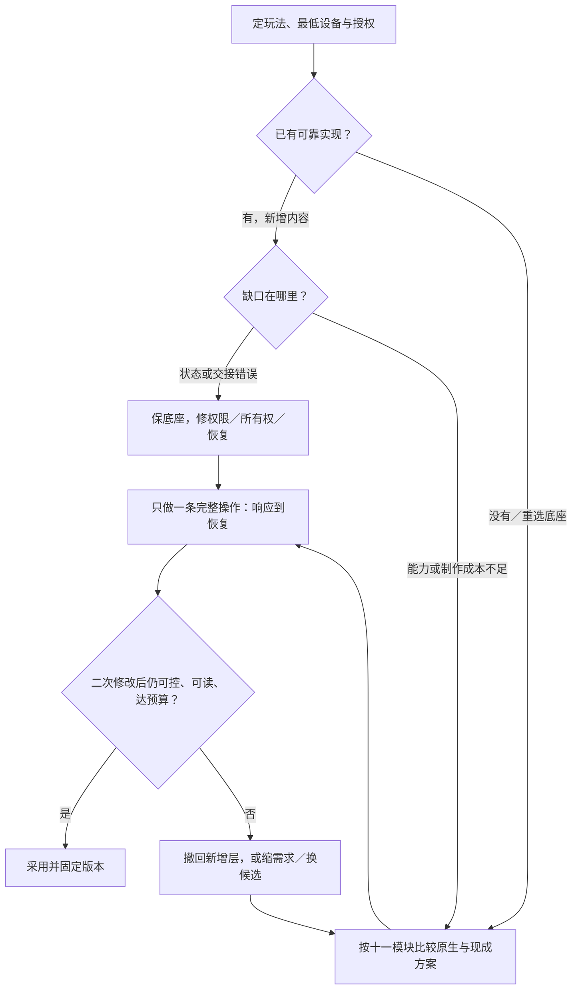
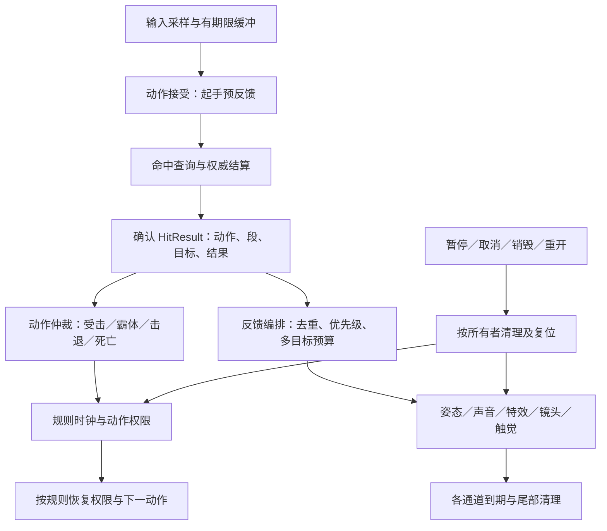
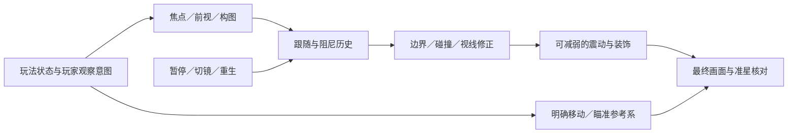
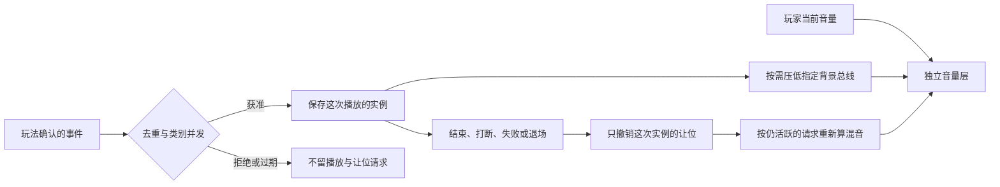

# 客户端核心模块：让操作有回应，让体验连续

> 编辑更新：2026-10-23（UTC+8）；资料核实时间及版本见 [WP10](../../docs/research/2026-10-14-game-wp10-client-modules.md)。单人程序、无人工美术／音频修补；Unity 主线、Unreal 对照。资产导入见 [01](01-engine-integration.md)，资源供给见 [03](03-generative-ai-in-games.md)。本轮资料／源码比较，另有窄文档检索试用；未运行引擎。

## 30 秒结论：先把核心动作做舒服

**[研究] ✅ 新项目按需求选成熟底座，已有项目保可玩契约再补缺口。** 布局密集 UI、分支对白或复杂平台运动可直接选现成方案，不必先实现不合适的原生方案。

- **选型：** [十一模块对照](#当前最高水平新增能力仍保住原来的控制契约)给替代、默认与成本。
- **AI 分工：** 接组件、补回归；[人验手感、视听与译义](#2-十一个模块的最低交付线)。
- **完整镜头：** 从[预判、跟随到遮挡与震动](#camera-contract)，先保玩家控制，再加镜头语言。
- **二改：** [按症状选读](#3-按当前任务选择实现与验收)，重点守取消、暂停、旧档和设备。
- **证据：** 资料／源码比较，模块库与引擎未试用；两次检索不证明 AI 制作收益，整链质量上限未知。

## 1. 单人项目先借引擎，再补确实缺少的一层

先定帧率／分辨率、内存、保存失败与菜单政策；联网仅按玩法引入，暂缓预建 ECS／跨引擎框架。[研究]

### 当前最高水平：新增能力，仍保住原来的控制契约

<!-- frontier: status=已比较 gap=1 gen=2026-10 checked=2026-10-23 -->

**[研究] 十一模块按需求比较；“领先”指特定能力，不是全能质量排名。** 单人、零美术／音频修补的默认如下，收益未复现，版本／生产案例／反例见各行。

| 主要选择 | 领先替代／什么需求使它胜出 | 当前选取；新增成本与撤回 |
|---|---|---|
| 渲染与性能 | HDRP／UE 高阶渲染、DRS、GPU 粒子：光照、规模或波动负载确需 | ✅ Unity URP／UE 原生质量档；按[设备预算](#设备预算量最坏场景不抄通用面数)先定位。新增平台、内存与内容负担；提示变糊／帧间隔恶化就退回 |
| 资源与内存 | Addressables／UE Asset Manager：分组驻留、独立内容发布；UniTask：组合等待与 PlayerLoop | ✅ 小常驻内容直接引用／已有异步；按需求直接选现成层；增打包、所有权与版本维护，[取消／驻留](#切换关卡与释放资源)失控先修底层 |
| 动画 | IK／Playables：接触与编排；Motion Matching：已有大动作集的选姿 | ✅ Animator／UE AnimBP＋Montage，按[动画页](assets/animation.md)选供给与控制。新增动作数据、重定向与调参；接触／变形不合格就换资产或缩动作 |
| 物理与运动 | ECM2／KCC 等 motor：平台、贴地与可预测控制；UE Mover：模块化运动／回滚 | ✅ 常规角色 CharacterController／CMC，力学玩法选 Rigidbody／Chaos；[运动对照](#3d-角色运动先选想要的控制再选碰撞求解方式)。承担许可／兼容或实验性迁移；旧连段／推动／落点受损就退回 |
| 输入 | UI vs Game Input、PlayerInput／Enhanced Input＋LocalPlayer：交接与多人 | ✅ 原生映射、override／UserSettings 保存；按[输入与暂停](#接入手柄暂停与多人菜单)补权限／身份。样例有混用及嵌套缺口；确认穿透、恢复误发或错玩家就撤回交接政策 |
| UI | UI Toolkit：数据／布局密集、文本化样式；UE CommonUI：反复出现的模态、返回与设备提示 | ✅ 稳定 uGUI／UMG 保留，新项目按需求直接试 UITK／CommonUI。迁移增控件／绑定／焦点重建，不为一次换肤换框架；[当前版本与生产对照](../../docs/research/wp10-content.md#整页选型回流ui-toolkit-新能力与迁移成本)不证明零手修或性能胜出 |
| 音频 | FMOD／Wwise：交互音乐和音频作者工作流；复杂传播另选专业方案 | ✅ [原生事件与混音](#audio-lifecycle)：AudioSource／Mixer／DSP 或 UE Audio／MetaSounds；[音频页](assets/audio.md)比较供给与互动。新增许可、事件库及构建维护；省不下制作成本就保原生 |
| 存档 | Newtonsoft：字典／树迁移；Easy Save：多类型／工具支持；ink：叙事状态 | ✅ 小 DTO＋JsonUtility／UE SaveGame；已用库继续复用。[存档](#保存续玩与升级旧档)仍需内容身份、AOT／授权与迁移；进度错就回退原档 |
| 本地化 | ATG／RTLTMPro：复杂文本；TMS：反复增量协作；6.7 新内置 Localization 模块 | ✅ 锁定引擎的 Localization／FText 与文本表，[语言检查](#增加语言与推进对白)分显示、编辑与译义。换版本／字体增回归；不可读／无法审译就缩覆盖 |
| 平台发布 | 远程 Addressables／Play Asset Delivery：独立内容或首包分发；自动诊断：现场证据 | ✅ Build Profiles／UE build-cook-stage-package，Steam 随版更新先平台差分。远程路线多目录、离线／旧版兼容与运维成本；[更新](#发布更新下载量与安装重写分开看)和[诊断](#发行后诊断先保反馈再接自动报告)必须保首局、隐私及恢复 |
| 编辑器扩展 | Yarn Spinner／ink 等作者环境：分支、预览和内容语义；UITK：复杂编辑工具 | ✅ 机械转换用脚本、参数用 Inspector，专门内容直接比较成熟环境；[内容作者工具](../../docs/research/wp10-content.md#104)。学习、命令桥接、生成维护不值时用窄工具 |

**版本改变选择，不强迫迁移：** UITK 6.7 的动画、ATG、本地化能力不套回 6.3。Unity 当前 6000.7 手册仍标 Beta，runtime 总表仍荐 uGUI；官方与生产案例并不支持统一换栈。[一手／研究，2026-10-22 UTC；[核实与反证](../../docs/research/wp10-content.md#整页选型回流ui-toolkit-新能力与迁移成本)]

**AI 检索也锁版本。** 两次 Context7 resolve 未给所需精确版本 ID，未接 query-docs，改读固定 tag 核 InputSystem 回调／UniTask 取消时机；不证明运行正确或模型提升。[窄试用回执](../../docs/research/wp10-content.md#文档检索窄试用先辨版本再读源码)。[经验／一手]

**加冲刺／二段跳仍保三份契约：** 有期限输入何时消费；跳跃资格与短长跳何时失效；进退冲刺如何交速度与反馈。用“单跳→冲刺→二段跳／受击”核同帧竞争、边缘短按、暂停和重开，过期动作补发、动量被清零或旧协程覆盖击退就退回。[研究]

Penny’s Big Breakaway（GDC 2025）取动量连续，Holden 的 Smooth Walking（2026-01）分调加减速／转向；它们不决定所有玩法的容错。AI 可写状态／轨迹检查，人复玩旧落点与新连段；[P35 比较](../../docs/research/wp10-motion.md#p35新增移动能力后保住控制契约)和[二改验收](../../docs/research/wp10-motion.md#二改验收从单跳到冲刺再到中断)保留完整参数与未运行边界。[一手／研究]

### 先做完整动作：响应、反馈和顺滑分别解决什么

| 缺口 | 先做什么；撤回条件 [研究] |
|---|---|
| 短按没响应 | Unity Dynamic Update 读输入、物理消费保存值，离散按下只消费一次；需要才加有期限缓冲／宽限，过期补发就收窄 |
| 转身迟滞／姿态弹跳 | 调转场、Exit Time 与打断；接触缺口才加 IK，命中被混合冲淡就退回 |
| 命中不清楚 | 按[完整反馈模块](#打击感与反馈先让命中有含义再让重击有分量)分结果、力度与通道，别先加震屏 |
| 回合演出拖沓 | 缩普通反馈／可选快放，保原完成条件与重要结果 |
| 移动抖／首次停顿 | 分姿态连续与长帧；Interpolate 落后一步，Extrapolate 可能越界纠正 |

卡边角先查碰撞表达，有界纠偏不得改路线／推入危险；[空间容错](../../docs/research/wp10-motion.md#69)。转向发黏分平滑、限幅和插值，保玩法所需转身承诺；[不同玩家反例](../../docs/research/wp10-motion.md#99)。[研究]

插值确为热点才按所有视口／尺度筛呈现，保模拟与必要屏外取样；入屏突跳就扩大范围。OpenRCT2 未测该项性能，VVVVVV 有屏外取样反例；[插值预算](../../docs/research/wp10-motion.md#102)，镜头实施见[完整模块](#camera-contract)。[研究]

### 打击感与反馈：先让命中有含义，再让重击有分量

**[研究] ✅ 默认用确认的 `HitResult` 驱动现有动画、声音、特效与镜头；动作仲裁和反馈编排并列。** 先做“轻击／重击／未命中／格挡”可分辨的一条完整动作，再增加顿帧和触觉，播放器不决定伤害、霸体或死亡。以下是资料／源码比较，未运行引擎或试玩；最高体验水平仍须目标设备与玩家验证。[完整证据与版本](../../docs/research/wp10-motion.md#hit-feedback)

#### 作品参照：不是把每次命中都放大

| 代表作与证据 | 借什么；不照搬什么 |
|---|---|
| **Monster Hunter Wilds（AAA，2024-12 发行前修订）**：开发者解释，曾因《World》反馈过重而降低 hitstop，Beta 后又强化终结／强攻击 | [一手转引／研究] 按动作地位分力度，而非统一延长所有命中；公告没有给可抄的毫秒值，转引不代表实机复测 |
| **Dead Cells（优秀独立，2017 开发者访谈）**：暴击用一帧冻结、随后短时减速，配血花与专属声音 | [一手／研究] 同一事件的节奏与声画一起设计，先做少而明确的重击层；历史描述不是当前版本常量，更不能换算为固定 16.7 ms |
| **Warframe（2025-10 官方修订）**：后坐镜头恢复引起晕动反馈；关闭屏震时移除相关镜头位移，用准星形状传达后坐 | [一手／研究] 信息与镜头运动可拆开，减镜头仍保命中／后坐提示；随后玩家仍要求分开设置，不是“眩晕已全部解决” |

[研究] 这三例给的是分层、组合和可关闭通道，不是统一最佳配方。单人无手工美术修补先用许可清楚的短受击姿态、接触点特效、少量分层音效；姿态方向／接触仍错就换资产或缩动作集合，不能靠强震屏遮住。

#### 参数先写契约，再调数值

| 参数组 | 要明确的选择 | 常见失败与撤回条件 [研究] |
|---|---|---|
| **接触与响应** | 采样、接受、判定、首反馈四时点；接触点／法线、受击方向；起手／生效／恢复窗口 | 起手等服务器、命中声早于结算、混合冲淡接触；先修时序与姿态，不用更大粒子补迟钝 |
| **顿帧与慢放** | scope 是攻击者、受击者、局部表现还是世界；持续／倍率／恢复时钟；同帧多目标取最大、合并或限额，禁止无限刷新 | 全世界连停使轻武器失去连贯；scaled 等待在暂停时不恢复，旧回调把新慢放重置；冻结若改变反应／判定窗口就归玩法规则 |
| **输入与取消** | 缓冲 TTL 用哪个时钟，停顿是否计入；接受／拒绝／消费一次；命中、霸体、死亡的优先级 | 解冻补发过期招、受击被闪色动画抢掉、死亡仍连招；先由动作仲裁给许可，反馈只跟随结果 |
| **声画与触觉** | 接触同步、音色／力度层级、相机方向与衰减、震动所属玩家和到期；同一事件每通道一次 | 多段与多目标叠爆、全局 cooldown 吞真实下一击；用动作 ID＋段序号＋目标＋结果区分，再对通道封顶 |
| **可读性与负担** | 玩家／威胁轮廓、命中和格挡可辨；粒子遮挡、闪光、音频并发与镜头／触觉强度 | “重”却看不清下一步或累；先减装饰、留必要信息。无障碍可关镜头／触觉，但不得暗改规则性停顿与输入窗口 |

[研究] 纯装饰尾音／粒子不阻塞下一动作，承担反应窗口的停顿由规则仲裁恢复。不预设“最佳顿帧毫秒”。先固定轻／重两档及目标设备预算，逐项 A/B；伤害窗口、移动、输入容错改变须另作为玩法变量记录。回合制则缩高频普通反馈或提供快放，仍等原完成条件、只结算一次；快速路径也核死亡清理、回血、随机消耗和奖励，依据见[回合等待预算](../../docs/research/wp10-motion.md#4)。

#### 现成实现：先复用播放器，只补项目语义

| 路线 | 当前决定；接入成本与边界 |
|---|---|
| **Unity 原生＋Cinemachine Impulse** | [研究] ✅ 已有 Animator、AudioSource、Particle System 就继续用；需要方向性镜头冲击再接 Impulse。Brain 的忽略 timeScale 不代 ImpulseManager 时钟；多事件叠加不自带总强度封顶，项目按通道管预算 |
| **Feel 多通道编排** | [研究] 👀 多个动作反复绑定声音／形变／相机时评估 Inspector 编排，别先自建通用反馈平台。Feel 6.3（2026-10）要求 Unity 6000.5+，本页 6000.3 基线不直接升级；付费依赖、场景绑定和停止／复位政策另验，未购买或试用 |
| **项目已有 Tween** | [研究] ✅ 少量闪色、形变和 UI 数值沿用现有库；DOTween 停止、完成、复位不同，Sequence 生命周期在根序列管理。PrimeTween 可作替代候选，许可和中断语义先核，不为一次受击迁库 |
| **Unreal 原生** | [研究] ✅ AnimBP／Montage、Niagara、Audio、Camera Shake、Force Feedback 各司其职；Camera Shake Single Instance 是重启不是事件去重。已用 GAS 才接 GameplayCue／PredictionKey，一次性 Burst 不能承担 latent 持续流程，不为反馈单独引入 GAS |

[研究] 停止按动作／对象／玩家所有者执行，不用全局 Clear／KillAll 清一击；停止序列也不一定停所有子效果，更不一定恢复初始值。暂停先阻止持续写入者，再按政策暂停或结束通道；销毁、退局和重开使旧代次失效。手柄换设备的停止／恢复遵守[输入与暂停](#输入与暂停先定动作权限再切输入)，网络沿[预测与确认](../../docs/research/wp10-motion.md#8)：起手可及时，关键命中／击杀默认等确认，同击收敛不重播，拒绝不能保留成功提示。

#### 交给 AI 的执行清单：先基线，再加第二次需求

[研究] 可直接复制给 Agent；这是验收模板，不是本仓已执行结果。AI 负责事件绑定、参数配置、trace 与回归，人决定力度、可控性、信息辨识和晕动／听觉负担。

- [ ] **锁定基线：** 写引擎／包版本、目标设备、轻击与重击、未命中／格挡／霸体／死亡的预期；列资产许可。确认伤害、位移、动作打断仍由原系统负责。
- [ ] **输出配置与 trace：** 每条记 `actionId / hitIndex / targetId / generation / outcome`、采样／接受／判定／首反馈时点、各通道播放次数、时钟／scope、停止原因；同击重复通知只反馈一次，两次真实击中都保留。
- [ ] **做逐通道 A/B：** 先姿态＋短声，再分别加特效、顿帧、镜头和触觉；录屏核接触帧、人物与下一威胁是否被遮住，静音／关镜头／关触觉后仍分清命中和格挡。
- [ ] **测中断恢复：** 起手、停顿中、恢复瞬间分别暂停／取消／杀死对象／换设备／退局／重开；核时钟恢复、无悬挂位移／闪色／震动、旧回调不改新角色，恢复不补播过期命中。
- [ ] **二改加多段和多目标：** 一击改三段，再同段命中多个目标；核逐段结算、同击去重与通道合并上限分别成立，不能用全局冷却吞合法事件；再添重击击杀或霸体目标，旧轻击仍可控。
- [ ] **核性能与联网：** 在 30／60／120 显示率、长帧、密集命中和首次播放下记录帧间隔／首反馈，目标机听爆音、看遮挡；联网另注入确认、拒绝、重演与观察者路径。自动通过不等于设备体验通过。
- [ ] **决定采用或回退：** 保留能被人稳定辨识且不破旧动作的通道；力度提高但连贯／可读／舒适性变差就减档或撤回，记录删掉哪层及原因，不以“更华丽”判完成。

### 镜头完整模块：先看清下一步，再让跟随有性格

**[研究] ✅ 默认复用 Cinemachine／UE 原生相机，只补玩法需要的取景与控制规则。** 先用无震动基线完成一次起跳、转弯或绕掩体，再逐项加前视、阻尼和冲击；更顺滑却更晚看见危险，便不是升级。以下为资料／源码比较，未运行引擎，最高体验水平未知；[版本、反证与实现细节](../../docs/research/wp10-motion.md#camera-contract)。

#### 作品给的标准：看到角色，不等于看到决策

| 公开实践 | 可借机制与代价 |
|---|---|
| **Lonely Mountains: Snow Riders**：团队因镜头反馈新增第三人称选项，并调整全部山地／路线适应新视角 | [一手／研究] 导演构图可展示捷径，追随视角利于前方判断；先选发现节奏与控制目标，别到内容完成后只换相机。作者认为新模式有趣，不证明所有玩家更喜欢 |
| **Celeste64 固定源码**：纵向跟随依据着地、下落与高度窗；攀爬转角保留持续输入方向，松回阈值内才重算 | [一手／研究] 竖直跟随与水平移动不必共用阻尼；切镜也不能无意反转持有中的操作。借局部规则，不搬 jam 级单体控制器或受限美术 |
| **Warframe 2025 后坐修订**：关屏震时移除相关镜头位移，保留准星反馈 | [一手／研究] 力度信息与画面运动可拆开；减镜头仍应分清命中／后坐。不是舒适度已经普遍解决；详见[反馈模块](#打击感与反馈先让命中有含义再让重击有分量) |

#### 六个职责分开调，不让避障或震动抢走控制

[研究] 图示是职责，不强制替换包内流水线；实际扩展顺序仍按版本核对。装饰后再验近裁剪与瞄准，不能假定先前避障已保证最终画面安全。

| 职责／要交给 AI 的参数 | 当前默认；失败时先改什么 [研究] |
|---|---|
| **跟随参照**：目标点、世界／角色局部轴、更新阶段 | 跟可靠的移动参照，不盲跟呼吸骨骼或漂移装饰节点；抖动先分目标采样、物理呈现、相机更新与帧间隔，不先堆阻尼 |
| **前视**：方向来源、预测秒数、最大偏移、反向／低速政策 | 缺前方信息才启用有限前视；速度预测不认识急弯、墙或落点。先减噪声／缩预测，再考虑区域焦点；加平滑会增加预测滞后 |
| **构图与阻尼**：屏幕锚点／死区、各轴响应、最低目标尺度 | 死区保参照，阻尼缓突变，二者都可能推迟信息；先分别调水平／垂直，再调 FOV。远敌加入使人物太小，就缩目标组而非无限拉远 |
| **遮挡**：碰撞层、半径、允许位移、遮挡持续／回退时间 | 防穿墙、看见目标、枪口通路分验。连续绕柱反复抽动就调整策略／恢复；没有可用视点时改局部显隐或几何，不继续加射线预算 |
| **震动**：来源、空间、幅度／频率／包络、合并与强度档 | 先借原生冲击；密集事件比较最大信号与叠加。关闭项要覆盖主冲击和次级尾震，必要信息另留声音／姿态／准星；不改变伤害或操控规则 |
| **控制与交接**：鼠标／摇杆单位、回正、cut／blend、历史政策 | 鼠标 delta 不作摇杆角速度再积分；手动观察时不让自动回正对抗输入。正常交接可混合，连续位移可迁移历史，重生可清历史；不统一 reset |

**按玩法取舍。** 平台跳跃优先起跳前落点与下落参照；高速行驶优先弯入口／出口，区分车身朝向、速度与路线；越肩瞄准优先手动观察、准星与枪口一致。它们可共用组件，不能共用一套“最佳阻尼”。[研究；[既有取景与控制证据](../../docs/research/wp11-camera.md#s9-2)]

#### 现成实现：先补一层，不重造整套相机

| 路线 | 采用／撤回 |
|---|---|
| **Unity Cinemachine** | [研究] ✅ Position Composer／Follow 做跟随，Orbital Follow／Third Person Follow 按视角选，Confiner／Deoccluder 按缺口加；Impulse 已有 `Use Largest`，不先自建合并器。新增区域、绑定和回归成本；看见目标仍抢控制就改政策，不把全部扩展叠上 |
| **已有窄跟随／区域工具** | [研究] ✅ 简单固定镜头已达标就保留；按 Celeste64 等局部机制补纵轴／输入交接。Pro Camera 2D 可比较房间与前视作者工作流，但本轮未闭合当前 Unity 兼容性，不因功能多而换栈 |
| **Unreal 原生** | [研究] ✅ CameraComponent＋SpringArm＋PlayerCameraManager，冲击用 Camera Shake；SpringArm 收臂防碰撞不是通用可见构图搜索。Gameplay Camera System 5.8 仍标 Experimental，仅复杂多模式图编排确需才试；已有可靠路线不为新名词迁移 |

**版本会改变接入方式。** Unity 6.3 基线核 Cinemachine 3.1.7；6.6 已将其变为随 Editor 的核心包，CM2 升 CM3 有 API／数据迁移。升级不是每个项目必变手感，但必须重放已调好的急转、绕柱和切镜；不能把主干预发布修复当稳定包已修。[一手／研究；[版本分流](../../docs/research/wp10-motion.md#camera-version)]

#### 交给 AI 的实施与二改验收

[研究] 以下可作任务清单，未执行；AI 交配置、绑定与轨迹检查，人接收预判、操控、可读性和舒适度。

- [ ] **冻结基线：** 引擎／包、设备／宽高比、输入单位；选一段同时含急转、遮挡和恢复的路线，标出玩家做决定前必须看见的落点／出口／威胁，保原移动和命中规则。
- [ ] **逐层接入：** 无装饰跟随→有限前视→遮挡→震动，每次只改一组；导出模式、目标与更新阶段、期望／实际相机姿态、焦点屏幕坐标、遮挡修正及输入参考方向，附同段录屏。
- [ ] **核控制：** 鼠标与手柄各测低速试探、急反向、持续按方向切镜、开关瞄准与回正；近墙换肩对照准星、枪口和实际命中，不能只验角色仍在屏内。
- [ ] **核恢复：** 暂停、失焦、切镜中取消、传送、死亡重生、目标销毁；按约定保留／迁移／清历史，无旧目标拉扯、新角色继承尾震或恢复误发输入。具体接口复用[历史管理](../../docs/research/wp11-camera.md#s12-2)。
- [ ] **第二次需求加窄门与连续多击：** 保第一版开阔路线；验最低分辨率／目标宽高比、30／60／120 Hz 与长帧。关镜头运动后关键信息仍可辨，开启时不穿墙／失准；记录查询与帧时间、每房特例及调参工时。
- [ ] **接收或撤回：** 更早看见必要信息、持续输入可理解且负担可接受才保留；只变得电影化却更难控制就减前视／阻尼／震动或改构图。自动轨迹通过不替人玩，不适时停止试玩，不强求完成路线。

### 刚移动就查询：先确认物理状态已更新

**[研究] ✅ 查询旧位置先查写入顺序。** Unity 6.3 内置 **3D** 改 Transform 后，在批量修改结束、依赖查询前才 SyncTransforms；它不推进模拟或完成 MovePosition，全局 auto-sync 不作配方。UE 物理结果用 TG_PostPhysics，更新依赖用 tick prerequisite；[物理查询](../../docs/research/wp10-motion.md#3)，不套 Unity 2D。[一手]

### 街机车辆：先比控制模型，再决定抽离规则

**[研究] ✅ 先比较现成街机车辆，不从“不要逼真轮胎”直接跳自建。** 许可／版本／网络绑定合适就复用；不合才窄取漂移、加速与恢复规则。Netick 样例根 MIT 不覆盖依赖和项目专属资产，轻库无网络绑定也未必更省验收；见[两底座与生产取舍](../../docs/research/wp10-motion.md#arcade-vehicles)。

[研究] AI 可拆读写与补规则，先定按住式／定时式，人验连锁 boost、离地松漂移、擦墙／落地与翻车复位；旧连段受损就撤回改动。均未实测，不推荐整包直接商用。

### 呈现节奏：动作已执行，画面仍不顺

**[研究] ✅ 原生同步先建立基线，帧间隔和响应一起验。** Unity 6.3 桌面先比较 VSync（非零时忽略 targetFrameRate）；Android 用 Optimized Frame Pacing／UE Swappy（UE 5.2 起默认）。UE 排队确为热点才试 low-latency syncing，缩 pipeline 减少长帧余量；掉帧或发黏就退回。[一手／研究]

基础响应达标再试帧生成，分应用帧／呈现帧。AMD UE 插件 4.1.1 Slate Redraw 重复 NativeTick，UI Extraction 可能损半透明 UI；副作用／HUD 错无法修就撤回。Unity 上采样入口不证明同类帧生成；[版本与反例](../../docs/research/2026-10-14-game-wp10-client-modules.md#呈现节奏补研平均-fps-与实际看到的动作不是同一个承诺)，设备收益未测。[一手／研究]

### 运动中的清晰度：关键提示不能只在截图里看得清

**[研究] ✅ 拖影先核矢量与 AA／上采样路径。** Unity 6.3 URP 对象矢量限 opaque／alpha-clipped，透明烟雾不适用，跟随角色也可能需 Per Object Motion。关键边界先用稳定大形状，再比较减少历史或 SMAA／FXAA，闪烁／模糊更坏就退回；STP 隐式开 TAA，连 render scale／Filter 一起查，调试绿色未必错误。[一手；[运动可读性](../../docs/research/wp10-motion.md#52)]

### 信号取舍：减掉演出后，仍看得懂下一步

**[研究] ✅ 先保危险方向、时点、范围与命中；频繁共用信息并列，低频规划信息可按需查。** 先减装饰／改表达，仍读不清才缩规则；切页打断操作或挤常用信息就改布局。关键颜色／声音另有表达，呈现设置与减伤等辅助规则分验。加敌人后比默认、静音、减粒子、自定义配色，辨识变差就撤回演出；[Into the Breach／Dead Cells 对照](../../docs/research/wp10-motion.md#63)。

### 像素风慢速移动：先分清画面网格与模拟运动

**[研究] ✅ 先找取整层：严格像素网格与慢速连续运动有取舍。** 旋转／缩放确需时试提高呈现分辨率或过滤，模糊／轮廓不稳就撤回。Unity 6.3 URP Pixel Perfect 先统一 PPU、分辨率与缩放；Pixel Snapping 不改 Transform，平滑最终画布未必平滑内部物体，Cinemachine 混合可能失去对齐。[一手；[像素网格与拾取回归](../../docs/research/wp10-motion.md#59)，不作 UE 配方]

## 2. 十一个模块的最低交付线

**[研究] AI 默认接现成组件、补项目规则与检查；人验体验。** 选型见上表，这里只列交付与典型失败，不重复推荐。风险项不是模型实测出错率。

| 模块 | AI 可交付的最小实现／必须挡住的错误 | 接收检查 |
|---|---|---|
| 渲染与性能 | 采样、质量档；平均 FPS 不能掩盖首用尖峰 | 目标机帧间隔、内存；人看运动提示，换色／受损按[材质参数](assets/materials.md#同资产换色或受损先分共享预设与对象参数) |
| 资源与内存 | 所有者、代次、清理；取消后仍收尾 | 往返切场注入迟到结果，核身份、释放与驻留 |
| 动画 | 状态、打断与唯一位移路由；防 root motion 双算 | 核复位、坡阶接触及步态；二改验[范围与屏外更新](assets/animation.md#换动作后消失或突跳先分包围范围与屏外更新) |
| 物理与碰撞 | 碰撞层、查询顺序、幂等命中 | 移动后查询、高速接触、同次攻击结算次数 |
| 输入 | 映射、改键持久化、冲突检查、稳定绑定身份；结构改变迁移旧设置，保失焦／断连和玩家权限 | 按住开菜单不误发，双人不串目标；[改键依据](../../docs/research/wp10-content.md#103) |
| UI | 绑定、有效焦点、返回与新局同步 | 换肤后一局→重开→再操作，核空态／反馈形状、手柄返回及变窗口点击 |
| 音频 | 按事件接实例、并发、分组与退出恢复 | 交错结束不误恢复；密集触发不吞新警告，人听起音与威胁辨识 |
| 存档 | DTO、稳定 ID、逐版迁移和失败反馈 | 两次内容修改后核剧情／库存／奖励，失败保唯一原档 |
| 本地化 | 语境、译文候选、稳定 key、变量／复数／缺字检查，可用伪本地化先查布局 | 旧名字、长文与编辑可用，人审译义／可读性 |
| 平台发布 | 构建配置、路径／资源／权限检查 | 干净目标机启动、续玩、旧版升级；Play／Cook 成功不够 |
| 编辑器扩展 | 机械批处理、预览与窄工具 | 副本上先预览、二次执行不增副本、故障能恢复；见[01](01-engine-integration.md) |

⛔ 自动检查不代手感、视听或翻译验收；失败时修实现、撤回新增层或缩小委派。[研究]

**作者工具不替项目写玩法。** Yarn 等可借分支语义、预览与本地化检查，项目仍接命令、世界状态和演出；简单线性对白不用必加框架，作者预览与实机分别验。[研究；[NITW／Yarn 依据](../../docs/research/wp10-content.md#104)]

### 声音事件：播完以后，谁解除“让位”

**[研究] ✅ 保留原生播放器与混音器，把一次事件的“播放、让谁小声、何时恢复”一起接完。** 并发决定谁获准播放，混音决定获准者能否分清；提高警报优先级不等于背景已经让位。普通短反馈先不加全局压低，确需突出对白／危险时，才让音乐或装饰环境声让位，别连其他必要警告一起压下去。

| 声音用途 | AI 应接上的规则 | 二改时一起检查 |
|---|---|---|
| 短命中／UI | 跟已确认结果；沿既有去重与类别预算，变体不另开额度 | 多段／多目标不重复提示；被拒的声音不留下让位 |
| 关键对白／警报 | 保存实例；明确它压低哪些背景、重叠时叠加还是只取最强 | A 先结束、B 仍在时不提前恢复；打断／失败也解除自己的影响 |
| 机器／移动循环 | 进入状态创建一次，状态值更新同一实例；退出、销毁和回池有停止路径 | 暂停定续播／重启，旧实例回调不停止重生后的新循环 |
| 音乐与场景状态 | 用户音量与游戏混音分层；交接取消过期目标 | 菜单内改音量，退出仍保持新设置；循环边界不误认整次播放结束 |

**Unity 先把用户音量与游戏让位放在不同增益层。** 6.3 的 `SetFloat` 接管 exposed 参数后，snapshot 不再控制该参数；不要让设置滑条和暂停／对白 snapshot 争一个音量。按声音信号让位可用原生 Send→Duck Volume；按玩法阶段让位则由该阶段明确进入／退出。FMOD／Wwise 已在项目中就用其事件、状态与混音工具，不为这个问题换后端；实例结束、snapshot 退出与淡出尾部仍须分别核。[一手／研究；[原生差异、制作案例与最小反例](../../docs/research/wp10-motion.md#p117-audio-lifecycle)]

**交给 AI 验控制，交给人验声音。** 用“两段对白交叠→先停第一段→调用户音量→打断第二段→退场”查残留与误恢复，再在密集战斗中听警告、方向、起音和反复循环。自动检查即使通过，也没有证明听感、耐听或目标机输出。[研究]

**音频按症状修原生：** 迟到分提交／首用／输出，一次改一项缓冲，爆音就退回；密集漏声分重触发、组限额和全局声部，priority 不绕组限额。听得清却误报就修触发／含义，减频救不了误报；[警报语义](../../docs/research/wp10-motion.md#51)。[研究]

持续声另定范围、淡化、续播／重启；Unity maxDistance 未必归零，UE 静音续播可能占 voice。切镜先定听点位置／朝向／速度，不能藏危险或重播误报；[并发](../../docs/research/wp10-motion.md#45)、[响应](../../docs/research/wp10-motion.md#96)、[音乐切换](assets/audio.md#音乐先定出场密度再定循环和状态切换)。[一手／研究]

### 墙门后的声音：先选可听规则，再选遮挡

**[研究] ✅ 直达／被挡先低通＋音量，经开门可听则复用房间连接。** Unity 用目标 AudioSource／Mixer 滤波，必要时 Linecast；Listener 会影响全部声音。UE 先 Attenuation Occlusion，simple 误挡才比 complex。门边跳变、开门仍闷／起音丢失先查几何和过渡，明确复杂传播需求才升级；[Homebody／Barotrauma 对照及许可](../../docs/research/wp10-motion.md#88)。[一手／研究]

### 高速碰撞：先分运动与错误，再选检测方式

**[研究] ✅ 按漏碰／误接触选原生检测。** Unity 6.3 内置 **3D** 线性运动在 Speculative 失败时比 Continuous（静态）／Continuous Dynamic（动态刚体）；sweep 不补旋转，Speculative 含角运动却可能漏碰／误弹。UE Chaos CCD 与 ProjectileMovement 扫掠／细分分开，开物理后由物理接管；substep 不替检测算法，回调按攻击 ID 去重。破坏反弹／推动就退回；[版本反例](../../docs/research/wp10-motion.md#95)。[一手／研究]

### 3D 角色运动：先选想要的控制，再选碰撞求解方式

| 控制目标 | 当前路线与责任 [研究] |
|---|---|
| 普通直立角色、坡阶利落 | CharacterController；Move 无重力／自动推刚体，isGrounded 来自最近一次 Move |
| 冲量／质量交互是玩法 | 力驱动 Rigidbody；反复抵消物理才改显式运动，抓取与可达路线分验 |
| 接触与可预测速度折中 | 速度驱动 Rigidbody；统一移动、重力、平台和击退，已有好用路线保留 |
| 贴地、旋转平台／离台动量 | 比 ECM2（商业候选）／KCC（自担兼容），按实际包核 API 与许可；缺口不减／二改扩散则退回 |

Unity Character Controller 1.4.5 是 ECS 包，非 GameObject 即插升级。平台跟随、离台、挤压分别定，接触点速度含角速度；root motion 交唯一控制者经碰撞约束，以实际运动校步态。验坡阶、旋转平台和受击恢复；[运动比较与成本](../../docs/research/wp10-motion.md#9)。[一手／研究]

#### Unreal：先扩展 CharacterMovement，不搬 Unity 的 motor 调度

**[研究] ✅ 常规胶囊角色用 ACharacter＋CMC，特殊动作局部扩展。** 沿 movement base 配离台速度防双算；root motion／Root Motion Sources 交 Movement Component，技能负责取消恢复，单次突进不要求 GAS。👀 UE 5.8 Mover 在 2026-10-14 核实页仍 Experimental，确需灵活形体／模块化运动／回滚才承担迁移，输入汇入模拟步命令；[UE 依据与样例边界](../../docs/research/wp10-motion.md#15)。[一手]

## 3. 按当前任务选择实现与验收

[研究] 按症状选读；新增内容后的检查均为后续验证设计。

### 切换关卡与释放资源

#### 场景切换：取消等待不等于取消工作

**[研究] ✅ 加载所有者＋请求代次，旧代结果只收尾；预取消先处理再创建 handle。** Addressables 使用期间保句柄，失败也清理。所核 UniTask 适配器默认取消不 release、预取消在接管前返回；#649 池复用串线未见确认修复，高频取消先保底层等待／原生完成通知，由存活所有者收尾，业务 guard 不证明库内身份正确。[一手]

**[研究] 🧪 单一所有者可改用 Addressables 4 原生等待，不必只为取消再装适配器。** 4.0 起提供 `await handle`／`ToAwaitable(token)`；所核 4.1.1 最低 Unity 6.0。后者接管该引用的取消释放，成功后取消也会释放；失败立即释放异常的 `e.Handle`，不要再按旧模板无条件释放原引用。反复启停用每轮新 token，`ToAwaitable(this)` 只跟销毁，不跟 Disable。[一手]

**共享一份 handle 仍保共同所有者＋`Completed` 分发。** 多个消费者各自给同一引用绑定取消，会让一方退出释放别人还在用的引用；复制 handle 不增引用，同一个 Awaitable 不能重复 await。AI 先写清谁持有、何时退出，再选接口；取消不保证终止底层加载。新旧版本与验收见[原生等待分流](../../docs/research/2026-10-14-game-wp10-client-modules.md#addressables4-native-await)。本轮只核文档／源码，未运行引擎。[一手／研究]

activateOnLoad=false 阻塞异步队列，激活须另安排；UE-207209 交叉取消仍回调的目标修复版不等于已修。[取消版本、替代及回归](../../docs/research/2026-10-14-game-wp10-client-modules.md#1-unitask新增自动释放为何仍不能等同完整取消)；既有异步没缺口就保留。[一手／研究]

#### 资源释放：所有权、驻留、总内存分别看

**[研究] ✅ 按寿命设所有者，只为热点加池／缓存，归还时取消、解绑、复位。** handle 复制不增所有权，Addressables 引用归零不保证立即释放，共 bundle 影响卸载。UE LoadPrimaryAssets 保持到显式卸载，PreloadPrimaryAssets 则须保活动句柄且不受普通 Unload／ChangeBundleState 控制；共享菜单由共同所有者协调，无新工作时空句柄仍可完成。[一手]

持有数、实际驻留、峰值分别量，缓存高水位不直接判泄漏；[所有权对照](../../docs/research/2026-10-14-game-wp10-client-modules.md#资源所有权补比load-与-preload-不能共用退出政策)。[研究]

### 保存、续玩与升级旧档

#### 存档复用：借序列化与存储能力，自己决定哪些进度能恢复

**[研究] ✅ 续玩与撤销失败分开；长局借房间／回合一致边界保存，边界太远就调整。** 永久死亡也可续玩。DTO／JsonUtility、Newtonsoft、UE SaveGame、Easy Save 的选取见前表；Easy Save CreateBackup 覆盖旧备份，Mindustry 列表仅查 metadata，恢复须完整读取＋内容校验，失败不回写默认新局。[一手]

卡顿分捕获／序列化／写入；Unity 后台 JsonUtility DTO 不得并发访问／修改，UE 异步保存仍在 game thread 序列化。保存退出等本次目标状态结果，失败保恢复选择；改关卡连地址／附属进度迁移。[一手；[存档比较及断电待测边界](../../docs/research/wp10-content.md#30)]

#### 旧档升级：版本可读之外还要进度正确

**[研究] ✅ 稳定内容 ID、schemaVersion／contentVersion 与逐版本迁移，先截一致快照，失败保唯一原档。** 两次内容修改后核剧情、选项、库存、奖励。几何／连接改变时比迁移与受限旧实现，旧世界运行不代表旧模板还能生产／混建；布局保不住或双版本负担太大就缩更新／支持边界，不静默损坏进度。[Factorio 取舍](../../docs/research/2026-10-14-game-wp10-client-modules.md#旧内容升级补研保旧世界不等于放行旧模板生产)。

ink 可能抛错或近似恢复并 warning，须捕获后决定迁移／回退章节；它只管叙事，非世界／库存存档。[一手；[ink 源码反证](../../docs/research/2026-10-14-game-wp10-client-modules.md#3-ink存档格式兼容不等于剧情修改兼容)]

### 接入手柄、暂停与多人菜单

#### 模拟输入：保留轻推幅度，再调死区与响应

**[研究] ✅ 保摇杆幅度，先核原生处理链。** Unity stick 默认死区，重复 processor 会叠加，勿套键盘 DigitalNormalized；UE 分核 mapping／action modifiers。有缺口再调，过大失微调、过小露漂移；换手柄核回中、低幅、满幅与斜向。[一手；[SuperTuxKart 反例](../../docs/research/wp10-content.md#26)]

#### 输入与暂停：先定动作权限，再切输入

**[研究] ✅ 先更新模拟／动作权限再禁输入，系统取消不是松手发射。** Unity 进行中动作 Disable 同步 canceled，须允许重入；战术暂停可保下令，世界继续的菜单仅转本地权限。持续值按恢复政策重读，失效缓冲／蓄力清理，已提交命令另处理；UI 不自动挡 gameplay，timeScale 与音频暂停分开。[一手；[输入交接](../../docs/research/wp10-content.md#21)，[蓄力计量](05-gameplay-architecture.md#7-战斗与技能先统一结算再决定-gas)]

震动短脉冲有时限，旧命中不补播；换设备／退局取消所属玩家旧工作，旧设备可达则发停止。Unity 1.20.1 PauseHaptics 保速度、不挡后写，Reset 清除；UE 按 PlayerController 的 Tag／循环／Play While Paused 管理。先停持续写入者，不误停别人；[反馈依据](../../docs/research/wp10-content.md#22)。[一手／研究]

#### 本地多人：设备归谁，菜单由谁操作

**[研究] ✅ 承诺多人后按实例接输入／菜单，共享菜单先定操作者。** Unity 读 PlayerInput.actions，Gamepad.current 非身份；独立 uGUI 配各自 UI module／MultiplayerEventSystem，playerRoot 不隔任意脚本。UE LocalPlayer 后另核 owning player、用户焦点、视口，AddToPlayerScreen 只管显示。双人同时导航／开关菜单串目标就修归属，别再复制 Canvas；[多人契约](../../docs/research/wp10-content.md#23)。[一手]

#### 菜单也是控制的一部分

**[研究] ✅ 初开／重开有有效焦点，确认／返回由当前层处理，关闭回原项或后备项；改键留取消、提示随绑定。** 原生路径坏先修。Unity UI vs Game Input 可借选择恢复，却不支持混用；提示变化不自动退出 UI。uGUI 防背景点击丢选择，Toolkit 重启 UIDocument 后重建焦点；CommonUI 不包办 UMG 导航。[一手]

第二个菜单重复政策才抽共享层；多暂停原因关闭只撤自身，Session 管持有者／加载权限。新设置页用真实改键、换设备和返回验收；[Celeste／Thrive 反例](../../docs/research/wp10-content.md#16)。[研究]

### 压低卡顿与设备耗用

#### 设备预算：量最坏场景，不抄通用面数

**[研究] ✅ 按最低设备／分辨率／帧率分预算，量冷启动、首技能、峰值战斗与关卡往返。** Unity Profiler／Frame Debugger、UE Insights 记录帧间隔分布、尖峰、驻留／峰值内存、音频、加载和包体，含关卡重叠与解压缓冲；开发构建定位、发布构建复核。60 fps 的 16.67 ms 是整帧，CPU／GPU／等待不简单相加。[一手／研究]

静止菜单确为渲染耗用才试 OnDemandRendering，保所需更新、输入／异步到达恢复绘制；耗用未降或首反馈变迟就退回。[Unciv 与 Android 延迟反例](../../docs/research/2026-10-14-game-wp10-client-modules.md#闲时预算少画几帧不等于整个应用一起慢)。[研究]

**先固定降采样定位，再决定 DRS。** GPU 时间受益且负载波动才试有可辨下限的动态档；稳定负载保固定档，到下限仍超预算就修实际热点。Unity 6.3 URP 缩放示例非自动预算器，HDRP 17.3 有组件；UE 核平台原生预算。HUD 清楚不代场内警告，DRS 不保证避突发尖峰；[Fortnite 与管线对照](../../docs/research/2026-10-14-game-wp10-client-modules.md#分辨率预算固定档动态档与内容取舍)。[一手／研究，未实测]

#### 首次技能：准备到能回应，而不只是加载完成

**[研究] ✅ 准备下一遭遇的必要动作／提示，分加载、初始化、上传和首绘；未就绪用明确转场或已准备的等价反馈。**

| 热点 | 窄方案／边界 [一手] |
|---|---|
| PSO／shader | Unity 6.3 实验性 GraphicsStateCollection 按平台／API 采集；旧 WarmUp 在 DX12／Vulkan／Metal 不保完整 PSO |
| 激活／末尾加载 | 分批初始化，integration／上传分别调；backgroundLoadingPriority 仅 Player 生效，提高可能打断操作 |
| 创建／GC | 先减分配，池需实际创建并定耗尽政策；defaultCapacity 仅容量，maxSize 不限借出并发 |

UE PSO Precaching 延迟 proxy／默认材质可能丢关键预警，先准备必要组件，遗漏再补 bundled PSO。新材质／keyword／画质补采、严格匹配查缺包，验冷首发、再发、重启、切档；无改善或等待／内存超预算就撤回扩大预热／池；[版本与反例](../../docs/research/2026-10-14-game-wp10-client-modules.md#首发帧时间补研从资源已加载到动作可见)。[一手／研究]

#### 密集粒子：先找预算花在哪里，再选 CPU 或 GPU

**[研究] ✅ 分实例／更新与透明覆盖，先缩装饰并发、大烟片和无贡献尾部；池不免活跃成本。** Unity 小反馈用 Particle System，规模确需再试 VFX Graph，核 compute／SSBO／管线（17.3 不支持 OpenGL ES）；UE Niagara Effect Type 缩档，GPU 模拟仍有 System／Emitter CPU 开销。画质只裁演出，可点燃碎片的规则留玩法层；提示丢失或性能／内存恶化就退回。[一手；[Factorio 反例与迁移成本](../../docs/research/2026-10-14-game-wp10-client-modules.md#粒子预算补研模拟规模与透明覆盖不能互相代替)]

### 修改界面与拾取交互

[研究] 远端界面分监看、局部命令与连续编辑：先摘要／预览，细节操作才进入；移镜、选中、下令分清。概览误选就收窄，反复切换才扩大；[Factorio／Zero-K 依据](../../docs/research/wp10-motion.md#66)，未测收益。

#### 放大 UI：先保信息，再选重排或折叠

**[研究] ✅ 先列不可隐藏的决策信息，用现有布局重排；仍挤占玩法视野才折叠次要面板。** 不从全局放大直接跳到藏菜单，也不为此迁框架。

| 放大后遇到的冲突 | 先选什么／何时撤回 |
|---|---|
| 只需大字，却连装饰也占满屏 | 分开文字与装饰尺度，先换行／重排列；挤掉关键状态就改布局，不偷偷缩回正文 |
| 面板可收起，但状态仍需随时知道 | 入口保容量／新事件等摘要，保已有快捷键／拖放路径；只留一个无状态图标不够 |
| 完整模态能换回视野 | 仅在可中断查询时采用；日志遮危险、教程消失或反复开关就退回半模态／常驻 |

Unity先核已锁版本原生能力：uGUI 2.6有最大尺寸，已核6000.3.15f1无此字段；多处flex／wrap缺口才评估uLayout，未试用。已有可用原布局时保留回退；Agent 二改新增物品／长标签后，在同一“查看状态→连续操作→返回”任务比较普通与大字档，并核新提示和旧操作仍可达，切档／重启按项目承诺。[研究；[近期重排候选、Cogmind 旧案例与边界](../../docs/research/wp10-motion.md#放大-ui保信息与连续操作)] 未运行引擎或真实游戏，不声称体验收益。

#### 换肤后重开：规则清空不等于画面恢复

**[研究] ✅ Agent 换图／动画后，走“一局结束→重开→再次操作”：核规则、控件／缓存同步、实际画面。** 首屏截图或直接调用 reset 不代真实按钮路径；反馈要指对透明留白内的形状，不只控件矩形。

Tytarenko 2026-09 Unity 制作复盘报告二改旧图残留、胜线覆盖不足，支持保旧 UI、补同步／可见结果回归，而非迁框架。Toolkit 绑定与 UE 布局／绘制失效不同，不规定通用 reset／invalidate 顺序；数据未同步重绘仍旧。只能靠全树每帧刷新／移位遮掩就撤回优化或素材；[案例与验收](../../docs/research/wp10-content.md#换肤后二改新局恢复与反馈形状一起接收)，本仓未运行引擎。[一手／研究]

#### 动态 UI 变贵：先找谁使它反复重建

**[研究] ✅ 先修重复写入，再分重建／绘制热点。** 动态牵静态才拆 uGUI Canvas，代价是独立 batching；UITK 视觉移动用 translate／DynamicTransform，真重排走布局。UE 先 Invalidation，全局启用不叠局部 Box，draw-call 仍紧才 Retainer。CPU 无改善或 GPU／内存／延迟更差就退回；二改验显隐、焦点、点击；[CanvasScaler 反例与修复版](../../docs/research/wp10-content.md#83)。[一手]

#### 显示正确但拾取偏移：先核位置来自哪里

**[研究] ✅ 普通按钮用原生事件，先核空间、原点、单位与相机／面板。** Toolkit position 已是 panel 坐标，localPosition 属接收元素；uGUI 用对应 RectTransform／事件相机，平面命中未必矩形内；UE Pixel／Viewport Position 用途不同。额外缩放／裁剪／重显示才映射，改窗口／小地图验中心、边缘、区外，原生仍错先查版本；[拾取契约](../../docs/research/wp10-content.md#79)。[一手]

### 增加语言与推进对白

**[研究] AI 译文是候选，追加内容重新验。** 小项目文本表，反复多语言增量再比 TMS；只改说话人／玩法条件也需回审。未验新文可延期、明确回退或缩语言，不继承旧验收；[供给取舍](../../docs/research/wp10-content.md#译文供给追加文本不继承旧验收)。

#### 新语言也会改变旧内容的显示

**[研究] ✅ 新语言与旧档名字一起核字库，子集／预填充随内容更新；改键样例硬编码也接表。** Unity ATG 按锁定 Toolkit 版本与内存／首字形目标评估。可重译报告存消息 ID＋类型参数，历史量保当时值，玩家原文保留；译文反推不回 key。Unity Arguments 不序列化、读档重建；UE FText→FString 丢 text history。[一手；[字体／旧报告反例](../../docs/research/wp10-content.md#37)]

#### 文字已经画进图里：先选择生产表示

**[研究] ✅ 分背景、译文、排版，再比逐语言图片、共享布局烘焙、运行时文字。** 少量稳定图保已授权版本；成套反复改字且需精确像素布局，试共用布局导出，不默认逐图手修或整套搬浏览器。Papers, Please 有导出维护且特殊图仍可能手修；零手修下字库／布局保不住可读性就换表示／缩语言；[生产取舍](../../docs/research/wp10-content.md#105)。[一手]

#### 新语言可读之后，还要能编辑和操作

**[研究] ✅ 分验字库、塑形、布局、编辑。** Toolkit **6.3** 基础 RTL 不足换行／塑形，复杂文本评估 ATG；稳定 uGUI／TMP 有缺口才试 RTLTMPro。UE 保 UMG 塑形／方向／composite font，Kerning Only 不适合阿拉伯语等复杂文本。[一手]

缺字用 fallback，有字却地域字形不合则按语言选字体；核描边／混排，损其他语言或预算就换字体／缩覆盖，不改编码／手修；[Mindustry 与字形依据](../../docs/research/wp10-content.md#字体选择补研缺字回退与地域字形优先分开)。[一手／研究]

混名字／数字核断行、删除、返回，ATG 逻辑光标未必视觉向左；长文分页／滚动／详情须手柄读完再返回，地图不一概镜像。难读的新字体撤回默认但保 fallback，仍不可操作就缓发语言；[显示编辑](../../docs/research/wp10-content.md#43)／[长文反例](../../docs/research/wp10-content.md#44)。[研究]

#### 对白拖沓：补全文字、推进语音与退出会话分开

**[研究] ✅ 分补全文字、结束句子、退出会话，沿已有组件配。** Yarn 文字／语音信号不同，退出不撤已发玩法命令；Firewatch 保护特定会话，inkle 短气泡可自动继续，按内容定保护／补述／重入。Yarn 3.2.8 开 endLineWhenVoiceoverComplete 时缺配音也可能结束，须阅读回退；加语言／分支验事实与选项，来不及读／丢信息就退回推进范围；[对白比较](../../docs/research/wp10-content.md#92)。[一手]

### 发布更新：下载量与安装重写分开看

**[研究] ✅ Steam 随版更新先平台差分，小下载仍可能重写大包。** 异常先查包范围、重排／压缩扩散，无关牵连才分关卡／功能包，连一次性大下载算成本。Unity 本地 Addressables 可保留，内容脱离 Player 才评估远程维护；UE PAK 补丁按 package，分发另定。未打包实测；[更新对照](../../docs/research/2026-10-14-game-wp10-client-modules.md#更新交付平台差分与独立内容发布分开选)。[一手]

**先保首局必要内容，再派生可读／可听规格。** 缺关卡高规格不等于完整低规格；拆包破首局／离线／旧档承诺就纳回或明示缩玩法。Play 首局即用优先 install-time，fast-follow 不阻启动、不保证入局已齐；[STK 与交付取舍](../../docs/research/2026-10-14-game-wp10-client-modules.md#发行裁剪内容完整性与资源规格分开选)。[一手／研究]

### 发行后诊断：先保反馈，再接自动报告

**[研究] ✅ 先核实际采集，再选反馈链；始终保人工反馈与构建标识。** Unity 6.2+ 新项目可能默认开 Diagnostics，没主动接入不代表没外传；仅人工路线显式核项目及目标 Build Profile 已关，另查其他 Unity 产品／第三方 SDK，此开关不代它们。[一手]

需现场证据才保留／接一条合适链，原生不足再 SDK，不默认自建／双开。AI 对版本拟回归，人审外发与恢复；妨碍启动／禁用或范围不可控就撤回仍保人工反馈，报告到达不等于故障恢复；[引擎／SDK 成本与修订链](../../docs/research/2026-10-14-game-wp10-client-modules.md#发行诊断先保可定位反馈再选自动报告)，未运行服务／引擎。[研究]

## 4. 借用的授权边界与升级条件

**[研究] ✅ 收益覆盖集成、授权、升级和二改成本才扩大依赖。** 接触动画改动先核[对位与兼容范围](assets/animation.md#交互目标二改先对位再判断是否仍是同一个动作)。

- Unity／包各核条款；UniTask、ink 为 MIT，Input System 为 Unity Companion License；所核 Addressables-Sample 树缺 LICENSE，仅参考机制。[一手]
- 所核 Lyra 渠道 UE-Only、Allows usage with AI: No；公开文档可读，整包给 Agent／复制资源须核逐文件许可。商业包源码可读不等于获准 AI 输入。[一手／研究]
- FMOD 免费档／商业条件另核，原生够用不为音质排名引入；[许可账](../../docs/research/2026-10-14-game-wp10-client-modules.md#6-许可维护与采用边界)。[研究]
- Toolkit 6.3 已有 world-space／custom shader／RTL；AnimationClip／Timeline 等差异按版本查，6.7 能力不可倒灌或据旧表否定，见[本轮核实](../../docs/research/wp10-content.md#整页选型回流ui-toolkit-新能力与迁移成本)。[一手]

按[跨模块矩阵](../../docs/research/2026-10-14-game-wp10-client-modules.md#7-后续真实验证矩阵)验取消、重入、旧档、设备；工具验幂等／撤回，构建验 AOT／裁剪、路径、资源、权限。人验动作、视听与翻译，最低设备及二改仍待实测。[研究]
