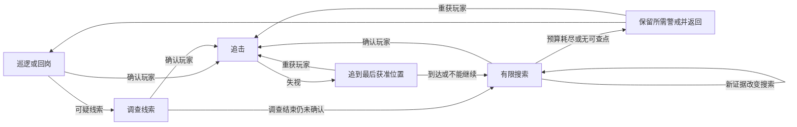
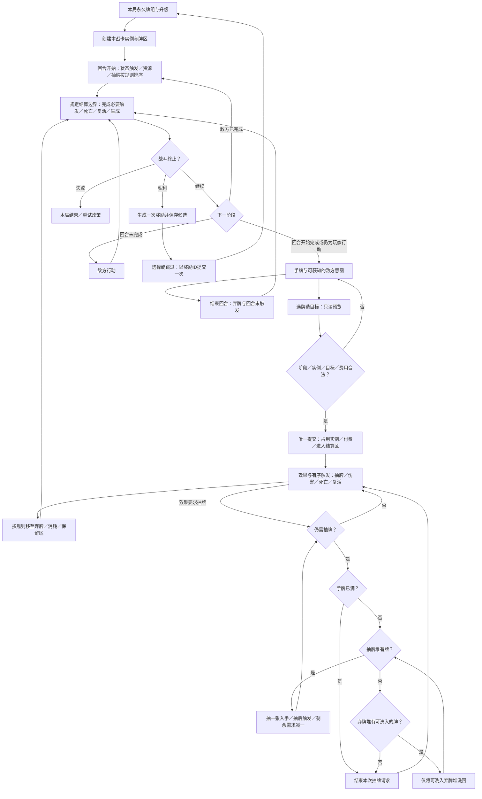
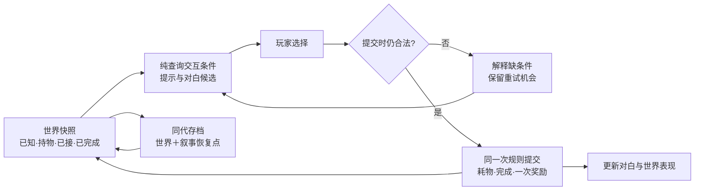

# Gameplay 架构：让第二次修改仍然可靠

> 核实／编辑：2026-10-23（UTC+8）；收短重复证据，保留操作与验收；整页比较仍为 10-22 版本，各机制日期和验证边界见研究。

适用：单人独立游戏；Unity 为主、Unreal 对照。

**✅ 原生组件、可测试规则和局部状态机优先；明确状态所有者、结算点、退出清理再加框架。** HFSM／行为树／GAS／ECS 各解不同问题。[研究]

AI 分工和验收均由本页契约与 [WP11](../../docs/research/2026-10-14-game-wp11-gameplay-architecture.md) 推导，非模型能力实测；运行证据仅含明确列出的陀螺库／inkjs 合成检查和 Star-Rush 本端兼容模式 HUD 检查，其余机制未实测，手感／性能／维护收益未知。**各节专项验收均须同时通过§11 通用验收。** [研究]

## 30 秒结论：先保状态，再选框架

| 问题 | 第一个选择；升级条件 |
|---|---|
| 少量阶段／技能 | 组件＋小状态机；共享退出逻辑多才用 HFSM |
| 组合优先级 | 行为树／StateTree；先确认复用与编辑收益 |
| 失视与脱身 | [追到线索、有限搜索、警戒返回](#p118-enemy-search-loop)，先分位置知识与行动资格 |
| 追击堵门 | 原生导航；区分通路、避让、停距与位移所有者 |
| 打断与重开 | 取消规则＋唯一结算；标签／效果／属性／预测反复出现再评估 GAS |
| 整招反复调动作／镜头／节奏 | 保规则结算；受控场景比较原生时间线编排，不把每次调节奏都改成代码 |
| CPU 或子系统能力不满足 | 热点先定位；预测等能力也可支持局部 ECS，保留组件制作链并计入边界成本 |
| 随机关卡 | 动作空间用房间组合，地形探索用受约束布局 |
| 整套关卡二改 | 保既有制作路径；二维重复批改才试语义源＋规则，不能免教学／进度返工 |
| 相机／关卡变化 | 原生相机、稳定 ID、可重置遭遇；按实际需求扩展 |
| 本地多人 | 同区且可读可共屏，自由分离比较分屏；核双方控制与楼层显隐 |
| 瞄准／命中 | 按误吸、精调、射程定位与意外接触分开改，保原控制和结算；见下文新增参照 |
| 影子／回放 | 展示录姿态，复现原因重演输入，倒带续玩需可恢复状态 |
| 赛车过弯 | [入口到出弯](#p112-racing-corner-loop)：联调控制、路线可读性与镜头，不按漂移次数评质量 |
| 卡牌循环 | [出牌到奖励](#p111-deckbuilding)：保实例身份、费用／触发顺序与本局牌组，先闭环再扩牌池 |
| 叙事回访 | [发现到交付](#p115-adventure-state)：分清已知、持物、选过与完成，失败可重试，世界与故事同代恢复 |

## 当前最高水平：生产上限怎样改变 Agent 的任务边界？

<!-- frontier: status=已比较 gap=1 gen=2026-10 checked=2026-10-22 -->

**默认保原生制作链，让复杂能力局部进入；没有跨玩法的最佳框架。** 下表按 2025–26 生产对照确定任务边界，日期、原文与限制见 [P76 整页比较][production]。[一手／研究]

| 整页主选择 | 上限／替代路线与本页默认 | Agent 做什么；人用什么决定保留或撤回 |
|---|---|---|
| 结构（§1、3、5） | 小规则／FSM 起步；Survival Kids 为预测、Highstreet 为保 VR 生态各选混合 | Agent 拆边界；人核能力、制作链与总成本，不为统一全迁移 |
| 状态／命令（§2、4、6） | 按承诺选迁移、同步与回放；Wube 拆依赖才使功能可选，旧档可读仍可能改变运行 | Agent 查旧队列／恢复；人定允许改变的结果，验继续执行 |
| 整招／战斗（§7） | Sandfall 受控战场用 Sequencer、规则独立；NeoBards 恐怖战斗保数值未知 | Agent 接编排／取消；人验节奏、命中与悬念，场地约束过大退普通动作 |
| 视图／关卡（§8、9） | Lonely Mountains 换视角须返工；BG3 跨层需分屏；语义源不替教学设计 | Agent 查绑定、视口、跨关依赖／重置；人验路线、应对、舒适与学习 |
| 二改／复用（§10、11） | Phaser 2026-09 旧工程保版本，模块修复不自动进入 | Agent 列影响／留结果；人核迁移、许可与旧承诺，回归则退版／缩覆盖 |

**未验证：** 单人无美术团队收益、当前 Agent 二改工时及设备成本；Codex 案例仅支持时钟信任／缓冲寿命等局部风险。[研究]

## 1. 先选够用的结构

[研究] ✅ 采用，🧪 试用，👀 评估，⛔ 暂缓；候选非实测排名。

**反复出现的能力先复用窄接口模块，由 Agent 组合。** 借 Phaser Studio 的碰撞／对象池、配置／陷阱封装及试玩反馈，不据此迁移 Unity／UE。见 [WP11 专业候选](../../docs/research/2026-10-14-game-wp11-gameplay-architecture.md#近期-coding-agent-二改缓冲寿命与时钟信任)。[一手／研究]

**旧游戏升级须主动比较局修与迁移。** Phaser Studio 2026-09 修方向／鼠标视角，旧作仍保原模型／引擎；核能力、验方向／鼠标捕获，回归就退版。AE 不同于开源 Phaser 4，API 不可照搬；见 [版本化能力补查](../../docs/research/2026-10-14-game-wp11-gameplay-architecture.md#p53补查共享能力修复怎样进入旧游戏)。[一手／研究；厂商报告，未实测迁移成本]

⛔ 省通用循环、字符串总线、几招先建 DSL、小关卡先建大世界。👀 商业图需长期编辑收益；依赖升级时重评，许可见第 10 节。[研究]

## 2. 游戏循环：一局结束要真的结束

**✅ Session／Run 拥有本局运行状态与资源。** 启动／前端／加载／游玩／暂停／结算按需保留；重开新局，常驻设置／存档另管。[研究]

**专项验收：** 连续重开再触发旧回调，确认不写新局、订阅／任务回基线。[研究]

- **原生基线**：Unity 沿 Update／FixedUpdate，各模块明定时钟；UE GameInstance 跨关卡、GameMode 随关卡、Pawn／Controller 分工，常驻服务不留旧世界引用。[一手／研究]
见 [WP11 游戏循环](../../docs/research/2026-10-14-game-wp11-gameplay-architecture.md#1-游戏循环把一局结束做成真正的生命周期边界)。[一手／研究]

**承诺离线收益才补算。** 购买／解锁依赖顺序就分批逐步；允许误差才粗步、规则允许才聚合。粗步可能漏自动化触发；跨边界重算，补算／在线不同时推进同一状态。见 [WP11 离线收益](../../docs/research/2026-10-14-game-wp11-gameplay-architecture.md#离线收益补研等待精度与结算边界)。[研究]

**可信经济比较服务器锚定／单调计时；纯本地可容许改钟，不强加在线。** Agent 实现时钟／结算，人定信任政策并验改钟、恢复、重复结算。作者修复与未知成本见 [WP11](../../docs/research/2026-10-14-game-wp11-gameplay-architecture.md#近期-coding-agent-二改缓冲寿命与时钟信任)。[一手／研究]

## 3. 状态机与行为树：先定义打断关系

**✅ 状态声明入口、出口、结束、打断优先级与清理。** 简单敌人用小 FSM；共享父层规则／退出等待多才 HFSM，多目标优先级／子树复用有收益才行为树。[研究]

**专项验收：** 异步未完时切状态，旧任务失效而新状态继续执行。[研究]

**按实际版本核生命周期。** Unity Behavior 1.0.16／UnityHFSM 2.3 的修订及 UE BT／StateTree 的并发、打断差异见研究，不能把图节点的退出当成所有任务结束。[一手]

简单敌人省图编辑器／多套决策。见 [WP11 状态机](../../docs/research/2026-10-14-game-wp11-gameplay-architecture.md#2-状态机行为树与-statetree先问什么会打断什么)。[研究]

<a id="p118-enemy-search-loop"></a>

### 敌人失去玩家后：追到线索、有限搜索、带着警戒返回

**✅ 逃脱属于玩法时，把“还能确认位置”“仍怀疑有人”“现在能执行动作”分开；搜索结束可以回岗，但不必洗掉警戒。** 简单敌人仍沿小状态机与原生导航，不为这条循环先造记忆框架。[研究]

核实：2026-10-23（UTC+8）。本节回答看到玩家后如何追、失视后搜哪里、何时放弃、被打断后怎样继续；追溯见 [P118 研究](../../docs/research/wp11-combat.md#p118-enemy-search-loop)。作品、固定源码与引擎文档均为静读，**未运行游戏、引擎或模型；最高水平及玩家公平感未知**。[研究]

#### 作品给出的选择：逃掉不等于敌人失忆

**借搜索后的后果，不照搬搜索时长。** Shadows 的发行前开发者说明以分区警报、成对搜索和保留怀疑给重新潜入留空间；The Dark Mod 在短时盲追后清敌人引用，再按范围／可达性分派搜点。玩家既有喜欢逃脱工具的，也有反复躲屋顶、原地等搜索结束的反感，难度与移动能力也影响判断，不能统一靠延长搜索修复。[一手／社区／研究]

TDM 的精细光照感知也出现过性能／识别问题；**传感器须与关卡、反馈和成本一起验，不能替代搜索行为设计。** 来源、版本和固定调用链见 [P118 作品与反证](../../docs/research/wp11-combat.md#p118-enemy-search-loop)，不据作品说明推断最佳算法或公平感。[一手／研究]

#### 一条可落地的循环：目的地来自证据，退出来自规则



图是玩法决策，不要求每个框一个类；调查完成、不可达或线索过期都必须有出口。死亡／失能等动作资格覆盖整条循环；重新看见玩家可以更新情报，但不能让眩晕中的角色立刻追击。[研究]

1. **看到：确认后追，不让微小遮挡频繁切状态。** 分开侦测条件与确认延迟／积累；以姿态、转头、提示等让玩家理解从怀疑到发现的变化。需要即时发现的敌种可例外，不能只改数值却保旧提示。[研究]
2. **失视：先保最后获准的位置。** 目标身份、位置、来源和时间分存；保留追击姿态的一小段宽限，不自动授权每帧刷新玩家坐标。若有意短时盲追、速度外推或队友报告，把范围与终止条件显式写进敌种规则。导演知道真值也不等于每个角色知道。[研究]
3. **到线索处：查有意义的位置，不在玩家周围随机撒点。** 小关卡先用设计者标的出口、转角、遮蔽物搜点；按线索区域、楼层、角色可达性筛选。到达、观察过、不可达是不同结果；不能因为路径结束，就宣称墙后已经搜净。[研究]
4. **搜索：限定本次投入，不把每帧旧线索当新事件。** 保存本次搜索的起点、剩余时间／候选和正在查的点。新声音可改调查方向，但不自动成为“已看见玩家”；重复同一报告是否延长、怎样延长，要有明确政策。多人搜同一区域时才加共享分派，避免全部挤向同一点。[研究]
5. **放弃：释放搜索任务，保留有价值的后果。** 短时不再精确定位，不代表尸体、入侵事实或警戒全清零。可回岗、守出口、呼援或保持更警惕，按玩法选一条可读默认；不是每种敌人都无限封锁出口。[研究]

**追不上不等于不知道在哪。** 玩家站在可见但不可达的高台时，保留可见情报，改为本敌种允许的等待／守路／远程动作；不要靠无限重寻路或凭空读穿墙位置“补聪明”。如果这让屋顶成为无成本反复收割点，先改敌种应对、撤退位置或场地，而不是给所有敌人攀爬能力。[研究]

#### 调参数：先确定玩家应获得什么机会

| 调节项 | 想改变的体验 | 先验哪种失败 |
|---|---|---|
| 确认延迟／警戒门槛、进入与退出差值 | 给短暂暴露补救机会，减少状态抖动 | 边缘反复闪现是否白嫖；真正暴露是否迟迟不追 |
| 失视宽限与位置更新政策 | 保追击连贯，同时让拐角脱身有意义 | 宽限内外绕到另一边，目的地是否符合声明的证据规则 |
| 搜索时间／范围、停点观察时长 | 压力中仍有换位、诱导或冒险穿过的选择 | 太短一转身就忘；太长只剩躲着等，扩大半径还误搜楼上 |
| 新线索权重与续期规则 | 让诱饵有用，又不让每声噪音洗掉刚确认的威胁 | 持续追视时抛诱饵是否强制转头；重复报告是否无限续期 |
| 事后警戒衰减、警报传播范围 | 让暴露有后果，又保重新潜入机会 | 一个小失误永久惊动全图；回岗瞬间恢复成从没发生过 |

没有通用“3秒忘记、10秒搜索”的最佳配方。先固定同一条逃脱路线，单独改会影响该机会的参数；记录从暴露、失视到重获／脱身的过程，人判断等待、可理解性和再次尝试意愿。[研究]

#### Unity 先落小规则；UE 沿原生感知，但别混淆遗忘

- **Unity 默认**：角色持有自己的感知／警戒／搜索状态，`NavMeshAgent`只执行获准目的地。`SamplePosition`找的是附近网格点，忽略障碍且可能选到另一层；还要核楼层、区域与实际路径。路径请求成功不等于抵达，区分 pending、complete、partial、invalid；通路与位移所有者沿下一节。[一手／研究]
- **已有 Unity Behavior 图**：追击与搜索分别选目标／位置输入，核上游谁更新黑板。1.0.16修过导航不可达仍永久 Running，并提供默认开启的`FailIfUnreachable`；给失败分支一个调查／返回结果，先核工程版本与修复，不统一叠超时器。没用图的项目不必为搜索换框架。[一手／研究]
- **UE 对照**：`Currently Perceived`、`Known Perceived`与刺激寿命不同。若玩法是“失去视觉若干秒后改查最后听见处”，不能等全部感官都遗忘才退出追击；按目标、感官维护该政策，重获同一目标才取消对应失视计时。作者实例是 StateTree，不据此判 BT 做不到。[一手／研究]
- **明示宽限**：UE的`Auto Success Range from Last Seen Location`可让已见目标在一定范围内继续判作看见；先核这类配置，再查“为何遮住仍知道”。搜索改位置输入后还要终止旧的 Actor 跟踪任务。[一手／研究]

#### 交给 AI 的二改卡：加诱饵与高台，不只让它“聪明点”

沿项目现有测试入口交一张带时间的轨迹表：`感知来源／目标／位置 → 警戒／决策 → 移动目的地／搜点结果`。先定位实时坐标读取者与搜索计时重置者，再修改规则、调试显示及测试；不同时换导航、动画和整个AI框架。[研究]

| 操作轨迹 | 自动可核的结果；另需引擎／人判断 |
|---|---|
| 看见A → 拐角失视 → A在墙后移动 → 到旧点 | 无新获准线索则不追随墙后新坐标；引擎核遮挡，人核这次转角是否真的提供脱身机会 |
| 失视A但保留其听觉 → 视觉期限到 → 同一旧声音重复通知 | 能退出视觉追击、调查允许的声音；旧事件不意外续满整个搜索，不能把听见等同看见 |
| 两个搜点，一个不可达／另一层 → 无新证据 | 不永久Running、不把未查点报已查；按预算结束或明确守点，实际路线由引擎验 |
| 搜索中重获A → 眩晕 → 仍可见 → 恢复 | 情报可更新，失能时不移动／开新攻击；恢复按当前情报重选，而非盲续旧搜点 |
| A消失、换目标B、死亡／池回收后再收到旧结果 | 旧任务不改新目标／新实例；取消与已承诺攻击沿§3、§7和§11，不在此另立结算规则 |
| 放弃后同处再入侵；有第二名敌人与相邻分区 | 保声明的警戒和传播边界；真人能看懂当前是在追、搜还是回岗，不能只看内部状态通过 |

这些是**待执行验收**，纯事件回放至多验证规则，不证明实际感知、导航、敌人智力或玩家体验。若搜点维护和例外成本高于玩法收益，就缩成“最后线索处查看后返回”，保住可解释的逃脱，不急升GOAP或学习模型。[研究]

### 追击与让路：有路径不等于走得自然

**✅ 原生导航分清通路、避让、停距和位移所有者。** 近邻用避让，堵路更新通行区域；近战定停距／侧移／卡位。跟随先沿组件契约，测得成本才节流。[研究]

**专项验收：** 不同权限角色遇门状态切换，均不选无权通路。[研究]

- **Unity AI Navigation 2.0.16**：避让不保证绕堵；静止可推箱可用 carving。位移只留一个所有者；更新延迟、刚体／动画及 Agent／Obstacle 并用限制见研究。[一手]
- **UE**：RVO／Detour Crowd 择一；前者可能越出 NavMesh，需走廊约束才评估后者，并核 Agent 上限。[一手]

**选路先过滤能力／权限及门状态，不能只提高成本。** Unity 区域／链接需同步这些信息；OpenMW 能开门却仍选锁门，是选路与动作脱节的反例。见 [WP11 导航](../../docs/research/wp11-combat.md#s19-1)。[一手／研究]

Factorio 取消同类硬碰撞，Overgrowth 组合停距／侧移／排斥；需身体卡位时保留碰撞。见 [WP11 导航](../../docs/research/wp11-combat.md#s19-1)。[一手／研究]

## 4. 数据驱动：定义、实例、存档分开

**✅ 定义放稳定 ID／参数／资产，实例放活状态，存档放快照／schemaVersion。** 沿 SO／DataAsset／表格，校验 ID、引用、范围。[研究]

**专项验收：** 含旧队列的档升级后继续执行并重载，不止验加载。[研究]

同类也可有不同寿命：Chop Chop 血量重置反例见 [WP11 数据](../../docs/research/2026-10-14-game-wp11-gameplay-architecture.md#3-数据驱动配置静态定义活实例存档不能同一个对象)。[一手／研究]

改名保引用，ID 不用序号。定配置即时／下次生成／新局生效；省 ORM／热更新。[研究]

**定义变化须比较迁移、保旧解释或退役旧 ID。** 缺新队列／同 ID 改逻辑均要查旧实例和待执行工作，声明损失／恢复条件；退配置不保证恢复旧状态。见 [WP11 定义二改](../../docs/research/2026-10-14-game-wp11-gameplay-architecture.md#定义二改能加载不代表旧实例仍匹配)。[一手／研究]

**必选改可选先拆依赖，旧局先备份再续玩／重载。** Wube 拆 Recycler 后 Space Age 才可关闭 Quality；2.1 实验版升级仍可能改变运行且不能降版。Agent 查内容／队列／已建对象，人定保留／转换／停用，关闭不等于无损撤回。见 [P76 状态比较][production]。[一手／研究]

**加耐久／强化先定可互换性。** 材料用栈，装备单件状态或使用前拆件；跨操作追踪才加身份，耐久不必逐件 ID。[研究]

OpenMW 拆分曾丢实例数据，见 [WP11 物品](../../docs/research/2026-10-14-game-wp11-gameplay-architecture.md#物品补研数量栈单件状态与转移身份)。[一手／研究]

**👀 损毁先选守住构筑还是不断重建。** Cogmind 作者 2025 复盘将受击损耗配替代件，手册另有更稳定的 RPGLIKE 路线；据此作以下适用判断。[一手／研究]

| 希望玩家做什么 | 借用的选择；撤回条件 |
|---|---|
| 保住长期构筑 | 保永久装备、降低损毁或有成本修复；若用治疗接替损耗，重核护甲与消耗资源价值 |
| 失去能力后临场重建 | 受击损毁配逃生与替代供给；只剩更慢的失败就缩减损耗 |
| 学会重建而非卡在缺件 | 比较按当前状态补给的辅助模式；若抹掉稀缺取舍，就收窄适用范围 |

**专项验收：** 改关键件损毁后，沿伤害／掉落链查撤退、替代与制造—回收的非预期供给，人验重建是否变苦役；社区既有喜爱动态构筑也有供给跟不上损失的焦虑反馈。见 [P106 供给与消耗](../../docs/research/2026-10-14-game-wp11-gameplay-architecture.md#p106-equipment-loss-supply)。[社区／研究]

### 模组二改：局部补丁不要补成完整定义

**✅ 已有数据／编辑器够用，先保局部补丁；新素材走资产链，数据表达不了的行为再加窄代码。** 不为一个配方造平台。[研究]

| 二改风险（待验） | 这次改成什么 |
|---|---|
| 把遗漏字段补齐、复制整张数组 | 查补丁语义，检查编辑器往返 diff 是否扩大修改面 |
| 只验单个模组能加载 | 按发布承诺验组合／顺序；冲突可声明依赖或不兼容 |
| 修改后直接重新上传 | 核发布包及原条目身份，不覆盖不该改的说明 |

Timberborn 修改型 Blueprint 须开 `Disable Blueprint validation` 避免默认补齐，**并非关闭所有校验**；仍核数组替换、完整对象删除及加载顺序，交最小补丁／预期结果并验实际内容。版本与反例见 [P104 模组二改](../../docs/research/2026-10-14-game-wp11-gameplay-architecture.md#p104-mod-blueprint-patches)。[一手／研究]

## 5. 组件与 ECS：迁移热点，不迁移口号

**✅ 组件管对象，普通类／函数管规则；热点或必需能力不足才扩架构。** 先定位渲染／蒙皮／碰撞／寻路，再比局部 Jobs/Burst／ECS；预测需求可早于 CPU 热点。具体路线限 Unity，UE 共用能力／整段成本原则。[研究]

**保制作链，边界成本吃掉收益就缩子系统。** Survival Kids 以 Netcode for Entities 做预测、保组件玩法，但单机仍付双重模拟成本；Highstreet 退混合物理以保 VR 生态，服务器核关键碰撞。不能据两案选择单人全 ECS，也不排除其他预测栈。见 [P76 生产取舍][production]。[一手／研究；团队报告，未复测]

**专项验收：** 同玩法／设备测整段成本与二改工时，包括同步、playback 和后续系统，不止 ECB 录制。[研究]

结构变更／同步／查询均计成本；ECB／enableable／强制 Complete 的计时陷阱见研究。[一手]

不能据 V Rising 的适应成本选择单人全 ECS，也没有通用对象数阈值。见 [WP11 ECS](../../docs/research/2026-10-14-game-wp11-gameplay-architecture.md#4-组件jobsburstecs先用数据规模和预算选不用对象数口号选)。[一手／研究]

**复用缓冲时，持久历史须独立所有。** 会被覆盖的对象不能只留引用；Agent 补快照／恢复清理，继续模拟再撤销／重做，核历史未变。计复制成本／历史上限，必要时退逐帧分配但保正确性修复。见 [WP11 二改源码](../../docs/research/2026-10-14-game-wp11-gameplay-architecture.md#近期-coding-agent-二改缓冲寿命与时钟信任)。[一手／研究]

## 6. 事件：命令有负责人，事实才广播

**✅ 局部调用，多观察者才用类型化事件。** 命令有负责人／结果，DamageApplied／EnemyDied 在提交后广播；明确时序、重入、丢弃政策。[研究]

**专项验收：** 死亡回调重入同一结算，奖励仍只提交一次。[研究]

晚加入 UI 读快照，必要时用操作身份拒绝旧事件。SO 通道属项目资产，换场景仍须退订；省字符串总线／完整事件溯源。见 [WP11 事件](../../docs/research/2026-10-14-game-wp11-gameplay-architecture.md#5-事件用于传播已发生事实别把一次命令拆成无人负责的广播)。[一手／研究]

**区域任务响应对象进出就持续重选，仅指定对象才展开固定队列。** 多单位保追加／替换、能力过滤、空筛选语义；BAR 未合并候选复测仍吞命令／误派友军，仅是该 RTS 证据，不指定引擎实现。见 [WP11 区域命令](../../docs/research/wp11-camera.md#s16-1)。[一手／社区／研究]

**连锁先防重入。** 检查合法后、重入前登记资格，失败按规则释放；明确派生伤害能否再反射。同步破坏未完成操作才延后到整次操作之后。[研究]

DCSS 的延后爆炸与 SPD／OpenRA 同步路线并存；排队不防环或保证顺序。见 [WP11 连锁](../../docs/research/2026-10-14-game-wp11-gameplay-architecture.md#事件连锁补研排队不代替防重入与操作边界)。[一手／研究]

**预览按模式无副作用查询，提交重验；连锁不精确标估计。** 建造纠错先撤回／反向订单，完整试演才评估回滚；反向订单可能等重建、不退世界时间，补偿不全就缩撤销范围。恢复世界不抹玩家记忆。见 [WP11 预览与撤销](../../docs/research/wp11-camera.md#s15-1)。[一手／研究]

**需复现序列就分离纯表现随机状态。** 沿生成器／RandomStream 分流；影响命中／障碍仍属玩法。OpenRA／BrogueCE 不证明跨版本／平台、物理／网络确定性，无须每对象一流。见 [WP11 随机](../../docs/research/2026-10-14-game-wp11-gameplay-architecture.md#随机所有权补研装饰二改是否改变玩法序列)。[一手／研究]

**回放按用途选并验。** 影子录时间／姿态／表现事件，不重做物理／奖励；复演核初始状态、输入时序和首次分歧；倒带须恢复到能续玩。能播放不补足真实历史，改图／规则仍可能失效。见 [WP11 回放](../../docs/research/2026-10-14-game-wp11-gameplay-architecture.md#回放用途先分影子展示输入复演与状态倒带)。[一手／研究]

## 7. 战斗与技能：先统一结算，再决定 GAS

**✅ 请求→检查→启动／成本承诺→命中→伤害／效果提交→结束或取消，每步唯一结算所有者。** 动画可开命中窗口，取消／死亡／卸载后晚事件失效；表现不再扣血。Unity 沿定义＋实例＋组件，优先复用合规模块。[研究]

**专项验收：** 打断后重施并触发旧回调，不得释放新招的锁／标签或越权结算。[研究]

**整招频繁改节奏，先用可编辑制作层。** 少量即时动作沿组件／Montage，大量受控演出才比较时间线。 Sandfall 在受控站位用 Blueprint 组合运动／特效／镜头／时间、Sequencer 绑定演员；FSM／GAS 仍管资格、费用、效果和取消。Unity Timeline 仅候选，UE 证据不证明其接法／收益。[一手／研究]

**专项验收：** 改站位／目标并打断重施，核镜头／时间缩放／位移归还，试玩节奏与读招；场地或绑定迫使逐招手补就缩覆盖，专业团队成果不保证单人零美术修补同级。见 [P76 技能编排][production]。[研究]

**🧪 UE 的效果、属性、标签、费用／冷却或预测反复出现时评估 GAS。** 复杂单机也可适合；技能数／联网非门槛。[研究]

GAS 的 CommitAbility、取消、EndAbility 分开；未结束能力会继续阻挡动作，Per-Actor 复用须清成员。退款、冷却、已提交效果按玩法定；借效果核条件／消耗／目标，见 [构筑取舍](../../docs/research/2026-10-14-game-wp12-indie-roadmap.md#构筑补研同一效果的触发代价)。[一手／研究]

**控制权、阶段退出、再次攻击资格分别决定。** 响应差先试局部解锁移动／恢复段退出，保必要承诺。有网络需求才验预测。[研究]

**蓄力分识别、进度、释放。** Hold 时长／触发符合玩法就沿用；攻速／耗能／局部慢动作影响进度则由技能计量，输入只给按住／松开。满蓄持有／自动释放／松开发射按招式选，动画按窗口衔接；Hades II 历史更新／Veloren 固定实现不要求新框架。[一手／研究]

Unity Input System 1.17／UE 5.8 的触发／时间缩放限制见研究；UI 对准承诺进度，释放重验资格，系统取消不当松手。原生识别不再吻合才拆计量；未试玩范围见 [WP11 蓄力](../../docs/research/wp11-combat.md#s40-1)。[一手／研究]

**淡出后不能出招，先查退出回调；旧状态只释放自己的占用。** UE 5.8／Unity 6.3 的回调覆盖、版本契约与动画开关见研究。[一手]

全片完成、淡出交权、串接下一阶段须分别处理，片段退出不等于技能结束。Lyra 就绪／移除可借，多人底座不必整搬。见 [WP11 战斗](../../docs/research/2026-10-14-game-wp11-gameplay-architecture.md#6-战斗与技能先统一结算权再谈-gas)。[一手／研究]

### 多来源效果：先定合并规则，再增加框架

**✅ 退出只撤自己的授予。** 单来源不重叠用布尔／计时器，严格配对用计数，需辨重复退出／来源才句柄。光环可随离开撤，命中毒可续；施放结束／来源死亡不自动终止效果。[研究]

**专项验收：** 两来源撤一，不误撤另一来源的强度／期限／属性。[研究]

**合并另定**：取较长、刷新、延长、叠强度或独立计时，再定上限／驱散；显示表达实际规则；来源撤销与合并是不同语义。[一手／研究]

Unity 用角色自己的活效果集合，共享 SO 仅作定义；UE 已采用 GAS 就沿 StackingType 与到期策略配置，None 不等于“同类只留一个”。OpenRA／SPD 为 GPL-3.0-or-later，闭源勿默认复制。见 [WP11 叠加](../../docs/research/wp11-combat.md#s18-1)。[一手／研究]

**✅ 净化、阻止新状态、免伤分别定，不能从“免疫”二字推断全有。** SPD 的 Cleanse 清／挡负面 Buff，地面毒气却走类型免疫与直接伤害；同名“毒”不保证同入口。只有设计要求恢复原效果才暂挂，而非删除后重施。[一手／研究]

Unity 先沿现有活效果集合，在施加前检查、净化时按规则移除，伤害入口另核保护；所核 EX-GAS 版本有相应标签机制但依赖付费 Odin、免疫反馈仍有 TODO，不为此迁框架。**专项验收：** 已中状态→净化→保护期重施／环境伤害→保护结束，分别查状态、HP、反馈；两保护来源撤一仍保另一。见 [P126 免疫边界](../../docs/research/wp11-combat.md#p126-immunity-contract)。[一手／研究；源码比较，未引擎实测]

**持续效果定单位、首末跳、到期显示。** 回合沿行动调度，“几次攻击”消费有效行动，即时用模拟时间；输入次数不等于调度时间。效果调度与菜单暂停分别配置。[一手／研究]

只有设计要求冻结才暂停计时，恢复不补被冻结区间；菜单中继续冒险则继续推进。沿既有调度，变速后仍核到期与显示。见 [WP11 时钟](../../docs/research/wp11-combat.md#s32-1)。[研究]

**属性从基础值／有效集合重算，已发生 HP 变化另存。** 固定取值、加减／护甲、取整／限幅次序，初算重算一致，不反向加减；最大 HP 如何影响当前值另定。Wesnoth 曾误改最大 HP：须保无关结果，定顺序不保证任意组合。见 [WP11 重算](../../docs/research/wp11-combat.md#s34-1)。[一手／研究]

**持续收益绑定当前装备／代价就动态读；已承诺攻击／有意奖励窗口的字段保快照。** 刷新时长／强度另定，需比收益就显示旧强化。PoE 1.2.0 改换装快照仍保生成等级；快照绕代价就缩，动态破坏承诺就恢复该部分快照。见 [WP11 读取时点](../../docs/research/wp11-combat.md#s33-1)。[一手／研究]

### 选敌：先保意图，再调辅助

**✅ 持续攻击分定候选、保持、失效与主动改选，独立于自动开火。** 手动可选位置、自动范围可更窄；有意最近／持续重选则保留。[研究]

**专项验收：** 候选远近互换后主动改选，自动重选不覆盖意图，保持不挡切换，模式切回仍保合法选择。[研究]

误选先修候选／保持，阻碍改选就收窄；见 [WP11 选敌](../../docs/research/wp11-combat.md#s28-1)。[研究]

### 瞄准与命中：按失误类型改，不只提高辅助强度

**✅ 保留合格控制器与武器模块；辅助、直接精调、弹道和接触范围分别按玩法缺口改。** 下表来自已发行作品的调参与反例，不能把其数值原样搬进自己的游戏。[一手／研究；日期、参数及来源见[瞄准研究](../../docs/research/wp11-aiming.md)]

| 玩家遇到的问题 | 可以借的选择；何时撤回 |
|---|---|
| 横穿敌人抢走准星 | Destiny 2 按短时瞄准历史加权；同时保主动改选／脱离，不能做成永久锁敌 |
| 近距好用、远距吸附过强 | THE FINALS 从关部分武器吸附转为按距离、武器及重触发冷却细分；减敏、跟随和满杆脱离也分别可调，不只降总强度 |
| 摇杆难以精调 | 设备与原输入链支持时，比较“摇杆粗转＋瞄准时陀螺精调”；先不强加 flick stick，保暂停陀螺以重新摆正手柄的入口 |
| 近距弹体不可靠、远距又太万能 | 按飞行／躲避等玩法承诺选合适的现成射线或弹体；确需分开近远表现才试混合，仍核伤害衰减和角色定位，不默认搬整套多人底座 |
| 动画接触漏判或意外打到屏外 | 扫掠外缘容错、近镜头内缘和有效时段分别调；保技能有意承诺的屏外范围，不统一放大所有碰撞体 |

**专项验收：** Agent 沿原接口改权重／距离曲线／状态，输入异常缺证据时采样轴／方向，必要时分记原输入与辅助增量；人试横穿敌、不同射程及主动脱离，核误吸、命中与旧行为。混合弹道另查分界两侧提前量／反馈突变及重复结算；组合／平台维护不值收益就缩覆盖。[研究推导，未运行引擎]

**陀螺先沿既有输入／融合，缺口才评估 GamepadMotionHelpers。** 它提供融合／校准，非 Unity 即插即用，须计 C++绑定／平台成本且不重复叠加已有校准；验慢转和静止漂移，保显式校准选择。Fortnite 粗转＋精调可借，其启用陀螺关闭辅助只是该作政策。[一手／研究]


🧪 固定库已编译运行合成序列：自动静止检测可把这组持续输入计为偏置，手动模式也可能保留真实偏置；只证明库数值行为，非实体手柄／引擎手感或游戏故障复现。数据、重跑与限制见[离线检查](../../docs/research/wp11-aiming.md#库级离线检查同一输入不告诉你真相)。

### 战斗质量：让玩家读懂承诺、接触与下一步

**✅ 先做好一招的前摇、接触、恢复，再增加招式。** 前摇交代方向，接触范围可信，恢复让下一步可预测；重武器可慢且不可随意取消，轻武器不靠每击长停顿装重量。[研究]

**专项验收：** 记录动作／反馈／许可时序，对照单／多敌预告与危险重叠，人验叠招仍有反制。[研究]

单人无美术修补时选可分段／重定时／程序化动作；缺起手／接触姿态就替换或简化，拖尾补不出姿态。依据见 [WP11 战斗质量](../../docs/research/wp11-combat.md#s10-1)。[一手／研究]

- **承诺可学习**：定转向／移动／闪避／连击窗口、命中与落空差异；动画未完可移动可能是设计，勿误删既有取消。[一手／研究]
- **组合可读**：轮廓、声、轨迹指同一危险，接触后看见下一威胁；场地／敌人组合已无解先减数量或改空间，必要时放弃复杂敌人。[一手／研究]
- **沿原生编排**：Unity 分开退出时点、混合与中断；UE 沿 Montage／Notify State 管区间，精确分支才评估 Branching Point。挥动声随动作，命中声／VFX 随确认结果；长混合可能淹没接触姿态。[一手／研究]

**叠招无反制先比减敌／冷却错峰，需保包围／选敌才限特定攻击并发。** 站位、参战、出招分开；错峰不保证上限，许可须定占用／归还并计飞行弹体，空等或破坏群压就缩／撤。对照见 [群体攻击比较](../../docs/research/wp11-combat.md#s39-1)。[一手／研究；未运行验证]

**预告只承诺确定结果，变化结果须标条件并更新／撤销。** 排序／推移曾使预告失真，可缩承诺／简规则；允许未知，无决策需要不建完整模拟器。见 [WP11 意图](../../docs/research/wp11-combat.md#s29-1)。[一手／研究]

**恐怖可保数值未知，计算行动需可信预告。**《Silent Hill f》以耐久维持压力，隐藏敌人血量／伤害但保打击反应；Agent 保状态一致，人验应对空间，不一概补 HUD。见 [P76 战斗对照][production]。[一手／研究]

**屏外缺信息可给可获知目标标记，缺应对时间可改入场／预告／弹速。** 反制须看起手才限屏外起手，已发攻击另定，表现裁剪不意外改结算。见 [WP11 屏外](../../docs/research/wp11-combat.md#s24-1)。[一手／研究]

**命中也负责阻止威胁时，先保住读招后的两条路径：抢断，或避开再反击。** [研究]

| 失败 | 优先改 | 保留的取舍 |
|---|---|---|
| 位移后辅助转向违背意图 | 收窄该情境候选／转向 | 保留主动换敌路径 |
| 打中却没打断，玩家误以为安全 | 核护甲／阶段规则、提示与结算 | 有意不可硬直的阶段保留 |
| 应对正确却接不上约定动作 | 核承诺和衔接出口 | 取消破坏风险收益就收回 |

高辅助挤占选择时核命中／对手应对／脱离风险，勿只减伤增重复；Overgrowth 同调辅助／AI 不可分贡献且仍有窄场挫败反馈，辅助适合目标人群则保留。见 [WP11 组合取舍](../../docs/research/wp11-combat.md#s36-1)。[一手／社区／研究]

<a id="p111-deckbuilding"></a>
### 卡牌构筑完整模块：一张牌到下一场战斗

**✅ 单人 PvE 局内构筑先做可解释的资源循环与唯一结算，再扩牌池。** Unity 优先比较现成原型的规则／交互边界，沿定义、实例和有序结算接入；不能把拖牌成功、卡牌数量或同 seed 当作完整系统验收。[研究]

核实：2026-10-23（UTC+8）。覆盖出牌资格、费用、触发、抽弃／消耗／洗牌、敌方／回合、奖励和本局永久牌组；不含多人竞技、商业抽卡、整个 Roguelike 或重做§9局外解锁。以下是资料／固定源码推导，**实现均未安装、未引擎运行；最高生产底座及 AI 收益未知**。证据与版本见 [P111 研究](../../docs/research/wp11-combat.md#p111-deckbuilding)。[研究]

#### 代表作品：借决策，不照抄数字

| 参照 | 对本模块的启发 |
|---|---|
| **Slay the Spire 2** 的终关调整与触发／复制／洗牌修订 | 保组合可理解、可复现；反无限规则须验是否过晚否定整局构筑。补丁不证明全系统稳定。[一手／社区] |
| **Monster Train 2** 开发者的资源与成长取舍 | 费用、抽牌、容量之外，还看成型前生存；终局倍率／胜率不单独代表满意度，早死解释也非因果实测。[一手／研究] |
| **Marvel’s Midnight Suns** 的手牌、行动数与场地资源 | 费用之外仍可制造选择，随机在手牌而不必再加命中失败；不是每局从头构筑的同类模板。[一手／研究] |

版本、原数值和正反反馈见 [P111 作品对照](../../docs/research/wp11-combat.md#p111-deckbuilding)；不把作品参数当本页推荐值。

#### 运行闭环：状态先落定，表现再追上



图示采用一组明确政策：逐张抽，先用完现存抽牌堆，堆空且仍需抽时才洗回；满手或无可抽／可洗牌则结束本次请求。其他游戏可另定满手去向与洗牌规则，不照搬此例。每次到`L`须完成该边界要求的触发、死亡／复活／生成再判终止，不能每次伤害后过早判胜；回合末已结束不得继续敌方行动。`K`记录实际阶段／下一步，不凭“尚未获胜”猜测。[研究]

**可执行短例：** 初态抽牌堆`[A]`、弃牌堆`[B,C]`、手牌至少空两格且无额外触发；输入“抽2张”。期望先入手A，再洗B／C并抽其中一张，另一张留在抽牌堆、弃牌堆为空；不可先将A／B／C混洗。[研究]

| 所有者／契约 | 最小实现与必须定下的分歧 |
|---|---|
| **牌定义 → 本局牌 → 本战实例** | 稳定定义ID与规则版本；本局单牌ID带升级／永久改造，本战实例带临时费用／附魔／牌区。复制牌明定复制定义还是当前实例、是否回写本局；同定义两张牌不得共享活状态。[研究] |
| **战斗所有者** | 拥有牌区、资源、阶段、敌人、规则随机状态和队列；UI仅提请求。预览不消费随机、不暴露洗牌顺序；提交重验目标、实际费用和实例所在区，拒绝同卡双提交。[研究] |
| **一次出牌操作** | 明定扣费／进入结算区的承诺点，绑定操作ID；目标在结算前失效时选取消退款、消耗但落空或按规则重选，不由动画回调决定。效果失败的回滚范围须明确，不能假定协程天然事务。[研究] |
| **触发与牌区** | 指定同优先级稳定顺序、插队／尾追加、抽入手前后、死亡／复活、战斗终止检查点。出牌本体结束不等于派生链结束；保留源牌与原操作身份，复制不要误取队首的自动牌。[研究] |
| **抽牌与回合** | 明定满手去向、空堆失败、洗入集合、保留／消耗、手动弃牌是否触发；消耗通常只移出本战循环，删除本局牌另有命令。回合开始／结束资源重置和敌方行动次序写成表，不依订阅顺序。[研究] |
| **奖励与恢复** | 胜利只建一个奖励ID，候选与已领状态随本局保存；选／跳过后修改本局牌组并一并持久化。仅支持安全点存档就禁止中结算保存；承诺任意恢复才保存队列、游标、随机状态与操作身份并验续跑。[研究] |

**循环要有出口，但不把合法无限一律截断。** 无进展／反复自触发须能诊断并终止或报错；调试预算不冒充设计规则。STS2 的 Hellraiser 限9张只针对敌人全为无限 HP 的场景，不能推广成所有连锁上限。[一手／研究]

#### 参数与体验：先问哪种选择失效

| 联动参数 | 常见失败 → 要看什么 |
|---|---|
| 起手／每回合抽牌、牌组大小、移除／升级供给 | 只加牌却稀释关键组合；记录到关键牌所需回合、空转回合和奖励跳过原因，而非以牌量算丰富度。[研究] |
| 每回合费用／行动数、回能、免费牌、保留与重抽 | 抽牌回能闭环吞掉其他选择；核有效资源变化及链条是否仍有取舍，不只统计最高伤害。[研究] |
| 敌方压力、治疗／休整、成长启动速度 | 终局很强却活不到成型，或前期无脑取同一防御；分早／中／晚阶段看存活、关键选择和失败解释。[研究] |
| 奖励候选数、池权重、重复与移除成本 | 强行喂指定套牌抹掉适应，纯随机又无可用选项；人验能否解释选／不选，统计须分难度、经验与路线。[研究] |
| 牌文／预告、动画时间与跳过 | 组合爽但词条难懂、长连锁拖沓；在真实手牌宽度核费用／目标／去向，跳过动画仍得相同规则结果。[社区／研究] |

没有可跨游戏推荐的抽牌数、能量值或胜率目标。先选一个有早期压力、一次成型转折与后期检验的短局；若每次都按最明显高收益牌、看不懂死因或等待超过决策价值，先收缩／重配规则，不先生成百张牌。[研究]

#### 现成路线：完整原型和交互组件不是同一种复用

| 起点／评级 | 采用单位与必须补的边界 |
|---|---|
| **Unity：NueDeck，👀 原型改造候选** | MIT，2022固定源码；借完整战斗／奖励循环，不当现行生产底座。须补全局有序结算、持久存档和规则／表现随机分流。[一手／研究] |
| **Unity：CardHouse，👀 交互候选** | Unity 6固定源码；代码CC0、字体另有OFL。借布局／拖放；示例先弃牌再效果／扣费，Timers不是事务，不承诺PvE、奖励与存档。[一手／研究] |
| **Unity 原生组合，✅ 本页结构默认** | 保已有SO定义、C#规则、局部阶段机与UI；借合规窄模块，补单一结算入口，不因卡牌造DSL／全局事件平台；非性能或工时胜出结论。[研究] |
| **UE：Roguelike Deckbuilder Toolkit，👀 付费评估** | 公开文档有Action Queue与campaign；未购买／读付费源码／试用。先核许可、版本、取消／恢复与队列语义，再比原生DataAsset／ActorComponent改造成本。[一手／研究] |

固定版本、调用链和许可见 [P111实现](../../docs/research/wp11-combat.md#p111-implementations)；复用仍核引擎、依赖与素材权限，源码可读不代替试用。

#### 给 AI 的任务和可复制验收卡

**AI 做资料表／绑定／轨迹与回归，人决定组合是否值得反复玩。** 先交定义与实例字段、阶段顺序、费用／失效政策和已有样例；让 Agent 列改动面并补测试，再扩牌。AI制作案例中，作者称跨引擎同seed一致，玩家仍报告拖牌／hover跨战斗失效，作者随后诊断为鼠标释放事件丢失；规则重演不能替代输入和完整一局试玩。[社区／研究]

```text
范围：单人PvE；引擎／包版本：____；规则版本：____；可保存边界：____
契约：牌定义ID／本局牌ID／本战实例ID；费用承诺点；无效目标政策；
      触发优先级与同级顺序；满手／空堆／保留／消耗政策；奖励提交ID。
轨迹：操作ID、源牌实例、目标、阶段、费用前后、牌区迁移、触发序号、
      RNG状态标识、死亡／复活、终止原因、奖励候选与领取状态。
[ ] 同卡重复点击／拖拽双提交只有一次承诺；目标失效按既定政策处理。
[ ] 同定义两实例临时改费互不污染；复制／升级／删牌写到正确寿命层。
[ ] 满手、双空堆、部分抽牌后洗牌、消耗与保留均无丢牌／重复牌。
[ ] 抽牌触发、死亡、复活、反射与自动出牌按固定顺序；无进展链可定位。
[ ] 预览不扰RNG、不泄隐藏顺序；装饰变化和跳动画不改变规则结果。
[ ] 敌方／回合边界不重置两次；中途退出后旧回调不能写新战斗。
[ ] 恢复胜利前后／候选页／已选择状态：奖励与永久牌组修改仅一次。
[ ] 人试玩早／中／晚阶段：能活到合理成型、说明取舍和死因，牌文可读。
二改：加入“抽牌触发回能”及一张复制／自动出牌卡，保旧夹具，
      重验费用闭环、触发身份、牌区、预览、恢复与完整一局。
记录：通过／失败／未运行；首次分歧与复现输入；人工改动、耗时、撤回原因。
```

专项模板仍须通过§11通用验收。[研究]

<a id="p112-racing-corner-loop"></a>
## 赛车类型：把一个弯道做得好开、看得懂

**✅ 先把“看到弯 → 选路线与速度 → 转过去 → 恢复下一次操作”做成闭环，再增加漂移奖励和速度特效。** 抓地过弯、刹车入弯、漂移出弯可以是不同玩法；赛车不是漂移越多越好。先选一种驾驶承诺，镜头与赛道共同服务它，不用漂移角度或最高速度代替质量。[研究]

核实：2026-10-23（UTC+8）。范围是街机竞速的一段可重复弯道，兼顾后续高速／坡道二改，不覆盖拟真轮胎调校或完整竞赛系统。**驾驶机制部分只读公开原文与源码，未验证手感；下方实操仅覆盖本端浏览器的兼容模式 HUD。** 当前最高水平与 AI 工时收益未知。[研究]

#### 实操：先读得清，再增加速度特效

**🧪 Star-Rush 的一次 AI 辅助修正：先给玩法信息稳定衬底，再加特效。** 训练场浅天空／樱花上的白色计时与圈数不易读，暂停字形为方框；本端加深色底，回正／暂停改中文、方向改SVG。仅改HUD，保原程序化画面，不动驾驶与镜头，也非AI生图。[经验；2026-10-23]


*已有入口：部署版本未核实。*


*本端改后预览（未部署）：两图同为 1188×761 兼容显示模式，但不是同一时刻／路线位置，不作同帧或量化效果对照。*

**可借的顺序：** 在最亮实际背景验信息，必要时加衬底；方向用SVG／几何配文字，不依赖环境字体。Agent保真实DOM绑定与状态入口，测试后仍看实屏，换赛段／方向／背景重验。仅确认本端兼容模式HUD，窄屏、字体放大、完整WebGL待验；不宣称线上修复或手感改善。见 [代码与验证边界](../../docs/research/wp10-motion.md#star-rush-hud-case)。[经验／研究]

#### 优秀作品教什么：让路面提供操作信息

**玩家做决定前就应读到信息。** Mario Kart World 开发者以白浪尖提示跳跃时机、地标与地形倾斜引导路线，交叉处仍明确标示并让不熟悉游戏的人检查。借此先用低装饰赛道验入弯方向／宽度、弯中出口、出弯主路／捷径与不可走的装饰，加入美术后重验；几何、材质、路肩与箭头须表达一致，标得更多却更晚读懂不算改善。[一手／研究]

视角也影响路线制作：Lonely Mountains 换第三人称曾返工全部山地／路线，取舍见§8；不默认双镜头或单人能承担同级返工。作品原文与限制见 [P112研究](../../docs/research/wp10-motion.md#p112-racing-corner-loop)。[一手／研究]

#### 一个弯道，三种方向，三个阶段


**不要把物理车身朝向、速度方向、视觉车头写成同一个旋转。** 物理朝向参与碰撞与控制；速度方向说明车实际往哪走；视觉车头可为漂移表达额外偏转。视觉偏转不能悄悄改变碰撞，镜头也不应未经比较就追随全部装饰摆动。低速或停住时速度方向不稳定，必须另定朝向回退；碰撞、倒车与重生也有各自政策。[研究]

| 阶段 | 玩家应能判断／执行 | 程序与镜头一起守住 |
|---|---|---|
| 入弯 | 提前看见弯向，选择减速、抓地或漂移 | 转向随速度的响应、可用路宽与前方取景；别靠撞墙才认识弯 |
| 弯中 | 持续调整路线，判断自己是否将滑出 | 横向速度／抓地、转向范围、可见出口；车头转了不等于轨迹转了 |
| 出弯 | 松键或回正后稳定驶入下一段 | 抓地恢复、残余侧滑、奖励触发与镜头恢复；不能只让粒子结束 |

**可读实现：SuperTuxKart 1.5。** 漂移中转向限同向范围，视觉恢复、结束后的物理旋转与奖励分开；奖励门槛不等于奖励持续时间，车型也可能覆盖默认。固定配置与许可见 [P112研究](../../docs/research/wp10-motion.md#p112-racing-corner-loop)，数值不照抄。[一手／研究]

值得借的是 **进入、维持、松键、恢复与奖励** 各有状态和条件：先保证不奖励也能控制，再决定鼓励什么路线，不默认漂移更快或每次都须赚回时间。[研究]

#### 调参数先认失败，不一次改整套手感

| 参数组 | 症状 → 第一轮比较 |
|---|---|
| 速度—转向曲线、输入响应 | 高速一下满舵就失控，低速却转不动 → 分低／中／高速比较响应，不用单一转向上限补所有区间 |
| 横向抓地、漂移转向、恢复时间 | 车头已正但仍出界，或松键像突然吸回轨道 → 看速度方向与恢复曲线，别只改车模旋转 |
| 奖励门槛、时长、叠加规则 | 直线反复甩尾比选线更优，或出弯加速把人推向看不见的墙 → 比正常过弯与奖励路线，明定取消／续接条件 |
| 路宽、弯曲变化、预告位置、镜头前视／阻尼 | 同样输入有时“来不及转” → 先分辨是能力不足还是弯道晚入镜；放大 FOV 可能同时缩小路面信息 |
| 碰撞体、坡面姿态、扶正规则 | 视觉留有距离却擦墙，跳跃被当翻车拉回 → 核碰撞与视觉对应、接地／离地和恢复触发，不能总加扶正力 |

以上是待试验的诊断顺序，不是已验证参数。每轮只改一组，并保留同弯、同初态的对照；“更快”与“更容易理解／恢复”分开记录。[研究]

**反例用来补场景，不给整款游戏打分。** STK 的视觉转角／碰撞、长窄车与两轮恢复／坡顶起跳问题，相关工作在Evolution，且有报告缺构建号；不能称1.5已复现或已修。版本与测试场景见 [P112反例](../../docs/research/wp10-motion.md#反例改变验收不代表作品普遍失败)，本轮未复测。[社区／一手]

#### 现成实现：沿底座接规则，不再造车辆框架

**✅ 底座沿 [P103](../../docs/research/wp10-motion.md#街机车辆先比现成控制模型再决定是否窄取规则) 核许可、版本与改造成本；已有车够用就保留。** STK的GPL源码只借机制，不直接移植；插件、依赖与素材权利分核。[研究]

**Unity 先比已有跟随与 Cinemachine Follow 的分轴阻尼／绑定。** 核实3.1.7的World Up仅跟yaw可隔离部分俯仰／翻滚，但不直接套反重力道路；物理朝向、速度方向、前路目标须比较。UE职责边界沿§8；共同验出口可见、输入连续，不机械翻译组件名。原生文档见 [P112镜头](../../docs/research/wp10-motion.md#画面必须说明动作时机镜头必须说明去向)。[一手／研究]

#### 给 AI 的任务：把判断需要的证据先做出来

**AI 查写入者、暴露参数并记录复现，人决定驾驶承诺和感觉。** 先列输入、转向／侧力、视觉旋转与镜头目标的写入者，加可关闭的三方向／视锥显示，沿项目步进定位松键后的恢复；下例和清单共用这些轨迹，日志通过不代替试玩。[研究]

**可直接检查的短例：** 初态为右弯中段、接地、已进入漂移、未满足奖励条件，保存位置、速度、三方向、漂移累计时间／奖励档位、恢复计时及其余会影响下一步的控制器状态；输入为松开漂移键、保持油门与当前转向。若本项目承诺“松键结束漂移并渐进恢复抓地”，则观察第一次处理该输入后是否退出漂移／进入恢复、是否错误发奖、物理侧滑是否按恢复规则衰减、视觉车头与镜头是否在出口仍可见时回稳。速度方向不要求松键瞬间对齐；只验 `isDrifting=false` 远远不够。再从同一初态保留按键作对照。此例是测试设计，未执行。[研究]

```text
范围：一种控制承诺、一个弯道；版本／车／赛道／镜头配置：____
初态：位置、物理朝向、速度、接地与漂移状态；输入设备：____
      漂移累计时间／奖励档位、恢复计时与其他决定下一步的内部状态。
记录：时间／步长、输入、速度向量、物理朝向、视觉偏角、
      漂移／奖励状态、接地／碰撞、镜头目标与实际姿态。
[ ] 正常转弯可完成；漂移是否更快／更难，符合本项目承诺。
[ ] 入弯前能辨方向；弯中看见出口；装饰后与目标视口仍可读。
[ ] 弯中松键／反打／刹车、出弯回正，规则与视觉反馈一致。
[ ] 高速擦墙、坡顶离地、空中松键与落地，不遗留错误推力／状态。
[ ] 回看后返回、暂停／重开／重生，镜头不追赶失效历史。
[ ] 变帧率／物理步长后重验；输入重放不自动保证跨平台确定性。
[ ] 减弱震动／速度特效后仍能判断路线、侧滑与奖励；人验舒适度。
二改：同一弯道增加坡顶或提高目标速度；复验控制、可读性、
      镜头与恢复，保留原场景，不以加箭头掩盖过晚取景。
结果：通过／失败／未运行；首次分歧、体验观察及撤回原因。
专项清单不能替代§11通用验收，旧档、设备成本和取消出口仍须核。
```

## 8. 相机：先让玩家看懂并控得住，再增加镜头语言

**✅ 先定信息与控制目标，再用固定镜头／简单跟随保落点、威胁和路线。** Unity 优先匹配版本的 Cinemachine，UE 优先原生相机，按目标补具体规则。[研究]

**验收职责：** Agent 接原生相机、模式切换并记轨迹，人判舒适度；具体情境统一见本节“体验契约”。[研究]

**高速穿行按信息选构图：** 地标／捷径次序重要选受控构图，前路判断优先比较追随；换视角须重计路线／场景成本，超预算保原构图或缩覆盖。Lonely Mountains 对照见 [WP11 镜头](../../docs/research/wp11-camera.md#s9-1)。[一手／研究]

Unity Cinemachine 选择：[研究]

| 玩法 | 默认构图 | 何时调整／撤回 |
|---|---|---|
| 精确平台 | 固定房间或 Position Composer＋死区／边界；横纵分调 | 冲刺看不清再有界前瞻，落点不可见再下视；小跳不拖全背景，预测不绑抖动骨骼 |
| 俯视战斗 | 固定朝向、稳定尺度、有限跟随 | Boss／双目标试 Target Group＋Group Framing，限缩放；角色／预告过小就退回尺度或改遭遇 |
| 越肩／3D | Third Person Follow；瞄准需要时加 Third Person Aim | 窄角落先调层、半径与碰撞响应，无可用视线再改空间／遮挡；避免自动绕行替玩家瞄准 |

前瞻放噪声，平滑增滞后；Unity 6.0 渠道核实为 3.1.7，勿计入 3.1.8-pre.2 修复。见 [WP11 镜头](../../docs/research/wp11-camera.md#s9-1)。[一手／研究]

**Unity 分防穿墙、恢复视线与材质显隐。** 不夺瞄准且可行才有限拉近／移位，固定朝向树冠可局部显隐；排除遮挡判断不使材质透明。[一手／研究]

显隐须保碰撞、掩体／落地边界、预告和退出恢复，轮廓只定位；无可行视点／材质例外过多就改几何，成本反例为 Project Zomboid 持续修 cutaway。见 [WP11 遮挡](../../docs/research/wp11-camera.md#s9-3)。[一手／研究]

### 本地多人：共享视图还是分屏

**✅ 按独立活动与可读尺度选合分屏。** PixelWheels 共屏受大赛道缩小限制，BG3 因跨层淡出补分屏；缩场破坏玩法或切换干扰就改路线／固定分屏。见 [WP11 多人视图](../../docs/research/wp11-camera.md#s42-1)。[一手／研究；未实测]

**专项验收：** 两人分处上下层再靠近，各视口地面不误隐、威胁可见且控制独立；全员入镜仍须可读。[研究]

### 建造／策略视图：先选支点，再调平滑

**✅ 缩放／旋转先查支点和输入。** Tiny Glade 按设备区分支点；项目可选光标／按钮视口中心，选中对象另定；单点常错才区域推断，阻尼不修错目标。[一手／研究]

**专项验收：** 同一建筑加高塔、换视口后分别验滚轮／按钮支点；OpenRCT2 分修高度拾取和按钮路径，二维修复不推至 3D。见 [WP11 支点](../../docs/research/wp11-camera.md#s25-1)。[一手／研究]

### Unreal：同样的可读性目标，不同的职责边界

**✅ UE 分开视点、防穿透、最终混合与控制／瞄准。** 相机朝向勿反写控制，SpringArm 防穿透不保证视线恢复。[一手／研究]

- **越肩**：肩位不得绕过碰撞探测，瞄准与枪口检查见下列共用契约。[研究]
- **俯视**：保朝向、尺度、落地参照，可借 Top Down Strategy 屋顶开口；项目管对象／恢复，不复制受限 Unity 实现。[一手／研究]
- **新系统**：核实的 UE 5.8 Gameplay Cameras 仍为 Experimental，多套 rig／导演／过渡确能省编排时才试；Occlusion Material 节点不保证枪口合法或材质适配。[一手／研究]

契约与模板范围见 [WP11 UE 相机](../../docs/research/wp11-camera.md#s11-1)。

### 两引擎共用的体验契约

**持续输入跨切镜仍可预测。** Celeste64 攀爬保留按住方向、松开重算，地面不必照搬；鼠标位移／摇杆速率分开，避免重复乘帧时间。[一手／研究]

**视点选目标，枪口核射线／弹体体积／弹道。** Third Person Aim 视差处理不替代可达性检查；受阻须显示并按规则结算，不能从相机穿掩体发射。装饰震动可与瞄准分离，有意后坐力另定；来源见 [WP11 镜头](../../docs/research/wp11-camera.md#s9-1)。[一手／研究]

**切镜、可关闭与默认开启分定。** 谜题可缓动，重生需立即取景则切镜，战斗混合保落点／瞄准；震动／摆动／模糊／非必要回正可减弱或关，视野／灵敏度按玩法开放，无通用舒适值。Endless Sky 保功能／旧设置而撤默认开，是不适时选稳定缺省＋易找开关的参照。见 [WP11 默认值](../../docs/research/wp11-camera.md#s14-1)。[一手／研究]

**历史先于阻尼。** 同目标平移可迁移历史保趋势，重生需立即取景则清历史，混合另选切镜／过渡。换目标、旋转及扩展不能套用位置迁移；Unity 版本限定 API 见历史与时钟研究。[研究]

**借出视图仍可后台更新历史。** SuperTuxKart 同目标如此；只更新必要状态，失效／不值成本就重建。联网先查重演污染，再局部调／停平滑，保直接旋转。见 [WP11 借出历史](../../docs/research/wp11-camera.md#s37-1)。[一手／研究]

**每视口一个输出者，时钟匹配目标运动。** 模式定优先级／历史／退出，技能只请求效果。查插值叠平滑滞后；同冻保历史，菜单运镜另定时钟，IgnoreTimeScale 不制造固定更新。[研究]

**专项验收：** 变帧率／步长、暂停、重生／取消时核屏幕位置／滞后、立即取景与后续跟随，柱／树冠处核瞄准、落点、恢复；指数阻尼／substepping 不保证帧率无关，旧 UE 问题未当前复测。见 [WP11 历史与时钟](../../docs/research/wp11-camera.md#s12-1)。[一手／研究]

## 9. 关卡：先能重置遭遇，再扩成大世界

**✅ 关卡定义管稳定内容，Encounter 管本次遭遇与一次奖励，存档管跨关完成。** ready 区别于加载完成，退出须清理。[研究]

**专项验收：** 已完成检查点重进并重放事件，任务能续、奖励仅一次；人验教学／遭遇节奏。[研究]

保存数据而非运行实例，seed 须伴生成器版本；小房间省大世界分区／编辑器。见 [WP11 关卡基线](../../docs/research/2026-10-14-game-wp11-gameplay-architecture.md#8-关卡先做可重置的遭遇再做大世界)。[研究]

**整套二改先保源，二维批改可试 LDtk／Tiled 语义源＋规则。** 新能力仍可能重做布局；AI 查跨关依赖／派生同步，人验教学／进度与节奏，特例手补过多就缩覆盖。见 [WP11 整套二改](../../docs/research/wp11-camera.md#整套关卡二改可编辑源不替代战役设计)。[研究；未实测]

**✅ 空间按玩法选，分支二改同步难度、收益与遭遇归属。** 稳定动作空间先组合合规房间；地形／逃生是玩法则按空间目标生成。Windblown 改分支后调整深度缩放与岛屿分配，还修过邻岛敌人误阻本场开门。[一手／研究]

AI 查支路收益、锁后敌人、连续同类房及生成失败回退；人验压力／喘息与绕路价值。回环破坏挑战、补片或搜索成本过高就缩组合；现成路线与限制见 [WP11 分支二改](../../docs/research/wp11-camera.md#p121-branch-contract)。[研究；工具／引擎／玩家效果未试]

无挑战残敌反复要清，先查离开是否损失必需成长，别先加房间；借 Rogue Legacy 成长时机／Into the Breach 胜利条件。清场有趣则保留，新条件拖时／跳好战斗就撤。见 [WP11 组合](../../docs/research/wp11-camera.md#s20-1)。[一手／研究]

**局外解锁别只排成一条升级树。** 开局构筑能力、加入随机池的新内容、筛选池的权限、永久数值是四种不同奖励。[研究]

| 玩家受阻处 | 先比较的改法 | 保留的代价 |
|---|---|---|
| 要刷很久才有想展示的组合 | 前置部分槽位／工具，不必全开 | 初期信息量与教学负担 |
| 解锁越多，越不愿尝试新内容 | 比较扩池、条件供给与有限缩池 | 保留随机适应，不保证指定构筑 |
| 希望失败也有长期变强目标 | 保留数值成长，单独校准基础挑战 | 不把数值增长当玩家掌握 |

Windblown 前置部分构筑却收紧／后移控制池，Rogue Command 反向加永久成长，仅作条件参照。**专项验收：** 二改解锁后核奖励入口／新旧进度，人验尝试意愿与刷取负担；见 [WP11 解锁取舍](../../docs/research/2026-10-14-game-wp11-gameplay-architecture.md#局外解锁构筑能力与控制池分开安排)。[一手／研究；未实测]

**教学按误解／熟悉度设计，改用途后验无逐步指令的主动选择。** 复杂组合借 Factorio 情境推荐／回查，探索借 Outer Wilds 可选练习；必需知识给机会、谜题留探索，行为次数只减打扰不证掌握。见 [WP11 学习](../../docs/research/wp11-camera.md#s22-1)。[一手／研究]

**高频失败先减无意义等待／重走，再降难度。** 保有意的永久死亡／资源／整局代价； 已获线索可留材料回看；查死亡演出／重建／交权成本，检查点给反馈并沿原生命周期重试。Celeste64 仍重建 World，局部重置须有成本依据。见 [WP11 重试](../../docs/research/wp11-camera.md#s13-1)。[一手／研究]

**辅助按受阻环节与目标选。** 已有信号可达表达沿[客户端设置](04-client-modules.md#信号取舍减掉演出后仍看得懂下一步)，揭露未知信息属于规则选择。单项负担用局部调整，协调资源／探索压力用整局预设，全局降速也可有意提供。[一手／研究]

定当局／下局生效、关闭恢复、进度／计分处理；Dead Cells 关闭后子项残留说明须验恢复。较易不证明掌握标准模式或各区等比变易。见 [WP11 辅助](../../docs/research/wp11-camera.md#s23-1)。[一手／研究]

<a id="p115-adventure-state"></a>
### 叙事冒险：从提前发现到回访交付

**✅ 对话负责表达，游戏规则负责交付；选过一句，不等于任务已完成。** 先闭合“提前探索→接取→交付→回访→存取”，再扩对白树；本节只把叙事工具作为规则的读者与命令入口。[研究]

**作品给的不是更多分支，而是不同后果。** Expelled! 让角色记住所见所闻、玩家在时限内改变关系；Great God Grove 把话语变成可收集并投递的解谜对象。前者提醒我们分清世界事实与各角色所知，后者要求追到取得、持有、使用和目标反应；不照搬时间压力或作品内容。见[来源与比较](../../docs/research/wp11-camera.md#p115-adventure-state)。[一手／研究]



**先让这四种回访说对话。** 已完成→承认结果；未接取→介绍；已接且当前能交→交付；否则→解释缺条件。曾发现不代表仍持有，自己知道不代表 NPC 已听说；“已读／已选”只控制呈现，永久完成由成功提交决定，持续携物／占领则保留可逆现状条件。关键进度优先于闲聊，所有候选不成立仍能退出或得到提醒。[研究]

| 需要什么 | 先采用／比较什么；撤回条件 |
|---|---|
| Unity 世界驱动、NPC 按条件回访 | 👀 Yarn Spinner 3.2.8：可接游戏状态、按条件选内容；内置保存只存变量，不承诺任意行续播。已有工具够用就不迁移。 |
| 分支文本与故事执行位置都重要 | 🧪 ink／inkjs：故事 JSON 保存执行状态；本端已跑 JS 小例，库存和外部操作仍须纳入同代游戏存档。 |
| 希望复用可视编辑与存档组件 | 👀 商业 Dialogue System：变量／任务与对话位置分 Saver；未购买／试用，先核许可与实际接入成本。 |
| 已在 Godot／Unreal | 👀 Dialogic alpha20 有 timeline／子系统保存，但破坏旧档；Yarn UE 仍预发布且非 Unity 版 MIT。保原引擎与锁版，不为功能清单迁移。 |

以上为 2026-10-23 的能力／边界比较，版本、源码和许可见[研究](../../docs/research/wp11-camera.md#p115-adventure-state)；未做引擎横评，最高制作效率未知。[一手／研究]

**可复制的提交契约：** 本例是不可重复的“交印章开档案室”；命令可重复请求，成功只发生一次。[研究]

```text
canDeliver = accepted && !completed && bag.has("seal")  // 只查询
tryDeliver():
  若 completed：返回 AlreadyCompleted
  若 !accepted 或 !bag.has("seal")：返回 MissingCondition
  在同一规则提交中：耗印章，写 completed，记一次奖励
  返回 Committed；表现与存档读取提交后的同一代状态
```

**实试中真正踩到的坑：** ink 的一次性 `*` 选择在交付被拒后也不会再出现；换成可重复 `+`，由 `completed` 阻止重奖，物品回来后才能重试。这是作者用错选择语义，不是 ink 缺陷。完整[内容](../../experiments/game_adventure_state.ink)、[可运行探针](../../experiments/game_adventure_state_probe.cjs)和[结果](../../experiments/game_adventure_state_results.json)已保留；仅 inkjs 2.4.0 合成规则通过，不代替 Unity 或玩家验收。[一手：本端]

**给 AI 的二改验收卡：** 把“持物即交”改为“先告知线索再交”，保旧档；Agent 查读写者、分支与恢复，人在这些轨迹上验因果和可理解性。[研究]

- [ ] 先拿物再接取、放仓再回访、取回重试：提示与提交查同一范围；不要求再触发一次拾取。
- [ ] 提示反复查询不耗物／发奖；选择显示后状态变化，提交重验且失败仍可重试。
- [ ] 中断、重复点击、换场景回访：未提交不算完成，已提交不重奖，退出归还输入；取消表现不撤回已提交世界。
- [ ] 从待选、选后未执行、提交后三处恢复；世界与故事取同代快照，不能拼接两份各自“加载成功”的档。
- [ ] 二改后继续旧选择并再存取；本例只改文字可续，重命名节点实际失败，需声明迁移／安全恢复点。
- [ ] 用有效阶段整档验回访，不只手拨几个布尔值；人验关键话题、角色知识、反馈和语气。

Yarn 作者另用构造反例说明：条件查询若修改状态，遍历候选的顺序就会改变选句；应纯查询、另发命令。故事 JSON 也不是磁盘事务；保存与退出仍接[客户端契约](04-client-modules.md)。[一手／研究]

## 10. 复用与许可：公开可读不等于任意可复制或可输入 AI

**✅ 代码、依赖、素材、AI 输入权限分核。** 采用时复核实际版本；原核实依据见 [WP11 许可](../../docs/research/2026-10-14-game-wp11-gameplay-architecture.md#四可借用项目与许可采用单位是机制不是整个仓库)。[一手／研究]

| 对象 | 采用边界 |
|---|---|
| UnityHFSM | MIT，保留版权／许可，固定版本回归退出；未核具体商业游戏采用 |
| Chop Chop | 根 Apache-2.0，依赖／素材另核；2021-12 停开发、面向 Unity 2020.3，学机制而非现行底座 |
| Daggerfall Unity | 代码 MIT，原版贴图／模型／音频另有权利 |
| Cinemachine／Entities Samples | Unity Companion License，涉及有效 Unity 许可与通知义务，不能当跨引擎 MIT |
| Unity Behavior 1.0.16 | LICENSE 指向 Unity Terms of Service，按实际包／计划核权限 |
| GAS／UE 原生模块 | UE 条款；源码可见不是开源，发行条件另核 |
| Lyra | Fab 标 UE-Only、Allows usage with AI: No，不默认全量输入 Agent |
| Behavior Designer Pro | 商业候选，2026-10-02 EULA 含席位、营收／融资及订阅条件；未读付费源码 |

Lyra 的引擎范围与 AI 权限分开；适用 NoAI Content 还受 [Epic Content License §17](https://www.unrealengine.com/eula/content) 限制，核具体文件与取得时许可链，不用镜像绕过。Celeste64 机制可学，也不代表取得 Content／IP 商用许可。[一手／研究]

Opsive 到期后的源码／对象码权利不同，购买页与合同资格措辞有差异；确认 SKU／席位资格，不默认 $145 足够。见 [WP11 动态补核](../../docs/research/2026-10-14-game-wp11-gameplay-architecture.md#阶段-f-商业资格与版本补核)。[一手／研究]

## 11. 给 AI 第二次修改的最小契约

提供代码、包版本、资产／节点、回归夹具与六点契约：[研究]

1. 定义与运行实例分离，谁创建、复用和销毁
2. 状态属于项目、存档、Session、场景、角色还是一次施放；使用哪个时钟
3. 谁提交伤害、奖励、库存；谁只观察；事件同步还是排队
4. 正常结束、取消、死亡、卸载、池回收分别清理什么
5. 内容 ID、序列化字段和旧存档怎样保持或迁移
6. 项目改造了哪些依赖，哪些时序必须保留

**统一二改验收：冲刺攻击加蓄力、受击中断、按承诺扣资源、检查点重开。** 在正常、取消、死亡、卸载、池回收与重开后，核实例隔离、一次结算、旧回调失效和资源清理；再核存档迁移及目标设备成本。镜头与关卡须保可读性和控制权。各节 WP11 链接保留具体测试情境；记改动、工时与失败，AI 测契约／记轨迹，人判手感与舒适度。[研究]

释放／存档／预算见[客户端模块](04-client-modules.md)，试玩方法见[验证页](02-verification-and-playtesting.md)。

[production]: ../../docs/research/2026-10-14-game-wp11-gameplay-architecture.md#p76整页比较生产上限与agent任务边界
