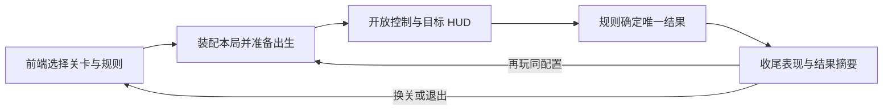
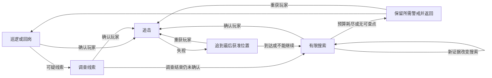
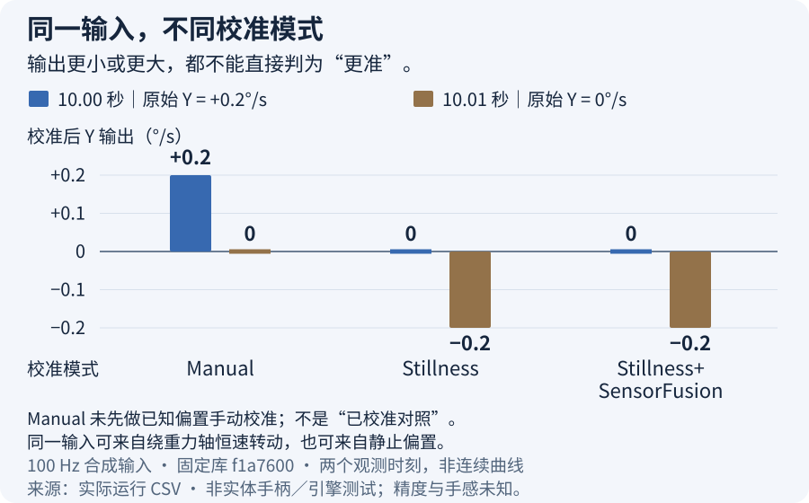
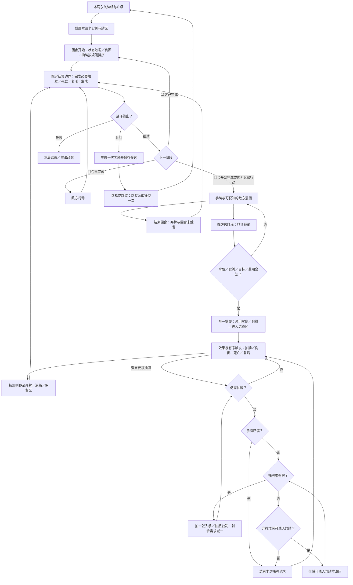
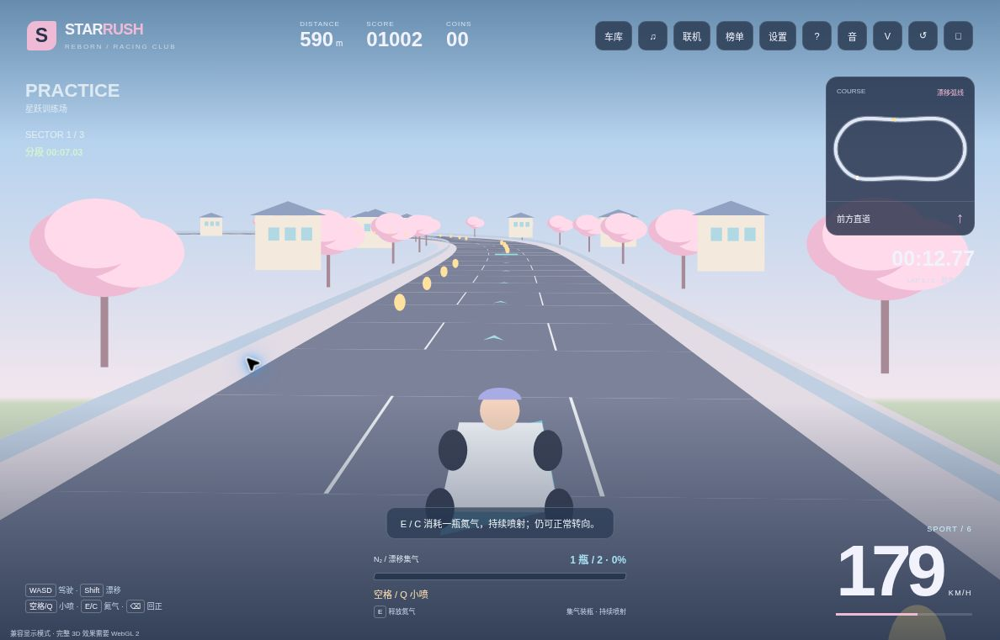
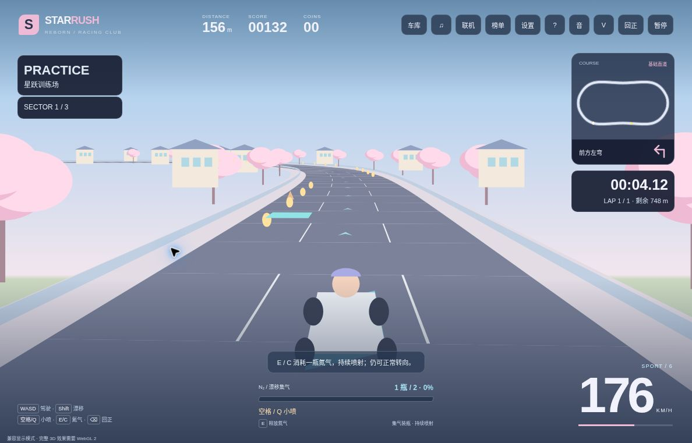
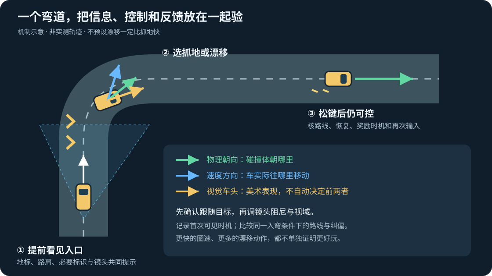
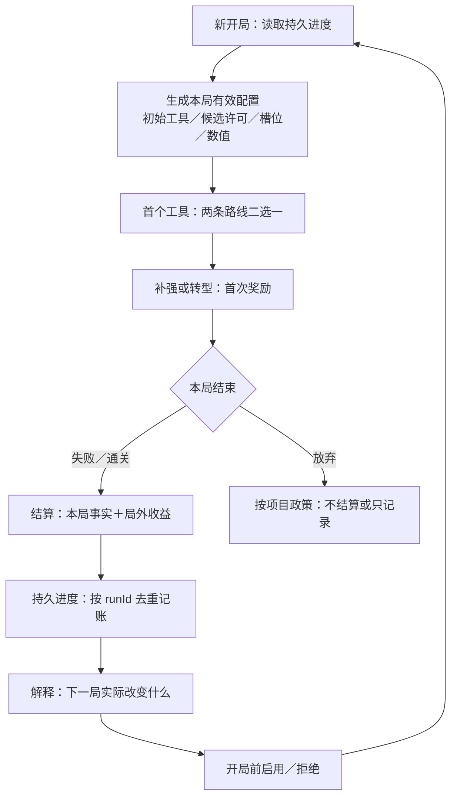
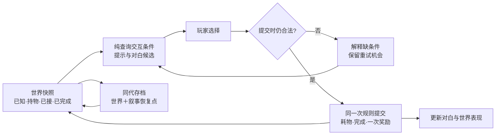

# Gameplay 架构：让第二次修改仍然可靠

> 核实／编辑：2026-10-23（UTC+8）；整页比较仍为 10-22 版本；各节原核实日期、时区与验证范围见节末（未单列者沿原研究链接）。

适用：单人独立游戏；Unity 为主、Unreal 对照。

评级：✅ 采用，🧪 试用，👀 评估，⛔ 暂缓；候选非实测排名。

**✅ 原生组件、可测试规则和局部状态机优先；明确状态所有者、结算点、退出清理再加框架。** HFSM／行为树／GAS／ECS 各解不同问题。

AI 分工和验收均由本页契约与 [WP11](../../docs/research/2026-10-14-game-wp11-gameplay-architecture.md) 推导，不是模型能力实测。本页运行证据来自明确列出的合成／离线检查与观察：MOBA 效用合成检查及已发布 v8 无画面对局、局内成长 8 条合成算术、陀螺固定库、inkjs 合成规则；Recast/Detour Node 的实跑仅限固定版本、同设备离线导航与 Crowd 数值行为；另有 Star-Rush 兼容模式 HUD／主弯键控观察。另有下文 MOBA 有界小兵分离、技能事实到原创动作的 Node 与软件 WebGL 接入；另有 §4 Luban 真实生成器与 TypeScript 消费者的配置二改检查；其余机制未实测，手感／性能／维护收益未知。**各节专项验收均须同时通过§11 通用验收。**

**来源与范围**：本页机制判断与 WP11 研究为[研究]；明确列出的合成／离线检查为[一手／研究]，运行观察为[一手／经验]。

## 30 秒结论：先保状态，再选框架

| 问题 | 第一个选择；升级条件 |
|---|---|
| 开局到下一局 | [装配→目标→结算→再玩](#2-游戏循环一局结束要真的结束)；先通消费者，快重试只缩展示、不跳结算 |
| 少量阶段／技能 | 组件＋小状态机；共享退出逻辑多才用 HFSM |
| 组合优先级 | 行为树／StateTree；先确认复用与编辑收益 |
| 补兵、换血还是撤退 | [薄效用层选意图](#utility-intent-selection)，既有 FSM 执行；先资格，再评分与反应 |
| 失视与脱身 | [追到线索、有限搜索、警戒返回](#p118-enemy-search-loop)，先分位置知识与行动资格 |
| 追击堵门 | 原生导航；区分通路、避让、停距与位移所有者 |
| 打断与重开 | 取消规则＋唯一结算；标签／效果／属性／预测反复出现再评估 GAS |
| 整招反复调动作／镜头／节奏 | 保规则结算；受控场景比较原生时间线编排，不把每次调节奏都改成代码 |
| CPU 或子系统能力不满足 | 热点先定位；预测等能力也可支持局部 ECS，保留组件制作链并计入边界成本 |
| 随机关卡 | 动作空间用房间组合，地形探索用受约束布局 |
| 整套关卡二改 | 保既有制作路径；二维重复批改才试语义源＋规则，不能免教学／进度返工 |
| 相机／关卡变化 | 原生相机、稳定 ID、可重置遭遇；按实际需求扩展 |
| 本地多人 | 同区且可读可共屏，自由分离比较分屏；核双方控制与楼层显隐 |
| 瞄准／命中 | 按误吸、精调、射程定位与意外接触分开改，保原控制和结算；见下文新增参照 |
| 影子／回放 | 展示录姿态，复现原因重演输入，倒带续玩需可恢复状态 |
| 赛车过弯 | [入口到出弯](#p112-racing-corner-loop)：联调控制、路线可读性与镜头，不按漂移次数评质量 |
| 升级／买装太晚 | [局内等级与装备](#in-match-growth)：分清够买、买到与首次使用，再调收入 |
| 局内奖励全无用 | [合法候选与供给底线](#reward-choice)：先保替代选择，再按缺口加袋／保底／有限重抽 |
| 卡牌循环 | [出牌到奖励](#p111-deckbuilding)：保实例身份、费用／触发顺序与本局牌组，先闭环再扩牌池 |
| 叙事回访 | [发现到交付](#p115-adventure-state)：分清已知、持物、选过与完成，失败可重试，世界与故事同代恢复 |

## 当前最高水平：生产上限怎样改变 Agent 的任务边界？

**默认保原生制作链，让复杂能力局部进入；没有跨玩法的最佳框架。** 下表按 2025–26 生产对照确定任务边界。

| 整页主选择 | 上限／替代路线与本页默认 | Agent 做什么；人用什么决定保留或撤回 |
|---|---|---|
| 结构（§1、3、5） | 小规则／FSM 起步；Survival Kids 为预测、Highstreet 为保 VR 生态各选混合 | Agent 拆边界；人核能力、制作链与总成本，不为统一全迁移 |
| 状态／命令（§2、4、6） | 按承诺选迁移、同步与回放；Wube 拆依赖才使功能可选，旧档可读仍可能改变运行 | Agent 查旧队列／恢复；人定允许改变的结果，验继续执行 |
| 整招／战斗（§7） | Sandfall 受控战场用 Sequencer、规则独立；NeoBards 恐怖战斗保数值未知 | Agent 接编排／取消；人验节奏、命中与悬念，场地约束过大退普通动作 |
| 视图／关卡（§8、9） | Lonely Mountains 换视角须返工；BG3 跨层需分屏；语义源不替教学设计 | Agent 查绑定、视口、跨关依赖／重置；人验路线、应对、舒适与学习 |
| 二改／复用（§10、11） | Phaser 2026-09 旧工程保版本，模块修复不自动进入 | Agent 列影响／留结果；人核迁移、许可与旧承诺，回归则退版／缩覆盖 |

**未验证：** 单人无美术团队收益、当前 Agent 二改工时及设备成本；Codex 案例仅支持时钟信任／缓冲寿命等局部风险。

**来源与范围**：2025–26 生产对照的日期、原文与限制见 [P76 整页比较][production]；[一手／研究]；核实 2026-10-22。

## 1. 先选够用的结构

**反复出现的能力先复用窄接口模块，由 Agent 组合。** 借 Phaser Studio 的碰撞／对象池、配置／陷阱封装及试玩反馈，不据此迁移 Unity／UE。

**旧游戏升级须主动比较局修与迁移。** Phaser Studio 2026-09 修方向／鼠标视角，旧作仍保原模型／引擎；核能力、验方向／鼠标捕获，回归就退版。AE 不同于开源 Phaser 4，API 不可照搬。

⛔ 暂缓自建通用循环、字符串消息总线；少量招式不先建 DSL，小关卡不先建大世界。👀 商业图需长期编辑收益；依赖升级时重评，许可见第 10 节。

**来源与范围**：Phaser Studio 案例沿 [WP11 专业候选](../../docs/research/2026-10-14-game-wp11-gameplay-architecture.md#近期-coding-agent-二改缓冲寿命与时钟信任)（2026-10-21）；版本化能力与旧游戏迁移沿 [版本化能力补查](../../docs/research/2026-10-14-game-wp11-gameplay-architecture.md#p53补查共享能力修复怎样进入旧游戏)（2026-10-22，UTC+8）；均为[一手／研究]。结构选型的暂缓项为[研究]推导；迁移成本为厂商报告，未实测。

## 2. 游戏循环：一局结束要真的结束

**✅ 先接通“选关／配置→可操作的一局→明确胜负→看懂结果→再玩”，用项目现有组件加一个本局流程所有者；不是先造状态机框架。** Session／Run 拥有本局目标、分数、敌人、临时奖励和任务；设置与已保存进度另管。阶段按需保留，暂停可以只是游玩中的子状态，短关卡也不必有独立结算场景。

### 选起点：小型本地循环与联网整局分开

| 项目问题 | 当前选择与实际接入起点 | 何时不适用 |
|---|---|---|
| 单机／本地小局，还缺开局与重开 | ✅ 保原组件；参考 PaddleBall 的 `GameManager → GameSetup` 装配、`ScoreManager` 接开局／得分／结束。重开不只是改阶段：分数消费者也创建新分数并刷新 UI | 其 SO 通道是教学架构，不要求每个通知都做资产；固定旧仓未找到整库许可，不直接复制其代码／素材 |
| 已用 NGO 的合作游戏，需全队胜负与下一局 | 👀 Boss Room：`ServerBossRoomState` 判全员倒下／Boss 死亡，结果经 `PersistentGameState` 进入 `ServerPostGameState`，`PlayAgain()` 回 `CharSelect` | 有网络场景同步、会话和服务依赖；单机不为菜单与再玩引入整套 NGO／UGS |
| 只是阶段数增加 | ✅ 先小枚举／局部状态对象；退出逻辑重复再沿§3升级 | FSM 教程能组织状态，不能替你实现目标、结果、奖励和所有重置消费者 |

Boss Room 是 Unity Companion 许可的完整教学项目，不是最少代码方案；固定工程为 Unity 6000.0.52f1／NGO 2.4.3。上述版本与调用链是源码阅读，不代表在当前项目运行过。源码、许可、社区对照见节末研究。

### 一条完整制作链：先让第一局和第二局都能玩



1. **从已有玩法入口装配，不从菜单另建一套游戏。** 找到现有角色生成、敌人／关卡加载、输入、HUD 与计分组件；前端只提交关卡／模式／难度／种子等运行配置。加载完成后建立新的本局状态，放好角色、镜头和目标，最后开放操作。编辑器直进关卡与正式启动走同一装配方法，避免“从菜单启动才正常”。
2. **把目标接到真实规则事实。** 例如先到目标分、Boss 死亡、出口达成或全员失败；HUD 订阅同一目标进度，不自己猜胜负。把 `TryFinish(结果)` 视为项目内一个窄入口：它只接受尚未结束的本局结果；同帧可能达标又死亡时，先汇总该步终局事实、按玩法约定仲裁，再调用它，而不是谁先回调谁赢。
3. **结束时先冻结结果，再演收尾。** 保存胜负原因、成绩、目标完成情况和本局奖励摘要；禁止继续得分／产出，但允许死亡、庆祝、镜头、音效完成。结果 UI 读摘要，不去读已经销毁的角色。永久解锁／奖励由既有进度系统接收一次，本局临时奖励不能靠结果动画结束再决定归属。
4. **结果页让玩家知道“为什么”和“下一步”。** 先展示胜负原因、一个主要成绩／进度变化及再玩／返回操作；手柄默认焦点落到合适按钮。先做好这三件事，再加逐项计分动画、排行榜或复杂战报。输入从玩法切到结果操作，确认键不能同时发起下一局攻击。
5. **再玩创建新的本局状态，保留明确允许保留的东西。** 小场景先采用项目现有重载／重建路径；只有目标设备的再玩等待确实影响体验，再改局部对象重置。复用场景时逐一重置目标、得分、角色／敌人、投射物、掉落、计时和 HUD，恢复出生与镜头；保留设置／解锁，是否保留随机种子由模式决定。旧回调不得写新局，订阅与任务回基线。

这里的 `TryFinish` 是职责示意，不是需要安装的新 API。Unity 继续用 Update／FixedUpdate；游戏、物理、菜单与收尾表现的时间来源分别明确，不能靠 `timeScale=0` 同时解决所有阶段。UE 沿 GameInstance 跨关卡、GameMode 随关卡、Pawn／Controller 分工，常驻服务不留旧世界引用。

### 多回合比赛：换边不换队伍，回合结束不等于整场结束

**✅ 用既有规则结算每回合，比赛层只聚合已确定的结果并决定下一步。** 有限比赛不需要重写模拟或引入联网框架；先把稳定的队伍身份、每回合攻守身份和整场生命周期分开。下表对应 FPS 网站 v14 的旁置离线训练赛：两侧各三回合，满六回合可平局；这是该模式的会话设计，不是 CS2 赛制或品质证明。

| 边界 | 保留什么 | 必须完成什么；常见错法 |
|---|---|---|
| 回合结算 | 队伍身份、整场比分与已完成回合摘要 | 模拟先产出唯一 `result.team`／原因；比赛层再记一次。不要按当前“进攻方”累加长期比分，也不要每个 UI 帧重复记胜场 |
| 下一回合 | 同一比赛、队伍比分、回合记录；该模拟的累计 tick | 走原 `Game.nextRound()` 重建角色／物理，重置角色／弹药，清本回合交互与事件，再刷新控制、声音、视图及 HUD。回合截止时间由当前模拟时间推出，不随意把累计时钟归零 |
| 半场换边 | 玩家所属队伍、该队比分、此前各回合的攻守快照 | 由规则重新分配 `side` 与出生点；旧回合记录保持结算时的攻守。不能交换队伍 ID 或用当前 `side` 重画所有历史记录 |
| 整场结束 | 最终比分和不可被 UI 改写的摘要 | 关闭“下一回合”通路，结果页提供再开整场。不是按钮改成“再玩”但仍调用 `nextRound()`，否则会暗中进入第七回合 |
| 再开整场 | 已选择的难度／设置、可复用的静态导航与资源 | 先创建新 Game，成功后替换并释放旧 Game、清比赛记录、重建机器人和重置各展示消费者，回部署确认。新 Game 创建失败时保留旧结果；后续消费者装配失败的回滚未验证，不能把它当成整段事务保证，也不自动恢复控制 |

实现时抓住三个窄接缝：

1. **结算只消费事实，不另判胜负。** 模拟负责目标、伤害、时间边界与团队计分；比赛层在模拟首次进入 `over` 后读取结果，再暂停输入并播放收尾。摘要复制值，不持有之后会复用的角色对象；给 UI 的记录也返回副本。
2. **记录去重和推进资格用同一事实。** 当前本地连续流程只接受 `round === 已记录数 + 1`，且不超过六回合；下一回合要求当前已结束、结果已记录、整场尚未结束。这个顺序门槛足够处理本例的重复观察，但不支持缺回合、乱序消息或中途恢复。加入这些需求时再使用稳定的比赛／回合 ID、权威结果和去重记录，不能把数组长度当网络交付保证。
3. **一个入口处理整场重开。** 最后一回合后的 Next 转到既有 `restart()`，不再碰回合推进；重建期间拒绝重复发起，迟到的初始化在页面已离开时释放，不接到新局。局内暂停和收尾展示另用已有时钟政策，不能把停止模拟等同于停掉结果动画。

**引擎对照。** Unity 单机场景内可保留普通 C# 比赛记录，由现有流程组件调用；只有确需跨场景时才沿已有常驻所有者传结果，`LoadSceneAsync` 完成后仍要做消费者装配。已使用 NGO 的项目复用上表 Boss Room 的服务端结算／结果传递链，不把客户端 TrainingMatch 当服务器。UE 的 `AGameMode`／`AGameState` 已提供比赛状态分工；联网规则留服务端、公开结果由 GameState 同步。Godot 的 Autoload 可保存跨场景记录，但新比赛仍须显式清空；常驻不是“永不重置”。这里是接入建议，未在三个引擎实跑。

**让 Agent 验真实入口，而非只测新建的记录类。** 本例的 `tests/offline-training-v1/match.test.ts` 用实际 Game 跑六回合，验证三回合换边、3:3 平局、重复观察只记一次、观察不改模拟哈希和返回摘要不泄漏可变引用；`tests/offline-training-v1/client-match.test.ts` 执行真实客户端源码，确认第六回合后的按钮回调创建新 Game、比分与记录归零、没有第七回合，也没有偷偷重锁输入。后者替换了 DOM／视图／控制等环境依赖，因此仍需浏览器检查半场提示、结果可读性、暂停与连续点击，不能称已试玩。

**实现起点与范围**：[已发布源码 `19f718eb`](https://github.com/dbvv1/FPS-Like/tree/19f718ebd5570ed1fb962b30d4ee607dc1ec9f6f/src/candidates/offline-training-v1) 中的 `session/match.ts`、`client.ts`、`sim/game.ts` 与上述两份测试。六回合规则和终局重开已有 CPU 测试，原小节的四项独立重跑记录保留；浏览器证据另看已接收的 [smoke 报告](https://github.com/dbvv1/FPS-Like/blob/1125fc428dcc0f22be976258fb105a0596ef46a3/docs/quality/smoke/B-FPS-OFFLINE-SMOKE-20261028/19f718ebd557-E2mXmf/report.json)：RTX 5070 下核到 9 个机器人／10 名角色、自然首回合结束、下一回合保留记录，以及现有“重新开始”清空整场记录和比分。[网站 v14 旁置入口](https://dbvv1-fps-like.pretty-llama-9945.chatgpt.site/?gameplay=offline-training-v1&match=complete-v1&squads=offline-v1&environment=courtyard-v1)已交付，原默认入口保留；六回合整场、半场换边、终局再玩与真人视听手感仍未验，地图维持“可用”。[UE GameMode／GameState](https://dev.epicgames.com/documentation/en-us/unreal-engine/game-mode-and-game-state-in-unreal-engine)、[Unity LoadSceneAsync](https://docs.unity3d.com/6000.0/Documentation/ScriptReference/SceneManagement.SceneManager.LoadSceneAsync.html)、[Godot Autoload](https://docs.godotengine.org/en/stable/tutorials/scripting/singletons_autoload.html)为官方机制对照；PaddleBall／Boss Room 固定源码比较沿本节已有研究，不重复引入整套框架。核实 2026-10-28（UTC）。


### 第二次修改：失败快速重试，胜利保留结果

**先分“结算规则”和“结果停留时间”，再缩短等待。** 高频失败的短挑战可在保留死因反馈后直达重试；首次胜利／有新解锁时仍给完整结果。为两条路径复用相同的结算与装配入口，快捷重试跳过展示，不跳过该局结果记录，也不重新发一次奖励。

- 把等待拆成**失败可读反馈、真正的重置／加载、装饰性停留**。先去掉无信息黑屏，再优化实测最慢的重置段；不要以加速所有动画掩盖加载，也不把示例的固定等待秒数当品类标准。
- 重试按键可在收尾时记录一次意图，本局结束后消费它并启动一次新局装配；新局就绪才开控，避免连按跳过下一局。需再次按下还是按住自动继续，按输入方案明确。
- 试玩连续失败时，比较“有死因反馈但能快重试”和“完整结果停留”；再单独看首次胜利是否有成就感。社区同时有讨厌空等与需要短暂喘息的反馈，不能推出所有游戏都应零延迟。

### AI 怎么接，怎样验收

**AI 先画出现有开局、目标事实、结束、结果 UI、重开五个调用点，按上面顺序接通一条真实玩法；不交一个无人调用的 Session 类。** 再让它加“失败快重试／胜利看结果”的二改，追踪每个消费者哪些保留、哪些重建。常见失败是只清 UI 不清计分、只停角色不停刷怪、显示胜利后继续结算、重载关卡却保留常驻旧局状态。

**规则测试**验目标达成／失败／同帧冲突的既定结果、一次结果与奖励、再玩初值；**Play Mode／目标设备**跑前端启动→正常胜利→再玩→失败重试→返回再进，观察控制权、目标、镜头、音效与 HUD 全链；另验暂停时重试能恢复本局时钟、加载中返回前端后迟到完成不再开控；连续重开后再触发旧回调，验对象／订阅／任务回基线。用 Profiler 定位准备、加载与首次可操作帧的等待，记录玩家可重新做决定的时点，不只记录场景加载完成。人判断死因是否可读、结果是否有价值、再玩是否打断节奏；单纯测试通过不能决定等待时长。

**承诺离线收益才补算。** 购买／解锁依赖顺序就分批逐步；允许误差才粗步、规则允许才聚合。粗步可能漏自动化触发；跨边界重算，补算／在线不同时推进同一状态。见 [WP11 离线收益](../../docs/research/2026-10-14-game-wp11-gameplay-architecture.md#离线收益补研等待精度与结算边界)。

**可信经济比较服务器锚定／单调计时；纯本地可容许改钟，不强加在线。** Agent 实现时钟／结算，人定信任政策并验改钟、恢复、重复结算。作者修复与未知成本见 [WP11](../../docs/research/2026-10-14-game-wp11-gameplay-architecture.md#近期-coding-agent-二改缓冲寿命与时钟信任)。

**来源与范围**：[WP11 游戏循环：固定源码与选择](../../docs/research/2026-10-14-game-wp11-gameplay-architecture.md#1-游戏循环把一局结束做成真正的生命周期边界)，官方／源码为[一手]、2025 重生节奏原帖为[社区]，接入顺序与验收为[研究]；核实 2026-10-26。离线收益／时钟信任保留原研究与核实日期。

## 3. 状态机与行为树：先定义打断关系

**✅ 状态声明入口、出口、结束、打断优先级与清理。** 简单敌人用小 FSM；共享父层规则／退出等待多才 HFSM，多目标优先级／子树复用有收益才行为树。

**专项验收：** 异步未完时切状态，旧任务失效而新状态继续执行。

**按实际版本核生命周期。** Unity Behavior 1.0.16／UnityHFSM 2.3 的修订及 UE BT／StateTree 的并发、打断差异见研究，不能把图节点的退出当成所有任务结束。

简单敌人省图编辑器／多套决策。见 [WP11 状态机](../../docs/research/2026-10-14-game-wp11-gameplay-architecture.md#2-状态机行为树与-statetree先问什么会打断什么)。

**来源与范围**：Unity Behavior／UnityHFSM 修订与 UE 并发差异为[一手]；状态机选择与验收为[研究]。

<a id="p118-enemy-search-loop"></a>

### 敌人失去玩家后：追到线索、有限搜索、带着警戒返回

**✅ 逃脱属于玩法时，把“还能确认位置”“仍怀疑有人”“现在能执行动作”分开；搜索结束可以回岗，但不必洗掉警戒。** 简单敌人仍沿小状态机与原生导航，不为这条循环先造记忆框架。下面回答看到玩家后如何追、失视后搜哪里、何时放弃、被打断后怎样继续。

#### 作品给出的选择：逃掉不等于敌人失忆

**借搜索后的后果，不照搬搜索时长。** Shadows 的发行前开发者说明以分区警报、成对搜索和保留怀疑给重新潜入留空间；The Dark Mod 在短时盲追后清敌人引用，再按范围／可达性分派搜点。玩家既有喜欢逃脱工具的，也有反复躲屋顶、原地等搜索结束的反感，难度与移动能力也影响判断，不能统一靠延长搜索修复。

TDM 的精细光照感知也出现过性能／识别问题；**传感器须与关卡、反馈和成本一起验，不能替代搜索行为设计。** 来源、版本和固定调用链见 [P118 作品与反证](../../docs/research/wp11-combat.md#p118-enemy-search-loop)，不据作品说明推断最佳算法或公平感。

#### 一条可落地的循环：目的地来自证据，退出来自规则



图是玩法决策，不要求每个框一个类；调查完成、不可达或线索过期都必须有出口。死亡／失能等动作资格覆盖整条循环；重新看见玩家可以更新情报，但不能让眩晕中的角色立刻追击。

1. **看到：确认后追，不让微小遮挡频繁切状态。** 分开侦测条件与确认延迟／积累；以姿态、转头、提示等让玩家理解从怀疑到发现的变化。需要即时发现的敌种可例外，不能只改数值却保旧提示。
2. **失视：先保最后获准的位置。** 目标身份、位置、来源和时间分存；保留追击姿态的一小段宽限，不自动授权每帧刷新玩家坐标。若有意短时盲追、速度外推或队友报告，把范围与终止条件显式写进敌种规则。导演知道真值也不等于每个角色知道。
3. **到线索处：查有意义的位置，不在玩家周围随机撒点。** 小关卡先用设计者标的出口、转角、遮蔽物搜点；按线索区域、楼层、角色可达性筛选。到达、观察过、不可达是不同结果；不能因为路径结束，就宣称墙后已经搜净。
4. **搜索：限定本次投入，不把每帧旧线索当新事件。** 保存本次搜索的起点、剩余时间／候选和正在查的点。新声音可改调查方向，但不自动成为“已看见玩家”；重复同一报告是否延长、怎样延长，要有明确政策。多人搜同一区域时才加共享分派，避免全部挤向同一点。
5. **放弃：释放搜索任务，保留有价值的后果。** 短时不再精确定位，不代表尸体、入侵事实或警戒全清零。可回岗、守出口、呼援或保持更警惕，按玩法选一条可读默认；不是每种敌人都无限封锁出口。

**玩家站在可见但不可达的高台时，保留可见情报，改为本敌种允许的等待／守路／远程动作。** 不要靠无限重寻路或凭空读穿墙位置“补聪明”；追不上不等于不知道在哪。如果这让屋顶成为无成本反复收割点，先改敌种应对、撤退位置或场地，而不是给所有敌人攀爬能力。

#### 调参数：先确定玩家应获得什么机会

| 调节项 | 想改变的体验 | 先验哪种失败 |
|---|---|---|
| 确认延迟／警戒门槛、进入与退出差值 | 给短暂暴露补救机会，减少状态抖动 | 边缘反复闪现是否白嫖；真正暴露是否迟迟不追 |
| 失视宽限与位置更新政策 | 保追击连贯，同时让拐角脱身有意义 | 宽限内外绕到另一边，目的地是否符合声明的证据规则 |
| 搜索时间／范围、停点观察时长 | 压力中仍有换位、诱导或冒险穿过的选择 | 太短一转身就忘；太长只剩躲着等，扩大半径还误搜楼上 |
| 新线索权重与续期规则 | 让诱饵有用，又不让每声噪音洗掉刚确认的威胁 | 持续追视时抛诱饵是否强制转头；重复报告是否无限续期 |
| 事后警戒衰减、警报传播范围 | 让暴露有后果，又保重新潜入机会 | 一个小失误永久惊动全图；回岗瞬间恢复成从没发生过 |

先固定同一条逃脱路线，单独改会影响该机会的参数；没有通用“3秒忘记、10秒搜索”的最佳配方。记录从暴露、失视到重获／脱身的过程，人判断等待、可理解性和再次尝试意愿。

#### Unity 先落小规则；UE 沿原生感知，但别混淆遗忘

- **Unity 默认**：角色持有自己的感知／警戒／搜索状态，`NavMeshAgent`只执行获准目的地。`SamplePosition`找的是附近网格点，忽略障碍且可能选到另一层；还要核楼层、区域与实际路径。路径请求成功不等于抵达，区分 pending、complete、partial、invalid；通路与位移所有者沿下一节。
- **已有 Unity Behavior 图**：追击与搜索分别选目标／位置输入，核上游谁更新黑板。1.0.16修过导航不可达仍永久 Running，并提供默认开启的`FailIfUnreachable`；给失败分支一个调查／返回结果，先核工程版本与修复，不统一叠超时器。没用图的项目不必为搜索换框架。
- **UE 对照**：`Currently Perceived`、`Known Perceived`与刺激寿命不同。若玩法是“失去视觉若干秒后改查最后听见处”，不能等全部感官都遗忘才退出追击；按目标、感官维护该政策，重获同一目标才取消对应失视计时。作者实例是 StateTree，不据此判 BT 做不到。
- **明示宽限**：UE的`Auto Success Range from Last Seen Location`可让已见目标在一定范围内继续判作看见；先核这类配置，再查“为何遮住仍知道”。搜索改位置输入后还要终止旧的 Actor 跟踪任务。

#### 交给 AI 的二改卡：加诱饵与高台，不只让它“聪明点”

沿项目现有测试入口交一张带时间的轨迹表：`感知来源／目标／位置 → 警戒／决策 → 移动目的地／搜点结果`。先定位实时坐标读取者与搜索计时重置者，再修改规则、调试显示及测试；不同时换导航、动画和整个AI框架。

| 操作轨迹 | 自动可核的结果；另需引擎／人判断 |
|---|---|
| 看见A → 拐角失视 → A在墙后移动 → 到旧点 | 无新获准线索则不追随墙后新坐标；引擎核遮挡，人核这次转角是否真的提供脱身机会 |
| 失视A但保留其听觉 → 视觉期限到 → 同一旧声音重复通知 | 能退出视觉追击、调查允许的声音；旧事件不意外续满整个搜索，不能把听见等同看见 |
| 两个搜点，一个不可达／另一层 → 无新证据 | 不永久Running、不把未查点报已查；按预算结束或明确守点，实际路线由引擎验 |
| 搜索中重获A → 眩晕 → 仍可见 → 恢复 | 情报可更新，失能时不移动／开新攻击；恢复按当前情报重选，而非盲续旧搜点 |
| A消失、换目标B、死亡／池回收后再收到旧结果 | 旧任务不改新目标／新实例；取消与已承诺攻击沿§3、§7和§11，不在此另立结算规则 |
| 放弃后同处再入侵；有第二名敌人与相邻分区 | 保声明的警戒和传播边界；真人能看懂当前是在追、搜还是回岗，不能只看内部状态通过 |

这些是**待执行验收**，纯事件回放至多验证规则，不证明实际感知、导航、敌人智力或玩家体验。若搜点维护和例外成本高于玩法收益，就缩成“最后线索处查看后返回”，保住可解释的逃脱，不急升GOAP或学习模型。

**来源与范围**：作品说明与固定源码为[一手／研究]；社区反馈为[社区]；Unity/UE 感知与导航行为按版本核引擎文档为[一手]；搜索循环、参数与验收卡为本页[研究]推导。核实 2026-10-23（UTC+8）；未运行游戏、引擎或模型，最高水平及玩家公平感未知。

<a id="utility-intent-selection"></a>

### 效用选意图：补兵、换血、撤退与推塔怎样取舍

**✅ 少量角色用薄效用层选择“现在想做什么”，沿现有 FSM 执行“怎样做完”。** 候选是“意图＋目标／位置”：争取补刀窗口、抓对手技能空档换血、危险超过收益时撤退、兵线覆盖时推进塔。伤害、冷却和视野规则与玩家共用；难度先调反应时间、瞄准误差和有限决策噪声，让玩家既能看懂选择，也有应对机会。MOBA-Like 已发布的 v8 采用了逐角色效用选择与普通输入命令执行；下文的统一候选接口和四个评分式仍是可选设计，不冒充该实现逐项采用。

**已有 BT／StateTree 就保执行图，只在需要动态取舍的局部分支评分。** 固定“巡逻→追击→攻击”用条件和 FSM 更省；多设计者反复调曲线才评估 Utility Intelligence 的编辑器；需求变成多步可替换的达成路径才比较 GOAP。效用层不代替路径、技能承诺或规划。Paragon 的参数化 BT 与技能选择器、DA:I 的合法动作／用途候选、GW2 的考虑项曲线支持这种分工；各路线许可、成本和固定源码反例集中在 [WP11 效用模块](../../docs/research/2026-10-14-game-wp11-gameplay-architecture.md#utility-intent-evidence)。

#### 先筛资格，再问有多值得

**只用获准情报生成候选，资格与偏好分别实现。** 沿[敌人搜索](#p118-enemy-search-loop)保存身份、位置、来源和时间；感知更新不赋予行动能力。冷却、资源和可作用目标复用技能模块，塔仇恨复用战斗模块，可达性复用导航模块。

| 候选 | 发起前的资格 | 值得程度与退出 |
|---|---|---|
| 补兵＋小兵 ID | 合法已知目标、可用攻击手段、可接近位置；无最后一击机制的 PvE 改为清杂／争取资源 | 估计接触时的补刀窗口；目标死亡、窗口结束或不可接近时终止／重选 |
| 换血＋英雄 ID | 目标仍可交战，至少一种攻击可执行或处在有限接近范围 | 看可兑现输出、行动后资源和位置；完成一次约定交换后重评，残血不等于必杀 |
| 撤退＋恢复位置 | 有撤退或恢复原因、能移动，锚点仍存在且可用，有可达且风险较低的位置 | 撤离与到达后的恢复分别验；恢复满足退出条件才重评推进，锚点失效／危险变化另走退出政策 |
| 推塔＋塔 ID | 塔可被作用，兵线／抗塔条件符合项目规则，有攻击位置 | 看覆盖时长和撤离成本；覆盖结束或塔转火触发反应到期重评，是否取消当前攻击仍按技能规则 |

把三层检查分开，尤其避免“冷却开始了，所以取消刚开始的施法”：

1. **发起资格**核冷却、资源、射程和控制状态，决定能否开始新动作。有限接近与直接施放是不同命令；未进射程不能发施法命令，定身也不自动等于不能攻击。
2. **持续合法性**由执行器按技能阶段核死亡、控制、目标丢失与取消。已扣资源、进入冷却不使本次施放自动非法；已发出的弹体沿技能规则继续结算。
3. **机会／风险条件**用已到反应时点的情报决定是否值得继续。兵线覆盖减少、塔转火等战术变化不能绕过反应延迟；规则明确的硬非法才即时处理。

**锚点仍在容器里，不代表仍可用。** MOBA 的外塔对象毁坏后继续保留；v7 起在推进等待点过滤外塔的存活资格，并在没有存活外塔时沿原基地集结点回退。测试应同时覆盖“死外塔仍有坐标”“活外塔”“根本没有该塔”，不能通过给死塔加偏好惩罚修复资格错误；存活也不等于没有威胁。撤退没有可达出口时，选择项目已有的防御／原地攻击／等待策略。候选先限于附近获准单位和少量撤退锚点，同一快照按稳定 ID 排序；先做便宜资格检查，再查路径和预计接触，避免各考虑项重复扫全世界。未知敌情使用声明过的保守风险档并记“不确定”，不当作零风险或补读真值。

#### 用能手算的曲线起步

**把原始量映射为 0–1 偏好，再比较意图。** 分值不是概率或真实收益；为每个输入写方向、上下限和缺失政策。必要输入缺失、NaN／无穷值应拒绝该候选并给原因；配置错误在加载时阻止启用。

- **机会窗口 W**：按意图具名定义。补刀根据前摇、弹道飞行和已知在途伤害估计接触时的血量区间；可击杀时机会高，确定会提前死亡则候选失效。推塔估计能完成攻击并撤离的推进机会窗口，不用补刀血量窗口。估计误差可配置，不读取未来结果。
- **危险 R**：在统一的短观察时域内估计敌方可兑现伤害／自身剩余生命，截断到 0–1，并计入塔仇恨、已知控制与逃离暴露。改变时域要重标相关曲线，不另建完整战斗预测器。
- **低血需求 L**：`clamp((hSafe - hpFraction)/(hSafe - hCritical), 0, 1)`，满足 `0 <= hCritical < hSafe <= 1`；低于临界血量时饱和。
- **窗口、覆盖、资源**：从“来不及／勉强／能完整做完”的分段线性锚点开始。兵线覆盖要和攻击承诺＋撤离耗时比较，而非只数附近小兵。

下面是**实现与测试用的合成起点，未调平衡**。所有输入在 0–1，`clamp` 截断到 0–1；V 为本次目标收益档、A 为短时交换优势、M 为行动后资源余量、P 为站位质量、C 为兵线覆盖、E 为撤离有效性。原始输入与曲线在角色配置旁具名保存。

| 意图 | 合成评分 | 首先检查什么 |
|---|---|---|
| 补兵 | `clamp(0.65W + 0.35V - 0.70R)` | 想珍惜补刀先调 W，不先降低所有风险 |
| 换血 | `clamp(0.55A + 0.25M + 0.20P - 0.80R)` | A 是否错误计入尚未就绪的技能 |
| 推塔 | `clamp(0.65W + 0.35C - 0.90R)` | 覆盖消失后的资格／退出，再调塔的偏好 |
| 撤退 | `clamp(0.80max(L,R) + 0.20E)` | 先满足撤退原因；max 避免低血与按剩余血量估计的危险重复累加 |

加权和减风险便于解释各项贡献，硬约束仍在资格层。若改连乘，要重验因素数量和零分含义：`0.8×0.8=0.64`，再加一个 0.8 就降为 0.512，并非动作真的变差；归一化或补偿也不能替代跨意图校准。每加一个考虑项，先重跑原四类场景。

#### 反应、切换与技能承诺各管一件事

**先核资格、执行结果与真实切换，再决定是否加差值门槛。** 确有分数微抖时，比较当前候选在新快照里的重算分；目标变化也算换候选，持续合法性失效按技能阶段处理，不受评分惯性保护。下面是需要惯性时的接线，不是每个角色都必须加的锁。

```text
每逻辑步：执行器处理死亡／终局／控制，按动作阶段核持续合法性
到决策时点：用已到反应时间的情报生成并评分
  无正分合法候选 -> 提交回退请求，不立即取消合法承诺
  当前意图候选失效 -> 请求退出，跳过惯性比较；实际取消仍按技能阶段
  否则切换要求：新分 - 当前重算分 > switchMargin
  非强制请求（含回退）遇合法不可打断窗口 -> 记录请求
  承诺结束 -> 重新核意图／目标，再提交给执行器
真正发命令前：再核目标、冷却、距离、资源、动作资格；选择阶段不扣资源
```

例如施法恢复期所有候选为零，仍完成合法恢复，再回退。决定引入惯性时只设一个切换差值，不叠最短驻留和随机锁定；技能承诺仍来自技能系统。目标死亡／失视是否取消由技能类型决定，已发出的非追踪弹体可以继续飞行。死亡／终局等强制退出覆盖承诺，塔仇恨和覆盖变化则先走反应政策。

**恢复需要自己的完成条件，不能拿通用切换惯性替代。** 到达恢复点后，观察实际回血、停留时长、退出时血量和再次推进的结果；无敌人在身边不等于没有恢复需求。MOBA 已发布 v8 的超时局中，英雄在基地退路没有损失生命，却多次在约三成血量时从撤退转为推塔。旧恢复承诺候选减少了超时，但高低难度结果未达原目标，因此没有直接采用。修订应单独比较恢复阶段、锚点危险退出与难度失误，不同时加额外回血或改数值；正常完成的对局也会频繁切换，次数少不是验收目标。

**反应延迟是延后利用新情报，不是冻结角色。** 感知延迟、决策频率、技能前摇分开配置；例如 30 Hz 逻辑每若干 tick 普通重评，持续合法性仍逐步检查。反应事件保存到期 tick，不因轮询不断续期；等待中的候选失效就丢弃重评，不能迟到施放旧目标。

**反应记忆按目标的当前生命期失效，而不是永久记住一个实体 ID。** MOBA v8 在自身死亡或已知目标死亡／移除时清理首次识别计时；同一 ID 近距复活后重新获取并等待反应时间，失能／施法的提前返回也不能漏掉资格清理。它只清反应记忆，不把位置跟踪、移动承诺和技能阶段一并重置。该模拟没有战争迷雾，死亡本就在获准全状态中；有迷雾的项目须用自己的可观察失效事件，不能照抄全图死亡查询。这不是所有动作共用的反应锁。

调试先关闭噪声，以稳定 ID 解同分。需要变化时，只对合格且接近最佳的候选加有限噪声，不改变强制状态或安全底线；角色使用独立带种子随机流并记抽样序号；同一角色的评分噪声、失误和瞄准若共流，跳过一段评分也会移动后续抽样，比较前后行为时要明确这一点。瞄准误差在瞄准层采样，不改伤害结算。回放保存内容／AI 配置版本、反应队列和随机状态；只有初始种子不足以抵御枚举顺序变化。

#### 用三个接缝接回现有执行器

**接口只分情报快照、纯选择函数、意图执行。** Unity 用角色实例持有运行状态、SO 或已有定义放配置；TypeScript 用只读内容和逐角色数据；UE 沿现有 Blackboard／BT 或 StateTree。评分函数不发移动、不扣资源、不结算伤害。


`IntentDecision` 至少含意图、目标 ID／位置、快照 tick、原因和决策 ID。执行器沿已有移动／技能处理“接近→前摇／施放→恢复→完成”，返回成功、不可达、失效或打断。同意图同目标不每次重新进入；退出取消旧导航／异步请求，迟到回调凭决策 ID 失效。不可达结果回到候选层，按目标和场景变化允许重试，不每 tick 重发失败路径。

战术意图与技能用途分开：“撤退”可走路或用位移，“换血”可普攻或施法。沿技能定义补伤害、控制、保命、位移、合法目标类别等少量用途，不为每个英雄复制执行树；新增方向弹道时更新接触窗口和瞄准输入，仍走同一技能命令与命中规则。

#### 先看为什么选，再看是否做成

**调权重前先观察实际角色的候选与执行结果。** 按决策变化或失败记录 tick、情报来源／年龄、资格拒绝理由、原始量→曲线值→总分、旧新候选及差值、反应到期 tick、执行阶段与结果；诊断时才展开全部分项。

| 可复现操作 | 要核的因果 |
|---|---|
| 固定兵线，只移动补刀窗口 | 选择随窗口改变，没有未来真值输入 |
| 只增加威胁或塔转火 | 到反应时点后攻击降分／退出，撤退有实际出口 |
| 分数小幅交叉，再明显拉开 | 小波动保当前，明显优势才切；硬非法按阶段退出，软风险经过反应 |
| 延迟期目标死亡后同 ID 近距复活、自身死亡后重见、施法中眩晕、旧路径晚返回 | 重新获取反应期，不迟发非法命令；保应保留的跟踪与技能状态，清理所有者仍唯一 |
| 无目标／全零、NaN、不可达撤退点 | 显式回退或拒绝异常；合法恢复期全零不抢断承诺 |
| 同配置／种子／命令，分别改变候选枚举与单位结算顺序 | 分开比较选择结果与战斗结果；同 seed 可重放不等于阵营公平，跨运行时浮点确定性另验 |

原 19 项合成检查只覆盖曲线与选择器算术；MOBA 的真实 Node 模拟另验活塔资格、死亡后重获反应期和旧版本命令回放，并实际跑正常 200／高低难度 200／镜像 500 局。v8 仍有超时及镜像区间偏差，不能把测试通过当成行为目标全部通过。排查时沿现有对局记录意图时长、无效命令、塔伤死亡和放弃原因，下钻到 seed／tick；比较技能／失误时用实际可交战时间或合法机会作分母，不只比较总伤害。具体运行入口与当前差距见固定源码和 brief，数值目标仍按该案例的校准规则处理。真实试玩再判出手是否留机会、撤退是否可理解和套路是否单一；高胜率不能证明像人。

#### 二改：先接新英雄与弹道，再扩团队意图

**当前 1v1 先验第二英雄与方向弹道怎样经过同一条链，不为演示支援先造 3v3。** MOBA 已有第二英雄和 v1 指向 Q／v2 起方向弹道的版本化模拟与回放；这说明命令与技能定义可演进，不代表本节完整效用蓝图或真实手感已经验收。 复用技能前摇、范围、弹速和合法目标，更新预测窗口、风险与瞄准。比较同场景轨迹：新增危险前能换血，危险出现后放弃承诺外进攻，危险消失且情报到期后能恢复。旧回放保旧配置，或明确拒绝版本不匹配。

以后允许多英雄，再由有来源和有效期的求援消息生成 `Support(allyId, position)`：资格核仍需帮助、来得及且可达，评分比较支援价值、赶路、离线损失和到场危险；请求结束／过期、目标改变或自身必须撤退时释放。确有拥挤才由现有队伍层管理有限支援名额与到期释放，团队目标和局部战术分工，不让角色互改评分或获得全图真值。

交给编码 Agent：保原感知、导航、技能与执行所有者，实现具名候选／曲线、选择结果和观察接口，交四类正常取舍、第二英雄＋方向弹道二改、失败 seed／tick 和可重放命令。每加技能都重写权重时，先查输入语义、重复风险和动作粒度；调参成本高而玩家感知不到收益，就退少量优先规则＋局部评分。

**来源与范围**：作者实践、现成路线和原 19 项合成检查沿 [WP11](../../docs/research/2026-10-14-game-wp11-gameplay-architecture.md#utility-intent-evidence) 的原核实日期。真实消费者核实 2026-10-26：[已发布 v8 AI](https://github.com/dbvv1/MOBA-Like/blob/c5c01ba414cc5f322631b7ed7bbbe5bfa10853f7/src/sim/ai.ts)、[活塔反例](https://github.com/dbvv1/MOBA-Like/blob/c5c01ba414cc5f322631b7ed7bbbe5bfa10853f7/tests/live-anchor.test.ts)、[反应生命期反例](https://github.com/dbvv1/MOBA-Like/blob/c5c01ba414cc5f322631b7ed7bbbe5bfa10853f7/tests/reaction-life.test.ts)、[brief 与校准入口](https://github.com/dbvv1/MOBA-Like/blob/c5c01ba414cc5f322631b7ed7bbbe5bfa10853f7/docs/brief.md)。独立 v9 单位分阶段结算仍为非默认候选；其无英雄对称波线保持对称却不自行终局，不能拿对称测试代替正常游戏与真人手感。

<a id="navigation-production"></a>

### 追击与让路：有路径不等于走得自然

**✅ 先用已有导航做完整移动链：关卡烘焙出通路，路径查询决定走哪，局部避让决定眼前怎么让，移动消费者负责真正位移。** 验收目标是单位从出生点出发、绕过阻挡、穿过允许的门，在攻击距离停下；不要把“返回一条路径”当作追击完成。感知与效用层只交获准的目的地，技能／状态机仍决定何时可以移动。

#### 默认选哪条路线

| 当前工程 | 起步方案 | 成本与何时换 |
|---|---|---|
| Unity 角色关卡 | AI Navigation 的 NavMeshSurface 烘焙＋NavMeshAgent，沿已有移动组件 | 制作端维护可走几何、Agent Type 与区域；运行端承担路径／避让。已有路径够用就不再接另一套 Crowd；堵路、停距或位移所有者错误先修对应层。 |
| UE 角色关卡 | 原生导航＋已有移动组件；RVO 与 Detour Crowd 择一 | RVO 可离开 NavMesh；需要走廊约束与群体配置再选 Detour Crowd，并核最大 Agent 数。不要叠开两个避让器。 |
| Node／独立无画面模拟，需要实际路径与群体移动 | 🧪 固定 Recast/Detour JS 封装，静态关卡先离线烘焙，再导入运行 | `recast-navigation@0.43.1` 为 MIT，已有查询／Crowd 可借；自己接对象寿命、移动权和回放。WASM、导航数据、查询与近邻更新都算成本，不把小样通过当规模预算。 |
| 已有格子地图或简单开放场地 | 保现有格子通路／简单移动，测得问题再增加能力 | 仅为“有 AI”引入 navmesh 不划算；原生满足即停。需动态几何才比较局部更新／tile，而不是每帧全场重烘。 |

本节的可运行起点是 [离线 Recast 小例](https://github.com/dbvv1/a1dbv/blob/de8dea906383d9a3ee25acf2fc80646ebf98b9f3/experiments/recast-navigation/README.md)，不要求 Unity／UE 项目更换技术栈。它把制作端和移动端真正接起来；引擎默认沿既有官方能力，未做跨引擎性能比较。

#### 从作者关卡到运行中的角色

1. **先定角色能通过的空间。** 统一米、上方向、角色半径／净高／可爬台阶／坡度；选进烘焙的是可走底面与影响通行的几何，不是所有装饰。门、跳跃和单向落差再表达为区域／连接及权限。关卡预览要能看到可走区域、窄口与目标点，不靠最终贴图猜通路。
2. **离线烘焙并保作者源。** Unity 以相应 Agent Type 配 NavMeshSurface、选收集范围／层再 Bake；独立 Node 小例用 `generateSoloNavMesh`。参数单位按实际 API：本例 `cs/ch=0.2m`，半径／净高／爬阶 `2/10/2` 是体素数，对应 `0.4/2/0.4m`；Crowd 的半径／高度则直接以米配置。换角色尺寸或体素大小，一起重算并查窄口，不能只改运行半径。
3. **把导航数据与关卡版本一起发布。** 小例用 `exportNavMesh`，保存几何身份、烘焙配置、库版本、字节数与 hash；旧版本不覆盖。运行时先核可信制作清单和实际 bytes，再 `importNavMesh`，不把烘焙成本塞进每个单位出生。引擎项目沿原生 NavMeshData／关卡资产打包，原则是加载的几何、通路和角色规格一致，不要求照搬本例 manifest。
4. **先拿合法目标，再查询完整通路。** 把已知目的地在小范围投影到正确导航面，限制楼层和最大偏差；再查该角色到目标的完整通路。投影不等于可达，非空路径也可能只到断路边；小例比较最后一个多边形是否为目标多边形。Unity 以 `pathPending/pathStatus` 等待并区分 complete／partial／invalid；失败回到意图层选守路、换目标或返回，不无限重发同一失败请求。
5. **给局部避让明确输入和容量。** 创建 Crowd 后按稳定 ID 顺序登记单位、半径、最大速度／加速度与近邻范围；目标合法且有完整通路后提交移动请求。小例每个模拟 tick 调一次 `crowd.update(1/30)`，既不拿渲染帧间隔当规则时间，也不另算一套排斥再叠上去。目标确实变化或通路失效时更新请求；固定跟随先用组件契约，测到查询热点才调整频率。
6. **把结果送到唯一移动消费者。** 本例 Crowd 已积分位置，消费者直接读取 `position()` 写模拟位置，渲染层插值显示；不要再按返回速度移动第二遍。引擎 Agent、刚体与 Root Motion 则选一个最终位移所有者，其他层接它的速度／位置。到达半径、攻击停距、转身、侧移与动画速度在此接合；释放单位先撤目标、移除 Agent，退出关卡再销毁 Crowd／Query／导航数据。

**身体卡位是玩法选择，不是避让参数越高越好。** Factorio 为解决同类互挡取消同类硬碰撞、保 separation；Overgrowth 分开接近／侧移／停距和受导航约束的排斥。需要封路、推挤或近战站位时保留相应身体规则。这个 Node 对穿例的最小距离略小于半径和，不能宣称零碰撞；攻击站位容量不足先改场地／站位政策，别用持续推开角色掩盖规则冲突。

#### 原生查询结果：失败也要结束持有

**🧪 固定使用 Recast JS 0.43.1 的项目，用公共低层查询做薄适配，把已返回的原生数组放进 `try/finally` 统一释放。** 该版 `computePath` 的部分失败出口早于清理代码；只在外面包 `try/finally` 拿不到它藏在内部的数组。修这一层即可，原导航网格、重规划政策和移动消费者继续使用；换版本时先核修复，再决定撤掉适配。

| 0.43.1 返回／传入什么 | 谁负责寿命 |
|---|---|
| `findPath(...).polys` | 调用者持有；成功、失败或空走廊均在用完后 `destroy()` |
| `findStraightPath` 的 `straightPath`、`straightPathFlags`、`straightPathRefs` | 三个返回数组都归调用者；只读了点坐标也要释放 flags／refs |
| 传给 `findStraightPath` 的原生 `polys` | 该调用借用，原持有者继续负责；不要误以为传入即转交所有权 |
| `findNearestPoly`／`closestPointOnPoly` 返回的坐标 | 已复制的 JS 数值；不照原生数组调用释放 |

给 Agent 的实现起点是 `findNearestPoly → findPath → 必要时 closestPointOnPoly → findStraightPath`：拿到结果后先保句柄，再判断状态；复制坐标为普通 JS 对象后返回，由 `finally` 释放本次已取得的四个数组。`getHeapView()` 仍指向 WASM 内存，不能作为长寿命结果交出去；返回前要复制。查询内部尚未返回句柄就抛错，仍需库自身负责清理。

**兼容适配保原路径语义，完整可达性仍由上层判断。** 原过滤器、投影范围、容量、起终点、错误结果和点去重规则一起保留；走廊没到目标多边形时，沿原 helper 把终点夹到最后一个多边形再求直线路径。这个局部路径可以 `success`，含义是查询成功而不是目的地已可达；是否允许向断路边移动，沿上面的完整／局部通路政策，不在修释放时暗改。

MOBA-Like 本地导航候选在同一失败查询重复 10,000 次后，残留的无符号整数数组 wrapper 从 10,000 个降为 0；另有 1,008 组新旧结果逐项相同，断路用例另保住了成功的局部路径。这里量的是对象数量，不是释放了多少字节；已观察的浏览器崩溃中路径失败数为 0，因此仍需另查崩溃原因。资源归属原则与 [04 资源释放](04-client-modules.md#资源释放所有权驻留总内存分别看)相通，具体 API 仅适用于该 JS 封装，Unity／UE 沿原生接口。

来源与范围：官方固定源码、所有权契约和本地候选的 CPU 实证见 [WP11 查询结果寿命](../../docs/research/wp11-combat.md#navigation-result-ownership)，核实 2026-10-27（UTC）；候选尚未发布，本节所有权验证来自 CPU 查询与模拟。

#### 已有开放战场：先修单位空间，再布置信息

**已有通路可用、问题只是小兵重叠时，先在模拟层尝试有界软分离，不急着换整套 Crowd，也不拿血条错位掩盖身体重叠。** MOBA 的实图比较否决了上下／左右挪血条加引线的方案：标签变成梯子，仍看不清对应单位。正式 v10 保原 Detour 路径与移动消费者，加入同帧接触修正后，接战个体有了前后左右空间；原英雄／小兵血条层级继续使用，无须叠加那套屏幕布局补丁。

可复用的是明确阶段与资格：存活小兵的同一位置快照参与成对计算，按稳定 ID 遍历、累加修正后统一限幅；双方同规则，眩晕兵保持位置但充当障碍，死亡单位不参与，英雄不被这层推开。案例限每秒 2 米的修正量、完全重合时按稳定 ID 选相反侧向，不消耗随机数；这是当前单位尺度的起点，不是通用避让参数。修正在原单位移动与已承诺普攻之后、塔更新之前提交；当 tick 已结算的攻击不因分离撤回，塔和下一 tick 的射程读取新位置。分离函数的输入排列不变性不等于整个战斗更新顺序无关。

**位置投影＋短路径检查只在本例凸矩形导航面上接受，不能当作任意墙角的连续扫掠。** 当前消费者限制投影距离、路径终点、长度和可见路径点的直达性；但公共路径封装会过滤 5 厘米内的短点，微小凹角可能已不可见。地图有凹角、洞或多层时，先补保真通路／扫掠查询与真实关卡反例，不能沿用“存在短路就直接写终点”的保证。拒绝修正时保原位置；密集站位仍可能重叠，需要规则层决定容量和卡位，不不断增大排斥量。

验收同时看正常接战画面、停距／失能／已承诺攻击，以及同种子输入重放。v10 会改变接敌、时长与胜负，必须给新对局明确版本，旧 1／2／7／8／9 回放仍走原规则；不拿旧 hash 证明新行为没变。本次实际采用只支持当前开放线形战场的可读性改善，不能替代上述引擎 Agent／Crowd 路线，也不证明 LoL 基本战斗品质已达标。

#### 二改：中央通路被封，旧局还怎样继续

**先从作者几何重烘新版本，再让新局接新数据；不要把旧 Crowd 的走廊引用直接带到另一张网格。** 可运行小例将中央 2 米宽的可走底面移除：v1 对穿可达，v2 两侧断开；v2 查询能给局部路径，但模块拒绝把它提交成完整移动，旧 v1 文件仍能复跑。这个二改验证了“源→新数据→运行查询”改变确实生效，不是运行时动态门。

若玩法要求同一局开门、移箱：Unity 通常静止的堵路箱可用 carving，默认 stationary 时序与查询下一帧生效要接入状态；移动人群仍交局部避让。门还要过滤角色能力、钥匙／权限和门状态，成本只表示偏好，不能禁止无权通行；单个角色没钥匙也不能全局关掉其他人可用的链接。连接动作沿原状态机等待／完成／打断，导航完成调用不是动画完成通知。原生 Agent 与 Obstacle 不同时启用来“加强避让”。独立 Recast 的动态障碍可进一步比较 TileCache，但本例只做离线换版。

需要同局换导航版本时，先定暂停点、重投影和重发合法目标的政策，清旧请求／路径；若角色落点已不可走，使用关卡规定的安全位置或拒绝迁移。只保存位置不能恢复 Crowd 的走廊和避让内部状态；目前可复跑的是从开局按输入重放，不能据此承诺中途精确续局。

#### 怎样交给 Agent 实现与验收

交付一条可追踪的链：`关卡／角色规格 → 导航制品身份 → 合法目的地 → 完整通路 → Crowd／Agent → 实际位置与到达结果`。先跑一个角色，再增加对向群体；记录失败目标、最小间距、到达时间及查询／移动总成本。然后改关卡几何，核新通路和旧版本恢复；接回技能打断、目标反向、堵门移开、窄门会车、追击转攻击／眩晕以及退出重启。真人最后看贴墙、急转、脚滑、身体卡位与自然度，性能看目标设备和实际单位量。

**回放记录明确输入、固定步长和导航身份，随机选择按局隔离。** 本例 8 单位、900 tick／30 Hz，同机两轮和新 Node 进程轨迹相同；库随机查询却共用 WASM FastRand，另一局交错查询会消耗本局序列。默认让自己的按局 PRNG 生成候选位置，再投影／核通路；不要以“各有一个 NavMeshQuery”推定随机流隔离。跨设备确定性、完整游戏回放和规模性能仍由真实消费者验。

来源与验证：原 Unity／UE、Factorio／Overgrowth、门权限机制沿 [WP11 导航](https://github.com/dbvv1/a1dbv/blob/de8dea906383d9a3ee25acf2fc80646ebf98b9f3/docs/research/wp11-combat.md#s19-1) 的 2026-10-15／20 核实；烘焙链及本仓 Node 实跑见 [制作接入与几何二改](https://github.com/dbvv1/a1dbv/blob/de8dea906383d9a3ee25acf2fc80646ebf98b9f3/docs/research/wp11-combat.md#navigation-production-evidence)，2026-10-26（UTC+8）。MOBA 已采用 Detour 路径与上述有界分离，未采用本节 Crowd 移动链。真实消费者核实 2026-10-26：固定 [v10 分离函数](https://github.com/dbvv1/MOBA-Like/blob/8972ebf392068c716ee7b12f427a1946d8d1206f/src/sim/minion-spacing.ts)、[实际提交位置](https://github.com/dbvv1/MOBA-Like/blob/8972ebf392068c716ee7b12f427a1946d8d1206f/src/sim/simulation.ts)、[接触／旧版本反例](https://github.com/dbvv1/MOBA-Like/blob/8972ebf392068c716ee7b12f427a1946d8d1206f/tests/minion-spacing.test.ts)及 [brief 的真实范围](https://github.com/dbvv1/MOBA-Like/blob/8972ebf392068c716ee7b12f427a1946d8d1206f/docs/brief.md)。上述软件 WebGL 正常接战由非作者实图复评；Unity／UE 未实跑。

## 4. 数据驱动：定义、实例、存档分开

**✅ 定义放稳定 ID／参数／资产，实例放活状态，存档放快照／schemaVersion。** 沿 SO／DataAsset／表格，校验 ID、引用、范围。

### 正常制作：先让一份作者数据真正改变消费者

**✅ 少量配置沿已有 JSON／ScriptableObject；跨表引用、批量作者输入或多语言消费者成为日常负担，再试 Luban。** 不因 AI 能生成很多表就迁移整个项目。SO 适合作者主要在 Unity 中改参数、拖资产；外部编辑与代码审阅为主的小项目用 JSON 加明确校验即可。**🧪 Luban 5.1** 适合把 schema、引用校验、代码生成收为一条链；本仓实际跑通生成器与 TypeScript 消费者，不把它宣布为所有规模的最佳方案。


| 当前项目 | 接入起点与取舍 |
|---|---|
| Unity Inspector 作者工作流 | 用现有 SO 定义敌人／技能，实例复制当前血量；生成器不是必需。参考官方 Paddle Ball 的 `GameDataSO → GameSetup → Ball/Paddle` 注入链，不照搬所有事件通道 |
| 已有 JSON 加载器的小项目 | 保现有文件、稳定 ID 和入口，先补范围／引用检查；加载后按 ID 查定义，禁止受伤时改共享 maxHp。不把配置改动变成新数据库工程 |
| 多表、多人或客户端／服务端共用 schema | 从敌人与技能两表试 Luban；按项目语言选官方生成模板，成功后才扩大。资产仍由引擎资产系统加载，字符串 ID 通过已有目录映射，表校验不会自动证明 Prefab 存在 |

**第一条可用链用两个敌人、两个技能即可。** 作者改 `maxHp`、移动速度、技能伤害／冷却；启动加载完整表集、解析引用，生成器或加载失败时保上一份有效数据。出生入口按稳定 ID 取定义，把初始血量写进实例。Unity 在既有 `Initialize(definition)` 或出生工厂注入；非 Unity 项目沿自己的实例构造器，不新建全局配置服务。选择“新局生效”最易解释；要“新出生生效”则明确存活敌人继续用哪版参数，别让 AI 默认即时改全场。

**调数值看玩家能否解释差异，不只看加载成功。** 同一测试场景固定敌人数量、距离和玩家装备：先单独调血量，观察击杀所需命中；再调速度／冷却，观察压迫和可反应窗口。人确认两种敌人职责是否区分，AI 输出改前后字段 diff 和消费者读值。这里的命中、节奏与资产表现仍须现有游戏试玩，不能用配置算术代替。

**正常二改：给侦察兵加护甲并换重击技能。** 保 `scout` ID，改显示名、maxHp，schema 增 `armor`，作者源补齐两种敌人的值，引用改向已有 `heavy`；重新生成、编译所有受影响消费者，再在实际伤害入口实现护甲语义。原先直接扣血的消费者不会因字段生成就自动减伤；AI 必须追调用点。删旧技能前查所有引用，涉及存档继续用下面的定义迁移检查。

[可运行实验](../../experiments/luban-data-production/README.md)已完成真实 Luban → 生成类型／JSON → TypeScript 编译 → Node 加载及上述字段／引用二改；缺引用、越界、重复 ID、缺字段、缺输入均失败，旧数据可重载。**特别注意：实测 Luban `--strict` 校验失败仍可写出数据文件；以退出码及结构化报告为准，不能把新文件直接复制进游戏。** 代码与数据应作为同一批候选，编译和加载验收后才接受。无需为此搭建热更新平台。

**AI 负责源数据批改、schema／生成调用、消费者适配与回归；人负责内容语义和试玩取舍。** 给 AI 原始 schema、真实加载入口、两个已有定义及预期差异，让它改作者源而非生成文件；约束失败时回到字段／引用修正，不删除验证器或换随机 ID。官方 Luban AI 文档可辅助理解 schema／诊断，本任务直接 CLI 足够，无需先装 MCP／Agent 服务。

**来源与核实（2026-10-26）**：[官方 SO 数据指南](https://unity.com/how-to/separate-game-data-logic-scriptable-objects)、[Luban 安装](https://www.datable.cn/docs/guide/install)与[AI 入口](https://www.datable.cn/docs/ai/overview)、固定源码／社区对照及实测详见 [WP11 正常生产链](../../docs/research/2026-10-14-game-wp11-gameplay-architecture.md#data-production-chain)。Luban／examples 为 MIT；Paddle Ball 旧源码仅作阅读参考，复用须核选定发行物许可。Unity／UE 原生接入与试玩未运行。

### 既有实例、存档与物品的专项检查

**专项验收：** 含旧队列的档升级后继续执行并重载，不止验加载。

同类也可有不同寿命：Chop Chop 血量重置反例见 [WP11 数据](../../docs/research/2026-10-14-game-wp11-gameplay-architecture.md#3-数据驱动配置静态定义活实例存档不能同一个对象)。

改名保引用，ID 不用序号。定配置即时／下次生成／新局生效；省 ORM／热更新。

**定义变化须比较迁移、保旧解释或退役旧 ID。** 缺新队列／同 ID 改逻辑均要查旧实例和待执行工作，声明损失／恢复条件；退配置不保证恢复旧状态。见 [WP11 定义二改](../../docs/research/2026-10-14-game-wp11-gameplay-architecture.md#定义二改能加载不代表旧实例仍匹配)。

**必选改可选先拆依赖，旧局先备份再续玩／重载。** Wube 拆 Recycler 后 Space Age 才可关闭 Quality；2.1 实验版升级仍可能改变运行且不能降版。Agent 查内容／队列／已建对象，人定保留／转换／停用，关闭不等于无损撤回。见 [P76 状态比较][production]。

**加耐久／强化先定可互换性。** 材料用栈，装备单件状态或使用前拆件；跨操作追踪才加身份，耐久不必逐件 ID。

OpenMW 拆分曾丢实例数据，见 [WP11 物品](../../docs/research/2026-10-14-game-wp11-gameplay-architecture.md#物品补研数量栈单件状态与转移身份)。

**👀 损毁先选守住构筑还是不断重建。** Cogmind 作者 2025 复盘将受击损耗配替代件，手册另有更稳定的 RPGLIKE 路线；据此作以下适用判断。

| 希望玩家做什么 | 借用的选择；撤回条件 |
|---|---|
| 保住长期构筑 | 保永久装备、降低损毁或有成本修复；若用治疗接替损耗，重核护甲与消耗资源价值 |
| 失去能力后临场重建 | 受击损毁配逃生与替代供给；只剩更慢的失败就缩减损耗 |
| 学会重建而非卡在缺件 | 比较按当前状态补给的辅助模式；若抹掉稀缺取舍，就收窄适用范围 |

**专项验收：** 改关键件损毁后，沿伤害／掉落链查撤退、替代与制造—回收的非预期供给，人验重建是否变苦役；社区既有喜爱动态构筑也有供给跟不上损失的焦虑反馈。见 [P106 供给与消耗](../../docs/research/2026-10-14-game-wp11-gameplay-architecture.md#p106-equipment-loss-supply)。

**来源与范围**：Chop Chop、Wube、OpenMW 与 Cogmind 的案例为[一手／研究]，社区反馈为[社区／研究]；数据分层、迁移与耐久判断为[研究]。

### 模组二改：局部补丁不要补成完整定义

**✅ 已有数据／编辑器够用，先保局部补丁；新素材走资产链，数据表达不了的行为再加窄代码。** 不为一个配方造平台。

| 二改风险（待验） | 这次改成什么 |
|---|---|
| 把遗漏字段补齐、复制整张数组 | 查补丁语义，检查编辑器往返 diff 是否扩大修改面 |
| 只验单个模组能加载 | 按发布承诺验组合／顺序；冲突可声明依赖或不兼容 |
| 修改后直接重新上传 | 核发布包及原条目身份，不覆盖不该改的说明 |

Timberborn 修改型 Blueprint 须开 `Disable Blueprint validation` 避免默认补齐，**并非关闭所有校验**；仍核数组替换、完整对象删除及加载顺序，交最小补丁／预期结果并验实际内容。版本与反例见 [P104 模组二改](../../docs/research/2026-10-14-game-wp11-gameplay-architecture.md#p104-mod-blueprint-patches)。

**来源与范围**：Timberborn 的 Blueprint 补丁语义为[一手]；模组二改风险与验收为[研究]。

## 5. 组件与 ECS：把一个完整循环做快，而不是全工程换架构

**✅ 原生组件接对象，普通类／函数管规则；先减无用工作和改算法，再比较局部 Jobs/Burst 与 Entities。** 批量同构 CPU 工作、预测栈等明确能力可以支持 ECS；GPU overdraw、昂贵动画或大量托管桥接不会仅因换数据容器消失。没有通用“多少对象就上 ECS”的门槛，UE 的 Mass 也不能直接照抄 Unity 的 API 与成本。

### 先选能完成当前制作目标的最小路线

| 读者正在做什么 | 默认与升级条件 | 能省什么，仍要承担什么 |
|---|---|---|
| 少量行为不同的角色／机关，已有 Animator、物理和 Inspector 工作流 | 保组件；把真正重复的更新集中，降低不必要的扫描频率 | 保制作链，集中管理本身不保证变快；先核主线程真正花在哪里 |
| 很多探测者找目标、同类数值计算，输入输出能连续存储 | 🧪 局部 Jobs/Burst，保 GameObject 作者／表现 | 可并行纯数据计算，但抽取位置、排序、同步与结果回写仍计成本；不需要先安装 Entities |
| 多个系统反复查询／组合相同数据，或已选 Netcode for Entities 等能力 | 👀 局部 Entities 子系统，保其余制作链 | 共享实体数据与查询；新增 baking、World／系统顺序、资源生命周期和托管桥接成本 |
| 大部分玩法与目标能力都按实体组织，团队接受该制作模式 | 比较完整 ECS 方案与原路线后决定 | V Rising／Survival Kids 是生产参照，不是单人项目必需底座；最高性价比须由自己的构建和二改证明 |

**完整第一版以“现有单位找到可攻击目标”为例：位置与资格 → 最近合法目标 → 原战斗系统发起攻击 → 原动画／UI 呈现。** 先固定是否按地面距离、射程、阵营、可见性和切目标节奏；优化不得悄悄改变这些规则。大量单位并不等于每帧每单位都全表扫描：先试按玩法节奏分批更新与空间划分，但保对近距离危险的及时反应。让玩家看到选对目标、不穿楼层锁敌、切换不过度抖动，比追一个空场循环的峰值重要。

### 从官方可读源码接入，不自造 ECS 框架

以下路径均相对 [固定官方 Samples](https://github.com/Unity-Technologies/EntityComponentSystemSamples/tree/6786a741ee1f118ed14cecfa02beae8e926937b0)；固定工程与许可见节末，不把不同包版本的 API 拼在一起。

1. **先把组件路线走完整。** `Dots101/Jobs101/Assets/TargetsAndSeekers/Step 1` 提供普通对象比较；Step 2／3 把位置拷入 `NativeArray`、用单作业／`IJobParallelFor` 求最近点，再回主线程消费。把已有单位位置和资格转为一次只读快照，输出单位 ID／无目标结果，交回原战斗负责人；不在这个纯数据 job 内访问托管 Animator／Transform 或直接重复结算伤害。数组复用、尺寸变化和释放按单位生命周期管理。
2. **先比较算法，再比较存储架构。** Jobs101 Step 4 已有按 X 排序、二分定位、按距离剪枝，不需要迁移实体。示例输出的是位置；游戏输出应携带原对象身份映射，不能把排序后的索引当敌人 ID。示例 `Schedule` 后立即 `Complete` 便于展示结果，实际项目依赖允许时安排其他工作、到消费者真正需要时再完成；若会引入一帧延迟，先明确目标选择是否允许，而非为跑分自动延迟。
3. **确需 Entities，保留可编辑源。** 从 `Dots101/Entities101/Assets/HelloCube/3. Prefabs` 读 `SpawnerAuthoring → Baker → Spawner.Prefab → SpawnSystem`；作者仍在 Inspector 选 Prefab、填参数，Baker 生成实体数据。把小子场景纳入既有场景加载路径，出生时实例化已烘焙 Prefab；不要运行时把整场景 GameObject 逐个“转实体”。读取其他 SO／资产数据时声明 baking 依赖，参数二改才会重烘焙到正确结果。
4. **在真实系统中找入口。** `14. ClosestTarget` 的 `SettingsAuthoring` 提供数量、Prefab、空间划分选项，`TargetingSystem` 演示查询、依赖和结果 Entity；`Target` 在这个样例中是“保存当前目标”的组件，不是凭名字就能当作所有可攻击者标签。实际项目先定义阵营／活状态／范围查询契约，再把候选结果接原攻击入口。样例的 Simple／KDTree 分支直接索引候选或取堆顶；接入资格过滤后须显式处理空集，输出 `Entity.Null`／无目标，不能照搬非空演示。初始化、计算、战斗消费、表现各定一位写入者；作业依赖与系统顺序分别核实，不能认为并行安排自动保证业务顺序。
5. **表现继续用成熟路径。** `7. GameObjectSync` 演示实体到 GameObject 的变换同步，`Firefighters/Step 4` 把动画角色和 HUD 接回托管对象；这些访问不能 Burst 编译。小量高品质角色可保原 Animator／UI，单向读模拟结果；大规模角色则把同步、动画、绘制加入整段预算，再考虑表现方案。ECS 查询快不等于动画、物理或渲染已经快。

### 正常二改：从地面敌人加一个飞行目标，再加暂时失去攻击资格

**先改玩法距离，再改数据和消费者。** 固定 ClosestTarget 样例的 `Simple` 路线用 XZ 平面，`None` 与 KDTree 用三维位置；平面演示可一致，加入高度后不再是等价实现。例如原点处单位面对 `(1,10,0)` 与 `(3,0,0)`：平面最近是前者，三维最近是后者。选择地面投影还是空间距离由玩法决定，AI 要同步两条算法、预期目标和调试画线，不能直接以 sample 的速度说明优劣。

**临时状态先选字段或 enableable，确需改变组件组合时再做结构变化。** 新增眩晕时，普通组件路线先改资格过滤；Entities 若要让查询暂时排除某类组件，可参考 `6. EnableableComponents`，它不改变 archetype，但普通查询把禁用组件视为不存在。每帧 Add／Remove 标签可能制造结构变化；使用 enableable 也要核读写同步，不是免费开关。死亡／出生通过明确时点处理，ECB 只是记录，播放之后才改变世界；消费者别在记录销毁后继续默认目标有效。

### AI 的完整任务与验收

**交给 AI：现有查询与战斗调用点、作者 Prefab、固定样例版本、目标距离／资格契约、预算场景和第二次内容修改。** 让它先给最小迁移边界，再交 source diff、实际接线和测试；不接受整库改成 Entities、为通过编译删动画／物理，或只交一个无消费者的 job。UI／输入／资产／存档仍沿各自模块。

验收同一组单位与目标：正常选敌、无候选、等距规则、飞行／高台、出生死亡、资格变化；对照原算法的目标身份，而非只比数量。作者改参数／Prefab 后重烘焙、运行构建，再验新单位确实使用新值；一份配置改动不应要求手改生成数据。若长期历史复用缓冲，快照要独立所有，防止下一帧覆盖撤销／回放记录；继续模拟后再撤销／重做，计复制成本与历史上限，见 [WP11 缓冲二改](../../docs/research/2026-10-14-game-wp11-gameplay-architecture.md#近期-coding-agent-二改缓冲寿命与时钟信任)。

**测整条循环与制作周转。** 在同玩法、资产、目标设备与出生／死亡密度下，分开记录抽取／索引构建／计算／等待／回写／后续系统，以及整帧 P95/P99、内存、首次与持续负载；比较原组件、局部 Jobs 和候选 Entities，不只录 ECB 而漏 playback。记录加飞行类型、换 Prefab／动画的实际改动；边界搬运吃掉收益就缩回子系统。剖析入口沿 [客户端性能链](04-client-modules.md#压低卡顿与设备耗用)，不另建无真实场景的性能榜。

**生产反例仍成立：** Survival Kids 为预测选 Netcode for Entities，单机仍承担双重模拟；Highstreet 为保 VR 生态退出混合物理，服务端核关键碰撞。它们支持按能力和制作链选范围，而非全 ECS。见 [P76 生产取舍][production]。

**来源与核实（2026-10-26）**：以上接线为固定官方样例源码及 [Baker 文档](https://docs.unity.cn/Packages/com.unity.entities@1.4/manual/baking-baker-overview.html)研究；工程 Unity `6000.2.10f1`，Entities101 锁定 Entities `1.4.3`／Entities Graphics `1.4.16`，Unity Companion License，仅按其 Unity 依赖项目条款复用。社区作者对学习成本与混合制作链的反馈、源码逐点依据及原生产参照见 [WP11 ECS](../../docs/research/2026-10-14-game-wp11-gameplay-architecture.md#4-组件jobsburstecs先用数据规模和预算选不用对象数口号选)。未运行原生样例，性能与制作提速未测；本版给出完整选择与接入路线，不宣称已迁移游戏。

## 6. 事件：命令有负责人，事实才广播

**✅ 局部调用，多观察者才用类型化事件。** 命令有负责人／结果，DamageApplied／EnemyDied 在提交后广播；明确时序、重入、丢弃政策。

**专项验收：** 死亡回调重入同一结算，奖励仍只提交一次。

晚加入 UI 读快照，必要时用操作身份拒绝旧事件。若接口只保当前逻辑步的事实，呈现须每次 step 后收取，不能只读最后渲染帧；[下文 MOBA 已采用接入](#skill-event-consumer)给出有界批与重开的实际消费。SO 通道属项目资产，换场景仍须退订；省字符串总线／完整事件溯源。见 [WP11 事件](../../docs/research/2026-10-14-game-wp11-gameplay-architecture.md#5-事件用于传播已发生事实别把一次命令拆成无人负责的广播)。

**区域任务响应对象进出就持续重选，仅指定对象才展开固定队列。** 多单位保追加／替换、能力过滤、空筛选语义；BAR 未合并候选复测仍吞命令／误派友军，仅是该 RTS 证据，不指定引擎实现。见 [WP11 区域命令](../../docs/research/wp11-camera.md#s16-1)。

**连锁先防重入。** 检查合法后、重入前登记资格，失败按规则释放；明确派生伤害能否再反射。同步破坏未完成操作才延后到整次操作之后。

DCSS 的延后爆炸与 SPD／OpenRA 同步路线并存；排队不防环或保证顺序。见 [WP11 连锁](../../docs/research/2026-10-14-game-wp11-gameplay-architecture.md#事件连锁补研排队不代替防重入与操作边界)。

**预览按模式无副作用查询，提交重验；连锁不精确标估计。** 建造纠错先撤回／反向订单，完整试演才评估回滚；反向订单可能等重建、不退世界时间，补偿不全就缩撤销范围。恢复世界不抹玩家记忆。见 [WP11 预览与撤销](../../docs/research/wp11-camera.md#s15-1)。

**需复现序列就分离纯表现随机状态。** 沿生成器／RandomStream 分流；影响命中／障碍仍属玩法。OpenRA／BrogueCE 不证明跨版本／平台、物理／网络确定性，无须每对象一流。见 [WP11 随机](../../docs/research/2026-10-14-game-wp11-gameplay-architecture.md#随机所有权补研装饰二改是否改变玩法序列)。

**回放按用途选并验。** 影子录时间／姿态／表现事件，不重做物理／奖励；复演核初始状态、输入时序和首次分歧；倒带须恢复到能续玩。能播放不补足真实历史，改图／规则仍可能失效。见 [WP11 回放](../../docs/research/2026-10-14-game-wp11-gameplay-architecture.md#回放用途先分影子展示输入复演与状态倒带)。

**来源与范围**：DCSS、SPD、OpenRA、BrogueCE 与 BAR 的固定源码为[一手／研究]；社区报告为[社区]；事件、连锁、预览与回放判断为[研究]。

## 7. 战斗与技能：先统一结算，再决定 GAS

**✅ 单人动作 RPG 先沿现有组件做“技能定义＋每次施放实例＋角色活效果集合”，把一组招式做出不同的决策节奏，再增加框架。** 玩家应能看懂何时值得蓄力、何时快速出手、为什么这一击更强；作者应能改招式节奏和效果组合，而不用同时修改输入、动画、伤害与 UI。以下以“蓄力射击＋灼烧、加速增益、保护光环、净化”为贯穿设计例，不是某款游戏的已验证平衡参数。

### 先做一组值得选择的动作，再选底座

| 体验目标 | 默认制作起点 | 取舍与升级条件 |
|---|---|---|
| 快射应急、蓄力择时 | 按下进入蓄力，松开按进度发射，满蓄可持有；用伤害／范围曲线而非只延长动画区分收益 | 持有期间允许哪些移动、转向由招式定；若满蓄等待没有风险也没有机会成本，缩持有或改自动释放，不靠加框架解决 |
| 连段流畅、重招仍有承诺 | 分开配置移动转向许可、输入缓冲窗口、下一阶段出口；命中／恢复段不是同一个开关 | 先调局部恢复出口与反馈，别把所有招都变成随时可取消；缓冲请求到实际出招时重验资源与目标 |
| 组合有意义 | 加速让蓄力更快，灼烧奖励连续命中，净化换来重新进攻的窗口 | 设计互补用途，不让每个增益都只是全局倍率；免疫、驱散、免伤分别组合 |
| 二改周转快 | 规则数据定义费用、进度、效果；动画／音频／特效引用集中在表现配置中 | 整招反复调整位移、镜头和时间时，再比较可编辑时间线；演出不得另建一套伤害权威 |

[Hades 的动作调整与 Veloren 蓄力实现](../../docs/research/wp11-combat.md#s40-1)给出可借的分离方式，不是统一手感答案。受控站位演出可参考 [Sandfall 技能编排][production]；Unity Timeline 仍需在自己的角色绑定与中断流程中验证。想提高响应，先改许可与阶段出口，保留费用、预警和重武器差异。

| 底座 | 本仓选择 | 具体成本 |
|---|---|---|
| Unity 已有角色／战斗组件 | ✅ 继续用，补下表中的缺失职责；不要重写已经覆盖玩法的模块 | 自己维护少量明确规则，但能保现有输入、动画、存档和调试入口 |
| Unity [EX-GAS](https://github.com/No78Vino/gameplay-ability-system-for-unity) | 👀 规则反复共享、愿承担集成验证时评估；不因一个净化需求迁移 | 有能力、标签、属性、效果与编辑工具；所核版本依赖付费 Odin，作者提示测试不足，免疫反馈仍有 TODO，MIT 不免除依赖成本 |
| UE 原生组件／Montage | ✅ 已有玩法简单、局部阶段清楚时保留 | 不为少量固定动作先搭全量标签与预测体系 |
| UE [GAS](https://dev.epicgames.com/documentation/en-us/unreal-engine/using-gameplay-abilities-in-unreal-engine) | 🧪 重复的费用、冷却、标签、属性、效果或确有预测需求时采用；复杂单机也适合 | 统一模型可省重复逻辑，但要学习能力生命周期、效果配置、任务与调试；技能数／联网不是硬门槛 |

**来源与范围**：[WP11 原生生命周期与制作比较](../../docs/research/2026-10-14-game-wp11-gameplay-architecture.md#6-战斗与技能先统一结算权再谈-gas)、[固定效果实现与许可](../../docs/research/wp11-combat.md#p126-immunity-contract)为[一手／研究]；2026-10-25 复核 EX-GAS 默认分支仍为 `80173529`、README 及免疫入口，Epic 当前公开能力文档；源码／作者报告，不是 Unity／UE 运行或维护收益实测，当前最高品质底座未知。

### 实现起点：定义、施放、效果和表现各管一件事

| 所有者（示意名，非引擎 API） | 保存什么／负责什么 | 不放什么 |
|---|---|---|
| `AbilityDefinition` | 不可变费用、冷却、阶段与曲线、效果／表现引用；Unity 可用共享 SO | 当前目标、剩余蓄力、玩家 HP |
| `AbilityExecution` | 一次施放身份、阶段、技能进度、承诺结果、窗口与订阅；接收按住／松开／系统取消 | 目标身上已成立的长期灼烧寿命 |
| `EffectSet` | 目标自己的活效果、来源、合并键、期限、周期与驱散规则 | 共享定义上的可变层数、动画播放状态 |
| `Attributes`／`DamageResolver` | 从基础值和有效修饰求派生值；命中时按既定顺序计算伤害并改变实际 HP | 表现回调里的第二次扣血 |
| `Presentation`／UI | 蓄力读条、瞄准形状、释放与命中、拒绝原因、层数／期限 | 自行决定技能成功、到期或退款 |

**同一条正常链先走通：** 输入请求 → 检查并创建施放 → 推进蓄力与读条 → 松开时重验并承诺费用／冷却 → 发射 → 命中提交直接伤害与灼烧 → 效果推进、UI 更新 → 施放结束。施放结束可早于灼烧到期；动画只提供阶段／命中窗口，实际结算归规则层。承诺检查与扣费／记冷却作为一个规则操作成功后才发射，执行实例记录已提交，重复释放请求不再收费或发弹；失败交明确拒绝原因。取消在承诺前本例不收费，承诺后不退款也不撤已命中效果，其他招式可另定。

下面是这组动作完成第二次修改后的目标配置，数值只用来说明可实现的规则，不是调参建议：

```text
ChargeShot: fullCharge=1.0 simulation-second, release=button-up, holdAtFull=true
  progressRate=currentChargeSpeed; damageScale=curve(progress)
  commit=release; cost=10 energy; cooldown=0.5 simulation-second
  sourceDamage=snapshot-at-release; targetMitigation=read-at-hit
Burn: key=(target, sourceActor, effectId); maxStacks=3; duration=4 simulation-seconds
  onReapply=add-one-to-cap-and-refresh-duration; period=1; resetPeriodOnReapply=false
  firstTick=after-one-period; lastTick=before-or-at-expiry; cleanse=remove-whole-group
  stackDamage=fixed-from-definition; sourceDeath=keep; targetDeath=remove
Protection: key=(target, grantId); leaveSource=remove-own-grant
  rejectNewTags=Burn; clearExisting=false; blockDirectDamage=false
Cleanse: remove=dispellable-negative-groups; addProtection=separate-explicit-choice
```

接入现有更新循环时，先实现三个明确入口（伪代码，委托现有碰撞／动画系统，不是引擎 API）：

```text
OnRelease(cast):
  if cast is current and TryCommitOnce(cast):
    EmitProjectile(cast.id, SnapshotDamage(cast.progress))
OnHit(projectile, target):
  if ClaimHit(projectile.id, target.id):  // 本例每弹每目标一次
    ResolveDirectDamage(projectile.damage, target.currentMitigation)
    target.effects.TryApply(Burn, source=projectile.source)
AdvanceEffects(previous, now):
  for each live group: process due ticks through min(now, expiry)
  remove expired groups; rebuild dirty attributes; publish UI state
```

命中后的灼烧入口重验目标存活与保护；直接伤害致死就不再附着。上述命中去重由弹体保存，不由已经结束的施放保存；取消时若政策要求销毁在途弹体，应显式实现，不能让旧施放状态隐式决定。示例同一模拟步先按固定队列处理命中／重施，再处理周期与到期，重施恰逢到期会保留该组并刷新期限。

`grantId` 标识一次授予，不是效果类型；`sourceActor` 应在所需存档／重生范围有稳定身份。若改成按目标聚合灼烧，就要重定不同施法者强度、贡献和撤销，不只改一个字典键。上例固定每层伤害避免“强弱两次施加谁覆盖谁”被隐式决定；若要按攻击力缩放，显式选择每层快照或统一刷新强度。

**技能进度不要被输入计时绑死。** 原生 Hold 已符合规则就直接用；攻速、耗能或角色局部时间影响进度时，输入只交按住／松开，执行实例以技能时间推进，UI 读同一进度。系统取消单独处理，不把失焦／禁用动作当成玩家松开发射。满蓄是否持有是招式选择；在 UI 上完成不等于结算已提交。

**来源与范围**：[Unity Input System 1.17 Interactions](https://docs.unity3d.com/Packages/com.unity.inputsystem@1.17/manual/Interactions.html)、[蓄力固定源码与触发契约](../../docs/research/wp11-combat.md#s40-1)、[Unity SO／GAS 的效果边界](../../docs/research/wp11-combat.md#s18-4) 为[一手／研究]；核实 2026-10-25；职责与配置为本仓设计示例，未运行引擎。

### 多来源效果：先定合并规则，再增加框架

**✅ 让效果容器表达玩家的组合规则，而不是靠重复加减数值凑结果。** 下面五个选择必须和制作配置一起交给 AI；不需要为它们先造公式 DSL 或通用效果图。

| 选择 | 本例默认与玩家可见结果 | 什么时候换 |
|---|---|---|
| 重复施加 | 灼烧按来源聚合至 3 层，重施刷新整组 4 秒，不重置下一跳；显示层数和组期限 | 每次命中应独立到期就用独立层；“取更晚”“刷新”“加时长”不可混叫延长 |
| 来源退出 | 两个保护来源各有授予，A 撤销后 B 继续；施放结束不撤已成立灼烧 | 单一不重叠所有者可用布尔／计时器，严格配对且不需辨来源可用计数 |
| 时间与周期 | 本例用模拟时间，菜单暂停冻结；在期限上恰好到来的最后一跳先结算再移除 | 回合用行动调度，“下两次有效攻击”用行动次数；不要把回合输入次数换成秒 |
| 取值与属性 | 发射时锁定已承诺伤害，目标减伤在命中读；基础值＋有效修饰统一重算，实际 HP 单独保存 | 持续收益与装备代价绑定就动态读相应字段；只刷新期限不能暗中换掉已承诺强度 |
| 净化与免疫 | 净化清可驱散负面组；本例保护只拒新灼烧，不自动清旧或挡直接伤害 | 想要“清旧＋挡新＋免伤”就显式组合；只想暂时压制并恢复原效果才保实例失活 |

时间推进处理 `(previous, now]` 内的到期事件，跨帧不能漏周期；本例先处理不晚于 expiry 的跳伤，再移除，目标死亡则不再结算。重施不重置周期时，延长期限只增可用时间，不赠送立即跳伤。冻结区间不累积恢复补跳；若玩法允许菜单期间继续冒险，则时间继续推进。这里的次序是本例政策，Flare 的实际顺序不同，不能直接照抄。

**属性有顺序，不靠反向加减撤 Buff。** 本例可从基础值依次做固定加值、指定倍率、限幅，再由伤害结算做护甲／取整；重算沿同一路径。若玩法需要“先设为 100 再加 100”，须保存这种有意顺序，不能擅自按类型重排。改最大 HP 要另定保当前值、比例或补差；不让属性重建重复治疗／扣血。

GAS 已提供叠加、到期等配置就用原生策略；`None` 是独立实例，不是“只留一个”。OpenRA 的来源 token、SPD 的重复施加、Wesnoth 的重建修订提供的是规则参照，不是可直接复制进闭源 Unity 的代码包。

**来源与范围**：[来源与叠加](../../docs/research/wp11-combat.md#s18-1)、[时钟与显示](../../docs/research/wp11-combat.md#s32-1)、[快照／动态读取](../../docs/research/wp11-combat.md#s33-1)、[属性重算](../../docs/research/wp11-combat.md#s34-1)、[净化调用链](../../docs/research/wp11-combat.md#p126-immunity-contract) 为[一手／研究]；固定源码与历史修订复用各节日期，核实 2026-10-25 整合；本例不是这些游戏的通用规则。

### 反馈接到成功结果，阶段退出保住动作节奏

蓄力条、角色姿态和音调表达“正在准备”，满蓄单独提示；松开后只有承诺成功才播放释放反馈。命中再给击中／护甲／免疫结果，拒绝施加灼烧不能仍播“着火成功”。范围提示对应实际判定，效果图标同时表达层数与期限；需要比较快照强度时再显示旧强化，不只显示当前增益。

控制权、动画淡出、下一次攻击资格分别配置。淡出开始可归还移动，但不自动退款或开启下一招；整段完成、淡出交权和进入下一阶段由各自事件驱动。旧施放只释放自己的窗口、锁和订阅，不得结束新施放。UE `CommitAbility`、取消与 `EndAbility` 不同；Per-Actor 复用还需清上次成员。Lyra 的多人 Pawn／ASC 就绪与移除机制可借，单机不必整套移植。

若淡出后无法再出招，先核原生退出契约与配置：UE 的淡出后中断选项、Unity 当前／next／interrupted 状态覆盖不同，别统一补定时解锁。若整招频繁调整镜头、时间缩放、位移，沿制作层编辑并把归还政策接回执行实例。

**来源与范围**：[动画退出、Lyra 生命周期和历史修复](../../docs/research/2026-10-14-game-wp11-gameplay-architecture.md#6-战斗与技能先统一结算权再谈-gas)、[技能制作编排][production] 为[一手／研究]；来源版本与历史范围见记录；反馈设计未做感知验收。

### 给 AI 的实施与二改：先完成组合，再检验边界

**第一次交付**沿现有工程定位输入、动画、伤害、活效果与 UI 的所有者：先固定蓄力速率为 1、灼烧上限为 1、只放一个保护光环，其余沿上述目标配置，交一条正常施放轨迹、清晰的调试视图和回归。调试视图至少能解释“为何不能施放、何时扣费、当前阶段、哪一来源／层在贡献”；别先生成新的技能平台。

**第二次修改**加入可动态影响进度的加速增益，把灼烧上限从 1 改为 3，再加入第二保护光环，达到上述目标配置。AI 应改定义／局部规则与表现绑定，交差量和下列预期轨迹；人决定曲线、承诺窗口、混音和组合是否有趣。二改只支持被测范围，不代表模型在所有技能上可靠。

| 先验正向能力，再验边界 | 交付应回答 |
|---|---|
| 快射→满蓄→加速蓄力→连续命中 | 进度、伤害曲线、层数和期限是否与定义一致？释放、命中与拒绝反馈是否可区分？ |
| 连段缓冲／重招恢复 | 实际下一招在何处开始？移动转向解锁是否仍保住招式差异与读招？ |
| 重施与临界周期 | 剩 2 秒时重施刷新为 4 秒但不改下一跳；到期恰好跳伤的次序一致，无凭空额外首跳 |
| 两光环→A 离开→B 离开 | 各撤自己的授予；撤 A 不改变 B 的保护，重复退出不影响新授予 |
| 已灼烧→净化→保护期重施／环境伤害→保护结束 | 状态、HP、拒绝原因分别符合所选规则，不把挡状态当全伤害免疫 |
| 暂停恢复、取消重施、永久成长后撤临时 Buff | 时间不补冻结区间；旧回调不结算新招；重算不改已发生 HP，原 §11 通用验收仍适用 |

规则轨迹和自动测试验计算与归属；实际试玩验操作节奏、读条、读招、打击反馈与构筑选择。只有后者受限时，保留具体版本与待试玩项，继续完成数据、代码与可运行接入，不把数值通过写成手感通过。

**来源与范围**：本节正常链、配置与二改为[研究]设计，核实 2026-10-25；机制证据复用上列固定资料，无本轮真实模型、游戏引擎或玩法品质实测。

<a id="skill-event-consumer"></a>
### 已采用接入：真实施法事实驱动动作，不让动画再结算

**MOBA-Like 沿现有组件走通了较窄的一组技能，而不是实现上面的整套蓄力／灼烧设计。** 在[已采用版本](https://github.com/dbvv1/MOBA-Like/tree/912c04ccb36b3c3b06cd7fcfba5b5a2341b8a81e)按 README 启动网页，选择 Q／E 等技能再点击目标：输入按 catalog 的 `targetType` 发命令，Simulation 校验并承诺费用／冷却，推进施放与弹道／区域；HUD 读冷却与拒绝原因，原创动作只消费实际输出。此案例在接受施法时扣费；后续失能／目标失效不会自动退款，不能把前文“释放时承诺”的设计例当成其当前规则。

**表现接三类不同事实，不用一个“攻击中”布尔值统管。** `castStarted` 带一次施放的 `castId`；`castResolved` 是实际 delivery 提交，不证明命中；`castCancelled` 来自真实中断／失效点。普攻即时结算不走施法实例，另由真实消耗攻击冷却处发 `basicAttack`，不从伤害猜出手。`heroDamaged` 分开实际 HP 损失和护盾吸收，受伤动作只消费 `hpDamage>0`；死亡读存活状态变化。v9 已承诺的后续空挥可以有攻击事件但没有尸体伤害，源动作的视觉接触帧也不再扣血。

**收取频率是接口的一部分。** 当前 `snapshot().events` 仅保一个逻辑 tick 的深拷贝批，按 `tick+ordinal` 排序／去重；它不进权威状态哈希，不是历史补发服务。客户端每次 `step` 后同步消费者，同一渲染帧推进多个逻辑步也逐步收取。消费者只保当前施放／受伤阶段，不无界累计；重开清空游标与动作，倒序快照要求先 reset。只按 render 取最后快照会漏掉中间的零前摇施法与伤害，增加 EventBus 不能补回漏读。

接入时保留原输入、模拟和资源所有者：技能定义／实例仍在 `src/content`、`src/sim`，逐步消费在 `src/client.ts`，动作阶段在 `asset-pipeline/presentation/motion-state.js`。可运行 `npx vitest run tests/presentation-events.test.ts` 看零前摇、取消、护盾／过量、v8／v9 与重复读取反例，再运行 `npm --prefix asset-pipeline/presentation test` 看真实 GLB／阶段消费；`npm run dev` 体验输入→施法→动作／场景反馈。复用当前仓库入口，不另建一套技能框架或日志平台。

**验证边界：** 固定源码的只读事件与真实 GLB 消费有 Node 检查；[原软件 WebGL 回执](https://github.com/dbvv1/a1dbv/blob/f2c83cb2/docs/collaboration/local-jobs/B-MOBA-CLIENT-SMOKE-001.md)实跑 E 输入、真实挂接 actor 的 `attack.upper` 轨道／权重和旧场景断言。不是所有受伤场景的浏览器覆盖，更不是手感、硬件性能或完整蓄力设计通过。具体源码、反例与旧回放边界见 [WP11 接入证据](../../docs/research/2026-10-14-game-wp11-gameplay-architecture.md#moba-skill-event-consumer)。

### 选敌：先保意图，再调辅助

**✅ 持续攻击分定候选、保持、失效与主动改选，独立于自动开火。** 手动可选位置、自动范围可更窄；有意最近／持续重选则保留。

**专项验收：** 候选远近互换后主动改选，自动重选不覆盖意图，保持不挡切换，模式切回仍保合法选择。

误选先修候选／保持，阻碍改选就收窄；见 [WP11 选敌](../../docs/research/wp11-combat.md#s28-1)。

**来源与范围**：候选、保持与自动重选规则为[研究]。

### 瞄准与命中：按失误类型改，不只提高辅助强度

**✅ 保留合格控制器与武器模块；辅助、直接精调、弹道和接触范围分别按玩法缺口改。** 下表来自已发行作品的调参与反例，不能把其数值原样搬进自己的游戏；日期、参数及来源见[瞄准研究](../../docs/research/wp11-aiming.md)。

| 玩家遇到的问题 | 可以借的选择；何时撤回 |
|---|---|
| 横穿敌人抢走准星 | Destiny 2 按短时瞄准历史加权；同时保主动改选／脱离，不能做成永久锁敌 |
| 近距好用、远距吸附过强 | THE FINALS 从关部分武器吸附转为按距离、武器及重触发冷却细分；减敏、跟随和满杆脱离也分别可调，不只降总强度 |
| 摇杆难以精调 | 设备与原输入链支持时，比较“摇杆粗转＋瞄准时陀螺精调”；先不强加 flick stick，保暂停陀螺以重新摆正手柄的入口 |
| 近距弹体不可靠、远距又太万能 | 按飞行／躲避等玩法承诺选合适的现成射线或弹体；确需分开近远表现才试混合，仍核伤害衰减和角色定位，不默认搬整套多人底座 |
| 动画接触漏判或意外打到屏外 | 扫掠外缘容错、近镜头内缘和有效时段分别调；保技能有意承诺的屏外范围，不统一放大所有碰撞体 |

**专项验收：** Agent 沿原接口改权重／距离曲线／状态，输入异常缺证据时采样轴／方向，必要时分记原输入与辅助增量；人试横穿敌、不同射程及主动脱离，核误吸、命中与旧行为。混合弹道另查分界两侧提前量／反馈突变及重复结算；组合／平台维护不值收益就缩覆盖。

**陀螺先沿既有输入／融合，缺口才评估 GamepadMotionHelpers。** 它提供融合／校准，非 Unity 即插即用，须计 C++绑定／平台成本且不重复叠加已有校准；验慢转和静止漂移，保显式校准选择。Fortnite 粗转＋精调可借，其启用陀螺关闭辅助只是该作政策。



🧪 固定库已编译运行合成序列：自动静止检测可把这组持续输入计为偏置，手动模式也可能保留真实偏置。数据、重跑与限制见[离线检查](../../docs/research/wp11-aiming.md#库级离线检查同一输入不告诉你真相)。

**来源与范围**：已发行作品的调参与反例、GamepadMotionHelpers 固定库与合成检查为[一手／研究]；核实日期与参数见 WP11 瞄准研究；固定库只证明数值行为，非实体手柄／引擎手感或游戏故障复现；其余瞄准验收未运行引擎。

### 战斗质量：让玩家读懂承诺、接触与下一步

**✅ 先做好一招的前摇、接触、恢复，再增加招式。** 前摇交代方向，接触范围可信，恢复让下一步可预测；重武器可慢且不可随意取消，轻武器不靠每击长停顿装重量。

**专项验收：** 记录动作／反馈／许可时序，对照单／多敌预告与危险重叠，人验叠招仍有反制。

单人无美术修补时选可分段／重定时／程序化动作；缺起手／接触姿态就替换或简化，拖尾补不出姿态。依据见 [WP11 战斗质量](../../docs/research/wp11-combat.md#s10-1)。

- **承诺可学习**：定转向／移动／闪避／连击窗口、命中与落空差异；动画未完可移动可能是设计，勿误删既有取消。
- **组合可读**：轮廓、声、轨迹指同一危险，接触后看见下一威胁；场地／敌人组合已无解先减数量或改空间，必要时放弃复杂敌人。
- **沿原生编排**：Unity 分开退出时点、混合与中断；UE 沿 Montage／Notify State 管区间，精确分支才评估 Branching Point。挥动声随动作，命中声／VFX 随确认结果；长混合可能淹没接触姿态。

**叠招无反制先比减敌／冷却错峰，需保包围／选敌才限特定攻击并发。** 站位、参战、出招分开；错峰不保证上限，许可须定占用／归还并计飞行弹体，空等或破坏群压就缩／撤。对照见 [群体攻击比较](../../docs/research/wp11-combat.md#s39-1)。

**预告只承诺确定结果，变化结果须标条件并更新／撤销。** 排序／推移曾使预告失真，可缩承诺／简规则；允许未知，无决策需要不建完整模拟器。见 [WP11 意图](../../docs/research/wp11-combat.md#s29-1)。

**恐怖可保数值未知，计算行动需可信预告。**《Silent Hill f》以耐久维持压力，隐藏敌人血量／伤害但保打击反应；Agent 保状态一致，人验应对空间，不一概补 HUD。见 [P76 战斗对照][production]。

**屏外缺信息可给可获知目标标记，缺应对时间可改入场／预告／弹速。** 反制须看起手才限屏外起手，已发攻击另定，表现裁剪不意外改结算。见 [WP11 屏外](../../docs/research/wp11-combat.md#s24-1)。

**命中也负责阻止威胁时，先保住读招后的两条路径：抢断，或避开再反击。**

| 失败 | 优先改 | 保留的取舍 |
|---|---|---|
| 位移后辅助转向违背意图 | 收窄该情境候选／转向 | 保留主动换敌路径 |
| 打中却没打断，玩家误以为安全 | 核护甲／阶段规则、提示与结算 | 有意不可硬直的阶段保留 |
| 应对正确却接不上约定动作 | 核承诺和衔接出口 | 取消破坏风险收益就收回 |

高辅助挤占选择时核命中／对手应对／脱离风险，勿只减伤增重复；Overgrowth 同调辅助／AI 不可分贡献且仍有窄场挫败反馈，辅助适合目标人群则保留。见 [WP11 组合取舍](../../docs/research/wp11-combat.md#s36-1)。

**来源与范围**：动作、反馈、群体攻击与作品反例为[一手／研究]，社区反馈为[社区／研究]；叠招、预告与屏外判断为[研究]；未运行验证。

<a id="p111-deckbuilding"></a>
### 卡牌构筑完整模块：一张牌到下一场战斗

**✅ 单人 PvE 局内构筑先做可解释的资源循环与唯一结算，再扩牌池。** Unity 优先比较现成原型的规则／交互边界，沿定义、实例和有序结算接入；不能把拖牌成功、卡牌数量或同 seed 当作完整系统验收。下面覆盖出牌资格、费用、触发、抽弃／消耗／洗牌、敌方／回合、奖励和本局永久牌组；不含多人竞技、商业抽卡、整个 Roguelike 或重做§9局外解锁。

#### 代表作品：借决策，不照抄数字

| 参照 | 对本模块的启发 |
|---|---|
| **Slay the Spire 2** 的终关调整与触发／复制／洗牌修订 | 保组合可理解、可复现；反无限规则须验是否过晚否定整局构筑。补丁不证明全系统稳定。 |
| **Monster Train 2** 开发者的资源与成长取舍 | 费用、抽牌、容量之外，还看成型前生存；终局倍率／胜率不单独代表满意度，早死解释也非因果实测。 |
| **Marvel’s Midnight Suns** 的手牌、行动数与场地资源 | 费用之外仍可制造选择，随机在手牌而不必再加命中失败；不是每局从头构筑的同类模板。 |

版本、原数值和正反反馈见 [P111 作品对照](../../docs/research/wp11-combat.md#p111-deckbuilding)；不把作品参数当本页推荐值。

#### 运行闭环：状态先落定，表现再追上



图示采用一组明确政策：逐张抽，先用完现存抽牌堆，堆空且仍需抽时才洗回；满手或无可抽／可洗牌则结束本次请求。其他游戏可另定满手去向与洗牌规则，不照搬此例。每次到`L`须完成该边界要求的触发、死亡／复活／生成再判终止，不能每次伤害后过早判胜；回合末已结束不得继续敌方行动。`K`记录实际阶段／下一步，不凭“尚未获胜”猜测。

**可执行短例：** 初态抽牌堆`[A]`、弃牌堆`[B,C]`、手牌至少空两格且无额外触发；输入“抽2张”。期望先入手A，再洗B／C并抽其中一张，另一张留在抽牌堆、弃牌堆为空；不可先将A／B／C混洗。

| 所有者／契约 | 最小实现与必须定下的分歧 |
|---|---|
| **牌定义 → 本局牌 → 本战实例** | 稳定定义ID与规则版本；本局单牌ID带升级／永久改造，本战实例带临时费用／附魔／牌区。复制牌明定复制定义还是当前实例、是否回写本局；同定义两张牌不得共享活状态。 |
| **战斗所有者** | 拥有牌区、资源、阶段、敌人、规则随机状态和队列；UI仅提请求。预览不消费随机、不暴露洗牌顺序；提交重验目标、实际费用和实例所在区，拒绝同卡双提交。 |
| **一次出牌操作** | 明定扣费／进入结算区的承诺点，绑定操作ID；目标在结算前失效时选取消退款、消耗但落空或按规则重选，不由动画回调决定。效果失败的回滚范围须明确，不能假定协程天然事务。 |
| **触发与牌区** | 指定同优先级稳定顺序、插队／尾追加、抽入手前后、死亡／复活、战斗终止检查点。出牌本体结束不等于派生链结束；保留源牌与原操作身份，复制不要误取队首的自动牌。 |
| **抽牌与回合** | 明定满手去向、空堆失败、洗入集合、保留／消耗、手动弃牌是否触发；消耗通常只移出本战循环，删除本局牌另有命令。回合开始／结束资源重置和敌方行动次序写成表，不依订阅顺序。 |
| **奖励与恢复** | 胜利只建一个奖励ID，候选与已领状态随本局保存；选／跳过后修改本局牌组并一并持久化。仅支持安全点存档就禁止中结算保存；承诺任意恢复才保存队列、游标、随机状态与操作身份并验续跑。 |

**循环要有出口，但不把合法无限一律截断。** 无进展／反复自触发须能诊断并终止或报错；调试预算不冒充设计规则。STS2 的 Hellraiser 限9张只针对敌人全为无限 HP 的场景，不能推广成所有连锁上限。

#### 参数与体验：先问哪种选择失效

| 联动参数 | 常见失败 → 要看什么 |
|---|---|
| 起手／每回合抽牌、牌组大小、移除／升级供给 | 只加牌却稀释关键组合；记录到关键牌所需回合、空转回合和奖励跳过原因，而非以牌量算丰富度。 |
| 每回合费用／行动数、回能、免费牌、保留与重抽 | 抽牌回能闭环吞掉其他选择；核有效资源变化及链条是否仍有取舍，不只统计最高伤害。 |
| 敌方压力、治疗／休整、成长启动速度 | 终局很强却活不到成型，或前期无脑取同一防御；分早／中／晚阶段看存活、关键选择和失败解释。 |
| 奖励候选数、池权重、重复与移除成本 | 强行喂指定套牌抹掉适应，纯随机又无可用选项；人验能否解释选／不选，统计须分难度、经验与路线。 |
| 牌文／预告、动画时间与跳过 | 组合爽但词条难懂、长连锁拖沓；在真实手牌宽度核费用／目标／去向，跳过动画仍得相同规则结果。 |

没有可跨游戏推荐的抽牌数、能量值或胜率目标。先选一个有早期压力、一次成型转折与后期检验的短局；若每次都按最明显高收益牌、看不懂死因或等待超过决策价值，先收缩／重配规则，不先生成百张牌。

#### 现成路线：完整原型和交互组件不是同一种复用

| 起点／评级 | 采用单位与必须补的边界 |
|---|---|
| **Unity：NueDeck，👀 原型改造候选** | MIT，2022固定源码；借完整战斗／奖励循环，不当现行生产底座。须补全局有序结算、持久存档和规则／表现随机分流。 |
| **Unity：CardHouse，👀 交互候选** | Unity 6固定源码；代码CC0、字体另有OFL。借布局／拖放；示例先弃牌再效果／扣费，Timers不是事务，不承诺PvE、奖励与存档。 |
| **Unity 原生组合，✅ 本页结构默认** | 保已有SO定义、C#规则、局部阶段机与UI；借合规窄模块，补单一结算入口，不因卡牌造DSL／全局事件平台；非性能或工时胜出结论。 |
| **UE：Roguelike Deckbuilder Toolkit，👀 付费评估** | 公开文档有Action Queue与campaign；未购买／读付费源码／试用。先核许可、版本、取消／恢复与队列语义，再比原生DataAsset／ActorComponent改造成本。 |

固定版本、调用链和许可见 [P111实现](../../docs/research/wp11-combat.md#p111-implementations)；复用仍核引擎、依赖与素材权限，源码可读不代替试用。

#### 给 AI 的任务和可复制验收卡

**AI 做资料表／绑定／轨迹与回归，人决定组合是否值得反复玩。** 先交定义与实例字段、阶段顺序、费用／失效政策和已有样例；让 Agent 列改动面并补测试，再扩牌。AI制作案例中，作者称跨引擎同seed一致，玩家仍报告拖牌／hover跨战斗失效，作者随后诊断为鼠标释放事件丢失；规则重演不能替代输入和完整一局试玩。

```text
范围：单人PvE；引擎／包版本：____；规则版本：____；可保存边界：____
契约：牌定义ID／本局牌ID／本战实例ID；费用承诺点；无效目标政策；
      触发优先级与同级顺序；满手／空堆／保留／消耗政策；奖励提交ID。
轨迹：操作ID、源牌实例、目标、阶段、费用前后、牌区迁移、触发序号、
      RNG状态标识、死亡／复活、终止原因、奖励候选与领取状态。
[ ] 同卡重复点击／拖拽双提交只有一次承诺；目标失效按既定政策处理。
[ ] 同定义两实例临时改费互不污染；复制／升级／删牌写到正确寿命层。
[ ] 满手、双空堆、部分抽牌后洗牌、消耗与保留均无丢牌／重复牌。
[ ] 抽牌触发、死亡、复活、反射与自动出牌按固定顺序；无进展链可定位。
[ ] 预览不扰RNG、不泄隐藏顺序；装饰变化和跳动画不改变规则结果。
[ ] 敌方／回合边界不重置两次；中途退出后旧回调不能写新战斗。
[ ] 恢复胜利前后／候选页／已选择状态：奖励与永久牌组修改仅一次。
[ ] 人试玩早／中／晚阶段：能活到合理成型、说明取舍和死因，牌文可读。
二改：加入“抽牌触发回能”及一张复制／自动出牌卡，保旧夹具，
      重验费用闭环、触发身份、牌区、预览、恢复与完整一局。
记录：通过／失败／未运行；首次分歧与复现输入；人工改动、耗时、撤回原因。
```

专项模板仍须通过§11通用验收。

**来源与范围**：Slay the Spire 2、Monster Train 2、Marvel’s Midnight Suns 的作品说明与固定源码为[一手]；社区反馈为[社区]；版本、参数与正反比较为[研究]；许可见本节各处。核实 2026-10-23（UTC+8）。以下是资料／固定源码推导，**实现均未安装、未引擎运行；最高生产底座及 AI 收益未知**。

<a id="p112-racing-corner-loop"></a>
## 赛车类型：把一个弯道做得好开、看得懂

**✅ 先把“看到弯 → 选路线与速度 → 转过去 → 恢复下一次操作”做成闭环，再增加漂移奖励和速度特效。** 抓地过弯、刹车入弯、漂移出弯可以是不同玩法；赛车不是漂移越多越好。先选一种驾驶承诺，镜头与赛道共同服务它，不用漂移角度或最高速度代替质量。

#### 实操：先读得清，再增加速度特效

**🧪 Star-Rush 的一次 AI 辅助修正：先给玩法信息稳定衬底，再加特效。** 训练场浅天空／樱花上的白色计时与圈数不易读，暂停字形为方框；本端加深色底，回正／暂停改中文、方向改SVG。仅改HUD，保原程序化画面，不动驾驶与镜头，也非AI生图。


*已有入口：部署版本未核实。*


*本端改后预览（未部署）：两图同为 1188×761 兼容显示模式，但不是同一时刻／路线位置，不作同帧或量化效果对照。*

**可借的顺序：** 在最亮实际背景验信息，必要时加衬底；方向用SVG／几何配文字，不依赖环境字体。Agent保真实DOM绑定与状态入口，测试后仍看实屏，换赛段／方向／背景重验。仅确认本端兼容模式HUD，窄屏、字体放大、完整WebGL待验；不宣称线上修复或手感改善。见 [代码与验证边界](../../docs/research/wp10-motion.md#star-rush-hud-case)。

**来源与范围**：HUD 观察为[经验／研究]，2026-10-23。

#### 提示先服从当前动作，再预告下一弯

**✅ 方向箭头与教练共用同一次路段预览，动作提示按“先恢复控制，再用奖励”排序。** Star-Rush 已在在制版本把这两处接到同一预览，避免一个说直道、另一个催转弯；预览只负责路线，是否该漂移仍由玩法与当前状态决定。

| 当前状态 | 提示默认；不要被什么覆盖 |
|---|---|
| 起漂／维持、反打、收漂／退出中 | 先说明当前阶段与收车动作；有小喷可说明就绪，但不抢成“马上加速” |
| 已不在上述阶段，有未过期小喷 | 提示车头稳定后衔接小喷；有氮气也不覆盖这条短窗口动作 |
| 正在氮气喷射 | 说明保持路线及前方弯向，不重复催按氮气 |
| 普通抓地行驶 | 弯前先控速、平顺转向，不一律催 Shift；符合项目直道条件才把氮气列为可选 |

**让 AI 改的是提示的取数与优先级，不是凭文案替玩家判安全。** 沿现有 HUD 更新一次取得预览，再传给两处显示；对照收漂同时有小喷／氮气、抓地接弯、喷射中等冲突状态。该实现没有检测“车头已稳定”的放行条件，文字也不能保证出弯安全。固定源码与[主弯操作回执](../../docs/research/wp10-motion.md#star-rush-cue-handoff)见研究：主弯延续至约450m，抓地通过仍贴栏、漂移轮有暂停，尚未证明顺畅恢复或驾驶改善。

#### 优秀作品教什么：让路面提供操作信息

**玩家做决定前就应读到信息。** Mario Kart World 开发者以白浪尖提示跳跃时机、地标与地形倾斜引导路线，交叉处仍明确标示并让不熟悉游戏的人检查。借此先用低装饰赛道验入弯方向／宽度、弯中出口、出弯主路／捷径与不可走的装饰，加入美术后重验；几何、材质、路肩与箭头须表达一致，标得更多却更晚读懂不算改善。

视角也影响路线制作：Lonely Mountains 换第三人称曾返工全部山地／路线，取舍见§8；不默认双镜头或单人能承担同级返工。作品原文与限制见 [P112研究](../../docs/research/wp10-motion.md#p112-racing-corner-loop)。

#### 一个弯道，三种方向，三个阶段



**不要把物理车身朝向、速度方向、视觉车头写成同一个旋转。** 物理朝向参与碰撞与控制；速度方向说明车实际往哪走；视觉车头可为漂移表达额外偏转。视觉偏转不能悄悄改变碰撞，镜头也不应未经比较就追随全部装饰摆动。低速或停住时速度方向不稳定，必须另定朝向回退；碰撞、倒车与重生也有各自政策。

| 阶段 | 玩家应能判断／执行 | 程序与镜头一起守住 |
|---|---|---|
| 入弯 | 提前看见弯向，选择减速、抓地或漂移 | 转向随速度的响应、可用路宽与前方取景；别靠撞墙才认识弯 |
| 弯中 | 持续调整路线，判断自己是否将滑出 | 横向速度／抓地、转向范围、可见出口；车头转了不等于轨迹转了 |
| 出弯 | 松键或回正后稳定驶入下一段 | 抓地恢复、残余侧滑、奖励触发与镜头恢复；不能只让粒子结束 |

**可读实现：SuperTuxKart 1.5。** 漂移中转向限同向范围，视觉恢复、结束后的物理旋转与奖励分开；奖励门槛不等于奖励持续时间，车型也可能覆盖默认。固定配置与许可见 [P112研究](../../docs/research/wp10-motion.md#p112-racing-corner-loop)，数值不照抄。

值得借的是 **进入、维持、松键、恢复与奖励** 各有状态和条件：先保证不奖励也能控制，再决定鼓励什么路线，不默认漂移更快或每次都须赚回时间。

#### 调参数先认失败，不一次改整套手感

| 参数组 | 症状 → 第一轮比较 |
|---|---|
| 速度—转向曲线、输入响应 | 高速一下满舵就失控，低速却转不动 → 分低／中／高速比较响应，不用单一转向上限补所有区间 |
| 横向抓地、漂移转向、恢复时间 | 车头已正但仍出界，或松键像突然吸回轨道 → 看速度方向与恢复曲线，别只改车模旋转 |
| 奖励门槛、时长、叠加规则 | 直线反复甩尾比选线更优，或出弯加速把人推向看不见的墙 → 比正常过弯与奖励路线，明定取消／续接条件 |
| 路宽、弯曲变化、预告位置、镜头前视／阻尼 | 同样输入有时“来不及转” → 先分辨是能力不足还是弯道晚入镜；放大 FOV 可能同时缩小路面信息 |
| 碰撞体、坡面姿态、扶正规则 | 视觉留有距离却擦墙，跳跃被当翻车拉回 → 核碰撞与视觉对应、接地／离地和恢复触发，不能总加扶正力 |

以上是待试验的诊断顺序，不是已验证参数。每轮只改一组，并保留同弯、同初态的对照；“更快”与“更容易理解／恢复”分开记录。

**反例用来补场景，不给整款游戏打分。** STK 的视觉转角／碰撞、长窄车与两轮恢复／坡顶起跳问题，相关工作在Evolution，且有报告缺构建号；不能称1.5已复现或已修。版本与测试场景见 [P112反例](../../docs/research/wp10-motion.md#反例改变验收不代表作品普遍失败)，本轮未复测。

#### 现成实现：沿底座接规则，不再造车辆框架

**✅ 底座沿 [P103](../../docs/research/wp10-motion.md#街机车辆先比现成控制模型再决定是否窄取规则) 核许可、版本与改造成本；已有车够用就保留。** STK的GPL源码只借机制，不直接移植；插件、依赖与素材权利分核。

**Unity 先比已有跟随与 Cinemachine Follow 的分轴阻尼／绑定。** 核实3.1.7的World Up仅跟yaw可隔离部分俯仰／翻滚，但不直接套反重力道路；物理朝向、速度方向、前路目标须比较。UE职责边界沿§8；共同验出口可见、输入连续，不机械翻译组件名。原生文档见 [P112镜头](../../docs/research/wp10-motion.md#画面必须说明动作时机镜头必须说明去向)。

#### 给 AI 的任务：把判断需要的证据先做出来

**AI 查写入者、暴露参数并记录复现，人决定驾驶承诺和感觉。** 先列输入、转向／侧力、视觉旋转与镜头目标的写入者，加可关闭的三方向／视锥显示，沿项目步进定位松键后的恢复；下例和清单共用这些轨迹，日志通过不代替试玩。

**可直接检查的短例：** 初态为右弯中段、接地、已进入漂移、未满足奖励条件，保存位置、速度、三方向、漂移累计时间／奖励档位、恢复计时及其余会影响下一步的控制器状态；输入为松开漂移键、保持油门与当前转向。若本项目承诺“松键结束漂移并渐进恢复抓地”，则观察第一次处理该输入后是否退出漂移／进入恢复、是否错误发奖、物理侧滑是否按恢复规则衰减、视觉车头与镜头是否在出口仍可见时回稳。速度方向不要求松键瞬间对齐；只验 `isDrifting=false` 远远不够。再从同一初态保留按键作对照。此例是测试设计，未执行。

```text
范围：一种控制承诺、一个弯道；版本／车／赛道／镜头配置：____
初态：位置、物理朝向、速度、接地与漂移状态；输入设备：____
      漂移累计时间／奖励档位、恢复计时与其他决定下一步的内部状态。
记录：时间／步长、输入、速度向量、物理朝向、视觉偏角、
      漂移／奖励状态、接地／碰撞、镜头目标与实际姿态。
[ ] 正常转弯可完成；漂移是否更快／更难，符合本项目承诺。
[ ] 入弯前能辨方向；弯中看见出口；装饰后与目标视口仍可读。
[ ] 弯中松键／反打／刹车、出弯回正，规则与视觉反馈一致。
[ ] 高速擦墙、坡顶离地、空中松键与落地，不遗留错误推力／状态。
[ ] 回看后返回、暂停／重开／重生，镜头不追赶失效历史。
[ ] 变帧率／物理步长后重验；输入重放不自动保证跨平台确定性。
[ ] 减弱震动／速度特效后仍能判断路线、侧滑与奖励；人验舒适度。
二改：同一弯道增加坡顶或提高目标速度；复验控制、可读性、
      镜头与恢复，保留原场景，不以加箭头掩盖过晚取景。
结果：通过／失败／未运行；首次分歧、体验观察及撤回原因。
专项清单不能替代§11通用验收，旧档、设备成本和取消出口仍须核。
```

**来源与范围**：驾驶设计参照为原文／源码[一手／研究]；Star-Rush 提示实现为[一手：源码／研究]，兼容模式 HUD 为[经验]；主弯观察为[一手]；STK 反例为[社区／一手]。核实 2026-10-24（UTC+8）。范围是街机竞速的一段可重复弯道，兼顾后续高速／坡道二改，不覆盖拟真轮胎调校或完整竞赛系统；完整同弯驾驶和手感仍未验，当前最高水平与 AI 工时收益未知。

## 8. 相机：先让玩家看懂并控得住，再增加镜头语言

**✅ 先定信息与控制目标，再用固定镜头／简单跟随保落点、威胁和路线。** Unity 优先匹配版本的 Cinemachine，UE 优先原生相机，按目标补具体规则。

**验收职责：** Agent 接原生相机、模式切换并记轨迹，人判舒适度；具体情境统一见本节“体验契约”。

**高速穿行按信息选构图：** 地标／捷径次序重要选受控构图，前路判断优先比较追随；换视角须重计路线／场景成本，超预算保原构图或缩覆盖。Lonely Mountains 对照见 [WP11 镜头](../../docs/research/wp11-camera.md#s9-1)。

Unity Cinemachine 选择：

| 玩法 | 默认构图 | 何时调整／撤回 |
|---|---|---|
| 精确平台 | 固定房间或 Position Composer＋死区／边界；横纵分调 | 冲刺看不清再有界前瞻，落点不可见再下视；小跳不拖全背景，预测不绑抖动骨骼 |
| 俯视战斗 | 固定朝向、稳定尺度、有限跟随 | Boss／双目标试 Target Group＋Group Framing，限缩放；角色／预告过小就退回尺度或改遭遇 |
| 越肩／3D | Third Person Follow；瞄准需要时加 Third Person Aim | 窄角落先调层、半径与碰撞响应，无可用视线再改空间／遮挡；避免自动绕行替玩家瞄准 |

前瞻放噪声，平滑增滞后；Unity 6.0 渠道核实为 3.1.7，勿计入 3.1.8-pre.2 修复。见 [WP11 镜头](../../docs/research/wp11-camera.md#s9-1)。

**Unity 分防穿墙、恢复视线与材质显隐。** 不夺瞄准且可行才有限拉近／移位，固定朝向树冠可局部显隐；排除遮挡判断不使材质透明。

显隐须保碰撞、掩体／落地边界、预告和退出恢复，轮廓只定位；无可行视点／材质例外过多就改几何，成本反例为 Project Zomboid 持续修 cutaway。见 [WP11 遮挡](../../docs/research/wp11-camera.md#s9-3)。

### 本地多人：共享视图还是分屏

**✅ 按独立活动与可读尺度选合分屏。** PixelWheels 共屏受大赛道缩小限制，BG3 因跨层淡出补分屏；缩场破坏玩法或切换干扰就改路线／固定分屏。见 [WP11 多人视图](../../docs/research/wp11-camera.md#s42-1)。

**专项验收：** 两人分处上下层再靠近，各视口地面不误隐、威胁可见且控制独立；全员入镜仍须可读。

### 建造／策略视图：先选支点，再调平滑

**✅ 缩放／旋转先查支点和输入。** Tiny Glade 按设备区分支点；项目可选光标／按钮视口中心，选中对象另定；单点常错才区域推断，阻尼不修错目标。

**专项验收：** 同一建筑加高塔、换视口后分别验滚轮／按钮支点；OpenRCT2 分修高度拾取和按钮路径，二维修复不推至 3D。见 [WP11 支点](../../docs/research/wp11-camera.md#s25-1)。

### Unreal：同样的可读性目标，不同的职责边界

**✅ UE 分开视点、防穿透、最终混合与控制／瞄准。** 相机朝向勿反写控制，SpringArm 防穿透不保证视线恢复。

- **越肩**：肩位不得绕过碰撞探测，瞄准与枪口检查见下列共用契约。
- **俯视**：保朝向、尺度、落地参照，可借 Top Down Strategy 屋顶开口；项目管对象／恢复，不复制受限 Unity 实现。
- **新系统**：核实的 UE 5.8 Gameplay Cameras 仍为 Experimental，多套 rig／导演／过渡确能省编排时才试；Occlusion Material 节点不保证枪口合法或材质适配。

契约与模板范围见 [WP11 UE 相机](../../docs/research/wp11-camera.md#s11-1)。

### 两引擎共用的体验契约

**持续输入跨切镜仍可预测。** Celeste64 攀爬保留按住方向、松开重算，地面不必照搬；鼠标位移／摇杆速率分开，避免重复乘帧时间。

**视点选目标，枪口核射线／弹体体积／弹道。** Third Person Aim 视差处理不替代可达性检查；受阻须显示并按规则结算，不能从相机穿掩体发射。装饰震动可与瞄准分离，有意后坐力另定；来源见 [WP11 镜头](../../docs/research/wp11-camera.md#s9-1)。

**切镜、可关闭与默认开启分定。** 谜题可缓动，重生需立即取景则切镜，战斗混合保落点／瞄准；震动／摆动／模糊／非必要回正可减弱或关，视野／灵敏度按玩法开放，无通用舒适值。Endless Sky 保功能／旧设置而撤默认开，是不适时选稳定缺省＋易找开关的参照。见 [WP11 默认值](../../docs/research/wp11-camera.md#s14-1)。

**历史先于阻尼。** 同目标平移可迁移历史保趋势，重生需立即取景则清历史，混合另选切镜／过渡。换目标、旋转及扩展不能套用位置迁移；Unity 版本限定 API 见历史与时钟研究。

**借出视图仍可后台更新历史。** SuperTuxKart 同目标如此；只更新必要状态，失效／不值成本就重建。联网先查重演污染，再局部调／停平滑，保直接旋转。见 [WP11 借出历史](../../docs/research/wp11-camera.md#s37-1)。

**每视口一个输出者，时钟匹配目标运动。** 模式定优先级／历史／退出，技能只请求效果。查插值叠平滑滞后；同冻保历史，菜单运镜另定时钟，IgnoreTimeScale 不制造固定更新。

**专项验收：** 变帧率／步长、暂停、重生／取消时核屏幕位置／滞后、立即取景与后续跟随，柱／树冠处核瞄准、落点、恢复；指数阻尼／substepping 不保证帧率无关，旧 UE 问题未当前复测。见 [WP11 历史与时钟](../../docs/research/wp11-camera.md#s12-1)。

**来源与范围**：Cinemachine 版本、Unity/UE 相机行为与作品观察为[一手／研究]；体验契约与验收为[研究]；本地多人视图未实测。

## 9. 关卡：先能重置遭遇，再扩成大世界

完整制作起点见[关卡与遭遇](08-level-design-and-encounters.md)：体验概念、可玩布局、角色尺度、遭遇节奏与第二次改关；本节保定义、遭遇与存档的架构边界。

**✅ 关卡定义管稳定内容，Encounter 管本次遭遇与一次奖励，存档管跨关完成。** ready 区别于加载完成，退出须清理。

**专项验收：** 已完成检查点重进并重放事件，任务能续、奖励仅一次；人验教学／遭遇节奏。

保存数据而非运行实例，seed 须伴生成器版本；小房间省大世界分区／编辑器。见 [WP11 关卡基线](../../docs/research/2026-10-14-game-wp11-gameplay-architecture.md#8-关卡先做可重置的遭遇再做大世界)。

**整套二改先保源，二维批改可试 LDtk／Tiled 语义源＋规则。** 新能力仍可能重做布局；AI 查跨关依赖／派生同步，人验教学／进度与节奏，特例手补过多就缩覆盖。见 [WP11 整套二改](../../docs/research/wp11-camera.md#整套关卡二改可编辑源不替代战役设计)。

**✅ 空间按玩法选，分支二改同步难度、收益与遭遇归属。** 稳定动作空间先组合合规房间；地形／逃生是玩法则按空间目标生成。Windblown 改分支后调整深度缩放与岛屿分配，还修过邻岛敌人误阻本场开门。

AI 查支路收益、锁后敌人、连续同类房及生成失败回退；人验压力／喘息与绕路价值。回环破坏挑战、补片或搜索成本过高就缩组合；现成路线与限制见 [WP11 分支二改](../../docs/research/wp11-camera.md#p121-branch-contract)。

**先定哪些挑战可绕过，再生成捷径。** 侧路可用探索风险／能力换过前庭战斗，必需进度门则仍需守住；核任务状态、模板内通路和房间间几何，不能只验抽象图连通。AI改侧门为单向落差时追落点／返回与门条件，人验是否值得走；见[采用图与二改卡](../../docs/research/wp11-camera.md#路线意图允许绕战斗不等于允许跳进度)。

无挑战残敌反复要清，先查离开是否损失必需成长，别先加房间；借 Rogue Legacy 成长时机／Into the Breach 胜利条件。清场有趣则保留，新条件拖时／跳好战斗就撤。见 [WP11 组合](../../docs/research/wp11-camera.md#s20-1)。

**局外解锁别只排成一条升级树。** 开局构筑能力、加入随机池的新内容、筛选池的权限、永久数值是四种不同奖励。

| 玩家受阻处 | 先比较的改法 | 保留的代价 |
|---|---|---|
| 要刷很久才有想展示的组合 | 前置部分槽位／工具，不必全开 | 初期信息量与教学负担 |
| 解锁越多，越不愿尝试新内容 | 比较扩池、条件供给与有限缩池 | 保留随机适应，不保证指定构筑 |
| 希望失败也有长期变强目标 | 保留数值成长，单独校准基础挑战 | 不把数值增长当玩家掌握 |

Windblown 前置部分构筑却收紧／后移控制池，Rogue Command 反向加永久成长，仅作条件参照。**专项验收：** 二改解锁后核奖励入口／新旧进度，人验尝试意愿与刷取负担；见 [WP11 解锁取舍](../../docs/research/2026-10-14-game-wp11-gameplay-architecture.md#局外解锁构筑能力与控制池分开安排)。

**教学按误解／熟悉度设计，改用途后验无逐步指令的主动选择。** 复杂组合借 Factorio 情境推荐／回查，探索借 Outer Wilds 可选练习；必需知识给机会、谜题留探索，行为次数只减打扰不证掌握。见 [WP11 学习](../../docs/research/wp11-camera.md#s22-1)。

**高频失败先减无意义等待／重走，再降难度。** 保有意的永久死亡／资源／整局代价； 已获线索可留材料回看；查死亡演出／重建／交权成本，检查点给反馈并沿原生命周期重试。Celeste64 仍重建 World，局部重置须有成本依据。见 [WP11 重试](../../docs/research/wp11-camera.md#s13-1)。

**辅助按受阻环节与目标选。** 已有信号可达表达沿[客户端设置](04-client-modules.md#信号取舍减掉演出后仍看得懂下一步)，揭露未知信息属于规则选择。单项负担用局部调整，协调资源／探索压力用整局预设，全局降速也可有意提供。

定当局／下局生效、关闭恢复、进度／计分处理；Dead Cells 关闭后子项残留说明须验恢复。较易不证明掌握标准模式或各区等比变易。见 [WP11 辅助](../../docs/research/wp11-camera.md#s23-1)。

**来源与范围**：Windblown、Rogue Legacy、Into the Breach、Factorio、Outer Wilds、Celeste64 与 Dead Cells 的案例为[一手／研究]；关卡结构、解锁、教学与重试判断为[研究]；整套二改、分支生成与路线意图未实测，工具／引擎／玩家效果未试，局外解锁对照未实测。

<a id="meta-progression-loop"></a>
### 局外成长：从本局构筑接到下一局开局

**✅ 单机 PvE 首版先做两条可成型路线、小资源池，把“首个工具→补强或转型→失败／通关结算→解锁→解释下一局改变什么→新开局消费”跑成一条玩家能复述的链；不涉及付费商业化设计。** 新增的替代路线和新解锁时机留到二改；四类奖励分开记账，不把“解锁”当成一个万能计数器。

**体验目标。** 玩家在一局内至少做两次有意义的选择：挑首个工具，决定补强还是转型；结算后能说出“下一局想试哪条路线、为什么”。失败也要能看懂卡在哪，通关也要能看懂赢在哪；局外进度是下一局的入口，不是把当局长短变成数字。

#### 玩家路径（首版）

1. **新开局。** 只读一次持久进度，算出本局有效配置：初始工具、候选许可、开放槽位、永久数值。开局确认页写出“这局和上局哪里不同”，玩家可以取消不想启用的项。首档为空时按基础配置开局，两条路线的基础工具仍可用；空档不能变成无选项。
2. **首个工具。** 默认两条路线各有一个基础工具，开局二选一；没选的另一条仍留在后续候选里，作为转型入口，不强迫玩家一开始就锁死路线。只有项目已经采用随机首抽时，才把首个工具放进第一次奖励；即便如此，两条路线都必须能出现，且玩家能解释为什么这次没见到另一条。
3. **补强或转型。** 第一次奖励先按 [局内奖励](#reward-choice) 的资格集合过滤（已解锁、当前前置、等级上限、互斥、本局禁选），再展示；展示内按身份去重，至少保住当前路线的一个补强，或给另一条路线的基础工具。展示固定，选中才提交一次。
4. **失败／通关。** 结算页先讲本局事实（走了哪条路线、关键选择、死因／胜负手），再列局外收益；失败也给进度时，说明这是参与／学习收益，不是通关收益。放弃按本节默认政策不结算；项目若选择记录，只保留本局记录，不产生解锁。
5. **解锁。** 四类奖励分别落到“现在到账”“下次开局生效”“需要选择启用”；“已解锁”“已生效”“已装备”分开写。
6. **解释下一局。** 在解锁项和开局确认页写出具体变化：多一个可选工具、池里多一类来源、多一个槽位、某项初始数值加多少；玩家能据此说出“下局我要试什么”。
7. **新开局消费。** 本局只从这份有效配置开始；局内不再读持久进度，也不直接写持久进度。结算结果由独立对象写回，下一次开局再读。



#### 两条路线与小资源池

下表是结构示例，不是推荐数值；伤害、冷却、权重、槽位数由项目配置。

| 路线 | 首个工具 | 补强 | 转型 | 什么时候算成型 | 玩家可选／可拒的理由 |
|---|---|---|---|---|---|
| 甲：火球直伤 | 火球 | 连锁火球（多目标） | 护盾（转防反） | 拿到火球后第一次补强 | 想快速清场；但怕单体高血量 |
| 乙：护盾反击 | 护盾 | 反弹（防御转伤害） | 火球（转直伤） | 拿到护盾后第一次补强 | 想稳；但清场慢、依赖敌人出手 |
| 通用项 | — | 移动强化（过渡） | — | 不单独成型 | 两种路线都能用的过渡项 |

- **首个工具是选择，不是抽奖。** 两条路线的基础工具都在开局可选集合里；后续候选才按权重抽。首版不会出现“想玩乙却整局没见到护盾”。
- **基础许可不靠解锁集合推导。** 两条路线的基础工具和各自补强属于基础候选内容；即使 `unlocked`／`activated` 为空，开局也能选基础工具，第一次奖励也能出本路线补强。解锁只额外增加“允许出现”的 ID，不负责提供基础内容。
- **供给底线只保能继续，不保毕业件。** 第一次奖励的合法集合里至少保留当前路线的一个补强；如果当前路线因为前置／禁选没有合法补强，就给另一路线的基础工具或通用转型项。保底只保能继续。当前路线指最近拿到的核心工具所属路线；混搭时两条都算，保底优先给还没有补强的那条。
- **小池优先。** 每条路线只放核心工具、少量补强和一个转型项；池子小到玩家能记住，再谈扩池。
- **允许混搭，不要求同时成型。** 两条路线可以互相转型，但各自要有独立的成型路径；只有混搭才强时，先修单路线；解锁只负责开放入口。
- **转型是加主轴，不是作废旧工具。** 拿到另一路线的基础工具后，旧路线的补强仍可用；否则玩家会觉得前面白选。
- **首版就定义一个可选 sidegrade。** 例如通用位移 `dash`，不占两条路线核心、不替代首个工具；首版解锁条件是“首次通关”（`firstClear`），解锁后只在下一局进入候选池。把条件写进首版配置，二改改时机时才有“二改前后”可比；没有这个旧条件就不造“首次通关改首次失败”的反例。

**局外解锁只改“哪些身份合法”和“开局带什么”，不改抽样算法与配置权重；但这不等于不改出现概率。** 候选集合变多会重新归一权重：三项均合法时三选每项必现；四项均合法且等权时，四项三选每项单次展示概率为 3/4，成型时点会变。原有资格过滤（前置、等级、互斥、本局禁选）继续在每次奖励前生效，局外层只在其前面加“基础许可 ∪ 已启用解锁的加入效果”；新增解锁是否稀释供给，按供给底线和新旧路线实测判断，不靠“没改权重”下结论，也不编平衡数字。供给底线仍由 [局内奖励](#reward-choice) 的规则负责。

**换法成本会决定玩家敢不敢转型。** Dead Cells 重做 Forge 后，有玩家报告更愿尝试其他构筑，也有人报告旧投资折损、游玩变慢；Grim Dawn 的撤回按递增费用、先退依赖被动，说明“转型可用”不等于“转型免费”。首版若要玩家换路线，先选一种政策并写进配置：账号级解锁（换路线不重付）、低成本重置／转移，或保留专精但明确代价。默认先选账号级解锁，它最不容易让旧投资作废；若试玩发现专精承诺消失、所有路线都太容易换，再改低成本重置／转移或保留专精并明确代价。不要一边要求频繁转型、一边让每条路线从零投资；具体修法与玩家效果仍无同条件优劣证据，见本节末来源。

#### 四类奖励分开记账、分开生效

| 类型 | 何时可见 | 何时生效 | 玩家凭什么理解 | 默认与撤回条件 |
|---|---|---|---|---|
| **立即获得**（货币／材料／消耗品） | 结算页 | 立刻进入账户 | “本局获得 X，已入账” | 首版只保留一种通用资源；玩家只刷结算不看玩法时，先改收益政策，不增加资源种类 |
| **加入候选池**（新内容／新来源） | 解锁页 | 下一局及之后的候选许可 | “以后可能遇到，不保证本局出现” | 先加到已有路线；首个核心工具被推后、无效候选变多，就后移或缩小池 |
| **开放构筑槽位／工具**（初始工具、槽位、牌组） | 解锁页 | 下一局开局配置 | “开局多一个可选工具／槽位” | 默认只开一部分；选择过载或两条路线基础供给被挤掉，就退回部分开放 |
| **永久数值**（初始生命、资源上限等） | 解锁页 | 下一局开局数值 | “具体哪项加多少，在哪里生效” | 默认少而透明；失败原因变成“数值不够”时，先改基础挑战／教学，不继续加数值 |

**筛选／禁选权限是候选池的相反操作。** 它减少未来可能遇到的内容，不是增加；要与“加入候选池”分开记账。池小且没有回退时先不给禁选；玩家禁选后池空，按 [局内奖励](#reward-choice) 的池空回退处理，禁选项不应被暗中复活。

**只剩刷取时，先补局内选择，不加解锁项。** 若玩家只为结算资源重复开局、局内没有新的路线决定，先查首个工具与补强是否真的改变打法、失败是否能解释；解锁系统只能把已有玩法接到下一局，不能替代局内决策。

#### 结算总结和默认收益政策

结算至少回答三件事：本局用了哪条路线、关键选择是什么、下一局哪里会不同。首版只选一套默认结算规则并写进配置：解锁只看首次通关，失败只给参与进度；下表四种只说明单个政策能传达什么，不作并列菜单，不同时叠两种解锁政策：

| 政策 | 传达什么 | 主要风险 |
|---|---|---|
| 参与即给少量进度 | 失败也有进展 | 玩家为结算而刷，忽略局内目标 |
| 通关给主要进度 | 胜利有意义 | 长期不过关的玩家看不到下一局变化 |
| 首次通关给一次性解锁 | 里程碑清楚 | 重复通关缺少长期目标 |
| 特定成就给定向解锁 | 鼓励尝试不同路线 | 成就条件难懂时变成攻略负担 |

**默认（首版）：首次通关给一次性定向解锁；失败给少量参与进度、不给解锁；放弃不结算。** 触发条件和里程碑用稳定 ID 写进配置，金额只作占位：

- `firstClear`：任一局 `outcome=cleared` 首次成立 → `newUnlocks=[dash]`；重复通关不再发同一解锁。
- `firstLossParticipation`：首次 `outcome=lost` → `earned += participationGrant`（金额由项目配置），不给解锁；默认只给首次失败一次，后续失败不再给，改为连续给须另写政策。
- `abandoned`：默认不写账本、不写解锁；只保留可重放的本局记录，供结算页和调试读取。

**一个可推导的本例（金额都取配置，不是平衡结论）。**

- `run-001` 失败：`routesUsed=["fire"]`，`picked=["fireball","chain-fireball"]`。`chain-fireball` 的基础许可来自定义，前置“已持有火球”在本局奖励时检查，所以能被选；结算按默认政策 `earned=participationGrant`、`newUnlocks=[]`。持久进度变为 `unlocked=[]`、`activated=[]`、`ledger.earned += participationGrant`。
- 下一局配置：`starterIds=["fireball","shield"]` 来自基础工具；`candidatePermissionIds` 仍是基础候选；玩家只多了参与进度，没有多出新选项。失败不会伪装成“解锁”。
- `run-002` 通关：按 `firstClear` 得到 `newUnlocks=["dash"]`、`earned=clearGrant`。持久进度变为 `unlocked=["dash"]`、`activated=[]`；“已解锁”不等于“已生效”。
- 玩家在开局页启用 `dash`：`activated=["dash"]`（校验为 `unlocked` 子集），下一局 `candidatePermissionIds` 增加 `dash`。之后每次奖励仍按当前持有、前置、等级、互斥、本局禁选过滤；`dash` 只是多一个可能出现的候选，不保证本局出现。
- 余额始终由 `ledger.earned - ledger.spent` 派生：`earned` 是本局应得的增量，不是当前余额；余额不足只影响购买／启用，不会把本局应得记成负数。

失败和通关的收益曲线、是否递减、是否按难度分档，由项目试玩决定；本节只要求同一 `runId` 只结算一次、结算结果可重放、放弃按声明政策处理。解锁系统只负责记录和应用结果，不替代“这一局为什么值得赢／输”的玩法目标。

#### 五个对象分开，存档只留一个所有者

| 对象 | 放什么 | 谁写 | 何时写 | 不能放什么 |
|---|---|---|---|---|
| 奖励定义（SO／DataAsset） | 稳定 ID、类型、路线标签、前置、效果、版本 | 内容作者 | 编辑期 | 本局计数、已领取状态 |
| 持久进度 | 已解锁／已启用 ID（有商店时再加已购买）、账本、schemaVersion | 结算／局外界面 | 结算、解锁、启用时 | 本局临时禁选、当前候选 |
| 本局状态 | 已获工具、当前路线、本次候选、使用次数、临时禁选 | 局内规则 | 每局 | 直接写持久进度 |
| 结算结果（不可变） | runId、结果、路线使用、候选／选择、收益、新解锁 | 结算 | 每局一次 | 指向会变的活对象 |
| 下一局有效配置（计算物） | 初始工具、候选许可、槽位、永久数值 | 开局 | 每局一次 | 再存一份可写副本 |

- Unity：SO 只放定义，持久进度用带 `schemaVersion` 的 JSON DTO，沿 [保存续玩](04-client-modules.md#保存续玩与升级旧档)；UE：DataAsset 放定义，SaveGame 放持久进度。两边都不把本局状态塞进定义资产。
- 余额优先用“已赚减已花”派生，不存可变余额；启用集合必须是拥有集合的子集。固定源码里的这个做法能避免购买／启用两份计数打架。
- 旧档迁移：未知 ID 不删档，保留或隔离；新版本改了解锁时机，不收回已拥有内容，只影响新一局的生效配置。

#### 最小数据与伪代码

```text
// 结构示例，不是可直接解析的 JSON；数值由项目配置
// 定义（内容资产）：基础内容不存进解锁集合，解锁只表达“额外允许什么”
{ "id": "fireball", "kind": "tool", "route": "fire", "base": true, "requires": [] }
{ "id": "shield", "kind": "tool", "route": "shield", "base": true, "requires": [] }
{ "id": "move", "kind": "candidate", "route": "common", "base": true, "requires": [] }
{ "id": "chain-fireball", "kind": "candidate", "route": "fire", "base": true, "requires": ["fireball"] }
{ "id": "rebound", "kind": "candidate", "route": "shield", "base": true, "requires": ["shield"] }
{ "id": "dash", "kind": "candidate", "route": "common", "base": false, "unlock": "firstClear", "effect": { "addCandidate": "dash" } }
{ "id": "slot-2", "kind": "slot", "effect": { "openSlot": "tool2" } }
{ "id": "start-hp", "kind": "permanentStat", "effect": { "addStartStat": "hp", "amount": <项目配置> } }
{ "id": "fragments", "kind": "immediate", "effect": { "grantCurrency": "fragment", "amount": <项目配置> } }

// 持久进度（一个所有者；基础内容不进 unlocked）
{ "schemaVersion": 1, "unlocked": [], "activated": [], "ledger": { "earned": 0, "spent": 0 } }

// 结算结果（不可变，按 runId 去重；展示失败与通关的不同结果）
{ "runId": "run-001", "outcome": "lost", "routesUsed": ["fire"], "picked": ["fireball", "chain-fireball"], "earned": <participationGrant>, "newUnlocks": [] }
{ "runId": "run-002", "outcome": "cleared", "routesUsed": ["shield"], "picked": ["shield", "rebound"], "earned": <clearGrant>, "newUnlocks": ["dash"] }

// 下一局有效配置（计算物，不写回；下面的候选许可按已启用 dash 展示，未启用时少一项）
{ "starterIds": ["fireball", "shield"],
  "candidatePermissionIds": ["fireball", "shield", "move", "chain-fireball", "rebound", "dash"],
  "slotCount": <基础槽位加已启用槽位效果>,
  "statMods": { "hp": <已启用永久数值汇总> } }
```

```text
settle(runId, result):
  若已结算 runId：返回已保存的同一份摘要
  校验 result；按默认收益政策算出 grants 与 newUnlocks
  在同一个保存单元里：保存结果摘要（按 runId），账本 += grants，unlocked |= newUnlocks
  一次性保存；返回摘要（结算页只读这份摘要）

buildNextRunConfig(meta):
  // 只算跨局许可，不在这里生成局内奖励
  active = meta.activated  // 读取时已校验为 unlocked 的子集
  starterIds = 基础工具 ∪ active 里的“开局工具”效果
  candidatePermissionIds = 基础候选 ID ∪ active 里的“加入候选池”效果
  slotCount = 基础槽位 + active 里的槽位效果
  statMods = 汇总 active 里的永久数值效果
  return { starterIds, candidatePermissionIds, slotCount, statMods }

eligibleRewardIds(config, runState):
  // 每次奖励重新过滤，不能只在开局算一次
  return config.candidatePermissionIds 中
         本局前置已满足、未到等级上限、不与已持有互斥、未被本局禁选的 ID

startRun(config):
  只把 config 交给本局；局内不读 meta，也不写 meta
```

**检查卡（首版）。**

- [ ] 同一 `runId` 重复结算只加一次；结算前后中断，重开只能看到“未结算”或“已结算一次”，不会双发。
- [ ] 放弃按声明政策处理；结算页能重放已保存的结果，不重新抽奖励。
- [ ] 两条路线各自拿到首个工具后，第一次奖励仍有至少一个合法补强；池空走已定义的补偿／跳过。
- [ ] 新增解锁后，老路线的首个核心工具到达时机没有变晚，或变晚有供给底线补偿；否则按撤回条件处理。
- [ ] 启用集合只含已拥有项；余额由账本派生；旧档未知 ID 不导致清档。
- [ ] 结算页与开局页能说清“这局发生了什么、下局哪里不同”；人试玩前不声称留存／平衡改善。

#### 给 AI 的首版任务单

1. 先读项目现有奖励定义、存档所有者、开局入口和 [局内奖励](#reward-choice) 的资格过滤；列一张“定义／持久进度／本局状态／结算结果／下一局配置”现状表，标出缺口。
2. 在既有 SO／DataAsset 上加 `kind`、路线标签、前置、效果和版本字段；不改抽样算法，不新建 DSL 或经济平台。
3. 实现结算：一个 `runId` 一次；把结算结果与持久进度放在同一个保存单元里按 `runId` 去重，不要分两次对外可见；失败、通关、放弃按项目政策分流。
4. 实现下一局配置：在开局唯一入口计算初始工具、候选许可、槽位、永久数值；局内每次奖励再按前置、等级、互斥和本局禁选过滤。
5. 做最小界面：结算事实＋收益＋下一局变化；解锁／启用页分开显示“已解锁”“已启用”“下局生效”（有商店时再加“已购买”）。
6. 补上面的检查卡，并保留旧档、失败输入和放弃路径；不把机械自查称独审。

#### 给 AI 的二改任务单（新增替代路线＋改解锁时机）

下表是结构示例；本单已给出固定时点并用稳定 ID 写进配置，不再留“开局或第一次奖励由项目定”。旧玩家／旧档保留原解锁，新时机只影响新一局。

| 版本／路线 | 首个核心工具 | 首次补强 | 选择理由 | 拒绝理由 |
|---|---|---|---|---|
| 首版甲（不变） | 开局候选之一（丙未解锁时甲乙二选一） | 拿到甲核心后的第一次奖励 | 想快速清场 | 怕单体高血量 |
| 首版乙（不变） | 开局候选之一（丙未解锁时甲乙二选一） | 拿到乙核心后的第一次奖励 | 想稳、防反 | 清场慢、依赖敌人出手 |
| 二改丙（新路线） | 新解锁 `routeCUnlock`（默认首次通关后触发；旧档不追溯），解锁后的下一次开局固定为甲乙丙三选一 | 拿到丙核心后的第一次奖励 | 想试召唤／持续伤害的新计划 | 不想多一步准备，想沿用甲／乙 |
| 二改 `dash`（改时机） | 首版：首次通关解锁；二改：首次失败解锁 | 不适用（不是路线核心） | 想早点拿到通用位移 | 觉得失败解锁像奖励失误 |

- **默认。** 新增路线丙（例如召唤／持续伤害）。丙未解锁时，开局仍是甲、乙二选一；甲、乙的资格与首次补强规则不变。丙的核心工具用新条件 `routeCUnlock`（默认首次通关后触发；旧档不追溯），解锁后的下一次开局固定改为甲、乙、丙三选一。丙的首次补强固定为“拿到丙核心后的第一次奖励”，不留“开局或第一次奖励由项目定”。
- **改时机只改 sidegrade。** 首版已经把 `dash` 定义为“首次通关解锁”的可选 sidegrade；二改把它改为“首次失败解锁”。这是本单唯一改变的工具开放条件，二改前后都能从配置读出；不移动甲、乙核心，也不拿基础路线做“首次通关改首次失败”的实验。
- **其他路径是条件替代。** 若项目试玩后仍想后移乙核心或改变甲／乙的解锁条件，先给供给底线补偿（例如首次奖励保底乙补强）并单独作为可选分支，不与本单默认同时实施；没有首版旧条件的工具不临时编一个。
- **对比。** 记录每条路线的首个核心工具时点、首次补强时点、首次补强前的合法候选数、无效候选数、玩家选择／拒绝理由。
- **判断。** 老路线首个核心工具不变晚、基础供给仍在，新路线又提供一种能说清的计划，才算增加选择；如果新路线只是把同一槽位的概率摊薄，或老路线因此更难成型，就后移新内容、缩小池或撤回时机改动。
- **撤回条件。** 老路线首次核心工具变晚且无补偿、无效候选明显增加、玩家无法解释新路线、试玩后总是跳过新项；出现任一就先回退到旧时机，再考虑权重调整。
- **检查。** 旧档继续可用；丙未解锁时开局甲乙二选一，解锁后甲乙丙三选一，甲、乙的资格与首次补强规则不变；丙由 `routeCUnlock`（默认首次通关后触发、旧档不追溯）解锁后的下一次开局固定进入三选一，首次补强在拿到丙核心后的第一次奖励；`dash` 的 `firstClear` 条件在首版配置里已存在，二改变为首次失败后只影响新一局；不新增平衡／留存数字。

**来源与范围**：核实 2026-10-25 UTC。复用局内奖励的资格过滤、单次展示去重与供给底线。Windblown 的前置构筑与扩池／缩池、Rogue Command 的永久数值反向选择沿用 [WP11 解锁取舍](../../docs/research/2026-10-14-game-wp11-gameplay-architecture.md#局外解锁构筑能力与控制池分开安排)；Shattered Pixel Dungeon 的局内供给反例见 [WP11 奖励证据](../../docs/research/2026-10-14-game-wp11-gameplay-architecture.md#reward-choice-evidence)；Dead Cells Forge 的历史与 Grim Dawn 的换法成本沿用 [WP12 换法成本](../../docs/research/2026-10-14-game-wp12-indie-roadmap.md#构筑补研选择清楚之后还要付多少换法成本)；固定源码 [Shattered Worlds](https://github.com/rjroy/shattered-worlds/blob/384227efe8afcb44be0582399f16ffe6d6030934/src/game/runtime/gameplayRuntime.ts)、[KeeperRL](https://github.com/miki151/keeperrl/blob/95d2be4e97db2243210a71918e36a533ad94dcd1/unlocks.cpp) 与 [Survivors Roguelike Kit](https://github.com/Roo-Roo-Roo/survivors-roguelike-kit/blob/3f905381d73a34b516030528b8ef6743868b9e52/Assets/RGame/RoguelikeKit/Scripts/UI/MainMenu/PowerUp/PowerUpAttributeUpgrade.cs) 的调用链与边界见 [WP11 固定开源调用链](../../docs/research/2026-10-14-game-wp11-gameplay-architecture.md#固定开源调用链从结算到下一局配置)。卡牌规则见 [卡牌构筑](#p111-deckbuilding)，装备的单件状态与损毁供给见 [P106](../../docs/research/2026-10-14-game-wp11-gameplay-architecture.md#p106-equipment-loss-supply)；本节不重做抽样或物品规则。固定源码只支持职责分离与调用链存在，不支持玩家体验、留存或平衡结论；固定源码已读、运行未做；以下是设计比较与实施蓝图，未实玩、未运行引擎；不写平衡、留存、刷取负担或开发提效数字。

<a id="in-match-growth"></a>

### 局内等级与装备：从获得资源到真正用上力量

**🧪 小型对战／PvE 先用明确等级门槛、少量直购装备和可预见购买窗口；技能负责角色玩法，装备负责对局取舍。** 先保住首次升级、首次有意义购买、首次带着成型组合回到战斗，再考虑复杂赏金、随机商店或多层配方。本节补“获得→够买→买到→用上”的正常链；随机候选沿[局内奖励](#reward-choice)，永久解锁沿[跨局成长](#meta-progression-loop)，不另配一套 MOBA 参数。

#### 先定每一阶段的决定，再反推资源门槛

| 阶段 | 玩家要决定什么 | 作者要保住什么；反馈要说明什么 |
|---|---|---|
| 早段：认识动作与兵线 | 安全拿经验还是冒险补刀／换血，首次升级强化哪个动作 | 基础自保不依赖稀有装备；展示经验来源、升级进度，以及增加属性／技能点／解锁的区别 |
| 中段：形成打法 | 现在买组件还是多留一波，输出还是针对威胁防守 | 至少一条可完成并使用的路线；显示现金补差、组件抵扣、回城代价与装备触发条件 |
| 晚段：兑现成长 | 领先推进还是补防守，落后方争取哪里重新参战 | 成型后还有使用窗口；说明关键差距和终局目标，胜负仍取决于操作与目标 |

**阶段由作者数据和玩法事件定义，不按局长等分。** MOBA brief 的 8–12 分钟是整局目标，不能自动推出“大件必须在第几分钟”。先观察升级／购买／使用与兵线、死亡返回、推塔的关系。PvE 可改用遭遇／波次，在安全间隙购买；无停顿动作若被购物打断，可比较遭遇间商店或预选自动购买。若目标是完整角色开场交战，可前置技能与起装，同时承担更多早期教学。

Riot 的快速模式说明起步、收入和终局可以分别改；其装备设计说明也提醒物品不要压过英雄技能。玩家既有喜欢缩短对局的，也有担心新手跳到中期看不懂死亡的：先保“第一次选择可理解”，试玩证明只是重复后再前置。作品版本、社区反例与适用成本见 [WP11 局内成长](../../docs/research/2026-10-14-game-wp11-gameplay-architecture.md#in-match-growth-evidence)。

#### 经验保参与，金币体现主动取舍

**首版可让有效在场支持基础经验，让补刀／目标提供金币差异；是否共享由玩法明确选择。** 多人在场时，分总池、复制奖励与团队加成是三种政策，1v1 不能证明哪种适合团队。

| 来源 | 最少定义的资格与分配 | 要观察什么 |
|---|---|---|
| 小兵／敌人 XP | 死亡时范围、存活、阵营、接收者共享函数、召唤物归属 | 留线与被压制者的升级机会；抱团是否意外增发 |
| 补刀／参与金币 | 最后一击、环境击杀、助攻窗口、团队奖励分别记账 | 冒险补刀是否值得，技能清线是否挤掉其他收入 |
| 被动金币 | 起止逻辑帧、死亡时政策、精度余数 | 给恢复底线还是鼓励不参与，少补刀者是否仍有有效购买 |
| 击杀／目标奖励 | 唯一事件、接收者，建筑奖励与地图优势分看 | 已有离场和推塔收益后再加资源，是否连续放大领先 |
| PvE 拾取经验 | 生成、到达、拾取、过期分开 | 争取位置是否有趣；未拾取不能记为已经获得 |

经验表用累计门槛 `threshold[L]`，开局等级门槛为零，之后严格递增；新增 XP 后求满足门槛的最高等级，并逐级落实技能点／解锁。封顶另定经验是否仍驱动充能；升级增加最大生命时，明确当前生命保持绝对值、保持比例还是补差，不能暗中多送治疗。

金币分初始金币、玩法收入、售卖回款、购买支出、当前余额和装备实例，保持：

```text
余额 = 初始金币 + 玩法收入 + 售卖回款 - 购买支出
```

合成消耗组件不再算一次现金支出；装备力量在购买生效时改变，不在余额过价格线时改变。售卖回款单列，不混入产出速度。技能成长与物品都增伤时，先分别看“同等级换装备”“同装备升级”，再看组合，避免总战力分数掩盖乘法放大。

#### 调成型时点，要同时看门槛与购买机会

| 作者参数 | 直接影响 | 一起检查 |
|---|---|---|
| 每波 XP、间隔、资格、累计门槛 | 首次升级、大招、等级差 | 漏波、共享、死亡返回后的参与机会 |
| 被动／补刀／目标金币 | 够买组件和完整件的时间 | 无击杀路线、死亡损失与主动行为收益 |
| 价格、补差、配方图 | 回城能买什么，路线锁定成本 | 中间强度、转路线残留、槽位阻塞 |
| 商店条件、回城与返场 | 钱转成战斗能力的延迟 | 放弃的兵线／塔压，领先方安全兑现的优势 |
| 等级属性、装备效果与触发 | 成型后真正改变的动作 | 清线、击杀、承伤、技能循环与目标伤害 |

**`t_afford` 必须绑定指定装备及当时合法的组件路径。** 现金补差为成品总价减去可消耗组件的定义价格合计；`t_afford` 是余额首次足够该补差的时刻，不是钱包第一次达到成品总价。组件与余额会变化，实际购买时重新计算，并另外核商店位置等资格。合法购买是 `t_buy`，首次有效使用是 `t_use`：前一段等待长可能是路线、回城或 UI，后一段长可能是死亡、触发条件或比赛已结束，不要见晚成型就降价。

一个可手算的例子：零起始金币、无其他支出、持续收入、直购价格 1000，商店机会外部固定为 120／240／360／480 秒。

| 收入（金／秒） | 够买（秒） | 首个可买窗口（秒） |
|---:|---:|---:|
| 4 | 250 | 360 |
| 5 | 200 | 240 |
| 6 | 166.67 | 240 |

4→5 跨了一个窗口，5→6 没有让购买更早；收入增加不保证购买按相同比例提前。两套四波累计 XP 都为 400，逐波累计 `[100,200,300,400]` 与 `[0,200,200,400]` 却把 250 门槛从第三波推到第四波：**同总量不等于同决定时点。** 这些是教学构造，不模拟真实回城反馈，也不是 MOBA 推荐阈值；8 条独立算术断言的实际范围见 WP11，本文不提供产品脚本入口。

#### 领先能兑现，落后仍有可做的事

**先保可恢复供给和明确撤退，再为实测滚雪球问题加动态赏金。** 击杀已带来离场、经验空窗和推塔机会，不默认再叠高额金币、经验与永久增伤。落后者应能判断守哪波、买哪种防守组件、何时能挑战，而非等待自动追平。

确需追赶时，选一个可解释来源，写清强弱口径、上限、更新时间与展示。当前钱包不代表领先：刚买完装可能余额最低、战力最高；只用击杀也会误奖落后队中表现好的玩家。保证参与机会不等于保证最终同强；PvE 可先用可见的遭遇间补给／恢复，避免隐藏改敌人血量。

#### 接既有结算和商店，不另造经济平台

**成长所有者接已结算事实，商店接命令，UI 只读提交后的状态。** 以下是字段关系，不强制新文件或框架。

```text
ProgressionRules(version)
  xpThresholds[] / sourceRules[sourceId](资格, XP, gold, 分配)
  levelGrants[level](属性, skillPoints, 解锁ID)
ItemDef(id, version)
  totalCost / recipe(componentId, count) / uniqueGroup / modifiers
MatchPlayer
  totalXp / level / unspentSkillPoints / skillRanks
  startingGold / goldBalance / gameplayIncomeBySource / saleProceeds / purchaseSpent / inventory实例
ResolvedReward(eventId, tick, sourceId, recipients, xp, gold)
PurchaseCommand(commandId, tick, actorId, itemId, chosenComponents)
PurchaseResult -> 扣费 / 消耗组件 / 新增装备 / 属性重算 / 事实事件
```

模拟先统一死亡／目标归属，形成唯一奖励事实→按资格分配→更新资源与逐级奖励→发只读提示。购买时重验位置、存活政策、阶段、余额、互斥。所选组件须是玩家持有的互不重复实例，逐项匹配配方 ID 与数量；首版只支持直接子项，无关装备不能抵价。按实际消耗组件求补差，再一次性扣费、移除组件、加成品并重算属性，不同时保留组件与成品效果。多层合成／折扣确需加入才定义递归价格口径，禁止负补差与配方环。

沿现有命令／事件所有者去重，核重复购买、同帧两条钱不足命令、终局奖励、非法组件引用的拒绝／无操作结果。确定性模拟用逻辑帧和整数／定点资源，被动收入保余数，不每帧向下丢掉；配置版本进入对局和回放。购买／回城可成为[效用意图](#utility-intent-selection)的输入，但成长模块只拥有资源与商店合法性，不另管 AI 打分。

#### 正常局怎么验，第二次修改保住什么

**按资源获得→升级／够买→买到→使用记录，并保留没成型的局。** 每局记配置版本、阵营／英雄／策略、seed、终局原因、各来源所得、关键等级与物品时点、回城返场／死亡／漏波、购买拒绝原因。首次使用须是装备效果成立或指定战斗行为发生，不是 UI 图标出现。

比较中位数和分位区间，分开无击杀发育、早领先、早落后与购买路线；未达到目标的局数和结束原因单列。阵营镜像与 seed 配对查方向偏差，选择率的分母是合法、可支付、可见机会。试玩再问“为何回城／选这件／哪里没看懂”，机器人指标不能代答。

| 二改 | 实施和回归重点 |
|---|---|
| **加装备路线** | 先定针对的威胁、牺牲能力和共享组件；保旧 ID、总价、路径、技能成长，不暗改旧收入。逐购买窗口核中间力量、转线残留、槽位／互斥、补差、卖回再购和效果去重。同总价只保最终成本，不保中期力量。 |
| **经验改拾取／目标来源** | 保目标升级窗口与原技能选择机会；对照新旧事件、接收者、可达率、拾取延迟、共享、死亡丢失。核无干扰、压线、远程击杀、多人、跨多级、封顶、终局及所有 XP 充能／恢复消费者，避免击杀和拾取双发。 |

加路线后，用原正常和早落后路线检查旧 `t_buy`／`t_use` 与战斗动作仍存在；新路线若压倒旧路线，先查便宜组件、提前触发和过度通用收益。偏移允许范围在产品目标与基线中预定，不事后移动。换经验来源则先用合成事件核门槛／归属，再由产品模拟所有者用真实波次、移动和死亡验等级差、大招、回城选择；均值相近也可能放大关键等级波动。

固定命令回放检规则，重跑策略／试玩看行为适应；旧版本配置选择保留、显式迁移或拒绝不匹配，不用新规则回放后把哈希差异说成随机。交给 AI 的任务应列出变动字段、事件顺序、兼容政策、旧路线正常链、失效样例与真实观察，而非“优化成长系统”。以上是成长模块后续二改选项，不替换 MOBA brief 的第二英雄＋指向改方向弹道里程碑。

**来源与范围**：作品／社区与固定经验调用链（见上文 WP11 局内成长）为[一手／研究]；核实 2026-10-25 UTC。卡牌、物品身份／损毁、随机抽样和跨局解锁沿既有入口。本节为机制研究与实现蓝图，8 条合成算术通过；MOBA 实际采用、正常／领先／落后轨迹、引擎与玩家体验待原案例回填。

<a id="reward-choice"></a>
### 局内奖励：让小资源池能构筑，而不是靠随机卡住

**✅ 少量既有技能／装备先做有意义的候选：过滤资格，单次展示按身份去重、加权抽取，跨次允许重复。** 不先用更多美术变体掩盖无用奖励，也不默认只喂当前流派；一个已可用的替代路线通常比“稀有但前置拿不到”更值得比较。

**作品控制的是不同层。** Windblown 0.99把装备来源改为三选一，部分场景允许选商店类型，精英增强来源保最低稀有度；这分别控制选择数量、来源和质量，不承诺指定构筑。Shattered Pixel Dungeon既用耗票袋，也保直接权重和不重置的唯一物品池；关键成长另按阶段供给，不把所有随机统一成一袋。[固定来源与边界](../../docs/research/2026-10-14-game-wp11-gameplay-architecture.md#reward-choice-evidence)。

| 要解决的体验问题 | 先用哪种机制 | 代价与撤回条件 |
|---|---|---|
| 普通掉落允许惊喜、重复与落空 | 直接权重；同次候选去重 | 平均概率不限制最长缺口；若影响必需成长，另设供给底线 |
| 一段进程反复见同类，想扩接触面 | 只对需要平稳供给的类别用有限票袋 | 多票仍可重复；每局趋同就缩袋范围，不把所有物品轮流发一遍 |
| 某阶段前必须有最低能力／资源 | 明确最迟机会或阶段配额 | 保能继续的底线，不保毕业件；玩家只等必得而不探索，就改来源／代价 |
| 本次不合意，玩家愿付代价换机会 | 有限重抽；方向重要可选来源类别 | 不保证更好；反复刷菜单找唯一答案时，减少定向或改善替代项 |
| 玩家明确不走某路线 | 当局禁选，明确后继项与作用入口 | 池小且无回退时先不给禁选；不能靠偷偷复活禁选项救场 |

**需要最迟出现就直接表达该约束；袋不等于固定间隔保底。** 10张票里1张目标，每袋一次；前袋第一张、后袋最后一张，仍能连续18次非目标。它约束整袋数量，不承诺任意连续10次都有；这是数学反例，不是作品参数。别把权重增加叫保证。

#### 一次三选一怎样生成、怎样消耗

以下小例假设“火球、护盾、移动强化”已制作好，“连锁火球”要求已持有火球；升级本身不强迫走火系。

1. **先做资格集合，再抽样。** 按已解锁、当前前置、等级上限、互斥与本局禁选过滤；没火球时不把连锁火球当占位。权重须有限且非负，零权重不抽；排序／身份稳定，规则读取不修改库存。
2. **默认只对本次展示无放回。** 从剩余合法身份按正权重抽一个，临时移除，再抽下一槽；最多展示`min(3, 合法正权重身份数)`。不要反复随机直到“凑齐三张”，也不要复制同一项伪造选择。能升级的火球可在下次再次出现。
3. **展示不是获得。** 普通选项预生成并固定，重复打开不重抽；选中后按当前资格提交，才升级／发放一次。重抽是显式的新请求，不是渲染回调；失败不能扣次数后留下旧的不可选界面。结算、随机流与恢复沿本页既有契约。
4. **若另加长期袋，写清记账对象。** “提供机会袋”在新候选展示时耗票，未选也算见过，整次重抽亦消耗机会；“获得供给”则只在成功领取后记满足。两者不可共用一个计数。资格过滤后无可用票不等于整袋耗尽；暂存不可用票、补袋或走回退要另定，不能自动重置来绕过资格。默认不把仅展示的关键补给计为已获得；有意只保机会的设计则明确说明，不暗中喂到玩家接受为止。
5. **池空先按产品承诺回退。** 正常仅剩两项就给两项；全空时提供事先定义的通用补偿／跳过。付费入口须先验可交付，交付失败退费或不扣费；不能无限重置袋、突破前置或撤销禁选。Black Dragon Mage曾因早期小池叠加禁选令付费宝箱耗尽而卡住，故这不是只在极端数据才测的分支。

**Unity／Unreal都先沿已有奖励服务＋数据定义实现。** Unity共享SO保定义，实例保本局禁选／票数；UE沿既有DataAsset／组件，不为加权选择引入GAS。随机数API只给数，不替你定义资格、供给或“见过／得到”；已存在的[随机隔离](../../docs/research/2026-10-14-game-wp11-gameplay-architecture.md#随机所有权补研装饰二改是否改变玩法序列)与[存档](04-client-modules.md#保存续玩与升级旧档)不重造。待选候选、领取标记、禁选／票数／供给计数及重抽余额同代保存，恢复不重新耗票。

**交给AI的二改：新增连锁火球，再允许禁选火系。** 追到升级、商店／箱子等实际使用的入口，明确禁选是否连带后继；核没前置、满级、零权重、仅剩两项／全空，以及展示后资格变化。若采用袋或保底，核袋边界和“见过未选”的计账；人试玩判断能否解释取舍、是否只剩刷菜单。比较首次可用补强时点、最长缺口与可选身份，而非只看平均稀有度；这些是验收建议，非已测改善。

**来源与范围**：核实 2026-10-24 UTC。Windblown 0.99、Shattered Pixel Dungeon 的机制为[一手]；Black Dragon Mage 的案例为[一手／研究]；固定来源与边界为[研究]，链接见本节。以下是机制比较与实施建议，未实玩／运行引擎；局外解锁沿本节既有建议，不新增卡牌或抽奖框架。

<a id="p115-adventure-state"></a>
### 叙事冒险：从提前发现到回访交付

**✅ 对话负责表达，游戏规则负责交付；选过一句，不等于任务已完成。** 先闭合“提前探索→接取→交付→回访→存取”，再扩对白树；本节只把叙事工具作为规则的读者与命令入口。

**先借作品的不同后果，不照搬分支数量。** Expelled! 让角色记住所见所闻、玩家在时限内改变关系；Great God Grove 把话语变成可收集并投递的解谜对象。前者提醒我们分清世界事实与各角色所知，后者要求追到取得、持有、使用和目标反应；不照搬时间压力或作品内容。见[来源与比较](../../docs/research/wp11-camera.md#p115-adventure-state)。



**先让这四种回访说对话。** 已完成→承认结果；未接取→介绍；已接且当前能交→交付；否则→解释缺条件。曾发现不代表仍持有，自己知道不代表 NPC 已听说；“已读／已选”只控制呈现，永久完成由成功提交决定，持续携物／占领则保留可逆现状条件。关键进度优先于闲聊，所有候选不成立仍能退出或得到提醒。

| 需要什么 | 先采用／比较什么；撤回条件 |
|---|---|
| Unity 世界驱动、NPC 按条件回访 | 👀 Yarn Spinner 3.2.8：可接游戏状态、按条件选内容；内置保存只存变量，不承诺任意行续播。已有工具够用就不迁移。 |
| 分支文本与故事执行位置都重要 | 🧪 ink／inkjs：故事 JSON 保存执行状态；本端已跑 JS 小例，库存和外部操作仍须纳入同代游戏存档。 |
| 希望复用可视编辑与存档组件 | 👀 商业 Dialogue System：变量／任务与对话位置分 Saver；未购买／试用，先核许可与实际接入成本。 |
| 已在 Godot／Unreal | 👀 Dialogic alpha20 有 timeline／子系统保存，但破坏旧档；Yarn UE 仍预发布且非 Unity 版 MIT。保原引擎与锁版，不为功能清单迁移。 |

**来源与范围**：以上为 2026-10-23 的能力／边界比较，版本、源码和许可为[一手／研究]；未做引擎横评，最高制作效率未知。

**可复制的提交契约：** 本例是不可重复的“交印章开档案室”；命令可重复请求，成功只发生一次。

```text
canDeliver = accepted && !completed && bag.has("seal")  // 只查询
tryDeliver():
  若 completed：返回 AlreadyCompleted
  若 !accepted 或 !bag.has("seal")：返回 MissingCondition
  在同一规则提交中：耗印章，写 completed，记一次奖励
  返回 Committed；表现与存档读取提交后的同一代状态
```

**实试中真正踩到的坑：** ink 的一次性 `*` 选择在交付被拒后也不会再出现；换成可重复 `+`，由 `completed` 阻止重奖，物品回来后才能重试。这是作者用错选择语义，不是 ink 缺陷。完整[内容](../../experiments/game_adventure_state.ink)、[可运行探针](../../experiments/game_adventure_state_probe.cjs)和[结果](../../experiments/game_adventure_state_results.json)已保留；仅 inkjs 2.4.0 合成规则通过，不代替 Unity 或玩家验收。

**给 AI 的二改验收卡：** 把“持物即交”改为“先告知线索再交”，保旧档；Agent 查读写者、分支与恢复，人在这些轨迹上验因果和可理解性。

- [ ] 先拿物再接取、放仓再回访、取回重试：提示与提交查同一范围；不要求再触发一次拾取。
- [ ] 提示反复查询不耗物／发奖；选择显示后状态变化，提交重验且失败仍可重试。
- [ ] 中断、重复点击、换场景回访：未提交不算完成，已提交不重奖，退出归还输入；取消表现不撤回已提交世界。
- [ ] 从待选、选后未执行、提交后三处恢复；世界与故事取同代快照，不能拼接两份各自“加载成功”的档。
- [ ] 二改后继续旧选择并再存取；本例只改文字可续，重命名节点实际失败，需声明迁移／安全恢复点。
- [ ] 用有效阶段整档验回访，不只手拨几个布尔值；人验关键话题、角色知识、反馈和语气。

Yarn 作者另用构造反例说明：条件查询若修改状态，遍历候选的顺序就会改变选句；应纯查询、另发命令。故事 JSON 也不是磁盘事务；保存与退出仍接[客户端契约](04-client-modules.md)。

**来源与范围**：ink 交付坑为本端[一手]实验；Yarn 构造反例为[一手／研究]。

## 10. 复用与许可：公开可读不等于任意可复制或可输入 AI

**✅ 代码、依赖、素材、AI 输入权限分核。** 采用时复核实际版本；原核实依据见 [WP11 许可](../../docs/research/2026-10-14-game-wp11-gameplay-architecture.md#四可借用项目与许可采用单位是机制不是整个仓库)。

| 对象 | 采用边界 |
|---|---|
| UnityHFSM | MIT，保留版权／许可，固定版本回归退出；未核具体商业游戏采用 |
| Chop Chop | 根 Apache-2.0，依赖／素材另核；2021-12 停开发、面向 Unity 2020.3，学机制而非现行底座 |
| Daggerfall Unity | 代码 MIT，原版贴图／模型／音频另有权利 |
| Cinemachine／Entities Samples | Unity Companion License，涉及有效 Unity 许可与通知义务，不能当跨引擎 MIT |
| Unity Behavior 1.0.16 | LICENSE 指向 Unity Terms of Service，按实际包／计划核权限 |
| GAS／UE 原生模块 | UE 条款；源码可见不是开源，发行条件另核 |
| Lyra | Fab 标 UE-Only、Allows usage with AI: No，不默认全量输入 Agent |
| Behavior Designer Pro | 商业候选，2026-10-02 EULA 含席位、营收／融资及订阅条件；未读付费源码 |

Lyra 的引擎范围与 AI 权限分开；适用 NoAI Content 还受 [Epic Content License §17](https://www.unrealengine.com/eula/content) 限制，核具体文件与取得时许可链，不用镜像绕过。Celeste64 机制可学，也不代表取得 Content／IP 商用许可。

Opsive 到期后的源码／对象码权利不同，购买页与合同资格措辞有差异；确认 SKU／席位资格，不默认 $145 足够。见 [WP11 动态补核](../../docs/research/2026-10-14-game-wp11-gameplay-architecture.md#阶段-f-商业资格与版本补核)。

**来源与范围**：许可与版本判断为[一手／研究]。

## 11. 给 AI 第二次修改的最小契约

提供代码、包版本、资产／节点、回归夹具与六点契约：

1. 定义与运行实例分离，谁创建、复用和销毁
2. 状态属于项目、存档、Session、场景、角色还是一次施放；使用哪个时钟
3. 谁提交伤害、奖励、库存；谁只观察；事件同步还是排队
4. 正常结束、取消、死亡、卸载、池回收分别清理什么
5. 内容 ID、序列化字段和旧存档怎样保持或迁移
6. 项目改造了哪些依赖，哪些时序必须保留

**统一二改验收：冲刺攻击加蓄力、受击中断、按承诺扣资源、检查点重开。** 在正常、取消、死亡、卸载、池回收与重开后，核实例隔离、一次结算、旧回调失效和资源清理；再核存档迁移及目标设备成本。镜头与关卡须保可读性和控制权。各节 WP11 链接保留具体测试情境；记改动、工时与失败，AI 测契约／记轨迹，人判手感与舒适度。

**来源与范围**：契约与统一验收为[研究]。

释放／存档／预算见[客户端模块](04-client-modules.md)，试玩方法见[验证页](02-verification-and-playtesting.md)。

[production]: ../../docs/research/2026-10-14-game-wp11-gameplay-architecture.md#p76整页比较生产上限与agent任务边界
