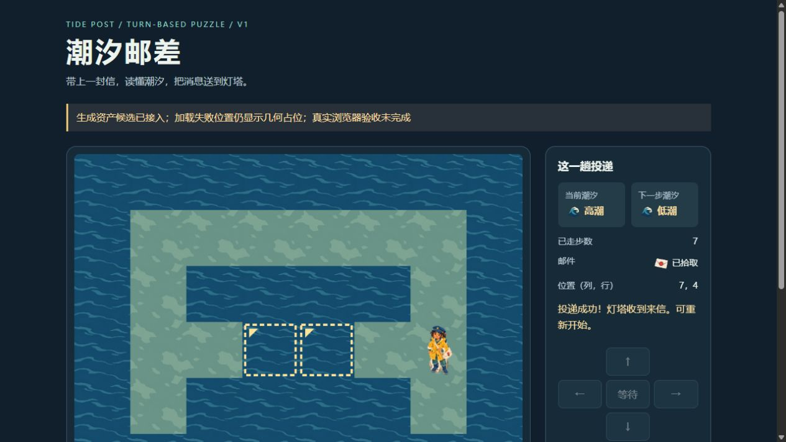
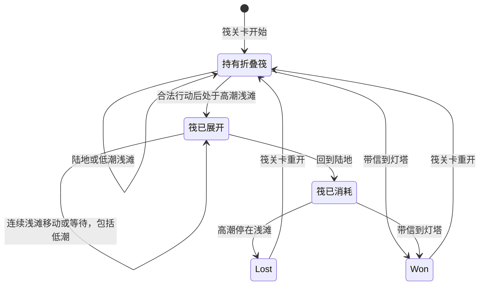
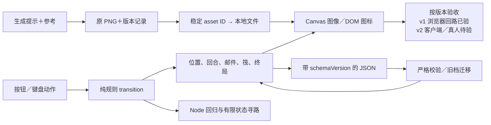

# 独立游戏路线图：先证明值得玩，再证明能够持续做

> 编辑日期：2026-10-23（UTC+8）；本轮加入 G1「潮汐邮差」真实生图、网页源码与预设二改；v1 已有独立浏览器操作与真实截图，v2 规则／模拟 UI 已测、客户端接收待补。原有测试／发行分流、内容冻结及玩家接收条件保留。面向单人程序员、无人工美术与音频修补；Unity 主线、Unreal 对照。历史核实范围与未实测边界见 [WP12 研究记录](../../docs/research/2026-10-14-game-wp12-indie-roadmap.md)。

**✅ 先用许可清楚的现成资产与可修改的程序化表示验证玩法，生成只补缺口；通过真人试玩和第二次需求修改后，再扩大内容量。** AI 可以加快代码、参数、导入和检查，人仍须决定目标玩家、玩法取舍、体验质量与是否继续投入。没有证据支持“编码跑通＋资产好看＝零手修可发布”。[研究]

编码默认沿用一个 [Codex／Claude Code 原生入口](../../docs/01-agents/README.md)，有明确缺口或质量目标再补能力；各阶段给起点，分档与撤回条件回主专题。✅ 为采用，🧪 为后续有条件试验，⛔ 为当前不采用。[研究]

## 30 秒结论：下一步先过哪道门

| 当前状态 | 先做 | 通过后再做 |
|---|---|---|
| 只有想法 | 定目标玩家、核心选择、最低设备与合法资产来源 | 用占位走通一轮玩法 |
| 原型能跑 | 让目标玩家理解并主动继续，先修阻碍判断的问题 | 做代表性垂直切片 |
| 第一版表现可用 | 改一次需求，同时检查旧引用、状态、旧档和预算 | 批量生产内容 |
| 内容结构已经足够 | 冻结新增类别，补完核心承接；清权、目标设备测试与平台审核 | 按当前版本与反馈用途选择发行方式 |
| 已发布 | 看真实失败与反馈，保留可回退版本 | 有证据再扩内容或升级管线 |

这些是阶段选择，不是本仓已经通过真实游戏验收的记录。[研究]

## G1 旗舰实战：给「潮汐邮差」真的生成资产，再改一次规则

**🧪 值得直接复验：把生成原图、稳定 asset ID、规则状态分开，才能在换图和改玩法时保住旧档。** 本次实际调用生图、保留原 PNG、接入无引擎网页源码，并完成一次预先计划的折叠筏二改；v1 已独立跑通真实浏览器回路，最新 v2 仍待客户端、目标设备和真人体验接收。[研究：本仓实验，2026-10-23]

| 本轮交付 | 已取得的证据 | 还不能说什么 |
|---|---|---|
| 资产生成 | 11 次调用，保留 9 个运行候选 PNG＋1 张概念图＋1 张淘汰原图；邮差简化返工 1 次 | 不是 9 件客户端合格资产，也没有同预算工具优劣结论 |
| 网页接入 | v1 独立浏览器加载 9 个映射／7 张素材，失败、重开、7 回合胜利及获胜档恢复均通过 | v2 的 11 个映射／9 张素材、筏与迁移尚未获客户端接收 |
| 规则与二改 | v2 的 17 项 Node 测试通过；真实 v1 存档迁移后可继续通关 | 不证明画面可读、手感、乐趣、性能或发布资格 |
| 截图 | 下图为固定 v1 的真实运行画面；后文另列生成资产与概念 | v1 截图不代表最新 v2，原执行入口的访问阻断仍在 |

**这是真实 v1 运行截图，不是概念图，也不是最新 v2。** 独立检查固定 [v1 `79862b6`](https://github.com/dbvv1/a1dbv/commit/79862b6156855149412b2d60e9e4d5a134c59fab)，实际完成素材加载、两步失败／重开、7 回合胜利，以及获胜状态保存—重开—恢复。画面仍显示“浏览器验收未完成”，因为检查没有改原版本源码；本轮结果见[独立运行报告](../../docs/collaboration/reviews/2026-10-23-direction-guidance.md#g1-v1独立运行所得)。[本仓独立实测，2026-10-23]

### 1）读者拿到什么，怎样复验

下载／查看：[网页 HTML](../../experiments/g1-tide-post.html) · [规则 core](../../experiments/g1-tide-post-core.mjs) · [画面与输入 UI](../../experiments/g1-tide-post-ui.mjs) · [规则测试](../../experiments/g1-tide-post.test.mjs) · [模拟 UI 回归](../../experiments/g1-tide-post-ui.test.mjs) · [生成提示、版本与文件摘要](../../experiments/g1-tide-post-assets.json)。保留仓库目录结构，图片在 `docs/img/g1-tide-*.png`；只有 HTML 一个文件并不能离线双击运行。[源码]

1. 在仓库根目录执行 `node --test experiments/g1-tide-post*.test.mjs`，先核规则、旧档与模拟 UI；需要支持 `node:test` 的 Node 环境。
2. 浏览器运行须由**你获准使用的 HTTP 静态服务**提供仓库根目录，再打开 `experiments/g1-tide-post.html`。ES module 不按 `file://` 双击交付；确认 `.mjs` 响应类型为 `text/javascript`。独立 v1 预览曾因返回 `text/plain` 不执行，修正服务 MIME 后才跑通；本文不启动服务器。
3. 用方向键／WASD 或按钮移动，空格等待，R 重开；选单可切基线／筏关卡，切换重开。保存只将 JSON 写入文本框，自行复制保留，没有自动存档或浏览器存储读取。
4. 先看页底资产状态，再看画面。代码配置 11 个 ID 映射、复用 9 个唯一运行文件；失败会明确报错并保留几何占位，**占位可操作不算生成图片已加载**。[源码／研究]

### 2）玩法先收窄到能检查的一个选择

目标是一个静态俯视投递谜题：先拾信，再到灯塔；选择绕安全陆路，或看潮相走浅滩。它不需要动画、音频、物理或联网来表达本轮规则，因此只检验一小组静态 2D 资产；不能外推到动作游戏或完整 G1 音画生产。[研究：实验设计]

| 参数／规则 | 固定值与实际含义 | 易做错之处 |
|---|---|---|
| 地图 | 8×6，共 48 格；源码坐标从 0 起，起点 `(1,3)`、信 `(2,3)`、灯塔 `(6,3)` | 概念插画不是可执行关卡布局 |
| 潮汐 | `turn % 4 < 2` 为低潮，即低、低、高、高；初始回合 0 | 按**行动后的回合**判水位，不按出发时颜色 |
| 消耗回合 | 合法移动与等待各＋1；撞深水／边界不耗回合 | 等待也可能淹死，非法移动不能偷推潮汐 |
| 基线失败／完成 | 高潮时留在浅滩且无保护即失败；带信到灯塔获胜 | 终局后移动／等待不再改变状态，重开重置 |
| 可解性 | 有限状态搜索验证基线最短 7 次有效行动、安全陆路 11 次 | 只证明存在路线，不证明新玩家能看懂或值得反复玩 |
| v2 折叠筏 | 单独关卡初始配 1 次；高潮浅滩自动展开，连续浅滩含等待都受保护，上岸才消耗 | 不是每格消耗；低潮也保持已展开状态；永远不能进入深水 |
| 二改后的路线 | 筏关卡最短 5 次行动，安全陆路仍为 11 次 | 便利可能消掉原来的时机取舍，是否更好玩尚未观察 |

可直接重放的基线胜利输入是「右、等、等、右、右、右、右」；「右、右」在第 2 回合进入高潮浅滩，立即失败。筏关卡「右」连续 5 次可赢；恢复到已展开筏的中途状态后，低潮等待不能让筏消失，上岸才能扣除。本例数值来自固定关卡，不是通用平衡建议。[源码／本仓规则测试]

基线没有筏，直接遵守无保护失败规则；两种关卡都只认规则状态，不根据角色图片判断可通行性。旧档迁移也不“赠送”新机制。[源码]

### 3）真实生成结果：一张母版不是整套一致性的保证

**上图是 AI 生成概念示意，不是运行截图。** 它在资产生成后展示既定的暖赭雨衣、海军蓝、灰绿、奶油色和珊瑚红方向；可执行地图由代码定义，准确标题、潮相、步数和提示全部使用 DOM 文本。[本仓生成／源码]

| 原角色候选 v1 | 二改站筏变体 v2 |
|---|---|
|  |  |

这是参考原角色生成的同身份变体，保留雨衣、帽子、邮包与配色目标，不是从原图精确添加独立筏图层；姿态、细节和占格仍须在最终尺寸复核。筏图标提示要求折叠木板束，候选并未明确满足折叠形态，只保留为装备类别图标，不负责证明展开／折叠状态。**“看起来同一人”和“新旧角色锚点、尺寸都可替换”是两道检查。**[本仓生成／研究]

| 地形例：低潮浅滩 | 拾取物／UI 复用：邮件 | 新 UI：折叠筏 |
|---|---|---|
|  |  |  |

**实际怎样生成、怎样返工。** 先生成邮差，再针对小尺寸细节作一次简化编辑；按同一调色／光向提示生成陆地、浅滩、深水、邮件、灯塔和潮汐图标，另生成概念图；二改补站筏角色与筏图标。每次提示都在清单里，未人工补画、改像素、裁切或压缩。邮差预览里的轮廓外 RGB 雾色，经抽样 alpha 为 0，不能只看黑底预览就判有光晕；v1 已有实际显示证据，但边缘品质与 v2 新旧角色混排仍须专项接收。[本仓生成与原图检查]

**本次暴露的三个成本。**[本仓实验／研究]

- **返工并没有归零：** 11 次调用得到 10 个选用候选，包含 1 次邮差简化；[被替代的首次邮差原图](../../docs/img/g1-tide-postman-rejected-v0.png)也已保留，合计 11 个源文件，清单记录提示与淘汰原因；淘汰件不在运行 manifest 中。
- **源图不是交付规格：** 原图约 0.49–2.14 MB／张；9 张运行候选合计约 10.13 MB，保留高分辨率原文件，超过本仓通常 300 KB 的单张建议。Canvas 逻辑单格 100 px，响应式界面会进一步缩小；DOM 图标仅 26 px。没有做目标尺寸导出、接缝与最低设备解码／内存验证，不把大图“缩着画”当优化完成。
- **共享图不能共享规则含义：** 高潮浅滩与深水复用同一水图，代码另加金色虚线与角标标记浅滩，否则美术复用会抹掉可通行信息。标记是否足够醒目尚待真人判断。

### 4）接入与二改：保存状态，不保存图名

**AI 实际承担了资产候选、接线代码、状态修改与自动回归；人的接收决定仍未被测试替代。** 规则文件不引用 PNG 或 DOM；UI 用 `actor.postman` 等稳定 ID 映射文件。图片缺失可明确降级，改文件不改变存档；代码和图片共同决定玩家看到什么，仍须在同一浏览器版本检查。[源码／研究]

二改预先约定“一次连续浅滩穿行，登陆消耗”，不是完成 v1 后突然抽来的未知题。v1 先冻结并取得真实保存文本，再把 schema 从 1 升到 2，加入 `raftAvailable` 与 `raftActive`；保留原 `baseline`，新建 `raft` 关卡。旧 baseline 存档补两个 `false`，位置／回合／持信／终局不变；拒绝伪造带筏旧档、未知字段、无效状态，而不是猜测修好。[源码／本仓规则测试]

这次修改仍揭示了状态与表现耦合：初版 UI 错按 `raftAvailable` 显示站筏角色，导致持有未展开时也站在筏上；源码审查后改为只在 `raftActive` 时显示乘筏，并取消成功加载变体时重复叠画几何筏。携带未展开与消耗后均用 v1 角色，装备文案另表状态。**规则测试通过仍会漏掉表现选错状态**，所以此处是一次实际代码返工，而非浏览器验收成功；新旧底锚和占格变化还要看实际合成。[源码／研究]

**已验与未验分开。** v1 的 10 项 Node 测试、历史离线检查及新增独立浏览器回路各有固定版本；当前 v2 的 17 项测试覆盖基线保留、拾信、失败、终局、重开、两种路线、筏的展开／连续穿行／消耗、旧档迁移和坏输入。另有可重放的 fake DOM／Canvas／Image 回归，核状态选图、失败占位、恢复和输入守卫；它不实际解码图片，也没有真实布局、焦点引擎、键盘输入或帧时间证据。预设二改和一次候选组也没有给出盲测、产能、主动工时或相对省时结论。[本仓测试／研究]

### 5）为什么不直接用现成包和框架

**默认仍是合法成套资产先行；本次生成是为了实测这条支路，不是证明它比现成更便宜。** 若目标只需普通城镇元素且接受像素风，先检查 [Kenney Tiny Town](https://kenney.nl/assets/tiny-town)：官方列 130 个 16×16 资产、CC0；本轮未下载或接入，也未确认它覆盖潮汐邮差的所有需求。应整套重选表现，不把 16 px 像素与这组剪纸风随意混用。[一手／研究，核实2026-10-23]

| 候选 | 本例决定 | 何时改变决定 |
|---|---|---|
| 成套现成＋少量程序图形 | ✅ 通常先选；来源、尺寸和风格齐全时省掉跨件生成问题 | 必要角色／语义找不到，且生成有明确接收规格时再补 |
| 本次参考生图＋原生 Canvas／DOM | 🧪 已生成并编写接入；48 格、静态离散回合不需要完整引擎系统 | 动画、场景管理、碰撞或资源生命周期扩张时重比框架；没有测得 Canvas 性能胜出 |
| Phaser | 👀 [4.2.1 官方发布](https://github.com/phaserjs/phaser/releases/tag/v4.2.1)为完整网页游戏框架候选，本轮未试用 | 需要其成套系统时先做同玩法最小接入，不为当前小地图默认迁移 |
| Unity／Unreal | 保留本路线图正式引擎主线／对照，本轮都未运行 | 目标平台、3D、编辑器与现有工程需要时回[接入专题](01-engine-integration.md)，不以浏览器实验替代引擎证据 |

中文实践的反例是 [V2EX 原作者记录](https://www.v2ex.com/t/1139433?p=1)（2025-06-18）：作者自报用 Phaser＋Cursor 一天半做小游戏，并因生图效果不好改用现成资产。可借的是“生成不合格就换来源”，不是把他的耗时当本轮速度基准。英文 [Kenney Jam 2025 多包整合讨论](https://itch.io/jam/kenney-jam-2025/topic/5105310/how-many-assets-packs-did-you-use)中，Luise 还为 Tiny Town 湖面重着色以匹配其他包，提醒现成也有筛选与风格整合成本；这类人工改色不属于本例允许的零手修证据。[一手：作者自报；本轮未复现]

### 6）可直接执行的接收清单

以下保持未勾选，留给读者自己的版本；不是本轮全链路通过单。[研究]

- [ ] **来源与交付：** 打开资产清单核每件用途／来源／版本；复核输入、输出、工具条款和发行渠道要求；将源图与目标尺寸交付图分开，未明权利不放行。
- [ ] **规则：** 执行上述 Node 命令；在获准浏览器中重放 7 步基线胜利、2 步失败、5 步筏胜利，并实际点重开。
- [ ] **加载与引用：** 记录页底映射数及唯一文件数；在副本故意缺一张图片确认报错与占位；恢复后重新加载，不把占位截图当生成资产证据。
- [ ] **显示：** 最小窗口检查 26 px 图标、角色脚底、两版尺度与浅滩边缘；重复排地形查接缝，深浅水都能分辨；文字无溢出且键盘焦点清楚。
- [ ] **二改：** 实际看持有、高潮展开、低潮仍展开、上岸消耗；死亡／获胜／中途分别重开，切关卡不串状态。
- [ ] **存档：** 用测试里的真实 v1 JSON 恢复并继续通关；v2 已展开／已消耗存档往返一致；坏 JSON 恢复失败后当前局不改变。
- [ ] **设备与体验：** 在目标设备量冷启动、解码、内存和输入响应；让未看过答案的人说出下一步潮汐与失败原因，观察是否愿意换路线或再玩一次。
- [ ] **证据与停止：** 真实运行截图绑定版本；仍需补画或无法达到预算，就换资产／缩表现。保留全部候选、费用、等待和主动工时，别从调用耗时推省时率。

**下一张应补 v2，而非重复证明 v1。** 在获准环境中记录最新版本的 9 张素材加载、筏展开／消耗、新旧角色显示和 v1 档迁移；沿用上方清单接收设备、权利与体验。独立 v1 的 MIME 修正是预览服务问题，不解释另一入口的 URL 策略拒绝，也不解除其权限边界。[研究]

本例可复用的是分层与复验方法，不是完整生产资格。长期工程仍按下文七阶段推进：源与许可交给接入，规则与对象交给验证，新旧版本交给二改；只有体验、设备、资源与旧档都满足约定才扩量，失败回到对应层而非整链重做。[研究]

**先按用途分流，不强迫所有原型走生产管线。** 一次性托管试玩可止于玩法判断；不可导出的世界／交互视频若要接管，先验证真实导出；玩家生成本身就是玩法时，走 [03 用途分流](03-generative-ai-in-games.md#30-秒结论先决定要验证什么再决定是否需要资产管线)。要持续修改的工程才需要把资产、引擎对象与行为接成可回读链；已有工程不因新工具迁移，成熟替代满足需求就可以采用。[研究]

资产交接带许可、可编辑源／生成记录、目标规格和版本，按风险回 [2D](assets/2d.md)、[3D](assets/3d.md)、[动画](assets/animation.md)、[材质／特效](assets/materials.md)、[音频](assets/audio.md)、[视频](assets/video.md) 选择默认与撤回条件；接入用 [01](01-engine-integration.md)，验证用 [02](02-verification-and-playtesting.md)，模块与结构分别用 [04](04-client-modules.md)、[05](05-gameplay-architecture.md)。不要求等全部美术完成才写规则，也不把一段生成成功当整链自动化比例。[研究]

## 当前最高水平：阶段由待解决的问题决定，不按产量自动推进

<!-- frontier: status=已比较 gap=1 gen=2026-10 checked=2026-10-22 -->

近期质量参照是Supergiant的[2026-05-23开发者访谈](https://www.rpgsite.net/interview/20348-supergiant-games-interview-2026-greg-kasavin-darren-korb-hades-2-ending-music-future-coffee)：从概念选择共同开发方式，到上线后按不同经历玩家的反馈修订；其专业团队不是单人零手修证据。AI实现／反馈的领先候选复用WP13的近期论文和独立作者实践，资产供给比较沿各资产专题。本表比较路线决策，不评选全流程工具赢家；完整同约束最佳路线与净收益仍未知。[一手／研究；详细来源与代价](../../docs/research/2026-10-14-game-wp12-indie-roadmap.md#p77整页阶段比较从验证问题选择交付方式)

| 主要选择 | 领先或已采用的替代 | 本页决定与退出信号 |
|---|---|---|
| 概念与规模 | 完整作品封闭制作／从概念起为持续反馈和扩展设计；Supergiant采用后者 | **保留**先定核心体验与可供应范围；只有玩法允许分期交付才考虑共同开发，不把收费测试当未成立概念的救济 |
| 资产供应 | 成套现成、可修改程序表示／离线生成／运行时生成；比较原型候选与生产资产的接缝 | **保留**现成与源可改优先，生成补缺；运行时生成须有玩家用途，不只为省制作。把淘汰、接线、二改和持续供应计入合格成本；需要禁止手修就换来源或缩表现 |
| 实现与接管 | 原生Agent／拆借模板／OpenGame、GCA整套管线；WP13已比较接入与验证代价 | **保留**原工程默认，按缺口借机制；同模型同预算下的整体收益未知，不因生成分数迁移引擎 |
| 原型与反馈 | GUI反馈循环／独立简报／定向真人；Play2Code、RSIGame及Spec2Game覆盖不同问题 | **采用**规则与实际路径先核观察，细微交互或反馈低增益时追加真人；分数分歧先对齐问项，不把呈现评分当乐趣 |
| 切片与二改 | 累积需求、候选／保留版本重放／同build验证 | **保留**最高风险资源和跨系统修改；新需求、旧路径、旧档、资产身份与体验分别接收，退步时回到认可版本定向修补 |
| 内容生产与打磨 | 持续扩区域／能力，或如Hades II明确冻结结构、转结局及收尾 | **采用**达到约定结构后停止加类别，补核心承接与发布路径；新内容不再改善目标体验时，不以数量延后收口 |
| 测试渠道与发布 | 邀请试玩／Playtest／收费Early Access／完整发行 | **采用**按反馈目的与当前价值分流；概念未成立或只剩最终排错不选EA。平台权利、实际构建和承诺仍各自验收 |
| 上线后与持续供应 | 独立团队的反馈修订、修复撤回与更新改期／跟随工具升级扩量 | **保留并补充**先守进度和已认可体验，分新／老玩家观察新增内容；承诺按可持续产能，修复转移故障或成本失控时撤回新增投入 |

AI可整理版本、试玩轨迹与差异，提出窄修复；人决定玩家体验、范围和承诺。自动反馈不足时转真人不是所有工作都改为手工，也不支持任意扩充试玩／工具预算；完整投入与适配失败都应计入选择。[研究]

## 1. 概念：选一个能验证、也能持续供应资产的玩法

**质量标准**：用一段话说清谁在什么情境下，反复作什么选择、得到什么反馈、为什么愿意再来一次。确定首个目标平台、最低设备、输入方式和可接受的开发规模；列出核心循环不可缺的角色、动作、界面与声音。正式候选先过代码、权重、输入及输出权利，不能等做完再清权。[研究／经验]

- **AI 能做**：比较已有玩法与开源结构，整理可复用资产、许可缺口、设备约束和最小实验问题；生成多个概念方向供选择
- **人必须决定**：目标玩家、核心体验、愿意牺牲哪些题材与表现，以及哪些功能属于第一版；研究者不能替项目编造预算或营收目标
- **推荐工具与入口**：已有 Agent 定向检索，确需跨来源比较再评估[深度调研](../../docs/25-ai-exploration.md)；准入与结构见 [WP1 授权](03-generative-ai-in-games.md#13-授权与商用门槛总表wp1)、[WP8 风格与源资产](03-generative-ai-in-games.md#17-跨资源风格优先共享源资产生成只补缺口)、[WP11 小型架构](05-gameplay-architecture.md#1-先选够用的结构)

**✅ 换成终端、示意图等间接表现时，先分清要保留的限制和该减掉的重复操作。** Duskers 从鼠标操控转为命令行后，进一步放弃配乐；面对便利性要求，保留近景／示意图的不同信息范围，却扩展参数化宏和键盘编辑。若有限信息与隔着设备操作正是体验，可保留；反复输入已经决定的动作则先比较批量命令，不必为了“更好用”改回全知视角／点选控制。目标若是直接操控或快速浏览，就不照搬。界面、输入适配和维护须重新计入制作预算；该作品有专职美术，未证明零手修或更低总成本。见[间接表现与二改](../../docs/research/2026-10-14-game-wp12-indie-roadmap.md#间接表现补研保留信息限制减少重复操作)。[一手／研究]

**✅ 若考虑Early Access，在概念期就判断玩法能否分期交付。** 默认仍先做小范围验证；若玩法允许逐步扩展、未来反馈还能改变玩法／内容，可把共同开发纳入路线；实际收费前，当前内容须已能独立提供价值。它会带来持续沟通、兼容和支持成本，不是做不完时临时收费的出口；具体渠道在§6分流。[研究：上述阶段比较]

**收窄或停止**：核心体验若离不开大量独特变形角色、近景表演、动态换装或精确动作，而找不到完整合法资产体系，就先换固定视角、有限角色或刚体表现；若这样会失去核心吸引力，应换概念，不用“以后 AI 会解决”支撑排期。静态像素与简单低模不是逐帧动画、蒙皮质量的保证。[研究／经验]

## 2. 原型：先看玩家怎样玩，再决定做多少

**质量标准**：用占位或合法现成资源走完一轮进入、操作、反馈、失败／成功和重开；玩家在没有作者不断解释时能理解目标与主要反馈。记录卡住的具体位置、策略、主动继续或退出原因，分别判断不懂、不能操作和不想继续。通过自动测试只能说明被测规则成立，不能代替趣味判断。[研究／经验]

**✅ 承担玩法判断的声音不能用静音占位。** 若攻击／危险辨识依赖声音，原型就接最低可用的合法音效，在拟分发构建核播放；装饰性音频可后补。AI接线和查触发，人验可辨性；未成立先修反馈，不据此扩内容。SNKRX曾因声音故障与核心体验不完整而撤下公开demo计划，不能归因于声音一项或浏览器本身。见[证据与撤回](../../docs/research/2026-10-14-game-wp12-indie-roadmap.md#原型音频补研何时不能用占位)。[一手／研究]

- **AI 能做**：实现窄玩法、局部状态机、可导出状态、输入注入与固定场景；批量跑规则测试，定位软锁与重复结算，整理试玩原始记录
- **人必须决定**：哪些反馈值得改，失败是教学、手感还是核心玩法问题；是否继续、换机制或停止。不能把模型自评和作者熟练通关当目标玩家认可
- **推荐工具与入口**：沿用已有编译入口；规则选逻辑测试，场景行为选 PlayMode／Functional Test，体验靠真人。见 [验证与真人试玩](02-verification-and-playtesting.md)、[WP11 循环／状态／规则](05-gameplay-architecture.md)、[WP10 输入／暂停](04-client-modules.md)

**✅ 默认保留原生 Agent＋现有工程，新建浏览器原型再考虑拆借模板。** OpenGame 的公开模板仍缺所引用的资产清单及实际测试用例；GCA 的同 build 证据绑定值得借鉴，但默认视觉服务失败可警告放行。两者都不能仅凭分数或 ready_to_ship 代替二改回归与真人试玩，也不构成 Unity／Unreal 迁移理由。见 [三路采用与撤回包](../../docs/research/2026-10-14-game-wp13-agent-config.md#5-p32原生入口拆借模板还是整套游戏管线)。[源码／作者报告／研究；2026-10-20]

**二改验收须分开新需求和旧行为。** 同build证据还须核实际玩家路径和新版本保留的旧需求，试玩总分不能抵消引用／旧关回归；二改验收机制的比较与局限见[验证选择](02-verification-and-playtesting.md#当前最高水平保住旧体验不能只看改进总分)。[研究；2026-10-21]

**✅ 先验证选择能被玩家察觉，再扩角色、被动或组合。** SNKRX 作者指出，多角色同时攻击让单体增伤不明显，扩内容也未解决构筑差异不清。先让玩家比较两种核心选择：已有取舍却看不懂，改反馈；取舍尚未成立，再改触发、代价或合并选项。借鉴效果还要看取得条件与发挥时间：DCSS 的同一效果可由冲锋赚取，也可常驻提供；Balatro 增加限时限制后，又调整了它适用的部分成长牌。若期限与设计需要的成长／发挥窗口冲突，先缩小适用集合，不默认所有慢热内容都应豁免。数值成长与常驻奖励也可以是目标；这些案例尚未证明上述处理能改善本项目体验。[一手／研究；案例与边界](../../docs/research/2026-10-14-game-wp12-indie-roadmap.md#八已发售作品的反证少美术不等于选择清楚)

**✅ 看得懂却不愿换玩法时，先查是否要重付一套成长成本。** 希望玩家经常尝试不同构筑，可比较扩大投资的适用范围或低成本重置／转移；专精承诺本身是目标时则保留。Dead Cells 重做 Forge 后，有玩家报告更愿尝试其他构筑，也有人报告旧投资折损、游玩变慢；先复查换法与迁移代价，再扩内容。具体修法尚无同条件优劣证据。见 [成长成本取舍](../../docs/research/2026-10-14-game-wp12-indie-roadmap.md#构筑补研选择清楚之后还要付多少换法成本)。[一手／社区／研究]

**✅ 自动反馈停滞时，先查操作与问项，再追加定向真人。** GUI未点到或时序错误先修观察；已能正常玩却仍不清楚为什么困惑、无趣，交给目标玩家观察。新玩家的首次理解与长期玩家的新内容体验分开记录；不要让熟练试玩者代替首次进入。采用范围与成本回[WP13整页反馈比较](../../docs/research/2026-10-14-game-wp13-agent-config.md#7-自动反馈何时转真人整页验证选择校准)。[研究]

**✅ 在批量做内容前准备反馈入口。** Steam 官方说明 Playtest 用独立 appID，反馈收集仍由开发者负责；所以若后续选择该渠道，测试版里应有可找到的反馈方式，并告诉玩家这轮想验证什么，而非只记录有多少人获得访问权。[一手：[Steam Playtest](https://partner.steamgames.com/doc/features/playtest)；研究：阶段安排]

**收窄或停止**：先修妨碍判断的输入、软锁和读不懂的反馈，再重新观察；在预先约定的修改时间内仍看不到目标体验，就停止扩内容。小样本只帮助找问题，不证明销量或市场规模。[经验]

## 3. 垂直切片：用正式规格走通，并且经历第二次需求修改

**质量标准**：选一个短而完整的代表段落，让正式目标规格的视觉、音频、UI、玩法、保存／重开和目标平台构建一起工作。它必须包含最危险的资产类型或交互，不能只挑最容易的静态场景。最低设备的帧时间、内存与加载预算先定，再验；保留许可、源资产、实际版本与可回退构建。[研究／经验]

**必须做第二次需求修改**，不是把同一提示词再跑一次。可沿 [WP11 的修改题](05-gameplay-architecture.md#11-给-ai-第二次修改的最小契约)，把单段攻击改成可蓄力、受击可中断，并改变武器长度／命中时刻；无战斗项目选择等价的跨系统修改，例如改变道路连接规则与任务恢复点。修改须同时触及内容、既有引用或状态，才能揭示后续生产代价。[研究／经验]

- **AI 能做**：按已有导入器原位替换，保资产身份；修改状态／取消逻辑、参数和测试，比较新旧输出，记录失败与成本
- **人必须决定**：改后是否仍好玩、风格与声音是否可接受、武器接触／运动是否正确，以及为了完成能否接受范围收缩
- **推荐工具与入口**：先用成套合法资产与原有导入器；缺口才按质量／性价比／本地免费档首试：[WP2 2D](assets/2d.md)、[WP3 3D](assets/3d.md)、[WP4 动画](assets/animation.md)、[WP5 材质／特效](assets/materials.md)、[WP6 音频](assets/audio.md)、需要过场才读 [WP7](assets/video.md)；随后按 [WP9 替换契约](01-engine-integration.md#5-第二次重生成更新已有对象保留正确含义)、[WP10 跨模块行为](04-client-modules.md)验收

最少留下这些结果：旧件与新件混排／同场景表现；Prefab／Blueprint、子资产和加载引用；旧存档及检查点恢复；取消、暂停、退出与重复重开；最低设备峰值。记录每环节全部候选、淘汰件、重生成次数、付费费用、机器等待与主动工时，不能只记最好的一件。原始资产与验收结果绑定版本，重生后旧结果失效。[研究／经验]

**✅ 缩减表现前，先保住它承载的探索行为和必要信息。** 配音／过场做不稳时，不必连故事与线索一起删，也不只把对白搬成字幕：已有场景可比较检查物件＋短文字，让玩家仍有发现和判断可做。Kraven Manor删配音与叙事后，因探索空洞补入Examine；发行后仍有体验者读到背景却缺乏继续探索的动机。分别验“能发现并理解什么”和“为何要继续”，再决定换载体或撤路线，不把文字存在当叙事已保住。文字编写、交互可达与本地化仍有成本；若情绪表演本是核心，文字未必可替代。[同作品修订与反例](../../docs/research/2026-10-14-game-wp12-indie-roadmap.md#缩减表现补研换载体不等于保住探索动机)。[一手／体验者报告／研究]

**收窄或停止**：必须补画肢体、刷权重、逐帧摆姿、手绘语义遮罩或人工音频精修才达标，便不满足本基准。换成完整资产、分件参数化、较少动作／配音，或删过场；替代后仍失去核心玩法，撤回该项目路线。有限程序修正可用，但不能把无限重抽当生产方案。[研究／经验]

## 4. 内容生产：复制已通过的做法，不复制一次好运

**质量标准**：切片与二改留下的源、参数、规格和引用契约可以扩到新的语义类别；每批在真实尺寸／背景／声音状态下与旧件比较。先小批抽查新轮廓、连接、角色动作和性能，再扩量；同色、同 seed 或高相似度不能替代“仍是正确的东西”。[研究／经验]

- **AI 能做**：变体参数、配置与关卡组合、确定性导出、来源登记、规格和引用筛查；按已批准母版重生成缺口，汇总异常供复核
- **人必须决定**：内容是否值得加入、节奏与辨识是否改善、哪些异常拒收，以及整套风格能否成立
- **推荐工具与入口**：[WP8 批量一致性](03-generative-ai-in-games.md#17-跨资源风格优先共享源资产生成只补缺口)、各 [资产专题](03-generative-ai-in-games.md)、[WP9 导入](01-engine-integration.md)、[WP11 数据与关卡](05-gameplay-architecture.md)

**✅ 先复用，后购买或生成。** 质量档、性价比档、本地／免费档按各资源专题选；统计“所有费用与工时／合格内容”，不要用单次 API 标价外推整款预算。需要付费而没有批准预算时，保留报价与对照设计，不执行购买、生成或安装；已有合法资源能满足就无需升级工具。[研究／经验]

**收窄或停止**：新类别只能依赖逐件救火、二改普遍破坏旧件、产量增加却持续超设备预算时，暂停该类别扩量。减少独特角色、换装、镜头方向、动态材质或配音覆盖；先确认减少后仍保住玩法，而不是把内容数量当进度。[经验]

**✅ 内容结构达到计划后，冻结新增类别，转向完整体验。** Hades II在最后一次EA大更新后明确不再计划新增区域、遭遇和能力，集中完成结局、成就与打磨。可借的是停止扩量的决定，不是照搬内容规模：本项目仍须补完核心目标、失败／成功承接和发布路径；若新内容没有解决已观察的问题，不用它延后收口。[一手：[Unseen Update](https://www.supergiantgames.com/blog/hades2-unseen-update/)；研究]

## 5. 打磨：在真正的玩家路径与设备上收口

**质量标准**：优先消除崩溃、进度丢失、软锁和不可操作菜单，再处理目标玩家反复遇到的手感、节奏与可读性问题。发布构建覆盖冷启动、首次效果、最坏并发、连续换场景、失焦／设备断连、保存失败和旧档恢复；画面、文字、音量与主要输入符合已承诺的设备和语言范围。[研究／经验]

- **AI 能做**：用复现夹具修问题、加回归、核资源释放与状态清理、根据 profiler 证据优化；检查文本溢出、缺音轨和规格错误
- **人必须决定**：手感、敌我与危险辨识、镜头晕动、混音和风格；缺陷是否必须阻止发布，不能仅按报错数定优先级
- **推荐工具与入口**：功能问题先用复现夹具／回归测试，体验问题用目标玩家试玩；性能问题再用 Unity Profiler／Frame Debugger、UE Insights 定位，发布构建复核。选择与撤回见 [WP10 客户端最低交付线](04-client-modules.md#2-十一个模块的最低交付线)、[WP11 打断／重置](05-gameplay-architecture.md)、[真人试玩](02-verification-and-playtesting.md)

**收窄或停止**：最低设备无法承受时先降装饰、并发和渲染成本，不删除关键危险提示；本地化与设备承诺无法验证时收缩公开支持范围。不要在收口阶段无测量地换引擎、大框架或整套生成模型。[经验]

**✅ 性能复用不能把最终资产退回占位。** 资源异步到达时保留可升级占位，缓存随依赖变化失效并清理重建；验冷启动、资源晚到和复访。Sanctuary’s End修复了按场景ID复用导致占位永久保留的问题；其就绪位不代表内容版本，同就绪下换资产仍须另验。AI补依赖与回归，人验外观和玩法信息；驻留内存与重建有成本，稳定同步资源无需照搬。对象池的逻辑测试不替代视觉检查。见[同作品修订与部署链](../../docs/research/2026-10-14-game-wp12-indie-roadmap.md#资产升级补研性能复用不能锁死占位表现)。[源码／作者报告／研究]

## 6. 发布：内容权利、实际构建与商店承诺一致

**质量标准**：可交付构建、商店描述／截图、语言和设备声明一致；完成适用渠道的许可、署名、内容披露和审核。保存来源与生成时合同凭据，给玩家明确的支持和问题反馈入口；准备已验证的旧档迁移、故障恢复与补丁回退方案。[研究／经验]

- **AI 能做**：比对资产来源、通知与披露清单；整理构建证据、已知问题和发布说明草稿，辅助核对商店宣称
- **人必须决定**：发行地区、价格、支持承诺、披露内容、条款接受与正式上线；付费、账户操作和发布各按实际授权处理
- **推荐工具与入口**：Unity Build Profiles／UE 打包链起步，重复构建才加 CI；放行条件见 [WP1 发布渠道](03-generative-ai-in-games.md#3-外部约束披露与玩家态度)、[WP10 发布／存档](04-client-modules.md)、[WP6 声音权利](assets/audio.md)、[WP7 跳过与恢复](assets/video.md)

**✅ 先选要取得的反馈，再选分发方式。** 邀请试玩或Playtest用于验证与排错；收费Early Access只在当前可玩版本本身有价值、仍愿让玩家反馈影响后续开发时考虑。Steam明确不宜用EA验证尚未找到乐趣的概念，也不宜只为最终bug测试使用它；不要依靠预期销量保证完成。已收口则准备完整发行，不能把EA当降低权利、设备或进度承诺的标准。[一手：[Early Access](https://partner.steamgames.com/doc/store/earlyaccess)；研究]

**✅ 渠道准备从切片／内容生产期并行开始，实际放行仍在发布阶段。** Steam 的商店页与构建分别审核，商店页先提交；Coming Soon 至少两周，批准后也不会自动发售。不能等到打包成功才给这些步骤留时间；上线前按当时官方规则重查，而不是把本文当完整平台清单。[一手：[Release Process](https://partner.steamgames.com/doc/store/releasing)；研究：排期调整]

**收窄或停止**：权利不明的资源隔离并替换，测试不足的功能撤出公开承诺；无法安全恢复进度或必达流程仍软锁时不放行。披露了 AI 不代表许可或商店审核已经通过，平台批准也不代表玩家喜欢。[研究／经验]

## 7. 上线后：先守玩家进度，再扩作品

**质量标准**：能把反馈定位到构建、设备与具体操作；补丁对受支持旧档和内容 ID 有明确迁移承诺。先处理崩溃、坏档和卡关，再判断新内容；每次更新重查受影响的二改行为与玩家路径。[研究／经验]

- **AI 能做**：聚合问题、建立最小复现、补回归、提出窄修复与迁移草案；核新旧资产、依赖版本和变更说明
- **人必须决定**：问题严重性、兼容承诺、哪些反馈代表目标玩家、是否推迟内容，以及何时停止维护或扩张
- **推荐工具与入口**：沿用复现／回归测试与原导入器，先窄修复，不随模型升级重建管线；迁移与换源见 [WP10 旧档与生命周期](04-client-modules.md)、[WP11 稳定状态／内容 ID](05-gameplay-architecture.md)、[WP9 资源替换](01-engine-integration.md)、[WP1 许可再核触发点](03-generative-ai-in-games.md)

**✅ 新内容的接收要看玩家从哪里来。** Supergiant复盘Hades II结局修订时，区分长期EA玩家与新玩家的经历，目标是回应失望而不损害原本认可的体验。补丁先记录具体困惑及所处进度，修后分别观察，不直接执行呼声最高的方案。AI可聚类反馈，人定保留什么；作者自述的反响不是可量化收益。[一手／研究：上述阶段比较]

**✅ 修存档故障，不把代价搬到下次进入。** 用同一受支持旧档比较旧／新构建的保存、终止后恢复与加载成本；移动端可能在后台写入完成前终止，不能直接照搬后台保存。Last Pirate作者报告另一项未指明实现的ANR修复因加载慢五倍而撤回，不应与其存档修订拼成因果链。未保住可恢复进度或只是转移故障时，保留已验证构建。见[生产反例与版本边界](../../docs/research/2026-10-14-game-wp12-indie-roadmap.md#存档补研修复不能只把代价搬到下一次进入)。[一手／研究]

**收窄或停止**：供应商停服或音色／模型退役时，保留合法旧产物与源文件，先核旧合同是否允许继续使用，再评估替换；不能因“有新版”全量重生。代码回滚不保证新格式存档可回退，发布迁移补丁前须保备份并测试恢复。维护负担持续超过项目预算时，优先冻结新功能、保稳定与如实说明支持范围。更新排期按可持续产能，不沿用首发冲刺速度；LocalThunk撤回1.1原定排期可作反证，但其自主安排条件不适用于所有项目。[研究／经验；产能边界见上述阶段比较]

## 下一步：补齐本例证据，再决定是否扩大

先接续已有 v1 浏览器证据，完成 G1 实战节列出的最新 v2 截图、同场景显示、筏与旧档迁移、目标设备与真人观察；结果不成立就改映射、换资源或缩玩法。若要迁移到正式引擎或追加动画／音频，先明确平台、预算、来源与风险资产，不能沿用本次静态网页的通过范围。[研究]

**本轮已有真实生图和规则二改，不再只是计划；但完整切片验收、零手修整款发行及两轮净收益仍未知。** 现成资产优先、通用许可、资源预算、存档兼容和发布检查均不因本例而降低。
