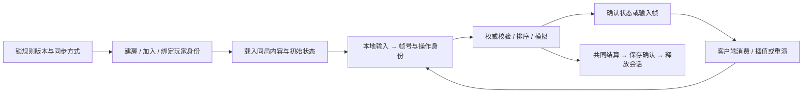

# 联网与服务端：先确定谁裁决，再让两端推进同一局

> 核实：2026-10-26。面向已有单机玩法、准备做小规模联机的程序员；Unity 优先，Unreal 对照。引擎方案为文档／源码选择，实际运行包括固定 MOBA 三进程输入帧、Colyseus 房间，Nakama 本地合成账号／云档／排行链及官方飞船模拟的 GGRS 请求消费；不把独立样例称为产品公网验收。

## 1. 当前强方案与默认：先选同步方式

**✅ 普通双人动作／合作先用服务器权威状态同步；已经具备可重放确定性模拟时，再评估输入同步。** 远端对象插值，本地操控确需即时响应才用成熟预测。先沿用引擎／项目现有网络栈，不为两人开房先自建调度、预测和迁移框架。

帧同步、状态同步与回滚不是三个互斥的网络拓扑：前两者回答主要传输入还是结果，回滚回答预测错了怎样恢复。确定性输入同步可以等待齐帧，也可以预测缺失输入后回滚；状态快照方案同样可以纠正并重演本地角色。

| 项目条件 | 默认与强替代 | 需要承担的成本 |
|---|---|---|
| 已有 Unity GameObject，小队 PvE 能接受权威确认 | ✅ NGO 客户端—服务器＋远端插值，沿[合作首版](04-client-modules.md#coop-production)接入 | NGO anticipation 不是完整 rollback/replay prediction；紧手感运动不能把缺失预测写成“再补几行” |
| GameObject 动作需要现成预测／校正 | 🧪 比较 Fusion 2 Host／Server，与已有成熟栈同题验手感 | 绑定其输入／模拟循环，评估重演 CPU 与服务／许可成本；Shared Mode 不用同一预测合同 |
| 已采用 Unity ECS，实体数与预测需求明确 | 🧪 Netcode for Entities 的 predicted ghost | 快照纠正会多次重演；不能为双人联网把稳定 GameObject 项目整体改成 ECS |
| 规则已能固定步长、同输入重放，愿意约束整个模拟 | 🧪 输入同步；低频操作先等待齐帧，低延迟需求比较 Quantum 的 deterministic predict-rollback | 固定状态／随机数／顺序／数学行为；最慢输入会拖住等待版，预测版要保存、恢复并重演状态 |
| 已有 Unreal 常规角色 | ✅ 先用 ACharacter／CharacterMovement 的网络移动与复制；用项目现成服务端模型 | 角色移动的 SavedMoves／校正不自动覆盖库存、技能、奖励或全部物理 |

**房主、专服和 Relay 是另一层选择。** 朋友合作短局可用玩家主机，主机退出结束本局也可以是明确首版政策；竞技裁决或必须持续在线的世界比较专服。Relay 解决连通，不替你裁决命中、保存奖励或接管断线主机。先定允许谁作弊、谁离开时游戏怎样结束，再买连接服务。

来源：NGO 2.7 [client anticipation](https://docs.unity3d.com/Packages/com.unity.netcode.gameobjects@2.7/manual/advanced-topics/client-anticipation.html)、NfE 1.9 [prediction](https://docs.unity3d.com/Packages/com.unity.netcode@1.9/manual/prediction-n4e.html)、Fusion 2 [输入](https://doc.photonengine.com/fusion/v2/manual/input/player-input)／[执行循环](https://doc.photonengine.com/fusion/v2/concepts-and-patterns/fusion-update-loop)／[物理选项](https://doc.photonengine.com/fusion/v2/manual/physics/physics-overview)、Quantum 3 [Frames](https://doc.photonengine.com/quantum/v3/manual/frames)、UE [网络移动](https://dev.epicgames.com/documentation/en-us/unreal-engine/understanding-networked-movement-in-the-character-movement-component-for-unreal-engine) [一手]，2026-10-26。这些是接线版本，不要求项目升级；服务现价与实际设备最优方案未比较，不宣称通用冠军。

## 2. 一局正常联机需要接通什么

**先做“创建房间→两人加入→移动／合作操作→共同结束”的短局，再加中途加入与续局。** 网络会话存在、场景加载完和玩家能操作是三个不同状态；UI 等到实际玩法 ready 才交输入。已有菜单／资源生命周期继续管理本地实例，不让网络回调直接接管全游戏。

| 接线阶段 | 实际所有者与交付物 | 首版怎样验证 |
|---|---|---|
| 规则与版本 | 玩法拥有固定逻辑步长、内容版本、随机源与状态；房间配置决定地图、种子、人数 | 同一输入在同一锁定运行条件可重放；跨版本不能假装同局 |
| 玩家加入 | 会话服务负责找房／连通，服务器把已认证连接映射到玩家／角色 | 第二个连接确实得到自己的角色；拒绝不允许的版本／重复席位，不按客户端传来的 heroId 授权 |
| 世界准备 | 服务器生成权威对象／初始状态，客户端完成场景、角色、HUD 的本地绑定 | 两端当前状态一致且均能操作；连接成功不替代 ready |
| 操作进入 | 客户端采集意图，服务器检查身份、频率、时序与游戏资格 | 按实际协议提交移动／技能，而不是上传可任意相信的位置、血量和奖励 |
| 模拟与呈现 | 权威规则写状态；客户端插值远端，预测者保输入与可恢复状态 | 一次操作只结算一次；被拒／校正后的表现回到权威结果 |
| 中途变化 | 同步对象当前状态，按既定政策处理断开／重新加入 | 首版允许断开结束就明确结束；需要续局再沿[现成恢复能力](04-client-modules.md#coop-continuity)落世界、身份、输入恢复 |
| 结算与退出 | 服务器生成结果身份，进度系统去重并确认保存；会话层关闭连接 | 同一结果重送不重复奖励；下一局不继承旧对象／回调 |

**暂停本地菜单，不等于暂停服务器。** 共同冻结必须由协议确定在哪一逻辑帧生效；本地可暂停菜单动画和输入采集，仍接收世界更新。预测中已经播放的声音、粒子和一次性 UI 也不应在每次重演时再播一遍：规则状态可以重算，确认事件与表现要有稳定身份。Factorio 的实际优化经验也显示，预测更多敌人／车辆会增加成本，小偏差就可能反复触发声音与粒子，不值得为了“全预测”把整世界搬进重演。

来源：[04 正常合作链与既有接线证据](../../docs/research/wp10-content.md#coop-normal-production)、[Factorio FFF-412](https://www.factorio.com/blog/post/fff-412)（2024-05-24，真实开发经验）；2026-10-26 综合。正常短局与冻结政策为实现建议，不是已运行这些引擎服务。

## 3. 在现成引擎栈中从哪里开始

**Unity GameObject 先复用原 NGO＋MPS 短局入口。** 用会话创建／加入建立网络，连接审批绑定允许的玩家，服务器只生成一次玩家对象；通过 NetworkSceneManager 同步受管理场景后，再确认本地角色和 HUD。当前门状态／持物状态用 NetworkVariable 初值和变化共用呈现路径；请求与一次性反馈走 RPC，服务器仍核发送者、对象权限和规则。MPS 的网络配置若已负责启动网络，就不再并排调用一套手写启动器。详细顺序、钥匙二改与离开接口在[04 完整合作模块](04-client-modules.md#coop-production)，这里不再复制一次。

需要完整预测时，把**输入→固定模拟→保存／校正／重演→呈现**一起接入候选，而不是只换发送 API：

- **NfE**：输入放 `IInputComponentData`，owner 走 predicted ghost，逻辑进入 `PredictedSimulationSystemGroup`，查询按 `Simulate` 过滤当前需模拟的实体；重演时不要无条件更新所有对象。官方高延迟例会在一个显示帧里跑多次逻辑 tick，先按实际重演上界测 CPU。
- **Fusion Host／Server**：`INetworkInput`→`OnInput`→`GetInput`／`FixedUpdateNetwork`，把输入权与状态权分开。简单视觉预测、Fusion 2.1 起的 Forecast 与完整物理重演不是同一成本档，别默认预测全世界刚体。
- **Quantum**：把规则与状态迁入它的确定性模拟，区分 Verified／Predicted frames；不能把任意现成 PhysX／Node 状态直接标成确定性。迟到输入可能改写预测，包括自己的输入。
- **UE**：普通角色先让 CMC 保存移动、服务器复算与纠正、客户端重演；不要再加一个同时直接写 Transform 的“网络移动脚本”。技能与库存仍按权威规则接线。

### 等待开始影响操作时，再用预测换保存与重演成本

**✅ 保留能满足玩法的等待式／权威状态同步；只有本地操作的等待确实破坏节奏，才把同一项操作接入现成预测栈。** 紧凑动作或格斗值得较早验证即时响应；低频指令、已经流畅的合作交互，不必为了“联网更高级”让整个世界可回滚。Unity 沿上面的 Fusion／NfE／Quantum 条件选择，UE 常规角色先保 CMC；GGRS 是 Rust 的可借实现与机制试验，不是迁移现有游戏的理由。

先把质量目标分成两项：**自己的操作多久响应，远端纠正有多明显**。预测可以让前者不等输入齐全，却会使远端跳跃、转身或命中发生修正；增大输入延迟能减少预测错误，也会推迟自己的响应。把两者与 CPU 峰值一起验，不只追求最终哈希一致。真实独立游戏 Signs of Danger 的弱网开发记录同时报告了本地响应保住、远端瞬移和重演负担；其参数不是其他游戏的质量预算。

#### 首次接入：用现成请求循环恢复整个模拟，不只恢复位置

1. **锁一条可重放操作。** 在现有模拟里确定帧号、输入、初态、固定随机源和内容版本；先跑确认输入的参考结果。待确认的移动与一次性技能意图分开表示，重复上一帧按钮不是所有命令的正确预测。
2. **让网络库决定回滚，让游戏拥有快照。** [官方飞船消费者实验](../../experiments/ggrs-rollback-adoption/README.md)下载未修改的官方 `ex_game.rs`，调用 `State::advance`；两个真实 `P2PSession` 经过 Message 编解码，按返回顺序处理 `SaveGameState`／`LoadGameState`／`AdvanceFrame`。预测与历史输入由库管理，不另造调度器。
3. **完整恢复之后再重演。** 位置、速度、旋转、技能阶段、冷却、生成／销毁、ID 分配、随机源和待执行命令中，凡会影响下一步的都属于模拟状态；摄像机、UI 和声音实例通常不属于它。快照要有独立值，不能复制一个指向仍在修改对象的引用就当历史。
4. **按实际推进处理循环。** 一次库调用可能只等待，也可能先恢复再执行多次模拟。当前固定 GGRS 源码在预测窗口耗尽时可返回成功但没有 `AdvanceFrame`；不能只捕获异常，或每调用一次就推进游戏时钟／发奖励。正式循环还要沿库的时间同步建议处理跑得过快的端。

#### 相同输入下，等待与预测实际换了什么

本仓用同一官方飞船模拟、同一脚本输入对照；传输只延迟三个用户态调度轮，**不是测得的网络毫秒**。先输入 40 帧，再用 40 帧中性输入收敛，两端最终完整状态均与确认输入的参考模拟一致：

| 路线，每端 80 个最终逻辑帧 | 无推进尝试 | 保存／恢复 | 实际模拟次数 |
|---|---:|---:|---:|
| 等待齐帧，窗口 0 | 240 | 0／0 | 80 |
| 预测，窗口 8 | 0 | 99／9 | 107 |
| 增加推进脉冲、冷却与对应新输入后 | 0 | 117／18 | 134 |

这说明预测用额外执行与快照换掉了本例的等待，不证明任何机器上都更快。第二次需求同时改变了输入，不能把更多重演归因于字段数。真实项目测最坏重演批次、快照内存、一次恢复耗时以及显示帧峰值；大世界／物理成本过高时，优先缩预测范围或保原权威方案，而不是无限加预测窗口。

**依赖身份也是接入成本。** 发布版 GGRS 0.13.0 在同题延迟等待测试中未完成，固定官方后续源码 `25bd9983` 完成；它仍叫 0.13.0，但包含未发布的输入编码基准／wire format 改动。实验锁 Git SHA 与依赖锁文件，不让两端混用；需要稳定发行包的项目先核修复是否已发布。具体原失败、调用点与范围见 [WP10](../../docs/research/wp10-content.md#rollback-adoption)。

#### 第二次修改：加冷却，也要修改恢复和表现

实验在官方运动外增加推进脉冲、9 tick 冷却和使用次数。完整恢复时每人正确使用 3 次；故意只恢复飞船、不恢复新增字段时变成 6 次，完整状态对照检出差异。**快照系统不会自动知道 AI 新增了哪些玩法字段**：交付新技能时同时更新输入、模拟状态、快照和重演测试，不只验普通单机按键。

声音／粒子另沿稳定的玩法事件身份接表现。确认后才播不会撤销，但有延迟；本地即时反馈可先播，再在纠正时去重、停止失效持续声、补缺事件。Signs of Danger 的实际方案保存每 tick 的声音计划再对照新旧时间线，仍有不完全可撤销的声音效果；不要从“规则重演成功”推导音频也正确，也不把所有反馈简单推迟到确认。一次性奖励与外部写入仍走确认链，不能每次重演直接发送。

**AI 首版交付**是现有栈的一项可操作预测、完整状态表与确认版对照；**二改交付**是新增字段／输入进入恢复、故意漏恢复能被检出，以及远端纠正和本地手感的试玩结论。若只得到复制位置的演示，或快照／重演吃掉目标设备预算，就保等待／原状态同步；不用一次成功的终端测试逼项目换栈。

来源：[GGRS 固定官方源码／示例](https://github.com/gschup/ggrs/tree/25bd9983dee3ecb0677be03b9e2e23d2bd6d29cb)（MIT／Apache-2.0）、[Fusion 2.1 物理预测的客户端成本](https://doc.photonengine.com/fusion/v2/addons/physics-addon-2.1)、开发者原文 [Bad Networks](https://www.slowrush.dev/news/bad-networks/)（2024-12-06）／[Rolling Back Sound](https://www.slowrush.dev/news/sound-for-rollback-networking/)（2025-05-02），2026-10-26 核实。[一手／本仓实跑] 两会话在同一云进程运行官方模拟与自有测试适配；未跑官方图形应用、跨设备、互联网或 Unity／UE，不能据此升级地图为“案例证实”。

### 房间、匹配与重连：先用现成服务接完一局

**✅ 已有 Unity NGO 就沿 MPS 会话；已有 Node 玩法、只缺房间链时，🧪 先试 Colyseus 自托管。** 需要账号、存档、好友与排行一起落地，再比较 Nakama。三者省的是不同工作，不因“都有匹配”就把稳定游戏搬到另一运行时。

| 已有条件／需求 | 接入起点 | 主要新增成本 |
|---|---|---|
| Unity NGO＋服务项目 | MPS 初始化与玩家认证→创建／加入 session→网络与玩法 ready | 服务项目和配置、用量与平台政策；匿名登录仍需服务初始化。创建时选 `WithRelayNetwork()` 会自动开网络，先大厅后开局则延后启动，不另调第二套启动器 |
| Node 玩法＋小队实时房间 | Colyseus `Room` 管权威状态，SDK `create`／`joinById`／`joinOrCreate`，用原生 Schema 同步 | 自托管进程、TLS、监控和生命周期；只做单进程房间可先不用 DB，持久化与跨进程扩容另接 |
| 还要账号／云存档／社交／排行 | Nakama 后端＋authoritative match handler | PostgreSQL 协议兼容数据库、迁移和运维；其 TypeScript 是沙箱 VM，不是 Node，不能直接搬依赖 `fs`／`crypto` 的模拟。Relay 只转发，不替你校验玩法 |

**先跑“建房→好友加入→全员准备→开局→恢复或结束→清理”，再加复杂匹配。** [Colyseus 可运行链](../../experiments/colyseus-room-chain/README.md)锁定官方 core `0.18.23`、SDK `0.18.6`，真实服务与独立客户端经 WebSocket 通信。匿名合成玩家共同完成三次激活，只演示权威会话接缝，不另造游戏模拟或接入生产账号。在该目录 `npm ci` 后 `npm run demo -- normal`，即可看到少一人 ready 不开始、双方共同结束和空房销毁；`restart` 演示新进程回原局，`timeout` 明确过期结束，`trio` 将需求改为三人齐备而保双人房不变。

| 阶段 | 应用自己决定什么 | 交给现成框架什么 |
|---|---|---|
| 找房／加入 | 好友房明确 room ID；规则版本与模式服务端验证，只有声明的 `filterBy` 字段参与对应匹配 | 房间实例、座位预留、连接与 state 编解码；`joinOrCreate` 找不到会新建，不能拿它替代回原局 |
| 准备／开局 | 所有人已载入并 ready 后服务器切阶段，显式 `lock()` 拒绝新人；只在合法阶段收玩法命令 | `maxClients` 的满员自动锁与空位自动释放；它不是玩法 ready |
| 短暂掉线 | `onDrop` 标离线并保玩家，本例暂停操作；在有界窗口调用 `allowReconnection` | 自动重试或 token 续接预留席位；`onReconnect` 与最终 `onLeave` 分开 |
| 恢复／结束 | 各客户端收到自己的新 state 后才恢复输入；超时／主动离开按规则结束；完成结果由权威状态确认 | 回传当前状态、最终离开与空房 `onDispose`，而非替应用决定奖励／持久化 |

**恢复连接后先等新状态，再允许操作。** 本次固定 SDK 的 `onReconnect` 早于新 token 写入及后续全量 state；不要同步存旧 token，或只看一个玩家恢复就替另一端开放输入。自动重试保原 Room，进程重启的 `client.reconnect(token)` 返回新 Room，监听也要重绑。离线队列不是业务日志：本例暂停时换输入 epoch，拒绝恢复后积压的旧操作；当前 epoch 内客户端本地递增操作序号、服务器去重，不从延迟 state 反复取同一 `lastSeq+1`。真正需要续传的购买／结算另做确认与持久化，不重播所有瞬时技能点击。

**先自托管跑通，不把许可免费当成免运维。** Colyseus 为 MIT，Nakama 开源版为 Apache-2.0；上线还需认证、TLS、预算、监控与数据政策。Colyseus 多进程要配共享 Presence／Driver 等，Nakama 要维护数据库；进程内重连不保证进程崩溃后恢复。托管可省部分运维，但服务价格／合同按采用时核，本例没有付费或部署。Unity／Nakama 接线为资料比较，Colyseus 才是本次真实运行项，不宣称跨项目成本冠军。

独立作品 [AlienFall 的开发日志](https://alienfall.io/journal.html)也采用 Node／Colyseus，并把持久数据与跨进程共享分别交 SQLite／Redis；可借其按职责组合现成部件的做法，不把作者自述的容量或成本推广成本例实测。

依据：[Colyseus 匹配](https://docs.colyseus.io/matchmaker)、[锁房](https://docs.colyseus.io/matchmaker/visibility)、[重连](https://docs.colyseus.io/room/reconnection)、[扩容](https://docs.colyseus.io/scalability)及固定 npm SDK 源码；[Nakama 仓库](https://github.com/heroiclabs/nakama)、[TypeScript 运行时](https://heroiclabs.com/docs/nakama/server-framework/typescript-runtime/)与[权威对局](https://heroiclabs.com/docs/nakama/concepts/multiplayer/authoritative/)；[Unity MPS 会话与网络](https://docs.unity.com/en-us/mps-sdk/session-networking)，2026-10-26 [一手／开源／本仓实跑]。实际路径与范围见 [WP10](../../docs/research/wp10-content.md#managed-room-chain)。

### 账号、云档与排行榜：换设备后继续同一份进度

**✅ 已有 Unity／UGS 就接 Authentication＋Cloud Save＋Leaderboards；需综合托管后端再比较 PlayFab，愿意维护数据库才选 Nakama 自托管。** 普通单机云档解决“换设备接着玩”，可信进度解决“谁有资格改奖励”，排行榜只是结果的一种展示；不要用一份客户端 JSON 同时承担三者。

| 项目条件 | 第一步与正常接线 | 主要取舍 |
|---|---|---|
| 已有 Unity 服务项目 | 初始化 Authentication→登录／绑定可恢复身份→Cloud Save 读档及 `writeLock`→玩法载入；可信奖励经 Cloud Code 写 Protected 数据及受保护榜单 | 少维护后端，但云项目／平台身份配置、读写／调用／流量预算仍要做；匿名账号不是跨设备恢复方式 |
| 想用综合托管游戏后端 | PlayFab 身份→Entity Objects 条件保存，服务端确认结果→v2 Statistics／Leaderboards | 新 title 按 v2 接线；2026-11-01 起新建 title 不再支持旧 v1 Economy／Statistics／Leaderboards，已有 title 不受该切换影响 |
| 需要自托管、能承担数据库运维 | Nakama 认证／Link→Storage 版本写入→服务端确认进度→authoritative leaderboard | 原生账号、存储与排行可复用；备份、迁移、监控、升级与线上身份安全归项目自己，不是“免费后端” |

**先让玩家在原账号上绑定身份，再让第二端登录已有账号。** 第一端的匿名／设备 ID 可以建立游客档，却不能保证丢设备后找回。`Link` 给当前账号增加登录方式，重新 `Authenticate` 可能找到或创建另一账号；绑定冲突不能当作自动合档。进度重要时在换设备前提供可恢复登录，并为“已有两个档”明确选择／合并规则。演示只用本地合成邮箱，真实平台身份和找回流程另验。

正常保存沿“读取内容＋版本→玩法改动→带原版本写入→收到确认后更新本地版本”。Unity 的 `writeLock`、Nakama 的对象 version、PlayFab 的 `ExpectedProfileVersion` 都服务于这一顺序；冲突后先取新档，让玩法或玩家决定，不能用设备时钟或无条件覆盖掩盖冲突。普通离线单机可允许 owner 写章节；竞技奖励、货币和排名来源放在服务器可写的对象中。还要禁止客户端抢先创建保护集合，而不只保护已经存在的记录。

**结算先确认进度，再更新可重试的榜单。** 用稳定的玩家／对局结果 ID 去重，把确认记录与奖励进度放进所用存储实际支持的事务。Nakama 的存储批次可原子提交，但排行榜不在同一批事务里；本例将最高分投影到 `best` 榜，确认后或重新登录时可补写，短时间落榜不等于奖励丢失。`incr` 重送会再加分；赛季切换、扣减或撤销成绩不能照搬非递减最高分投影。经过 RPC 不证明对局真实，服务器仍须从权威玩法／可核结果生成奖励，不能原样相信客户端上传的分数。

[可运行完整链](../../experiments/nakama-player-progress/README.md)用固定 Nakama 3.41.0＋PostgreSQL 17.11＋JS SDK 2.8.0，实际跑两个 SDK 客户端的合成身份恢复、章节云档、旧版本冲突、结果去重、真服务重启及排行补写。`npm run demo` 从第一份档走到第二需求“累计 XP≥20 解锁冲刺”，保原 XP／最佳分；`npm test` 还核客户端伪造／保护集合、原子批次和并发条件写。可信结果来自测试调用方，不是 MOBA 已接云存档，也未验证真实身份提供方、跨物理设备或生产宕机恢复。

**成本先按操作量与职责算。** 云档别每帧写：按关卡／结算或明确检查点保存，区分每活跃玩家的读写、函数调用与流量；重试也算成本。UGS 的免费额度／排行榜优惠、PlayFab 的开发额度不等于长期生产零成本；PlayFab Development Mode 的 1,000 个玩家是累计创建账号，不是 1,000 MAU。自托管则把数据库和备份恢复工时计入。已有平台云档足以满足纯单机时，不为一个排行榜搬迁整个账号体系。

依据：[Unity 身份](https://docs.unity.com/en-us/authentication/approaches-to-authentication)、[云档版本](https://docs.unity.com/en-us/cloud-save/concepts/write-locks)与[数据权限](https://docs.unity.com/en-us/cloud-save/concepts/player-data)；[PlayFab 条件写](https://learn.microsoft.com/en-us/rest/api/playfab/data/object/set-objects?view=playfab-rest)及[v2 切换公告](https://developer.microsoft.com/en-us/games/articles/2026/09/update-new-titles-move-to-v2-economy-statistics-and-leaderboards/)；[Nakama 存储](https://heroiclabs.com/docs/nakama/concepts/storage/collections/)与[排行榜](https://heroiclabs.com/docs/nakama/concepts/leaderboards/)；[UGS](https://unity.com/products/gaming-services/pricing)／[PlayFab](https://developer.microsoft.com/en-us/games/products/playfab/pricing/)当前计费口径，2026-10-26 [一手／开源／本仓实跑]。一位 Unity 开发者的[最高分 metadata 不更新经历](https://www.reddit.com/r/Unity3D/comments/1g3ut1p/unable_to_properly_update_builtin_leaderboard/)也说明成绩记录不宜充当可变玩家档案；其客户端保最高分的 workaround 不用于这里的权威结算。固定版本接缝与实际检查范围见 [WP10](../../docs/research/wp10-content.md#player-cloud-progress)。

### 在线配置与观测：知道这一局用了哪版，再决定是否回滚

**✅ Unity／UGS 项目先接 Remote Config，按实际分析需求接 Analytics；已有 PlayFab 沿 Title Data＋Telemetry。** 自托管 Node 服务器、需要文件／Git 管配置时，🧪 比较 OpenFeature＋GO Feature Flag，再沿现成 Prometheus 观测服务行为。配置和分析可以独立采用，不为调一项参数先搭一套运营平台。

| 需求与已有条件 | 第一条正常链 | 主要成本与适用范围 |
|---|---|---|
| Unity 已有服务项目 | 选环境→初始化与身份→拉 RC→验证候选→开局采用；在相应数据政策下用 Analytics 记录实际版本／结果 | RC 与 Analytics 分别配置；分析计费看 MAU、事件与查询，免费 SDK 不等于不限量数据服务 |
| PlayFab 已有账号／后端 | Title Data 读静态配置→服务端定局规则→Telemetry 记分析事件；需要驱动自动规则才用 PlayStream | Title Data 存在传播缓存，不能当实时共享变量或瞬时全局停止开关；事件按量与大小计费 |
| 需要自托管公开组件 | GO Feature Flag 取配置→OpenFeature provider 评估→原服务器消费；Prometheus 拉取低基数指标 | 省去自写评估／采集协议，但发布权限、服务可用性和存储运维仍归项目；运维指标不自动变成玩家漏斗／留存分析 |

**把下载、采用和生效分开。** 定义一份带 schema／规则 revision 的完整配置，先核类型、范围、内容兼容，再在开局或其他明确安全点固定。伤害、人数与掉落等共同规则由服务器选择一份，所有玩家消费同一结果；不能让客户端各自分组后直接改变共同世界。远端返回成功但 schema 不兼容也不采用。游戏可继续内置默认或明确保存的 last-known-good，来源要记清，不能让“还在加载”改写进行中的局。

Unity RC 4.2.5／runtime 4.0.4 的接线是：初始化时选环境，登录已有身份，注册结果处理再拉取；`appConfig.assignmentId` 可关联分配，但不是项目的永久规则版本，`configAssignmentHash` 的可复取期限也只有 56 小时。另存自己的 `rulesRevision`。固定 runtime 的 `FetchConfigsAsync` 遇 HTTP／网络错误可能直接抛异常，项目要 `catch` 后走已验证旧快照或默认，不能只等文档中的 Cached 回调。客户端缓存可修改，配置里不放秘密，也不把它当可信奖励来源。

**观测记“实际用上”，不只记“取到了”。** 按局开始／结果、配置来源和规则 revision 设计最小 schema；失败率、调用延迟和采用次数交服务指标，留存／漏斗等行为问题再选分析服务。结束事件携带本局固定版本，而不是上报时最新配置。Unity Analytics 常规批量发送与离线补传意味着 Dashboard 不是即时裁决通道；上线前按对应 Editor／SDK 核采集初始化。Unity 6.2+／Analytics 6.1+ 使用 UnityConsent，已有 Granted 会在 UGS 初始化时启动采集，不能统一假定“初始化后仍未发送”。RC 可独立使用，不为下载配置强开行为分析。

[可运行接入](../../experiments/online-config-observation/README.md)没有另造示意玩法：用 GO Feature Flag 1.57.2＋OpenFeature，复用上文固定 MOBA 的真实 `Simulation`／Detour，只适配已有 `heroesPerTeam` 参数。r1 1v1 已开局后，r2 只让新 canary 局变为 2v2，稳定组和旧局不变；r3 回滚恢复未来局。真实 Prometheus 3.15.1 拉取并查询实际采用版本／来源及 60 tick 模拟片段计数；服务停掉后下一局明确回到内置默认。它验证配置进入原模块的接缝，不是 MOBA 产品已联网运营或完整对局平衡结论。

**二改先明确生效范围。** 追加新字段时让旧构建忽略／拒绝不支持的配置，保原局与存档规则；回滚发布一份新的可识别 revision，使未来局回到已知参数。要立即终止进行中局，单独设计业务出口；切回旧参数不会撤销已发奖励。监控按有限 revision／模式聚合，不把玩家 ID 或每局 UUID 放进指标标签；配置评估次数不是采用人数，有 canary 也不自动证明因果效果。先写成功指标与撤回条件，再决定是否做正式 A/B 试验。

依据：[Unity RC 接入](https://docs.unity.com/en-us/remote-config/code-integration)、[环境](https://docs.unity.com/en-us/remote-config/environments)、[Analytics 初始化](https://docs.unity.com/en-us/analytics/get-started/get-started)／[SDK 行为](https://docs.unity.com/en-us/analytics/sdks-and-apis/sdk-behaviour)；[PlayFab Title Data](https://learn.microsoft.com/en-us/gaming/playfab/live-service-management/game-configuration/titledata/)／[Telemetry](https://learn.microsoft.com/en-us/xbox/playfab/data-analytics/ingest-data/telemetry-overview)；[GO Feature Flag](https://gofeatureflag.org/docs/sdk/server_providers/openfeature_javascript)与[Prometheus 指标](https://prometheus.io/docs/practices/instrumentation/)，2026-10-26 [一手／开源／本仓实跑]。Unity 开发者的[异步错误处理原帖](https://discussions.unity.com/t/unity-remote-config-package-fetchconfigsasync-does-not-actually-handle-response-errors/1703270)与固定包源码相符；版本与实跑范围见 [WP10](../../docs/research/wp10-content.md#online-config-observation)。未运行托管服务／Unity，未发送真实玩家数据；最高水平与生产成本冠军未知。

## 4. 用已有 MOBA 模拟跑两端输入帧，而不是另写一个假游戏

**🧪 已经有确定性模拟，就先把同一局放进两个独立进程。** [可运行入口](../../experiments/server-lockstep/README.md)直接导入正式 MOBA 固定 `3bcda00f` 的 `Simulation` 和 Detour 数据，不改它的生产代码。一个服务端按席位排帧并裁决，两个 Node 客户端只消费服务端提交的下一帧；同机同版本的三份状态哈希互相核对。它验证这个输入接缝，不把浏览器浮点、认证或互联网体验的问题藏掉。

共同起点不只一个 seed：锁源码与内容版本、导航数据、依赖和运行时；先比初始状态，再运行逻辑帧。输入至少包含稳定玩家身份、目标 tick、同一帧内的操作次序；“没有操作”也发送空包。服务器不能把未到包当空包，不能按到达顺序决定同帧操作。例中的同一英雄先 `move` 再 `stop` 与倒序具有不同语义，延一帧也可能改变完整状态，即使最后坐标碰巧相同。

本例采用容易检查的等待齐帧：两席输入齐全、上一帧确认完成后，以固定 30 Hz 模拟步长推进一次。网络慢时等待，不用巨大 `deltaTime` 追赶。相同输入重试只消费一次，冲突重试、错误角色、不连续帧或状态哈希不一致结束本局；需要持续在线时再设计有版本的状态恢复，不能用“继续跑”掩盖分歧。

第二次改动从实际需求进入：加入新技能时扩展命令 schema 与服务器所有权校验，沿原模拟规则验合法性；改成更即时的手感时评估现成预测／回滚栈及可恢复状态，不只把等待删除。浏览器接入换成匹配项目的传输适配，保留帧与状态合同；Node TCP 不直接成为浏览器 API。

实际结果与范围：[WP10 同例](../../docs/research/wp10-content.md#server-input-frames)。代码／导航固定源：[MOBA Simulation](https://github.com/dbvv1/MOBA-Like/tree/3bcda00fb35361cc5a25ee74e3768a2f3678c563/src/sim)，2026-10-26；不修改其当前非联网里程碑，也不称可玩客户端已经采用。

## 5. 给 AI 的实施材料与验收

**交给 AI 的是实际状态／输入接缝和一条完整短局，不是“帮我加个联机”。** 提供项目锁定网络栈、角色与连接的身份关系、逻辑步长、命令 schema、持久数据所有者、准许的加入／退出政策；让它先接一个正常玩家操作和远端可见结果，再沿同一条链补第二玩家与结算。若它提出新框架，要求说明现成栈具体缺什么、为何值得维护。

接收时用两个真正独立实例从加入到退出；同一输入的多进程一致性、快照／预测纠正、重复确认和断线出口分别看结果。状态哈希是找分歧的工具，不是玩法质量或安全认证；真实延迟、丢包、不同设备／运行时和目标平台性能要在实际采用的栈上验。没有跨平台确定性证据时，先采用已验证的状态同步，或收窄锁步运行条件，不让漂亮的单机回放替代联机结果。
