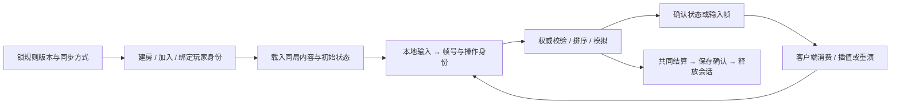

# 联网与服务端：先确定谁裁决，再让两端推进同一局

> 核实：2026-10-26。面向已有单机玩法、准备做小规模联机的程序员；Unity 优先，Unreal 对照。引擎方案为文档／源码选择，实际运行的是固定 MOBA 模拟的三进程输入帧消费者；不把它称为浏览器联网版或公网验收。

## 1. 当前强方案与默认：先选同步方式

**✅ 普通双人动作／合作先用服务器权威状态同步；已经具备可重放确定性模拟时，再评估输入同步。** 远端对象插值，本地操控确需即时响应才用成熟预测。先沿用引擎／项目现有网络栈，不为两人开房先自建调度、预测和迁移框架。

<!-- frontier: status=已比较 gap=2 gen=NGO2.7-NfE1.9-Fusion2-Quantum3 checked=2026-10-26 -->

帧同步、状态同步与回滚不是三个互斥的网络拓扑：前两者回答主要传输入还是结果，回滚回答预测错了怎样恢复。确定性输入同步可以等待齐帧，也可以预测缺失输入后回滚；状态快照方案同样可以纠正并重演本地角色。

| 项目条件 | 默认与强替代 | 需要承担的成本 |
|---|---|---|
| 已有 Unity GameObject，小队 PvE 能接受权威确认 | ✅ NGO 客户端—服务器＋远端插值，沿[合作首版](04-client-modules.md#coop-production)接入 | NGO anticipation 不是完整 rollback/replay prediction；紧手感运动不能把缺失预测写成“再补几行” |
| GameObject 动作需要现成预测／校正 | 🧪 比较 Fusion 2 Host／Server，与已有成熟栈同题验手感 | 绑定其输入／模拟循环，评估重演 CPU 与服务／许可成本；Shared Mode 不用同一预测合同 |
| 已采用 Unity ECS，实体数与预测需求明确 | 🧪 Netcode for Entities 的 predicted ghost | 快照纠正会多次重演；不能为双人联网把稳定 GameObject 项目整体改成 ECS |
| 规则已能固定步长、同输入重放，愿意约束整个模拟 | 🧪 输入同步；低频操作先等待齐帧，低延迟需求比较 Quantum 的 deterministic predict-rollback | 固定状态／随机数／顺序／数学行为；最慢输入会拖住等待版，预测版要保存、恢复并重演状态 |
| 已有 Unreal 常规角色 | ✅ 先用 ACharacter／CharacterMovement 的网络移动与复制；用项目现成服务端模型 | 角色移动的 SavedMoves／校正不自动覆盖库存、技能、奖励或全部物理 |

**房主、专服和 Relay 是另一层选择。** 朋友合作短局可用玩家主机，主机退出结束本局也可以是明确首版政策；竞技裁决或必须持续在线的世界比较专服。Relay 解决连通，不替你裁决命中、保存奖励或接管断线主机。先定允许谁作弊、谁离开时游戏怎样结束，再买连接服务。

来源：NGO 2.7 [client anticipation](https://docs.unity3d.com/Packages/com.unity.netcode.gameobjects@2.7/manual/advanced-topics/client-anticipation.html)、NfE 1.9 [prediction](https://docs.unity3d.com/Packages/com.unity.netcode@1.9/manual/prediction-n4e.html)、Fusion 2 [输入](https://doc.photonengine.com/fusion/v2/manual/input/player-input)／[执行循环](https://doc.photonengine.com/fusion/v2/concepts-and-patterns/fusion-update-loop)／[物理选项](https://doc.photonengine.com/fusion/v2/manual/physics/physics-overview)、Quantum 3 [Frames](https://doc.photonengine.com/quantum/v3/manual/frames)、UE [网络移动](https://dev.epicgames.com/documentation/en-us/unreal-engine/understanding-networked-movement-in-the-character-movement-component-for-unreal-engine) [一手]，2026-10-26。这些是接线版本，不要求项目升级；服务现价与实际设备最优方案未比较，不宣称通用冠军。

## 2. 一局正常联机需要接通什么

**先做“创建房间→两人加入→移动／合作操作→共同结束”的短局，再加中途加入与续局。** 网络会话存在、场景加载完和玩家能操作是三个不同状态；UI 等到实际玩法 ready 才交输入。已有菜单／资源生命周期继续管理本地实例，不让网络回调直接接管全游戏。

| 接线阶段 | 实际所有者与交付物 | 首版怎样验证 |
|---|---|---|
| 规则与版本 | 玩法拥有固定逻辑步长、内容版本、随机源与状态；房间配置决定地图、种子、人数 | 同一输入在同一锁定运行条件可重放；跨版本不能假装同局 |
| 玩家加入 | 会话服务负责找房／连通，服务器把已认证连接映射到玩家／角色 | 第二个连接确实得到自己的角色；拒绝不允许的版本／重复席位，不按客户端传来的 heroId 授权 |
| 世界准备 | 服务器生成权威对象／初始状态，客户端完成场景、角色、HUD 的本地绑定 | 两端当前状态一致且均能操作；连接成功不替代 ready |
| 操作进入 | 客户端采集意图，服务器检查身份、频率、时序与游戏资格 | 按实际协议提交移动／技能，而不是上传可任意相信的位置、血量和奖励 |
| 模拟与呈现 | 权威规则写状态；客户端插值远端，预测者保输入与可恢复状态 | 一次操作只结算一次；被拒／校正后的表现回到权威结果 |
| 中途变化 | 同步对象当前状态，按既定政策处理断开／重新加入 | 首版允许断开结束就明确结束；需要续局再沿[现成恢复能力](04-client-modules.md#coop-continuity)落世界、身份、输入恢复 |
| 结算与退出 | 服务器生成结果身份，进度系统去重并确认保存；会话层关闭连接 | 同一结果重送不重复奖励；下一局不继承旧对象／回调 |

**暂停本地菜单，不等于暂停服务器。** 共同冻结必须由协议确定在哪一逻辑帧生效；本地可暂停菜单动画和输入采集，仍接收世界更新。预测中已经播放的声音、粒子和一次性 UI 也不应在每次重演时再播一遍：规则状态可以重算，确认事件与表现要有稳定身份。Factorio 的实际优化经验也显示，预测更多敌人／车辆会增加成本，小偏差就可能反复触发声音与粒子，不值得为了“全预测”把整世界搬进重演。

来源：[04 正常合作链与既有接线证据](../../docs/research/wp10-content.md#coop-normal-production)、[Factorio FFF-412](https://www.factorio.com/blog/post/fff-412)（2024-05-24，真实开发经验）；2026-10-26 综合。正常短局与冻结政策为实现建议，不是已运行这些引擎服务。

## 3. 在现成引擎栈中从哪里开始

**Unity GameObject 先复用原 NGO＋MPS 短局入口。** 用会话创建／加入建立网络，连接审批绑定允许的玩家，服务器只生成一次玩家对象；通过 NetworkSceneManager 同步受管理场景后，再确认本地角色和 HUD。当前门状态／持物状态用 NetworkVariable 初值和变化共用呈现路径；请求与一次性反馈走 RPC，服务器仍核发送者、对象权限和规则。MPS 的网络配置若已负责启动网络，就不再并排调用一套手写启动器。详细顺序、钥匙二改与离开接口在[04 完整合作模块](04-client-modules.md#coop-production)，这里不再复制一次。

需要完整预测时，把**输入→固定模拟→保存／校正／重演→呈现**一起接入候选，而不是只换发送 API：

- **NfE**：输入放 `IInputComponentData`，owner 走 predicted ghost，逻辑进入 `PredictedSimulationSystemGroup`，查询按 `Simulate` 过滤当前需模拟的实体；重演时不要无条件更新所有对象。官方高延迟例会在一个显示帧里跑多次逻辑 tick，先按实际重演上界测 CPU。
- **Fusion Host／Server**：`INetworkInput`→`OnInput`→`GetInput`／`FixedUpdateNetwork`，把输入权与状态权分开。简单视觉预测、Fusion 2.1 起的 Forecast 与完整物理重演不是同一成本档，别默认预测全世界刚体。
- **Quantum**：把规则与状态迁入它的确定性模拟，区分 Verified／Predicted frames；不能把任意现成 PhysX／Node 状态直接标成确定性。迟到输入可能改写预测，包括自己的输入。
- **UE**：普通角色先让 CMC 保存移动、服务器复算与纠正、客户端重演；不要再加一个同时直接写 Transform 的“网络移动脚本”。技能与库存仍按权威规则接线。

想理解回滚机制时可读开源 [GGRS](https://github.com/gschup/ggrs) 的 [Save/Load/Advance 请求循环](https://docs.rs/ggrs/latest/ggrs/)：游戏必须完整保存并恢复状态，按请求顺序执行；预测预算耗尽仍可能停帧。它是 Rust P2P rollback 参考，不是 Unity 即插即用方案；本地 SyncTest 也不是线上游戏已验收。

依据：上一节官方接口和 GGRS 文档／开源实现，2026-10-26 [一手／开源]；未在本项目安装这些网络 SDK。不要为引用的包版本强行升级已有项目。

## 4. 用已有 MOBA 模拟跑两端输入帧，而不是另写一个假游戏

**🧪 已经有确定性模拟，就先把同一局放进两个独立进程。** [可运行入口](../../experiments/server-lockstep/README.md)直接导入正式 MOBA 固定 `3bcda00f` 的 `Simulation` 和 Detour 数据，不改它的生产代码。一个服务端按席位排帧并裁决，两个 Node 客户端只消费服务端提交的下一帧；同机同版本的三份状态哈希互相核对。它验证这个输入接缝，不把浏览器浮点、认证或互联网体验的问题藏掉。

共同起点不只一个 seed：锁源码与内容版本、导航数据、依赖和运行时；先比初始状态，再运行逻辑帧。输入至少包含稳定玩家身份、目标 tick、同一帧内的操作次序；“没有操作”也发送空包。服务器不能把未到包当空包，不能按到达顺序决定同帧操作。例中的同一英雄先 `move` 再 `stop` 与倒序具有不同语义，延一帧也可能改变完整状态，即使最后坐标碰巧相同。

本例采用容易检查的等待齐帧：两席输入齐全、上一帧确认完成后，以固定 30 Hz 模拟步长推进一次。网络慢时等待，不用巨大 `deltaTime` 追赶。相同输入重试只消费一次，冲突重试、错误角色、不连续帧或状态哈希不一致结束本局；需要持续在线时再设计有版本的状态恢复，不能用“继续跑”掩盖分歧。

第二次改动从实际需求进入：加入新技能时扩展命令 schema 与服务器所有权校验，沿原模拟规则验合法性；改成更即时的手感时评估现成预测／回滚栈及可恢复状态，不只把等待删除。浏览器接入换成匹配项目的传输适配，保留帧与状态合同；Node TCP 不直接成为浏览器 API。

实际结果与范围：[WP10 同例](../../docs/research/wp10-content.md#server-input-frames)。代码／导航固定源：[MOBA Simulation](https://github.com/dbvv1/MOBA-Like/tree/3bcda00fb35361cc5a25ee74e3768a2f3678c563/src/sim)，2026-10-26；不修改其当前非联网里程碑，也不称可玩客户端已经采用。

## 5. 给 AI 的实施材料与验收

**交给 AI 的是实际状态／输入接缝和一条完整短局，不是“帮我加个联机”。** 提供项目锁定网络栈、角色与连接的身份关系、逻辑步长、命令 schema、持久数据所有者、准许的加入／退出政策；让它先接一个正常玩家操作和远端可见结果，再沿同一条链补第二玩家与结算。若它提出新框架，要求说明现成栈具体缺什么、为何值得维护。

接收时用两个真正独立实例从加入到退出；同一输入的多进程一致性、快照／预测纠正、重复确认和断线出口分别看结果。状态哈希是找分歧的工具，不是玩法质量或安全认证；真实延迟、丢包、不同设备／运行时和目标平台性能要在实际采用的栈上验。没有跨平台确定性证据时，先采用已验证的状态同步，或收窄锁步运行条件，不让漂亮的单机回放替代联机结果。
