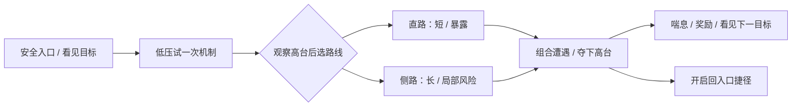

# 关卡与遭遇：从可玩布局到值得再玩的一关

**默认先做一关可快速修改的真实玩法布局：一个清楚的体验主题、一条必经路线、一个有代价的可选分支，再用现有角色、敌人和胜负规则试玩。** 空间尺度还不确定时用原语白盒；已有成熟网格／模块编辑器时直接摆真组件，不必额外造一份白盒。先让玩家在空间里作选择，再决定美术和生成规模。

本页补全 [Gameplay 架构](05-gameplay-architecture.md)的关卡制作链；生命周期、存档和战斗规则仍归原模块。适合单人程序制作紧凑的动作／探索关卡；竞技地图还需双方出生、回防、交战时间与多人平衡验证。本文为官方资料、开发者制作复盘与源码研究；已解析 LDtk 官方样例验证数据分层，未运行原生编辑器或真人试玩。

## 1. 先选择制作路线，而不是选择地图生成器

| 当前问题 | 默认做法 | 何时换路线 |
|---|---|---|
| 3D 移动、镜头和战斗空间还没确定 | ✅ 现引擎原语／现成模块；Unity 需要挤出和面编辑时接 ProBuilder | 一组 Cube 就能测走廊宽度时，不先学完整建模工具 |
| 2D 房间、格子地形与交互点较多 | ✅ 保项目现有 Tilemap／编辑器；新增独立作者源时评估 LDtk 的 IntGrid＋Entities | 已有 Tiled 等导入链就继续用，不为这页迁移 |
| 玩法和编辑器已经成熟 | ✅ 用真敌人、真门、真奖励直接做可玩关卡 | 内容昂贵到不敢删、空间还在大改时，退回廉价占位 |
| 核心卖点是反复探索新组合 | 🧪 先手做合格房间，再限制连接、入口和内容组合 | 新鲜感依赖随机性且能持续检验种子时才扩生成；不要用随机摆怪代替遭遇设计 |
| 现工程是 Unreal | ✅ 沿已有角色、Level 和 Actor 制作布局，用原语／建模工具改几何 | 不为复用 Unity 工具换引擎；官方 Quick Start 只教搭房间，不保证关卡设计成立 |

**优秀制作流程不等于每次都“纸图→白盒→精装”。** Steve Lee 在 GDC 2025 分享《Tactical Breach Wizards》：编辑器已就绪、角色与敌人能力按需提供，直接做真实关卡比额外画草图更快，没有单独白盒阶段。值得借的是缩短“改想法→玩结果”，不是照搬其回合制尺寸。它的另一条质量参照是每关有可辨识的概念；同一批能力通过新组合产生新问题，而不只是数量递增。

Unity 默认也不是“ProBuilder 当前最好”。它适合场景内快速几何调整；2025 年真实用户同时报告对齐、选择和版本迁移摩擦。先在锁定包中完成一间房的移动、开口、碰撞与重载，再决定是否扩用。熟悉现有模块摆放的人不必被迫迁移。

依据与核实（2026-10-26）：[Steve Lee GDC 2025 原始演讲稿](https://media.gdcvault.com/gdc2025/Slides/Lee_Steve_TheUnusualLevel.pdf)、[ProBuilder 官方手册](https://docs.unity3d.com/Packages/com.unity.probuilder@6.0/manual/index.html)、[用户原帖与不同工作流](https://www.reddit.com/r/Unity3D/comments/1oqd2qc/am_i_the_only_one_who_struggles_a_lot_with/)、[UE 官方起点](https://dev.epicgames.com/documentation/en-us/unreal-engine/level-designer-quick-start-in-unreal-engine)。方法是适配选择，不是已测出的工具效率排行。

## 2. 第一关只证明一个有趣的选择

**先写玩家会做什么，不写“做一个废弃工厂”。** 示例目标：“玩家先看见控制高台的远程敌人，再在短而暴露的直路与长但能绕后的侧路之间选择；夺下高台后打开返回入口的捷径。”这是原创教学示例，不是某作品地图复刻。

准备四个东西即可开工：

1. **现有玩法基线**：角色移动／冲刺、视角、敌人射程和攻击预告、死亡与重试都用项目现成实现。若这些仍大改，关卡尺寸也只作暂定。
2. **本关概念**：一句选择及其代价；先保留两个敌人职能，例如压制与逼迫移动，而非十个只差血量的变体。
3. **一个短路线图**：入口、第一次观察、交战、喘息、可选风险、终点。路线上每段有作用；无作用的长路先删。
4. **一组可换的占位组件**：地面／墙／坡道／遮挡，出生点、敌人点、门和补给。颜色表达危险／可交互／背景，不以细节数量表示完成。

图是空间意图，不是自动成立的玩法。侧路必须改变接敌方向、资源或观察条件；如果只是多走一截同样的走廊，它没有选择价值。玩家可以跳过的奖励放在支路，关卡完成所需能力／任务条件不能因选路而永久错过。

## 3. 用角色和摄像机决定尺寸

**做一个小型动作标尺区，再搭完整布局。** 用当前角色实走单人通道、双敌交会、转角、坡道与落差；把实际能顺畅通过的尺寸作为组件参数，不从现实建筑尺寸直接推“游戏一定舒服”。

| 需要判断的空间 | 怎么设起点 | 试玩时看什么 |
|---|---|---|
| 暴露路段 | 以当前移动速度估算暴露时间：距离／速度；另计起步、转向、开火和敌人反应 | 玩家是否有机会理解并执行换位，而不是出门即被无解命中 |
| 掩体与射击孔 | 用真实镜头、枪口／投射物轨迹、站立／蹲下姿态测试 | 镜头看得见却打不到；肩侧镜头被竖柱挡住；退后一步突然暴露 |
| 近战区域 | 两侧留真实闪避、敌人包围和摄像机旋转空间 | 玩家能读到攻击并选方向，墙边不持续被镜头遮挡 |
| 高台与坡道 | 从进入该区域时的视角看地标与敌人，不只用俯视编辑视图 | 高度提供信息／路线变化，还是迫使玩家持续找屏外威胁 |
| 门洞与捷径 | 用碰撞体、敌人导航尺寸与门的实际打开状态测试 | 视觉可通但角色或 AI 过不去，重试后路径含义改变 |

不要把“全灰”理解成可以延后辨识。占位阶段就应有敌人与背景的轮廓／明度差，以及可见的入口和目标。2026 年一份真实白盒反馈指出肩侧镜头与掩体冲突、进入时缺乏观察机会；作者解释自己想直接投入战斗。这不是谁的审美必胜，而是要把“突入紧张”与“来不及看懂”分开验证。

依据与核实（2026-10-26）：[白盒作者与试玩反馈原帖](https://www.reddit.com/r/UnrealEngine5/comments/1sfpici/ive_been_learning_level_design_for_3_months/)、[Level Design Book：可玩白盒与尺度](https://book.leveldesignbook.com/process/blockout)。表中尺寸推导是项目起点，不提供通用最佳米数。

## 4. 编排遭遇：改变问题，不只增加敌人数

**先单独介绍一种威胁，再让两种互补威胁与空间相互作用。** 示例先让玩家处理会明确预告的高台射手；组合遭遇加入迫使离开掩体的近战单位。射手控制一条路线，但侧路仍提供可读的对策。不要同时换新敌人、缩小场地、减少补给再增加波次，否则失败无法归因。

- **观察到承诺**：首轮允许识别目标、危险方向和一处可用位置；突袭段可以压缩准备，但用声音、入口动作或前一段建立预期。
- **活动敌人决定实际压力**：同时瞄准、包抄、封路的单位比房间总数更重要。沿已有 AI／Spawner 设置激活条件、加入顺序与空间分布；一批倒下后不必立刻刷同数量下一批。
- **高峰后有变化**：喘息可以是安全观察、补给选择、短探索或打开捷径，不必都关门发奖励。补给放在风险位置会改变选择，免费放脚下只会改资源曲线。
- **胜利后看得出结果**：高台被夺下、门打开、原来危险的路线变安全；下一目标清楚。完成条件沿现有任务规则，不从“视野里没敌人”猜通关。
- **难度分开调**：先改攻击重叠、空间逃生机会与读招时间，再决定血量／伤害是否需要变；保留关卡主题，避免简单档变成无事可做。

给自己一个低成本记录：每段的玩家问题、敌人职能、可用对策、结束后的新信息。它比密密麻麻的秒表脚本更能支撑改关。实际节奏仍由试玩决定；固定步长回放能验行为，却不能自动判断紧张和疲劳。

## 5. 接进已有工程，不另写一套关卡游戏

### Unity／Unreal：一个关卡入口，复用现有运行逻辑

**复制一个已能启动的测试场景，保住 Bootstrap、玩家与输入配置，再替换布局。** 把碰撞／导航、视觉表现、玩法点位分组；用现有 EncounterRunner、Spawner 或同等接口消费敌人定义和场景锚点。已有系统叫别的名字就沿其入口，不为了文档改架构。

程序员的第一步是查清“谁开始这一关、谁创建敌人、谁判完成、谁重试”，然后只加本关内容与必要适配。没有遭遇数据时，先用一个序列化定义保存敌人引用、出现条件、点位与完成规则即可，不先写图编辑器。作者工具接 [内容作者工具](unity/05-content-authoring-tools.md)，规则与持久状态接 [Gameplay](05-gameplay-architecture.md)。

Unity 需要改几何时从项目兼容的 `com.unity.probuilder` 与官方菜单开始；脚本化生成才读对应版本 API。此次源码 HEAD 为 6.1.3、要求 Unity 6000.0，而 6.0 文档显示 6.0.9，不能按仓库 HEAD 推断项目已装版本。官方 `CreatePolyShape` 演示多边形生成，但它定时随机重建，不是关卡内容生成器；旧 `RenameNewObjects` 示例还有关闭的编译开关和旧命名空间，不能不检查就粘进新工程。ProBuilder 是 Unity Companion License，不当作跨引擎通用 MIT 库。

### 2D：语义格子驱动玩法，图块负责外观

**沿现有导入器把地形语义、交互实体和表现分开。** LDtk 的 IntGrid 可表达墙／可走区域，Entities 表达门、按钮、出生和拾取；自动图块负责将规则变成外观。不要从渲染图块的图片编号倒推“这是墙”。

官方 `Typical_TopDown_example.ldtk` 已有 Collisions、Entities、自动墙顶／地板层，先在现项目导入该结构的最小自有版本，再换自己的合法图块。导入时按稳定实体身份匹配既有对象／引用；正确处理网格大小、层偏移和像素到世界单位。换墙皮应不动门的玩法身份；移动墙语义则要重新生成碰撞／导航。外部关卡文件选项与格式升级按锁定版本导入器处理，不从导出的图片丢失玩法数据。

依据与核实（2026-10-26）：[ProBuilder 固定源码与许可](https://github.com/Unity-Technologies/com.unity.probuilder/tree/4d190ef81b8d0b8db9970b2638450362309f3641)、[LDtk 固定样例和源码](https://github.com/deepnight/ldtk/tree/2b7b5512f2f88fa281cb6492debbb26ead7838d4)、[JSON 分层与外部关卡](https://ldtk.io/docs/game-dev/json-overview/)。LDtk 代码 MIT；样例美术不随代码许可自动转成项目素材。离线解析确认样例的语义与自动图块分列，不等于导入器、碰撞或寻路已通过。

## 6. 第二次改关：再加一处远程威胁，而不是推倒全部地图

**保留“夺高台”的概念，在侧路增加另一处远程威胁，把原有侧路改成能观察该射手但需要一次暴露穿越的绕行。** 先不加新素材、不重写敌人系统。

1. 复制内容版本，保原关可玩；复用已有远程敌人定义，在新锚点放置，确认从入口能识别它。
2. 改两处遮挡与侧路出口，不把“加难度”简化成缩窄所有通道。记下想改变的选择：玩家应先处理压制、再进入近战，而不是被同时围住。
3. 移动补给到能看见但需要决策的位置；如风险已明显增加，不再同时减资源和加生命值。
4. 用同一角色、镜头和难度重跑旧路线、新路线、抢跑、绕过与死亡重试。看看一条路线是否在所有条件下都更优。
5. 邀请没看过编辑器的试玩者从入口开始；只记录他第一次看向哪里、何时理解目标、为何死亡和何时感到重复，不在旁边指路。

一个关卡作者在 2026 年自己的白盒复盘里明确承认：局部区域与引导有所进步，但宏观节拍、情绪和趣味深度仍不足。它提醒我们，能摆出连通场景与能组织完整体验是两种成果；不要把路线检查通过当关卡质量通过。

依据与核实（2026-10-26）：[《阿勒忒亚山》作者原始复盘](https://voidcake.site/article/Aletheia)。以上二改是建议流程，未称为该作品或本仓案例的实测结果。

## 7. AI 做什么，以及怎样判定可交付

**让 AI 实现清楚的空间意图并找反例，人决定节奏是否成立。** 可以直接给 Agent 这一项：

> 沿现项目可启动场景和已有角色／敌人系统做“观察高台→直路或侧路→夺点→开捷径”的一关。先报告现有接入点与移动／相机尺度，不换控制器、不新建战斗框架。用可编辑原语或现成模块保留本关点位身份；输出可玩入口、两条路线的预期代价和二改入口。验证视觉可达与实际碰撞／导航一致，列自动检查结果以及仍需真人判断的体验。

| 验证层 | 实际要证明什么 | AI 常见误判 |
|---|---|---|
| 数据／静态检查 | 内容引用、点位、门条件、生成预算，必经目标未被可选路线绕坏 | 把 JSON 合法或图连通当成关卡可玩 |
| 原生实际运行 | 当前角色能走、镜头能看、敌人能到位，出生／胜负／重试正常 | 用俯视截图／浏览器示意替代角色视角和引擎导航 |
| 完整试玩 | 玩家理解目标，两路线有真实取舍，遭遇后有节奏变化 | 自动通关率高就宣布有趣，或者把迷路全归玩家 |
| 第二次需求修改 | 改空间、敌人组合和补给仍可继续制作，旧关没被连带破坏 | 每次重建所有对象导致引用和手工调整丢失 |
| 目标设备剖析 | 最重遭遇的帧时间、同时活动 AI、可见物与内存符合项目预算 | 用编辑器空场景帧率推断完整关卡性能 |

达到以上相关门槛再做材质／光照和装饰；换美术后重看轮廓、通路和读招。作品需要叙事气氛或光影才成立时，可以提前用一小段真实表现验证，不强迫全关始终灰色。暂不需要开放世界、全程序化生成或复杂导演系统来证明这一关有趣。

来源比较、源码阅读与离线验证范围见[研究记录](../../docs/research/2026-10-26-level-design-and-encounters.md)。
