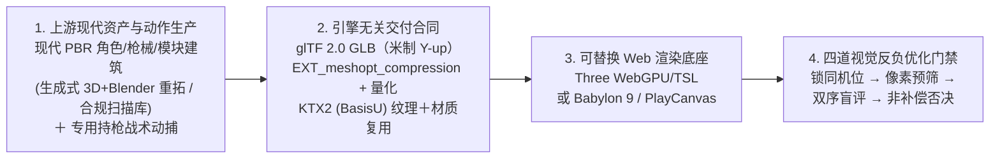

# 09 Web 渲染方案与资产解耦

> 更新：2026-11-26  
> 回答两个核心问题：**① 为什么网页 3D 游戏反复“越改越灰或沦为缝合怪”？② 3D 美术／动作如何与 Web 运行时解耦，并按画质目标选对 2026 Web 渲染管线？**

## 1. 30 秒结论：网页画质弱，先查资产断代、光照标定与评估门禁

**桌面 Web 运行时早已不是不能跑高面数的瓶底；画质长期原地打转甚至负优化，多数出在“2005 旧资产硬拼代码方块＋色调映射失调＋拿 FPS 当画质”。** 第 9 批《雪线回波》在桌面 RTX 5070 上用 WebGL2 跑出 `5,783,263` 三角面、`1,881` calls 与 `100.2 FPS`（[第 9 批负优化复盘](../../docs/collaboration/demo-trial-20261117.md#ninth-batch-snowline-aaa)），帧耗裕度充足，但同机位画面仍被真人判定显著劣于旧基线——根源是把高面数与开启 `N8AO`/`CSM`/`AgX` 等名词误当成画面提升，未阻断 **P5 暗部抬灰（`18.31 → 49.92`）、2005 低模与旧方块混排“缝合怪”、空手动捕硬套 IK** 等直观视觉退步。[本端实测]

---

## 2. 2026 主流高画质 Web 3D 渲染方案横评

**按原生照明／抗锯齿能力、3D 资产适配与生态成熟度选型，不为某个热门模型或单一示例换整栈。** 下表外部框架特性核自 2026 年一手官方文档与源码，**尚未在本仓同一可玩关卡下作同场景性能与画质基准对比**，采用前须先跑同机位 1–2 镜 A/B 验证。[一手文档／源码研究]

| 渲染方案 | 评级 | 关键渲染与画质能力 | 适合的 3D 游戏形态 | 采用条件与硬边界 |
|---|---|---|---|---|
| **Three.js `r187+` `WebGPURenderer` + TSL** | ✅ 采用（桌面高画质） | 原生 MRT 多目标、节点式 `SSGINode`（屏幕空间 GI）、`GTAONode`、`TRAANode`（速度缓冲时域抗锯齿）与 Bloom，自动输出 WGSL 并在不支持设备回退 WebGL2（[WebGPURenderer 手册](https://threejs.org/manual/pages/webgpurenderer)、[后处理文档](https://threejs.org/manual/pages/webgpu-postprocessing.html)、[r187 SSGI 示例](https://raw.githubusercontent.com/mrdoob/three.js/r187/examples/webgpu_postprocessing_ssgi.html)） | 现有 Three.js 写实或高质感 PBR 游戏平滑升级，需保留自定义材质/角色管线与可控包体 | **本仓第 10 批 RTX 5070 实测 100 FPS / 6/6 盲选胜出**（见 [§6 最小 A/B 实测](#webgpu-vs-webgl2-ab)）；须注意 **4-MRT 32 bytes/sample 硬上限**（`output+diffuse+normal+velocity`，不可再加第 5 个 RGBA16F 附件），需将旧 `EffectComposer` 重写为 TSL `RenderPipeline` |
| **Babylon.js `9.0`（2026-03）** | 🧪 试用 | 8.0 起核心着色器原生双写 GLSL+WGSL（免去 >3 MB GLSL→WGSL 转译库）；9.0 **Frame Graph v1.0**（DAG 显存复用）、**Clustered Lighting**、带纹理发射的 **Area Lights**、WebGPU 计算着色器 **Volumetric Lighting**、Adobe 贡献 **Dynamic IBL Shadows** 及内置 Havok 物理与 Inspector（[9.0 官宣](https://blogs.windows.com/windowsdeveloper/2026/03/26/announcing-babylon-js-9-0)、[9.0 特性全览](https://babylonjs.medium.com/welcome-to-babylon-js-9-0-c3edc9ee6428)、[8.0 WGSL 说明](https://blogs.windows.com/windowsdeveloper/2025/03/27/announcing-babylon-js-8-0)） | 需要成套开箱即用引擎能力（体光、区域光、多盏动态灯光、Havok 物理、在线检查器）的中大型 3D 网页作品 | `IBL Shadows` 体素追踪目前**主要适用于静态投射体**，高频变形蒙皮角色实时重体素化开销高（[IBL Shadows 文档](https://aka.ms/babylon9IBLSDoc)） |
| **PlayCanvas `v2.19+`（MIT）** | 🧪 试用 | WebGL2 + WebGPU 双后端、簇状照明，WebGPU 计算着色器 GPU 基数排序的 **3D Gaussian Splatting（3DGS）** 与分段流式加载 **Streamed SOG** LOD 管线（[PlayCanvas Engine](https://github.com/playcanvas/engine)、[v2.19 WebGPU+SOG 博文](https://github.com/playcanvas/blog/blob/main/blog/2026-06-03-new-in-supersplat-webgpu-and-streaming-bring-huge-performance-wins.md)、[GSplat 渲染器文档](https://developer.playcanvas.com/user-manual/gaussian-splatting/rendering-architecture/renderers)） | 实景扫描/重建背景＋低多边形碰撞代理网格＋前场少数高精度可动角色/载具的混合路线 | 3DGS 背景难做任意破坏或动态全局打光；云端编辑器强耦合其工作流，纯本地代码可控度弱于 Three/Babylon |
| **裸 WebGPU + WGSL（无引擎）** | 👀 评估 | 零外部框架包体、直接用 Compute Shader 在 GPU 现成生成海量实例植被/粒子与体积雾散射（如 [Abyssal Garden](https://github.com/Noniv/abyssal-garden) 97 KB 单 HTML 生成水下体积光与约两百万摇曳海藻）[一手／研究] | **纯程序地貌、体积光雾、水下/流体物理等氛围展示与单主题原型** | 缺原生 glTF 蒙皮骨骼混合、物理碰撞与资产热替换；**不适合多角色持枪、UI 重度交互的写实战术游戏** |
| **WebGL2 定制 MRT 风格化／标定 PBR** | ✅ 采用 | 广兼容回退底座。风格化可走 MRT（Color + Depth + ObjectID + Normal）+ 仅背景 Kuwahara 笔触 + 选择性描边（如 [Blackout](https://github.com/anstapnever/blackout)）；写实 PBR 则配 2K HDRI、分级 CSM、半分辨率 AO 与**经校准的色调映射**（[世界光照与玩法提示](04-client-modules.md#世界光照与玩法提示后处理只改世界不把提示一起压暗)、[HDR＋N8AO＋CSM＋AgX 后处理栈](assets/materials.md#n8ao-csm-agx-stack)） | 全浏览器兼容发布、固定美术语法的风格化作品、或作为 WebGPU 不可用时的保底管线 | 原生缺乏动态漫反射 GI 与真体积散射；**不能盲目开启多层后处理**，每换一项色调映射或 AO 必须过同机位黑电平与对比度门禁 |

> 注：**Google Filament（WASM）** 适合将既有 C++ 高严密 PBR 管线移植到 Web，但其自身只是纯渲染器而非游戏引擎，且工具链贴近 C++/CMake，单人 Web 原型通常优先选前三者。

---

## 3. 拆解“Fable 5.2 类网页 3D 作品质感好”的四条真实机制与天花板

社区基于 `Claude Fable 5.2` 的高口碑网页 3D 作品（参考 [awesome-fable-5.2](https://github.com/fengyiqicoder/awesome-fable-5.2) 与 [03 节公开源码参照](03-generative-ai-in-games.md)），视觉出彩**不是单凭纯代码就自动做出 3A 写实人物**，而是沿四条结构路径分流：[一手文档／源码研究]

1. **路线 A：概念图 ＋ Tripo 3D ＋ Three.js 多轮精修（带人物的头部作品真实做法）**：例如 *What the Water Keeps*（[TheNewStack 拆解](https://thenewstack.io/claude-fable-game-demos)）由作者用 Tripo 生成 3D 模型、Suno 配乐，再用 Three.js 自定义水面/灯笼光影组合；*Gilt & Gutter* 同样用 Tripo 出角色再绑定动画；国人长篇演示《雾锁山门 / Mist-Locked Mountain Gate》则是即梦出概念图＋Tripo 3D 模型＋Fable 多轮精修（并非纯手搓写实角色）。
2. **路线 B：放弃硬拼写实 PBR，用定制多通道（MRT）Shader 统一强艺术风格**：如 [Blackout](https://github.com/anstapnever/blackout) 用 Three.js r170 WebGL2 跑 6 步 MRT 链（硬边阴影 → Color/Depth/ObjectID/MaterialID/Normal → **仅背景施加 Kuwahara 水粉笔触** → 选择性描边 → 夜景胶片调色），并配合 `three-mesh-bvh` 穿模检测（`qa.mjs`）、`smooth.mjs` 与 `pops.mjs` 自动排障；同类还有世界空间笔触渲染的 *Oil Paint* 与全着色器彩铅 RPG *Brushwild*。
3. **路线 C：靠强氛围题材避开写实人形短板，配裸 WebGPU 或自写 WebGL2**：*Saltline*（[HuggingFace 拆解](https://huggingface.co/blog/aiddroid/how-saltline-ai-game-was-built-with-claude-fable)，约 `8 h / $550`）全靠雨夜集装箱港＋湿路高光粗糙度 Shader 出质感，刻意使用纯第一人称且敌人全为无人机与机器狗，规避了第三人称写实人体；[Abyssal Garden](https://github.com/Noniv/abyssal-garden)（`97 KB` 裸 WebGPU + WGSL）专注水下体积散射与两百万海藻实例化，且在 `prompt.txt` 强制规定**上下文隔离视觉 Critic（新子代理只看 6 张 1440p 固定机位图＋飞越录像、严禁看代码，按 Major/Medium/Minor 打回清零）**。
4. **硬边界反例**：用同样“裸 WebGPU ＋ 6 机位隔离 Critic”去纯代码造大众熟知的真实车辆（[Reddit 实录](https://reddit.com/r/ClaudeAI/s/fHqt8s59wU)），跑满 `7 小时 12 分钟`、8 轮、`~$348`，第 8 轮仍剩 **4 项 Major 形体缺陷**。说明写实人/枪/车近景无法绕开现代 3D 资产供给（见第 10 批实验 B 实证）。

---

## 4. 架构原则：3D 美术／动作资产与 Web 运行时彻底解耦

**角色脸面与装备精不精细、枪械好不好看、持枪动画协调不协调，100% 属于资产与动画生产层问题，与 WebGL2/WebGPU 运行时无关。** 一旦建立跨引擎 `glTF 2.0` 资产合同，同一套高精角色、武器、1P 手臂、持枪动捕与模块建筑可在 Three.js、Babylon.js 或 PlayCanvas 间无缝复用：

- **传输与显存规范**：面向 Web 传输和真机帧稳态，静态与骨骼动画网格优先 **`EXT_meshopt_compression` ＋ `KHR_mesh_quantization`**（解码器仅 ~32 KB，WASM SIMD 约 `1 GB/s` 级解码且同时压缩骨骼动画/变形目标；`Draco` 解码显著偏慢，仅保留给纯静态扫描件），贴图压成 **`KTX2`** 减显存（[glTF 资产规范](assets/3d.md#engine-agnostic-glb-contract)）。
- **禁止“半吊子换件”**：当主场景 80% 仍为程序方块壳时，切忌只塞入少量写实岩石和老旧人形；要么成组替换同风格现代套件（主角＋枪＋1P 手臂＋持枪动捕＋站房立面＋地形一次到位），要么先用同风格中景重塑打底。

---

## 5. 色调映射与后处理防发灰校准红线

**色调映射只决定高光滚落与色域映射规则，绝不能“直接换上 `AgX` 就以为更电影感”。**[一手文档／本端实测]

| 色调映射路线 | 适用场景 | 典型误用与防发灰校准规则 |
|---|---|---|
| **`Khronos PBR Neutral`** | 需要精确还原贴图固有色、避免色相漂移与过饱和发灰的写实 PBR 资产展示（[Khronos 官方说明](https://www.khronos.org/news/press/khronos-pbr-neutral-tone-mapper-released-for-true-to-life-color-rendering-of-3d-products)） | 动态范围极宽的强逆光/霓虹爆炸场景高光过渡较陡，需配柔和光源衰减 |
| **`ACESFilmic`** | 强明暗反差、冷暖对撞强烈的硬朗战术／工业夜景与雪地日光场景 | 低饱和暗景易轻微压暗吃细节，禁止为此把环境底光硬抬到 `>0.4` |
| **`AgXToneMapping`** | 高亮度色彩保持自然不偏色的宽动态 HDR 管线 | **严禁配合高强度 `HemisphereLight`＋高 `envIntensity`＋大半径屏幕 AO 直接套用**，否则会把暗部阴影黑电平抬灰（如第 9 批实测 `P5: 18.31 → 49.92`、`RMS: 50.7 → 34.31`） |

**强制硬约束**：任何渲染后端、HDRI、AO 或 Tone Mapping 改动后，必须先运行 [`visual_pregate.py`](templates/.claude/skills/game-quality-pass/scripts/visual_pregate.py) 对照旧基线同机位核对暗部底线、对比度与饱和度，未通过前不进入下一步优化（完整门禁流程见 [02 视觉反负优化四道门](02-verification-and-playtesting.md#visual-anti-regression-gates)）。

---

## 6. 本机 RTX 5070 最小 A/B 实测：`Three.js 0.187.0 WebGPU` vs `WebGL2`

在同场景几何、同 PBR 贴图、同灯光与曝光参数（`hemi = 0.45`、`sun = 1.85`、`env = 0.36`、`exposure = 1.06`）下，本机 RTX 5070（`1280×720`）对 `WebGL2`（`EffectComposer` + `UnrealBloomPass` + `OutputPass`）与 `WebGPU`（`4-MRT` + `SSGINode` + `BloomNode` + `TRAANode`）跑通三机位锁定对照（[第 10 批详细记录](../../docs/collaboration/demo-trial-20261117.md#tenth-batch-ab-tests)）：[本端实测]

- **性能与硬件校验坑**：初版挂入 5 个 `RGBA16Float` MRT（含 `emissive`，`40 bytes/sample`）触发 WebGPU 默认 `32 bytes/sample` 校验失败导致全黑输出；缩减为 **4 MRT（`output`、`diffuseColor`、`normal`、`velocity`）＋ 合成后阈值 `bloom`** 后全链路 `0` 报错，WebGPU 三机位实测 **`100.0–100.9 FPS`**（`P95 10.2–10.3 ms`、`1,668 calls`、`1.71M–1.82M tris`），不慢于同场景 WebGL2（`95.3–100.0 FPS`、`P95 10.3–13.0 ms`）。
- **像素预筛与双序盲评全过**：三机位全部通过 `visual_pregate.py`（如庭院机位 `P5: 46.69 → 29.06`、`dark_pct: 2.98% → 10.14%`、`RMS: 42.22 → 43.53`）；不看代码与数据的独立视觉盲审在全部 6 张左右互换图上 **6/6 一致判定 WebGPU 胜出**（`2.5–3.0/5` vs `1.5–2.0/5`，远山体块阴影清晰度、道具脚底接触接地感与门口高光控制明显更佳）。
- **单靠换渲染器的诚实天花板**：即便切到 WebGPU SSGI+TRAA，原纯 Blender 人物近景在盲评里**依然只拿到 `2.0/5`**（面数折角感与平涂色块仍像玩具）。证明渲染管线只能救光影，人物与枪械必须同步切现代上游 3D 资产（见 [第 10 批实验 B](assets/3d.md#gen3d-vs-blender-ab)）。
