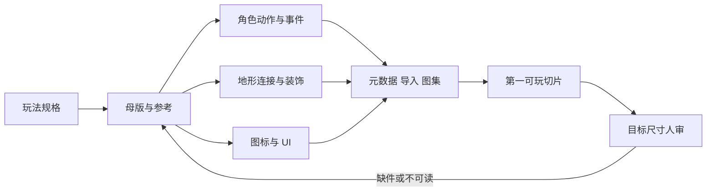

# 2D：从统一美术规格到可二改的资源包

> 核实：2026-10-23（原证据）；生产模块整合：2026-10-25（UTC+8）；3D 源到四向图集 CPU 实跑：2026-10-26 UTC。适用：单人程序员、没有专职美术、不做逐张人工修补。先取可二改的许可源或作者源，生成只补缺口；本文按角色、地形、图标、UI、导入接入与第二次修改逐类落地。固定来源、版本、反证和验证范围见 [WP2 研究记录](../../../docs/research/2026-10-14-game-wp2-2d-assets.md#生产模块对应与证据入口)。本轮未运行引擎或生成模型，视觉与玩法品质仍需实际人审。

## 30 秒结论

| 你要做的 | 默认起点 | 何时换路线 |
|---|---|---|
| 角色必要动作与换装 | ✅ 许可完整动作集或分层作者源；同骨架换部件 | 缺动作、隐藏面或新方向才补源或重渲；自由配装须有共同部件与遮挡规则 |
| 地形与装饰 | ✅ 完整 47-blob 连接地形＋自平铺底层；先草／路，后水／崖 | 只加装饰补中心变体；新拓扑补过渡；接不回旧图就换源或缩地形 |
| 功能图标 | ✅ Game-icons／Kenney 匹配项；原生 tint／overlay 做状态 | 风格不合才从母版改或生成；已学标识先保身份 |
| 原生 UI | ✅ 引擎文本／布局；装饰 9-slice；文字不进图 | 只有平面稿才比较切片或结构重建；复杂嵌套用 SPRITE 思路 |
| 缺口补件 | 🧪 先可编辑源／母版；仅栅格才同题生成 | 静态精改 Sunburst／Flare；无 alpha 插图 Nano Banana 2.1；本地 klein-4B |
| 像素风 | ✅ 完整动作／可替换源；局部换装 PixelLab | 只缺过渡补帧；静态地形 Retro；长动作分组验连续性 |
| 软透明／透明动画 | ✅ 有合格源先用；缺源再比 RGB＋抠像与原生 RGBA | 柔边、发光必要才评原生 RGBA；许可不清不进发行默认 |
| 换光向／体积 | ✅ 平面受光够用就保留；体积找配套颜色／法线 | 仅 PNG 才参数化 normal／light map；旧阴影冲突就换源 |
| 验收 | ✅ Agent 逐件规格、引用、邻接检查；人审目标尺寸 | 整套均值或相似度不能放行；P36 只作合成反例 |
| 导入／二改 | ✅ 保源画布、pivot、ID、事件；先查最终编码与混合 | 裁切丢位置改共同画布；压缩或 alpha 错配先修消费 |

**默认流程：** 玩法规格 → 许可源与母版 → 角色／地形／UI 按类生产 → 元数据与导入 → 第一可玩切片 → 目标尺寸人审 → 第二次修改。先取现成源，缺什么补什么；生成只补缺口，不用来补救尚未定义的规格。

非像素 UI、静态插图／卡面、软透明、分件 rig、像素专项和规则几何的专项入口见文末[按资产类型进入](#按资产类型进入)；主流程先用贯穿例把第一套跑通。

依据：[一手／研究] 本表是后文决策的压缩；具体来源、固定版本与撤回条件见各节和 [WP2 整页卡](../../../docs/research/2026-10-14-game-wp2-2d-assets.md#当前最高水平卡整页生产选择p802026-10-22)，2026-10-22 前核实。

## 贯穿例：先把玩法翻译成资产规格

**先把玩法翻译成一张可执行的资产规格表。** 本文用一个原创俯视角小型探索／动作游戏贯穿全页：一个角色的必要动作、一族相互连接的地形／装饰、少量功能图标和原生 UI。下面的数值是**本例的可执行起点**，不是通用最佳；换目标设备、相机距离或画风时，按最终每格／每角色占屏像素重算。

| 约束 | 本例起点 | 它先约束什么 |
|---|---|---|
| 目标显示与缩放 | 1920×1080、16:9、相机 1×；移动／低端另定 1280×720 | 轮廓、图标和细节实际得到多少像素；是否可用 mip 与软边 |
| 世界网格与角色占屏 | 64px 瓦片；角色视觉 96×128、碰撞 40×24；交互距离 48px | 瓦片数量、图集大小、遮挡层级和动作可读尺寸 |
| 轮廓与色彩 | 1 条外轮廓、3–4 个明度层；背景降饱和；可交互物用保留强调色 | 目标尺寸下的辨识、色盲可读性和新旧资产混排 |
| 动作节奏 | 12fps 基准；idle 6 帧、walk 8 帧、attack 6 帧、hurt 3 帧、death 8 帧 | 帧数、事件窗口、图集容量和制作成本；动作游戏可升到 15–24fps，慢节奏可降到 8–10fps |
| 镜头与缩放 | 俯视正交、跟随带 8–10% 屏幕死区、整数 1×／2×、不旋转 | padding、mip、遮挡处理和 UI 安全区 |
| 画布与 pivot | 角色共同画布 96×128（左上原点），脚底中心 (48,120)；道具 pivot 在底部接触点；地形 64×64（左上原点） | 对齐、裁切、图集位置和换装后的接触点 |
| 遮挡 | 高道具按 y 排序；树冠等前景遮挡物为前层并淡出或切洞，角色始终完整可读；墙体分前后层 | 分层数量、额外精灵和战斗中的可读性 |
| 地形邻接 | 需要连接的地形统一用 47-blob：8 邻域 256 种掩码映射到 47 块；平整底层另加中心变体 | 图块数量、连接规则、旧地图兼容 |
| UI | 原生文本与布局；9-slice 边框 32px；图标 24／32／48px；留安全区 | UI 图集、缩放、本地化长度和点击区域 |
| 玩法事件 | attack 有效帧、hitstop、footstep、land；移动 120／200 px/s | 动画状态机、命中判定和音画同步 |

**规格卡（每个资产一张，跟着源走）：**

| 字段 | 例子 |
|---|---|
| asset_id／类别／owner | `char.player.idle.down`；角色 idle；维护者 |
| 目标／源尺寸 | 96×128 / 192×256 |
| 画布／pivot | 96×128（左上原点），脚底中心 (48,120)；源 192×256 按 2× 对应 (96,240) |
| 帧／方向／循环 | 6 帧、12fps、loop |
| 事件 | 无；呼吸循环 |
| 源／许可／版本 | 来源 URL、作者、许可、固定版本、hash |
| 可编辑源 | PSD／ASE／Spine／分层 PNG |
| 导入 | atlas 组、filter、压缩、alpha、mip |
| 验收 | 目标尺寸轮廓、脚底、循环接缝 |

规格卡的作用是让程序、Agent 和下一位维护者看到同一份合同。字段不全时，先补规格再开工；不要用“看起来差不多”代替画布、pivot 和事件定义。

**可执行配方见 [§7](#7-可执行配方源任务单导出与事件)：** 源前提 → 填满动作／地形任务单 → 批量导出（命名、配置、许可、pivot 单位）→ 运行时事件映射。

依据：贯穿例是 [经验：本仓生产设计]，数值只服务本例；玩法到规格的约束沿用 [WP2 §6 风格控制](../../../docs/research/2026-10-14-game-wp2-2d-assets.md#6-风格控制先最少原生参考再考虑训练) 与 [§11–14 导入契约](../../../docs/research/2026-10-14-game-wp2-2d-assets.md#11-图集二改裁切后保留的是位置还是尺寸)，2026-10-23 前核实。

## 三条路线：先取什么源

**先按资产类别选路线，不按一条全页顺序：**

- **角色动作、地形／装饰、UI 装饰：** 先找完整许可包或分层作者源；有源就沿源改，不先逐张生成。
- **局部改色、切片、像素修正：** 用原生编辑（如 Aseprite、Krita、GIMP）；在生成图上反复补像素通常比回到源更贵。
- **自动瓦片、9-slice、简单图标、组合物品、调色变体：** 用代码／规则派生；规则表达不了就换源。
- **AI 生成：** 只在现成源和规则都不满足、且质量收益明确时补缺口；保留参考、版本、mask 和源图，确定性合成回母版。

| 路线 | 先用于 | 优点 | 代价与失败模式 |
|---|---|---|---|
| **完整许可资源包／分层作者源** | 角色动作、地形族、UI 装饰、静态插图 | 首套最快、风格已成套、许可可核；分层源能继续改部件和动作 | 包内动作／遮挡／拓扑可能不全；混包会风格冲突；不是每包都给可编辑源 |
| **原生图像编辑／像素专门工具** | 局部改色、轮廓、切片、像素修正、遮罩（如 Aseprite、Krita、GIMP；按项目版本核许可与格式支持） | 控制直接、能改现有栅格、适合像素风 | 人工工时高；没有 rig 和隐藏面；逐帧改易漂移；调色板和图集要自己守 |
| **代码／规则派生** | 自动瓦片、9-slice、简单图标、组合物品、调色变体 | 确定性强、批量一致、参数可二改 | 只适合能被规则表达的外观；复杂角色、自然纹理和新视角不适用 |

现成包、原生编辑和代码派生都不是 AI 生成；来源和产出方式分开记录，避免把其他路线写成模型产出。

**换路线的信号：** 源缺动作、隐藏面或连接拓扑，先换源或缩需求；原生编辑开始变成逐像素修生成图，回到源或换来源；代码规则不断超出原语，换来源；许可不清的素材不进入发行默认。

**AI 只补缺口，三档首试：**

| 缺口 | 首试 | 条件与撤回 |
|---|---|---|
| 精细局部改稿、透明静态角色／卡面／图标 | 🧪 固定 `gpt-image-2.5-sunburst-2026-09-08` 与 `gpt-image-2.5-flare-2026-09-08` 同题比较 | 两者支持透明 PNG／WebP；目标尺寸、透明边和保留区须同验；持续串改就换可编辑源或收窄需求 |
| 无 alpha 要求的概念、背景、插图变体 | 🧪 付费 API `gemini-nano-banana-2.1`（2026-10-06 页面更新的多参考路线） | 输入与思考另计；未核到原生 alpha 契约，抠图和淘汰成本可能抵消单价优势 |
| 本地／免模型许可费的小批静态 | 🧪 `FLUX.2-klein-4B`（指定版本有已核商用许可路径）；精细编辑对照 `Qwen-Image-Edit-2511`，初图可用 `Qwen-Image-2512` | 计入硬件、等待、挑选和维护；4B 不足不能自动换免费 9B／dev 商用；无合适硬件时现成资源或 API 可能更划算 |

**⛔ Qwen-Image-2.1 不进入免费商用默认。** 其固定模型卡（2026-09-20）所列代码／权重许可为 Qwen Research，限非商业研究评估，商业需另行授权；原生 RGBA 能力和旧版 Apache 许可都不能替新版清权。FLUX 3 Image 只作布局专项对照。型号、价格、许可与复核触发见 [WP2 §9 动态事实表](../../../docs/research/2026-10-14-game-wp2-2d-assets.md#9-阶段-f-b图像动态事实表)。

依据：[一手／研究] 现有成套来源、Game-icons／Kenney 许可、PixelLab／Retro 条款与三档模型见 [WP2 整页卡](../../../docs/research/2026-10-14-game-wp2-2d-assets.md#当前最高水平卡整页生产选择p802026-10-22)、[§9](../../../docs/research/2026-10-14-game-wp2-2d-assets.md#9-阶段-f-b图像动态事实表)、[§10](../../../docs/research/2026-10-14-game-wp2-2d-assets.md#10-阶段-f-c像素专用服务补缺)；模型与价格按 2026-10-14 分项核实，未在本轮重跑。

## 第一套：从母版到可玩切片的顺序

**第一套的组合通常是：许可包或分层作者源作主体，原生编辑修局部，代码派生自动瓦片与 UI，AI 只补缺件。** 每件产物都回填规格卡、来源和事件表，后面的切片与第二改才有可追踪的源。

### 1. 风格母版与参考分工

**先把母版做成一页可执行的约束，不是一张好看的图。** 至少包含：调色板、目标尺寸剪影、线宽／边缘规则、光向、3–4 个材质样本、比例尺和“不要这样做”的反例。母版批准后再分叉，失败修改不写成新真值。母版有错会被整套继承，批准前在目标尺寸和实际背景看一遍。

| 参考角色 | 放什么 | 不放什么 |
|---|---|---|
| 身份参考 | 角色体型、脸／装备识别点 | 另一套画风、不同光向 |
| 风格参考 | 线宽、色阶、材质笔触 | 具体角色本体、可迁移的独特图案 |
| 布局／姿态参考 | 构图、动作方向、镜头 | 需要重新设计的角色身份 |
| UI 参考 | 层级、留白、状态色 | 与游戏功能无关的装饰 |

**只加必要参考。** 分别指定身份、风格、布局／姿态，用不同物品类别检验“该保什么、不能带进什么”。SafeStyle 与独立 DyRef 的近期比较仍出现参考内容泄漏或漏用；给宝石外观作风格参考，不应把宝石本体带进药瓶。原生参考够用就不叠适配器；跨多类资产持续漂移时，再比较兼容的预训练适配与逐项目训练；训练要有权利清楚的训练集和可摊薄的维护成本。i2L 展示从参考预测可复用权重，但本轮未核清其权重许可，只作研究候选。固定 seed 不能代替身份一致性；统一调色板能减少颜色差异，修不了透视、姿态和轮廓错误。

依据：[一手／研究] SafeStyle／DyRef／i2L 与整族泄漏反例见 [WP2 整页卡·整族风格](../../../docs/research/2026-10-14-game-wp2-2d-assets.md#整族风格先分参考职责再比较适配成本)；母版与训练条件见 [§6](../../../docs/research/2026-10-14-game-wp2-2d-assets.md#6-风格控制先最少原生参考再考虑训练)；2026-10-22 前核实。

**固定机位 paint-over 先写接收清单，再生目标图。** 列出本轮可改层（如照明、色调、地表噪声）与必须保留的机位、通路／阻挡边界、主体位置、动作和身份；非作者拿原始实图逐项对照。本轮若只是灯光小样，另锁角色、武器与场景轮廓，避免把换握姿、改塔形或移路沿误判为光照改善；这种严格几何锁定不套用到允许重设计形体的美术目标图。

MOBA 的两轮实图编辑暴露了这个接收缺口：第二轮树冠语言恢复，但武器握姿／肩臂、塔开口／台阶和路沿仍变化。二改仍串改就停止该方案，收窄编辑范围或换可编辑源，不扩量；失败图可以明确降级为调色／材质参考，不能算已选目标，也不是实机品质改善证据。[两轮失败与接收结论](https://github.com/dbvv1/MOBA-Like/blob/27a40bedaab6bd8bf737885afe952ef6db403f2c/docs/quality.md#L83-L89)，2026-10-30（UTC+8）[案例实测／非作者看图复核]。

### 2. 角色：必要动作、源结构和事件

**第一套先做“能支撑玩法的最小动作集”，不先补满动作库。** 本例动作表如下；帧数和时长是起点，按目标尺寸和手感重算。

| 动作 | 第一套是否必须 | 本例帧数／时长 | 事件与验收 |
|---|---|---|---|
| idle | 必须 | 6 帧／0.5s，loop | 循环接缝、呼吸不滑步 |
| walk | 必须 | 8 帧／0.67s | 两次脚contact；脚不滑、速度同步 |
| run／dash | 玩法需要 | 6 帧／0.5s | 起步、落地；加速度与接触 |
| attack | 必须 | 6 帧／0.5s（2 预备＋2 有效＋2 收招） | active.start／end、hitstop；击中帧与取消窗口 |
| hurt | 必须 | 3 帧 | hurt.start；受击反馈与无敌时间 |
| death | 必须 | 8 帧，non-loop | death.start；末帧保持、碰撞关闭 |
| interact | 可选 | 4 帧 | interact.start；提示与动作同步 |
| 方向 | 4 向（下／上／侧＋镜像） | 8 向只在玩法需要时做 | 转身；不用旋转冒充新方向 |

**按手上有什么选生产路线：**

| 手上有什么 | 第一套怎么做 | 何时换 |
|---|---|---|
| 完整动作包 | 直接选匹配动作；映射 ID、事件和画布；统一 pivot 后接入 | 动作集缺项、风格不合或遮挡层缺失时换包／补源 |
| 分层 PSD／ASE／Spine | 保部件、骨骼、曲线和动作名；换部件、调节奏后重导出 | 缺隐藏面、需要新方向或大转身时补画／换源 |
| 合格绑定的 3D 角色与动作 | 用成熟渲染器从同一源按固定相机、脚底和角度表批渲；回源改动作后重烘 | 必须逐像素清理才能达标就换风格／来源；方向、配装持续扩张时比较实时 3D |
| 只有静态图／正面图 | 先按“静态插图”或“分件 rig”入口补源；不要用少量帧冒充完整动作 | 需要大转身、强冲击、多方向或任意配装时回完整动作源 |
| 只缺少量帧／过渡 | 在已有动作上补；PixelLab 可编辑同一组帧，DeepInterframes 只补关键帧之间 | 长动作分组仍接不上、脚底或接触漂移就只能手画时，换源或缩动作 |

**已有 3D 作者源，可直接借[四向动作图集起点](../../../experiments/sprite-source/README.md)。** 固定 CC0 占位角色的三段动作，经 Blender CPU 渲染成两套四向图集，再由实际取帧消费者按时间表和脚底 pivot 合成；长刃二改交新包，旧包与帧身份保持。共同相机要覆盖整段动作和装备预算，不能只按站姿定画布或逐帧居中。导出后按原动作时长保存采样时刻，loop 去掉重复端点，非循环保末姿态；重采样后的命中事件由玩法另定。此例是整身烘焙，不是自由配装分层，缺少的 hurt／death 仍须回源补齐。

**画布、pivot 与遮挡一起定：**

- 角色用共同画布，pivot 固定在脚底中心；武器、披风、背包分成前层和后层，别把全部部件烘进一张图。
- 高道具按 y 排序；角色走到树后时，由树冠等前景遮挡物淡出或切洞，角色本身保持完整可读；墙体分前后层。遮挡规则要在战斗动作上验，不只看站立。
- 换装后先核身体完整：头、躯干等必要部件确实加载，再判断衣服漂浮。SOLREIGN 的记录显示，合成器取错部件名时非空图会掩盖缺件；缺件时先修评估器，不据图淘汰美术。
- 脚底 pivot 只对支撑相成立；跳跃、翻滚和挥剑会改变包围盒，逐帧居中会把正确动作改坏。

**像素风分支：** 16／32px 画布、整数缩放；完整动作或可替换源优先。只有栅格缺整套外观时，🧪 试 PixelLab Edit Animation／Transfer Outfit：16–64px 最多 16 帧、65–80px 9 帧、81–256px 4 帧；换装（32–64px）15 帧、65–80px 8 帧、81–256px 3 帧。PixelLab 条款允许合规商业输出，禁止未经许可用输出训练模型。长动作分组会增加组间漂移；Skeleton v3 的关节输入是生成条件，不是可编辑 rig。静态地形缺图可试 Retro Fast／Plus（多参考升级 Pro）；Retro 的输出归生成者，但新条款允许平台用输出训练、免费样本可能公开，旧账号到 2026-10-28 才适用新版，不能提前套用其自动化许可。本地沿 klein-4B。两者都未经过本仓逐帧一致性、第二次修改和引擎验收，sprite sheet 也不等于可编辑骨架。

Unity 内原型可先用官方 Sprite Generator 把生成视频采样成精灵帧，减少接入步骤；官方原型定位不等于发行质量，Promote／Replace 也不证明第二次生成后 GUID、fileID、pivot 和引用稳定，实际生产资格按 [WP9](../../../docs/research/2026-10-14-game-wp9-engine-handoff.md#8-unity-原生生成器补核原型集成不等于发行管线) 核。

依据：[一手／研究] 动作、换装、3D 母版与像素服务见 [WP2 §2](../../../docs/research/2026-10-14-game-wp2-2d-assets.md#2-精灵动画控制身份不等于控制动作)、[整页卡·动作](../../../docs/research/2026-10-14-game-wp2-2d-assets.md#动作换皮自由配装和补过渡不是同一任务)、[§10](../../../docs/research/2026-10-14-game-wp2-2d-assets.md#10-阶段-f-c像素专用服务补缺)、[换装预览反例](../../../docs/research/2026-10-14-game-wp2-2d-assets.md#换装预览异常先排除观察工具缺件)；2026-10-22 前核实；新增四向图集于 2026-10-26 UTC 实际完成 CPU 渲染、打包、取帧合成与 7 项回归，保原源验证范围，未运行生成模型／游戏引擎。

### 3. 地形／装饰：先定连接，再做图

**先写“允许哪些邻接”，再画瓦片。**（参考 [Tiled Terrain](https://docs.mapeditor.org/en/stable/manual/terrain/)）单块自平铺、A 接 B 的允许邻接、内外角、图集采样接缝是四个不同问题；规则、内容和采样分别修。采用匹配引擎版本的官方包，不复制旧仓库代码；Tilemap Extras 并非整包 MIT（4.1.2 为 UCL，第三方通知含 MIT 贡献）。

| 层 | 第一套 | 连接／数量 | 备注 |
|---|---|---|---|
| 草地／基础地面 | 1–3 个中心变体 | 自平铺；64×64 | 作为平整底层，先保证单块可重复 |
| 土路 | 47-blob 图组 | 8 邻域 256 种掩码→47 块；与草地按同一边界 contract 相接 | 先做这一族；中心变体不改变连接 |
| 水 | 后加，同一 47-blob | 256→47；岸边装饰另层 | 需要岸线、深浅和动画时再加 |
| 崖／墙 | 后加，同一 47-blob＋前后层 | 256→47；碰撞独立 | 分前后层做遮挡 |
| 树／石／草簇 | 每种 3–5 个变体 | pivot 在底部接触点 | 高道具 y 排序；树冠等前景遮挡物淡出或切洞 |
| 可交互物 | 少量 | pivot 在底部 | 与地形分开，便于换位置和状态 |

**第一套的验收：** 平整底层自平铺；所有需要连接的地形共用同一个 47-blob contract，并对 8 邻域 256 种掩码都有明确映射（含四边、凸角、凹角和孤立组合）；允许的 A→B 与三地形交汇按层序验；图集采样不露缝。只增加中心装饰、连接轮廓不变时，复用同一 47-blob 图组，只补中心变体，逐位核映射不变。新增一种地形时，先保旧块和旧 ID，再补缺失过渡；接不回旧地图就换源或缩地形。

**生成输出不等于完整图组：** PixelLab 的标准 16 块输出，或悬崖 25 块中只有 21 种角组合的输出，都不等于 47-blob；按 `total_tiles` 实数、掩码覆盖和缺口补齐后再验收，不把“能生成”或“块数够多”当完整连接。

**47-blob 的边界：** 它要求采用 blob 邻接约定——对角连接只在两条相邻正交边也连接时成立；256 种掩码都要映射到 47 块中的一个，但多种掩码会共用同一块。若玩法需要区分纯对角接触，或每种掩码都要独立外观，就超出这套 contract，改用 256 块全集或另定规则，不能仍把 47 块叫完整。

**像素与手绘分开：** 像素地形用 16／32px、整数缩放、硬边和有限调色板；手绘地形可用 64px、2× 源图和软边，但要按最终缩放验边缘和 mip。像素风不是“天然零手修”，手绘也不是“必须人工补每一块”。

依据：[一手／经验] Tiled 连接规则、Mindustry 的中心变体与派生预览、PixelLab／Retro 双参考与 GameTileNet 边界见 [WP2 §3](../../../docs/research/2026-10-14-game-wp2-2d-assets.md#3-瓦片和自动qa先确定它究竟验证什么)、[整页卡·瓦片](../../../docs/research/2026-10-14-game-wp2-2d-assets.md#瓦片保连接条件再补缺失的像素)、[§13](../../../docs/research/2026-10-14-game-wp2-2d-assets.md#13-瓦片生产链连接图组与中心变体分开修改)；2026-10-22 前核实，未运行生成器或引擎。

### 4. 功能图标与原生 UI

**图标先保识别，再谈绘画。** 第一套按功能列：生命、体力、攻击／冷却、交互、背包、任务，必要时加设置和地图。先选 [Game-icons](https://game-icons.net/)、[Kenney Generic Items](https://kenney.nl/assets/generic-items) 等已核许可的匹配项；Game-icons 按作者区分 CC BY 3.0 或 CC0，Lorc／Delapouite 仍需署名；Kenney Generic Items 的彩／白图集不能共用切片坐标，独立 PNG 更易保留身份。SVG 只有在内部有可操作部件时才算部件源，不能因后缀是 SVG 就承诺能独立改瓶盖、液面。

| 项目 | 默认 | 条件 |
|---|---|---|
| 图标尺寸 | 源 128px，导出 24／32／48px | 按最终 HUD 占屏验；不要只在放大预览看 |
| 状态 | 原生 tint／overlay／冷却遮罩／角标 | 不重画整套图；保留玩家已学会的轮廓和色块 |
| 风格 | 一套轮廓语言、有限色板；功能图标与装饰插画分开 | 功能图标优先辨识，不追绘画细节 |
| 来源 | 匹配许可包；缺独特外观才从母版生成或编辑 | 生成图逐件在目标尺寸和实际操作中验 |

**已有技能图先补缺失语义，沿同一份源配方适配。** MOBA 的 Barkguard 自护盾原本只有文字：从真实 `self` 投递、`self` 目标和 `shield` 效果识别缺口，而不是看 W 键就配盾，也不给仅加速／治疗的 self 技能套同图。比较狭长实心盾后，选用 Tabler 的宽盾轮廓，按原配方统一色板、线宽和 32／48px 双主题；旧五类图的源与导出不变。实际 HUD 中补齐一枚可读盾，冷却灰态、文字和自然恢复仍由原控件处理，足以补功能空白，不必扩成英雄整套。若目标是英雄专属辨识，通用盾仍不够，要另比各技能在战斗余光里的区分度。

来源与实测：Tabler [固定盾源](https://github.com/tabler/tabler-icons/blob/a4ce1404bc6d24d3c365afe7b258d6bf6f48d62d/icons/outline/shield.svg)及 [MIT 许可](https://github.com/tabler/tabler-icons/blob/a4ce1404bc6d24d3c365afe7b258d6bf6f48d62d/LICENSE)；对照 [Game-icons/Sbed 盾](https://game-icons.net/1x1/sbed/shield.html)为 CC BY 3.0。 [MOBA 源配方与 HUD 实测](https://github.com/dbvv1/MOBA-Like/blob/9311f43e1b396827bf27caebc8ab715f5cb2cc84/asset-pipeline/icons/README.md)保留原件身份与随运行 SVG 导出的完整通知；本例构建增加约 0.9 KB gzip，未测玩家识别率。[一手／经验，2026-10-26]

**UI 默认用原生控件。** 按钮文字、价格、血量、布局与状态色留在引擎里，装饰底图与文字分开；第二版改文案或尺寸时，不必重画整张界面。装饰用 9-slice，边框、角和中段分开；留安全区，核本地化后的长文案、焦点、点击区域和遮挡；仍须验字体许可、字形覆盖和目标尺寸，不承诺自动排好全部语言。

**只有平面稿缺源时才比较三条恢复路线：**

| 同一张平面稿的需求 | 当前选择 | 失败后怎么撤回 |
|---|---|---|
| 文本变长、按钮变宽、切换禁用／选中 | ✅ 原生 UI 重建布局与状态；装饰单独保留 | 需要独特轮廓时补对应装饰，不把文案和交互重新烘进图片 |
| 只取已知边界的静态装饰，布局已有实现 | ✅ 切片／分割后按既有层级接入 | 遮挡缺面、柔透明串层就换合法源或简化装饰 |
| 缺源层级且需复原复杂嵌套、非矩形装饰 | 🧪 借 SPRITE 的分阶段思路：层级草案→alpha 提取与遮挡补全→原生 UI | 重叠半透明、抽象界面或必须手绘才能修好时退回原生布局＋合格装饰源 |

SPRITE 是上海大学／MiAO Worlds 的 2026 年研究候选，项目页仍写代码待发布；可借重建机制，不能当现成可安装工具。论文只支持原型范围，复杂拖放、时序反馈另做；本仓未运行其管线。

**图标第二次修改：** 旧技能先保视觉身份，再提高绘画质量。程序员把候选放回目标尺寸和实际操作，核它是否仍对应玩家已学会的动作；确需改变身份则作为产品改版单独验收。World of Claudecraft 的作者报告：OpenAI 生成的“释放伙伴”缩至 16px 失读后重生；维护者随后要求发布前恢复 58 张旧技能、保留其他新图，以保护战斗余光识别。⛔ 不把绘画升级当成体验升级。

依据：[一手／研究] 原生 UI、Game-icons／Kenney、SPRITE 与图标二改见 [WP2 §1](../../../docs/research/2026-10-14-game-wp2-2d-assets.md#1-第二次修改为什么优先改结构)、[平面 UI 卡](../../../docs/research/2026-10-14-game-wp2-2d-assets.md#当前最高水平卡平面ui结构重建p372026-10-22)、[图标二改](../../../docs/research/2026-10-14-game-wp2-2d-assets.md#图标二改绘画升级与已学标识分开决策)；2026-10-22 前核实。

### 5. 元数据、导入与打包

**元数据是二改的合同。** 至少保存下表字段；源图、可编辑源、导出物和导入设置一起版本化。**字段名与下面的清单结构是本项目约定，不是 Unity／Unreal API；** 接入时映射到目标引擎自己的资产字段。

| 字段组 | 必须记录 | 用途 |
|---|---|---|
| 身份 | asset_id、类别、用途、owner／维护者 | 引用、替换、回归、交接 |
| 来源 | 来源 URL、作者、许可、版本、hash | 清权、复现、追溯 |
| 画布 | 目标／源尺寸、画布、pivot（px，记录原点）、裁切矩形 | 对齐、换装、图集 |
| 动作 | 方向、帧序、fps、loop、事件帧 | 状态机、命中、音画同步 |
| 地形 | 家族、47-blob contract、256 掩码→tile 映射、允许邻接、tile ID | 自动瓦片、旧图兼容 |
| 导入 | atlas 组、filter、压缩、alpha、mip、pivot 单位 | 最终画面与性能 |
| 验收 | 规格检查结果、人审状态、批准日期 | 放行与撤回 |

**图集：先保源坐标，不必保留透明像素。** [TexturePacker 的原生设置契约](https://www.codeandweb.com/texturepacker/documentation/texture-settings) 区分：`Trim` 保原尺寸与位置；`CropKeepPos` 保位置但改变尺寸；`Crop` 会把原位置清零。已有消费者能读原画布／裁切偏移时，复用其导入器；只有 PNG 或消费者不读这些数据时，才保持共同画布／union bounds。Unity 已有 `.ase/.aseprite` 动画可用匹配版本的官方 Aseprite 导入器提供的 **Canvas pivot**（[Aseprite 导入器文档](https://docs.unity3d.com/Packages/com.unity.2d.aseprite@3.0/manual/ImporterFeatures.html)）；Paper 2D 路线应连同 `.paper2dsprites` 元数据重导入，单独更新 PNG 不能更新切片／pivot。不要逐帧裁完再统一居中。

**压缩：先看整段，再决定是否换格式。** 源图清楚、打包后动画却闪噪，先查最终纹理编码，不急着重生素材。以目标尺寸播放同一动作，与相同条件的无压缩版本比较；只为受损的细描边、渐变或关键动画调整格式／分辨率。Unity 检查 [最终 Sprite Atlas](https://docs.unity3d.com/6000.3/Documentation/Manual/sprite/atlas/sprite-atlas-reference.html) 的平台设置，UE 检查 [Texture Asset Editor](https://dev.epicgames.com/documentation/en-us/unreal-engine/texture-asset-editor-in-unreal-engine) 的 Final 编码而非只看 Fast 预览；先用现成原生选项，不自建压缩器。局部高保真例外可能增加占用，包体缩小也不等于 GPU 内存下降。

**透明边：先核输入与混合约定。** straight alpha 与 premultiplied alpha 不是两档画质；输入已乘过 alpha 又被当直通处理，会重复压暗柔边。Unity 要同时查 shader 是否在采样后预乘与实际 [Blend](https://docs.unity3d.com/6000.0/Documentation/Manual/SL-Blend.html)，不能只凭“预乘混合”认定纹理也必须预乘；`Alpha Is Transparency` 是 RGB 扩边，不是通用修复开关。Unreal 则核实际材质的 [Translucent／AlphaComposite](https://dev.epicgames.com/documentation/en-us/unreal-engine/material-blend-modes-in-unreal-engine?application_version=5.6) 与送入的颜色，不能照搬 Unity 的导入勾选。合格源图在重导出、重导入或换 shader 后才出问题，先修管线错配，不先淘汰素材。

**缩小与 mip：** 二值裁切远处变稀，🧪 比较原生保覆盖 mip，参考阈值匹配材质裁切值；[Unity Default 纹理](https://docs.unity3d.com/6000.3/Documentation/Manual/texture-type-default.html) 的 Generate Mipmap 提供 Preserve Coverage／Alpha Cutoff，[Unity Sprite Atlas](https://docs.unity3d.com/6000.3/Documentation/Manual/sprite/atlas/sprite-atlas-reference.html) 另有 Generate Mip Maps、Alpha Dilation、Padding 和最终平台格式，源图设置不等于图集产物。串色先查图集版本、间距与实际 mip，固定 padding 不能保证任意缩小。软透明沿用混合约定；原分辨率且不缩放的 UI 可关 mip（mip 约增加 33% 容量）；像素风按实际缩放范围选择。关键细轮廓仍丢失就换适合目标占屏尺寸的表示／来源。

依据：[一手／研究] 裁切坐标、压缩、透明边、mip 与两引擎消费契约见 [WP2 §11](../../../docs/research/2026-10-14-game-wp2-2d-assets.md#11-图集二改裁切后保留的是位置还是尺寸)、[§12](../../../docs/research/2026-10-14-game-wp2-2d-assets.md#12-压缩二改静帧误差更小动画仍可能更闪)、[§14](../../../docs/research/2026-10-14-game-wp2-2d-assets.md#14-透明边交接输入纹理不等于混合输出)、[缩小后变稀或串色](../../../docs/research/2026-10-14-game-wp2-2d-assets.md#缩小后变稀或串色先选处理位置)；2026-10-17 前核实，未运行引擎。

### 6. 玩法事件与动画帧

**事件表是数据，不是散落在代码里的魔法数字。** 每个动作至少记录：预备结束、有效开始、有效结束、收招结束、可取消窗口；环境事件记录脚contact、落地、交互。

| 事件 | 绑定 | 用途 | 检查 |
|---|---|---|---|
| attack.active.start／end | 帧号或归一化时间 | 开／关命中盒、hitstop | 实际击中帧与动画接触一致 |
| attack.cancel | 收招内时间窗 | 连段／取消 | 旧输入不吞、不过早取消 |
| footstep | 脚contact 帧 | 音效、尘土 | 不滑步；左右脚不重复 |
| hurt.start | 受击帧 | 反馈、无敌 | 受击方向、硬直和恢复 |
| death.start | 死亡首帧 | 关碰撞、掉落 | 末帧保持、可复活／清场 |
| interact.start | 交互帧 | 提示、开箱、对话 | 提示与动作同步 |
| land | 落地帧 | 音效、尘土、硬直 | 高低差与翻滚后仍正确 |

**状态机与动画分工：** 游戏逻辑决定状态（idle／move／attack／hurt／death／interact），动画只反映状态；输入缓冲、取消窗口和命中判定留在玩法层。动画事件可以触发音效、粒子和命中盒，但不要用动画帧本身当唯一玩法真值。移动动画按实际位移调速度，脚contact 对齐地面速度；攻击的预备、有效、收招分别验，不能只看整段循环。

依据：[一手／经验] 事件帧、命中与状态衔接沿用 [WP2 §2](../../../docs/research/2026-10-14-game-wp2-2d-assets.md#2-精灵动画控制身份不等于控制动作) 与 [P36 合成契约](../../../docs/research/2026-10-14-game-wp2-2d-assets.md#p36原qa与tiled导出的本地合成契约复核)；动画状态与事件接入见 [动画模块](animation.md)；2026-10-22 前核实，未运行引擎。

### 7. 可执行配方：源、任务单、导出与事件

**这一节把前六节收成一条可照做的链，只跑本例第一套。** 路径、文件名和字段名是**项目约定示例**，不是 Unity／Unreal API；接入时映射到引擎自己的资产字段。未取得的源、未通过的视觉项和未运行项逐项保持“未取得／未验”，不用生成图、占位图或“文件能导出”代替。

**源前提与未取得物：**

| 项 | 已要求的前提 | 本例当前状态 |
|---|---|---|
| 角色动作源 | 许可清楚、4 向、含 idle／walk／attack／hurt／death 的可编辑 PSD／Spine 或同骨架动作包；有动作名、帧序和脚底基准 | **未取得**；下表以 `src/char/hero.psd` 为占位路径，取得后回填作者、URL、许可、版本、hash |
| 地形源 | 许可清楚、可切成正方形图块的母版；若用 WP2 §13 的 47 块组合器，输入边长须能被 4 整除，其他组合器按其契约核 | **未取得**；先在 64px 母版上验 256 掩码映射 |
| 风格母版与参考 | 调色板、剪影、线宽、光向、3 个材质样本、反例；身份／风格／布局参考分工 | 设计产物；**未做目标尺寸人审** |
| 运行环境 | 目标引擎版本、图集消费者、动画状态机 | 本文只给约定；**未运行引擎** |

**目录与责任（示例）：** `src/` 放授权源和可编辑源，只读留档；`refs/` 放母版与分工参考；`spec/` 放每件规格卡；`build/export/` 放批量产物；`manifest/` 放 `assets.json`、`events.json`、`LICENSES.csv`。导出物不覆盖源；替代旧图时保留旧源和旧清单。

**角色动作任务单（以 down 为例填满；up／side 按同一格式补）：**

| asset_id | 源动作／参数 | 帧／fps／循环 | 画布／pivot（px；注明原点） | 导出名 | 许可行 |
|---|---|---|---|---|---|
| `char.player.idle.down` | `hero.psd` → `idle`，部件 `body`＋`gear` | 00–05／12／loop | 目标 96×128（左上原点）／(48,120)；源 192×256 按 2× 对应 (96,240) | `char.player.idle.down_00..05.png` | `hero` |
| `char.player.walk.down` | `walk`，左右脚 contact 帧 0／4 | 00–07／12／loop | 同上 | `char.player.walk.down_00..07.png` | `hero` |
| `char.player.attack.down` | `attack`，预备 0–1、有效 2–3、收招 4–5 | 00–05／12／non-loop | 同上 | `char.player.attack.down_00..05.png` | `hero` |
| `char.player.hurt.down` | `hurt` | 00–02／12／non-loop | 同上 | `char.player.hurt.down_00..02.png` | `hero` |
| `char.player.death.down` | `death`，末帧保持 | 00–07／12／non-loop | 同上 | `char.player.death.down_00..07.png` | `hero` |

方向只为 `down` 填满；`up` 用同组动作，`side` 只导出朝右、运行时镜像朝左。源没有的动作不在这里伪造帧，列为未取得并回到 [§2](#2-角色必要动作源结构和事件) 选路线。

**pivot 坐标约定：** 本表统一以**目标画布左上为原点**，单位为 px；源为 2× 时按比例映射。若消费者使用左下原点，同一脚底点换算为 (48,8)，接入时按引擎坐标系转换，不把本表约定当成引擎 API。

**地形任务单：**

| asset_id／组 | contract | 块数／切片 | 导出与布局 | pivot／单位 | 许可行 |
|---|---|---|---|---|---|
| `terrain.grass.base` | 自平铺底层 | 1–3 个中心变体 | `terrain.grass.base_00..02.png`，64×64 | 目标 64×64（左上原点）／(0,0)，px | `grass` |
| `terrain.road.blob47` | 47-blob | 47 块（256 掩码映射） | `terrain.road.blob47_00..46.png`；按组合器的 47 项输出顺序打包 | 同上 | `road` |
| `terrain.road.center` | 中心变体 | 0–2 个 | `terrain.road.center_00..01.png` | 同上 | `road` |

47-blob 的编号与掩码映射表随图组保存；中心变体只在全连接掩码下替换，不改变连接映射。

**批量导出命名与配置（同一套给二改复用）：**

- **命名：** `<domain>.<family>.<id>[.<dir>]_<frame/idx>.png`；角色帧与地形块均两位序号；方向 `down/up/side`；side 不导出镜像。
- **图集：** 每个动作方向一张 `atlas.char.player.<action>.<dir>.png` 加清单；地形每族一张 `atlas.terrain.<family>.png`。
- **配置：** 源导出 `filter=按画风（像素 Point／手绘软边）`、`pivot=px 绝对坐标并注明原点`、`alpha=按源与材质实际约定记录`、`padding=2`、`extrude=1`；图集按目标设备再定 `compression/mip`。这些是**本例默认**，按最终尺寸和引擎复验，不由导出成功推定画面合格。
- **许可：** `LICENSES.csv` 每源一行 `source_id,source_url,author,license,version,hash,modified`；`assets.json` 只引用 `source_id`，不复制许可文本成第二份真相；未清权源不进 `build/export/`。
- **源与规格：** `spec/<asset_id>.json` 与源文件一起版本化；导出可重跑，源不可被导出物覆盖。

**输出 → 玩法事件映射（`manifest/events.json`，项目约定）：**

| 导出产物（切片） | 动画事件 | 项目字段（约定） | 运行时消费者 |
|---|---|---|---|
| `char.player.attack.down_02`／`_04` | 进入帧 2 开启／进入帧 4 关闭 | `attack.active.start=2`、`attack.active.endExclusive=4` | 命中盒开关、hitstop |
| `char.player.attack.down_04/05` | 收招可取消窗 | `attack.cancel.window=[4,6)` | 输入缓冲与连段 |
| `char.player.walk.down_00/04` | 左右脚 contact | `footstep.left=0`、`footstep.right=4` | 脚步音效、尘土 |
| `char.player.hurt.down_00` | 受击首帧 | `hurt.start=0` | 受击反馈、无敌时间 |
| `char.player.death.down_00` | 死亡首帧 | `death.start=0` | 关碰撞、掉落 |

**约定边界：** `manifest/*.json` 的字段名、事件名和数组结构都是本项目自定义清单，不是引擎 API；接入时必须由导入脚本或人工映射到目标引擎的动画事件、状态机和碰撞层，不能假设引擎会读这些字段。帧号从 0 开始；区间统一采用左闭右开 `[start,endExclusive)`：有效帧 2–3 对应 `[2,4)`，进入帧 2 时开启命中盒，进入帧 4 时关闭；收招可取消帧 4–5 对应 `[4,6)`。单帧 contact／start 事件在进入该帧时触发。只改 fps 时保留帧绑定，按新播放速率核对实际时机；插帧、重排、重采样或局部重定时后，重建受影响的区间和 contact 绑定。

**落地顺序：** 先填满两张任务单和 `LICENSES.csv` → 批量导出 → 按 256 掩码验地形、按事件表验动作 → 接入第一可玩切片（下一节）。

依据：[一手／经验] 47-blob 的 256→47 映射、输入边长约束与中心变体机制见 [WP2 §13](../../../docs/research/2026-10-14-game-wp2-2d-assets.md#13-瓦片生产链连接图组与中心变体分开修改)；动作源、rig 参数与补帧分工见 [WP2 §2](../../../docs/research/2026-10-14-game-wp2-2d-assets.md#2-精灵动画控制身份不等于控制动作)；命名、清单与事件字段是 [经验：本仓生产设计]，未在引擎中执行。

### 8. 第一可玩切片

按下面的顺序接，不要等整套美术完成：

1. **测试地图：** 草地＋土路、碰撞、出生点、一个敌人、一个可拾取物、一棵可遮挡的树。
2. **角色：** idle／walk／attack／hurt／death 五组动作；状态机、事件帧、脚底 pivot；先做 4 向（下／上／侧＋镜像），不做 8 向。
3. **镜头：** 跟随、死区、整数缩放；角色走到树后验证遮挡；先不做镜头旋转。
4. **UI：** 生命／体力、攻击冷却、交互提示、背包；原生文本和布局，装饰 9-slice。
5. **导入：** 图集、pivot、压缩、alpha、mip 按上文设置；检查最终产物，不只看源 PNG。
6. **运行：** 在 1920×1080 和 1280×720 各跑一遍；记录掉帧、模糊、边缘、点击区域和文字可读性。

**验收分两层，不能互相替代：**

| 层级 | 谁来做 | 检查什么 | 通过后能说明什么 |
|---|---|---|---|
| 规格／引用 | Agent／脚本 | 文件存在、尺寸、pivot、帧序、事件引用、图集、alpha、压缩、旧引用 | 资产包结构正确，能进入下一轮；不证明好看或好玩 |
| 视觉／玩法 | 人 | 目标尺寸轮廓、动作可读性、接触、遮挡、UI 层级、命中反馈、脚不滑 | 这个切片在该尺寸和该玩法下可用；不证明整套资产或量产成本 |

**缺最终人看不阻塞作者源、接入说明和独立检查。** 上面的验收表是接收方法，不是已通过的视觉结论。

依据：[一手／经验] 规格与视觉分开、P36 局部反例、目标尺寸与 alpha/pivot 检查见 [WP2 P36 卡](../../../docs/research/2026-10-14-game-wp2-2d-assets.md#当前最高水平卡像素资产的自动验收p36)、[P36 合成契约](../../../docs/research/2026-10-14-game-wp2-2d-assets.md#p36原qa与tiled导出的本地合成契约复核)；接入与验证分工见 [01 引擎接入](../01-engine-integration.md)、[02 验证与试玩](../02-verification-and-playtesting.md)；2026-10-22 前核实，未运行引擎。

## 第二次需求：加地形、换装备而不破坏旧内容

**第二次修改先判断变化落在哪一层。** 只改外观、改连接拓扑、改动作源、改遮挡规则是四种工作量；不要用“重新生成一套”统一处理。

### 新增一种地形并保旧地图

**先冻结旧地图，再按变化只补缺的那一层。**

| 变化 | 先做什么 | 何时升级 |
|---|---|---|
| 只增加中心装饰，连接轮廓不变 | ✅ 复用同一 47-blob 图组，只补中心变体；保留旧 tile ID 和规则 | 中心变体不够表达新地形时再补连接块 |
| 同连接拓扑的新表面（草地→雪地） | ✅ 做一套平行 47-blob 图块，用 [RuleOverrideTile](https://docs.unity3d.com/Packages/com.unity.2d.tilemap.extras@4.0/manual/RuleOverrideTile.html) 或等价映射换外观；旧地图保留旧图块，换完检查原 Sprite 映射是否完整 | 新表面需要不同转角／遮挡时升级拓扑 |
| 新拓扑（水岸、崖、三地形交汇） | 🧪 在同一 47-blob contract 下补过渡图块和规则；追加新 ID，不重编号 | 候选接不回旧地图就换源或缩地形 |
| 新地形需要源图里没有的绘制 | 先找匹配许可源；只有质量收益明确时才生成缺件 | 生成物持续接不上或需手绘修补，换源／缩需求 |

**迁移步骤：**

1. 冻结旧地图、旧图集和旧元数据，记录 tile ID、图集分组和连接定义。
2. 新图块用新 ID 追加；旧 ID、旧图集和旧连接定义不动。
3. 更新自动瓦片规则；只为新地形加层或调色，不覆盖旧层。
4. 只重建新图集分组；旧图集保持原样。
5. 加载旧地图和旧存档，跑 256 掩码映射、四边／凸／凹角和三地形交汇。
6. 人在目标尺寸看新旧混排、边缘、颜色和小地图／预览派生结果。

**沿用同一配置：** 新地形仍按 [§7](#7-可执行配方源任务单导出与事件) 的 47-blob contract、命名、pivot 单位（px，记录原点）和 `LICENSES.csv` 行导出；只追加新 asset_id／tile ID，不改旧掩码映射、旧图集分组和导出设置。

旧地形的碰撞、标签和寻路代价保持不变；新地形若改变通行规则，作为玩法改动单独验。

**常见失败：** 重导旧图集、重编号 tile ID、用中心变体冒充新拓扑、新图块接不回旧地图、已有独立预览图时小地图颜色缺失。Mindustry 的公开修改链把地板组合扩到静态墙，新增金属墙时只为中心增加变体，并在公开 Beta 采用；随后修复了已有独立预览图时小地图颜色缺失。这支持“保旧连接、只补缺过渡”，不证明零手修或工时收益。

依据：[一手／研究] 连接规则、中心变体、RuleOverrideTile 与旧地图迁移见 [WP2 §3](../../../docs/research/2026-10-14-game-wp2-2d-assets.md#3-瓦片和自动qa先确定它究竟验证什么)、[§13](../../../docs/research/2026-10-14-game-wp2-2d-assets.md#13-瓦片生产链连接图组与中心变体分开修改)、[§1](../../../docs/research/2026-10-14-game-wp2-2d-assets.md#1-第二次修改为什么优先改结构)；2026-10-22 前核实。

### 换装备并保动作可读性

**先判断换装是否改变骨架、轮廓、动作或遮挡，再选替换部件、补帧或换源。**

| 变化 | 生产 | 验收 |
|---|---|---|
| 同骨架、只改色／材质／小挂件 | ✅ 替换部件层或材质参数，保动作曲线和事件 | 旧动作仍可读；pivot、接触和遮挡不变 |
| 同骨架、新轮廓（披风、肩甲、长武器） | 加分件层，定前后顺序；必要时补 2–3 帧 | 目标尺寸剪影仍清楚；武器弧线、脚底和命中帧不丢 |
| 新动作（双手重击、重甲翻滚、披风物理） | 先找同骨架兼容动作源（同方向、同 fps、动作名／事件可映射）；没有就改分层 rig 的帧序、曲线和部件参数，或从合格 3D 源按固定相机／脚底重烘；补帧只在已有关键帧之间 | 新动作源、遮挡层和事件帧一起产出；只能靠专业手绘关键帧才达标时缩装备表现或换源 |
| 遮挡规则改变 | 高道具 y 排序；树冠等前景遮挡物淡出或切洞，角色保持完整可读；墙体分前后 | 战斗中角色不被遮没；攻击有效帧仍能看见 |

**如果新装备需要新动作源，正面生产，而不是只写撤回：**

- **先找现成兼容动作源：** 同骨架、同方向、同 fps，动作名与事件可映射；只替换部件层和动作参数，保留旧动作名、帧序和事件。基型页（如 Quaternius）标“同体系动作兼容”不等于已含绑定源，实际下载内容、绑定文件和动作许可分开核。
- **参数路径优先于重画：** 有分层 PSD／Spine 时改帧序、骨骼曲线和部件变换，保留同一画布和脚底 pivot；隐藏面仍要补画或从 3D 源重烘，不能靠自动分层猜，也不要求人工逐帧重画整套。
- **3D 重烘：** 用已有成熟渲染器从合格 3D 角色按固定相机、脚底基准和角度表输出；渲染器具体命令／相机 API 本轮未核，不写未验证的 CLI；重烘后仍按同一导出配置回填事件。
- **栅格帧编辑与补帧：** 只缺整套外观时，可在兼容帧组上用 PixelLab Edit Animation／Transfer Outfit（按公开尺寸／帧数上限）；只缺已有关键帧之间的过渡才用 DeepInterframes 类补帧；两者都不补隐藏面、遮挡层或长动作一致性。
- **做不到就缩需求：** 去掉披风物理、改用同骨架挥砍、减少方向或换装备设计；如果只有专业手绘关键帧才能通过，就不属于零手修路线，换源或缩小表现范围，不把不可读的动作放行。

**沿用同一导出配置：** 换装备仍用 [§7](#7-可执行配方源任务单导出与事件) 的命名、共同画布、脚底 pivot（px，记录原点）、图集和 `LICENSES.csv` 行；只追加部件层和帧，不改旧动作名、帧序和事件。

**动作可读性的最低检查：** 在 96×128 目标尺寸看 idle、walk、attack、hurt 的剪影；攻击的预备、有效、收招能分开；换装后脚底、武器接触和受击方向不变；角色在树后、墙边和敌人重叠时仍能看见关键动作。换装只改外观时保碰撞／命中盒和 pivot；装备改变武器长度或攻击范围才作为玩法改动单独验。需要手绘补面、补遮挡或逐点修整才能通过，就换源或缩动作范围。

依据：[一手／研究] 3D 源、分件 rig、换装与遮挡、PixelLab 换装边界见 [WP2 §2](../../../docs/research/2026-10-14-game-wp2-2d-assets.md#2-精灵动画控制身份不等于控制动作)、[静态图到可编辑 rig](../../../docs/research/2026-10-14-game-wp2-2d-assets.md#静态图到可编辑rig先准备分件和活动范围)、[整页卡·动作](../../../docs/research/2026-10-14-game-wp2-2d-assets.md#动作换皮自由配装和补过渡不是同一任务)；2026-10-23 前核实，未运行生成或引擎。

### 二改回归清单

**先跑旧地图、旧动作、旧 UI 和导入的回归，再看目标尺寸。**

- **旧地图：** 旧 tile ID、旧连接、旧图集、旧存档能加载；新旧地形混排不露缝。
- **旧动作：** 旧 clip、事件帧、命中时刻、取消窗口、脚底 pivot 不变；换装后接触和遮挡仍对。
- **旧 UI：** 旧图标、文字、焦点、点击区域、本地化长度不被新装饰挤坏。
- **导入：** 图集、压缩、alpha、mip 的最终产物仍合格；没有因为新增文件改变旧分组。
- **目标尺寸：** 1920×1080 和 1280×720 都看一遍；像素风另看整数缩放边界。
- **记录：** 淘汰图、重生次数、主动工时、旧引用变化；不用“文件能导入”代替视觉与玩法验收。

依据：[一手／经验] 第二次修改的接收、旧引用与目标尺寸检查见 [WP2 P36 合成契约](../../../docs/research/2026-10-14-game-wp2-2d-assets.md#p36原qa与tiled导出的本地合成契约复核) 与 [§4](../../../docs/research/2026-10-14-game-wp2-2d-assets.md#4-程序可修与应收窄的边界)；2026-10-22 前核实，本轮未执行引擎回归。

## AI 做什么，人决定什么

**AI 做可核查的规格、批量派生和回归检查；人定视觉、玩法、身份与许可的最终结论。**

| 工作 | AI 可承担 | 人必须决定 |
|---|---|---|
| 选源与许可 | 盘点现有包、读许可原文、比动作／拓扑／可编辑性 | 许可是否可用于目标发行；风格是否接受 |
| 规格 | 把玩法写成规格卡、检查字段、列缺口 | 目标尺寸、动作节奏、可读性标准 |
| 生成补件 | 参考整理、prompt、mask、变体、批量派生 | 选哪张、是否保住身份、是否值得淘汰成本 |
| 地形 | 生成／检查自动瓦片、256 掩码映射、内外角、旧 ID | 连接拓扑、风格、旧地图兼容承诺 |
| UI | 布局代码、状态映射、9-slice、可访问性检查 | 信息层级、焦点、文字可读性 |
| 导入 | 图集、pivot、压缩、alpha、mip 的规格检查 | 最终画面、性能取舍、设备表现 |
| 二改 | 差异、回归、事件映射、旧引用检查 | 动作是否可读、遮挡是否正确、是否换源 |
| 验收 | 逐件规格与引用检查、报告 | 视觉与玩法品质；玩家是否看得懂 |

**AI 不能单独决定：** 风格身份、隐藏面补全、动作表演与手感、玩家是否看得懂、最终视觉品质、许可结论。规格检查通过只说明资产包结构正确；它不证明好看、好玩或可量产。

依据：[一手／研究] 自动验收的最高水平未知，AnimationBench／MMIG／GameTileNet 与 P36 只提供分项目标与局部反例，见 [WP2 P36 卡](../../../docs/research/2026-10-14-game-wp2-2d-assets.md#当前最高水平卡像素资产的自动验收p36)；AI 与人工分工是 [经验：本仓生产设计]；2026-10-22 前核实。

## 质量与维护代价

**首套先取能覆盖最多资产类别的许可源；只为“整套都独特”或“源确实缺项”支付自定义成本。** 需要长期换装、改地形、调节奏时，分层源和明确元数据的价值高于首套省下的时间。

| 路线 | 首套速度 | 独特性 | 可编辑性 | 主要成本与失败 |
|---|---|---|---|---|
| 完整许可包 | 快 | 中 | 取决于包 | 风格冲突、动作／遮挡不全、混包许可 |
| 分层作者源 | 中 | 高 | 高 | 源制作与 rig 维护；改一处要重导出 |
| 原生编辑 | 慢 | 中／高 | 中 | 人工工时、调色板漂移、逐帧不一致 |
| 代码／规则 | 系统性资产快 | 低／中 | 高 | 只适合规则可表达的外观；规则膨胀 |
| AI 生成 | 视合格率 | 中 | 低／中 | 淘汰、清理、风格漂移、许可与维护 |

成本按全部生成、算力、后处理、淘汰和主动工时除以合格资产数；每张标价不等于可用成本。完整零手修成套供给的最优仍未知，现有证据不支持承诺“一套模型自动做完整个游戏”。

依据：[研究／经验] 成本口径与零手修边界见 [WP2 §7](../../../docs/research/2026-10-14-game-wp2-2d-assets.md#7-成本与真实产物不从标价推可用资产价)、[整页卡](../../../docs/research/2026-10-14-game-wp2-2d-assets.md#当前最高水平卡整页生产选择p802026-10-22)；2026-10-22 前核实。

## 当前最高水平与未验证范围

**完整零手修成套供给的最优仍未知；保可编辑源、完整资源族与原生消费契约是比较过替代后的工程默认，不是同预算实测冠军。** 近期研究分别推进局部编辑、分工参考、结构恢复、补帧、透明生成与重打光；优秀团队的源层动画控制提供生产参照。它们解决不同子问题，不能拼成同一整页排名。

| 子问题 | 已比较的领先替代 | 本仓默认 | 仍未覆盖 |
|---|---|---|---|
| 静态局部改稿 | Raj 等照片编辑、VeriEdit-Bench 结构化图形；Sunburst／Flare 同题 | 能改源先改源；仅栅格才同题生成 | 同一透明游戏资产的三路实测、主动工时 |
| 整族风格 | 原生参考、i2L 预测权重、逐项目 LoRA；SafeStyle／DyRef 反例 | 先母版与分工参考；漂移再比适配成本 | 整族商业赢家、跨类别接受率 |
| 动作／换装 | 完整动作与分层／3D 源、PixelLab 帧编辑、DeepInterframes、实时 3D | 完整源优先；仅缺整套外观才试帧编辑，只缺过渡才补帧 | 长动作分组、连续换装、接触正确率 |
| 透明动画 | GameAlpha、Wan-Alpha++、RGB＋抠像 | 有合格源先用；柔边必要才评原生 RGBA | 发布许可、跨背景合成、目标设备 |
| 地形 | 共享外边界生成、PixelLab／Retro 双参考、GameTileNet、Mindustry | 完整 47-blob terrain set；保旧块与连接，只补缺过渡 | 旧地图零手修兼容、三地形交汇 |
| 换光向 | 配套颜色／法线、同源 3D、Light the Sprite、PIXLRelight | 平面受光够用就保留；体积必需先找配套源 | 旧阴影冲突、移动光源整段验收 |
| 自动验收 | AnimationBench、MMIG-Bench、GameTileNet、P36 合成反例 | Agent 逐件规格与引用，人审视觉与玩法 | 缺肢／错接触／连接断裂的可靠自动检出 |

**未验证范围：** 上述路线在同一完整游戏资产族上的接受率、主动工时和两轮全成本未知；本仓没有运行生成模型、引擎或目标设备，也没有真实玩家试玩。视觉品质、玩法品质和量产收益都要在获准的实际切片上验。缺最终人看不推翻作者源、接入说明和独立检查。

依据：[研究] 各项当前水平、独立证据、发布日期与保留理由见 [WP2 整页卡](../../../docs/research/2026-10-14-game-wp2-2d-assets.md#当前最高水平卡整页生产选择p802026-10-22)、[透明动画卡](../../../docs/research/2026-10-14-game-wp2-2d-assets.md#当前最高水平卡透明参考动画化p372026-10-22)、[自动验收卡](../../../docs/research/2026-10-14-game-wp2-2d-assets.md#当前最高水平卡像素资产的自动验收p36)、[换光向补研](../../../docs/research/2026-10-14-game-wp2-2d-assets.md#换光向补研彩色精灵要不要追补表面法线)；2026-10-22 前核实。

## 按资产类型进入

| 你的资产 | 从这里开始 |
|---|---|
| 像素角色／换装 | [角色：必要动作、源结构和事件](#2-角色必要动作源结构和事件) 的像素风分支 |
| 静态插图／卡面／透明道具 | [静态插图、卡面与透明源](#静态插图卡面与透明源) |
| 软透明／透明动画 | [软透明与透明动画](#软透明与透明动画) |
| 已有分件／静态图转 rig | [已有分件与静态图转 rig](#已有分件与静态图转-rig) |
| 平面 UI 稿 | [功能图标与原生 UI](#4-功能图标与原生-ui) |
| 地形／装饰 | [地形／装饰：先定连接，再做图](#3-地形装饰先定连接再做图) |
| 图集／压缩／透明边 | [元数据、导入与打包](#5-元数据导入与打包) |
| 玩法事件／动作衔接 | [玩法事件与动画帧](#6-玩法事件与动画帧) |

### 静态插图、卡面与透明源

**✅ 有可编辑源就沿源改；只有栅格、又要补现成源没有的绘画外观时，才同题生成。** 静态插图、卡面、透明道具先判断“符号是否足够”：玩法只要“茶”的符号，合法现成图标省去生成；外观本身是需求时，才比较生成候选。公开茶壶单样本记录支持从 Flare medium 试起，再与 Sunburst／高档对照；它不证明质量冠军，目标尺寸、透明边和二改另验。持续不合格就换源或缩需求。

**透明源检查：** 在深、浅、对比背景看遗漏、洞和 halo；像素风可按规格硬化 alpha，柔边绘制不能一律二值化。透明边 RGB 扩展可缓解采样伪影，不能修坏 mask。

依据：[一手／研究] 茶壶三路、局部改稿卡与透明边约定见 [WP2 茶壶卡](../../../docs/research/2026-10-14-game-wp2-2d-assets.md#当前最高水平卡透明茶壶初图p372026-10-21)、[静态局部改稿卡](../../../docs/research/2026-10-14-game-wp2-2d-assets.md#当前最高水平卡静态局部改稿p372026-10-22)、[§14](../../../docs/research/2026-10-14-game-wp2-2d-assets.md#14-透明边交接输入纹理不等于混合输出)；2026-10-22 前核实。

### 软透明与透明动画

**✅ 有合格动作／分层源就复用，不为原生 RGBA 重生；缺源才比较下表。** 先固定已认可参考、动作时序、目标尺寸和背景集合，再判断边界是否包含半透明信息。

| 输入与要求 | 当前选择 | 撤回条件 |
|---|---|---|
| 不透明主体、边界清楚 | 🧪 有合格 RGB 就保动作；只有参考图则先比较 I2V 动作，再时序抠像；按整段选 mask | 漏部件、边缘闪动或背景染色无法程序化修复，就换源；抠像不能补错动作 |
| 柔边、发光或半透明结构必须保留 | 👀 优先纳入原生 RGBA 整段生成对照，而非先二值分割 | 实现许可不清就不进入发行默认；身份、动作或跨背景合成不合格，退回合格源／缩需求 |

GameAlpha（2026-08）支持 RGB／alpha 联合生成的边界对齐，但未证明比同底模后抠像更美，发布仍待核。Wan-Alpha++（2026-10）普通动画的提升较小；已释 normal 入口与论文配置不同，effect 权重待发布、新仓代码许可未明确。**完整交付最优未知。** Agent 维护同一参考、帧序与 alpha 检查；人按目标尺寸审身份、确有运动、动作语义、攻击接触、首尾和状态衔接，再在深浅及实际背景看整段。AnimatedTile 只播放输入帧；视频抽帧和 sprite sheet 仍只是来源／容器，原生 RGBA 也不免除裁切、pivot、图集、混合和压缩检查。

依据：[一手／研究] 透明动画比较、发布范围与反例见 [WP2 透明动画卡](../../../docs/research/2026-10-14-game-wp2-2d-assets.md#当前最高水平卡透明参考动画化p372026-10-22)；2026-10-22 前核实。

### 已有分件与静态图转 rig

**✅ 已有正确分件 PSD／骨骼源就沿源改；只有静态图、需要小幅 idle／gesture 时，🧪 再评估语义分层＋可编辑 rig，不先逐帧重生。** 源图应让手臂离开躯干、双腿分开、关节附近不被衣物粘成一块；缺隐藏面时，自动分层仍要生成补全，并非恢复原稿。Qwen-Image-Layered 可评估把已有图分成 RGBA 层，但不是恢复真实原稿，也不保证遮挡后部件完整，不能直接当可绑定角色源。

| 手上有什么、要做什么 | 首试与撤回 |
|---|---|
| 已有合格分件／动作源，要改衣色、挂件或节奏 | 保现有 Spine／引擎动画源；改部件和曲线，不重新分层。新轮廓改变遮挡时重新验动作 |
| 只有正面动漫角色，需要呼吸、眨眼、小幅招手 | 👀 See-through＋rig-c 可将语义层、关节、网格和动作保成源；Layer 提供付费 Spine agent 候选。两者本仓未试，分层／关节错误不能靠文件通过掩盖 |
| 大转身、强冲击、多方向动作或任意配装 | 回完整动作源／替换绘图；不能只加骨骼幅度补出不存在的侧背面 |

**第二次修改回同一 rig：** 保部件、骨骼及动作名称，改一次局部时序或同规格部件，再以目标尺寸播放旧、新动作，检查关节裂缝、遮挡和接触；需要手绘补面／逐点美术修整才能通过就换源或缩动作。rig-c 代码 MIT 不覆盖示例图、上游模型或 Spine 运行时；Layer 须有可用工作区和 Creative Units，JSON 版本与消费者匹配。**完整零手修产线仍未证实。**

依据：[一手／研究] 分件 rig 输入、许可门与作者修正见 [WP2 分件 rig 比较](../../../docs/research/2026-10-14-game-wp2-2d-assets.md#静态图到可编辑rig先准备分件和活动范围)、[§2](../../../docs/research/2026-10-14-game-wp2-2d-assets.md#2-精灵动画控制身份不等于控制动作)；2026-10-23 核。

### 换光向：先决定是否需要表面体积

**✅ 固定光向或平面受光已符合设计，就不为“更高级”给整套图追补法线。** 需要凹凸随光向变化时，先找许可清晰的配套颜色／法线资产；已有合格 3D 母版再比较同相机、姿态成对输出。法线不恢复新视点、几何遮挡或真实投影。

**🧪 只有彩色 PNG 时，比较参数化法线与研究中的直接灯光图，但不默认给整套追补体积。** Light the Sprite（2025）直接预测 light map 后乘原图，仍保留原有阴影；PIXLRelight（2026-05）分离材质与照明，也承认阴影可能混入颜色，且评估是照片而非像素动画。配色改变不应让凹凸随之改变；只有参数化处理已满足外观才继续，否则换配套源或保留简化照明。

二改同步颜色／法线的姿态、裁切、图集位置和翻转，按目标尺寸移动光源看整段；不能以一张打光截图验收。Unity URP 与 UE Paper2D 的受光材质、附加纹理接入及成本分别核，不能只找到 normal 文件就算完成。

依据：[一手／研究] Light the Sprite／PIXLRelight 与两引擎消费条件见 [WP2 换光向补研](../../../docs/research/2026-10-14-game-wp2-2d-assets.md#换光向补研彩色精灵要不要追补表面法线)、[整页卡·换光向](../../../docs/research/2026-10-14-game-wp2-2d-assets.md#换光向近期方法没有消除配套源的价值)；2026-10-22 前核实，本轮未运行模型或引擎。

### 规则几何与组合物料

**规则几何、固定视角的小道具：🧪 生成反复画错结构时，可比较代码绘制母版。** SOLREIGN 的历史制作记录把生成不合格的正面机柜改为矩形、线段与重复线圈绘制，再派生持握图；公开快照资源目录的三张 PNG 与制作产物的尺寸、字节数和哈希一致。这是换资产来源，不是修好生成图。**局限：仍要为该物体设计坐标、配色和比例，未证省时或完整零手修发行；** 复杂角色、自然纹理或新视角不能沿用这个结论。目标尺寸下仍不清楚、或需人工绘补时，换源／缩需求，不继续堆绘图规则。

**玩法组合直接定义物料外观时：✅ 先评估由同一结构派生整族表现，不先逐件生成。** shapez 的形状短码同时连接加工、绘制、交付目标、储存与保存；新增四象限涂色及后续线控时复用物料表示，但仍修改机器图片、输入规则与提示。语法内新组合、运算变更和短码文法变更要分开验，不能都当换皮。有限合法图组已够用则仍先复用；新物种、表情或动作超出原语时换源，不无限扩规则。

依据：[一手／研究] 代码母版、shapez 结构与两轮修改见 [WP2 §15](../../../docs/research/2026-10-14-game-wp2-2d-assets.md#15-规则几何小道具从重生成换到代码母版)、[P33](../../../docs/research/2026-10-14-game-wp2-2d-assets.md#p33组合语法本身就是物料时先派生整族表现)；2026-10-20 前核实。

## 参考入口

- [WP2 研究记录](../../../docs/research/2026-10-14-game-wp2-2d-assets.md#生产模块对应与证据入口)：固定来源、模型／工具版本、许可、反证与完整验证范围。
- [游戏 03 资产总览](../03-generative-ai-in-games.md)：授权、代码／权重／输出与生成路线总表。
- [01 引擎接入](../01-engine-integration.md)：替换、身份、pivot 与运行时消费者。
- [02 验证与试玩](../02-verification-and-playtesting.md)：规格检查、视觉与玩法验收分开。
- [动画模块](animation.md)：动作契约、状态机、事件与绑定。
- [材质／特效](materials.md)：受光、透明、混合与画面语言。
- [3D 资产](3d.md)：需要同源 3D 母版、批渲或换装时的上游选择。
- [独立游戏路线图](../06-indie-roadmap.md)：资产交接、版本与发行阶段。
