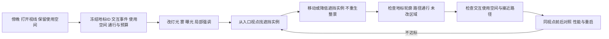

# 3D：从场景意图到可修改的完整片段

> 整页比较：2026-10-22；完整场景补核：2026-10-23；生产模块整合：2026-10-25（UTC+8）；蒙皮消费者实测：2026-10-25（UTC）；室内作者源实试：2026-10-26（UTC）。适用场景：单人程序员、不做人工美术修补；引擎结论 Unity 优先、Unreal 对照。文中分档是具体任务的条件化首试顺序，不是同题实测冠军；固定来源、反证、许可和验证边界见[WP3研究记录](../../../docs/research/2026-10-14-game-wp3-3d-assets.md)。

## 30 秒结论

| 眼前需求 | 首选 | 何时换路线 |
|---|---|---|
| 只有一个场景想法，不知从哪开始 | ✅ 先定玩法、相机和通行，再用一套同风格包做一个 60–80 米片段：入口→地标、一次交互、一次视线转折（[完整流程](#完整片段先做一个能走能看能改的场景)） | 缺关键轮廓才补生成件；整景生成先验对象级编辑与消费者 |
| 同风格静态道具／模块场景 | ✅ 同包资产与已有参数配方；建筑只换风格时保布局、门窗，复用部件和材质搭配 | 缺件才生成可替换件；尺寸／拓扑也变时回布局配方，不整栋盲重生 |
| 有资产，却组不成有品质的完整场景 | ✅ 从一个可玩片段开始：真实视角定参照，地形／建筑定大形，按焦点与留白编排近中远层，再统一材质／光照 | 编排后仍缺关键轮廓才补件；整景生成先验对象级编辑与消费者，不能用概念图代替运行画面 |
| 已有精灵的 3D 源，想改实时表现 | 先按新视点／光照／运动重验源；比较保留重烘与补合格实时源 | 转换仍需手修几何／材质或补运动部件，换源或收窄表现，不以已有工程当就绪 |
| 同作品树／灌木／草，二改要近景或定向风 | ✅ 先选同风格且风动数据匹配目标引擎的资源族 | 缺枝条结构先核源端提取／生长路径；恢复不合格、通道未知或须手刷权重，换源或收窄表现 |
| 缺可用几何的自定义低模刚体 | 🧪 新需求先试 Meshy T2.5 灰模；已合格 T2 配方不迁移 | 关键孔洞、细件或挂点反复丢失，退回现成／参数化 |
| 已认可几何，只差预算／导出或面组织 | ✅ 超预算保源简化，仅导出用成熟工具；面组织妨碍编辑才 🧪 形状条件重拓扑 | 重要孔洞、轮廓或接口超出误差线就撤回；重拓扑另验 UV 与引用，不退回图片重生 |
| 认可形体，要换参考外观 | ✅ 改色／磨损保源调材质；新纹样才 🧪 同网格重贴图，先查图与表面对应 | 结构／相机不匹配先重选源／视点；精确文字或背面连续性反复失败，换合格纹理源，不整物盲重生 |
| 变形角色／换装 | ✅ 固定版本、身体覆盖与动作配套的受限衣橱 | 必须刷权重或修面才合格，换角色或收窄玩法 |

以上为条件化选型，不是本轮模型／引擎实测排名。[经验] 型号、费用与商用门槛见 [WP3 动态事实表](../../../docs/research/2026-10-14-game-wp3-3d-assets.md#10-动态事实表限定补核)。

TaoFlowForge 权重仓已声明 Apache-2.0，但必需 DINOv3 的实际来源／版本及适用许可链仍待核，暂不列无条件商用默认；不等于判定它只能非商业研究（[2026-10-16 补核](../../../docs/research/2026-10-14-game-wp3-3d-assets.md#102-taoflowforge补得权重声明仍核实际-dino-适用链)）。[一手／研究]

## 完整片段：先做一个能走、能看、能改的场景

**✅ 默认路线：一套同风格、许可清楚的模块／自然包，加项目自己的布局数据和装配脚本；AI 先产出可审的布局与清单，不先产出一张概念图。** 目标不是一次做完整关卡，而是做出一个 60–80 米、单程约 15–30 秒、加上观察和交互约 40–60 秒的片段：它能导入引擎、能在真实相机下观看、能在第二次需求里局部修改。下面的尺寸与数值是工程起点，按玩法、角色速度、目标设备和镜头重新标定；它们不是引擎规格、通用关卡尺寸或审美标准。[工程建议／经验]

本页用下面这个原创小型探索片段贯穿。它不依赖新仓库或完整游戏，也不限定赛车题材。


| 片段要素 | 本例默认 | 为什么先定 |
|---|---|---|
| 入口 | 门、坡道或框景，出生点能读懂路径方向，但先不完整看到地标 | 入口决定第一眼构图与玩家预期 |
| 主要地标 | 1 个，轮廓独特，50–80 米外可识别，体量高于其他建筑／树冠 | 地标是导航锚点，也是第二次“打开视线”的对象 |
| 可交互物件 | 1 个门／钟／开关；使用半径 1.2–1.5 米、接近路径 1.5–2 米 | 交互需要独立对象、运动结构、碰撞和事件绑定 |
| 视线转折 | 1 处路径弯、岩石、树丛或低墙；遮挡地标后在行走中重新露出 | 转折决定“先藏后见”的节奏，第二次改常移动它而不是删掉 |
| 层次 | 近 0–8 米、中 8–30 米、远 30–100 米以上 | 近景框边、中景活动、远景定位三类职责不同 |
| 预算 | 以目标设备基线为准，记录 draw calls、三角面、贴图内存与帧耗时 | 没有设备与基线时，不先编一个绝对值当通过线 |

### 1. 先定相机、尺度与通行

**相机和角色控制器决定资产尺寸，不能先做一批 1:1 建筑再发现门进不去。** 先量角色胶囊、相机臂、视野和通行净宽，再把入口、路径、门洞、台阶和地标体量按这些约束摆放。下表是第三人称步行探索的起点，不是跨类型规格；驾驶、飞行、VR 或固定镜头要重新标定。[工程建议／经验]

| 参数 | 起点 | 条件与调整 |
|---|---|---|
| 角色眼高 | 1.6–1.8 米 | 角色比例改变时重核镜头与门洞 |
| 行走速度 | 3.0–4.5 米／秒 | 冲刺、载具或重手感另测 |
| 第三人称相机臂 | 2.5–3.5 米，离地 1.5–2.0 米 | 室内、狭窄处缩短；先验相机碰撞 |
| 视野 FOV | 本例起步用垂直 FOV 55–65°，并非通用最佳值；按目标画面调整 | 固定机位增大 FOV，近远物体的屏占比都会减小；若为构图移动相机，重新检查近远比例 |
| 入口到地标 | 50–80 米 | 超过 100 米时另设中景引导，否则地标太小 |
| 地标在入口的仰角 | 5–15° | 太高会被近景遮挡，太低会与地平线混在一起 |
| 地标占屏宽 | 约 8–15% | 以实际相机与分辨率截图核对，不只看模型尺寸 |
| 主路径净宽 | 2.5–4 米 | 单人步行；战斗、载具、NPC 同行另加 |
| 交互使用空间 | 半径 1.2–1.5 米、高 2.0 米；接近路径 1.5–2 米 | 角色体型、交互动作和镜头一起定 |
| 视线转折 | 前进方向改变约 30–60°，转折后 5–15 米露出地标 | 转折太早没有“先藏后见”，太晚玩家已迷路 |
| 可行走坡度／台阶 | 坡度约 ≤15°，台阶约 ≤0.3 米 | 以角色控制器实测为准，不照搬本文 |
| 相机碰撞缓冲 | 0.3–0.5 米 | 贴墙、树丛和门框处单独验 |

先用灰盒或基本体走一遍：出生点看得懂方向、路径能通过、转折后地标出现、交互物有地方站。灰盒通过后再替换资产，能避免“模型很精细但门宽不够”的返工。[工程建议／经验]

**同风格包先核比例、枢轴和材质消费者。** Kenney 的模块建筑、城郊和自然包各页列 CC0，适合作为免费起点；它们不承诺任意组合即同风格，也不保证目标设备预算。先导入一个门、一段墙、一棵树，核单位、朝向、底座枢轴、碰撞与材质，再批量摆放。[一手／工程建议；[场景供给比较](../../../docs/research/2026-10-14-game-wp3-3d-assets.md#42-完整场景从制作参照到可编辑路段)]

### 2. 主辅形体与近中远层

**先保证一个主形体和一条可读路径，再谈装饰密度。** 主形体是地标；辅形体是入口、建筑组、树组和视线阻挡；填充物只补质感，不抢轮廓。每一件都要说明它承担“框边、引导、遮挡还是衬托”，说不出职责的先不放。[研究／工程建议]

| 角色 | 数量与位置 | 形体规则 | 常见错误 |
|---|---|---|---|
| 地形与路径 | 1 条主路径＋可行走坡面 | 高差服务视线与转折；坡度、台阶、净宽先定；边界用山体、挡墙或植被收口 | 先堆资产再改地形，门洞、台阶、转角全部返工 |
| 主形体／地标 | 1 个，远层 | 独特轮廓、明确竖向、与天空／远景有明度差 | 被中景树冠或建筑切掉顶部；与辅形体同样高度 |
| 辅形体 | 2–3 组，中景为主 | 低于地标；重复模块形成节奏；一组框入口、一组压路径一侧 | 等距排开，像样板街；每组都用独特件，维护成本失控 |
| 视线阻挡 | 1 处，中层 | 可移动、可降低、可换成低矮件；不承担关键碰撞或存档 | 做成不可改的主墙体，第二次开视线只能重生整景 |
| 近景框边 | 0–8 米，画面边缘 | 岩石、草丛、枝条或门框；不挡交互物与路径 | 为了“丰富”把近景塞满，挡住脚下与交互提示 |
| 中景活动 | 8–30 米 | 路径、交互物、建筑组、转折 | 交互物放在主地标正前方，开视线时被一起删掉 |
| 远景定位 | 30–100 米以上 | 地标、山脊、树线、天空；用雾和明度分层 | 远景与中景同样清晰，空间压缩成一张贴图 |

编排时先定一条从入口到地标的行走线，再在线的两侧放辅形体和框边。入口用近景框住一部分画面，但保留地标的一个竖向线索；转折用中景遮挡，转折后让地标占住画面一侧而不是正中。留白是构图的一部分，不要求每个空位都填满。[研究／工程建议；[真实作品的组织方法](../../../docs/research/2026-10-14-game-wp3-3d-assets.md#真实作品借视觉组织不照搬制作规模)]

近期作品值得借的是组织方法，不是复刻制作规模。Wanderstop 把植被的色彩感与建筑的轮廓语言分开设计；Ghost of Yōtei 用远景地标和近处压力共同塑造体验；Snow Riders 发现前作的急转／落差不能直接沿用到新的运动方式。它们分别支持“风格职责分开”“参照转成空间关系”“地形服从移动方式”；这些作品由专业团队制作，不能把其产能当成单人默认。[一手：创作者原文；研究推导，见上述研究]

### 3. 选择供给路线：同包＋程序布局、补缺件、显式整景

三条路线回答不同问题，不是同一张排行榜。默认从第一条开始；只有第一条确实缺一件关键轮廓，才进入第二条；第三条当前只用于有限视点背景。[研究／工程建议]

| 路线 | 能给什么 | 采用条件 | 不采用／撤回 |
|---|---|---|---|
| **✅ 同包模块＋程序布局** | 可本地编辑的墙、门、屋顶、地面、树、石；脚本按路径和规则摆放，保留对象 ID 与变换 | 许可清楚、已有包覆盖风格与尺寸；先导入样本核比例／枢轴／材质／风动消费者 | 包内缺关键轮廓或组合接缝反复失败；不要用更多包硬凑同一风格 |
| **🧪 同包＋生成补缺件** | 为地标、交互物或独特近景补一件／一组；先灰模再贴图 | 只补真正缺的件；先导入一个样本，核尺寸、枢轴、材质、碰撞和 LOD；保存请求、任务 ID、版本与许可 | 整批生成后再统一修；单张参考图不交付地形、碰撞、隐藏面或可改布局 |
| **👀 显式整景生成** | 室外分层生成、室内分阶段放置、有限视点背景 | 只作远景、固定背景或概念参照；先核实际可运行交付物、对象编辑与许可 | 入口→地标主路径、门要开、物体要拾取、第二次要改布局时，仍用模块 mesh |

**当前决定：同包＋程序布局是默认，补缺件限一两件，显式整景不用于主路径。** 同包路线的上限是风格通用、地标可能不够独特，但它的源可编辑、许可清楚、第二次改通常只需移动实例或改参数，维护成本最低。补缺件能提高局部上限，代价是每件都要承担版本、许可、导入、LOD／碰撞、材质和二改成本，所以先补“从入口就能看见的那一件”。按 WP3 2026-10-23 的固定记录，WorldClaw 官方仓只有说明与展示，SceneSmith 偏室内仿真且需要模型／服务投入，Marble 的导出档与商用口径存在张力；它们适合背景，不适合作为可开门、可拾取、可局部改布局的主场景。本轮没有刷新这些动态状态，只沿用当时的发布物与许可证据。[研究／工程建议；[供给与发布边界](../../../docs/research/2026-10-14-game-wp3-3d-assets.md#42-完整场景从制作参照到可编辑路段)、[动态事实表](../../../docs/research/2026-10-14-game-wp3-3d-assets.md#10-动态事实表限定补核)]

**第一版的最小资产集（示例，不是固定清单）：**

| 资产 | 最小数量 | 作用 | 来源 |
|---|---|---|---|
| 地形／地面模块 | 1 套 | 高差、可行走区、地面过渡 | 引擎地形、模块地面或参数化网格 |
| 地标模块 | 1 组（可由 2–4 件叠成） | 唯一轮廓与导航锚点 | 同包模块；缺轮廓才补生成件 |
| 辅建筑模块 | 2–3 组 | 入口、路径一侧、视线阻挡 | 同包模块，重复组合 |
| 门／交互件 | 1 | 一次交互，带运动结构 | 同包带父子／动画的门，或参数化关节件 |
| 树／灌木 | 2–3 种 | 中远景层次与风动 | 同包自然包，先核风动消费者 |
| 草／地被 | 1–2 种 | 近景与地面过渡 | 同包自然包 |
| 岩石／小道具 | 2–4 种 | 框边、转折、路径节奏 | 同包自然包或基本体 |
| 地面／地形材质 | 1 套 | 统一底面与可行走区 | 现成材质或参数化 |
| 天空／灯光预设 | 白天 1 套、傍晚 1 套 | 气氛与第二次改对照 | 项目自制预设 |

这套资产足以支撑入口→地标、一次交互和一次视线转折；先做齐再扩种类。若某一行必须靠手工建模或反复修面才能成立，先缩需求或换合格包，不把第一片段变成资产生产队列。[工程建议／经验]

| 路线 | 上限 | 首次到可玩 | 第二次改 | 维护 |
|---|---|---|---|---|
| 同包＋程序布局 | 中；靠编排与材质统一拉高 | 快 | 低；移动实例、改参数 | 低 |
| 补缺件 | 局部高；重点景物更独特 | 中；每件要导入与验收 | 中；生成件带版本／许可／重导入 | 中 |
| 显式整景 | 背景高；主路径与交互弱 | 慢；依赖服务与算力 | 高；对象边界、交互与碰撞常要重做 | 高 |

以上是定性比较，不是同预算实测成本或品质排名。[研究／经验]

### 4. 材质族、灯光与气氛

**先统一少量材质族，再让关键动作和地标突出。** 一个片段先控制在 3–4 个材质族：地面／地形、结构（石／木／灰泥）、植被、强调（金属、发光或交互提示）。每族共享一套颜色与粗糙度范围，用实例色或顶点色做变化；不要给每个道具单独做材质和 shader 变体。纹理密度按目标相机与设备定，近景主角件高于中景，不用一套 4K 贴图铺满全场。[研究／经验；[画面语言](materials.md#先统一画面语言再让关键动作突出)]

| 层 | 默认 | 检查 |
|---|---|---|
| 颜色 | 5–7 个主色，1 个强调色；地标与交互物用强调色或明度差 | 黑白截图下仍能分出主次 |
| 材质族 | 3–4 族；共享 roughness／metallic 范围 | 新旧件混排时不出现明显色温或光泽断层 |
| 纹理 | 中景够用即可；近景主角件单独提高 | 不用贴图补几何缺失；烘焙阴影不当作可重新打光 |
| 灯光 | 1 个主方向光＋天空／环境光＋1 个补光；固定曝光 | 暗部、逆光、雾和低画质下路径仍可读 |
| 阴影／雾 | 阴影距离覆盖片段主区域；远景用雾和明度分层 | 阴影预算与雾距不吞掉地标轮廓 |
| 预设 | 第一版用白天预设；傍晚作为第二次改的参数预设 | 预设切换不改变对象 ID、碰撞和交互事件 |

白天的起点可用 30–50° 太阳高度、中性偏暖主光、较冷环境光；傍晚的起点用 5–15° 低角度暖光、降低主光强度、略冷的天空补光和更明显的远景雾。具体色温、强度和雾密度以目标相机与设备实测为准；这些数值是调参起点，不是画面品质证明。[工程建议／经验]

### 5. 给 AI 的输入与产出：布局、清单、装配、检查

**AI 先产出可审的布局与清单，再产出资产。** 输入不能只有“日系小镇”一句话，而应包含玩法、相机、路径、尺寸、已有资产、风格参照、预算和禁区。AI 的第一版输出是布局骨架、视点、遮挡／净空检查和缺口清单；人确认构图与交互后，才补资产或生成缺件。[工程建议／经验]

一个够用的作者目录可以很小。下面是项目约定示例，不是引擎内置格式；字段可以删减，也不要把示例当成 API。原包与生成件分别保存，项目文件只记录引用、覆盖和检查，不把第三方源混入项目自有目录。

```text
scene/
  intent.md          # 人写：玩法、相机、路径、风格参照、已有资产、预算、禁区
  layout.json        # AI 产出／人审：对象 ID、来源、变换、层次、材质族、交互 ID
  manifest.json      # 资产来源：包／版本／许可／导入设置／目标引用
  checks.md          # 验收：视点、视线、通行、使用空间、预算、未改项
assets/
  packs/<pack>@<version>/   # 原样保留的授权源，不就地改
  generated/<job-id>/       # 生成请求、任务 ID、版本、产物与许可记录
engine/
  scene/                    # 引擎自己的场景／预制体装配，不替代作者源
```

`intent.md` 至少写清：玩家从哪进入、第一眼应看到什么、路径在哪里转折、交互物是什么、允许玩家做什么、参考图借的是轮廓／配色／密度中的哪一项、已有包及版本、目标设备与帧率、不能改的碰撞／事件／存档键。

`layout.json` 示例（数值仅示意）：

```json
{
  "schema": "scene-layout/0.1",
  "note": "项目约定示例，不是引擎内置格式",
  "units": "meters",
  "viewpoints": [
    {"id": "entrance", "eye": [0, 1.7, 0], "yaw": 0, "pitch": 0, "fov": 60},
    {"id": "turn", "eye": [18, 1.7, 26], "yaw": 35, "pitch": -5, "fov": 60},
    {"id": "landmark", "eye": [30, 1.7, 42], "yaw": 20, "pitch": 8, "fov": 60}
  ],
  "objects": [
    {"id": "landmark_tower", "role": "landmark", "layer": "far",
     "source": "pack:castle/tower@v1", "transform": {"pos": [30, 0, 75], "rotY": 0, "scale": 1},
     "materialFamily": "stone", "collision": "proxy"},
    {"id": "gate_interact", "role": "interactive", "layer": "near",
     "source": "pack:dungeon/gate-door@2.1", "transform": {"pos": [12, 0, 18], "rotY": 90, "scale": 1},
     "interaction": "open_gate", "useSpace": {"radius": 1.4, "height": 2.0}},
    {"id": "view_blocker", "role": "occluder", "layer": "mid",
     "source": "pack:nature/rock-large", "transform": {"pos": [22, 0, 32], "rotY": 20, "scale": 1.1}}
  ],
  "lighting": {"preset": "day", "sunElevation": 38, "sunAzimuth": 120, "fog": 0.15},
  "checks": [
    {"id": "sightline_entrance_landmark", "type": "ray", "from": "entrance", "to": "landmark_tower", "expect": "clear"},
    {"id": "use_space_gate", "type": "capsule", "object": "gate_interact", "expect": "free"}
  ]
}
```

`manifest.json` 示例：

```json
{
  "pack": "kenney-modular-dungeon-kit",
  "version": "2.1",
  "license": "CC0",
  "sourceUrl": "https://kenney.nl/assets/modular-dungeon-kit",
  "archiveSha256": "<记录实际下载文件哈希>",
  "import": {"upAxis": "Y", "unitScale": 1.0, "pivot": "base", "textureEncoding": "sRGB"}
}
```

**AI 的产出顺序：**

1. 盘点已有包与许可、版本、导入设置；不先调用生成服务。
2. 按 `intent.md` 生成布局骨架、三个视点、视线／净空检查和未决问题；输出差异而不是整份重写。
3. 列缺口清单：哪一件是为了轮廓、哪一件是为了交互、哪一件只是装饰；只为前两类补件。
4. 生成缺件时先灰模，导入一个样本，核尺寸、枢轴、材质、碰撞与 LOD；通过后才批量。
5. 生成装配／导入脚本与稳定 ID 映射，跑检查并留下前后对照。
6. 人确认构图、地标身份、交互语义和画面感后，才进入运行时验收。

**人负责的仍是画面与业务判断：** 地标是否有辨识度、入口是否引导、转折是否成立、交互物是否该在那里、傍晚是否可读、是否接受当前品质。AI 负责把意图变成约束、算遮挡与净空、写装配与检查脚本、应用局部变换和整理差异。[研究／工程建议]

### 6. 运行接入：把对象 ID 串到碰撞、交互与镜头

**作者源、引擎对象和玩法绑定分开保存。** 作者源保留原包、生成记录和布局；引擎场景只引用稳定对象 ID，不依赖 mesh 名称或节点顺序。这样第二次改布局或换外观时，碰撞、交互事件和存档键不会被一起重建。[研究／工程建议；[资源族二改](../../../docs/research/2026-10-14-game-wp3-3d-assets.md#16-p37前置二改判据名称与共享数据)]

| 作者层 | 运行时对象 | 必须保持 | 检查 |
|---|---|---|---|
| `objects[].id` | 场景对象／预制体实例 | 稳定 ID；改名不改变引用 | 重载、重启、存档后仍能找回 |
| `source` | 导入网格／材质 | 单位、轴向、底座枢轴、材质槽 | 新旧件混排不漂移、不穿地 |
| `collision` | 独立碰撞代理 | 与可见网格分离；门洞、台阶、路径可通行 | 角色、相机、投射物分别验 |
| `interaction` | 事件／状态机／存档键 | 事件名、使用空间、动画与碰撞契约 | 触发、取消、重载、失败路径 |
| `viewpoints` | 相机变换与 FOV | 视点 ID、镜头参数 | 同视点可重拍前后对照 |
| `materialFamily` | 共享材质／实例参数 | 材质族、实例色、透明与剔除 | 不因单个物件新增 shader 变体 |
| `lighting.preset` | 场景灯光／天空／雾 | 预设名与参数；切换不改对象 | 白天／傍晚切换后路径仍可读 |

Unity 可用嵌套预制体保留子件源链接与局部 override；碰撞先用 box、sphere、capsule 或少量 compound，凹结构再评估凸分解。UE 可用 Level Instancing 组织可重复集合，静态密集外观用 Packed Level Blueprint，动态门和交互物件保留独立 Actor。具体组件名、事件系统和存档接口由项目自己定；本文不把示例字段写成引擎 API。[一手／研究；[嵌套预制体](https://docs.unity3d.com/6000.3/Documentation/Manual/NestedPrefabs.html)、[Level Instancing](https://dev.epicgames.com/documentation/en-us/unreal-engine/level-instancing-in-unreal-engine)]

### 7. 第一片段验收：三个视点、连续移动、一次交互

**验收按真实相机和真实移动做，不按模型预览或参数表放行。** 至少保留入口、转折、地标三个可重拍视点；每个视点记录位置、朝向、FOV、画质和 UI 状态。再连续走一遍，确认路径、镜头、交互和地标露出都不是只在单帧成立。[研究／待执行方案；[Star-Rush 最小路段](../../../docs/research/2026-10-14-game-wp3-3d-assets.md#star-rush最小路段方案与待验条件)]

| 检查 | 通过条件 | 失败时先改什么 |
|---|---|---|
| 入口构图 | 路径方向可读；地标露出一个竖向线索或部分轮廓；近景框边不挡路 | 先移近景框边与相机，不先换地标 |
| 行走 | 主路径净宽、坡度、台阶可通过；相机不穿墙、不卡树 | 先调控制器与摆位；资产尺寸错误才换件 |
| 视线转折 | 转折前地标被遮挡，转折后 5–15 米内重新可见 | 移动或降低遮挡件，不删整段植被 |
| 交互 | 使用空间与接近路径空闲；触发、取消、重载都成立；镜头不穿模 | 先移交互物或障碍，不改事件契约掩盖碰撞问题 |
| 未改区域 | 只改了目标对象与环境预设；其他 ID、变换、碰撞、事件不变 | 回退到上一版布局，不用整景重生兜底 |
| 预算 | 记录 draw calls、三角面、贴图内存、帧耗时；与基线比较 | 先稀疏化、复用实例、缩阴影范围；不先加新渲染框架 |
| 重启／加载 | 场景、材质、碰撞、交互和存档键在重载后仍对应 | 先修引用与 ID；不用重新生成资产掩盖绑定错误 |

**数值通过不等于画面成立。** 轮廓、主次、材质断层、暗部可读性和交互可发现性仍要人看真实画面；没有真实运行画面时，本页只保留流程与待验项，不声称视觉或性能通过。[研究／经验]

### 8. 交付时应留下的可改内容

- 原包与固定版本、下载哈希、许可与实际取得档；生成件另存请求、任务 ID、模型／纹理版本和采用文件。
- `intent.md`、`layout.json`、`manifest.json`、稳定对象 ID、交互事件名、存档键。
- 三个验收视点、白天／傍晚预设、性能基线、未改项与已知缺口。
- 旧件与旧布局的对照副本；第二次改只提交目标对象的差异，不覆盖已接受版本。

**缺最终画面不阻止完成文稿、源整理和独立处理步骤；但它阻止声称“好看”“运行通过”或“第二次改成功”。**[研究／经验]

依据：[WP3 §4.2 完整场景](../../../docs/research/2026-10-14-game-wp3-3d-assets.md#42-完整场景从制作参照到可编辑路段)、[§4.1 建筑族](../../../docs/research/2026-10-14-game-wp3-3d-assets.md#41-最高水平卡保布局扩建筑外观族)、[§11 交互结构](../../../docs/research/2026-10-14-game-wp3-3d-assets.md#11-装饰改成交互分件不是运动结构)、[§15 植被](../../../docs/research/2026-10-14-game-wp3-3d-assets.md#15-植被资源族近景风向与密度二改)、[§16 资源族二改](../../../docs/research/2026-10-14-game-wp3-3d-assets.md#16-p37前置二改判据名称与共享数据)、[动态事实表](../../../docs/research/2026-10-14-game-wp3-3d-assets.md#10-动态事实表限定补核)；相机／尺度与目录结构为本轮工程建议，未实测。

## 第二改：傍晚、打开视线、保留使用空间

第二次需求是“改成傍晚，打开入口到地标的视线，并保留可交互物件的使用空间”。它不是单独恢复或取消一条边界，而是同时改气氛、遮挡和交互可用性。正确顺序是：先冻结不变量，再改气氛，再移动遮挡实例，最后验交互与未改区域；不要从重生整景开始。[研究／工程建议]



### 1. 先冻结不变量

动手前把这五项写成检查：地标对象 ID 与来源、交互事件与存档键、交互使用空间、主路径与碰撞、目标设备预算。它们不随气氛或遮挡修改而变化；任何一项要变，就升级为一次明确的场景重做，而不是藏在“打开视线”里。[研究／工程建议]

### 2. 先改气氛，不改结构

- 太阳降到约 5–15° 的低角度暖光，降低主光强度；天空补光略冷，保留暗部可读性。
- 远景雾略增，拉开层次；不要把地标一起吞掉，轮廓仍需可辨。
- 固定曝光后检查路径、交互物和地标；暗到看不清路时先补 1–2 个局部强调光或发光材质，不加满场景点光。
- 保留白天预设作为对照；傍晚是参数预设，不是换一套材质或重生场景。

气氛改动可逆、成本低，先做能把“傍晚是否成立”单独暴露出来；如果这一步就不成立，后面的遮挡修改没有意义。[工程建议／经验]

### 3. 再开视线：移动实例，不重生场景

从入口视点的眼高向地标包围盒的中心、左缘、右缘各打一条射线或细圆柱，列出挡住的实例。按职责处理：

- **装饰性遮挡**（树、灌木、岩石、矮墙）：优先移动、降低、缩小或减少实例；保留转折处的一部分，让“先藏后见”仍成立。
- **辅形体**（建筑组、门楼）：先移出视线轴或降低体量；不要为了开视线拆掉承载碰撞和入口功能的主结构。
- **地标自身或玩法必需物**：不改；回到构图，调整入口位置、路径弯或地标高度。
- **整片植被**：按簇减少，不按均匀比例剃平；保留近景框边和中景深度线索。

开视线不是把入口到地标之间全部清空。保留一个低矮前景或侧向框边，能维持尺度感；如果地标在入口完全无遮挡，转折就不再是转折。目标可以是“入口看到地标顶部或部分轮廓，转折后看到完整主形”，不必第一眼全见。[研究／工程建议；[植被二改](../../../docs/research/2026-10-14-game-wp3-3d-assets.md#153-同一作品第二次修改保留什么重建什么)]

### 4. 保留交互使用空间

交互物件的使用空间按冻结值检查：半径 1.2–1.5 米、高 2.0 米，接近路径 1.5–2 米。开视线时如果遮挡件正好在这块空间里，移遮挡件或交互物，不要缩小使用空间来迁就构图；缩小会让角色贴墙、镜头穿模或触发失败。傍晚可读性不足时，用交互物自身的小范围发光、局部补光或材质强调，不默认加一个漂浮 UI 标记。[研究／工程建议；[交互结构](../../../docs/research/2026-10-14-game-wp3-3d-assets.md#11-装饰改成交互分件不是运动结构)]

### 5. 同视点复核与停止线

| 检查 | 方法 | 通过／停止 |
|---|---|---|
| 入口视线 | 入口眼高到地标中心／左右缘；允许前景框边，不允许整块遮挡 | 地标轮廓不可辨或只剩一条缝，继续移遮挡件；仍不行则改入口／路径 |
| 转折仍成立 | 转折前部分遮挡，转折后完整主形出现 | 转折被完全清空，补回低矮框边或侧向体块 |
| 地标身份 | 同一 ID、来源、比例、主材质；轮廓不变 | 需要换地标或改比例时，停止本次局部二改，另立场景重做 |
| 交互使用 | 使用空间、接近路径、触发、取消、重载 | 任一失败，先移物件／障碍；仍失败则回退布局 |
| 未改区域 | 对象 ID、变换、碰撞、事件差异清单 | 出现非目标变换，回退到已接受版本 |
| 预算 | 前后 draw calls、三角面、灯光数、帧耗时 | 灯光或植被改动超出预算，先缩范围／减实例 |
| 真实画面 | 白天／傍晚同视点对照＋连续移动 | 没有真实运行画面时，只记待验，不声称通过 |

### 6. 这次二改的取舍

| 改动 | 收益 | 代价／风险 | 处理 |
|---|---|---|---|
| 打开视线 | 入口更清楚地标，导航更强 | 失去围合感，场景显得更小、更空 | 保留低矮前景、侧向辅形体和转折后的完整露出 |
| 改成傍晚 | 气氛与地标轮廓更强 | 对比下降，路径、交互物和暗部更难读 | 低角度暖光＋冷天空补光＋少量局部强调；固定曝光后实测 |
| 减少植被／体块 | 视线更干净 | 深度线索和风动细节减少 | 按簇稀疏，保留近景框边与中景层次 |
| 加局部灯／发光 | 交互物和地标更可发现 | 灯光与 draw call 上升 | 限制 1–2 个，优先发光材质，不铺点光 |
| 保留使用空间 | 交互仍可用、镜头不穿模 | 约束遮挡件摆位 | 移遮挡件或交互物，不缩使用空间 |
| 不重生整景 | 保住 ID、碰撞、事件和存档 | 局部最优可能达不到理想构图 | 接受局部妥协；要到理想构图时另立一次明确重做 |

**人判断的是傍晚是否好看、地标是否仍有身份、转折是否仍然是转折、交互是否仍可发现；AI 负责算射线与净空、列遮挡实例、应用确定性的移动／缩放和输出差异。** 任何“更通透”“更有氛围”的说法都要落在同视点真实画面上，不能由参数正确推出。[研究／经验]

依据：[WP3 §4.2](../../../docs/research/2026-10-14-game-wp3-3d-assets.md#42-完整场景从制作参照到可编辑路段)、[§11](../../../docs/research/2026-10-14-game-wp3-3d-assets.md#11-装饰改成交互分件不是运动结构)、[§15.3](../../../docs/research/2026-10-14-game-wp3-3d-assets.md#153-同一作品第二次修改保留什么重建什么)、[§6](../../../docs/research/2026-10-14-game-wp3-3d-assets.md#6-第二次修改最小可用约束而非完整新管线)；本节为工程流程建议，未在引擎中执行本次二改，未取得白天／傍晚对照画面。

## 当前最高水平：能定向改，不等于只剩最终文件

<!-- frontier: status=已比较 gap=1 gen=2026-10 checked=2026-10-22 -->

下表覆盖本页的主要生产选择；“保留”表示已比较领先替代后仍保留默认，不是未搜索。**本轮未确认同预算、零手修、整族两改到发行的完整冠军；这不妨碍按任务给出默认。** 整页已比较植被源端恢复、联合生成／衣物拟合与 GPU 凸分解；10-23 沿场景选择补完整制作流程与显式生成，10-25 把分散模块合成生产流程，未新增同题实测。其余复用已核固定证据。[研究]

| 主要选择 | 近期领先替代与证据 | 决定 |
|---|---|---|
| 完整片段的生产组织 | 同包＋程序布局、补缺件、显式整景三条路线，见[完整片段](#完整片段先做一个能走能看能改的场景)与[WP3 §4.2](../../../docs/research/2026-10-14-game-wp3-3d-assets.md#42-完整场景从制作参照到可编辑路段) | **采用**同包＋程序布局默认；**🧪**只补一两件关键缺件；**👀**整景只作有限背景 |
| 缺几何的新刚体，选原生低模还是密源 | Meshy T2／T2.5、LATO.2 与独立 TaoFlowForge；近景 TRELLIS.2，见[刚体路线](#静态道具原生低模与高密度源资产分开) | **保留**同包优先；缺件先灰模，近景有实际增益才用密源，不冒称现售型号冠军 |
| 认可形体后改预算、面流或外观 | 形状条件重拓扑、MeshQuery UV 规划；Meshy 同网格／SUPRA-Tex 参考约束 | **保留**预算先受限简化、面组织再重拓扑、外观先改材质；新 UV／重建网格另接收 |
| 扩建筑族与可玩场景 | ProxyBuild／ShellMaker；WorldClaw 显式室外生成、SceneSmith 室内分阶段编排，对照 Marble／WorldAct，见[场景选择](#场景与角色不沿用静态道具的成功标准) | **采用**真实视图＋对象状态的局部迭代；**保留**当前可用模块默认，整景生成按发布物与用途分流，不只当概念图，也不直接覆盖交互壳 |
| 植被改近景、定向风或种类 | Witcher 4 技术演示的骨骼植被、UE5.8 PVE；独立 GPU 实时树生成，见[植被供给](#植被成套供给先选可改的风动源不只选树形) | **采用**源端提取／生长作为缺结构时的候选；**保留**合格资源族，不只给静态成品调风 |
| 自定义变形角色 | Rigel3D 联合生成形状／骨架／权重，对照事后自动绑定 | **保留**现成配套默认；联合生成是专项候选，须验目标动作而非只看 rig 存在 |
| 换衣或跨体型复用 | LoBoFit 骨骼对应 refit／独立 LUIVITON 无共享 rig 拟合，见[衣橱选择](#角色换装先开放已配套组合) | **采用**按输入拆分拟合候选；**保留**受限衣橱，初始合身不等于兼容动作与商用闭环 |
| 装饰转交互、连续局部改件 | 关节资产／Infinigen 与 Auto Split；EditHero 连续编辑 | **保留**运动结构／可替换分件，局部改件优先；复杂新形状不靠整物重抽兜底 |
| 旧源改实时，优化后还要二改 | Naev 迁移；GenRA／Disney GMR 与本仓共享数据对照 | **保留**重验用途与编辑源；仅有优化产物可按引用路径复制，不以保名字代替隔离 |
| UV、LOD、压缩与碰撞交付 | MeshQuery／meshoptimizer；CuACD 与独立 VisACD，见[处理层](#减面uvlod与碰撞借成熟工具做小处理) | **保留**成熟工具与消费者门槛；GPU 仅作大批复杂凹分解候选，简单代理不升级 |

所有行均受代码／权重／输入／输出许可与实际导入器约束；当前版费用及资格只在[动态表](../../../docs/research/2026-10-14-game-wp3-3d-assets.md#10-动态事实表限定补核)维护。[一手／研究] **未覆盖的是各路线整族生产的共同成本、接受率与发布质量，不把这些效果未知写成工具不可用，也不把局部作者结果相加成完整成功率。**[研究]

**✅ 仍要逐成员改色／改动作时，保可编辑源与累计配方，再派生优化产物。** GenRA 保原骨架／蒙皮，Disney Generative Motion Rig 保创作控制，支持把编辑与交付分开；本仓 Fox 派生族中，glTF-Transform 4.5.1 保独有名称隔离了本例材质，却未隔离动画时间 accessor。正确按需复制与源重建均通过数值／曲线对照，不能宣称必须回 DCC，也未验证视觉或引擎；见[资源族卡与两轮对照](../../../docs/research/2026-10-14-game-wp3-3d-assets.md#16-p37前置二改判据名称与共享数据)。[本仓运行／研究]

## 先采用什么

**✅ 同风格现成资产满足需求时不重新生成；重复尺寸、模块接缝和可动零件优先复用已覆盖需求的参数化配方。** 先按玩法分成静态刚体、模块场景和变形角色，再确定尺寸、占屏大小、材质与设备预算。箱盖能打开、门宽能修改、角色能换衣，比第一张旋转预览精细更能决定后续生产成本。[经验]

**先分“改参数”与“补配方”。** 已支持的尺寸、布局与风格可反复复用；新增屋顶轮廓、墙体风格或连接类型，先查是否已有合格源模块及对应规则。Tiny Glade 增加木墙时还需处理开窗、窗框与石基组合，并补木楼梯；开源模块组装器也可能只生成旋转与邻接表，不生成缺失网格。需要手工建模才能补齐时，换完整授权资源体系或收窄需求，别把它记成零手修调参。[一手／研究：见 [WP3 程序化范围](../../../docs/research/2026-10-14-game-wp3-3d-assets.md#13-程序化二改复用已有配方还是补新形状与规则)]

**旧生产母版不自动具备新用途资格。** 从固定视角精灵改为实时 3D，先核源在实际新视点、动态光照、运动部件及不同展示窗口是否仍合格，再估批量转换收益。[Naev 的实际迁移](../../../docs/research/2026-10-14-game-wp3-3d-assets.md#14-旧精灵母版转实时先重验源再谈批量复用)获得星光、倾斜和多窗口复用，也修材质／坏几何，部分船近乎重做；现成脚本不包办这些工作。只需旧视角下换规格时保留重烘对照；新表现确有价值但源必须手修时，换已合格实时源或缩小范围，不无限补转换器。[一手／研究]

图生 3D 适合将已接受的参考变成候选形状；文生 3D 适合探索，部分商业文本路径内部也先生成图像。正式资产尽量先锁参考图或一致多视图，明确不可见面的要求；单图、固定 seed 都不能保证背面、零件结构和成套风格。[一手／经验]

## 三类资源、三档首试

先满足[授权总表](../03-generative-ai-in-games.md#13-授权与商用门槛总表wp1)的具体版本、账户、输入及发行地区条件。零手修是准入条件；两路均合格时，再按实际相机下的轮廓、细节与成套风格选择。[研究／经验]

| 资源 | 质量优先 | 性价比优先 | 本地／免费 |
|---|---|---|---|
| **静态刚体道具** | ✅ 匹配画风的成熟完整资产；近景确需独特轮廓／细节时 🧪 `meshy-7.1`，Rodin Gen-2.5 作高细节对照，承担减面／烘焙维护；降到预算后无目标表现增益则保原路线（[取舍](#静态道具原生低模与高密度源资产分开)） | ✅ 同包复用；需新轮廓时 🧪 `meshy-t2.5` 原生低模，锁目标预算、先灰模再贴图；旧合格 T2 配方保留；Tripo `P1-20260311` 作替代候选 | ✅ Kenney Nature Kit／简单参数化几何；写实可 👀 Poly Haven 指定资产，仍核预算 |
| **场景** | ✅ 同套模块／材质，重复搭配先存可复用组合；已有布局只换建筑风格，保墙与门窗，缺件再生成 | ✅ 尺寸／布局用已有配方；门、道路、交互物与局部变体保独立接口和引用。接缝先查基础连接，不补无限特殊件（[比较](../../../docs/research/2026-10-14-game-wp3-3d-assets.md#4-场景应保留对象边界而非只追全景漂亮)）[一手／研究] | ✅ 现成模块／引擎基本体；👀 Infinigen 只借单资产参数配方，不默认导入整世界 |
| **变形角色** | ✅ 已知拓扑、骨架和服装兼容关系的完整现成体系；生成仅作专项候选 | ✅ Quaternius 配套头部＋带身体表面的服装分件，固定动作版本；不承诺任意跨体型 | ✅ 指定 CC0 角色包免费可下载部分；不把免费包写成包含全部付费源工程 |

**Tripo 几何与纹理分开选：** P1／P2 未指定纹理版本时仍用 `v3.0-20250812`；需要去除参考图烘焙光照（`delight`）时，显式选 `v3.5-20260815`，不能只升级几何。生成请求用 `texture_version`，单独重贴图用 `model`；灰模阶段同时设 `texture=false`、`pbr=false`。保存两阶段请求、任务 ID 与实际产物，后续换色才不会混入未记录的模型变化。[一手／经验：[生成 API](https://developers.tripo3d.ai/en/docs/generation-image-to-model/p)、[重贴图 API](https://developers.tripo3d.ai/en/docs/models-texture)]

**撤回条件：** 原生低模反复丢重要孔洞、细件或挂点，就换现成资产／参数化结构；高细节生成降到预算后失真，也不能要求程序员手工补面。角色必须刷权重、修关节面流才能过关时，按本基准失败，改用既有角色、刚体分件或收窄玩法。[经验]

**局限：局部同题比较未覆盖整套资源的美术质量、两轮修改及发售通过率，不能宣布某生成器能完成整套零手修游戏资产。**[研究]

## 角色换装：先开放已配套组合

**✅ 先选完整着装身体与配套头部，再开放已经验过的槽位。** Quaternius 服装 v2.0 补入人体部件，官方只承诺配基型头；它不是把任意衣服套到六种裸身体上的拟合器。第二次换装先核实际取得的免费／付费部件、身体覆盖、动作版本与绑定关系，不能只查骨名。具体维护与采用证据见[WP3 衣橱二改](../../../docs/research/2026-10-14-game-wp3-3d-assets.md#15-角色衣橱二改先选配套着装身体再决定是否跨体型)。[一手／研究]

**跨体型先看手里有什么，不默认只能重做角色。** 已有 MHCLO 衣物先比较 MPFB 源端 refit；有源着装身体、对应骨骼与相近姿势，可 👀 比较 LoBoFit；只有 A/T 休息态衣服与目标人形，可 👀 比较 LUIVITON 的代理注册／模拟拟合。后两者是研究候选，不是现成通用衣橱：前者仍有穿插／逐帧闪烁及专利许可待核，后者不擅长硬甲／断开饰件，且初始合身未交付完整动作兼容。[研究；[近期比较与权利边界](../../../docs/research/2026-10-14-game-wp3-3d-assets.md#近期角色供给先区分联合生成与衣物拟合)]

**只有参考图的新角色，另比较联合生成，不先把静态生成＋自动绑定当唯一先进路线。** Rigel3D 联合生成形状、骨架与权重，再预测关节标签，但缺关节、极端姿势和标签歧义仍可能失败；不凭骨架指标升级为零手修默认。AI 可筛输入、整理候选及装配脚本，人验运动穿插、露肤、轮廓和目标动作；需要手工雕衣、补面或刷权重时，换完整体系或减少体型／槽位。[作者报告／研究]

## 静态道具：原生低模与高密度源资产分开

**✅ 已有认可几何且只差预算，先保源做误差受限简化，不默认从图片重生。** 保护轮廓、孔洞、细件、挂点与材质接缝；可见误差由玩法和目标相机决定，不为达面数强行越线。只有面组织确实妨碍后续编辑，才 🧪 比较形状条件重拓扑；它重新推断连接，不是无损转换。此顺序是保已接受内容的工程默认，不是同预算质量或成本冠军。[研究／经验]

| 手里已有的内容／目的 | 当前选择 | 撤回条件 |
|---|---|---|
| 几何与外观已认可，只需降低交付预算 | 保母版，先用现有简化／LOD／烘焙；仅格式处理沿下文 Blender／gltfpack | 关键轮廓、孔洞或接口损失，回更保守设置或换合格源，不强减 |
| 形状已认可，但局部编辑需要更合理的面组织 | 比较以原几何为条件的重拓扑，保留旧源作对照 | 新裂缝、非流形连接、重叠面或法线朝向错误影响用途；修复须人工补面时换源 |
| 只有图片，缺可用几何 | 按预算试原生低模；确需近景细节再走高密度源及派生交付 | 隐藏面、薄件或功能孔洞反复错误，不用更多面数掩盖；回现成／参数化 |

2026-08 的 Meshy T2 论文把重拓扑与图片生成分开评估；2026-09 Alibaba TaoFlowForge 提供独立团队的同单图比较。两者不足以确认当前 T2.5 或完整零手修生产赢家，来源、输入差异与成本局限见[WP3 路线卡](../../../docs/research/2026-10-14-game-wp3-3d-assets.md#当前最高水平卡刚体生产路线)。现成合格源优先、场景模块与变形角色分流不变。[作者报告／研究]

**重拓扑后重新验 UV、纹理、部件引用和交付，而非只看网格整齐。** Agent 可整理源／候选差异及预算，人验实际相机下的形状与风格；保留部件名不保证材质、skin 或挂点兼容。改 UV 须重新烘焙／贴图，出现连通但不合用途的面流仍撤回；下面的许可、导入器、碰撞和角色检查全部保留。[研究／经验]

**🧪 新的单图／文本刚体需求先试 Meshy T2.5 灰模；已合格 T2 配方保持不变。** 同价且目标范围更宽，使它值得首试，不代表同预算质量已胜出。孔洞、细件或挂点仍失败，回已验 T2 或现成／参数化，不靠加面数掩盖。[一手／经验]

**显式锁型号和面数预算。** Smart Topology 省略型号已转 T2.5，默认目标由 T2 的 4,000 升至 15,000；目标仍不是输出硬上限。两版的范围、多图限制、无效减面开关与 10 月 30 日旧接口退役，见[参数与迁移边界](../../../docs/research/2026-10-14-game-wp3-3d-assets.md#21-原生低模已经是可调用路线不只是减面新包装)。[一手]

历史官方 cookbook 作者记录过 1,000 目标得到 1,096 triangles 的灰模，但没有公开对应 GLB；本轮只读取固定源码、记录及预览来源，没有独立复测网格。这个案例支持“验实际面数、先验灰模”，不证明 T2.5 效果、闭合拓扑或引擎发布质量。[一手／研究]

**🧪 近景雕塑或复杂表面再走高密度源资产。** Meshy 7.1 与 Rodin 2.5 的细节路径保留作候选，最终仍要通过轮廓、贴图和预算检查；Rodin 默认 Raw/medium 目标 500,000 面，不是游戏交付规格。Tripo Studio 九月已发布 P2.0 与局部 Mesh Edit，但 API 的 `P2-20260801` 仍标 Preview；不要跨入口推断稳定性，quad／局部编辑也不等于变形与身份保留合格，不自动替换 P1。[一手／经验]

成本按所有生成、淘汰、贴图、后处理和主动工时除以合格资产数。灰模、纹理／分辨率、remesh 分开计；Rodin 自动化另核 Business 套餐及配置报价冲突。具体 credits 和套餐只在[WP3 动态表](../../../docs/research/2026-10-14-game-wp3-3d-assets.md#10-动态事实表限定补核)维护，不把不同品牌 credit 当同一货币，也不把 API 单价当整套生产成本。[一手／研究]

## 植被成套供给：先选可改的风动源，不只选树形

**✅ 同作品的树、灌木与草，先选同风格、许可清楚且匹配目标风动消费者的资源族。** 同包不等于三类资源都齐全；树可用分枝运动，草可用简单摆动，不必统一成最复杂管线。只剩静态网格或“支持 Nanite”的标签，不保证第二次改近景、风向或密度仍可用。[研究；[证据与版本边界](../../../docs/research/2026-10-14-game-wp3-3d-assets.md#15-植被资源族近景风向与密度二改)]

**运行时调风，不等于补做风动源。** Unity 6.3 的 `.st9` 响应参数建立在 Modeler 已配置的风动上；Terrain 草不受 Wind Zone 控制。UE 的 SimpleGrassWind 是非定向摆动；5.8 Nanite Foliage／Dynamic Wind 仍为实验功能，后者需骨骼／分组数据，只有全局风、没有玩家／物体互动。以上不是通用碰撞能力的否定，不能据此替换已有合格管线。[一手／研究]

**第二次需求先分三种代价。** 只改摆放数量或已有风响应，保源调参数；改树冠／枝条结构或超出已有响应的运动，先核源能否重导出并重核绑定；缺必要源时先比较下述源端恢复；恢复不合格、映射不明或要手工补权重，换源或明确收窄要求。保留旧资产 ID、场景引用与独立碰撞，变更风动不能挤掉覆盖／透明排序、LOD、阴影和目标设备预算检查。[研究／经验]

**缺结构不等于只能换掉静态树，但恢复是候选，不是保证。** UE5.8 PVE 可从静态网格提取骨架，再由 Mesh Builder／Export 绑定骨架与风动数据；有叶模型须按材质区分树干，且不回收叶片实例，半径可能算错。它仍是实验功能，5.7 资产不能直接在 5.8 打开；保源图／网格和图配方，恢复要手修才合格就换源。Witcher 4 技术演示与独立实时 GPU 树生成提供规模／参数化参照，不证明本作品零手修或整管线成本胜出。[一手／研究；[近期植被比较](../../../docs/research/2026-10-14-game-wp3-3d-assets.md#近期植被比较恢复源结构还是每帧生成)]

**AI 只接已知格式的批处理与核对，不猜风动权重。** TreeIt 顶点色随 DBO／FBX 导出，但 RGBA 定义本轮未核；Firewatch 与 Crysis 已有不同通道含义，不能直接接同一 shader。近景表现与通行由人验，草／灌木分验，未运行模型或引擎。[一手／研究]

## 减面、UV、LOD与碰撞：借成熟工具做小处理

**✅ 采用 Blender 无头 bpy 作为程序处理层。** 单位、轴向和部件用途已知时，可批量规范变换，调用原生 modifier、UV 展开／烘焙并导出；只需 glTF 简化、压缩时继续用 gltfpack，不强制绕行 Blender，也不为常规操作另造框架。[研究／经验]

**先核目标导入器，再开量化／压缩。** gltfpack 默认量化与可选压缩会引入不同 glTF 扩展；Unity glTFast 的 meshopt 解码需要相应附加包，UE 的导出扩展列表不能证明导入器支持。按项目实际版本、导入器与已具备的解码能力选择优化；未核清时保留原文件，关闭未确认支持的选项或沿用项目已支持的格式路径。保节点身份不解决格式兼容，详见 [WP3 兼容门槛](../../../docs/research/2026-10-14-game-wp3-3d-assets.md#输出兼容先核消费者再压缩)。[一手／研究；2026-10-15 UTC+8]

**验最终文件，不验“成功”日志。** Blender Collapse 的比例按三角面计算，不是顶点硬上限；逐个 mesh 处理后，检查导出文件的三角面、实际顶点、贴图和材质预算。平面硬表面的 Planar 可限制材质／UV 接缝处消边，但这些 delimit 选项不能当成 Collapse 的保证。现成 Shards 脚本只有近似顶点目标，VAT 还含占位输出，适合借调用机制，不原样当完整管线。[一手：固定源码，见 WP3 §9]

**压缩后能加载，还要核动作时间。** 本仓用官方无贴图 RiggedSimple 实跑 gltfpack 1.3 与 Three r186／r182 加载器：EXT／KHR 都能在新消费者解码，但默认重采样使本例 clip 多约 25ms；单加 `-af 0` 恢复原时长并保两轮改色／改时长。本例 r182 识别 EXT、不识别 KHR，真实 fallback 另带体积成本；保已兼容 EXT，不只为 KHR 名称迁移。见[可复跑小样](../../../experiments/p123-meshopt-consumer.md)与[交付判据](../../../docs/research/2026-10-14-game-wp3-3d-assets.md#19-p123压缩成功之后由真实消费者接手)；只验 CPU 加载／采样，不是画质通过。[本仓运行；2026-10-23]

<a id="skinned-gltf-consumer"></a>

**✅ 蒙皮角色按“作者源→规范检查→实际消费者”接收，整角色移动时一起带上骨架。** 保留生成配方／脚本、可编辑工程、导出设置和许可，把 GLB 作为可重建的运行产物；不要把优化后的 GLB 反当唯一作者源。[原创角色制作起点](animation.md#第二次修改决定是否留下)已用同一源完成长刃二改。导入后先播放动作，再对同时包含 mesh 与骨架的角色根施加整体变换；只移动 mesh 不是整角色移动，蒙皮还取决于关节和绑定矩阵。

**遇到 `NODE_SKINNED_MESH_NON_ROOT`，先验目标加载器怎样带动顶点和骨骼，不为清警告直接拆层级。** Beacon Guard 三个 GLB 在固定 Validator `2.0.0-dev.3.10` 中均为 0 error，但仍有 25／26／25 个该 warning；这不是模型品质通过。用 Three `0.186.1` 实际加载后，整 `gltf.scene` 平移／等比缩放的 3 变体×3 动作固定时刻，全部蒙皮顶点和 15 根骨骼都符合独立坐标预期；故意只变换 mesh 的反例失败。因此这组资产可保现有导出，继续目标消费者接入；其他警告仍逐项判断，换加载器、非等比缩放及正式游戏行为另验。

需要把同源角色变成多个单位时，接[独立实例与快照消费者](animation.md#multiunit-animation-consumer)：共享几何／clip，分开骨架、混合器与材质，再区分逻辑同步、绘制插值和资源释放。这里的单 scene 整根检查与那里的多实例接线都是纯 Node 数值验证，浏览器／GPU 渲染、动作衔接与画面品质仍待验。复跑命令、固定来源和版本级别差异见 [WP3 蒙皮接收](../../../docs/research/2026-10-14-game-wp3-3d-assets.md#skinned-gltf-consumer-evidence)。[本仓运行；2026-10-25 UTC]

**保住第二次修改所需的身份。** gltfpack 默认会合并 mesh、裁剪节点并删除部分元数据；需外部操控的节点、材质和 extras 分别核 `-kn/-km/-ke`，再查输出。Meshy 条款禁止删改输出中的 AI 标识；未知扩展或自定义属性仍可能被处理器丢弃，不能认为 `-ke` 包办保留。[一手／研究：见 WP3 §9]

**✅ 减面解决预算，重拓扑解决面组织，UV 解决表面参数化，三者分别验收。** 优先借 meshoptimizer／gltfpack 等已有处理，误差预算不足时允许达不到面数目标；不要为了数字达标无条件损伤轮廓。保 UV 接缝与硬边会限制简化幅度，放宽边界也会改变外观。[一手／经验]

无可用 UV 时可评估 xatlas；重建 UV 后重新烘焙或贴图，旧纹理与像素 mask 不能直接沿用。新原生拓扑模型 LATO.2 仍缺完整 UV／纹理／材质，2026-10 的 MeshQuery 研究也将人工 UV 精修放在范围外；不为“Agent 自动展开”另造完整框架。[研究／经验]

LOD 按视距和屏幕误差选，核轮廓、孔洞、材质接缝与挂点；固定 50%／25% 只是候选比例。实际顶点数可能因法线／UV 接缝增加，低面数不代表低内存；角色 LOD 还要单独核 skin 和 morph。[一手／经验]

**✅ 碰撞代理独立于可见网格。** 动态物件先用 box、sphere、capsule 或少量 compound；确需凹结构时再评估现成凸分解。洞能否穿过、门能否打开和代理精度由玩法决定。[一手／经验]

**先选实际暴露预算控制的接口。** CoACD 主分支 Python／CLI 需启用 `decimate`，每包最大顶点值才生效；已核 Unity 包不含该控制，需限顶点时 👀 评估主分支离线处理，不能照搬参数。限制凸包数量需 `merge`，可能牺牲凹度误差且仍达不到目标包数。Unity 6.3 文档写的是 255 triangles，不能把 CoACD 默认 256 vertices 当作同一限制；分别核最终每包顶点、三角面、包数与目标引擎 cooking。UE 可 🧪 先比较原生 Auto Convex，但其 API 会移除既有碰撞，须先保留原资产／碰撞。若压预算破坏关键孔洞或接触轮廓，退回简单代理或换资产。[一手／研究：固定接口、取舍与引擎差异见 [WP3 凸分解预算](../../../docs/research/2026-10-14-game-wp3-3d-assets.md#凸分解预算先核实际接口)]

**已有 GPU 且复杂凹网格的分解吞吐成为瓶颈时，才 👀 比较 CuACD。** 其预编译运行不需 CUDA toolkit／PyTorch，但仍需 NVIDIA GPU／驱动；LGPL 许可不能沿用 CoACD 的 MIT。论文计时排除预处理，也没有每包顶点／三角预算保证，须把冷启动、显存、导出和引擎验收计入整轮成本。小批保成熟 CPU／原生流程，简单代理不升级。[作者报告／一手／研究；[近期碰撞比较](../../../docs/research/2026-10-14-game-wp3-3d-assets.md#近期碰撞比较只在吞吐瓶颈时增加gpu路线)]

**局限：自动处理能降低规格不匹配，不能保证修好错误轮廓、缺失结构或关节变形。**[经验]

## 材质与风格：有贴图不等于可重新打光

区分 base color 中的烘焙阴影、roughness／smoothness、法线方向与通道打包；PBR 文件齐全不等于同一物理表面。Meshy 7.1 不输出 emission，部分旧参数虽被接受却被忽略，不能照搬旧模型配方。[一手／经验]

输入去背、纹理 alpha、输出透明材质是三件事。TRELLIS.2 默认 GLB 为 OPAQUE，改材质连接可能恢复透明，却不能补玻璃几何和折射；已有合格叶片／头发 cards 重叠出错，先核[覆盖与半透明表达](materials.md#叶片与毛发重叠出错先分覆盖与半透明)；内容持续失败时，仍优先同风格现成资源或不透明几何，并接受外观限制。[一手／经验]

**✅ 风格先靠同套源与材质配方；形体已认可，别为换外观整物重生。** 只改色、粗糙度或已有磨损参数，继续改原材质。需要新参考纹样时，🧪 先沿 Meshy 7 保 UV 重贴图入口试同一网格；这是兼顾现有契约的首试，不是质量冠军。图中结构与网格不符时先解决形状／相机对应，不用换贴图模型掩盖。[研究／经验]

Meshy 2026-09 同网格自评中，几家当前纹理模型差距较小、优势指标不同；独立团队 SUPRA-Tex 2026-10 论文比较显式表面观测与其他贴图方法，支持把参考外观保真作为独立选择。两者都不证明保原资产身份或商用完整赢家；SUPRA-Tex 发布适配器限非商业研究，导出还会重建网格／UV，只作研究标尺，不替换商用默认。[作者报告／一手；[同题证据与发布边界](../../../docs/research/2026-10-14-game-wp3-3d-assets.md#124-参考外观同网格比较与观测约束)]

**先验文字／纹样位置，再验背面接续与换灯表现。** 正面像参考不等于隐藏面连续，也不等于反光材质正确。Agent 可固定同源对照、整理通道与引用差异，人判断目标相机下的可读性及新旧资源混排；关键标记反复失真或必须手绘修补，换授权合格纹理源／收窄外观。把淘汰、补参考、重新烘焙和旧 mask 迁移纳入成本，不以论文单阶段秒数代表交付总投入。[研究／经验]

**✅ 已有像素 mask、分件或换装引用时，先保结构再换纹理。** Meshy Retexture 的 `enable_original_uv` 默认 false；需要复用有效旧 UV 时显式设 true，但它不承诺材质槽、节点、skin 全部保留。Hunyuan3D-2.1 的指定 Paint 实现即使关闭 remesh，仍重展 UV，并通过单对象／单材质 OBJ 路径导出；不拿它覆写已有交互或换装资产。输出的 UV、部件与材质对应不满足旧引用时，退回原网格的材质参数修改，或接受重新烘焙／适配的成本。[一手／经验：不同作者契约与固定调用链见 [WP3 §12](../../../docs/research/2026-10-14-game-wp3-3d-assets.md#12-只换外观重贴图不是结构无损编辑)]

**局限：保 UV 开关是接口承诺，未证明实际输出或 Unity／Unreal 导入后身份不变。**[研究]

## 场景与角色：不沿用静态道具的成功标准

### 完整场景：先做一个可玩片段，不先补满资产表

完整流程、三条供给路线、首片段验收与第二改已上移到[完整片段](#完整片段先做一个能走能看能改的场景)与[第二改](#第二改傍晚打开视线保留使用空间)。本节只保留场景扩展到建筑族、有限背景和角色供给的边界，避免同一流程维护两份。

**已试一条可回流的作者环节：直接取原游戏几何，不在 DCC 另搭相似概念景。** [Star-Rush CPU 作者试验](../../../docs/research/2026-10-14-game-wp3-3d-assets.md#cpu作者试验能回流仍可不采用)保存并重开原路段、核对象与变换，再缩小一棵树：站台露出更多，却不足以采用，保留原场景。读者可借“原源→作者视点→局部差异→原参数”的方法；Blender 离线参考不是游戏截图，真实 WebGL 与移动验收仍沿[原路段方案](../../../docs/research/2026-10-14-game-wp3-3d-assets.md#star-rush最小路段方案与待验条件)。[本仓实操：2026-10-23，固定源、一次二改]

### 已有建筑结构与有限背景的供给

**✅ 已有可玩布局，要扩同风格建筑族，先保占地、墙与门窗，再换外观层。** 默认复用合格库内件、部件组合和墙／屋顶材质搭配；只为缺件生成可替换候选。尺寸或拓扑也要变时，回已有参数配方修改布局。这是保已认可内容的工程默认，不是已经测得成本最低。[研究／经验]

近期 ProxyBuild 把预分槽壳体映射到有限模块库，独立团队 ShellMaker 比较已知墙／开口骨架上的外观补全。它们支持把结构约束与视觉风格分开，未证明整族零手修赢家；ShellMaker 的结构指标较强，但风格并非全面领先，复杂部件仍可能畸形或交叠。[作者报告／研究；[同题输入、反例与成本](../../../docs/research/2026-10-14-game-wp3-3d-assets.md#41-最高水平卡保布局扩建筑外观族)]

**👀 不直接用 ShellMaker 发布 GLB 覆盖原玩法壳。** 已核代码会重建墙并将场景居中、最长包围盒边缩至 1，缓存也未完整绑定风格／模型；论文保形不等于原米制、枢轴和引用保留。Agent 可整理部件、材质搭配及装配差异，人验新旧混排、通行与实际相机；原坐标／接口丢失或缺件须手修，退回合格库内件或收窄风格。代码、模型、源资产分别清权，库准备与淘汰返工计入投入。[一手／研究／经验；固定源码见同上]

**🧪 缺室内作者源时，可以先用 Infinigen 2 生成一间，再保源局部修改。** 固定 `2.0.0a3` 已在 CPU 上生成带家具／材质的客厅、保存并重开 `.blend`、渲染；沙发与三个独立抱枕一起后移 0.35 米后，其余对象的变换、网格与材质引用保留。把需要一起移动的部件编成项目自己的组，不靠重新抽 seed 实现“只改沙发”。这条路线提供可改的场景源；原生生成器报告的细分估计约 1125 万三角，仍要另做运行预算、材质烘焙、碰撞与交互接线，不能直接替代前面的模块场景默认。[实际入口与导出结果](../../../docs/research/2026-10-14-game-wp3-3d-assets.md#infinigen-2-室内源的实际制作与二改)集中见 WP3；本轮未验目标引擎和可玩通行。

Marble 的 splat、collider 与高质量 mesh 用途不同；🧪 Pro 可作交互弱、有限视点的背景候选。合同将 Standard 也定义为付费，导出页却把商用列 Pro，故不默认用 Standard 发行；免费旧输出也不因升级追溯取得付费权利。若要开门、拾取、破坏或第二次改布局时隔离影响，默认仍用模块 mesh。WorldAct 等研究专门补对象分解和背景修复，也仍有动态／关节物体与物理属性限制。[一手／研究／经验]

**✅ 变形角色优先既有拓扑、骨架与兼容动作。** 自动 rig 成功、T/A-pose 和 quad 都不能代替肘膝、肩、面部与动作接触验收；比例或衣服改变后重验 skin、挂点和动画。TRELLIS.2／LATO.2 推荐安装包含需单独核商业权利的依赖，Hunyuan3D-2.1 输出受地域限制，不能作为全球商用免费默认。[一手／研究]

## 装饰改成交互：先选运动结构，再换外观

**✅ 第二次要开门、掀盖或扩大通道时，先保门框／门扇、运动轴与碰撞，再决定换哪块可见网格。** 完整片段里的那件可交互物件按这里选结构。“有多个 mesh”只说明可分对象，不说明绕哪转、开到哪里或角色能否穿过。Kenney Modular Dungeon Kit 2.1 的指定门 GLB 已交付父子节点和作用于门扇的旋转动画数据，可作为结构起点；同包的静态 gate 文件却没有动画，不能把整个包都当可开合成品。[一手／经验：文件 hash 与标准库复算见 [WP3 §11](../../../docs/research/2026-10-14-game-wp3-3d-assets.md#11-装饰改成交互分件不是运动结构)]

**🧪 自动切件只用于它实际交付的边界。** Meshy Auto Split 面向打印，会封口／加固薄区、丢弃部分碎片且不保原纹理；它的分件输出不承诺游戏铰链、关节限位或碰撞。需要精确接口时，保留已知结构并换外观，或借明确参数化配方；这不否定该服务生成静态装饰的用途。[一手／经验：同上]

程序化也要选对导出路径：Infinigen 的单资产关节导出定义连接关系、轴与范围，并有独立碰撞分支（须关闭 `visual_only`）；整场景 USD 导出却明确不带 articulation。可借这种结构分离，不直接采用该固定导出器（其惯量代码另有静态可见类型问题），也不把“能导 USD”当成可交互资产保证；可开合刚体也不等于变形角色，后者仍须保存 skin／morph 与兼容动作。[一手／经验：同上]

**局限：上述文件数据与源码只确认输出契约，没有验证目标引擎播放、碰撞通行或改尺寸后的运行表现。**[研究]

## 第二次修改决定是否留下这条路线

完整需求示例（傍晚＋打开视线＋保留使用空间）见[第二改](#第二改傍晚打开视线保留使用空间)；下面是局部改件的通用分诊。

**✅ 已分件刚体只改局部时，先让 Agent 定向改件，不默认整物再生成。** EditHero（Yu、Tsai 等，2026-10-01）在同一连续修改子集比较代码改件与生成编辑：前者更能保住未改部分，但复杂新增／替换形状仍弱。它提供目标视图且输入已分件，不是普通文字指令就能做成游戏资产的证明。Agent 负责定位、修改和差异检查，人看新增形状及新旧混排；部件无法可靠定位或形状不合格时，换合法兼容件／生成补缺，不覆盖已接受的整物。[作者比较与成本边界](../../../docs/research/2026-10-14-game-wp3-3d-assets.md#18-p37连续局部改件保旧内容还是整物再生成)另列；下列 UV、挂点、碰撞、预算和许可检查不变。[作者报告／研究]

- **换颜色／磨损：** 先保 mesh 和 UV 改材质；重贴图后核实际 UV、材质槽和资源引用，不假定只改了像素。[经验]
- **改尺寸／让箱盖打开：** 先用上节已有运动结构；只换外观时保连接坐标约定，改尺寸时按参数重建／重核连接位置，再验开合空间与碰撞代理。整体重生或自动切件不代替铰链和限位。[一手／经验]
- **换衣／比例：** 优先同体系部件；重生网格后不能沿用旧 skin、morph 和挂点验收结果。[经验]
- **保留身份：** 保存采用源、模型版本、参数、许可与任务 ID；在原引擎资产身份下替换可见部分，把碰撞、挂点和玩法组件留在稳定封装中。故障先分生成、后处理、导入／运行时，再决定重生。[一手／经验]

**结论边界：** 当前来自源码、文档、论文及开发者产物记录；后续获准后用一个带孔刚体和一次真实修改验证会更有力，变形角色另算，不能合并成功率。本轮没有运行引擎或生成模型，也没有取得第二改的真实画面；因此本页给出的是可执行流程与检查线，不是已完成场景的品质证明。[研究]

依据：整页固定来源与许可见[WP3 研究记录](../../../docs/research/2026-10-14-game-wp3-3d-assets.md)；本轮只读公开资料与仓库内记录，未下载权重、未运行引擎／生成器、未做视觉或性能实测。
