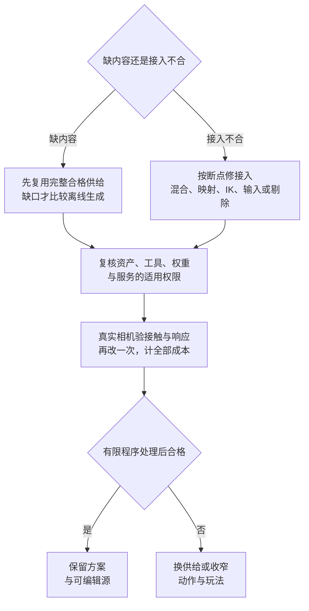

# 动画与绑定：先固定动作契约，再补生成

> 编辑更新：2026-10-23（UTC+8）；适用：单人程序员、不做人工美术修补。分档为条件首试顺序，全部未试用；各项核实日期、版本、固定源码、许可与反证见[WP4 研究记录](../../../docs/research/2026-10-14-game-wp4-animation.md)。

## 30 秒结论

先核来源权限，固定动作、骨架与设备需求；图只选主路，具体备选见下方十二项比较。[研究]

- **完整供给优先：** 人形保骨架、2D保动作交集、对白先有面部源，不让求解器补不存在的素材。[研究]
- **生成有两层：** 离线补片段／移动集合；运行时生成仅为研究候选，不作成熟Unity／UE插件默认。[研究]
- **只修真正断点：** 导入后接触变差先对照压缩；检索不生成动作，IK不定义取消政策，离屏异常不先重生成。[研究]
- **二改决定去留：** 变速、换装备或改台词后仍需手摆姿／绘补，就换来源或缩范围。[研究]
- **未试用：** 图为条件选择，不是质量排行榜；动态资格与版本见[WP4](../../../docs/research/2026-10-14-game-wp4-animation.md)。[研究]

## 当前最高水平：全页主要选择与领先替代

<!-- frontier: status=已比较 gap=1 gen=2026-10 checked=2026-10-23 -->

**完整许可动作组＋固定骨架默认，按缺口局部升级。** 十二项供给、控制、二改与交付选择已比近期机制，独审支持资料差距1；整套零手修质量和净工时未知。[研究；2026-10-23]

| 主要选择 | 领先替代／质量参照 | 本页决定与撤回点 |
|---|---|---|
| 完整人形玩法动作 | 现成动作组、Motorica成套生成、Uthana／Kimodo专项生成 | ✅ 完整动作优先；移动集合缺口再评估成套生成，不把移动覆盖当全玩法覆盖 |
| 自动绑定与换外观 | Mixamo／AccuRIG；SkinTokens保骨架生成skin | ✅ 先保已验收骨架；🧪只重做蒙皮，关节几何不够就换模型 |
| 同骨架复用或人形转换 | Unity Generic／Humanoid、UE共享骨架及导入／运行时重定向 | ✅ 同骨架先复用，跨骨架按迭代频率与运行预算选转换时点 |
| 自录动作与短表演 | Uthana Video2.1／Text3.0、Vision3.0、Kimodo | 🧪 能演出来先比较视频，需约束再比文本／可控生成；接触错不靠滤波兜底 |
| 非人形与异拓扑动作 | 专用成套资产、程序控制；👀BlendAnything跨骨架混合 | ✅ 先找完整动作组；研究混合已有动作不补全玩法，商用许可未闭合不采用 |
| 位移、循环与接触 | root motion／in-place、局部warp／足锁、Motorica轨迹回灌 | ✅ 保一个移动权威，先分片段缺口和接触偏差再选生成或修正 |
| 响应、取消与命中反馈 | P39的Hades II／Wilds生产修订与同动作实现比较 | ✅ 保短期意图与合法出口；反馈不改恢复承诺，P39不重开 |
| 急转、启停与移动风格 | GASP5.8／JLPM／环境感知MM；Motorica站姿约束；MotionBricks／ARDY | 🧪 数据齐再升级检索，在线生成仅候选且保独立玩法仲裁 |
| 比例、装备与交互二改 | 分动作对位、UE5.8 Relative IK与神经软硬目标 | ✅ 按动作保接触轴和阶段，统一修正破坏旧动作就撤回 |
| 2D转身、换装和逐帧 | 完整Spine／Unity 2D结构、LPC动作交集、生成补帧 | ✅ 复用已有骨架／图层；缺背面、握点或装备动作就换供给 |
| 对白脸部与口型 | Rhubarb、VRM／uLipSync、MetaHuman、Audio2Face | ✅ 先有嘴形／面部源，再选求解器；改句成对更新声音与口型 |
| 最终画面、权限与成本 | 原生压缩／ACL Database与CurveCodec 2存储路线、bounds／更新策略 | ✅ 导入后失真先查压缩与消费者；实机画面、分层许可与全部淘汰成本决定去留 |

**👀 BlendAnything（2026-07）在共同语义空间混合不同骨架的已有动作，再解码回参考骨架。** 异拓扑细节会损失，许可证限非商业研究，不替代商业成套动作；与视频动捕、MM检索的区别及实验局限见[全页研究](../../../docs/research/2026-10-14-game-wp4-animation.md#全页收口十二项选择与新机制2026-10-22)。[一手／研究]

**可直接沿用：** 位移权威、二改与对白配对规则；Agent核覆盖、版本、映射和事件，人验相机下的姿态、风格与响应。官方、既有固定源码及中英制作记录提供条件证据，不证明广泛采用率。[研究]

## 先采用什么

**✅ 按玩法验完整动作组，不按片段数量判断。** 人形至少核所需idle、移动、启停、转向、攻击、受击与死亡；短表演缺口再比动捕／文本。机械、悬浮、铰链与规则分节先用运动规则，有机生物须另维护专用身体／支撑控制。[一手／经验]

骨架、rest pose、蒙皮、动作、重定向与控制器分层保存；只改外观时复用已验骨架，不随之重生全部动作。[研究／经验]

## 三档首试：完整资产优先，生成补缺

先满足[授权总表](../03-generative-ai-in-games.md#13-授权与商用门槛总表wp1)对应的具体版本、地区、输入和发行条件。零手修是准入条件；两路均合格时，再按承重、接触、连续性与输入回应选择。[研究]

|任务|质量优先|性价比优先|本地／免费|
|---|---|---|---|
|**人形角色与动作**|✅ 已验骨架＋完整动作组；状态／混合与局部MM见[连续性取舍](#连续性升级先修具体断点再选-motion-matching)；短表演缺口🧪Uthana Text3.0／Video2.1|✅ 地区可用时 Mixamo 现成动作；需要数值移动控制再🧪Uthana Locomotion；较多自录视频对照 Rokoko Vision 3.0|✅ 已有许可动作先同骨架复用，按需重定向／IK；🧪SkinTokens 补绑定；缺可控短人形动作时👀Kimodo-SOMA-RP-v1.2，不作质量冠军|
|**2D 角色**|✅ 完整现成骨骼／逐帧角色包；Spine 资产、编辑器及 runtime 分别清权|✅ 已正确分层和绑定的结构＋Unity 2D Animation，复用换装／参数|✅ 自有或已核许可逐帧包、Sprite 动画与刚体部件曲线；需多人换装可🧪LPC已覆盖组合，先核完整动作交集|
|**非人形／精确接触**|✅ 专用完整资产组；覆盖不到时修改角色或玩法|🧪 明确身体与支撑规则的程序步态；依赖基础姿态时先取得许可资产|👀 SkinTokens／MoCapAnything 专项研究，先解决依赖和目标骨架问题|

**采用 Uthana Video2.1 时显式选模型：** `create_video_to_motion` 要传 `model="video-to-motion-2.1"`；省略或用旧别名 `video-to-motion-v2` 仍是 2.0。2.1 返回后处理后的 motion IDs，不能直接沿用 2.0 单个基础动作的取值假设；保存请求版本、job ID、完整结果和最终下载的 motion ID，再验接触。同文件短期重传可能复用旧 job；跨模型是否复用未说明，保存并核对返回身份，不能仅按提交次数计新候选。[一手／研究：[Video API](https://uthana.com/docs/api/capabilities/video-to-motion)、[GraphQL 契约](https://uthana.com/docs/api/graphql#create_video_to_motion)]

**Text3.0 另走异步入口：** 使用 `create_text_to_motion_job` 并显式指定 `text-to-motion-3.0`，通用同步教程不能代表 3.0。官方[能力页](https://uthana.com/docs/api/capabilities/text-to-motion#text-to-motion-30)写 PAYG 全面开放，[GraphQL reference](https://uthana.com/docs/api/graphql#create_text_to_motion_job)仍写 limited release；公开准入口径冲突未消除，接入前核当前账户资格与实际返回模型，未获资格时保留已有可用路线。[一手／研究；2026-10-15 UTC+8]

**👀 Kimodo-SOMA-RP-v1.2补可控短人形动作。** 文本、路径与末端约束仍需SOMA转换、重定向和后处理；有限修正后还需手摆姿，就换许可动作或缩范围。[一手／研究]

本轮没有零手修效果实测，旧v1.1分数还受作者披露的测试泄漏与精度口径影响。版本、文本编码器访问、算力与分层许可见[P9补核](../../../docs/research/2026-10-14-game-wp4-animation.md#p9补核本地可控短动作)，不能按代码Apache放行整链。[一手／研究；2026-10-20]

**撤回条件：** 有限重新生成／录制与程序修正后，仍必须刷权重、补画肢体或逐帧摆姿才能过关，就换资产、缩小动作或改变玩法。若完整现成动作已满足需求，不为使用 AI 而重新生成。[经验]

## 成套移动缺口：生成数据库，不只挑单段

**👀 缺整套移动风格时比较Motorica。** Motion Factory覆盖走跑、横移、启停与转向；Reverse Workflow回灌玩法root轨迹补洞，Key Idle Pose约束集合站姿，不替代全部玩法动作。[一手／研究]

**现有集合够用就不换，缺数据才算整套生成或局部补洞。** 武器手势、攻击与恢复另核覆盖；免费数据页不足以放行商用，合同与作者手改反例见[研究](../../../docs/research/2026-10-14-game-wp4-animation.md#成套供给与在线生成补齐剩余选择2026-10-23)。[研究]

## 自动绑定：有骨架不等于变形正确

**🧪 规范人形输入比较 Mixamo／AccuRIG，本地候选比较 SkinTokens。** Mixamo 限定二足人形，严重异形、大附肢／道具、非中性姿势、游离部件和脏网格可能失败；中国国家码账户不可用。AccuRIG 是 guided rigging，免费版不包含全部高级蒙皮／减骨能力，不能按“免费自动绑定”省略检查。[一手]

SkinTokens 固定版本提供`--use_skeleton`保已有骨架、只生成 skin，以及保纹理的`--use_transfer`。第二版只改外观时可优先比较这条路径，而不是重新预测骨架；作者的绑定指标仍不是游戏发布通过率。[一手／经验]

错误先分层：骨轴／rest 映射错，修重定向；已明确识别的剑或硬壳被弯曲，修刚性部件权重；关节几何不足、缺面或部件粘连，不能承诺用平滑或“再加骨头”修好。权重总和为 1 只说明数值合法，不代表剑握得对。[一手／研究]

## 文本、视频和程序动画各补什么

- **文本动作：** 先用于背景 idle、招呼和短表演。Uthana Text3.0 不保证与场景接触或精确末姿；HY-Motion 明确不支持 seamless loop、in-place、多人和非人形。不能用提示词“无缝循环”代替能力契约。[一手]
- **可控移动：** Uthana Locomotion 有方向、速度、步对数和风格控制，并区分 root motion／in-place 导出，比反复描述“快一点”更容易对应修改；它仍只是 clip 生成，不做寻路、碰撞和动态平衡。[一手／研究]
- **视频动捕：** 已能演出所需节奏且单人全身可见、镜头稳定时首试；遮挡、模糊与复杂肢体接触仍可能误判。滤波能减抖，不能把错误姿态变正确；不允许手修时应重录、换来源或撤回动作。[一手／经验]
- **程序动画：** 瞄准、后坐、门轴和悬浮可先用明确曲线。角色移动须分两路：已有基础姿态＋程序修饰可减少专用片段，但仍需合格的许可姿态；直接用身体／支撑规则生成运动则要维护专用控制。Overgrowth 的稀疏关键帧路线与 Rain World 的生物运动证明两路都有生产参照，不证明普通程序员零手修即可复现。没有基础姿态来源时，不把“少关键帧”当“无需动画内容”；IK 仍不负责创造自然表演。[一手／研究：[生产证据](../../../docs/research/2026-10-14-game-wp4-animation.md#程序步态补研姿态来源与运动结构)]

**🧪 同一种运动先调速度／尺度并重建派生状态；新增肢体、爬行／飞行或特殊交互按新代码／动作估算。** Rain World每物种需专用控制，Overgrowth仍补武器／物种动作并因工时撤招；许可姿态与程序处理不足时，保局部程序层、换动作或缩范围。[一手／研究；同上证据，未测工时／性能]

Rokoko Vision 在 2026-07 并入 Create，旧双机位和在线 webcam 已于 8 月退役；新 Vision 3.0 不含手指追踪。[一手]

Cascadeur 2026.2 的动画层仍为 Alpha，工具更可编辑不等于零手修；Free 非商用且只能导出 CASC；Indie 的 US$100k 门槛含营收或融资，不能只算游戏收入。[一手]

## Root motion、循环、接触是三份承诺

**✅ 位移只设一个权威。** 代码移动角色时使用 in-place 视觉动作，并匹配实际速度／步幅；root motion 驱动时由动画位移进入碰撞／控制器处理，避免代码与动画双重平移。跳跃、冲刺和攀爬分别决定 Y 与 XZ 来源，不给全部剪辑统一 Bake Into Pose。[一手／经验]

**✅ 循环同时检查首尾姿态、速度和接触相位。** 清零水平 root 只得到 in-place；首尾姿态相同也不能证明脚不滑。Unity Loop Pose 把首尾相对姿态差分摊整段，不会制造缺失的着地／离地阶段；一次性死亡和落地也不应强制循环。[一手／研究]

**✅ 接触按世界空间和真实道具检查。** 支撑脚阶段可用有限 IK，腾空不能一直锁脚；手握持要检查实际武器。攻击命中、恢复、音效、脚步与可取消窗口单独记录。第二次要求“命中提前、恢复不变”时应局部重定时并重建事件，不能只全局加速。[研究／经验]

**🧪 Shards of Stone 可借鉴刚体隔离和程序步态，⛔ 不原样采用为通用动画管线。** 固定脚本未实现其承诺的完整 rest 转换／身高缩放，`--loop` 只清零 hips 两轴；作者也承认握剑滚转与成本测量未完成。完整反证见研究记录。[一手／研究]

## 攻击后要防御：先修合法出口，再加连续性

**✅ 即时应对型近战先用短期意图缓冲与显式取消窗口，不把全段动画加速当响应修复。** 同一招中先按追击、又改按防御时，先定义新请求是否替代旧请求；执行仍要等合法出口。有预排指令承诺的玩法才保顺序队列。[研究]

**命中停顿不替代交还控制。** Hades II分别修丢输入、恢复段Dash及取消后停顿；Wilds发布前同时加强hitstop、提前部分取消，说明重量感与合法风险要分别调。[一手／研究]

**二改把接触提前、恢复不变，再加一次短hitstop。** 回归命中／落空、旧追击被防御替代、暂停后到期与取消后重入；确认伤害不重算、合法出口不被反馈拖后。Agent可实现与记录，人定取消政策并试玩；无需为了这一题迁移动画框架。见[同动作实现比较、最高水平卡与局限](../../../docs/research/2026-10-14-game-wp4-animation.md#当前最高水平卡攻击后的防御出口p392026-10-21)。[研究]

## 连续性升级：先修具体断点，再选 Motion Matching

**✅ 状态机／Blend Tree也是完整质量路线；小步态集合、明确攻击段落与准确取消优先。** 按Unity 6.3要求对齐归一化落脚相位，用短转场／可控打断切状态；缺启停转身就补动作，速度混合不造急停重心转移。[一手／研究：[Blend Trees](https://docs.unity3d.com/6000.3/Documentation/Manual/class-BlendTree.html)]

**🧪 只为看得见的问题加一层。** 步幅与实际速度不符，先有限重定时／stride warping；停止姿态与剩余距离不符，可用 distance matching；切换弹跳可评估惯性化；支撑脚漂移再加带接触相位、释放条件和伸展上限的足锁。它们分别修改采样时间、姿态或连续性，不能互相代替，也不该把髋膝拉坏来追求数字上的零滑动。Unity 原生 Two Bone IK 是求解器，接触识别与锁定策略仍要自己提供。[一手／研究：[距离匹配](https://dev.epicgames.com/documentation/en-us/unreal-engine/distance-matching-in-unreal-engine)、[姿态修正](https://dev.epicgames.com/documentation/en-us/unreal-engine/pose-warping-in-unreal-engine)、[IK](https://docs.unity3d.com/Packages/com.unity.animation.rigging@1.4/manual/constraints/TwoBoneIKConstraint.html)]

**🧪 近景角色频繁急转／启停、移动风格多，且已有相应许可动作覆盖时，再用 Motion Matching 减少逐条编排。** 它从数据库选已有姿态，不是生成缺失动作；搜索、过渡、足锁和动作事件仍需协同。可以只替换移动或入场选姿，攻击／交互保留明确规则。Epic 2026-08 的 GASP 5.8 已把状态机 blendstack、Chooser 内 pose matching 与 Blend Spaces 组合使用，先进路线也不要求全项目二选一。[一手／研究：[官方更新](https://www.unrealengine.com/tech-blog/download-the-latest-game-animation-sample-project-now-updated-for-ue-5-8)]

Unity 可🧪比较作者维护的 JLPM MotionMatching，但要承担同骨架 BVH、特征／标签、重定向和接触策略的接入；不是给几个现成 clip 就自动达到演示质量。Unreal 可借官方 GASP 的局部机制；样例能导出不代表资产已获跨引擎或训练许可。具体固定版本、代码边界与许可见 [WP4 连续性补研](../../../docs/research/2026-10-14-game-wp4-animation.md#连续性补研与升级边界)。[一手／研究]

**👀 需要训练自己的神经控制器时，先核数据与维护能力。** 已有大量合法数据、普通检索确有内存／风格扩展瓶颈，而且能维护训练和回归时才比较。2026-08 的官方 AnimGen 已能在编辑器训练并运行神经控制器，但仍是 Experimental；示例 NPC 模型未提供训练数据，不能按“可以播放”推断“可以按第二次需求重训”。购买动作的游戏使用权也不自动包括训练权。[一手／研究：[AnimGen 示例](https://www.fab.com/listings/df37eb46-09bf-4604-9307-cdc39c769790)]

**👀 在线生成另比MotionBricks／ARDY，不把它们混成离线动作库。** 前者用目标关键姿生成过渡，后者支持在线文本和运动约束；均不替代输入、交互与恢复政策。MotionBricks的UE演示仍由StateTree仲裁，公开G1预览不等于现成游戏插件；ARDY的历史窗口和后处理也有响应／质量代价。当前仅借分层控制机制，不迁移默认，先核文本编码器访问与分层许可，见[可得工件与边界](../../../docs/research/2026-10-14-game-wp4-animation.md#成套供给与在线生成补齐剩余选择2026-10-23)。[一手／研究]

**二改：加速、缩短刹停，再加双手持物侧移。** 前两项验复用后的脚接触，后一项先补姿态／步态；在最终相机验重心、轮廓、急转、手脚接触和首个输入回应，计新增动作、重建／重训与主动工时。参数／剪辑够用就保原路线，数据齐而转场负担大才升级检索。[研究]

### 窄道动作：先决定能否让路，再选环境感知检索

**最高水平未知；环境感知MM有同题领先证据。** Ponton等2025 TOG窄道错身中，普通MM相撞、圆盘表达卡住、椭圆侧身通过；前行→侧身→复跑展示姿态／路线联动，不证明响应、打断或音画领先。[一手／研究；2026-10-21]

**✅ 默认保完整许可动作与既有运动控制。** 精确方向／取消是玩法承诺时，有限窄口先用明确侧身动作；这是现成方案优先的可行推荐，不是质量冠军。**🧪 侧身让路是核心体验、动作覆盖已齐且允许偏离目标路线时，比较环境感知MM**，不要只加IK或期待普通MM自己理解障碍。作者有Unity公开实现；[代码MIT](https://github.com/UPC-ViRVIG/Environment-aware-Motion-Matching/blob/273928addc94ddf4a3bd7b8bf1ef17c360b0000e/LICENSE)与[动作数据CC-BY-4.0](https://zenodo.org/records/17220516)分别核，角色／场景资产另核。[一手／研究]

**穿越全链验：** 按下／松手的首个回应、肩臂／装备避障、脚支撑、出口／反退恢复；姿态步幅须读懂让路，反馈跟实际事件。二改收窄或加迎面角色，回归空旷直行／堵死入口；论文减碰撞但增CPU／路线偏差，未测全链。[研究]

**仍需人工修姿、破坏操纵或超预算就撤回**，改用明确动作或限制通道，接受自由度下降。MM检索不是AI生成；Agent可核覆盖、做接入与对照记录，人决定控制权、看完整动作和退出。零手修通过率未知；图像、指标、许可API及缺口见[窄道研究](../../../docs/research/2026-10-14-game-wp4-animation.md#p39窄道补研姿态与路线一起选择)。[研究]

## 交互目标二改：先对位，再判断是否仍是同一个动作

**✅ 支撑／腾空／抓握顺序正确，仅高度或站位改变，先分段对位。** Unity `Animator.MatchTarget`移动／旋转整角色，使Avatar部位按进度到位；仅base layer、开启`applyRootMotion`、同时一项匹配，手脚顺序调度并明确motor／Animator位移权威。UE Motion Warping在窗口内改root motion，参数不可照搬。两者非全程手脚约束；移动阶段修正、接触后有限IK，不让着地预备提前滑向终点。[一手／研究：[Unity 6.3](https://docs.unity3d.com/6000.3/Documentation/ScriptReference/Animator.MatchTarget.html)、[UE](https://dev.epicgames.com/documentation/en-us/unreal-engine/motion-warping-in-unreal-engine)]

**✅ 姿态采样与位移修正共用动作进度。** 全局变速同步窗口／结束时刻，提前抓握重定位对应窗口；按剩余root高度选起点可省曲线，却可能跳过蓄力／起手，仅在当前姿态可接入时用。ALS历史修复与取舍见 [WP4](../../../docs/research/2026-10-14-game-wp4-animation.md#交互与时长补研分段对位和动作进度)。[一手／研究]

**✅ 路径不兼容就换动作或缩交互范围。** 低跨越、高攀上、悬挂起身分别核高度、进场朝向、净空与目标运动；同相位循环用原生混合，末端偏差用IK，站位差分段对位。漂浮、吞承重／蓄力或穿障碍就撤回，接受可攀位置减少或动作分支增加；UpRoom复盘同样将有限翻越与需大量动作／专用控制的自由攀爬分开。[一手／研究：[开发者复盘](https://www.uproomgames.com/dev-log/procedural-climbing)]

**按动作保存匹配轴，不用全局“更多对齐”修二改。** 中文跑酷制作记录中，ClimbUp需要新增前后对位，但同一权重会损伤StepUp／JumpUp落点，因此拆成每动作权重；这是现成片段组合的具体反例，不证明整条管线零手修，见[来源与限制](../../../docs/research/2026-10-14-game-wp4-animation.md#成套供给与在线生成补齐剩余选择2026-10-23)。[社区／研究]

**验收看全程接触和路径，不只对位终点；上述机制未作零手修实测。**[研究]

## 重定向与2D路线：复用结构，不补不存在的内容

**✅ 同骨架同体型且动作够用，直接复用，不强制重定向。** Unity 6.3可比Generic；跨人形复用／专属功能才转Humanoid，其导入可能丢位移、中间骨骼或缩放，先核Import Messages再定动作来源。[一手／研究]

**保留功能代价：** Unity Mecanim 内置 IK 依赖正确配置的 Humanoid Avatar，已有这类消费者时不能只因同骨架就切 Generic。Generic 仍支持 root motion，但改用选定 Root Node；切换后须重验位移、接触和事件，不能承诺无损或零滑脚。[一手／研究]

UE 5.8先比Skeleton共享；层级／命名近同、比例相近的独立骨架可用Compatible Skeletons。比例／结构差异再重定向；IK Retargeter仍需链、姿态与root配置，不补缺失动作，不能套用Unity机制。[一手／研究；来源、历史反例与撤回条件见 [WP4 同骨架复用](../../../docs/research/2026-10-14-game-wp4-animation.md#同骨架复用补研先保原动作再决定转换)]

**✅ 比例／装备二改先修参照与求解顺序。** 握枪、取弹匣、落脚分别参照道具、身体、场景，不用永久offset修全程；路径兼容则改目标／代理体积，需拉伸、穿装备或毁轮廓就换适配动作／模型。几何可达仅必要条件，soften主动不到达属平滑取舍，不直接判失败。[一手／研究；机制与生产反例见 [WP4 比例与装备补研](../../../docs/research/2026-10-14-game-wp4-animation.md#比例与装备补研接触参照可达性与体积)]

**🧪 UE5.8 Relative IK 仅作实验候选：** 它可依据烘焙的身体接触关系适配新比例；修改用于烘焙的 physics asset 后需重新生成数据，碰撞目标修正还受操作顺序影响。它修正 IK goals，不保证整个网格无穿插，不替代已验收动作组。[一手／研究：[官方操作栈](https://dev.epicgames.com/documentation/unreal-engine/retargeting-operation-stack-in-unreal-engine-5-8)]

**✅ 2D 骨骼路线从已正确分层、关节遮盖完整的资产开始。** Unity 官方流程仍含骨骼创建、网格细化、权重调整与姿态检查；Auto Geometry／Auto Weights 不负责补画隐藏肢体或背面。Spine 是成熟创作／运行时工具，不是 AI 自动绑定器；其完整资产包可减少起步工作，旧 Unity 示例工程仍需迁移。[一手／研究]

换色、同规格装备和速度尽量复用 slot／sprite／骨架。转身、背面、大透视或形变需要相应替换图或完整逐帧动作；没有这些内容时，再评估整段生成或收窄动作。逐帧须保共同画布、pivot、身份与事件，详见[2D 专题](2d.md)。[一手／经验]

**✅ 俯视像素角色要换装备，先选“身体×方向×必要动作×装备×许可”都有供给的图层体系。** 可🧪从LPC已覆盖的male／锁子甲／连枷或战斧走路、挥砍组合起步；它们没有持武器run，不因菜单可选就承诺扩动作。缺关键层时先换有供给的装备或缩动作，生成只补有界缺口。[一手／研究]

Herodom的实际采用含工具维护与委托美术，不是零手修实证；本地免费也须履行逐件署名／SA等条件。固定覆盖、许可路线与PixelLab批量反例见[成套扩装研究](../../../docs/research/2026-10-14-game-wp8-style-consistency.md#像素角色扩装先核完整动作交集再换装备)。AI可核目录与配置，人仍验四向遮挡、握点及事件；本轮未运行或验收成图。[研究]

## 导入后握点或脚抖：先对照压缩，再返工动作

**✅ 源动作合格、导入后才变差，先对同一源文件做压缩差分。** 固定骨架、映射、速度与相机，比较当前设置和高精度对照；差异随压缩变化，才局部收紧受损片段。两版都错则回查源动作／转换，不先重生成或重绑。开发者曾改导出与骨架均无效，后调整Bone Compression Settings消除腿抖；这是作者自述，非本仓复现。[一手／研究：[原帖与证据边界](../../../docs/research/2026-10-14-game-wp4-animation.md#压缩补研导入后接触退化与装备二改2026-10-23)]

- **Unity 6.3：** 默认保原生压缩；需要更高精度时，比较关键帧削减与更低容差，Off只作诊断对照。Rotation Error是角度，Position Error是曲线百分比，不能当作世界空间握点保证；全关会增加文件／运行内存并影响性能。[一手]
- **UE5.8：** 默认保Anim Compress ACL；先核Optimization Targets和socket／特殊骨的精度范围，再决定局部设置。使用ACL Database才另核运行时质量档：编辑器默认最高预览，cooked默认最低，提升需显式stream；这一差异不适用于普通ACL。[一手]

**二改换长装备，沿同一输入回归旧装备与新末端。** 验实际握点、支撑脚、整段及转场，保留解码后误差、占用和目标设备采样成本。有限调参仍坏或超预算，就撤回该压缩配置／资产修改，保旧合格组合。Agent可保存导入配置、批量对照，人验最终画面。[研究]

**👀 CurveCodec 2是存储／整段传输的前沿候选，不迁移运行时默认。** 它无随机姿态访问，代码／权重限非商业，商业使用另需许可；更小字节数也不等于接触更好。上述判断是资料与源码研究，来源、成本及无引擎验证缺口见[WP4](../../../docs/research/2026-10-14-game-wp4-animation.md#压缩补研导入后接触退化与装备二改2026-10-23)。[一手／研究]

## 换动作后消失或突跳：先分包围范围与屏外更新

**✅ 大挥击、侧移、程序IK或长装备先显示renderer bounds，验中央、边缘、离屏返回。** 边缘消失先查范围／root／父级继承，屏外挂点停住查更新；持续可见且正常求值仍扭曲、滑脚、穿插才回查绑定／重定向／动作。这是排查顺序，非直接确诊。[研究]

- **Unity 6.3：** 导入时的动画范围不保证覆盖后加的动作与程序变形。范围可预测时，先修正覆盖支持动作／装备的 renderer bounds；难以预估才比较 `Update When Offscreen` 的逐帧重算。它不等同于 Animator 的更新策略：`CullUpdateTransforms` 会在不可见时停重定向、IK 和 Transform 写入，`CullCompletely` 停动画。屏外仍需骨骼驱动的挂点／判定时，须单独保住所需求值。[一手／研究：[范围诊断](https://docs.unity3d.com/6000.3/Documentation/Manual/troubleshooting-skinned-mesh-renderer-visibility.html)、[Animator](https://docs.unity3d.com/6000.3/Documentation/ScriptReference/AnimatorCullingMode.html)]
- **Unreal 5.8：** 先核实际 bounds 来源，包括 Physics Asset 的参与体和是否沿用 Leader Pose 的范围；新装备不能无条件继承旧身体范围。`AlwaysTickPose` 在未渲染时仍 tick，但不刷新骨骼变换；`AlwaysTickPoseAndRefreshBones` 才同时保留两者。需要屏外骨骼结果时不能只看“Always”名称，也不能把 Unity 的开关照搬过来。[一手／研究：[bounds 配置](https://dev.epicgames.com/documentation/en-us/unreal-engine/API/Runtime/Engine/USkinnedMeshComponent)、[tick 合同](https://dev.epicgames.com/documentation/unreal-engine/API/Runtime/Engine/EVisibilityBasedAnimTickOption?lang=en-US)]

**✅ 位移、伤害／奖励和骨骼挂点不随视觉剔除停掉，纯装饰不必全开屏外求值。** 正确后在目标设备比较有限／动态范围和必要更新成本，不滥用巨大bounds或关闭剔除。二改保存范围来源／坐标空间、更新模式与消费者；发布构建验最大姿态、装备切换、离屏触发及返回首帧。显示正确不证明动作好看，性能未测；反例与运行时覆盖生命周期见 [WP4](../../../docs/research/2026-10-14-game-wp4-animation.md#剔除补研范围更新与动作内容分开)。[研究]

## 授权与成本会改变自动化路线

- **Mixamo：** 可用于商业游戏，但不将原始动作作为素材包再分发，也不可用服务内容／输出训练、测试或改进 AI 模型。[一手]
- **Uthana：** 2026-08 起新客户按量；Text3.0 为 US$0.10／秒，Video2.1 为 US$0.05／秒，Locomotion 为 US$0.02／秒，循环另计。付费输出与免费 CC BY 4.0 输出不同；GraphQL 可用，默认数据改进条款仍须考虑。[一手]
- **Rokoko：** Basic 月付 US$12 含 600 秒处理，年付折合 US$10／月；免费 30 秒／月。条款禁止未另授权的脚本／自动化访问，不能因此搭无人值守网页批处理；自生内容和 Motion Library 资产许可也不同。[一手]
- **DeepMotion：** 免费非商用；付费期间生成的输出获永久商业许可，但不归用户独占所有，禁止独立素材再分发。逐帧纠错返积分需要人工劳动，不计作本基准的免费生产；网页自动化不默认允许，批量接入另核官方 API 授权。[一手／研究]
- **本地模型：** HY-Motion 输出地域条件、GVHMR 非商业限制沿用 WP1；MoCapAnything V2 主代码／权重 MIT，但默认 RMBG-1.4 依赖免费仅非商业。先获许可或验证替代，不能只删下载步骤就放行。[一手／研究]
- **Spine：** runtime 源码可读不等于 MIT；购买角色包不自动免除 runtime 集成许可。Essential／Pro 收入与投资融资合计门槛、Enterprise 及资产包再分发规则分别核对。[一手]

总成本计候选、淘汰、录制、算力、主动修复及本地硬件维护，再除合格动作数／秒；套餐额度和生成单价不等于通过成本。[研究]

## 对白改句：先有可用的脸，再选口型求解器

**✅ 先选无需手修、已覆盖所需嘴形或面部绑定的角色，再让工具对声音求口型。** 缺脸部源且接受动漫人形风格时，先比较 VRoid 预设路线；已有六嘴形、MetaHuman 或面部 rig 时，再按下表选求解器。缺嘴图、面部形变或统一风格时，先换完整角色来源，求解器不负责补齐这些资源。[一手／研究；证据与版本见 [WP4 面部供给补核](../../../docs/research/2026-10-14-game-wp4-animation.md#p28补核先解决面部供给再做对白二改)]

| 起点与分档 | AI／工具能承担 | 瓶颈与撤回条件 |
|---|---|---|
| ✅ 本地／低接入成本：已有 A–F 六种真实嘴形的 2D 角色＋Rhubarb | 从录音生成嘴形时序，程序员做映射和批处理 | 不生成嘴图、眼神与情绪；非英语识别质量须另验，嘴形缺失就换来源 |
| 🧪 风格化 3D 来源：VRoid→VRM1.0→UniVRM／uLipSync | 预设提供角色来源，现成组件驱动口部；不是 AI 生成造型 | 核真实表情绑定、许可与音色校准；五元音不等于六嘴形，情绪叠加须验 |
| 🧪 已选兼容 MetaHuman：UE 5.6 起的音频驱动 | 生成面部动画；mouth-region 掩码可作为替换口型的入口 | 新句与原眼神、头部表演能否合成仍须看角色；跨 Unity 的导出接入另计 |
| 👀 已有 rig／本地可控：Audio2Face SDK | 音频推理与既有形变基底拟合 | 缺 neutral/delta poses 就没有可用目标；后段 CPU 求解不代表整条管线免 GPU |

**AI给候选曲线，Agent映射／批查，人验表演。** 角色供给与表现需求仍可能先卡住，通过率和净工时未知。[研究]

**二改三句对白的中句，再做第二语言；声音／口型成对验收。** 重算字幕／触发，其他句资产可留但绝对时间可能移动；情绪和时机合适才留眼神／头部层，mouth-only不保证合成不变。[研究]

**失败保留旧声音／口型整对。** Rhubarb旧输出可能残留；候选通过退出状态、格式、嘴形映射与时长检查后，才与录音成对替换。静音、跳句、切语言须收口并清旧状态。[一手／研究]

**不达标可退文本／有限嘴形或远景，但接受风格、镜头和可读性损失。** 近景口部玩法不能无成本替代；Thimbleweed Park只证明录音／口型链可行，不证明单人零手修。[一手／研究]

## 第二次修改决定是否留下

1. 保存骨架／模型、clip 命名、源动作、服务版本、root 策略、重定向／导入压缩设置、误差评估对象、事件与接触标签；原始动作与处理后动作分开。[经验]
2. 第一版通过最小完整动作组；第二版保持骨架换同规格装备，并做一次局部时序／移动速度修改，再增加一个确需新语义的动作。[研究]
3. 自动核骨架映射、clip 非空、数值与时长、事件范围、根轨迹、接触漂移、首尾姿态／速度和旧引用；压缩后另验实际末端与采样间过渡，阈值按目标相机、角色与玩法定。[研究]
4. 在真实角色、道具和状态转换中判断动作是否可读、握持正确、风格一致；记录重生／重录次数、淘汰样本及第二改主动工时。[经验]

本轮完成资料、论文、源码和许可比较；真实引擎、目标设备及两轮修改试验待获准执行，不能把这些检查建议写成已经通过。[研究]
