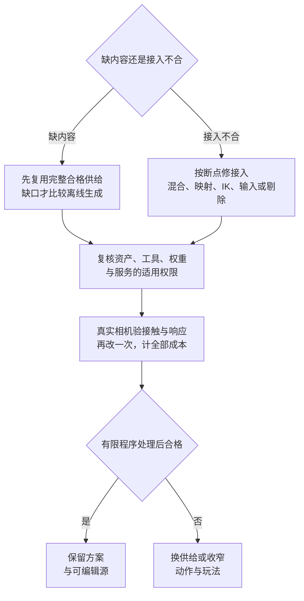
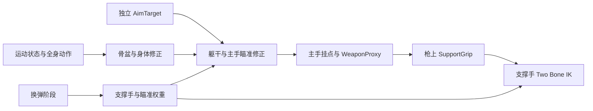

# 动画与绑定：先固定动作契约，再补生成

> 核实更新：2026-10-26；适用：单人程序员、不做人工美术修补。角色／武器模块已核公开文档与固定源码，MOBA 已采用可编辑角色源、五动作合同与实际事件消费者；生成服务及原生 Unity／Unreal 未运行；各来源原核实日期与许可见 [WP4](../../../docs/research/2026-10-14-game-wp4-animation.md)。

## 30 秒结论

**先拿完整合法动作组，把一名角色和一把武器的移动／瞄准／换弹接通，再补缺口。** 新项目直接从下方[角色武器模块](#weapon-animation-module)开始；已有角色按断点查后半页，2D／非人形／对白另走各自路线。



生成负责补动作内容，Agent负责配置／适配和回归，人验目标相机下的接触与响应。二改仍须手摆姿／补画时，换来源或收窄动作；不把控制器变复杂当作素材问题已解决。

## 先采用什么

<a id="weapon-animation-module"></a>
### 从一把长枪做出完整角色，再扩动作和武器

**✅ 无动画师的第三人称项目，先选“角色＋同风格完整动作组”，再让 AI 补明确缺口；Unity 用同一 Animator 组合移动、武器动作与局部约束。** 目标不是能播放走路和开枪，而是玩家移动、瞄准、射击、换弹后都能继续操作，手握得住、脚站得稳、姿态能说明当前动作。近景双手换弹是内容门槛：只有普通走跑和一个 rifle idle 时，先换有对应动作的枪／资产组，或明确采用更简单的换弹表现，不把缺口交给 IK 掩盖。

先在目标相机确定一名角色、一把长枪和支持的活动：自由移动、面向瞄准方向横移、启停／转向、开火后坐、站立与移动换弹、受击／死亡。第一版不需要每种动作十个变体，但“允许移动换弹”就必须有可组合的上身动作；若现成 reload 依赖全身重心，则先采用站定换弹，把移动限制写成玩法，而不是粗暴切掉下半身。

| 先取得的内容 | 可以借什么；AI 做什么 | 留下什么才能二改 |
|---|---|---|
| 角色、骨架与武器 | 优先现有合格角色／骨架；AI 核命名、比例、蒙皮和握持覆盖，已有骨架不因换外观重生 | 原模型／骨架、rest pose、武器源、单位与朝向、具体许可 |
| 自由移动与持枪移动组 | 现成同风格动作先用；[Mixamo](https://www.mixamo.com/) 可作地区可用时的基础来源，但逐项核横移、启停、转身和持物姿态 | 未处理 clip、来源版本、动作角色／武器条件、接触相位 |
| 同风格集合确实缺失 | 👀比较 Motorica 的集合／站姿与轨迹回灌；短受控走路缺口再比 [Uthana Locomotion](https://uthana.com/docs/api/capabilities/locomotion)，不让自由文本反复猜方向／速度 | 输入条件、实际模型／输出身份、原始结果和淘汰原因；生成集合不自动包含 reload |
| 换弹、抬枪与特殊动作 | 先找匹配枪型的现成动作；能演出来且许可允许再比较视频动捕，文本适合容忍接触误差的短表演 | 原录制／生成结果、可编辑作者工程、武器／弹匣参照；缺手指与交接姿态就换源 |

**生成后的编辑也要选路线。** 只改速度、事件或有限对位，保原片段并派生处理版；要改手取弹匣的路径，就需要对应作者源／新动作，而不是对压缩后 FBX 许诺任意局部编辑。已有 Cascadeur 工程保 `.casc` 中的 rig、层与约束，再导运行 clip；只有烘焙曲线时，Unbaking 是重建近似可编辑表示，不是找回原作者层。按本页零人工美术修补基准，仍需手摆姿／刷权重才合格的方案应换供给或缩动作，不能把劳动藏到“AI 后处理”。

成套生成的正向价值是补**一致的动作覆盖**：Motorica 的 Key Idle Pose 面向 idle／start／stop／loop 的共同站姿，轨迹回灌面向已有玩法的启停／转向缺口；持枪还要手部姿态与 IK。厂商采访中的作者仍曾 Control Rig 手改特定姿态，因此只把它列为有明确缺口时的候选，不承诺单人零手修。价格／地区／商业与训练权利先过[许可入口](#授权与成本会改变自动化路线)。

**依据**：[一手] [Motorica 回灌与双手道具](https://motorica.com/blog/motion-matching-made-simple-episode-4-retargeting-props-and-the-reverse-workflow)、[站姿与作者二改](https://motorica.com/blog/masters-2026-michal-navratil-interview)、[Cascadeur 层限制](https://cascadeur.com/help/category/318)；[研究] 资源组合与零手修取舍沿 [WP4](../../../docs/research/2026-10-14-game-wp4-animation.md#角色武器模块来源层求解和二改)；核实 2026-10-25，未试用生成服务／引擎。

### 第一步接入：先保同一个人和一条位移链

**✅ 先导一个 idle、一个移动循环和一个完整 reload，确认比例／骨轴／root，再批量导入。** 同骨架且不用 Humanoid 专属能力可保 Generic；跨人形复用或需要 Mecanim 内建 IK 时先配置 Humanoid Avatar，动画文件复用正确的 Avatar。Animation Rigging 的 Two Bone IK 与 `OnAnimatorIK` 不是同一条能力链，不能因教程装了 Rigging 包就把手 IK 当包内约束。

本例普通移动采用 motor 驱动、in-place 视觉：输入进既有角色控制器，动画读实际局部速度与转向，不另写角色平移。跳跃、攀爬等若采用 root motion，另按动作声明 XZ／Y／yaw 谁消费；细则沿[位移与接触](#root-motion循环接触是三份承诺)。接着保存 clip 范围、loop、root 配置、压缩设置与事件；比较同一源的低压缩诊断版，不把导入抖动先算给生成器。

角色尺寸不因替换 clip 改动；速度提高时先看实际步幅和接触相位，再做有限变速。站姿没有正确肩托、手指包握或负重重心，先补适配动作，不能只把支撑手拖到枪管上就宣称动作完成。

**依据**：[一手] [Unity 6.3 动画导入](https://docs.unity3d.com/6000.3/Documentation/Manual/class-AnimationClip.html)、[内建 IK 回调](https://docs.unity3d.com/6000.3/Documentation/ScriptReference/MonoBehaviour.OnAnimatorIK.html)；[研究] [WP4 同骨架取舍](../../../docs/research/2026-10-14-game-wp4-animation.md#同骨架复用补研先保原动作再决定转换)；核实 2026-10-25，未运行引擎。

### 第二步组合：武器配置换内容，层决定谁覆盖谁

**✅ 保共享控制骨架，按武器配置动作／握点／阶段，不为第二把同类枪复制整个控制器。** 以下 `WeaponPoseProfile` 是项目自定义数据设计，不是 Unity 内建类型或本仓已实现组件；与运行中剩余时间、当前弹药等可变状态分开。

| 拟议配置／运行消费者 | 起步内容 |
|---|---|
| `clipSet` → 动画状态 | 自由／持枪移动、启停、转向、抬枪、reload 与必要全身动作；缺项明确禁用对应玩法 |
| `layerPolicy` → Animator | 上身 mask、override 权重、additive 参考姿态、哪些全身动作优先；不假设所有 clip 可拆上下身 |
| `weaponMount / supportGrip / elbowHint` → 姿态适配器 | 主手到武器的局部变换、相对武器的支撑手骨目标姿态、肘提示及坐标空间；保持目标节点身份稳定 |
| `reloadPhases` → 动画表现 | 分阶段的支撑手、瞄准、后坐权重，弹匣显示／交接时点；游戏是否完成装填由技能／武器规则决定 |
| `importAndSource` → 导入／二改工具 | 来源、作者工程、骨架／Avatar、root、压缩与事件配置；用它重建运行 clip，不手工覆盖唯一源 |

**三类层分别服务不同修改。** 全身基底提供重心、步态和转向；upper override 只覆盖选定上身骨骼，使腿继续移动；additive 叠加相对参考姿态的后坐／小幅修饰，不把完整绝对持枪姿态直接当偏移。先看上身替换是否误带 root／骨盆，再调权重；全身 reload／受击接管时按政策退掉相冲突的上身和瞄准约束，避免两个系统同时拉同一只手。Avatar Mask 的 IK 曲线选项也不等于关闭任意 Rigging 约束。

结构相同、只换动作时可用 [Animator Override Controller](https://docs.unity3d.com/6000.3/Documentation/Manual/AnimatorOverrideController.html) 复用状态与转场；它不新增分层逻辑，也不能替缺失动作。若长枪 B 需要“逐发装填”，而 A 是“换弹匣”，先增加明确的动作阶段和内容，不把两者硬塞进同一换 clip 接口。换成更短 clip 时一并核转场、混合和阶段时点。

**依据**：[一手] [Unity Layers](https://docs.unity3d.com/6000.3/Documentation/Manual/AnimationLayers.html)、[Avatar Mask](https://docs.unity3d.com/6000.3/Documentation/Manual/class-AvatarMask.html)、上述 Override Controller；[研究] 配置与分工为本模块实现建议，核实 2026-10-25。

### 第三步接触：同帧只保一条主手—武器—支撑手依赖

**✅ 本例让主手带武器、支撑手追武器，不让两只手反过来同时决定枪的位置。** 输入／相机给独立 `AimTarget`，主手姿态来自动作与瞄准修正；武器沿主手挂点运动，支撑手最后求解。只有换成“独立武器目标驱动双手”的架构时才反转这一关系，不能混用两种权威。



这张图是**求值依赖，不是让每个方框都变成一个 Update 脚本**。Animation Rigging 在 Animator 基础姿态后应用约束；Rig Builder 按层组织，同一 Rig 的层级顺序影响约束顺序。将身体／骨盆放在依赖它们的手接触之前；瞄准先改躯干／主手，随后让支撑手读取已更新武器握点。若又在最后移动骨盆或上身，先前贴合的手就会被再次带走。

**最小接线先把目标空间写死。** 以右手为主手，角色根放 Animator＋RigBuilder，后者登记 RigRoot；下列名字是项目节点名，不是自动生成接口。

```text
角色根（Animator＋RigBuilder）
├─ 骨架 … 右手骨 → WeaponProxy → SupportGrip
│                             └→ 视觉枪模型
└─ RigRoot（Rig，与骨架根并列）
   ├─ Body 修正
   ├─ Aim 修正
   ├─ SupportArmIK（Two Bone IK Constraint）
   └─ ElbowHint（以角色根为基准校准的提示）
```

`SupportArmIK` 的 Root／Mid／Tip 分别接左上臂／前臂／手骨，Target 接 `SupportGrip`，Hint 接 `ElbowHint`。**SupportGrip 存的是支撑手骨 Tip 应到达的位置与旋转，不是枪网格表面的接触点。** 在已适配的持枪姿态中采样该手骨相对 WeaponProxy 的姿态；手腕原点、骨轴和手指包握不能靠把目标放在枪管表面解决。首次接线将 Maintain Target Offset 的 Position／Rotation 都关闭，以显式目标为准；其 offset 在建 job 时取得，不是随切枪自动重算的握持配置。先核位置／旋转权重各为 1 时目标是否正确，再以有效弯肘方向校准 Hint 与其权重，不用降低权重掩盖错误坐标。[Two Bone IK 官方字段说明](https://docs.unity3d.com/Packages/com.unity.animation.rigging@1.4/manual/constraints/TwoBoneIKConstraint.html)

本例的代理**直接随主手骨的父子链**进入动画 stream，不放在角色根下再用普通脚本复制主手世界姿态。切枪更新稳定代理的局部变换与握点数据、替换视觉模型，而非每次销毁被 Rig 绑定的目标。只靠父级移动、又未被约束直接引用的控制节点按 [Rigging Workflow](https://docs.unity3d.com/Packages/com.unity.animation.rigging@1.4/manual/RiggingWorkflow.html) 配 `RigTransform`。用同一动画 stream 内的依赖取目标，不在普通脚本中读上一轮骨骼世界坐标再要求它神奇地变成当前帧；确需换绑定则受控重建并核返回首帧。

瞄准超出肩／臂可用范围时，先转身体或降低瞄准权重，不拉伸手臂追枪口。相机意图与枪口遮挡仍由既有[瞄准／命中模块](../05-gameplay-architecture.md#瞄准与命中按失误类型改不只提高辅助强度)处理。LlamAcademy 作者明确警告从枪方向推 AimTarget、再由 IK 把枪瞄向该目标的循环；它的 `PlayerIK` 实际走 `OnAnimatorIK`，本例只借用武器配置／握点入口，不把教程代码直接混入上述 Two Bone IK 链。

**依据**：[一手：固定源码] [Rigging 1.4.1 层构建](https://github.com/needle-mirror/com.unity.animation.rigging/blob/1bd2bf88886c18e9012b90f9c3c331bc85c2f513/Runtime/AnimationRig/RigBuilderUtils.cs)、[绑定句柄](https://github.com/needle-mirror/com.unity.animation.rigging/blob/1bd2bf88886c18e9012b90f9c3c331bc85c2f513/Runtime/AnimationJobs/TransformHandle.cs)、[LlamAcademy README](https://github.com/llamacademy/scriptable-object-based-guns/blob/81cb444d25f1c0044835440977da48305ca6325e/README.md)；[研究] 单向链与稳定代理为设计推导，核实 2026-10-25，未引擎验证。

### 第四步换弹：手离开枪是动作的一部分

**✅ 主手保持持枪时，支撑手必须按阶段离开握点、完成弹匣动作，再回到握点。** 下表是一种换弹匣设计，阶段界线取自已取得的动作，不给所有枪套相同百分比。这里的“支撑手权重”具体消费到 `SupportArmIK.weight`：离枪降至 0，让 reload 动作接管，回握再渐增至 1；不降低整个 Rig 的权重连带关掉身体修正。瞄准／后坐权重由各自约束或层消费，阶段数据须在该 Animator 的求值前送入，实际更新模式另验。

| 阶段 | 姿态与表现怎么接 | 需要保住什么 |
|---|---|---|
| 进入换弹 | 从持枪过渡到 reload；按动作减瞄准／后坐，支撑手权重开始下降 | 退出支撑约束与手离枪时机一致，不突然弹到另一目标 |
| 取／换弹匣 | 支撑手由 reload clip 或独立交互目标控制；弹匣在身体／手／枪间按动作换参照 | 不继续追枪上握点；若主手也离枪，另有明确持枪支撑与动作，不能沿本例假设 |
| 回握 | 在动作已接近握点时渐增支撑约束，恢复瞄准 | IK 修小偏差，不跨身体拉手；肘弯与枪托仍合理 |
| 完成或中断 | 表现归还相应层／约束；技能按自身阶段决定装填结果 | 切枪／受击后旧动作不能改新武器配置，不能因动画淡出又加一次弹 |

**✅ 近景接触已配套、袖臂仍整组平移时，先保掌—弹匣接触再解身体端。** FPS-Like 的原掌指和既有可见弹匣路径作为腕端目标，相机空间肩锚、两段定长与外侧肘提示只驱动原创袖形；Three 与 Canvas 共用这一变形，不再分别拼动作。分件接缝须共享腕段的轴、环向与末圈顶点；中心对齐仍会露楔形背景，不能靠放大袖口遮住。短连射→换弹→就绪的双后端连续片验证了弯肘可读、整袖平移减少；只适用于已校验腕目标全程可达的近景换弹；换握、取新匣或躯干联动不由这套袖形解决。左腕折面与固定手指仍缺，不据此声称 Unity/Unreal 已验证。实现起点是 [FPS-Like 的末端求解与共截面袖形](https://github.com/dbvv1/FPS-Like/blob/0d8c0c2c29e3b5d208b943d46a8f713392a9e855/src/render/arm.ts)，输入仍来自原武器阶段；当前效果见 [FPS-Like](https://dbvv1-fps-like.pretty-llama-9945.chatgpt.site)。

[LlamAcademy 的实际示例](https://github.com/llamacademy/scriptable-object-based-guns/blob/81cb444d25f1c0044835440977da48305ca6325e/Assets/Scripts/Guns/Demo/PlayerAction.cs)在换弹起点把手／肘权重统一降到 0.25，结束再回 1。这是读得见的教学接线，不是分阶段双手装填已解决；本模块改成按接触职责控制，动作路径不兼容时仍换动作，而不把常数调得更低当完成。

**依据**：[一手：固定源码] 上述 `PlayerAction` 与同版 `PlayerIK`；[研究] 分阶段路线沿 [WP4 接触／对位证据](../../../docs/research/2026-10-14-game-wp4-animation.md#比例与装备补研接触参照可达性与体积)推导，2026-10-25 核实，Unity 接线未实测；[案例实测] FPS-Like `0d8c0c2`，2026-10-26 正常输入核 Three／Canvas 的程序袖形与接缝。

### 什么时候换更强方案

**✅ 先区别“缺内容”和“编排已太贵”，再决定升级。** 更强的采样／生成系统不能省掉手势、接触阶段和玩法意图。

| 路线 | 值得采用的条件 | 比默认多付出什么 |
|---|---|---|
| 同 Animator＋武器配置／局部 rig | 一组角色骨架，少量武器家族，动作已够；本例默认 | 自己接好层、阶段和参照；不会自动长出新 reload |
| 武器家族专用动作与层 | 握持、重心、装填或移动语义明显不同 | 新内容与转场维护；保共享状态／运动接口，不必复制整个角色 |
| 成套生成＋局部补洞 | 同风格移动集合缺失，输入／输出和商用合同可闭合 | 生成淘汰、转换、姿态／接触验证；Key Idle Pose 也不替手部素材 |
| 局部 MM／GASP 参照 | 数据覆盖已齐，急转启停与转场编排成为瓶颈 | 数据／特征／接触维护；攻击和换弹仍可走显式阶段 |
| UE Lyra linked layers | 已用 UE，希望共享主图而按武器换动作／修正 | 用 UE 原生接口而非照搬 Unity 配置；工程／资产使用和 AI 输入权限另核 |

[Lyra 官方动画说明](https://dev.epicgames.com/documentation/en-us/unreal-engine/animation-in-lyra-sample-game-in-unreal-engine)把按武器内容放入 linked-layer 子蓝图，并结合上／下身混合、启停 distance matching 与循环 stride warping。可借的是“共享运行机制、按武器提供内容”，不是所有武器共用一段移动，也不是把整套多人样例搬进单机。新在线生成候选沿[连续性升级](#连续性升级先修具体断点再选-motion-matching)评估，不据演示替换默认。

**依据**：[一手] Lyra 公开文档、Motorica 工作流；[研究] [既有连续性比较](../../../docs/research/2026-10-14-game-wp4-animation.md#连续性补研与升级边界)；核实 2026-10-25，最高零手修品质／净工时未知。

### 给 AI 一次真正完整的二改

**任务：保留旧枪 A，让新长枪 B 能移动射击与换弹；缩短 B 的换弹，并提高移动速度。** 先让 Agent 读原动作覆盖、源文件与 `WeaponPoseProfile`，判断哪些是配置、哪些需要新源动作，给可采用的现成／生成候选；不要直接要求“把 IK 修好”。源不够时明确退回，不默默用旧 reload 冒充新枪。

交付依次是：未修改源及许可 → 新动作或派生 clip → 导入／层／握点／阶段配置 → 既有运行消费者适配 → A／B 同相机回归。缩短换弹须重定位离枪、装填承诺与回握，不只加快整段；提高移动速度后同时检查步幅、启停和两脚接触，必要时补新速度动作。第二把枪的弹匣位置、枪托、重量或持姿变化可能要求新 reload **和** locomotion，offset 只修兼容范围内的局部差异。

| 实际消费者要验什么 | 通过时应能观察到什么 |
|---|---|
| A／B 前后左右移动、启停、上下瞄准与开火 | 动作回应符合输入；肩托／主手／支撑手合理，脚接触与轮廓不被上身层毁掉 |
| 站定／允许的移动换弹，进入／换匣／回握分别观察 | 手按动作离开并重新握住；弹匣路径连续，缩时后各阶段仍成立 |
| 切枪、受击中断、重生，回到旧枪 A | 目标、层权重和事件归属正确，旧枪没有被二改污染 |
| 同源压缩差分、最大姿态、屏外返回和目标机采样 | 新枪末端无新增明显漂移／跳变；范围与更新满足真实骨骼消费者，成本在项目预算内 |

Agent 可以批量核配置／引用、做事件轨迹、实现适配和回归脚本；人或获准的真实运行端看最终相机、判断姿态／风格／重量与可玩性。几何距离、文件检查和模型自报都不能代替这一关；没有运行引擎时交接上表具体待验场景，不把整条制作链标成通过。

**依据**：[研究] 本模块二改设计；机制／来源沿 [WP4](../../../docs/research/2026-10-14-game-wp4-animation.md#角色武器模块来源层求解和二改)，2026-10-25，二改与观感验收未执行。

## 当前最高水平：全页主要选择与领先替代

**完整许可动作组＋固定骨架是默认，按内容缺口和可见断点升级。** 既有十二项供给／接入比较支持条件选择；整套零手修品质和净工时未知，不把候选拼成排行榜。

| 问题 | 默认与领先替代 | 改变选择的边界 |
|---|---|---|
| 人形玩法动作与移动风格 | 完整动作组；Motorica 成套生成、Uthana／Kimodo 补缺，GASP／JLPM 局部检索 | 生成补内容，检索消费内容；许可、接触与第二改都要成立 |
| 绑定、比例与交互 | 已验骨架；SkinTokens 保骨架蒙皮、按动作对位、Relative IK 候选 | 几何／路径不兼容时换模型或动作，不靠无限 IK 修正 |
| 非人形与在线动作 | 专用完整供给／程序控制；BlendAnything、MotionBricks／ARDY 观察 | 异拓扑混合已有动作、在线生成过渡不是视频动捕；工件／许可未闭合不替默认 |
| 2D 与对白 | 完整图层／骨骼资产、LPC 动作交集；先有嘴形／面部源再选求解器 | 新方向、遮挡或嘴形缺失须补源，不靠重定向补不存在内容 |
| 交付与二改 | 原生压缩／ACL、明确 bounds 与更新消费者；CurveCodec 2 存储候选 | 最终相机接触、目标机预算与作者源可修改性决定去留 |

**👀 BlendAnything（2026-07）跨骨架混合已有动作，异拓扑细节会损失且限非商业研究。** 不替代商业完整供给；[固定机制与反证](../../../docs/research/2026-10-14-game-wp4-animation.md#全页收口十二项选择与新机制2026-10-22)留在 WP4。角色／武器的默认、强替代和实施顺序见[完整模块](#weapon-animation-module)。

**依据**：[一手／研究] [WP4 既有比较](../../../docs/research/2026-10-14-game-wp4-animation.md)，原核实至 2026-10-23；新模块固定源码核查至 2026-10-25，均非同资产品质实测。

## 三档首试：完整资产优先，生成补缺

先满足[授权总表](../03-generative-ai-in-games.md#13-授权与商用门槛总表wp1)对应的具体版本、地区、输入和发行条件。零手修是准入条件；两路均合格时，再按承重、接触、连续性与输入回应选择。[研究]

|任务|质量优先|性价比优先|本地／免费|
|---|---|---|---|
|**人形角色与动作**|✅ 已验骨架＋完整动作组；状态／混合与局部MM见[连续性取舍](#连续性升级先修具体断点再选-motion-matching)；短表演缺口🧪Uthana Text3.0／Video2.1|✅ 地区可用时 Mixamo 现成动作；需要数值移动控制再🧪Uthana Locomotion；较多自录视频对照 Rokoko Vision 3.0|✅ 已有许可动作先同骨架复用，按需重定向／IK；🧪SkinTokens 补绑定；缺可控短人形动作时👀Kimodo-SOMA-RP-v1.2，不作质量冠军|
|**2D 角色**|✅ 完整现成骨骼／逐帧角色包；Spine 资产、编辑器及 runtime 分别清权|✅ 已正确分层和绑定的结构＋Unity 2D Animation，复用换装／参数|✅ 自有或已核许可逐帧包、Sprite 动画与刚体部件曲线；需多人换装可🧪LPC已覆盖组合，先核完整动作交集|
|**非人形／精确接触**|✅ 专用完整资产组；覆盖不到时修改角色或玩法|🧪 明确身体与支撑规则的程序步态；依赖基础姿态时先取得许可资产|👀 SkinTokens／MoCapAnything 专项研究，先解决依赖和目标骨架问题|

**接 Uthana 前先固定实际返回版本。** Video2.1 显式传 `video-to-motion-2.1`，旧别名仍指向 2.0；2.1 返回后处理 motion IDs，Text3.0 则走异步 `create_text_to_motion_job`。保存请求、job／motion 身份和原结果，不把重传次数当新候选；Text3.0 资格口径仍有冲突，账户未获准就保可用路线。接口细节沿 [WP4](../../../docs/research/2026-10-14-game-wp4-animation.md#uthana-模型与返回契约补核2026-10-15-utc8)。

**依据**：[一手] [Video API](https://uthana.com/docs/api/capabilities/video-to-motion)、[GraphQL](https://uthana.com/docs/api/graphql#create_video_to_motion)、[Text3.0 能力页](https://uthana.com/docs/api/capabilities/text-to-motion#text-to-motion-30)、[异步入口](https://uthana.com/docs/api/graphql#create_text_to_motion_job)；核实 2026-10-15，未调用。

**👀 Kimodo-SOMA-RP-v1.2补可控短人形动作。** 文本、路径与末端约束仍需SOMA转换、重定向和后处理；有限修正后还需手摆姿，就换许可动作或缩范围。[一手／研究]

本轮没有零手修效果实测，旧v1.1分数还受作者披露的测试泄漏与精度口径影响。版本、文本编码器访问、算力与分层许可见[P9补核](../../../docs/research/2026-10-14-game-wp4-animation.md#p9补核本地可控短动作)，不能按代码Apache放行整链。[一手／研究；2026-10-20]

**撤回条件：** 有限重新生成／录制与程序修正后，仍必须刷权重、补画肢体或逐帧摆姿才能过关，就换资产、缩小动作或改变玩法。若完整现成动作已满足需求，不为使用 AI 而重新生成。[经验]

## 成套移动缺口：生成数据库，不只挑单段

**👀 需要一整套同风格启停／转向时比较 Motorica，不为已有完整集合重做管线。** 站姿约束、轨迹回灌和双手道具各有消费者，采用步骤已进入[角色制作入口](#从一把长枪做出完整角色再扩动作和武器)；武器手势／reload 仍另核覆盖，免费数据页不等于商用许可。

**依据**：[一手／研究] [WP4 成套供给](../../../docs/research/2026-10-14-game-wp4-animation.md#成套供给与在线生成补齐剩余选择2026-10-23)，2026-10-23；2026-10-25复核制作工作流，未试用。

## 自动绑定：有骨架不等于变形正确

**🧪 规范人形输入比较 Mixamo／AccuRIG，本地候选比较 SkinTokens。** Mixamo 限定二足人形，严重异形、大附肢／道具、非中性姿势、游离部件和脏网格可能失败；中国国家码账户不可用。AccuRIG 是 guided rigging，免费版不包含全部高级蒙皮／减骨能力，不能按“免费自动绑定”省略检查。[一手]

SkinTokens 固定版本提供`--use_skeleton`保已有骨架、只生成 skin，以及保纹理的`--use_transfer`。第二版只改外观时可优先比较这条路径，而不是重新预测骨架；作者的绑定指标仍不是游戏发布通过率。[一手／经验]

错误先分层：骨轴／rest 映射错，修重定向；已明确识别的剑或硬壳被弯曲，修刚性部件权重；关节几何不足、缺面或部件粘连，不能承诺用平滑或“再加骨头”修好。权重总和为 1 只说明数值合法，不代表剑握得对。[一手／研究]

## 文本、视频和程序动画各补什么

**先按输出承诺选输入，不按“生成器最新”选工具。**

| 路线 | 起点与决定性限制 |
|---|---|
| 文本 | 背景 idle、招呼、短表演；Uthana Text3.0 不保证精确末姿／场景接触，HY-Motion 不支持 seamless loop、in-place、多人和非人形 |
| 数值移动 | Uthana Locomotion 的方向／速度／步数／风格更便于二改；只生成 clip，不做寻路、碰撞或动态平衡 |
| 视频 | 能演出节奏、单人全身可见、镜头稳定时首试；遮挡／模糊的错误姿态不能靠滤波修成正确，不合格就重录或换源 |
| 程序动画 | 瞄准／后坐／门轴先用曲线；角色需“许可基础姿态＋修饰”或专用身体／支撑规则，两者都不是通用自动动画师 |

Overgrowth 的稀疏关键帧与 Rain World 的专用生物控制可借机制：前者仍补武器／物种动作并因工时撤招，后者按物种维护控制。改变速度／尺度可先复用，新增肢体、爬行／飞行和交互按新内容／控制估算；没有基础姿态时不能把“少关键帧”读成“无需素材”。

Rokoko Vision 3.0 已转离线录制后上传，不含手指；旧双机位／在线 webcam 路线退役。Cascadeur 2026.2 层仍 Alpha，不支持层导入／导出；保原生作者工程，Free 非商用且只导 CASC，Indie 门槛包括融资。具体资格沿许可节，不拿“辅助编辑”冒充零手修。

**依据**：[一手／研究] [程序生产参照](../../../docs/research/2026-10-14-game-wp4-animation.md#程序步态补研姿态来源与运动结构)、[Cascadeur 层限制](https://cascadeur.com/help/category/318)、[WP4 动态事实](../../../docs/research/2026-10-14-game-wp4-animation.md#8-动态事实表2026-10-14-补核)；原核实 2026-10-14—23，未试用。

## Root motion、循环、接触是三份承诺

**✅ 位移只设一个权威，循环另验相位，接触再看实际角色与道具。** motor 驱动配 in-place；root motion 的位移交给碰撞／控制器消费，跳跃／冲刺／攀爬按动作分 XZ／Y／yaw，不统一 Bake Into Pose。清零水平 root 不等于无缝循环，首尾姿态相同不等于脚不滑；Unity Loop Pose 分摊姿态差，不制造缺失的落脚阶段。

支撑期有限 IK、腾空释放；握持看实际武器。命中、脚步、恢复与取消窗口独立记录，“命中提前、恢复不变”改局部时序并重建事件，不全局加速。**⛔ 不把 Shards of Stone 原脚本当完整导入管线**：固定版本缺完整 rest 转换／身高缩放，`--loop` 仅清 hips 两轴，握剑滚转与成本也未闭合。

**依据**：[一手／研究] [WP4 引擎机制](../../../docs/research/2026-10-14-game-wp4-animation.md#3-引擎接入的机制依据unity优先)、[Shards 固定反证](../../../docs/research/2026-10-14-game-wp4-animation.md#e-真实游戏反证shards工具可以借鉴不能按readme全信)；原核实 2026-10-14，未引擎实测。

## 攻击后要防御：先修合法出口，再加连续性

**✅ 即时应对型近战先保短期意图和显式取消窗口，不把整段加速当响应修复。** 追击后改按防御先定是否替代旧请求；有预排承诺才保顺序队列。Hades II 分别修丢输入、恢复段 Dash 与取消后停顿，Wilds 发布前同时加强 hitstop、提前部分取消，说明重量与合法风险分别调。

二改固定“接触提前、恢复不变，再加短 hitstop”，验命中／落空、请求替代、暂停到期与重入；Agent 改时序和记录，人定取消政策并试玩，不为此迁框架。

**依据**：[一手／研究] [P39 同动作比较与边界](../../../docs/research/2026-10-14-game-wp4-animation.md#当前最高水平卡攻击后的防御出口p392026-10-21)，2026-10-21；二改未执行。

## 连续性升级：先修具体断点，再选 Motion Matching

**✅ 小动作组和明确攻击阶段先用状态机／Blend Tree；缺启停、转身或持物姿态先补内容。** [Unity Blend Trees](https://docs.unity3d.com/6000.3/Documentation/Manual/class-BlendTree.html)要对齐落脚相位，长混合不会制造重心转移。

| 可见断点 | 先比较的局部机制 |
|---|---|
| 步幅与实际速度不符 | 有限变速／stride warping；不靠拉坏髋膝追零滑动 |
| 停止姿态与剩余距离不符 | [Distance Matching](https://dev.epicgames.com/documentation/en-us/unreal-engine/distance-matching-in-unreal-engine) 驱动采样时间 |
| 转场突跳或支撑脚滑 | 惯性化／接触相位足锁；[Two Bone IK](https://docs.unity3d.com/Packages/com.unity.animation.rigging@1.4/manual/constraints/TwoBoneIKConstraint.html)只求解，接触识别、释放和伸展限幅另定 |
| 姿态方向／步幅／坡度不同 | 按消费者核 [Pose Warping](https://dev.epicgames.com/documentation/en-us/unreal-engine/pose-warping-in-unreal-engine)，不把它当采样／内容生成的替代 |

**🧪 动作覆盖已齐且近景急转／启停编排昂贵，再局部采用 MM。** Unity 的 JLPM 需同骨架 BVH、特征／标签、重定向和接触接入；UE [GASP5.8](https://www.unrealengine.com/tech-blog/download-the-latest-game-animation-sample-project-now-updated-for-ue-5-8)也将检索与显式混合并用，攻击／交互可保明确规则。样例可导出不代表跨引擎／训练已获许可。

**👀 神经控制与在线生成只在内容、许可和维护能力齐备时比较。** [AnimGen 示例](https://www.fab.com/listings/df37eb46-09bf-4604-9307-cdc39c769790)仍 Experimental，NPC 模型无训练数据；MotionBricks／ARDY 是在线生成候选，不是现成 Unity 插件，演示仍有玩法仲裁。重训数据、受限文本编码器、历史窗口和后处理成本见[既有研究](../../../docs/research/2026-10-14-game-wp4-animation.md#成套供给与在线生成补齐剩余选择2026-10-23)，不为名字先进迁移默认。

**依据**：[一手／研究] 上述官方资料、[WP4 连续性／固定实现／许可](../../../docs/research/2026-10-14-game-wp4-animation.md#连续性补研与升级边界)；原核实至 2026-10-23，未运行比较。

### 窄道动作：先决定能否让路，再选环境感知检索

**✅ 精确方向／取消是玩法承诺时，有限窄口先用明确侧身动作。🧪 侧身让路为核心且允许偏离目标路线，再比较环境感知 MM。** Ponton 等 2025 TOG 的窄道对照展示椭圆表达＋侧身通过，伴随 CPU／路线偏差成本，未测本项目响应或手持装备。

作者 Unity [代码 MIT](https://github.com/UPC-ViRVIG/Environment-aware-Motion-Matching/blob/273928addc94ddf4a3bd7b8bf1ef17c360b0000e/LICENSE)、[动作 CC-BY-4.0](https://zenodo.org/records/17220516)，角色／场景另核。验按下／松开、肩臂装备避障、脚支撑、退出／反退；二改收窄或增迎面角色，回归空旷／堵死入口。破坏控制、超预算或需人工修姿就撤回，接受明确动作／通道限制。

**依据**：[一手／研究] [WP4 窄道对照](../../../docs/research/2026-10-14-game-wp4-animation.md#p39窄道补研姿态与路线一起选择)，2026-10-21；最高完整链品质和零手修率未知。

## 交互目标二改：先对位，再判断是否仍是同一个动作

**✅ 支撑／腾空／抓握顺序兼容才分段对位，路径变了就换动作。** Unity [MatchTarget](https://docs.unity3d.com/6000.3/Documentation/ScriptReference/Animator.MatchTarget.html)在 base layer、`applyRootMotion` 开启时按进度对齐 Avatar 部位，同时只处理一项；UE [Motion Warping](https://dev.epicgames.com/documentation/en-us/unreal-engine/motion-warping-in-unreal-engine)在窗口内改 root motion。二者都不等于全程双手／脚约束，移动段对位后才用有限接触 IK。

姿态与位移共用动作进度，变速同步窗口／退出；低跨越、高攀、悬挂起身分别核高度、朝向、净空和目标运动。按剩余 root 高度选起点可能跳过蓄力，只在当前姿态可接入时用。手脚最终到了，不代表途中没漂浮／穿障碍。

按动作保存匹配轴／权重：[UpRoom 复盘](https://www.uproomgames.com/dev-log/procedural-climbing)将有限翻越与大量专用动作的自由攀爬分开；中文制作记录的 ClimbUp 新增前后对位后损伤旧 StepUp／JumpUp，遂拆权重。超过兼容范围就缩交互或增动作，不用一个“更强对齐”覆盖所有情况。

**依据**：[一手／社区／研究] [WP4 分段对位](../../../docs/research/2026-10-14-game-wp4-animation.md#交互与时长补研分段对位和动作进度)、[中文二改](../../../docs/research/2026-10-14-game-wp4-animation.md#成套供给与在线生成补齐剩余选择2026-10-23)；原核实至 2026-10-23，未作零手修实测。

## 重定向与2D路线：复用结构，不补不存在的内容

**✅ 同骨架同体型先复用，跨人形才按需求转换。** Unity Generic 仍有 root motion、以 Root Node 为参照；已有 Humanoid 内建 IK 消费者不能为少转换而随意换 Generic。Humanoid 可能改变位移／中间骨／缩放，核 Import Messages、接触和事件。UE 先比共享 Skeleton／Compatible Skeletons，比例／结构差异再配 IK Retargeter 链、pose、root；不套 Unity 的映射解释。

比例／装备二改先分身体、道具和世界参照，再按求解顺序修。可达只是必要条件，soften 主动不到达可能是平滑取舍；需拉伸、穿装备或毁轮廓就换动作／模型。👀UE5.8 [Relative IK 操作栈](https://dev.epicgames.com/documentation/unreal-engine/retargeting-operation-stack-in-unreal-engine-5-8)可借烘焙身体接触适配比例，但修改对应 physics asset 需重烘焙，修 IK goals 不保证全网格无穿插。

**依据**：[一手／研究] [同骨架比较](../../../docs/research/2026-10-14-game-wp4-animation.md#同骨架复用补研先保原动作再决定转换)、[比例与装备](../../../docs/research/2026-10-14-game-wp4-animation.md#比例与装备补研接触参照可达性与体积)；原核实 2026-10-15，未引擎实测。

**✅ 2D 从关节遮盖完整、正确分层／绑定的资产起步。** Unity Auto Geometry／Auto Weights 不补隐藏肢体；Spine 是成熟创作／运行时工具而非 AI 自动绑定器，完整包可减起步工作但旧示例工程需迁移。换色／同规格装备复用 slot／sprite／骨架；转身、背面、大透视须有替换图或逐帧动作，保画布／pivot／事件，见 [2D 专题](2d.md)。

俯视像素换装先核“身体×方向×动作×装备×许可”交集；LPC 已核 male／锁子甲／连枷或战斧的走路／挥砍组合，没有持武器 run。缺层就换装备或缩动作，生成补有界缺口。Herodom 采用还含工具维护与委托美术，不能算零手修实证，免费也须履行逐件署名／SA。

**依据**：[一手／研究] [WP4 引擎与 2D 入口](../../../docs/research/2026-10-14-game-wp4-animation.md#3-引擎接入的机制依据unity优先)、[LPC 覆盖与生产反例](../../../docs/research/2026-10-14-game-wp8-style-consistency.md#像素角色扩装先核完整动作交集再换装备)；原核实至 2026-10-23，未验成图。

## 导入后握点或脚抖：先对照压缩，再返工动作

**✅ 同源、同骨架／映射／速度／相机下，比较当前压缩与高精度对照。** 差异随压缩变才局部收紧，均错则回源动作／转换；开发者调整骨压缩后消除腿抖是[作者自述](../../../docs/research/2026-10-14-game-wp4-animation.md#压缩补研导入后接触退化与装备二改2026-10-23)，非本仓复现。

- **Unity 6.3**：保原生默认，必要时比关键帧削减／低容差；Off 作诊断。Rotation Error 是角度，Position Error 是曲线百分比，不承诺世界空间握点精度。
- **UE5.8**：保 ACL 默认，核 Optimization Targets 与 socket／特殊骨的精度范围。仅使用 ACL Database 时另核质量流送：编辑器默认最高预览、cooked 默认最低；普通 ACL 不套此结论。

第二把长枪验真实末端、支撑脚、转场、解码误差与目标机成本；超预算或局部调参仍坏就保旧合格组合。👀CurveCodec 2 无随机姿态访问、代码／权重非商用，只列存储／整段传输候选，不改运行时默认。

**依据**：[一手／研究] [WP4 压缩、固定 ACL 与许可](../../../docs/research/2026-10-14-game-wp4-animation.md#压缩补研导入后接触退化与装备二改2026-10-23)，2026-10-23；未引擎实测。

## 换动作后消失或突跳：先分包围范围与屏外更新

**✅ 大挥击／长装备先显示 bounds，验中央、边缘、离屏返回。** 边缘消失查范围，屏外挂点停住查求值；正常求值仍扭曲、滑脚才回查动作。范围可预测先修范围，不能无条件扩巨大 bounds 或全开屏外更新。

Unity 后加动作／程序 IK 不保证被导入范围覆盖；`Update When Offscreen` 重算范围与 [Animator culling](https://docs.unity3d.com/6000.3/Documentation/ScriptReference/AnimatorCullingMode.html) 是两件事，`CullUpdateTransforms` 会停重定向／IK／Transform 写入，`CullCompletely` 停动画，见[范围诊断](https://docs.unity3d.com/6000.3/Documentation/Manual/troubleshooting-skinned-mesh-renderer-visibility.html)。

UE 查 [bounds 来源／继承](https://dev.epicgames.com/documentation/en-us/unreal-engine/API/Runtime/Engine/USkinnedMeshComponent)；[`AlwaysTickPose`](https://dev.epicgames.com/documentation/unreal-engine/API/Runtime/Engine/EVisibilityBasedAnimTickOption?lang=en-US)屏外不刷新骨骼，`AlwaysTickPoseAndRefreshBones` 才两者都保。按实际挂点／判定消费者选择，纯装饰不必全开；位移／伤害规则不随视觉剔除停止。

**依据**：[一手／研究] [WP4 剔除](../../../docs/research/2026-10-14-game-wp4-animation.md#剔除补研范围更新与动作内容分开)；保存范围坐标／更新策略，发布构建验最大姿态、切枪与返回首帧；未测目标机性能。

## 授权与成本会改变自动化路线

- **Mixamo：** 可用于商业游戏，但不将原始动作作为素材包再分发，也不可用服务内容／输出训练、测试或改进 AI 模型。[一手]
- **Uthana：** 2026-08 起新客户按量；Text3.0 为 US$0.10／秒，Video2.1 为 US$0.05／秒，Locomotion 为 US$0.02／秒，循环另计。付费输出与免费 CC BY 4.0 输出不同；GraphQL 可用，默认数据改进条款仍须考虑。[一手]
- **Rokoko：** Basic 月付 US$12 含 600 秒处理，年付折合 US$10／月；免费 30 秒／月。条款禁止未另授权的脚本／自动化访问，不能因此搭无人值守网页批处理；自生内容和 Motion Library 资产许可也不同。[一手]
- **DeepMotion：** 免费非商用；付费期间生成的输出获永久商业许可，但不归用户独占所有，禁止独立素材再分发。逐帧纠错返积分需要人工劳动，不计作本基准的免费生产；网页自动化不默认允许，批量接入另核官方 API 授权。[一手／研究]
- **本地模型：** HY-Motion 输出地域条件、GVHMR 非商业限制沿用 WP1；MoCapAnything V2 主代码／权重 MIT，但默认 RMBG-1.4 依赖免费仅非商业。先获许可或验证替代，不能只删下载步骤就放行。[一手／研究]
- **Spine：** runtime 源码可读不等于 MIT；购买角色包不自动免除 runtime 集成许可。Essential／Pro 收入与投资融资合计门槛、Enterprise 及资产包再分发规则分别核对。[一手]

总成本计候选、淘汰、录制、算力、主动修复及本地硬件维护，再除合格动作数／秒；套餐额度和生成单价不等于通过成本。[研究]

## 对白改句：先有可用的脸，再选口型求解器

**✅ 先选无需手修、已覆盖所需嘴形或面部绑定的角色，再让工具对声音求口型。** 缺脸部源且接受动漫人形风格时，先比较 VRoid 预设路线；已有六嘴形、MetaHuman 或面部 rig 时，再按下表选求解器。缺嘴图、面部形变或统一风格时，先换完整角色来源，求解器不负责补齐这些资源。[一手／研究；证据与版本见 [WP4 面部供给补核](../../../docs/research/2026-10-14-game-wp4-animation.md#p28补核先解决面部供给再做对白二改)]

| 起点与分档 | AI／工具能承担 | 瓶颈与撤回条件 |
|---|---|---|
| ✅ 本地／低接入成本：已有 A–F 六种真实嘴形的 2D 角色＋Rhubarb | 从录音生成嘴形时序，程序员做映射和批处理 | 不生成嘴图、眼神与情绪；非英语识别质量须另验，嘴形缺失就换来源 |
| 🧪 风格化 3D 来源：VRoid→VRM1.0→UniVRM／uLipSync | 预设提供角色来源，现成组件驱动口部；不是 AI 生成造型 | 核真实表情绑定、许可与音色校准；五元音不等于六嘴形，情绪叠加须验 |
| 🧪 已选兼容 MetaHuman：UE 5.6 起的音频驱动 | 生成面部动画；mouth-region 掩码可作为替换口型的入口 | 新句与原眼神、头部表演能否合成仍须看角色；跨 Unity 的导出接入另计 |
| 👀 已有 rig／本地可控：Audio2Face SDK | 音频推理与既有形变基底拟合 | 缺 neutral/delta poses 就没有可用目标；后段 CPU 求解不代表整条管线免 GPU |

**AI给候选曲线，Agent映射／批查，人验表演。** 角色供给与表现需求仍可能先卡住，通过率和净工时未知。[研究]

**二改三句对白的中句，再做第二语言；声音／口型成对验收。** 重算字幕／触发，其他句资产可留但绝对时间可能移动；情绪和时机合适才留眼神／头部层，mouth-only不保证合成不变。[研究]

**失败保留旧声音／口型整对。** Rhubarb旧输出可能残留；候选通过退出状态、格式、嘴形映射与时长检查后，才与录音成对替换。静音、跳句、切语言须收口并清旧状态。[一手／研究]

**不达标可退文本／有限嘴形或远景，但接受风格、镜头和可读性损失。** 近景口部玩法不能无成本替代；Thimbleweed Park只证明录音／口型链可行，不证明单人零手修。[一手／研究]

## 第二次修改决定是否留下

**✅ 改已接入游戏的角色，先保骨架／绑定与动作语义，再改轮廓和必要动作；同时交可编辑源与运行 GLB。** MOBA 的骑士、枪盾兵、弩兵没有重新寻找一套互不兼容的 rig：复用本仓原创十五骨骼，保 `idle/walk/attack/hurt/death` 五个名字，重新制作可见网格。英雄用冠盔、肩甲、披风与剑盾；战斗尺度预览复评后，近战兵扩大圆盾，远程兵改尖风帽、窄肩和横弩。兵种分辨主要靠大轮廓，不靠加细节或换颜色；成套来源与场景所有权见 [3D 采用起点](3d.md#moba-battle-supply)，这里管动作如何继续接得上。

**五动作合同保的是语义和接口，不是每条曲线永远不变。** 枪兵的 `attack` 改成刺击、弩兵改成短后坐，不能让横弩继续播放过顶剑击。保原作者源的哈希作为回退起点，在派生源改几何／动作，检查骨名、顺序、层级、静止轴与绑定；相同名字或都是十五骨，不足以证明兼容。换体型、握柄或关节拓扑后重验蒙皮、脚底、武器扫掠和包围范围，不能沿用旧外观的通过结论。

| 交付层 | 留下什么 | 本例改后怎么验 |
|---|---|---|
| 作者输入 | 固定原始 rig／动作源、生成脚本、配方与许可；可继续打开的 `.blend` | 原始源不覆盖；派生源保合同并记录实际改了哪些几何／动作。简单 rig 没有完整动画师 IK 控制器，不凭 `.blend` 扩大承诺 |
| 运行资产 | 自包含 GLB，米制 Y-up／+Z 朝前，脚底锚点，十五骨与五 clip | 真文件核 skin／clip／高度／预算；硬边拆点后按变形位置而非顶点索引比较 |
| 游戏接入 | 英雄分层消费者、兵种混合器、权威事件与实例生命周期 | 每个逻辑步收事件；真实相机看移动中出手、接触、受击、死亡与重开，不以“文件能播放”代替采用 |

**检查导出时加一个快速动作的子帧，不只对齐首末 pose。** 本例源 Bezier 挥剑与 GLB 烘焙采样在半帧处曾差约 6 cm；在可编辑派生源按整数帧线性采样后，六角色×五动作各查五个整数帧及一个半帧：整数帧容差 0.3 mm、半帧容差 5 mm，实测英雄最大约 2.61 mm、兵约 0.142 mm。这样保住原整数帧姿态并收窄源／运行插值差异；抽样不证明所有时刻相同，也不证明动作自然。需要更柔和的源曲线时，应提高采样或重定误差线后复评，别只把容差放大到检查通过。

**从已发布的同一份源和消费者重做一次，而不是另搭演示角色。** 在 [MOBA 固定 b4dff100 的资源目录](https://github.com/dbvv1/MOBA-Like/tree/b4dff1007527a2f8bfae81ca4749e90321f7bd7f/asset-pipeline/battle)取得工程后，从产品根目录、Blender 4.3.2 与 Python 3 环境运行：

```sh
blender -b --factory-startup --threads 2 --python-exit-code 1 --python asset-pipeline/battle/tools/build.py
python3 asset-pipeline/battle/tests/test_assets.py
blender -b --factory-startup --threads 2 --python-exit-code 1 --python asset-pipeline/battle/tests/check_animation.py
```

早期“只改刃长”的小样仍可用来练不变量检查：`0.75→1.05` 米只改 `WeaponBlade` 顶点，握柄／护手随 `Hand_R`，其他网格、材质、骨骼与曲线不变，源→GLB 采样点最大约 0.0032 mm；它没有证明长刀的战斗扫掠已合格。旧三动作配方与 `placeholder/run.sh` 保留在[固定小样](https://github.com/dbvv1/MOBA-Like/tree/c66f250f817b1ad7357088cba12f6ad30c83b8c8/asset-pipeline/placeholder)，不再作为当前游戏角色入口。脚本重生成会覆盖派生 Blend 的手改，持续维护的改动应回到作者配方。

<a id="multiunit-animation-consumer"></a>

**共享只读资产，隔离每个单位的骨架、混合器和可变外观状态。** 当前 `world.ts` 用 `loadBattleAssets()` 取成套 GLB，以 `hero-teal/hero-rust` 创建 `createPresentation({catalog, assets, heroesOnly:true})`；小兵和建筑由 `createBattlefield` 读同一快照。两条消费者都挂到真实 Three 场景，不再让旧分类几何冒充正式兵／塔。`SkeletonUtils.clone` 后，仅在同一角色内部、骨骼对象序列与逆绑定矩阵相同的 mesh 共用 skeleton，并保各自 bindMatrix；几何和只读 clip 可以跨单位共享，骨架与 mixer 不能共享。

英雄按源材质在实例内 clone 一次，需单独改色的部件再独立 clone／释放；当前小兵保共享只读材质，若以后要单兵染色，先分离它的材质再写，不能把英雄的隔离保证套到所有实例。`resourceInventory` 按对象与底层 ArrayBuffer 去重、`assertResourceBudget` 按调用方上限拒绝意外复制；只统计传入的 roots／clips，不含未传的派生轨、完整 JS 堆或 GPU 显存。

| 调用时机 | 真实消费者负责什么 |
|---|---|
| 资产加载成功后建 world | 英雄与兵种选择各自模型／动作；失败清理已载源，成功后源由 world 持有 |
| 每个 `step` 后 `world.sync(snapshot, playerId)` | 按实体 ID 同步位置、朝向与当步事件；英雄 sync 同 tick 幂等，不能跳过中间逻辑步只收最后快照 |
| 每个绘制帧 `world.draw(seconds, alpha)` | 插值位置；运行中英雄按 `latestTime-(1-alpha)/tickRate` 采动作，避免 catch-up 后再算一次 delta；兵种的独立 mixer 按绘制 delta 推进，不把画面位置写回模拟 |
| 回放倒退／换局 | 独立英雄 view 倒退前 `reset()`；游戏 Restart 销毁旧 world、重建模拟与消费者。复活重置插值端点，不从旧尸体滑回 |
| 离场 | 先释放实例骨架／克隆材质和自有地景，再由资产持有者释放共享源；迟到的 world 也随 lifetime 回收 |

原 `loadCharacterAssets(customLoad, {signal})` 仍是独立适配器的取消接口：取消的是本次消费，迟到结果回收；成功移交后再 abort 不销毁存活共享源，也不保证 GLTFLoader 网络 I/O 中断。当前游戏改走成套 `loadBattleAssets()`，不要误以为它自动继承了该 signal 参数。

**少量英雄可先关闭旧动画球剔除，把精确范围计算放到真正拾取时。** 本例 SkinnedMesh 的 `frustumCulled=false` 避免 idle 球漏掉挥刀顶点；实际 Raycaster 派发时按当前蒙皮点求 box→保守 sphere，并先更新世界矩阵。代价是离屏角色仍可能绘制、拾取要扫顶点；大量角色或高频拾取改用另验的粗代理／完整保守界，不把这次功能修复当性能胜出。

<a id="layered-animation-consumer"></a>

**攻击和受击由真实事件驱动，动作结束不反过来决定伤害。** 原剑盾英雄采用 `death > hurt > attack > idle/walk`；远程 Veyra 的已提交释放与普通受击分层，做法见下段。每步事件按 `(tick, ordinal)` 去重，reset 清游标。`castStarted` 建前摇，`castResolved` 或 `basicAttack` 启动出手；`castCancelled` 只取消相应 cast。只有 `heroDamaged.hpDamage>0` 才播身体受击，全护盾吸收不假装身体受伤。模拟死亡、选敌、伤害与复活都不等待动画；不存在权威命中事件时，不从冷却、castSlot 或 HP 差补造。

**出手主形不够清楚时，先换合适的成熟动作源，再决定混合政策。** Veyra 的远程即时普攻不适合继续用短剑贴身挥击；已采用植物 focus 与 CC0 UAL1 Standard 的 `Spell_Simple_Enter/Shoot/Exit`，按准备、释放、收回重采样到原十五骨骼的八个上身骨，根与腿仍归移动。先比静止姿势、轴与实际空间侧：本例源 `hand_l` 和目标 `Hand_R` 都在正 X，照左右后缀配对会映错手。改作者配方与 Blend，再导出运行 GLB；检查旧四动作、骨架与绑定、子帧和脚底，不把同骨名当兼容证明。

**已提交短释放期间保主手臂，普通受击只做低权重躯干叠加；真实控制和死亡仍优先。** Veyra 使用 `recoilLayer:'torso-additive'`，从原 hurt 躯干轨相对 idle 参考姿势求增量；短释放期间压低这层权重，避免连续普通伤害反复抹掉发起姿势；短释放结束后恢复原受击覆盖策略。真实 cast 等 resolve 才释放；即时普攻从真实提交开始，没有视觉伪造的伤害前准备。若多逻辑步跨过主姿势，只在当前动作原生命周期内、第一次实际 draw 时补呈现一次；取消、控制、死亡或过期即丢弃，sync 不算已画，也不积压历史动作。正常 1／3 tick 采样与连续受击反例都要核，不能只针对低帧率调时长。

实现从[正式源与重采样配方](https://github.com/dbvv1/MOBA-Like/tree/9311f43e1b396827bf27caebc8ab715f5cb2cc84/asset-pipeline/heroes/veyra-release)及[同版 motion／adapter](https://github.com/dbvv1/MOBA-Like/tree/9311f43e1b396827bf27caebc8ab715f5cb2cc84/asset-pipeline/presentation)开始。实际正常视距的伸臂已越出躯干、武器身份更符合远程释放，但兵群与血条仍遮挡手部；这项有限采用没有证明拥挤战斗已清楚。来源：[Quaternius UAL1 官方免费 Standard](https://quaternius.itch.io/universal-animation-library)，原件／许可／哈希随配方保存；固定消费者及正常画面核实于 2026-10-26，2026-10-27 合入。

**移动中的英雄优先分上下身责任；小兵先保武器动作和实际出手一致。** 英雄源轨先把首键归零，避免把导出前导帧算进循环；英雄八个上身骨、七个下身骨拆轨：腿与外根位移由移动／快照负责，受击默认只覆盖上身；源和派生轨只读缓存、mixer/action 逐角色独立。小兵在 `basicAttack` 后播放本兵种全身 `attack`，再回 `idle/walk`，仍不等于英雄分层或 hurt 消费。英雄观察 `alive→dead` 播 death、结束后再保留一秒尸体；初见已死不补播，复活清旧姿态。

小兵死亡会在同逻辑步从模拟集合删除，不能靠下一张快照里的 `alive=false` 接动画：[正式消费者](https://github.com/dbvv1/MOBA-Like/blob/c45c2eb6e9326438753aec8ae74befd54ae13eca/src/render/battlefield.ts)改读 cleanup 在真实死亡移除前发出的 `minionDied`，只给已见存活实例播放原约 1.03 秒 death 与 0.15 秒尾停，立即退出选取和血条，再释放独立 mixer／骨架；不推迟模拟死亡、奖励或碰撞，也不把一般缺实体猜成死亡。每个 fixed step 都消费事件，长帧不能只取最后一批；后台无 draw 时尾段暂停，终局仍可收完，重开立即清理。真实正常群战录像支持“不当帧抹掉”的窄连续性增量，但倒下被英雄、活兵和血条遮挡，死亡辨识仍弱；死亡尾段接入不等于达到战斗品质参照。

**源动作改时长，消费者的结束条件也要读同一份 clip。** FPS 的已接收刚性角色源包能重建、能加载，但旧消费者把 fire／hit 窗口另写成 120／180 ms；仅将实际 GLB 的时间输入改为 240 ms，动作仍在旧时刻被截断。沿原消费者改为读取已加载 clip 的 duration，并拒绝无效／重复 clip 后，真实 Three 加载器采样跟随新时长；非时间 buffer 字节、另一个角色实例与源对象保持不变。动作仍从真实事件年龄采样，不能让视觉时长改写伤害或射击间隔。

改源还须更新批准的产物身份，并核上游事件保留期：本例 Feedback 只留 700 ms，240 ms 二改在范围内；超出该保留期的 hit／death 在启用前拒收，须先改完整事件生命周期才能支持更长动作。此为来源二改与 CPU 消费者验证，正式 GLB 未替换，未新增浏览器、引擎或作品采用证据。来源：[固定源包与动作合同](https://github.com/dbvv1/FPS-Like/tree/b198df62a56f4c520716fbc9cb4afac47dd62213/asset-pipeline/content-set)、[旧消费者](https://github.com/dbvv1/FPS-Like/blob/a0c8d52b952f04195c9ae31dca0af092c2418764/src/render/content-set-assets.ts)、[已修正候选与实源回归](https://github.com/dbvv1/FPS-Like/commit/02d5328cc86deafbc5e789dfb4f76e50efbb914f)；二改核实 2026-10-28 UTC。

**二改“受击仍要走路”时先改掩码，不先重画 GLB。** 默认 `hurtRegion:'upper'` 复用同一 hurt 源的上身轨；用 `motionOptions: {hurtRegion:'full', strike:.3, recovery:17/30}` 可比较旧全身反应或调整视觉出手，实际 resolve／命中时刻不变。活跃 attack/hurt 混合时按变形顶点求本地最低点，只向上补内部 Root，外根仍由模拟独占；这是局部平地接触修正，不是坡地足 IK，开销随角色与顶点数增长。

需要更细的源／分层修改，可复跑[同源实验](../../../experiments/character-animation/README.md)：旧 profile 的视觉接触 `.6s→.35s`、恢复仍 `17/30s`，分段采同一挥击；取消冻结出层采样后淡回移动。另一次倒下 `.8s→1.2s`、尾部保持 `.2s` 保其余四动作；混合穿地约 9.8 mm 的反例促成内部 Root 校正，两版本／四起点 60 Hz 检查达到本例 1 mm 容差。实验的 16 项 Three／GLB、5 项 Blender 检查与复用的 4 项预览检查仍是对应旧样本证据，不能拿来免验当前重塑人物或推广为任意重定向。

**验收从源继续走到实际主循环。** 在 Node ≥22.12、可用 WebGL2 浏览器的环境，从当前固定产品根目录执行 `npm ci`、`npm --prefix asset-pipeline/presentation ci`，随后 `npm test`、`npm --prefix asset-pipeline/presentation test` 和 `npm run smoke`；用 `npm run dev` 实际移动、施法、受击、死亡与 Restart，并在[可玩站](https://dbvv1-moba-like.pretty-llama-9945.chatgpt.site)观察当前采用结果。模拟为 30 Hz，主循环每步同步、每帧绘制；后台暂停本地对局并清积累，终局只让有限视觉尾段结束，不补造模拟取消或命中。Node 数值检查用于克隆／释放、取消、bounds、事件与混合差量；软件 WebGL 真帧和正常输入交战已采用，但不能代替自然步态、滑步、连续打击感和硬件 GPU 成本评估。

**何时换来源或收窄：** 需要手指握持、近景表演、全身重心参与或不兼容体型，而有限程序改源仍不能达到目标相机要求时，优先完整合格动作供给；别叠更复杂控制器掩盖素材缺口。本文当前实证是 Three 网页消费者，原生 Unity／Unreal 与生成服务未运行；整体战斗仍未达到 LoL 参照品质。软件检查通过与历史页面崩溃／旧版 GPU exit 9 的范围见 [3D 同次采用](3d.md#moba-battle-supply)，不据一次通过推断全设备稳定。

**依据与范围：** [本仓原创 CC0 源／实际消费者与二改] MOBA [b4dff100 资源源与验证](https://github.com/dbvv1/MOBA-Like/tree/b4dff1007527a2f8bfae81ca4749e90321f7bd7f/asset-pipeline/battle)、[同版英雄表现](https://github.com/dbvv1/MOBA-Like/tree/b4dff1007527a2f8bfae81ca4749e90321f7bd7f/asset-pipeline/presentation)、[主循环接线](https://github.com/dbvv1/MOBA-Like/blob/b4dff1007527a2f8bfae81ca4749e90321f7bd7f/src/render/world.ts)，2026-10-26 UTC；[旧样本实际范围与固定来源] [WP4 同例](../../../docs/research/2026-10-14-game-wp4-animation.md#程序化占位角色源与运行资产的实测差别)，保留原源→GLB、刃长、分层与反应动作实验入口。当前角色原始 rig 与派生资源按各自 CC0 文件，包内来源／哈希集中于产品，不将第三方来源既有 403 或未取得角色写成已解决。
