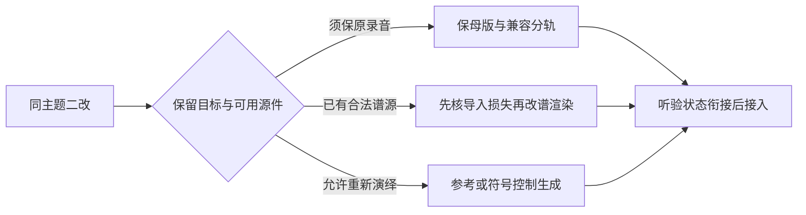

# 音频：先拆成可修改的事件、段落和台词

> 核实时间：2026-10-14（UTC+8）；配音二改与全文采用边界补核：2026-10-15（UTC+8）；混音焦点补核：2026-10-16（UTC+8）；状态变体与声源表达补核：2026-10-18；成套配乐接入修订补核：2026-10-19（UTC+8）；P9 接入选择及成套供给补核：2026-10-20（UTC+8）；整页主要选择比较：2026-10-22（UTC+8）；谱源二改候选补核：2026-10-23（UTC+8）；短音制作接入补核：2026-10-24（UTC）；主干接入状态：2026-10-25（UTC）；音乐增轨生产路线补核：2026-10-25（UTC）。单人程序员、无音频人员、不做人工音频修补。下列三档是任务条件下的首试顺序，不是同规格试听冠军；型号、成本、真实采用、授权增量与固定源码反证见[WP6 研究记录](../../../docs/research/2026-10-14-game-wp6-audio.md)。

## 30 秒结论

| 你的需求 | 先做什么 | 何时换路线 |
|---|---|---|
| UI、短反馈、通用音效 | ✅ 成套许可资源或 jsfxr，按单事件交付 | 缺独特声源时再评估 SFX 生成 |
| 扩充一套游戏音效 | ✅ 保留已过权利／玩法验收的子集，只替换新类别或不合的声音家族 | 整体风格不合、许可不接受或必须人工精修时，换供给／缩范围 |
| 新增风格化状态提示 | 🧪 比较合格声源的固定状态变体与新素材 | 需真实材质身份、变调破坏性格或仍难辨时换源 |
| 游戏配乐 | ✅ 先定出场密度；新增状态先找配套版本／兼容分轨 | 允许主题重演绎才比较参考生成；要原曲原样加层不换整曲 |
| 角色配音 | 👀 固定授权音色，按台词 ID 离线生产 | 关键表演不成立或音色停供时，缩小范围／换方案 |
| 运行时生成 | ⛔ 固定内容不用现场生成 | 只有开放对话等核心玩法确需未知内容时再评估 |

[研究] 选型先过许可，再看合格资产成本；逐项型号、价格、声音供应与复核期限见 [WP6 动态事实表](../../../docs/research/2026-10-14-game-wp6-audio.md#九动态事实表2026-10-14-补核)。

## 当前最高水平

<!-- frontier: status=已比较 gap=1 gen=2026-10 checked=2026-10-22 -->

**先保住合格声音，再按缺口换供给或组织方式。** 下表覆盖整页选择，不把单音质量、成曲偏好或编辑接口当作完整游戏音频管线胜负。近期生成上限分别参考独立短音横评、YuE2 固定版本的成曲／符号编辑（2026-10-22核实）、Eleven v4 2026-09 同句偏好；音乐与语音的独立编辑研究限制“改对目标就保住其余”的推断。制作参照采用 Fretless、Cairn 等具名作者实践，旧作品只支持仍适用的具体机制。[一手／研究；证据、日期和完整边界见 WP6]

| 主要选择 | 领先替代与比较依据 | 决定与撤回条件 |
|---|---|---|
| 成套 UI／短反馈供给 | OpenSFX／Roguesphere 保合格子集；Eleven SFX v2、Stable Audio 3 与 ControlFoley 补独特声源 | ✅ 许可包／jsfxr 优先；语义或整体风格不合才换族，非商业权重不进发行默认 |
| 参考短音：变体还是局部修补 | 原独立横评区分参考生成与局部编辑；QuAP 也有优化不升分反例 | ✅ 小改保母版参数处理；新音色才👀参考生成，不能用修补高分承诺整段身份 |
| 机器改速／状态提示 | Pixel Wheels 固定变调；Factorio 分离撞击间隔与连续底声 | ✅ 固定含义先于随机变体；大改速按事件重排／兼容层混合，破坏声音性格就换源 |
| 音乐来源与同主题改曲 | 对照 Music v2.5／Suno v6、YuE2 重演绎与合法谱源固定渲染候选，MuseCPEval 提供保留性诊断 | ✅ 合格录音／兼容分轨优先，已有合法谱源才👀固定渲染二改，允许重演绎才生成，主题或拍点漂移则撤回 |
| 音乐出场密度 | C418 的留白设计与 Minecraft 后续频率选择 | ✅ 长驻留先比较间隔，不靠增轨填满；留白失去节奏／情绪就恢复连续 |
| 完整片段还是自适应分层 | FTL 对齐交叉淡化、Factorio 状态切换、SuperTuxKart 普通／快版 | ✅ 少量完整片段起步；连续强度确有价值且供得出兼容版本才分层，缺源不靠全曲提速补齐 |
| 跟随什么、何时切 | 角色处境／当前视图反例，Unity DSP／UE Quartz | ✅ 先定状态依据与稳定窗口，再排乐句；过期请求取消，重要反馈不等拍点 |
| 音乐是否反过来改玩法 | Mini Metro 双向调度、Mini Motorways 收紧耦合，Fretless 音乐战斗 | 🧪 仅节律确为核心且能重验规则时共同调度；普通战斗保玩法时序 |
| 纯文本、拟声还是配音 | Celeste／Springbound 的角色声源与讲话节奏；当前 TTS 表演候选 | ✅ 文本足够时可用拟声／有限提示；依赖可理解语音或具体表演才升完整配音 |
| 连续角色补句 | Eleven v4 场景上下文、Qwen 固定角色、F5 区间编辑；SpeechEditBench 分任务／语言反例 | ✅ 最短完整表演段验收；单句优先但邻句接不上就扩大重生，改字正确不等于角色保留 |
| 定位、宽度和混音密度 | RoboRaid 分层、Cogmind 场景调参、Overwatch 辨识；HARDCORE MECHA／Cairn 焦点与 Returnal 动态范围 | ✅ 定位核心／空间宽度分别选源，先减装饰再让位；下混丢信息、抽吸或遮危险就撤回，不强制全部 mono |
| 原生还是 FMOD／Wwise | Unity／UE 原生职责，对照 Fretless 的模块编排、markers 与现场混音 | ✅ 简单系统原生；反复编排成为瓶颈才🧪中间件，仍需源件与工程维护，不因专业作品采用就升级 |
| 离线、运行时与最终交付 | Fortnite 实际实时语音仅证明采用；XAG、端到端延迟与最低设备约束 | ✅ 固定内容离线；未知对话确为玩法才评估 runtime，缓存／回退／许可／视觉替代及设备验收均保留 |

**差距1是整页的条件选择已比较，不是音频效果已验收。** 未覆盖的是当前候选在同一商业游戏上的整套资产接受率、连续二改听感与主动工时；尤其同主题多状态与跨语言连续表演，不能据自动分或厂商同句偏好断言最佳。完整零手修质量上限仍未知，许可、最低设备、低音量／单声道／无声和回退门槛不随分数放宽。[研究；[整页证据卡](../../../docs/research/2026-10-14-game-wp6-audio.md#整页收口供给编辑与组织方式分开比较)]

## 先采用什么

**✅ UI 和短反馈先找成套资源或用参数化合成；独特环境、音乐主题与角色台词才增加生成模型。** 音效按事件、音乐按出场方式选曲目或可切换段落、配音按角色和台词 ID 生产，默认离线导出固定音频；运行时负责触发、随机变体、混音和节拍调度。Kenney 指定 CC0 包与 jsfxr 已有明确许可路线，没必要为每次点击重跑模型。[一手／研究]

玩法脚本引用逻辑音频 ID，素材路径和版本留在映射表；生成新版本只改映射，保留原音频和来源。局限：程序能调规格和调度，不能修错的声源语义、旋律发展、戏剧表演或未授权声音。[研究]

**✅ 已有声音合格，就不为扩充内容整包重做。** OpenSFX实际保留并重授权部分旧声音，替换缺口后仍修正公交映射；Roguesphere按玻璃／金属的声音身份局部换源。整套风格不合或缺口必须人工音频精修时，再换完整供给或收窄题材。[成套供给与二改证据](../../../docs/research/2026-10-14-game-wp6-audio.md#成套音效供给保留合格子集再替换缺口)不证明这些人工制作过程已能由AI零手修复制。[一手／研究]

AI可核逐件来源、事件映射、缺口及脚本处理；瓶颈是声音身份和连续游玩的耐听，人须试听决定保留／替换／删除。参数检查或“有73个槽”都不能替代成套质量验收。[研究]

## 可复制制作起点：短样本与现有程序声混合

**✅ 通用短反馈先做一条可修改的资产链：保留许可源与处理配方，只把选中的运行片接到真实事件；已有合适的合成层继续用。** Star-Rush已做到源资产、规格二改、加载打包及轻碰事件运行，可作为实现起点；最终混音听感仍未验收。[一手／研究；[固定源件与接收说明][rail-source]、[WP6证据](../../../docs/research/2026-10-14-game-wp6-audio.md#制作回流短样本与程序声混合)]

**主干状态（2026-10-25）：** [master `6324d55`][rail-master] 已包含这条资产链与两套候选，普通构建仍用 `procedural`、不加载样本；显式 `STAR_RUSH_RAIL_SOURCE=kenney npm run build` 或 `STAR_RUSH_RAIL_SOURCE=synth-v1 npm run build` 才选对应素材。下文的默认与运行记录属于固定候选版本，不能当作当前主干默认；Kenney 默认启用改动仅本地完成，未发布。[一手：固定主干源码]

### 从哪几件产物开始

以下以已做出的轻／中金属碰撞说明每步交什么，不要求别的游戏沿用赛车阈值。[一手：固定源码与制作记录；研究：复用建议]

| 步骤 | 程序员／Agent可直接完成的产物 | 本例如何继续修改 |
|---|---|---|
| 事件与规格 | 写清声音表达什么、何时发声、和哪些现有层同播，再选短音／循环／定位方式 | 只补护栏瞬态，保发动机、轮胎与音乐；不为换音源改碰撞物理 |
| 来源与候选 | 保存许可原文、原始文件、来源与hash；候选先按语义和预算筛，再试听 | [Kenney Impact Sounds](https://kenney.nl/assets/impact-sounds) 1.0中4个CC0原OGG保留；轻000／轻001／中000／重000可回选，Kenney 构建选轻000与中000入运行包。标签是选材依据，不是听感判定 |
| 可编辑处理 | [处理脚本][rail-recipe]保源转出mono、22050Hz、PCM16 WAV，并更新manifest；样本构建直接用衍生文件 | 在游戏仓库运行 `python3 prepare-impact-audio.py` 才需ffmpeg；改源选择后重做、构建。两运行片共28,394B，未把4候选全塞进包 |
| 加载与打包 | [播放器][rail-player]接原SFX总线；[构建入口][rail-pack]生成内容哈希URL、静态文件及Worker精确路由 | 异步解码；尚未ready或失败，本次事件立即用原程序声而不追补；样本与原护栏噪声二选一，避免意外叠响 |
| 真实事件 | 在真实玩法中核事件类别、所选资源和最终混音；[定向测试][rail-tests]守住映射与打包 | F2已见两片ready及轻碰计数；中档真实事件仍待接收。测试替身只证明逻辑，不能证明听到的材质或力度 |
| 第二次规格修改 | 保旧源与回退，让同一链承受新需求，不另建素材平台 | 已实际从v1单档改v2轻／中两档；复用既有 `impact > 5` 界线，未改0.7触发阈值和160ms冷却。这是做过的规格二改，非听后改善 |
| 最终接收 | 在实际输出设备、完整混音和连续玩法中决定留／换／删；修改后重验相同事件 | 先听两档能否辨识，再听反复擦碰是否烦扰和遮掉必要信号；沿页末设备验收，不用波形或播放计数代签 |

### 为什么当前用WAV混合，而不是直接换整套

| 选择 | 当前决定与代价 | 何时换 |
|---|---|---|
| **短WAV＋已有程序化层** | ✅ 本例样本构建采用。小体积、固定PCM规格方便校验与原生解码；仅补缺口，不重做发动机／音乐。已解码PCM仍占内存 | 这是两个短瞬态的选择，不是整套音频格式规范；变成长音乐或大量样本时重新算下载与解码预算 |
| 原OGG直接运行 | 👀 保留为源／备选。压缩传输有价值，但需核目标浏览器解码及实际部署；压缩文件更小不代表解码后常驻内存同比更小 | 多片或长片使体积成为实际瓶颈，且设备解码已验，再比较；不为两个小片增加格式分支 |
| 全程序化 | ✅ 保留已有层和回退。无需这批下载，参数容易二改；代价是要设计足够清楚的材质与力度 | 合成已经表达目标就不必换；需要真实材质但调不出来，才补许可样本 |
| AI生成补缺 | 👀 适合现有声库没有的独特身份，沿下文三档核权利与候选；增加生成、淘汰、风格统一和听验成本 | 本例未调用，不把Kenney CC0称作AI生成，也没有证据说生成比当前样本更好 |

[研究] 这是任务条件下的实现选择，不是同规格试听排名；音乐、配音与空间声源继续按本页各自路线选，不把mono短碰撞规格扩展到整页。

**已有样本与可重建合成源，能在同一混音下比较。** 历史[固定接收版本][rail-synth]保留Kenney默认及原播放器，只纳入另一份本地交付的确定性模态／噪声配方与两WAV；当前主干用 `STAR_RUSH_RAIL_SOURCE=kenney`／`synth-v1` 分别构建样本，`STAR_RUSH_RAIL_SOURCE=procedural npm run build` 恢复程序音。每次样本构建只打包一对，轻／中界线、gain0.15、生命周期与回退不变，没有整支采用候选原来的交叉淡化和强度增益，因此可先判断源差异，再决定是否改混音。[一手／研究]

合成配方可重建并做时长二改，源复现与两种构建链已检查；最终声音尚未听，不能据此判定哪组音色更好。它不是AI音频生成，也没有通用再分发许可：原说明仅称随项目条款，仓库未见独立LICENSE，不能套Kenney CC0。外部读者可借制作机制，复制这些合成资产前须另核授权。[一手／研究；[接收与验证范围](../../../docs/research/2026-10-14-game-wp6-audio.md#制作回流短样本与程序声混合)]

[rail-synth]: https://github.com/dbvv1/Star-Rush-Reborn/blob/a2ca06395c4f8dcf8e260a4a337f37bfc7779e28/assets/impact-audio/candidates/synth-v1/README.md

**把“技术安全参数”和“听后决定参数”分开。** 本例原OGG解码float峰超过1，转PCM前固定乘0.5只给量化留余量，不是响度优化；播放器样本gain `0.15`仍为暂定。听到单件不合材质就换源；尾音拖累节奏才改明确裁切／淡出配方；与发动机／轮胎／音乐互盖时先决定哪些层让位，再调实例增益或混音，而不是盲归一化所有片。每次只改已定位的原因并复验轻／中事件和重复疲劳。[一手／研究]

**接收端下一步：** 按当前游戏[README][rail-master]安装依赖，显式选择 Kenney 或 synth-v1 构建并运行，首次用户手势启音；分别制造轻／中碰撞，在最终混音中听辨识、音量层次和反复擦碰，按结果换候选或改处理／混音参数后重验。当前已运行到轻事件，仍缺中档实战、可消费声音、最终混音与听后二改；不因此推翻已交出的源件、脚本和运行版本，也不宣称完整链品质通过。[一手／研究]

[rail-master]: https://github.com/dbvv1/Star-Rush-Reborn/blob/6324d552e2a1beda2a3214a02e37d8f17aabf60f/README.md
[rail-source]: https://github.com/dbvv1/Star-Rush-Reborn/blob/5266703f3302410a994c69ec15345edf11edc455/assets/impact-audio/README.md
[rail-recipe]: https://github.com/dbvv1/Star-Rush-Reborn/blob/5266703f3302410a994c69ec15345edf11edc455/prepare-impact-audio.py
[rail-player]: https://github.com/dbvv1/Star-Rush-Reborn/blob/5266703f3302410a994c69ec15345edf11edc455/impact-audio.js
[rail-pack]: https://github.com/dbvv1/Star-Rush-Reborn/blob/5266703f3302410a994c69ec15345edf11edc455/build.mjs
[rail-tests]: https://github.com/dbvv1/Star-Rush-Reborn/blob/5266703f3302410a994c69ec15345edf11edc455/tests/impact-audio.mjs
[rail-readme]: https://github.com/dbvv1/Star-Rush-Reborn/blob/5266703f3302410a994c69ec15345edf11edc455/README.md

## 先让声音成为好玩的反馈，再增加素材数量

**✅ 先给核心动作一套可学习的声音语言：起手、落空、命中、格挡、成功各有含义，奖励与危险有不同性格。** 声音不只是确认按钮已按下；起音、力度、尾音和留白要配合动作的重量、节奏与情绪。命中音跟随实际命中结果，不能按下攻击就提前播放；音乐可以等乐句，关键动作反馈不应为等节拍延迟。这是设计建议，需用实际玩法判断是否更舒服。[研究]

按下面顺序打磨；完整来源与反例见 [WP6 质量比较](../../../docs/research/2026-10-14-game-wp6-audio.md#十从可播放到可读耐听的游戏反馈)。

1. **先辨识，再丰富。** 保留关键提示的标志性起音；脚步、碰撞等高频声音在同一语义内做有限变体，别把“随机更多”当成质量。Overwatch 开发者公开材料将角色／威胁辨识与较少的关键声音变化联系起来；这是作者实践，不是本项目反应时间测试。[一手／研究]
2. **先按当前玩法给重要声音留位置，再加响度。** 已播放却难辨时，先减重复／装饰层，再让音乐／环境按状态让位：密集战斗保敌我动作与危险，攀爬可能更需持续呼吸／接触声，不按响度固定排序。出现明显忽强忽弱、遮掉另一威胁或损失轻重区别就减弱／撤回；确属频段冲突才试局部处理，不默认逐角色动态 EQ。世界声源仍须表达方向和距离，UI／自身确认按玩法选稳定位置。[HARDCORE MECHA 与 Cairn 作者案例](../../../docs/research/2026-10-14-game-wp6-audio.md#混音焦点补研已播放却难辨时让谁退后)支持这些取舍，未证明本项目听感收益。[一手／研究]
   **增加声源或改地图后才混乱，先改场景参数，不急着重做资源。** 单件已合格时，比较传播范围、衰减与实例增益；单件语义错误，或场景调参后仍掩盖必要信号，再比较替换资源与混音。[Cogmind 的密度二改](../../../docs/research/2026-10-14-game-wp6-audio.md#声源密度二改先改传播还是重做音频)通过配置调整避免重采样，不能照搬其衰减曲线。**局限：原始制作含人工音频编辑，此例不证明零手修管线或 AI 收益。** [一手／研究]

3. **Unity 6.3 LTS 先用原生机制。** [Audio Random Container](https://docs.unity3d.com/6000.3/Documentation/Manual/AudioRandomContainer-UI.html)已有 Shuffle、避免最近重复及音高／音量变化；[AudioMixer](https://docs.unity3d.com/6000.3/Documentation/Manual/AudioMixerInspectors.html)有 Send／Duck Volume。先调这些，再决定是否写额外选择器。玩家音量和状态混音分开控制，避免脚本写入的 exposed 参数锁住快照变化。[一手／研究]
4. **Unreal 先分清声源、混音和调度。** 普通播放沿用 Sound Wave／Sound Cue；需要程序化变化时🧪用 MetaSound Source，把共用逻辑放 Patch、同图不同参数做 Preset。Sound Class／Mix 管分类与状态，Submix 管汇总效果，Sound Concurrency 管叠加淘汰；MetaSounds 不包办这些职责。短音必须结束，静音组件仍可能占并发预算；不要为“不断音乐”给全部声源打开 PlayWhenSilent。当前按 UE 5.8 文档核对；MetaSounds 已在 5.4 正式转为 Production Ready，试用评级针对是否值得增加制作复杂度，非认定它仍为 Beta。文档冲突与边界详见 [WP6 引擎对照](../../../docs/research/2026-10-14-game-wp6-audio.md#105-unityunreal同一质量目标不同原生职责)。[一手／研究]
5. **让音乐承接情绪，不随状态抖动。** 探索／战斗转换按已设计的乐句安排，瞬间进出战斗先平滑状态；胜负短曲可有明确插入规则。少量循环能成立就不加分层。反复修改模块编排、markers／回调与参数曲线已成瓶颈时，才🧪比较 FMOD／Wwise 与原生维护代价。Fretless 的 FMOD 可视编排依赖专业模块曲目，特殊加载路径仍自建 Unity 实时混音工具；这支持升级制作方式，不证明可省掉源件制作或工程维护。[一手／研究；[制作依据](../../../docs/research/2026-10-14-game-wp6-audio.md#整页收口供给编辑与组织方式分开比较)]
6. **听不到也不丢玩法。** 依 [Xbox XAG 103](https://learn.microsoft.com/en-us/xbox/accessibility/xbox-accessibility-guidelines/103)／[105](https://learn.microsoft.com/en-us/xbox/accessibility/xbox-accessibility-guidelines/105)，分组音量、单声道选项与关键声音的视觉替代一起设计；方向性警告的替代要保留方向和事件含义，台词字幕不能代替所有声音信息。音乐／音效关闭后仍能理解关键状态。[一手／研究]

**最重要的验收：** 普通音量下能否分清结果、感到节奏、听清危险且不疲劳；再核低音量、普通扬声器、单声道和无声。声音互盖先减重复／装饰层或调整让位；低音量下强声够响却漏弱提示，才🧪用原生混音做可选较窄动态版本，保留轻重与紧张反差，合格默认不必增模式。[Returnal 作者](https://www.asoundeffect.com/returnal-game-audio/)按播放环境推荐动态范围，不把大动态当高质量档；原生边界与反例见 [WP6](../../../docs/research/2026-10-14-game-wp6-audio.md#104-包容性也影响反馈质量)。API 正确不证明听感成立。[一手／研究]

## 三类资源分别选三档

商业生产先满足[授权总表](../03-generative-ai-in-games.md#13-授权与商用门槛总表wp1)；新增对象的明确条款见[本轮增量](../../../docs/research/2026-10-14-game-wp6-audio.md#七授权总表的增量依据)。免费生成次数不等于免费商用，模型代码开放也不等于声音已经清权。[一手／研究]

| 资源 | 质量目标候选（非制作最优排名） | 性价比优先 | 本地／免费 |
|---|---|---|---|
| **SFX** | 👀 付费、非 Beta 的 `eleven_text_to_sound_v2`：独特 Foley 和环境音首试，按单事件导出 | ✅ 合适的 Kenney Interface Sounds 等成套包；🧪 jsfxr 短电子音，缺口才生成 | ✅ jsfxr；👀 Stable Audio 3 Small-SFX 仅在 Community 商业注册、收入和 T5Gemma 条件满足时评估 |
| **音乐** | 👀 `music_v2_5` 与 Suno `v6` 按分段修补／整曲重演绎比较，不按接口数排名；前者先过[Indie 与主体资格](../03-generative-ai-in-games.md#音效音乐与配音同品牌也可能适用不同协议)，后者须合法 Download 且核编辑/Remix 范围 | ✅ 少量授权曲目（按需循环）＋胜负 jingle＋程序调度；独特主题才比较生成路线 | 👀 ACE-Step1.5 官方 turbo；显存与维护预算足够再对照 `acestep-v15-xl-turbo`；无硬件时选合法现成资源 |
| **配音** | 👀 付费、非 Beta 的 `eleven_v4`：固定授权音色与上下文，逐句验收 | 🧪 `eleven_v4_turbo` 或已验收的 `eleven_flash_v2_5` 做大量短句；长旁白保留 Multilingual v2 对照 | 👀 Qwen3-TTS-12Hz-1.7B-CustomVoice＋Tokenizer-12Hz，先用预设音色；文本＋短语音反馈也可作为正式设计 |

旧资产若已合格，不因新型号发布而整批重生。Eleven v4 走 Text to Dialogue API，v4 Turbo 走 Text to Dialogue WebSocket，迁移不能只替换旧 TTS 请求的 model_id；发布时间及版本差异见研究记录。[一手／研究]

ACE 官方 XL-turbo 卡要求至少 12GB 显存时配合 offload 和 INT8；其成本不能套用旧 turbo 的低显存说法。Qwen 的 1.7B CustomVoice 支持指令控制和 9 预设音色，0.6B 不能直接继承同等情绪控制承诺。Stable Audio 3 Small-SFX 可 CPU 是作者兼容性声明，不是游戏帧预算测试。[一手／研究]

**成本按合格资产计。** 配音按字符、音乐按时长的当前单价集中在[WP6动态表](../../../docs/research/2026-10-14-game-wp6-audio.md#九动态事实表2026-10-14-补核)；另计套餐、税、编辑与废弃，不把生成秒数当合格交付秒数。[一手／研究]

Eleven Music 普通计划要求单游戏累计净收入 <US$50万、开发／发行实体及关联方上一财年全部游戏净收入 <US$100万；不符合 Indie 定义的商业游戏须 Enterprise Music（Lite 不覆盖），否则改选合法现成音乐或已清权的本地路线。主体资格与收入计算口径仍以[授权总表](../03-generative-ai-in-games.md#音效音乐与配音同品牌也可能适用不同协议)为准。[一手／研究]

Suno 公开年付的 Pro／Premier 分别限 20／60 首下载每月，不能当生成次数；免费档无商用权。本地也计算力、挑选和维护。Eleven Music 若需无损 WAV 或 192kbps MP3，先核主体资格，再按附表 Pro 或更高的合格计划核预算；Starter／Creator 的下载权不满足该格式要求。局限：本轮未测同题可用率，不能据单价算出完整制作费用。[一手／研究]

👀 已在 Unity 内做少量环境音原型时，可比较 Text to Sound；2026-10-14 已复核 Assistant **2.20.0-pre.2** 的[生成](https://docs.unity3d.com/Packages/com.unity.ai.assistant@2.20/manual/Sound/sound-generate-prompt.html)与[编辑文档](https://docs.unity3d.com/Packages/com.unity.ai.assistant@2.20/manual/Sound/sound-edit.html)，Loop 仍仅重复播放，不保证无缝循环。生产授权及版本前提见 [WP9 §8](../../../docs/research/2026-10-14-game-wp9-engine-handoff.md#8-unity-原生生成器补核原型集成不等于发行管线)，不因版本更新改变成套资源／jsfxr 优先顺序。[一手／研究：文档复核，未运行引擎]

## 音效：单事件比整段声音更适合交互

**✅ 拆开脚步、开门、撞击，交给引擎排列。** 把“走近、开门、拔剑、攻击”一次生成成整段，会锁死玩家行为时序。脚本可裁掉静音、有限 EQ/增益、短淡入淡出，配合小幅 pitch/volume 变化和避免立即重复；需要真实材质身份却不匹配、夹带背景音乐、一次命中有两次主撞击应拒收或重新生成。[研究]

**[研究] 新增风格化状态，先分“固定含义”与“随机去重复”。** 合格声源可按状态选择固定变体，再在同一含义内少量变化；不要让随机音高决定本应稳定的提示。Pixel Wheels 为冰面滑行复用既有轮胎循环并固定变调，该次提交未改音频文件，代码进入已发布版本。它支持比较程序变体这条路线，不证明真实材质可任意互换或总成本更低；仍难辨、破坏声音性格时换许可素材／生成补缺。许可链、反例与验证边界见 [WP6 状态变体](../../../docs/research/2026-10-14-game-wp6-audio.md#状态变体补研固定含义与随机去重复分开)。[一手／研究]

**[研究] 二改要大范围改速时，先选“改事件间隔”还是“改音高／音色”。** 有合格短音的机械撞击可按动作阶段重排，持续底声另管；连续发动机声可用兼容的怠速／行驶层随速度混合，再有限变调。[Factorio 的改造](https://factorio.com/blog/post/fff-396)及发布配置支持这一分工，不要求所有速度变化都拆层：固定低速且已合格的单循环、刻意用音高表达转速时可保留简单方案。[一手／研究] **局限：短音必须先可用，拆层不证明免手工制作；**停机、改配方、切换预览还要防误触发，生产与发布后修复证据见 [WP6 §3.5](../../../docs/research/2026-10-14-game-wp6-audio.md#35-机器改速改触发间隔还是改声音本身)。

jsfxr 适合 UI、奖励、伤害和街机电子音，不替代全部真实 Foley。第二次要求“保留辨识感、只缩短尾音”，改包络而非重新随机生成：固定源码的 mutate 会改多参数、包络参数与时长不是线性关系，噪声还调用 Math.random。保存参数不保证位级复现，应同时保存最终 WAV；需要确定性噪声时另行控制 PRNG 并验证。[一手／研究]

SFX v2 接口当前允许 0.5–30 秒及 loop 参数；能力页与接口的最小时长口径不同，接入按实际 API 约束。官方能力页只对非循环效果列 48kHz WAV，不能把 loop 选项当作所有格式的无缝保证。局限：裁切和 crossfade 能减少部分接缝，不能把错误的声音变成正确事件。[一手／研究]

### 定位物体与铺满空间：先选声源表达

**[研究] ✅ 要辨方向的单个物体，先比较无烘入混响的单声道核心。** 既有立体声适配后合格就不重生；环境底声、音乐或有意表现宽度的声源不一律转mono，可保留立体声或比较定位核心与宽度层。

下混损失必要内容、或原录音的空间感不合新场景时换合适素材，不把spread／归一化当去混响或相位修复。宽度层削弱方向就减弱／撤回；引擎和插件各核输入契约。Unity／UE差异、求和反例与RoboRaid制作经验见 [声源取舍](../../../docs/research/2026-10-14-game-wp6-audio.md#声源补研定位与宽度分开)。[一手／研究]

## 音乐：先定出场密度，再定循环和状态切换

**👀 固定预告／过场才比较视频配乐生成。** Instant Soundtracks 可分开音乐与 SFX，但不承诺逐事件干声或无缝循环；玩法音效仍按事件交付，别让视频时间线锁死交互。[接口、格式合同冲突与成本边界](../../../docs/research/2026-10-14-game-wp6-audio.md#27-p9接入选择效果烘入与固定视频)另核，三档型号顺序不变。[一手／研究]

**✅ 长时间探索／建造，先选音乐是否持续在场，不先用更多循环层填满时间。** 可比较曲目间留白与持续配乐：C418明确为避免反复播放烦扰而要求间隔；后来的Minecraft又允许玩家调整音乐频率。已有合格曲目可先改出场密度，留白导致空洞、丢失节奏或必要情绪时缩短间隔／恢复连续；这不是静音必然更好或省制作的证明。见[出场密度与版本边界](../../../docs/research/2026-10-14-game-wp6-audio.md#音乐出场密度补研先改间隔还是增加曲目)。[一手／研究]

**需要持续配乐／状态响应时，再定探索、战斗、胜负等状态、乐句长度和切换点。** 少量可循环 BGM 配独立 jingle 可先比较；需要连续强度变化时，才增加同长度、同节拍、同调性和同起点的分层。分离 API 产生的 stem 需查串音和混响，不等于拿到了原生独立录音轨。[一手／研究]

**新增强度状态，先核整套资源是否真的供得出对应版本。** 原曲已满足表达时可保留原曲与独立提示；强度变化本身重要时，比较已有相容普通／快版及各自循环点，承担多版本存储、调度与后续修改。不要默认程序变速能补齐缺版，无损音频也不等于可重编配工程；必须人工改编才成立时，换完整许可资源或收窄音乐状态。[SuperTuxKart 的成对供给、接入修订与回退撤除](../../../docs/research/2026-10-14-game-wp6-audio.md#成套配乐二改普通曲不自动供应强度版本)支持这项选择，但未证明其替换旧曲的制作动因或零手修创作闭环。[一手／研究]

**[研究] ✅ 先定音乐跟随什么，再选切换时机。** 战斗强度需及时变化且已有对齐版本，可借 [FTL 作曲者所述](https://www.kgou.org/2013-10-06/composing-game-soundtracks-that-move-faster-than-light)的同步播放、交叉淡化；无兼容层则保留完整片段与明确转场。[一手／研究] 远程查看或区域边缘频繁往返时，按玩法选择角色处境或当前关注区域，再考虑等状态稳定／合适乐句才切。Factorio 的[历史选项及使用者回执](https://forums.factorio.com/119140)说明即时跟随视图也可能打断音乐，不支持一律跟随角色坐标。[一手／研究] **局限：对齐不保证音乐相容，延后切换也可能让音乐落后当前处境；**取消过期请求、暂停恢复与二改验收见 [WP6 音乐切换补研](../../../docs/research/2026-10-14-game-wp6-audio.md#音乐切换补研精确播放之前先选状态与时机)。

**🧪 声音要把模拟事件组织成音乐时，先选“只跟随玩法”还是“允许共同调度”。** 不缺曲目却缺整体节律，继续补循环未必解决：Mini Metro 曾为此改乘客生成、上下车时序，音频参数也会改变模拟。只有这种相互约束确属目标体验、且允许改规则与重验平衡时才考虑；否则保持玩法时序，音乐按状态／密度响应，不强求每件事都落拍。代价包括事件队列、改速与暂停、性能和关卡平衡，不只是合成音色；关键命中／危险反馈仍不得为音乐延迟。作者后来在 Mini Motorways 收紧了这类耦合，不能把“更同步”当普遍更好。[同作品改造、公开参数及撤回依据](../../../docs/research/2026-10-14-game-wp6-audio.md#音乐与模拟补研共同调度不是免费音效层)。[一手／研究；未实测]

Unity 的[PlayScheduled](https://docs.unity3d.com/6000.3/Documentation/ScriptReference/AudioSource.PlayScheduled.html)基于 dspTime 安排开播、支持预缓冲；[TransitionToSnapshots](https://docs.unity3d.com/6000.0/Documentation/ScriptReference/Audio.AudioMixer.TransitionToSnapshots.html)做混音状态过渡。Unreal 对应先用 [Quartz](https://dev.epicgames.com/documentation/en-us/unreal-engine/overview-of-quartz-in-unreal-engine) 的 Clock／Play Quantized 提前安排拍点。两者都不会替你找正确乐句；Update／Tick 中提前提交调度可以，等到拍点才发普通 Play 不等价，混音淡变也不自动对齐节拍。采样级音频调度不使游戏线程回调、输入判定或设备输出变成零延迟。[一手／研究]

**✅ 给已认可探索曲增加战斗状态，先问“原录音不变”还是“主题可重新演绎”。** 前者先用合法配套版本／兼容分轨，缺源则保完整片段加独立提示；Music v2.5 的参考是风格引导的新作品，不能当给原曲无损加乐器。允许重演绎时，再比较其参考／局部编辑、Suno v6 编辑与 YuE2 的符号控制研究路线；YuE2 乐谱内容控制与保留的作者结果不保证原音色、波形或无缝循环。独立 MuseCPEval 显示结构／和声保留与拍点保持可以分离，因此反复跨状态仍有节拍漂移就撤回新版本，不用平均音乐分放行。[一手／研究；[当前代比较与独立边界](../../../docs/research/2026-10-14-game-wp6-audio.md#整页收口供给编辑与组织方式分开比较)]

**👀 已有合法乐谱／MIDI，才增加“改谱后固定渲染”的二改路线。** 明确音符与速度，固定 SoundFont 与渲染设置，改段落或配器，比重新生成整段录音更直接表达修改目标；yovoice v0.4.1 的 score／分轨工作流是未试用候选，已有 MIDI 离线渲染需求可对照 FluidSynth 2.5.4。WAV 成品不是可编辑乐谱，AI 能改结构不代表旋律发展成立，仍由人判断作曲与连续听感。[一手／研究；[源码比较与接收条件](../../../docs/research/2026-10-14-game-wp6-audio.md#谱源二改候选固定渲染还是重演绎)]

yovoice 接收专用谱JSON／MIDI，但导入MIDI只取首个速度与开头拍号，不保留CC（如踏板）或弯音；需保这些表达时先保原MIDI，比较直接MIDI渲染，不把格式转换当无损。[一手：固定源码；[导入边界](../../../docs/research/2026-10-14-game-wp6-audio.md#谱源二改候选固定渲染还是重演绎)]

导入前保留母版，需要循环时记录精确循环采样点；首尾波形检查只能筛 click，仍要听乐句是否完整、尾音是否被切、重复是否突兀。第二版“战斗更密、16 小节改 8 小节”优先改已有层与段落；生成缺口才用 Music inpainting 或 ACE repaint。ACE turbo 有局部 repaint，但 extract/lego/complete 在固定版本只列于 base，不能用“ACE 支持”笼统推给 turbo。局限：局部编辑入口不证明未改区间位级不变，也不证明听感衔接成功。[一手／研究]

### 保留探索录音、新增战斗声部：先选路线，再做可回改候选

**✅ 默认仍是先找成套许可曲／兼容分轨；只有原探索录音必须保留、又确实没有兼容战斗版时，才把“以旧轨为上下文生成独立声部”当作条件首试。** 已有合法 MIDI／谱源时保源改谱是另一条路；从成曲拆 stem 只分离已有内容；时间段替换只改选定区间；独立生成部件是从文字另做声部；允许重演绎时才是参考生成的新作品。这些路线输入输出不同，不能互相替代；也不能用“有编辑接口”推出音乐相容、零串音或完整作者工程。[一手／研究；[WP6 源码与替代路线](../../../docs/research/2026-10-14-game-wp6-audio.md#音乐增轨生产上下文-lego同长导出与二改边界)]

| 路线 | 输入 → 输出 | 保原录音 | 新增声部 | 主要边界 |
|---|---|---|---|---|
| 成套许可曲／分轨 | 许可曲目或成对版本 → 现成完整片段 | ✅ | 只换现成版本 | 仍是默认；缺兼容版本才换路线 |
| 保源改谱 | 合法 MIDI／专用谱 + SoundFont → 固定渲染音频 | ✅ 有原录音另存；保谱源 | ✅ 可明确改声部 | 导入可能丢速度／拍号／CC／弯音；WAV 不是谱 |
| 上下文增轨（lego） | 选中旧轨片段（≤600 秒，无效果、峰归一化）+ 轨道类别／描述 → 2–4 个独立候选 WAV | ✅ 旧轨不自动静音 | ✅ 条件成功 | 需 base 模型；候选可能复制上下文；相容／串音未验 |
| 时间段替换 | 原曲 + 起止 + 提示 → 区间重生成、区间外保留 | 声称保留 | ❌ 不产出独立新声部 | 不证明区间外位级不变；inpainting 不自动加乐器 |
| 拆 stem | 成曲 → ZIP 分轨 | ✅ 原曲另存 | ❌ 只分离已有 | 只受已有内容限制；串音／混响／相位另验 |
| 独立生成部件 | 文字／标签 → 新声部或整曲 | ❌ 另做 | ✅ | 需自己对齐 BPM／调性／乐句；独立渲染不保证贴合 |
| 音频重演绎 | 参考曲／风格提示 → 新作品 | ❌ 波形另做 | ✅ 可整曲重做 | 不是给原曲无损加乐器；主题／音色／波形不保证 |

Eleven 的 inpainting 当前用整曲时间范围与 composition plan（`music_v2`／`music_v2_5`），拆 stem 返回 ZIP 分轨且不新增乐器；Stable Audio 3 的独立部件是逐次独立渲染，需另对齐 BPM／调性，且不产生可理解人声。具体字段、版本与限制见 WP6。[一手／研究]

**输入与起点。** 需要一条已验收的探索曲录音（母版 + 来源／许可）、BPM／调性／拍号／乐句边界／循环采样点、新增层职责（12 类轨道之一 + 一句描述），以及游戏现有音乐状态入口。默认起点是许可曲／分轨；确需保留原录音时，条件起点是 Remiqora 0.3.0 + ACE-Step base（固定源码与许可见 WP6）。[一手／研究]

1. **固化源件与可回改源。** 先存母版（WAV／FLAC、采样率、位深、来源与许可），剪辑不覆盖源文件；原探索曲若有原 DAW 工程／谱源，单独留档，不把 Remiqora 派生工程当原曲源。Remiqora 的 clip 编辑是非破坏性的，但项目**没有自动保存**，必须显式 Save，关闭未保存页面会警告；安装时选的模型／项目目录之后不能移动（数据库存绝对路径）。第三方录音的输入权利另核，模型训练数据声明不等于你的素材清权。
2. **定拍点、调性、乐句和循环。** 项目 BPM 要手动核对：自动检测只读开头 30 秒，是简单检测器，复杂材料可能错。调性可选 24 个 key，留空则不传；**arranger 请求固定 4/4**，非 4/4 要先决定改段落或换工具。循环区用时间标尺设，上下文最长 600 秒；lego 可用整曲或循环区，结果放在同一区域起点。
3. **限定新增层职责。** 从 drums／bass／guitar／keyboard／synth／strings／brass／woodwinds／percussion／fx／vocals／backing_vocals 选一类，描述写“补什么、别盖什么”。旧轨仍是主体，新层只承担战斗进入、强度或收尾需要的增量，不做整曲重生成。
4. **候选生产。** lego 需要 ACE-Step **base**（约 4.8GB；turbo 不支持，源码按模型 `supported_task_types` 过滤）；XL base 可选（约 20GB，README 要求 16GB 以上卡）。一次 2–4 个变体，各落独立轨，**旧轨不会自动静音**（只有 repaint／continue／cover 会在区间内压住原轨）。送给模型的上下文含轨音量、clip 淡入淡出和 warp（跳过 muted／MIDI clip），**不含效果器、不理会 mute／solo**，并峰归一化到 0.9，所以模型听到的不是最终混音。候选可能是上下文的“重渲染复制”；源码用 Pearson 相关启发式（阈值 0.3，观察到复制约 0.75–0.96）优先把低相关候选设为可听，都不低于阈值时仍用第一个；这只是筛选提示，不是相容或零串音证明。上游 ACE-Step #1088 有用户报告 lego／complete 不加乐器或输出混乱，2026-05 因不活跃自动关闭，没有修复回执。[一手：固定源码；社区：单例 issue]
5. **同旧轨听选与峰值。** 在 Remiqora 里逐个 mute／solo 候选，和原轨一起播（lego 从区域起点播）；先听是否真的补缺、是否盖住原轨旋律或危险提示，再看峰值和动态余量。不要用相关分数、波形或“有 2–4 个候选”代替试听；只留一个进入编配，其余留库跟踪，丢弃的候选在下一次保存时清理。
6. **保存作者工程与派生文件。** 作者工程是 Remiqora 服务器里的项目，不是导出的 WAV；候选 WAV 只支持音频级剪辑、淡化、warp 和混音，不是 MIDI／可逐音符重编配源，改音符或配器要重新生成或另走谱源编辑。交给 Reaper／Bitwig／Studio One／Cubase 时，导出 `stems + Reaper .RPP` 或 `.dawproject`：可听轨从 0:00 起、同长、同采样率，**轨音量／pan／效果已烘进 WAV，master 为中性**；RPP／DAWproject 只带 tempo、4/4、轨名／颜色、DAWproject 的基础 mute／pan／volume 和 WAV 引用，**不带效果链、自动化或 MIDI**（MIDI 在导出时被渲染成音频）。它是可继续混音的派生交接，不是能在任意 DAW 恢复全部参数的完整作者工程；导出按测得的效果器延迟回移，仍要在目标 DAW 核起点与循环。首版与二改各存一份项目／导出，不覆盖母版。[一手：固定源码]
7. **按已有音乐状态接入。** 沿用本页已有的出场密度与切换默认（FTL 交叉淡化、SuperTuxKart 成对版本、稳定窗口），不另开一套：探索曲按原逻辑继续，战斗层作为独立 clip／lane 在进入时淡入、退出时淡出或按乐句切；脚本只引用逻辑 ID 和映射表，不写死文件名。切点落在乐句边界，过期请求取消，关键反馈不等拍点；复验旧轨未停、重叠峰值、循环相位和暂停恢复。
8. **二改：先分参数，再决定是否重抽。** 可参数化的是战斗层音量／pan／EQ／压缩／淡入淡出、clip 裁到 8 小节、循环区、保留哪个候选、状态阈值／交叉时长、哪层在哪个状态发声。必须重新候选并试听的是换轨道类别或角色、换上下文轨或段落、改调性／BPM／拍号、需要现有候选裁不出的新进入／收尾素材，以及要改原录音本身（本路线前提是不改原录音）。16→8 小节若只是缩短战斗层，按乐句边界裁切加短淡出即可；若要求重新生成 8 小节版本，重跑 lego／repaint 并重新试听。**不要声称导出边界自动落在拍点**：区域以秒为单位，循环点要自己核采样。

**采用条件与成本。** Remiqora 0.3.0 是预发布（作者声明会有破坏性变更、bug 和粗糙处；安装包未签名，Windows SmartScreen／macOS Gatekeeper 会拦）；首次安装约 18GB，lego 另需 base 约 4.8GB，XL base 约 20GB，全装约 60GB；Windows 需 RTX 20 系以上与 580+ 驱动，作者在 RTX 4080 16GB 上测过，macOS 走 Apple Silicon；本地运行、无内置认证，只放可信网络。补丁维护另计：ACE-Step 固定在 `ca1e85f` 打取消任务等小补丁，audio.cpp 的 `dev` 分支会漂移，安装脚本的 pin 已经需要过一次 bump。[一手：固定 README／补丁说明]

**许可链按“代码／权重／输入／输出”分开。** Remiqora 代码 MIT；ACE-Step 代码 MIT，Remiqora README 称其权重 MIT、允许商用输出。本页沿用 WP6 已核的 turbo 包与 XL-turbo 卡，后者明确商用输出；但 lego 目标 base／XL base 权重卡本轮因 Hugging Face TLS 拒绝未直读，实际采用／发行前须按目标 checkpoint 核定，未核定前不列为已清权的发行默认。YuE2-3B 权重是 CC BY-NC 4.0，不能商用，audio.cpp 的 Apache-2.0 只覆盖代码；后续 0.4.2 README 新增的 Stable Audio 3 走 Community License（注册、年收入低于 US$1M）加 Gemma 条款，提示助手 Qwen3.5 只写文本，与 0.3.0 不是同一受检版本，不能混用。输入录音的权利单独核；输出跟随实际生成模型的许可，不由 Remiqora 的 MIT 覆盖。[一手／研究]

**未验。** 本轮只读固定源码、官方页与上游 issue，没有安装、下载权重、运行生成／引擎／GUI，也没有试听；音乐相容、零串音、候选接受率、主动工时和最终混音都未知。源码支持“能产出独立候选、能同长导出、旧轨不自动静音”这些工程能力，不等于听感或品质通过；Star-Rush 短音链的最终混音也仍未听，不能把它的工程回执迁移成音乐结论。[研究]

## 配音：能使用旧声音，不等于以后还能补录

**✅ 需定位、跨场景复用的游戏台词默认保留干声母版，混响／距离留给引擎；固定广播才比较烘入效果。** Eleven 新增效果不加请求费，但不能因此丢弃干声；换场景或补句不合时退回引擎处理。其立体声效果还拒绝部分 PCM 等输出，见[接入限制](../../../docs/research/2026-10-14-game-wp6-audio.md#27-p9接入选择效果烘入与固定视频)。[一手／研究]

**[研究] 文本已承担完整信息时，先判是否需要可理解的配音。** 风格允许拟声对白，可比较纯文本、已合格的许可短音／程序音色与完整配音；把角色声源和停顿、情绪、收尾分开，改句长先改节奏，不默认重生整句。现成随机播放已足够就停，具体收尾或转换受限才补结构。[Celeste 与 Springbound 的制作取舍](../../../docs/research/2026-10-14-game-wp6-audio.md#拟声对白补研声源与讲话节奏分别修改)支持这种拆分，但两例均含人工制作，不能据此承诺零手修达到同等质量。[一手] **局限：缺少合格拟声源或声音干扰阅读时，可退回纯文本／有限提示；必须通过语音听懂内容或依赖具体台词表演时，进入下方配音路线。** 不把提示音自动当角色表演。

**✅ 台词 ID 稳定，但生成和验收单位按表演连续性决定。** 独立战斗喊话／提示可只换一句；连续对白先替换改动句并连同前后句试听，接不上时重做最短完整表演段，不能因文本只改一词就承诺只需修一词，也不默认全角色换版。文本、角色、语言、发音表、生成参数与最终音频一起保存。[研究]

**固定动作或镜头时窗时，先选“改文本／时序”还是“要求配音适配”，再生成。** 新音频通过后重算字幕／口型与后续触发点；不要让旧秒数继续驱动新句，或靠统一加速硬塞进去。Eleven 的请求上下文是有模型和保留条件的辅助，不能当长期补录保证；Qwen CustomVoice 的固定 speaker 与生成参数也不是局部波形编辑接口。独立源码与服务边界见 [WP6 §3.4](../../../docs/research/2026-10-14-game-wp6-audio.md#34-改一句的最小单位不一定是一句)。局限：局部编辑或定长入口不证明自然衔接，ASR／长度检查不能替代连续表演验收。[一手／研究]

**当前强模型也按目标语言、改文正确、角色身份和邻句表演分别接收。** Eleven v4 的近期同句盲评支持把它列为表演候选，但不是连续补句比较；独立 SpeechEditBench 中改文分数不含身份保留保证，且不同语言差异明显。只改字可评估专用编辑，表演本身要改则比较带上下文重生；ASR 正确却换了角色感或接不上邻句，仍退回最短完整表演段，不以高分自动升级。[一手／研究；[近期证据范围](../../../docs/research/2026-10-14-game-wp6-audio.md#整页收口供给编辑与组织方式分开比较)]

**口型先查角色资源，再随改句重算。** 已有嘴形／面部绑定时按[动画专题的对白二改](animation.md#对白改句先有可用的脸再选口型求解器)选求解器；新声音与新口型成对通过后替换，原眼神／头部层只在语义和时机仍合适时保留。[研究]

将基础服务许可、剧本权利、本人/表演者声音授权和具体音色条款分别核查；授权要覆盖拟用的角色、语言、商业媒体与后续生成范围。使用预设音色也不能冒充真人背书，Apache/MIT 不授他人的声音权。[研究]

Eleven Voice Library 无通知期音色可立即撤下，有通知期最长两年；已合法导出的商用资产与未来可继续调用同 voice_id 是两件事。长期角色优先明确通知期或连续性安排，并保留音频。[附加条款 §8](https://elevenlabs.io/vla) 仍允许平台随时移除音色、可不通知；通知期不是服务可用性保证，缓存也不解决尚未创作的 DLC 台词。[一手／研究]

Fortnite 实际部署过 Flash v2.5 实时 Darth Vader 语音，Epic 公开说明遗产管理方参与；SAG-AFTRA 仍就劳动协商提出争议。它证明实际采用，不证明单人项目成本、v4 质量或声音权利只需一纸同意。局限：情绪主导的关键剧情若反复重生仍不成立，应缩小配音范围或换方案，不能靠响度规范掩盖表演缺陷。[一手／研究]

## 默认离线；运行时生成必须由玩法证明必要

**✅ 离线预生成＋引擎运行时混音。** 简单合成音、变体选择和动态配乐不要求神经网络现场推理。只有开放对话、玩家命名等确需未知内容，才评估运行时 TTS；关键命中反馈、节奏判定和必达剧情不可依赖远程生成按时完成。[研究]

运行时路线先明确服务端密钥、最大字数/费用、审核、缓存、超时字幕或固定台词回退、隐私与平台披露。厂商百毫秒推理时延不等于玩家端到端响应；服务或音色停止供应时必须仍能玩。[一手／研究]

## 第二次修改后再验收

- **SFX：** 换一种材质并缩短尾音，检查辨识、起音、重复和旧事件引用
- **音乐：** 缩短乐句、增一个强度状态，反复切换探索→战斗→菜单→恢复，检查相位、尾音、重叠峰值和旧源未停
- **配音：** 分别改单独喊话与连续对白中间句，再缩短动作时窗；检查前后衔接、旧角色一致性、字幕／口型／后续触发，记录实际扩大到哪段重生
- **设备：** 检查格式、采样数、解码、并发声部、内存、动态范围与实际听感；自动检测通过不等于内容合格

记录淘汰、重生、全部成本和主动工时。两轮局部修改仍破坏旧资产，就撤回现成资源、较简单状态或较少配音，不无限重抽。通用路线以资料和固定源码比较为主；上文短音案例已完成制作接入与规格二改，真实试听、模型运行、引擎导入与完整设备验收仍未完成。[研究]
