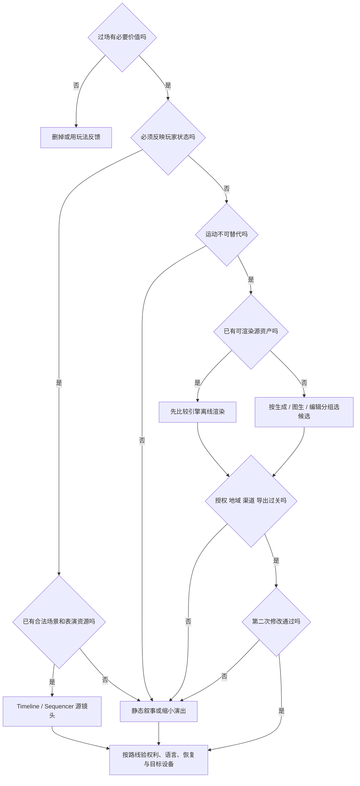

# 视频与过场：先选能继续修改的表达形式

> 核实时间：制作／接入链 2026-10-25，生成候选沿 2026-10-22 比较。单人程序员、无人工美术修补；未试用模型／引擎，以下是资料比较与实施设计。现价、许可、失访和下次复核日期见 [WP7 动态事实表](../../../docs/research/2026-10-14-game-wp7-video.md#十阶段-f-动态事实表与遗漏候选)。三档按交付条件选择，不是画质盲测冠军。

## 当前最高水平：先选表达形式，再选生成器

<!-- frontier: status=已比较 gap=1 gen=2026-10 checked=2026-10-22 -->

**视频只在“必须动起来”时才做：会随玩家状态变化的过场用可编辑源镜头，固定画面用静态图＋程序运动，固定成片才比较生成。** 下表是整页主要选择的当前最高水平对照；三档按交付条件选，整套零手修质量上限与有效成片成本仍未知。[研究]

| 主要选择 | 领先替代／参照 | 当前决定与撤回点 |
|---|---|---|
| 必须做过场吗 | 玩法反馈、静态叙事、完整角色表演 | ✅ 无必要信息或情绪价值就删；表演是核心体验则保留 |
| 玩家换装／持有物／分支 | Sandfall 动态绑定角色的 Sequencer 镜头，对照固定预渲染 | ✅ 已有资产优先 Timeline／Sequencer；缺表演资源退静态，不能靠时间轴补出表演 |
| 少量旁白和固定画面 | 静态图＋程序运动，对照生成视频 | ✅ 静态先行；运动不可替代时再升级 |
| 超设备预算的固定奇观／宣传 | 引擎离线渲染，对照 Wan3／H3／Seedance／Omni 的分任务生成 | 🧪 有源资产先比较离线渲染；生成只接受可淘汰、外观固定的片段 |
| 多镜头切点／节奏 | CutCraft 的逐镜生成＋显式合成，对照一口气生成多镜头 | ✅ 时长、转场和音轨偏移交可编辑时间轴；跨镜头动作／空间接续仍须整段审 |
| 低清筛选后增强 | 直接高质量生成，对照 Draft→Final | 🧪 先算筛掉多少才省钱；低清看不出的关键细节不能提前放行 |
| 局部二改 | Wan3／Omni／Seedance 编辑与 OmniEdit 分轨，对照重新生成 | 🧪 分别查外观、运动和事件时序；只加对主体不算改对动作 |
| 本地／免费 | Wan2.2 指定基线，对照 H3 开权重上限与 LTX-2.5 控制专项 | 🧪 先核发行地域与整条管线；云端 H3 成绩不等于纯本地2K效果 |
| 接入渠道 | 原厂模式接口，对照聚合站参考输入与持久化故障 | ✅ 按具体渠道核输入、结果归档及合同；有模型名不等于有完整工作流 |
| 配音／字幕／新增语言 | 独立声音时间轴，对照联合生成和 DubIt | ✅ 分离生产；译文变长先改节奏，口型质量另验 |
| 播放／恢复／发行 | 现成播放器＋游戏状态边界，对照分支视频缓冲 | ✅ 母版、语言和状态分离；设备解码、旧存档与换片仍需实测 |

来源与版本见 [WP7 本轮整页收口](../../../docs/research/2026-10-14-game-wp7-video.md#十二p95整页选择与前沿纠偏)。三档是条件默认，未试用，不把资料差距1写成整套效果验收。[研究]

图中路径是条件选择，不是已执行结果；表演不可替代且静态不能满足时，应调整设计或取得合适表演资源，不强行生成。[研究]

直接开工看[开门揭示制作链](#制作起点一段能回到游戏的开门揭示)；已有成片则看[播放器接入与退出](#跳过恢复与失败回退)。

## 过场要不要做，做到哪一步

**已有合法场景和角色、需要反映玩家状态时，优先 Timeline＋程序镜头；没有表演资源时，静态图配合平移、缩放、淡变、字幕和旁白也可以是正式设计。** 前者复用现有资产和时序，后者避免为几秒过场另建一套高精角色。[研究]

Sandfall 将《Clair Obscur: Expedition 33》的技能做成小过场，动态绑定战斗角色，并把位置等属性暴露给关键帧轨道；受控战斗场地仍需逐场调整。可借的是状态复用，不是其不足 30 人的核心团队产能。[一手／研究]

Mixtape 开发者强调时间轴预览有助迭代；Dispatch 则选择预渲染并自建分支视频缓冲，以交换实时渲染负担。可借的分别是“可编辑时序加快迭代”和“预渲染可换掉实时渲染负担”，但 Dispatch 仍有手绘背景和约 30 人核心团队，不能当成“单人生成视频省去所有工程”的证明。核心限制：引擎镜头复用资产和时序，不能凭空解决绑定、面部和肢体表演。[一手／研究]

**生成视频只给非交互、外观固定、分支少的短镜头：先验收参考图，再从一个主体、一个动作、一个镜头开始。** 固定奇观超出设备实时预算时，也可比较引擎离线渲染，不必每件资源都由模型生成。[研究]

依据：[一手／研究] Sandfall、Mixtape、Dispatch 的机制与团队边界（WP7 S42、S2、S3）；[研究] 生成视频与离线渲染的适用条件，见 [WP7 §二](../../../docs/research/2026-10-14-game-wp7-video.md#二表达形式的实际取舍)；核实 2026-10-22。

## 制作起点：一段能回到游戏的开门揭示

**✅ 先做可拖动预览的实时源镜头，再决定哪一镜值得生成或预渲染。** 示例是玩家启动机关后，塔门打开、镜头指出新路线，然后交还控制；它要识别当前角色与装备，不需要另造一套演员。这里的 18 秒三镜头是起稿规格，不是所有过场的最佳时长。

| 镜头与目的 | 首版怎么做 | 留下什么供二改 |
|---|---|---|
| A，约 0–4 秒：知道谁触发了什么 | 当前角色背侧中景、已有待机或交互动作；机关反馈沿用玩法资产 | 角色绑定、镜位与关注点，不把角色外观烘焙进影片 |
| B，约 4–13 秒：看清门后可走路线 | 用现有门与场景做开门、推进或切到出口；旁白只解释画面不能说明的事 | 门的表现进度、相机轨迹、旁白源与字幕 ID |
| C，约 13–18 秒：知道现在可以做什么 | 留一段可延长的环境停留，平滑回到玩法镜头，再放开输入 | 退出姿态、玩法相机目标、可延长区间与出口状态 |

先用灰盒门、已有角色、临时音频走完整段；定好目标设备、宽高比、字幕区域和入口／出口，再替换合法成套资源。美术供给沿用 [场景](3d.md)、[动画](animation.md)、[音频](audio.md) 的作者源，不因是过场就丢掉原始模型、动画或分轨工程。动作库没有合格的触碰动作，就让交互先在玩法里完成、镜头从结果开始；不要把一个手碰机关的近景变成整套动作生成项目。

**先定世界变化，再拍它。** 此例在合法交互成功时由游戏逻辑提交“门已解锁”；时间轴只负责呈现，不发奖励。门状态组件拥有最终姿态与碰撞，过场期间可以接收表现进度，但不得与 Animation Track 同时写同一个 Transform。若采用独立门表现代理，退场时由状态组件同步正式门；立即跳过也必须得到同一个可通行世界。未确定的剧情选择仍停在选择界面，不能套用“默认开门”。

静态替代也按同一段叙事制作：已验收场景图分前景／背景层，轻微平移与淡变，配独立旁白和字幕，最后切回真实门。生成替代只考虑 B 镜中不含可变装备的固定奇观，不用一条漂亮宣传片替代 A、C 与实际世界的衔接。

依据：[WP7 §二](../../../docs/research/2026-10-14-game-wp7-video.md#二表达形式的实际取舍)、Sandfall／Mixtape／Dispatch 既有制作证据；上述镜头、状态分工与规格为[研究]设计示例，2026-10-25，未制作或引擎验收。

### 在 Unity 中搭出能继续改的第一版

从项目已锁定的 Unity 6.3 LTS 版本起步，先在 Package Manager 确认兼容的 Timeline 与 Cinemachine；本次文档核到 Timeline 1.8.13、Cinemachine 3.1.7，**不是已安装组合或升级要求**。已有项目不要为照抄示例升级引擎。

1. 在场景建一个过场根对象，添加 PlayableDirector、关闭自动播放、将 Wrap Mode 设为 None（播一次，不停留末帧），创建 `GateReveal.playable`。把镜头、门表现、旁白分轨命名；保留一个玩法主相机与 CinemachineBrain，创建 A／B／C 三个 CinemachineCamera，将 Cinemachine Track 绑定到主相机的 Brain，再让 Shot Clips 分别引用三个镜头。相邻片段用于切镜，重叠用于混合，先不用多轨覆盖制造调度歧义。
2. 把各镜头的关注点与位置锚点放在门或过场根的局部空间。先定角色允许站位与出镜范围，再调景别；当前角色在边缘时应选择受支持镜位或缩小演出，不能靠把玩家瞬移到拍摄点掩盖入口设计问题。
3. 若必须播放已有角色动作，再加 Animation Track，绑定该角色的 Animator，确认根运动、控制器与时间轴谁拥有角色位置；单纯看门无需接管角色整套动画。主线动画模块的握点／遮罩与动作许可继续适用，时间轴不会自动修好武器接触。
4. 给旁白独立 Audio Track／AudioSource，字幕按语言 ID 与时间区间读取。先拖动预览检查镜头顺序和遮挡，再从真实交互入口播放，检查输入、相机和门状态交接；编辑器预览正常不代表运行时绑定正常。

**本例只锁玩家操作，不修改 `timeScale`，Director 的 Update Method 显式选 Game Time，字幕读取 `Director.time`。** 暂停菜单同时暂停 Director 与本段自行启动的独立 AudioSource，恢复时也由同一控制器协调，不能只让字幕停住。若设计需要用 `timeScale = 0` 冻结世界而让演出继续，则改用 Unscaled Game Time 并保留显式暂停合同，不沿用 Game Time 等待它自行前进。

**源镜头与演员绑定分开存。** `.playable` 保存轨道、片段和录制动画，Director 的场景实例保存绑定；换装一般继续使用真实角色，不复制一个过场专用“默认衣服”角色。角色运行时才生成时，在播放前把正确轨道引用用 `SetGenericBinding` 绑定到实际 Animator／组件，镜头的跟随和关注目标也单独赋给当前实例。按稳定角色身份找对象，不按场景里第一个同名对象猜；缺关键绑定就走静态回退。修改同一 Timeline asset 会影响全部实例，专门的语言节奏或版本差异要明确做变体，不能把共享源当局部副本改。

Unreal 已有项目用 Level Sequence 的运行时绑定；当前文档的 Replaceable 可以编辑时用预览演员、运行时解析实际角色，适合保留装备差异。它仍需要镜头、场地与动作资源；Sandfall 逐场调整的成本也适用于此类复用。只有单纯按顺序切相机、没有对白／门演出时，简单镜头序列比完整时间轴更轻；不要为了“电影系统”自建通用编辑器。

依据：[Timeline 源与实例](https://docs.unity3d.com/Packages/com.unity.timeline@1.8/manual/tl-overview.html)及[Director 时钟](https://docs.unity3d.com/Packages/com.unity.timeline@1.8/manual/playable-director.html)、[Cinemachine 与 Timeline](https://docs.unity3d.com/Packages/com.unity.cinemachine@3.1/manual/concept-timeline.html)及[接线步骤](https://docs.unity3d.com/Packages/com.unity.cinemachine@3.1/manual/setup-timeline.html)、[Unity 6.3 SetGenericBinding](https://docs.unity.com/en-us/engine/6000.3/script-reference/unityengine/playables/playabledirector/setgenericbinding)、[UE Custom Binding](https://dev.epicgames.com/documentation/en-us/unreal-engine/dynamic-binding-in-sequencer) [一手]；接线顺序与所有权为[研究]，2026-10-25，仅文档核查。

### 固定奇观：离线渲染怎样交成可修改资产

**🧪 同一镜头实时超预算，而它不需要展示动态角色时，先离线渲染现有源场景。** Unity Recorder 从编辑器 Play mode 捕获影片、图像序列与独立 WAV；它不是发布包中的录屏／渲染系统。UE 则保存 Level Sequence、正确地图与 Movie Render Queue 预设；复杂批次再评估 Movie Render Graph，不为一个片段先上渲染农场。

先把单镜输出成固定帧率、明确起止帧的图像序列，再和独立声音在剪辑工程里组装；需要转场就多留前后可裁帧。图像序列便于重渲一镜而不重渲整片，但不是可编辑 3D 源。源场景、相机、模型与材质引用、灯光、动画、渲染预设以及包版本仍要一起保留；最终 MP4 只是运行派生物，不能代替这些源。

在导出前固定分辨率／宽高比、实际帧率与时基、色彩空间及音频采样率。把工作母版、剪辑工程和目标平台编码分层保存；母版不烧录字幕，不把旁白、音乐与效果音只剩一条无法拆分的混音。第一次接入先用短测试片核设备可解码与画面颜色，再渲整段，避免把“编辑器能播放”当作平台格式保证。多语言需要独立混音时，可从共同画面源派生各语言发行片／音轨，作者源仍保持分轨。

成本不是零：实时路线主要付资产／接线／性能工时，离线路线另付渲染、序列存储、编码与发行体积；改变灯光或门结构要重渲受影响镜头。只有玩家可变外观从画面中排除、这笔固定成本小于实时预算代价时，才切到预渲染；否则保持实时或降低镜头规格。

依据：[Recorder 5.1.7](https://docs.unity3d.com/Packages/com.unity.recorder@5.1/manual/index.html)、[UE Movie Render Pipeline](https://dev.epicgames.com/documentation/unreal-engine/movie-render-pipeline-in-unreal-engine) [一手]；交付分层与成本为[研究]，2026-10-25；平台编码与视觉效果未实测。

### 生成器在这条链里做什么

**🧪 生成只补无法经济取得的固定镜头，AI coding 则贯穿源工程与接入。** 先锁定 B 镜的构图参考、人物／道具是否允许出现、开头与结尾状态，再按下文[条件三档](#条件三档)选有合法渠道的生成／编辑候选。已有源场景可提供合法参考帧；“支持首尾帧”只约束输入，不等于中间过程符合门的位置与动作逻辑。

第一版从一个主体、一个动作、一个镜头开始，先筛机位与叙事，再查完整动作和前后镜头接续。选中后立即归档实际母版、参考图、精确模型／渠道、实际 seed 与最终 prompt、计费及许可凭据；外链和聊天会话不是源资产。生成片的可修改源通常只有输入与请求、另加剪辑工程，**没有可任意换装、改灯、重摆相机的角色和场景**。接受不了这个区别，就不要把它放在必须长期定向修改的镜头上。

后续只改 B 镜的一段时，给编辑器同时提供“改什么”和“保持什么”；输出回到母版时间轴，先审目标改对、非目标保持、动作时序、音画与接缝，再替换批准窗口。LTX Retake 固定代码整段编解码以及非整数 fps 的风险已在下文说明；不能因为接口叫局部编辑，就覆盖已验收的整段原片。重复抽样超过该镜头的费用／工时上限时，改回源镜头或静态，不把失败变成全片逐帧修补。

给 AI coding 的实施材料应是**实际源结构＋镜头意图＋需要保留的关系**：让它生成绑定配置、资源缺失检查、字幕区间转换、渲染／编码清单与播放器适配，并要求说明改了哪些源。镜头审美、叙事节奏、身份连续性与听感仍由人审；不要让 Agent 根据一张截图宣告接触、口型或最终品质通过，也不要让其用虚构 API 代替现成 Timeline／VideoPlayer。

依据：[WP7 固定 Wan／LTX 源码与模型修改接口](../../../docs/research/2026-10-14-game-wp7-video.md#三近期模型重要的是修改接口改变了什么)、[整页前沿比较](../../../docs/research/2026-10-14-game-wp7-video.md#十二p95整页选择与前沿纠偏) [一手／社区／研究]，复用 2026-10-22 及原注明日期证据；本节制作分工为 2026-10-25 [研究]，未生成。

### 首版交付与第二次修改，按同一条链走

第一份交付应能让另一名程序员从入口改镜头，而不只是拿到一段成片：源 Timeline／Level Sequence、绑定场景或 prefab、全部可再取得的合法依赖与版本、声音分轨／字幕、必要的渲染剪辑工程，以及运行端选择哪个版本／语言的配置。生成镜头另外带已归档输入与请求，预渲染镜头带母版与派生规格；不把未取得的源文件列成“已交付”。

第二次改成“角色换长武器，旁白译文增长 30%”，先改需求对应的源，不重造全片：

| 路线 | 实际修改顺序 | 不应保留的假定 |
|---|---|---|
| 实时源镜头 | 绑定新装备，核 A 镜构图与角色姿态；重用 B 镜，把 C 镜环境停留延长并调整字幕／音频出口 | 新武器不会只靠绑定就得到正确握持；参考动画模块处理动作差异 |
| 同源预渲染 | 画面未含装备则不重渲；含装备则只改并重渲受影响镜头，检查相邻剪辑，再从共同母版派生语言版 | 固定影片不会自动反映玩家换装，也不能把原声硬拉慢来吞掉译文 |
| 生成插入镜头 | 固定 B 镜不受装备变化就保留；需要改可见物时单独试编辑并复验非目标区域，失败退回源镜头 | 同 seed、局部输入或稳定首尾帧都不保证原动作保留 |
| 静态方案 | 换对应图层或移除可变装备特写，重排字幕／旁白区间与停留时长 | 平移缩放不能造出缺失的肢体表演 |

句长增长不是整条时间轴等比例降速：先用 C 镜的可延长停留吸收；仍放不下才调整句子、拆对白或重排镜头。需要近景口型的片段按新表演重做，不能拿只延长环境镜头的方案冒充口型解决。更改共享 Timeline 时核其他实例；每次交付保留稳定镜头 ID、内容版本与安全恢复节点，让补丁换片不破坏旧存档。

验收先看正常播放的价值：看完是否知道路线、角色装备是否正确、镜头和声音是否有可感知的节奏、交回控制是否自然；再按下文[播放器合同](#跳过恢复与失败回退)核早跳／连跳／出错／旧档。真实目标设备需检查启动等待、解码和内存占用、字幕可读性、各音量总线与宽高比，不以网页 demo 或编辑器预览代替。首次合格与二改合格分别记录废片、源修改工时、渲染／生成等待、编码与版本数量，才能判断哪条路线更省总成本。

依据：上述交付与二改为[研究]实施设计，2026-10-25；表达取舍、动态绑定、语言时长和媒体状态边界沿用 WP7 S1–S4、S14–S15、S19／S26、S42，制作接线见前两节的一手链接；未创建 `.playable`、角色／场景资产、实际影片或可运行适配器，目标平台编码、音画同步、瞬时／重复跳过、长译文与设备耗用仍需在真实项目验收。

## 三档怎么选：按交付条件，不看画质榜

**已有资产或静态图能满足，就用性价比档；只有固定成片确需生成时才比较质量档；本地免费只作指定基线，不为“免费”买硬件。** 选前先过 [授权总表](../03-generative-ai-in-games.md#13-授权与商用门槛总表wp1) 与 [视频许可增量](../../../docs/research/2026-10-14-game-wp7-video.md#七许可增量模型自动化入口与导出分开)：输出可商用、允许自动化访问、能正式导出，须分别核查。[一手／研究]

| 档位 | 选择与必须条件 | 成本及撤回条件 |
|---|---|---|
| **质量优先** | 👀 固定成片按任务比较 Wan3、H3、Seedance2.5／Omni，Runway 保留为已有剪辑管线的候选 | 必须过渠道合同、参考控制及二改验收，榜单偏好不代表可发行率 |
| **性价比优先** | ✅ 已有资产用 Timeline／Sequencer 或静态图运动，确需生成再比较 Omni 等合规渠道 | 按合格片与重做工时核总成本，低秒价、预览及增强都不自动省钱 |
| **本地／免费** | 🧪 Wan2.2-TI2V-5B 保留指定硬件基线，H3 和 LTX 分别作上限与控制专项参照 | 先核硬件、完整管线和发行地域，不能把开权重或 API 榜单等同全本地免费 |

**当前领先参照要分任务读。** 10 月 22 日 AA 编辑有声榜的 Wan3 领先，Seedance2.5／Omni1.1 区间重叠；图生有声榜前列亦重叠，不据名次硬分胜负，也不跨有声／无声或生成／编辑比较 Elo。Runway 专业导出、Aleph 范围编辑仍有工作流价值，但不能据此继续称画质或编辑质量默认领先；完整比较范围见 WP7 S46–S49。[一手／研究]

**本地档的取舍不是漏看新模型。** Wan 指定路径至少 24 GB 显存及 offload，1280×704；H3 开源 Base 为 768p，官方完整 2K 流程另含托管 Context-IR 及尚未开源的 Regenerate-2K，不能照搬服务端成绩。H3 社区许可对排除地域的限制明确涉及 Outputs 使用／分发／展示；这里只判断该许可没有授权这些用途，不替代其他渠道合同。LTX 仍须核营收门槛、组件／LoRA 和披露。[一手／研究]

Wan3 官方 API 本轮仍标 Preview，首尾帧模式不能同时接音频，需改用全模态参考模式；这不证明同样的首尾控制效果。Wan3／H3 托管渠道完整合同与发行准入未清核，维持 👀 而非正式发行默认。[一手／研究]

核心限制：没有证据证明任一方案能零手修稳定交付整套多角色、多语言、反复修改的过场。Runway 默认条款允许输入／输出用于训练，Google 付费 API 仍有安全留存；保密素材不能仅凭“可商用”就上传。Sora 官方关闭日期已过，不作新生产默认。[一手／研究]

依据与动态条件：[WP7 许可增量](../../../docs/research/2026-10-14-game-wp7-video.md#七许可增量模型自动化入口与导出分开)、[动态事实表](../../../docs/research/2026-10-14-game-wp7-video.md#十阶段-f-动态事实表与遗漏候选)、[整页收口](../../../docs/research/2026-10-14-game-wp7-video.md#十二p95整页选择与前沿纠偏)；[一手／研究；WP7 S11、S25、S46–S52]；核实 2026-10-22。

## 渠道红线：Veo 预览到期，Kling／Seedance 只补对照

**⛔ 新生产不再接 Gemini API 的 Veo 3.1 Preview。** 专页公告三个预览 ID 拟于 **2026-10-22** 关闭，停用总表说明所列为最早可能日期；当天未验证端点已关闭；已有管线先保存合法母版，再比较 Omni 或另渠道 GA，不能只换 model ID。另渠道 Gemini Enterprise Agent Platform 的 Generate／Fast `001` 是 GA，Lite `001` 仍为 Preview；准入、费用和效果须另核。[官方视频专页](https://ai.google.dev/gemini-api/docs/video)；具体范围与成本边界见 [WP7](../../../docs/research/2026-10-14-game-wp7-video.md#google当前默认已不是只有-veo)。[一手／研究]

**👀 Kling 和 Seedance 加入同镜头修改对照，不替换引擎镜头／静态图默认。** Kling 3.0 Pro 在 Runway API 提供 1080p、3–15 秒生成，O3 Pro 增加视频输入编辑；Seedance 2.5 提供最长 30 秒、多参考与视频编辑。它们更适合外观固定的宣传镜头，不能据官方演示认定游戏装备、空间关系或多语对白能稳定改对。[一手／研究]

- Kling 国际版付费会员条款明确商用和去品牌水印；普通条款默认限制未获授权的商用。免费积分、买积分与会员权益不能混同，国际会员条款也不能套到中国版或第三方 API。[一手]
- Seedance 2.5 的 Runway API 分别计输出、输入／参考视频，并有每次最低费用；480p 预览与 1080p 增强各收费，不是只付差价。先核实际渠道合同、地区及导出，再按 [WP7 价目与反例](../../../docs/research/2026-10-14-game-wp7-video.md#动态事实表) 判断是否省钱。[一手／研究]

核心限制：BytePlus／火山原厂路线本轮未完整取得条款与地区正文，Kling 官网套餐金额也未读到；这些缺口不能用托管平台价格、搜索摘要或品牌声誉补齐。完整采用边界与会改变推荐的反证见 [WP7](../../../docs/research/2026-10-14-game-wp7-video.md#十阶段-f-动态事实表与遗漏候选)。[研究]

依据：[一手／研究] Veo 停用与另渠道状态（WP7 S5、S8、S45）、Kling／Seedance 托管能力与许可边界（WP7 S30–S33）；核实 2026-10-22。

## 多镜头：切点交剪辑，接续仍交人审

**切点、片长、光学转场、声音提前／延后可显式合成；跨镜头空间和动作接续不能靠拼接保证。** CutCraft 对包含 Seedance 2.5 的 13 模型评估，并在三个模型上比较生成后合成：部分离散控制改善，但 Wan2.7、HappyHorse1.1 的片内音画同步代理指标反而下降（不是对白口型分数）；它是额外规划／生成／修复路线，不是等预算胜出。[一手／研究]

需要 match cut（匹配剪辑）、遮挡转场或连续动作时，保留共同源场景、先核相邻镜头再扩整段；若只能靠逐帧修补接上，就撤回到引擎镜头或改镜头设计。AI 可整理镜头计划与合成参数，人仍决定表演、节奏和可接受接缝。[研究]

依据：[一手／研究] CutCraft 的显式合成与连续性边界（WP7 S41）；[研究] match cut 与逐帧修补的撤回条件，见 [WP7 §十一](../../../docs/research/2026-10-14-game-wp7-video.md#离散控制改善内容连续性不自动改善)；核实 2026-10-22。

## 修改接口：少重抽，不等于无损编辑

**先判修改是否做对，再判其余内容是否保留。** OmniEdit-Bench 将空间、时序、音频等分轨，同题结果显示改外观能力不能代表改动作能力；据此把验收拆成目标正确、非目标保持、时序／音画与自然度。其作者含 Wan 团队、测试版本也不同于最新服务，不能充当中立当前排行榜或二改通过率。[一手／研究]

Omni 总入口仍把尾帧／延展列为 Veo 用途，但 Omni 详细页也支持两者，应按模式与地区对照。Omni 详细页仍不支持语音编辑／上传音频参考，非英语效果未评估；多轮接续依赖保存的 interaction，不能替代本地化配音管线。[一手／研究]

Aleph 2.0 先改关键帧，再传播到最长 30 秒、1080p 片段。同样 5 秒，Gen-4.5 为 60 credits，Aleph 为 140 credits 且另计关键帧；但 Edit Studio 只改选中时间窗时按范围扣费，至少 56 credits。短窗口可能比整段重生便宜，应连同废片与工时比较。[一手／研究]

LTX 固定源码的 Retake 虽有时间窗，原片仍经 VAE 编码并整段解码；CLI 还将输出 fps 转为整数。要求窗外原片不动时，保存 master，程序拼接核准的新窗口，再查接缝和时基。核心限制：这是指定 SHA 的代码风险分析，未证明实际像素、声音或时基已验收。[一手／研究]

依据：[一手／研究] OmniEdit-Bench、Omni 模式限制、Aleph 计价与 LTX 固定源码的边界（WP7 S5、S7、S9、S10、S14、S53），见 [WP7 §三](../../../docs/research/2026-10-14-game-wp7-video.md#三近期模型重要的是修改接口改变了什么)；核实 2026-10-22。

## 连续性与本地化：画面、声音、状态分开生产

**✅ 画面、配音、字幕、任务状态分开生产。** 镜头 ID 稳定，保存参考图、模型／权重、真实 seed、最终 prompt、母版和许可；Wan 提示扩写会改变实际 prompt，也须归档。[一手／研究]

旁白、背影、远景和单人镜头可减少口型与遮挡难题，但不能以此牺牲核心演出。新增语言先定句长与节奏；LTX DubIt 按参考视频的帧数／帧率处理，不会自动适配任意长度翻译。声音权利按 [音频专题](audio.md) 单独处理。[一手／研究]

程序可改编码、裁切、加边、有限调色、字幕和音量，不能保证修好抓取接触、穿插、身份交换或跨镜头空间错误；补帧与放大不修复错误语义。核心限制：同 seed 不保证改词后保留旧动作，零手修仍需要人工选片和整段审核。[研究]

依据：[一手／研究] Wan prompt 归档与 DubIt 长度边界（WP7 S11–S15）；声音权利按音频专题单列；[研究] 程序处理与同 seed 的边界，见 [WP7 §三、§四](../../../docs/research/2026-10-14-game-wp7-video.md#四零人工美术修补的可接受边界)；核实 2026-10-22。

## 跳过、恢复与失败回退

**✅ 进度状态属于游戏，不属于影片。** 现成播放器外只加最小状态边界：[研究]

- 正常结束、跳过和错误回退走同一个幂等出口，不重复奖励
- 保存镜头 ID／版本、分支和入口 checkpoint；默认从安全叙事节点恢复
- 跳过释放相机、输入、音频并提交出口状态，不只 seek 到末尾；剧情选择不能替玩家决定
- 媒体损坏给静态说明或安全返回，不让主线卡死；语言音轨与字幕独立装载

Unity VideoPlayer 的 Prepare、seekCompleted、errorReceived 各有阶段语义；Timeline Signal 的 retroactive／emitOnce 不是任意 seek 安全开关。Unreal Set Playback Position 会求值区间事件，关键进度提交应独立。核心限制：接口阅读不能替代目标设备解码、切后台和读档测试。[一手／研究]

**实现起点是两种表现共用一个入口，不是两套剧情状态机。** 项目可自定义一个小适配层：入口先解析镜头版本、语言、演员绑定与已经确定的分支；实时路线启动 Director，影片路线启动 VideoPlayer，二者都回到同一个退出函数。这是建议结构，不是 Unity 内置类或本仓已实现组件。

**混合路线另加段级推进，B 结束不是整段结束。** 首版默认仍全实时；若替换固定 B 镜，把 A、C 做成可独立启动的源序列并复用绑定配置，先预备 B 成功再进入 A，按 A→影片 B→C 串行运行，不让整条实时 Timeline 在影片背后继续走，被替换 B 的实时音画也不播放。A 结束只切到 B；B 正常结束先撤掉影片显示与音频、释放播放器，再启动 C，只有 C 结束或全局跳过／错误终止才进共同出口。准备超时走全局静态回退，暂停／恢复作用于当前活跃段，取消则同时失效所有未完成回调，不允许迟到的 B 回调把已退出过场重新带进 C。

影片首版用本地合法导出片＋RenderTexture 显示，关闭 `playOnAwake` 与循环；先订阅准备、结束和错误回调，再 `Prepare()`，准备成功、轮到该片段且仍是当前播放请求才 `Play()`。准备期间仍能取消；用请求代次与已退出标记拒绝迟到回调，设有界等待并走回退，不因跳过后才收到准备完成又把影片播起来。字幕跟随表现的播放时间，暂停、seek 和恢复时重算当前区间，不按独立墙钟累计；暂不做中途续播的项目直接回安全叙事节点，少承担一个同步系统。

非 Web 平台需要总线／效果控制时，把内嵌声音通过 `AudioSource` 路由到项目混音；Direct 直接送硬件，不能假定经过同一总线。**WebGL 不照抄这条接线**：Unity 6.3 文档说明其 `AudioSource` 模式除 mute 外的字段被忽略；应单独确定可用音量路径与平台验收，不能宣称已支持各声部音量。首版可使用同画面的语言发行片保持解码器内同步，作者源仍保独立分轨；真要外置对白，须为媒体和音频选共同时间基准并处理暂停／seek／重同步，不能在 `started` 回调中各自 `Play()` 就当长期同步已解决。

依据：[一手] Unity VideoPlayer、Timeline Signal、Unreal Set Playback Position 的接口语义（WP7 S4、S19、S26）、[Unity 6.3 prepareCompleted](https://docs.unity.com/en-us/engine/6000.3/script-reference/unityengine/video/videoplayer/preparecompleted)、[audioOutputMode](https://docs.unity.com/en-us/engine/6000.3/script-reference/unityengine/video/videoplayer/audiooutputmode)、[Direct](https://docs.unity.com/zh-cn/engine/6000.3/script-reference/unityengine/video/videoaudiooutputmode/direct)；[研究] 状态边界、混合段级推进与最小设备验收，见 [WP7 §五](../../../docs/research/2026-10-14-game-wp7-video.md#五播放跳过与恢复状态属于游戏不属于影片)；适配与回调管理为 2026-10-25 [研究]，未运行播放器。

## 预览筛选：何时真的省钱

**Draft 的价值是便宜地淘汰，不是把通过的一条免费升级。** 设每条预览费 d、增强费 u、直接成片费 h，送增强比例 p；仅调用费省钱的条件是 `d + p × u < h`。[研究：成本推导]

沿 WP7 的 2026-10-14 Runway API Seedance 2.5 历史税前报价，8 秒无视频参考、同数量候选且各至多一次：480p Draft $1.60，增强到 1080p 另 $5.44，直出 1080p $5.44；要筛掉超过约 29.4%，调用费才较低。全部增强则每条 $7.04，比直出贵。采用前重核费率，并把误淘汰、增强失败、重试和工时计入。[一手／研究]

低清先筛机位和站位；小字、脸部、产品细节在最终片重验。这个阈值假定低清筛选保留最终合格片、增强不破坏它，未测得这一假定或真实节省率。[社区／研究]

依据：[一手／研究] Runway API Seedance 2.5 历史费率与推导（WP7 S28、S30）；[社区／研究] 低清筛选的作者经验（WP7 S43）与未测假定，见 [WP7 §十一](../../../docs/research/2026-10-14-game-wp7-video.md#预览筛选的费用边界)；核实 2026-10-22。

## 第二次修改后再决定采用

**模型支持不等于渠道工作流齐备；采用前用实际渠道做一次同镜头二改。** 中文 V2EX 试用原帖记录过聚合站三图参数报错、参考输入和结果持久化问题，站方随后称部分已修复但没有用户复验；采用前用实际渠道核输入组合、结果 ID 与正式导出，不把历史聚合站故障归给原厂模型。[社区／研究]

**按验收片段算成本，不按最好看的一次输出算。** 包括废片、编辑、关键帧／配音、编码存储、等待和主动工时。Runway API 输出链接 24–48 小时过期，Veo 服务端视频保留 2 天，应正式导出归档。[一手／研究]

后续获准的最小对照：同一角色换手持物但保持动作与镜位，再增加一条长 30% 的翻译台词；比较静态图、引擎参数和生成编辑的重做范围。具体二改沿用[同一条制作链](#首版交付与第二次修改按同一条链走)，不能把重做全片记成局部修改成功。另验立即/末帧/连按跳过、pause 后 skip、后台恢复、缺文件/音轨、读档与补丁换片。[研究]

核心限制：达到预设费用／工时上限，或必须人工美术修补才能通过，就缩小过场；本轮没有真实模型或引擎验收。[研究]

依据：[一手／研究] Runway 条款与输出归档（WP7 S22、S29）、输出链接与保留期限；[社区／研究] V2EX 渠道故障（WP7 S54）；[研究] 最小对照与停止条件，见 [WP7 §六、§十二](../../../docs/research/2026-10-14-game-wp7-video.md#六第二次改动应怎样算账)；核实 2026-10-22。
