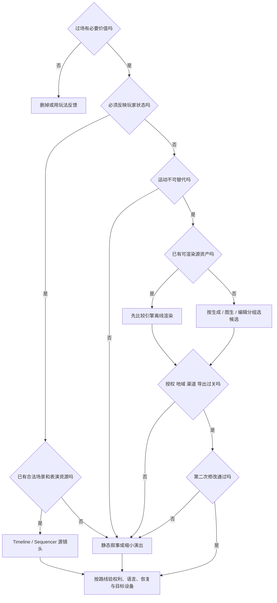

# 视频与过场：先选能继续修改的表达形式

> 核实时间：2026-10-22。单人程序员、无人工美术修补；未试用模型／引擎，以下是资料比较与条件推导。现价、许可、失访和下次复核日期见 [WP7 动态事实表](../../../docs/research/2026-10-14-game-wp7-video.md#十阶段-f-动态事实表与遗漏候选)。三档按交付条件选择，不是画质盲测冠军。

## 当前最高水平：先选表达形式，再选生成器

<!-- frontier: status=已比较 gap=1 gen=2026-10 checked=2026-10-22 -->

**会随玩家变化的内容保留可编辑源镜头；固定成片才比较生成，剪辑精确不代表内容连续。** 下表按整页主要选择比较近期机制；生成、图生与编辑不可共用冠军，整套零手修质量上限与有效成片成本仍未知。[研究]

| 主要选择 | 领先替代／参照 | 当前决定与撤回点 |
|---|---|---|
| 必须做过场吗 | 玩法反馈、静态叙事、完整角色表演 | ✅ 无必要信息或情绪价值就删；表演是核心体验则保留 |
| 玩家换装／持有物／分支 | Sandfall 动态绑定角色的 Sequencer 镜头，对照固定预渲染 | ✅ 已有资产优先 Timeline／Sequencer；缺表演资源退静态，不能靠时间轴补出表演 |
| 少量旁白和固定画面 | 静态图＋程序运动，对照生成视频 | ✅ 静态先行；运动不可替代时再升级 |
| 超设备预算的固定奇观／宣传 | 引擎离线渲染，对照 Wan3／H3／Seedance／Omni 的分任务生成 | 🧪 有源资产先比较离线渲染；生成只接受可淘汰、外观固定的片段 |
| 多镜头切点／节奏 | CutCraft 的逐镜生成＋显式合成，对照一口气生成多镜头 | ✅ 时长、转场和音轨偏移交可编辑时间轴；跨镜头动作／空间接续仍须整段审 |
| 低清筛选后增强 | 直接高质量生成，对照 Draft→Final | 🧪 先算筛掉多少才省钱；低清看不出的关键细节不能提前放行 |
| 局部二改 | Wan3／Omni／Seedance 编辑与 OmniEdit 分轨，对照重新生成 | 🧪 分别查外观、运动和事件时序；只加对主体不算改对动作 |
| 本地／免费 | Wan2.2 指定基线，对照 H3 开权重上限与 LTX-2.5 控制专项 | 🧪 先核发行地域与整条管线；云端 H3 成绩不等于纯本地2K效果 |
| 接入渠道 | 原厂模式接口，对照聚合站参考输入与持久化故障 | ✅ 按具体渠道核输入、结果归档及合同；有模型名不等于有完整工作流 |
| 配音／字幕／新增语言 | 独立声音时间轴，对照联合生成和 DubIt | ✅ 分离生产；译文变长先改节奏，口型质量另验 |
| 播放／恢复／发行 | 现成播放器＋游戏状态边界，对照分支视频缓冲 | ✅ 母版、语言和状态分离；设备解码、旧存档与换片仍需实测 |

来源与版本见 [WP7 本轮整页收口](../../../docs/research/2026-10-14-game-wp7-video.md#十二p95整页选择与前沿纠偏)。三档是条件默认，未试用，不把资料差距1写成整套效果验收。[研究]

图中路径是条件选择，不是已执行结果；表演不可替代且静态不能满足时，应调整设计或取得合适表演资源，不强行生成。[研究]

## 先决定是否需要视频

已有合法场景和角色、需要反映玩家状态时，优先 Timeline + 程序镜头。没有表演资源时，静态图配合平移、缩放、淡变、字幕和旁白，也可以是正式设计。[研究]

Sandfall 将《Clair Obscur: Expedition 33》的技能做成小过场，动态绑定战斗角色，并把位置等属性暴露给关键帧轨道；受控战斗场地仍需逐场调整。可借的是状态复用，不是其不足30人的核心团队产能。[一手／研究；WP7 S42]

Mixtape 开发者强调时间轴预览有助迭代；Dispatch 则选择预渲染并自建分支视频缓冲，以交换实时渲染负担。后者仍有手绘背景和约 30 人核心团队，不能当成“单人生成视频省去所有工程”的证明。核心限制：引擎镜头复用资产和时序，不能凭空解决绑定、面部和肢体表演。[一手／研究；来源见 WP7 S2、S3]

生成视频只给非交互、外观固定、分支少的短镜头：先验收参考图，再从一个主体、一个动作、一个镜头开始。固定奇观超出设备实时预算时，也可比较引擎离线渲染，不必每件资源都由模型生成。[研究]

## 条件三档

先过 [授权总表](../03-generative-ai-in-games.md#13-授权与商用门槛总表wp1) 与 [视频许可增量](../../../docs/research/2026-10-14-game-wp7-video.md#七许可增量模型自动化入口与导出分开)。输出可商用、允许自动化访问、能正式导出，须分别核查。[一手／研究]

| 档位 | 选择与必须条件 | 成本及撤回条件 |
|---|---|---|
| **质量优先** | 👀 固定成片按任务比较 Wan3、H3、Seedance2.5／Omni，Runway保留为已有剪辑管线的候选 | 必须过渠道合同、参考控制及二改验收，榜单偏好不代表可发行率 |
| **性价比优先** | ✅ 已有资产用 Timeline／Sequencer 或静态图运动，确需生成再比较 Omni 等合规渠道 | 按合格片与重做工时核总成本，低秒价、预览及增强都不自动省钱 |
| **本地／免费** | 🧪 Wan2.2-TI2V-5B 保留指定硬件基线，H3和LTX分别作上限与控制专项参照 | 先核硬件、完整管线和发行地域，不能把开权重或API榜单等同全本地免费 |

**当前领先参照要分任务读。** 10月22日 AA 编辑有声榜的 Wan3 领先，Seedance2.5／Omni1.1区间重叠；图生有声榜前列亦重叠，不据名次硬分胜负，也不跨有声／无声或生成／编辑比较Elo。Runway专业导出、Aleph范围编辑仍有工作流价值，但不能据此继续称画质或编辑质量默认领先；完整比较范围见WP7 S46–S49。[一手／研究]

**本地档取舍不是漏看新模型。** Wan指定路径至少24 GB显存及offload，1280×704；H3开源Base为768p，官方完整2K流程另含托管Context-IR及尚未开源的Regenerate-2K，不能照搬服务端成绩。H3社区许可对排除地域的限制明确涉及Outputs使用／分发／展示；这里只判断该许可没有授权这些用途，不替代其他渠道合同。LTX仍须核营收门槛、组件／LoRA和披露。[一手／研究；WP7 S11、S25、S50–S52]

Wan3官方API本轮仍标Preview，首尾帧模式不能同时接音频，需改用全模态参考模式；这不证明同样的首尾控制效果。Wan3／H3托管渠道完整合同与发行准入未清核，维持👀而非正式发行默认。[一手／研究；WP7 S49–S52]

核心限制：没有证据证明任一方案能零手修稳定交付整套多角色、多语言、反复修改的过场。Runway 默认条款允许输入/输出用于训练，Google 付费 API 仍有安全留存；保密素材不能仅凭“可商用”就上传。Sora 官方关闭日期已过，不作新生产默认。[一手／研究；WP7 动态事实表]

**⛔ 新生产不再接 Gemini API 的 Veo 3.1 Preview。** 专页公告三个预览ID拟于 **2026-10-22** 关闭，停用总表说明所列为最早可能日期；当天未验证端点已关闭；已有管线先保存合法母版，再比较 Omni 或另渠道 GA，不能只换 model ID。另渠道 Gemini Enterprise Agent Platform 的 Generate／Fast `001` 是 GA，Lite `001` 仍为 Preview；准入、费用和效果须另核。[官方视频专页](https://ai.google.dev/gemini-api/docs/video)；具体范围与成本边界见 [WP7](../../../docs/research/2026-10-14-game-wp7-video.md#google当前默认已不是只有-veo)。[一手／研究，2026-10-22]

## Kling、Seedance 是否改变推荐

**👀 补入修改对照，不替换引擎/静态默认。** Kling 3.0 Pro 在 Runway API 提供 1080p、3–15 秒生成，O3 Pro 增加视频输入编辑；Seedance 2.5 提供最长 30 秒、多参考与视频编辑。它们更适合外观固定的宣传镜头，不能据官方演示认定游戏装备、空间关系或多语对白能稳定改对。[一手／研究；WP7 S30、S33]

- Kling 国际版付费会员条款明确商用和去品牌水印；普通条款默认限制未获授权的商用。免费积分、买积分与会员权益不能混同，国际会员条款也不能套到中国版或第三方 API [一手；WP7 S31、S32]
- Seedance 2.5 的 Runway API 分别计输出、输入／参考视频，并有每次最低费用；480p预览与1080p增强各收费，不是只付差价。先核实际渠道合同、地区及导出，再按[WP7价目与反例](../../../docs/research/2026-10-14-game-wp7-video.md#动态事实表)判断是否省钱。[一手／研究]

核心限制：BytePlus / 火山原厂路线本轮未完整取得条款与地区正文，Kling 官网套餐金额也未读到；这些缺口不能用托管平台价格、搜索摘要或品牌声誉补齐。完整采用边界与会改变推荐的反证见 [WP7](../../../docs/research/2026-10-14-game-wp7-video.md#十阶段-f-动态事实表与遗漏候选)。[研究]

## 多镜头：哪些交剪辑，哪些仍交生成

**切点、片长、光学转场、声音提前／延后可显式合成；跨镜头空间和动作接续不能靠拼接保证。** CutCraft 对包含 Seedance 2.5 的13模型评估，并在三个模型上比较生成后合成：部分离散控制改善，但 Wan2.7、HappyHorse1.1 的片内音画同步代理指标反而下降（不是对白口型分数）；它是额外规划／生成／修复路线，不是等预算胜出。[一手／研究；WP7 S41]

需要 match cut（匹配剪辑）、遮挡转场或连续动作时，保留共同源场景、先核相邻镜头再扩整段；若只能靠逐帧修补接上，就撤回到引擎镜头或改镜头设计。AI可整理镜头计划与合成参数，人仍决定表演、节奏和可接受接缝。[研究]

## 修改接口：少重抽，不等于无损编辑

**先判修改是否做对，再判其余内容是否保留。** OmniEdit-Bench将空间、时序、音频等分轨，同题结果显示改外观能力不能代表改动作能力；据此把验收拆成目标正确、非目标保持、时序／音画与自然度。其作者含Wan团队、测试版本也不同于最新服务，不能充当中立当前排行榜或二改通过率。[一手／研究；WP7 S53]

Omni 总入口仍把尾帧/延展列为 Veo 用途，但 Omni 详细页也支持两者，应按模式与地区对照。Omni 详细页仍不支持语音编辑/上传音频参考，非英语效果未评估；多轮接续依赖保存的 interaction，不能替代本地化配音管线。[一手／研究]

Aleph 2.0 先改关键帧，再传播到最长 30 秒、1080p 片段。同样 5 秒，Gen-4.5 为 60 credits，Aleph 为 140 credits 且另计关键帧；但 Edit Studio 只改选中时间窗时按范围扣费，至少 56 credits。短窗口可能比整段重生便宜，应连同废片与工时比较。[一手／研究]

LTX 固定源码的 Retake 虽有时间窗，原片仍经 VAE 编码并整段解码；CLI 还将输出 fps 转为整数。要求窗外原片不动时，保存 master，程序拼接核准的新窗口，再查接缝和时基。核心限制：这是指定 SHA 的代码风险分析，未证明实际像素、声音或时基已验收。[一手／研究]

## 连续性与本地化

**✅ 画面、配音、字幕、任务状态分开生产。** 镜头 ID 稳定，保存参考图、模型/权重、真实 seed、最终 prompt、母版和许可；Wan 提示扩写会改变实际 prompt，也须归档。[一手／研究]

旁白、背影、远景和单人镜头可减少口型与遮挡难题，但不能以此牺牲核心演出。新增语言先定句长与节奏；LTX DubIt 按参考视频的帧数/帧率处理，不会自动适配任意长度翻译。声音权利按 [音频专题](audio.md) 单独处理。[一手／研究]

程序可改编码、裁切、加边、有限调色、字幕和音量，不能保证修好抓取接触、穿插、身份交换或跨镜头空间错误；补帧与放大不修复错误语义。核心限制：同 seed 不保证改词后保留旧动作，零手修仍需要人工选片和整段审核。[研究]

## 跳过、恢复与失败回退

**✅ 进度状态属于游戏，不属于影片。** 现成播放器外只加最小状态边界：[研究]

- 正常结束、跳过和错误回退走同一个幂等出口，不重复奖励
- 保存镜头 ID/版本、分支和入口 checkpoint；默认从安全叙事节点恢复
- 跳过释放相机、输入、音频并提交出口状态，不只 seek 到末尾；剧情选择不能替玩家决定
- 媒体损坏给静态说明或安全返回，不让主线卡死；语言音轨与字幕独立装载

Unity VideoPlayer 的 Prepare、seekCompleted、errorReceived 各有阶段语义；Timeline Signal 的 retroactive/emitOnce 不是任意 seek 安全开关。Unreal Set Playback Position 会求值区间事件，关键进度提交应独立。核心限制：接口阅读不能替代目标设备解码、切后台和读档测试。[一手／研究]

## 预览筛选：何时真的省钱

**Draft 的价值是便宜地淘汰，不是把通过的一条免费升级。** 设每条预览费 d、增强费 u、直接成片费 h，送增强比例 p；仅调用费省钱的条件是 `d + p × u < h`。[研究：成本推导]

沿 WP7 的2026-10-14 Runway API Seedance 2.5历史税前报价，8秒无视频参考、同数量候选且各至多一次：480p Draft $1.60，增强到1080p另 $5.44，直出1080p $5.44；要筛掉超过约29.4%，调用费才较低。全部增强则每条 $7.04，比直出贵。采用前重核费率，并把误淘汰、增强失败、重试和工时计入。[一手／研究；WP7 S28、S30]

低清先筛机位和站位；小字、脸部、产品细节在最终片重验。这个阈值假定低清筛选保留最终合格片、增强不破坏它，未测得这一假定或真实节省率。[社区／研究；WP7 S43及成本推导]

## 第二次修改后再决定采用

**模型支持不等于渠道工作流齐备。** 中文V2EX试用原帖记录过聚合站三图参数报错、参考输入和结果持久化问题，站方随后称部分已修复但没有用户复验；采用前用实际渠道核输入组合、结果ID与正式导出，不把历史聚合站故障归给原厂模型。[社区／研究；WP7 S54]

**按验收片段算成本，不按最好看的一次输出算。** 包括废片、编辑、关键帧/配音、编码存储、等待和主动工时。Runway API 输出链接 24–48 小时过期，Veo 服务端视频保留 2 天，应正式导出归档。[一手／研究]

后续获准的最小对照：同一角色换手持物但保持动作与镜位，再增加一条长 30% 的翻译台词；比较静态图、引擎参数和生成编辑的重做范围。另验立即/末帧/连按跳过、pause 后 skip、后台恢复、缺文件/音轨、读档与补丁换片。[研究]

核心限制：达到预设费用/工时上限，或必须人工美术修补才能通过，就缩小过场；本轮没有真实模型或引擎验收。[研究]
