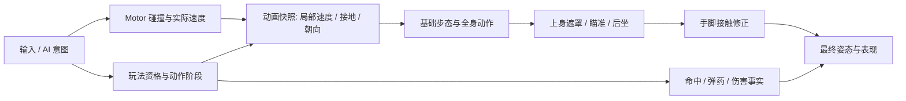

# 角色动画运行时：让脚步、动作与操控说同一件事

**✅ 已有 Unity GameObject 项目，先用 Animator 的小状态机＋Blend Tree＋必要的身体分层；移动控制器拥有普通行走位移，动画消费它的实际运动。** 先把起步、停步、转向和一次攻击做顺，再决定是否换播放器或引入 Motion Matching。这里接的是已经合格的动画资产；生成、重定向与骨架规格沿[动画制作链](../assets/animation.md)，角色碰撞沿[角色运动](../04-client-modules.md#3d-角色运动先选想要的控制再选碰撞求解方式)，技能资格与结算沿[战斗模块](../05-gameplay-architecture.md#7-战斗与技能先统一结算再决定-gas)。

本页为**研究与源码走查的完整接入方案，未运行 Unity／Unreal，尚未证明原生动作质量或目标设备性能**。当前 Web 案例的动作事件可复用为接口依据，不能证明 Avatar、Animator、IK 或根运动通过。

## 1. 先选作品需要的表现，再选系统

**小团队优先买到或生成一套风格匹配的合格动作，再花时间调动作之间的关系。** 首版以俯视动作游戏的“能读出出手、闪避和收招”或近景第三人称的“起停转身有连续重量”为质量目标；两者对脚滑、面朝方向和动作库规模的要求不同。独立作品参照可选《Death's Door》的动作可读性，近景运动技术参照可用 Epic Game Animation Sample 的障碍场；比较同一距离、速度、转向和接触，不把写实动作数量当成风格化游戏的品质指标。

| 当前需求 | 选择与开始位置 | 什么时候不适用 |
|---|---|---|
| 少量角色、动作集合稳定，现有 Animator 可维护 | ✅ 保 Animator；Base locomotion＋全身动作，确需边走边攻击才加 UpperBody 层 | 状态图已因武器／姿态组合膨胀，程序频繁动态换动作时，比较下一项 |
| 程序主导组合动作、逐过渡调时长与事件，愿意引入付费依赖 | 🧪 Animancer 8.4；先从 Basic Character、Directional Mixers、Layers 和 Weapons 样例接一名角色 | 它是动画控制／创作工具，不赠送步态、碰撞或运动匹配；简单门和道具无需迁移 |
| 近景角色持续起停、急转与复杂步态，已有足够动作覆盖 | 👀 Unity 的 JLPM22 MotionMatching；先在它的 Examples 验原动作库，再接自己的轨迹 | 少数循环动作、频繁改变体型／风格或要求即刻转向的俯视玩法，不宜先承担数据库生产与搜索调校 |
| Unreal 新项目需要近景全身移动 | 🧪 Game Animation Sample／Pose Search，保原运动控制器与动作选择职责 | 不为样例迁移一个稳定项目；新版本样例依赖和 Mover 成熟度必须随选定引擎核对 |

**Animancer 值得试的是创作周转，不是“换了就更自然”。** 一个 2026 年开发者展示的攀爬使用普通状态机＋分层，没有用 Motion Matching；作者仍要逐动作处理物理胶囊与水平、竖直、旋转根运动的关系。其经验支持先调动作合同，再选更好调的播放器。相反，Motion Matching 的优势在于从覆盖充分的数据库中选合适姿态，缺少后退、急停或负重动作时，搜索不会创造它们。

许可先过门：Animancer Pro 的商店页为 **Standard Unity Asset Store EULA／Extension Asset**，Lite 可在 Editor 试部分 Pro 功能，构建使用权限另核；不是开源免费替代。JLPM22 代码为 MIT，保留许可，样例动作仍单独追来源。GASP 的 Fab 页面本次可见 “Allows usage with AI: No”，许可正文未呈现；这里只分析公开说明，不下载／转交样例资产给 Agent，也不据“免费”推断可公开再分发。

依据：Animancer [下载与支持版本](https://kybernetik.com.au/animancer/docs/download/)／[8.4 变更](https://kybernetik.com.au/animancer/docs/changes/animancer-v8-4)／[商店许可与版本](https://assetstore.unity.com/packages/tools/animation/animancer-pro-v8-293522)（8.4.0，2026-06-21）；[作者原帖](https://www.reddit.com/r/Unity3D/comments/1sv9e62/i_tried_adding_some_environmental_interaction/)（2026-04-25）；[JLPM22 固定源码](https://github.com/JLPM22/MotionMatching/tree/35fc8ee9a0fd97f12de458ea81eaef7c8219d87a)；[GASP 官方说明](https://dev.epicgames.com/documentation/en-us/unreal-engine/game-animation-sample-project-in-unreal-engine)／[Fab 页面](https://www.fab.com/listings/880e319a-a59e-4ed2-b268-b32dac7fa016)，2026-10-26 核实。表为适配判断，三套候选均未试用，跨作品的最高水平未知。

## 2. 首版接线：一名角色，一条可玩的动作链

**先做“静止→走跑→转身→攻击→回到移动”，再加瞄准与地形修正。** 保留现有 Motor 和技能规则；不要让 Agent 同时重写控制器、动画状态机和武器系统。建议在原工程中放一块平地、一段坡阶、一面墙和一个目标，固定镜头能同时看见脚底、胶囊和武器。

**建立三个接缝即可，不新造动画框架。**

| 接缝 | 首版字段与责任 | 更新入口 |
|---|---|---|
| Motor→动画 | 平面实际速度、接地、竖直速度、角色面朝；移动平台时定义为相对支撑面运动 | Motor 完成本次求解后产快照，再在对应 Animator 评估前写参数 |
| 玩法→动作 | 动作 ID、当前阶段、阶段进度、是否允许移动／转向、表现事件 ID | 权威动作开始或阶段变化时提交；不要每帧重发 Trigger 或 CrossFade |
| 动画→表现 | 足步、布料、武器拖尾等呈现事件 | 只负责声音／特效；命中与弹药仍由玩法结算，联网预测重演时按事件身份去重 |

Animator 建立 `Speed`（m/s）、需要侧移时的 `LocalX/LocalZ`（m/s）、`Grounded` 与动作入口。参数名集中管理；不是把摇杆 `0..1` 直接写入以米每秒为阈值的树。转向移动型角色用 1D Idle／Walk／Run 足够；锁定目标的侧移用 2D：每方向只有一种步态可选 Simple Directional，同方向有走与跑则用 Freeform Directional，并放一个中心 Idle。后退或侧移动作缺失时先限制该姿态的移动集合，别用向前跑循环假装完整八向。

进入攻击时选择一次过渡；动作结束返回当时的 locomotion 参数，而非固定回 Idle。常规移动状态不需要为了每个方向建独立状态和相互连线。资产导入先核 Avatar、循环接缝、Root Transform 的 Bake Into Pose 和动作朝向；原地循环和有位移动作混用之前，逐段看模型相对根节点是否回跳。

依据：Unity 6.0 [Blend Tree](https://docs.unity3d.com/6000.0/Documentation/Manual/class-BlendTree.html)／[2D 类型](https://docs.unity3d.com/6000.0/Documentation/Manual/BlendTree-2DBlending.html)／[Root Motion](https://docs.unity3d.com/6000.0/Documentation/Manual/RootMotion.html)，2026-10-26 核实；快照与接线顺序是项目实现建议，不是官方统一框架。

## 3. 表现调优：先改原因，再补修饰

### 脚滑：先把速度和步相对齐

**先量实际移动，再调播放速度，最后用脚锁或 IK 修局部接触。** 同一段直线记录胶囊行程与 clip 的有效步频；推墙时实际水平速度接近零，步态也应回到静止或专用推墙动作。移动平台带来的世界位移不能误算成角色自己奔跑。

- **匀速持续滑**：核模型缩放、单位、循环根位移／作者参考速度，再调树阈值。原地 clip 没有可直接读取的行程，用参考脚步和目标速度标定，不编造“自动测得的根速度”。
- **只在走跑混合时滑**：比较两段相同支撑脚的归一化相位。若左脚着地对着右脚着地混，会平均出双脚拖行；先改循环起点／相位，再调混合区。
- **只在起停或反向时滑**：判断是控制器瞬间改速而动画还在旧步态，还是过渡太长。缩短关键切入，必要时加入起步、停步、转身片段；不是一律加大平滑。
- **坡阶接触差**：先确认胶囊高度与地面，再加脚底接触约束、骨盆补偿和松开时机。足部 IK 不应把摆动脚一直钉住，也补不了缺失的抬脚动作。

调速可从 `实际速度 / 当前步态参考速度` 理解，但给上下限并保 Idle 零速分支；比值超出可接受步频时换走／跑动作。局部步态调速不要直接改整个 `Animator.speed`，否则上身换弹、攻击和眨眼也被加速。这些是调校起点，不能据一个公式宣布脚滑已解决。

### 过渡节奏：保关键姿态，不把出手融没

**把操控延迟、准备姿态、接触帧和收招拆开看。** 固定镜头逐帧比较“输入被规则接收→身体开始变化→武器接触→可接下一动作”。太长的混合会吞掉挥击轮廓，太短会跳姿；先保接触前后最关键的姿态，再调两侧过渡。只对需要播完的片段设退出时机，移动／瞄准的输入响应不要无意等整段循环结束。

首版可选两档短过渡在同一输入录像中并排看，保留更清晰的一档；具体秒数由 clip 长度与玩法承诺决定。动画长度改变时，动作有效窗用哪一条时钟必须明示：规则定时的游戏由动画匹配阶段，动画驱动的单机近战则由已定义的标记提交规则请求，依旧由规则验证。不能同时按旧秒数和新 Animation Event 结算。

### 上身瞄准：先分层，再约束接触

**移动留在 Base，持枪／瞄准用上身 Override，后坐等小偏移才用匹配参考姿态的 Additive。** 用 Avatar Mask 排除腿和根，不为“上身”把髋部也随意整层覆盖；腰到胸的权重和最大扭转决定近景是否拧断。转向超出舒服范围时让下身／Motor 转身，不无限扭上身。

先用现有瞄准动作获得大姿态，再按需用 Animation Rigging 的 Multi-Aim 调方向、Two Bone IK 把副手贴到武器握点。目标与 hint 必须避免对同一骨链形成循环依赖；换弹需要释放握点时按动作阶段降权，再接回。依次开关 Base、上身、Aim 和手 IK，观察是哪一层破坏了枪口或手腕；不要一次堆四层后只调最后一个权重。

依据：Unity [Animation Layers](https://docs.unity3d.com/6000.0/Documentation/Manual/AnimationLayers.html)、Animation Rigging 1.3.1 [Multi-Aim](https://docs.unity3d.com/Packages/com.unity.animation.rigging@1.3/manual/constraints/MultiAimConstraint.html)／[Two Bone IK](https://docs.unity3d.com/Packages/com.unity.animation.rigging@1.3/manual/constraints/TwoBoneIKConstraint.html)，2026-10-26 核实。调校顺序为工程建议；要在实际骨架与镜头验接触。

## 4. 根运动：动画可以提议位移，但只留一个裁决者

**普通移动保持 Motor 驱动；翻滚、攀爬或强承诺近战需要精确接触时，再逐动作采用根运动。** 这不是永久二选一：同一个角色可以普通行走由代码控制，特殊动作读取 clip 位移；切换的是明确的动作运动政策，不是多个组件抢着写 Transform。

根运动动作在 `OnAnimatorMove` 读取 `deltaPosition`／`deltaRotation`，把允许的水平、竖直、旋转增量交给项目的运动求解入口，碰撞后再形成最终位置。该回调发生在动画求值之后、`OnAnimatorIK` 之前；采用它时不要又让内置根运动和普通速度各移动一次。Motor 在 FixedUpdate 时，需要定义动画增量如何累计到物理步、消费一次及如何取回碰撞结果；不能把 Update 的增量直接当固定步速度。

| 动作 | 位移与视觉政策 | 正常体验要看什么 |
|---|---|---|
| 走／跑／侧移 | Motor 定位置，动画按实际速度呈现 | 推墙不跑空，缓推能慢走，反向没有长时间朝旧方向滑 |
| 翻滚／冲刺 | 规则定可否发动与位移政策；根运动或规则轨迹择一进入 Motor | 行程、拐向权限与可受击阶段符合玩法，而非仅 clip 很漂亮 |
| 跨越／攀爬 | 先确认目标可达与空间，再将整段运动对齐目标；关键手脚接触补约束 | 进入、触点、落地都对齐，目标高度超出动作适用范围就选另一动作 |
| 联网角色 | 服务器裁决位置；按现有网络栈支持的运动与预测方式接动画 | 远端插值与本地动画相容，不把各端 Animator 浮点结果当确定性规则 |

Motion Matching 也要处理这层：JLPM22 源码分别有轨迹控制器、搜索器、姿态惯性化、脚锁，以及动画角色向控制器靠拢／最大距离约束。移植时先保这些关系，再换输入；只把搜索选中的帧播出来，会丢掉原示例保持接触和连续性的其余部分。

Unreal 对照沿 Animation Blueprint／Montage 接动作，Motion Matching 负责合适的姿态选择，Motion Warping 负责适用动作对齐目标，角色移动仍有自己的责任。GASP 不是完整战斗框架。2026-08 官方回复仍说明 Mover 有 API 变化、适合项目早期试用；已有 CMC 工程不要为追样例把动画升级和网络移动迁移捆在一起。

依据：Unity [OnAnimatorMove](https://docs.unity3d.com/6000.0/Documentation/ScriptReference/MonoBehaviour.OnAnimatorMove.html)；JLPM22 [控制器源码](https://github.com/JLPM22/MotionMatching/blob/35fc8ee9a0fd97f12de458ea81eaef7c8219d87a/com.jlpm.motionmatching/Runtime/CharacterController/SpringCharacterController.cs)；Epic [Motion Matching](https://dev.epicgames.com/documentation/unreal-engine/motion-matching-in-unreal-engine)／[Motion Warping](https://dev.epicgames.com/documentation/en-us/unreal-engine/motion-warping-in-unreal-engine)／[Mover 官方答复](https://forums.unrealengine.com/t/any-roadmap-updates-on-mover/2833898)，2026-10-26 核实。

## 5. 交给 AI：一轮完整接入，一轮内容修改

**AI 负责接线、参数工具、批量检查和回归；程序员决定响应、重量和动作语言。** 给它固定引擎／包版本、现有 Motor 与技能入口、一套获准使用的动画、角色比例、目标镜头及目标设备预算；要求先报告要改的资产与引用，再经 Editor API 修改。不要让它只生成一份脱离 Controller／Avatar 的 C# 就宣称接入完成。

首轮交付：一名角色在调校场连续走跑、停步、反向、推墙、攻击后继续走；有需要再加入边走边瞄准。保留每动作的参考速度、过渡时长、可移动／转向阶段及根运动轴选择，做成项目现有配置的字段，而不是全局魔法常数。输出原工程可玩的场景、参数来源与短录像。

二改任务：**加入一把双手武器和一个更矮角色，旧武器与旧角色继续能用。** 优先换持握姿态／遮罩／IK目标和动作集，保原 Motor、玩法时钟与公共步态；身高变化后重验步幅、手握点、膝盖方向与攻击触点。若为了二改必须复制整个状态图，先检查动作定义与实例状态是否混在一起。Motion Matching 路线则补对应动作覆盖、重建数据库并检查查询特征，不只是替换几条 clip。

| 接收问题 | 验证方式 | 典型 AI 失败 |
|---|---|---|
| 规则是否仍正确 | 现有规则测试核动作次数、消耗、伤害与移动权限；缺动画时仍给明确失败／回退 | 从 Animation Event 再结算一次，换 clip 偷改玩法时长 |
| 动画是否真的在接线 | 原生 Play Mode 读状态／参数／层权重，退出再进入、换装备后复验 | 每帧 CrossFade 重启动作，字符串参数拼错，改了错误 Prefab |
| 连续运动是否自然 | 同镜头录起停、180°转向、坡阶、推墙；看支撑脚漂移与手部接触 | 只按输入驱动步态，把 IK 当成所有脚滑的修复器 |
| 玩家是否仍控得住 | 正常速度试玩，分看按下到可见响应与动作承诺 | 以过长过渡遮跳变，导致输入已经接受、角色却迟迟不动 |
| 最低设备是否负担得起 | 目标构建 Profiler 比较 1 名主角与典型同屏单位；逐开混合、层、IK、搜索 | 只测 Editor 平均 FPS；把主角所需高频骨骼修正复制给远处所有单位 |

优化先找实际占比：减少不必要骨骼／层／约束、降低远景更新，再评估复杂搜索或新的动画运行时。屏外角色若靠动画提供必要运动／事件，不能直接 Cull Completely；先把玩法职责移回持续运行的规则层，再验证返回镜头的姿态。每项质量门槛由作品的镜头与预算定，不写通用“零脚滑”或某个毫秒数作为所有项目合格线。

**何时重选默认：** 当前动作库已覆盖但手工过渡持续成为瓶颈，试 Animancer；近景起停转身的组合已明显超过人工状态图维护能力，且动作来源／预算齐备，再试 Motion Matching。新 Unity 动画工具的生产可用性需按实际工程版本复核，不能把路线图或团结引擎的 AnimGraph 当成全球 Unity 6 已具备的同一接口。

探索与源码差异见[研究记录](../../../docs/research/2026-10-26-animation-runtime.md)。本页不要求当前网页作品换引擎，也不把尚未执行的原生验收交成“已通过”。
