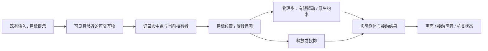

# 物理交互：让箱子有重量、门有阻力，放手后仍是同一个世界

**默认沿现有输入与角色系统，用原生 Rigidbody、简单碰撞体和最少的关节做“拿起→搬运→放下／投掷→推动机关”。** 需要被墙挡住、压动机关或影响别的物体的道具保持动力学；只是查看物品或插入背包的表现可以用非物理跟随。先决定玩家的控制承诺，再选择驱动方式，不把所有物体硬贴摄像机，也不为一只箱子引入完整 XR／布娃娃框架。

本页针对普通屏幕的 3D 道具与机关，XR、Unreal 作为现成能力对照。[角色／车辆和高速碰撞](../04-client-modules.md)保留原模块；[关卡与遭遇](../08-level-design-and-encounters.md)决定这些交互为何值得做。已核官方说明和固定样例源码，未运行 Unity／Unreal 或设备手感测试。

## 1. 品质目标与方案选择

**先让轻物、重物和受约束物可区分，而不是让所有东西都“能捡起来”。** 一间测试房放轻箱、重箱、铰链门、抽屉和落点台：轻箱响应快，重箱拖动较慢但仍能操作；门只绕铰链动，抽屉只沿轨道；放下后不抖动、不无故发射。运输任务还要让物体外形影响过门、转向和摆放。

《R.E.P.O.》的官方玩法把重钢琴与易碎陶器的搬运接到合作运输目标。可以借它的质量标准：重量、体积和碰撞结果改变玩家选择；不能从商店介绍推断其实现，更不必为普通单人项目照搬联网物理。不是物理核心玩法时，稳定、可预测的交互往往比全场景自由模拟更有价值。

| 需求 | 当前选择 | 适用成本／不采用理由 |
|---|---|---|
| 普通屏幕拿箱、推门、投掷，项目已有 Rigidbody | ✅ 保原交互入口，动力学道具用有限驱动；门先 HingeJoint，单轴抽屉用受限 ConfigurableJoint | Unity 没有一键完成全部玩法的通用拾取组件；只补本项目的选择、目标与释放适配 |
| 查看物品、手持装饰，不承诺推挡世界 | ✅ 可用显式的非物理展示／持有模式 | 不把此模式称为“有碰撞的重量搬运”；交还世界时仍找合法放置位置 |
| 已有 XR Interaction Toolkit | ✅ 直接用官方 Grab／Physics Interactables 站点与项目兼容版本 | 三种运动模式有不同接触承诺；高级 TransformJoint 含瞬移策略，见 §3 |
| 普通屏幕想先试现成资产 | 👀 Grab It 2.0.0：距离约束、旋转、投掷、质量曲线与铰链处理的候选 | 官方商店显示 2025-04-25、Input System、Standard EULA／Extension Asset；未购买、未试用，不能称为质量冠军 |
| 已有 Unreal 项目 | ✅ Physics Handle 搬物＋Physics Constraint 做门／轨道 | 沿原 Actor、输入与物理资产，不移植 Unity 关节脚本 |
| 只找到几行 Lerp／MovePosition 拾取教程 | 👀 用于理解输入与对象分工 | 没有受阻、质量、释放和机关验证时，不作为完整物理底座 |

依据与核实（2026-10-26）：[R.E.P.O. 官方玩法](https://store.steampowered.com/app/3241660/REPO/)、[Unity 官方 XRI 样例](https://github.com/Unity-Technologies/XR-Interaction-Toolkit-Examples/tree/881f7e197c7b0958621ebd1a05f249bbe254d36f)、[Grab It 官方页](https://assetstore.unity.com/packages/tools/physics/grab-it-105735)、[UE Physics Components](https://dev.epicgames.com/documentation/en-us/unreal-engine/physics-components-in-unreal-engine)。推荐取代“看到一个平滑跟随脚本就用于所有交互”；最高水平与实际维护成本排名未知。

## 2. 第一版接入：一个物体，一条运动写入路径

**在已能玩的场景里做测试房，不先创建新控制器。** 程序员先找到项目的交互 Input Action、玩家相机、物品选择／提示与碰撞层；新增道具 Prefab 和一个抓取适配入口即可。

- **候选选择**：相机射线／项目已有形状查询先决定可见目标，命中子碰撞体后定位所属 Rigidbody 与交互定义。遮挡层和可交互层分别想清楚，不能只查询道具层而穿墙选中箱子。显示距离、可抓／过重／被锁的原因。
- **抓取点**：用命中位置的局部锚点或作者指定握点，不默认从任意角落抓起都将物体中心瞬移到眼前。目标距离和旋转操作用现有输入方案，并让准星仍可识别空间。
- **执行**：输入更新只写意图，物理步由一个驱动更新刚体／关节目标；动画、手部 IK 和网络插值不再同时写同一刚体 Transform。画面跟实际物体，不让一只“视觉箱子”穿墙而物理箱子停在门外。
- **释放**：先停止持有驱动，再执行放下或一次投掷；保原物体身份与正常世界运动。若持有期间临时改重力、阻尼或碰撞配对，归还此次实际修改的值；不是统一把所有对象重力设为 true。
- **规则接缝**：机关读取其定义的接触／重量／位置条件并发已有玩法事件；拾取只代表持有，不自动等于获得背包物品或完成任务。

**Prefab 先配对，再调参数。** 一个动态刚体配少量 Box／Capsule／适合的 convex 碰撞体；碰撞轮廓以可玩接触为准，不直接照搬高面数渲染网格。检查模型单位、缩放、重心和握点，避免细长箱子的真实支点与视觉底部相差太远。小把手可用交互命中代理，不必让它承担整扇门的物理碰撞。

## 3. 搬运方式：跟手、重量与受阻不能同时靠瞬移得到

**需要真实接触的道具，用动力学驱动追目标，并允许目标与物体暂时有距离。** 对原生 ConfigurableJoint 路线，先在测试 Prefab 上配好局部 anchor／connectedAnchor、轴、自由度、spring／damper 和有限 maximumForce，再由现有交互层移动目标。不要在按下抓取时重新猜全部轴向；门与抽屉保留原约束，不换成自由物抓取。

| 手感症状 | 优先改什么 | 不要直接做什么 |
|---|---|---|
| 松手前一直像弹簧球摆动 | 降不必要的刚度、增加合适阻尼，检查目标跳变与重心力矩 | 把 spring 拉到极大并期待 solver 自动解决 |
| 重物和轻物一样灵巧 | 明确驱动力／加速度策略、允许质量影响响应，配合旋转阻力与声音 | 每帧统一改到相同速度，却宣称真实重量 |
| 靠墙后手在前、箱子滞后 | 减小目标穿入、提示受阻，超过可操作距离时放开或限制目标 | 无条件将实际物体传送到手边 |
| 门／抽屉被拿成自由物体 | 只驱动其允许的旋转／平移，抓点在把手 | 同时让抓取控制器锁全部轴、原关节又限制另一套轴 |
| 抖动只在画面出现 | 对照物理步轨迹与显示帧，检查 Rigidbody interpolation | 先提高全局模拟频率或用第二脚本平滑物理根节点 |

XRI 3.4 的官方 Grab 资料区分 Instantaneous、Kinematic、Velocity Tracking：前两者更快跟随，但不能由此承诺被静态几何挡住；Velocity Tracking 用速度／角速度追目标，允许接触响应，代价是可能滞后。已有 XR 项目从官方站点比较这三者，普通屏幕项目不必为此装 XR。

**高级样例也不是任意玩法的默认。** 固定源码 `TransformJoint.cs` 每物理步清速度，受阻时施冲量，并可临时改质量；`breakDistance` 超限直接 warp 到目标，`breakAngle` 超限直接对齐旋转。它是跟手与接触折中的示例，不是“关节断开距离”，也不保证不穿墙。用于任务箱、易碎物和门时，先明确自己的受阻政策，不能只复制同名字段。

依据与核实（2026-10-26）：[ConfigurableJoint 驱动与约束](https://docs.unity3d.com/6000.0/Documentation/Manual/class-ConfigurableJoint.html)、[XR Grab Interactable 3.4](https://docs.unity3d.com/Packages/com.unity.xr.interaction.toolkit@3.4/manual/xr-grab-interactable.html)、[TransformJoint 固定源码](https://github.com/Unity-Technologies/XR-Interaction-Toolkit-Examples/blob/881f7e197c7b0958621ebd1a05f249bbe254d36f/Assets/XRI_Examples/Global/Scripts/TransformJoint.cs)。XRI Examples 为 Unity Companion License，项目锁 XRI 3.4.0／Unity 6000.3；不把样例参数当量产默认。

## 4. 放、投、推、堆：做成可辨识的动作

**放下是停止持有并交回正常运动，投掷是另加一次明确的动作。** 保留合理的已有速度，按设计决定是否继承角色移动；若项目持有驱动清过速度，需要有意建立释放速度，而不是把最后一帧鼠标跳动直接当力。投掷预览也应从真实释放位置和本项目规则算起，不能从相机中心穿过近处障碍。

- **投掷重量**：同冲量对重物给更小速度变化；同 `VelocityChange` 不依赖质量。两者都可用于游戏，但必须与“重箱更难扔”的承诺一致。不要把按住投掷键的每一帧都加一次完整投掷冲量。
- **推门和抽屉**：HingeJoint 先只留一条旋转轴与适合的限位；抽屉只留轨道方向。用把手输入产生目标／力矩，门锁、关闭和机关完成仍是玩法状态。官方 Door 样例把旋钮、锁与门限位分开，值得借职责，不必照搬 XR 钥匙流程。
- **稳定堆放**：先用箱体和平面测试静止、推倒、再摆放；检查支撑面积、碰撞缝、重心和表面摩擦。两侧材料的 combine 规则共同决定摩擦／反弹，改箱子一侧的摩擦值不保证接触效果按预期变。
- **碰撞表现**：按接触强弱／物体材质选一次声音和视觉反馈，轻擦不是每步重复重击。易碎物可用内容规则映射冲击到损伤，不为了可玩运输先做通用断裂网格系统。

先排初始重叠、关节互相矛盾、极端质量比和非单位缩放，再局部比较 solver iterations／固定步长成本。CCD 只对需要的高速物体按[现有碰撞模块](../04-client-modules.md#高速碰撞先分运动与错误再选检测方式)选择，不解决错误的关节和交互语义。提高精度后仍必须回到原先的轻重手感与堆放测试。

依据与核实（2026-10-26）：[AddForce 的 ForceMode 语义](https://docs.unity3d.com/6000.0/Documentation/ScriptReference/Rigidbody.AddForce.html)、[官方关节稳定建议](https://docs.unity3d.com/6000.0/Documentation/Manual/RagdollStability.html)、[表面组合规则](https://docs.unity.com/en-us/engine/6000.0/manual/physics-section/physics-overview/collision-section/collider-surfaces/combine)、[Door 固定源码](https://github.com/Unity-Technologies/XR-Interaction-Toolkit-Examples/blob/881f7e197c7b0958621ebd1a05f249bbe254d36f/Assets/XRI_Examples/Physics/Scripts/Door.cs)。以上调校顺序是工程建议，未宣称已测出一套通用稳定参数。

## 5. 二改：轻箱搬运变成易碎长箱运输

**增加体积与脆弱性，而不是只把 mass 乘十。** 保原轻箱，新增长箱内容定义：新碰撞轮廓、握点、驱动上限／可旋转策略、冲击反馈和任务价值；继续用相同交互入口。

1. 在原房间增加一道转角和狭门；先确认长箱可以通过，但需要旋转／重新抓握，不把碰撞堵死当挑战。
2. 让玩家能看懂长箱受阻和轻微碰撞：局部受损反馈与任务价值变化来自同一次玩法事实，声音不代替损伤规则。
3. 降低可承担碰撞的余量时，保基本放置容错；重箱已慢、通道已窄，就先不同时缩短任务时间。
4. 玩家尝试推着走、提着走、丢上台面和在门边换姿态；分别看是否存在有意义的选择或显然最优的漏洞。
5. 复跑轻箱、门和抽屉：改长箱不能让所有物体都像黏在手上，也不能靠全局增大 solver 成本掩盖一个坏 Prefab。

若再加合作搬运，先回[联网与服务端](../07-networking-and-server.md)选择模拟权威与同物体多人作用政策；不让两客户端各自拥有同一个动力学刚体，不能把单人样例称为可直接同步。

## 6. AI 实施与真正的验收

**AI 适合找接入点、配内容、记录轨迹和复查变更；“更有重量”必须变成可以比较的动作。** 2026 年真实求助者用 spring joint 持物时出现振荡，评论提出阻尼、直接改位置与动力学驱动等互不等价路线；不能把票数或一条 Lerp 建议当品质结论。中文公开练习也展示了可读的输入／物体分工，但仅切重力＋MovePosition 跟随，缺少受阻与质量策略，且未见许可文件，不复制进产品。

给 Agent 的首项任务：

> 保现有角色、相机和交互 Input Actions，在测试房加入轻箱、重箱、铰链门、抽屉与落点台。先报告各物体的运动写入者、碰撞与持有模式，再复用原生约束和现有反馈。交可玩入口、轻重对照、墙边旋转与放投轨迹；第二轮增加易碎长箱，只改内容和必要适配。不要装整套 XR 或重写角色控制器来完成普通屏幕交互。

| 验收 | 需要的真实证据 | 常见 AI 失败 |
|---|---|---|
| 正常动作 | 选中、抓住、旋转、受阻、放下、投掷、推门连续可玩 | 只演示空旷处悬浮跟随 |
| 轻重与手感 | 相同操作下响应／旋转／落点可比较，玩家知道为什么推不动 | 只改 mass，实际驱动把差异全部抹掉 |
| 稳定与表现 | 物理步与画面轨迹、堆放和擦碰声，低显示帧率仍可操作 | 给物理根节点再加 Transform 平滑，两个系统争位置 |
| 规则 | 机关完成、破损、价值与同一次接触一致，门受锁约束 | 每个 collider callback 都结算一次、画面开门但规则仍锁 |
| 二改与设备成本 | 长箱没有破坏轻箱；最重接触场景的物理时间、活动体和约束成本 | 所有物体开最高 CCD／全局提高步频后只看平均 FPS |

来源与核实（2026-10-26）：[spring 持物作者与讨论](https://www.reddit.com/r/Unity3D/comments/1rpax1t/any_advice_on_how_to_get_items_grabbed_in_front/)、[中文练习固定源码](https://github.com/liangbinhi/Unity-Object-Pickup-System/tree/beb757dc1c2f207c8cddaa94ba8eff5fa11c56ad)。素材、代码与体验选择详见[研究记录](../../../docs/research/2026-10-26-physics-interaction.md)。
