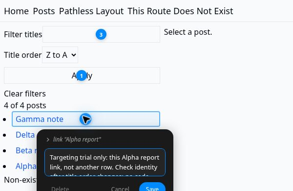

# 把页面批注交给另一个编码 Agent

核实时间：2026-10-24（UTC+8）。Agentation 3.1.2，dot 自有云端 Chromium 实试；没有调用模型修改应用。[本仓实试]

**已有 Codex 浏览器评论或 Cursor Design Mode 时先用原生；需要把多条反馈复制给不同客户端，再试 Agentation。** 本次验证的是反馈交接，不是更高的改稿成功率。[研究]

## 从现有页面开始

1. 在自己的 React 18+ 开发项目中安装开发依赖 `npm install -D --save-exact agentation@3.1.2`，按[官方安装](https://www.agentation.com/install)在开发入口挂载 `<Agentation />`；不要把调试工具默认发到生产环境。
2. 选 Standard，保留 Block page interactions，关闭 Clear on copy/send；分别点选两个元素，写清对象与意图，Copy 一次导出整批。
3. 将文本交给有源码访问权的 Agent，要求先核页面版本、对象文字和对应实现，再修改；截图补充布局，不以坐标替代身份。
4. 先退出批注模式再排序，重新开启后核对目标；页面重排或改稿后也须重确认；需要比较生产页面能力时，新建一条批注，不用旧批注中的 Source 字段作证。

这里不需要安装 Skill、连接 MCP、配置 webhook 或提供账号。[一手／本仓实试]

## 本次真实结果

载体是[已有 TanStack 示例](tanstack-url-state/README.md)在固定仓库 `45e1e0adb25e3411485abd9db3b4cdc9f0756c38` 的隔离副本。列表／详情请求地址改成本地夹具；只实际使用了四条虚构列表数据，未测详情或原外部 API。没有为工具制造待修 bug。[范围]

| 检查 | 实际结果 |
|---|---|
| 两条批注一起复制、刷新保留 | Apply 与 Alpha report 两条反馈保留并同批导出 |
| 选择器是否唯一 | Apply 命中 1 个按钮；Alpha 的路径命中全部 4 条链接 |
| 开发态 Source | 两条都指向 `src/posts.lazy.tsx:9:22` 的组件函数，不是按钮第 50 行 JSX |
| 排序后身份 | Alpha 移到第四行，旧标记仍在第一行 Gamma 上，编辑标题仍为 Alpha |
| 新建生产态批注 | 新输入框批注没有 sourceFile／reactComponents；旧开发态批注仍带保存的 Source |
| 实际组件字段 | Standard 且 React Components 开启，所获回调数据仍没有 reactComponents |

以上选择器计数和刷新观察是实际操作者回执；独审核了产物与截图，没有另跑第二次浏览器。普通按钮／链接的批注阻止了点击动作，特殊 pointerdown、移动端、其他框架未测。[本仓实试／范围]



**可携带的上下文不是稳定的元素身份。** 让 Agent 联合批注文字、页面状态和源码核对象；不能只凭 selector、旧坐标或保存的 Source 自动下刀。[研究]

## 两条原样导出片段

```text
### 1. button "Apply"
**Location:** .p-2 > section > .flex > .border
**Source:** src/posts.lazy.tsx:9:22
**Feedback:** Targeting trial only: identify this existing Apply button and its owning component; no UI change requested.

### 2. link "Alpha report"
**Location:** section > .list-disc > li > .block
**Source:** src/posts.lazy.tsx:9:22
**Feedback:** Targeting trial only: this Alpha report link, not another row. Check identity after title order changes; no code change requested.
```

## 版本、替代与复验边界

- npm 精确版本 3.1.2；tarball SHA-256 `599185b3e8fea5f0837f7b9f7d8d0fca79c250c30c4b1a539cf7d533affad8b9`，SHA-1／SHA-512 与 registry 元数据一致。另读[官方固定源码](https://github.com/benjitaylor/agentation/tree/0e3236eb1a0f5577852ab7bb5121f5dd46d42f1d)，没有证明该提交就是包的构建输入。[一手／本仓实试]
- 许可为 PolyForm Shield，不是 MIT；[官方说明](https://www.agentation.com/)允许内部使用，商业再分发另议，本仓不再分发其包或源码。[一手]
- [Codex 浏览器评论](https://learn.chatgpt.com/docs/browser)与[Cursor Design Mode](https://prod.cursor.com/docs/agent/design-mode)已经支持视觉反馈；只要点选后交给当前 Agent，就不必额外安装。只需取元素／组件上下文也可评估[React Grab](https://github.com/aidenybai/react-grab)，本轮未运行它或比较定位精度。[一手／研究]
- [Nodum 的十月使用日志](https://github.com/nodummd/nodum/blob/main/tasks/nodum-master-plan.md#6-progress-log)记录批注推动移动端修改，也记下 pointerdown 导航先于拦截的问题；是维护者自报，不是本仓复现，不能据此宣称官方支持手机。[社区]
- 本次安装禁用了 lifecycle scripts，构建与类型检查通过；未配置远端同步。一次渲染器崩溃经正常刷新恢复，原因未定，不能归因工具；没有完整网络审计、模型改稿收益或 hosted CI 结果。[范围]
