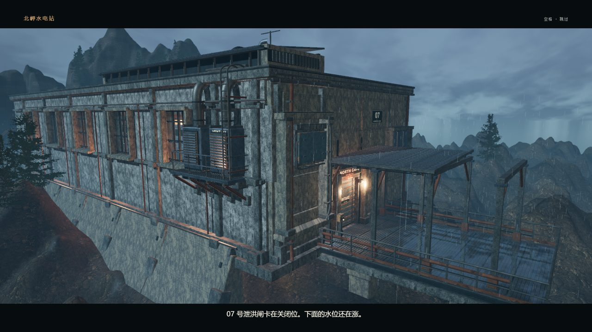
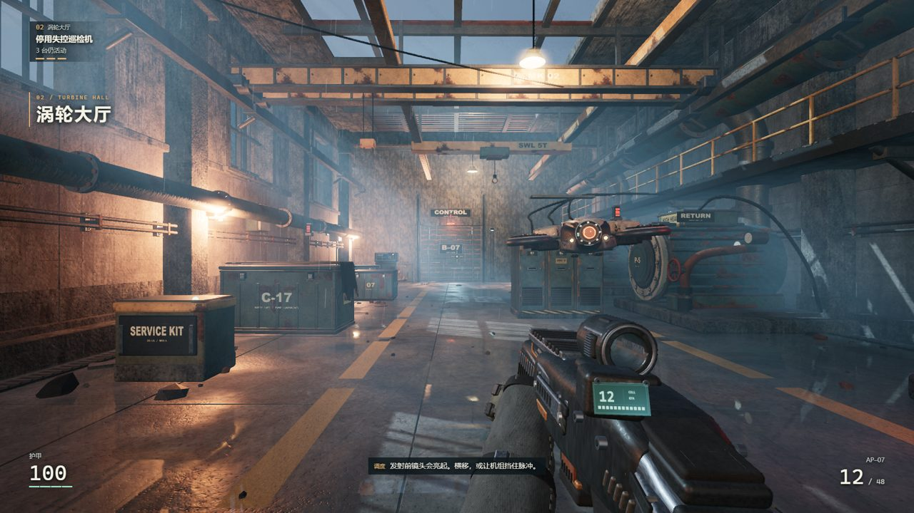
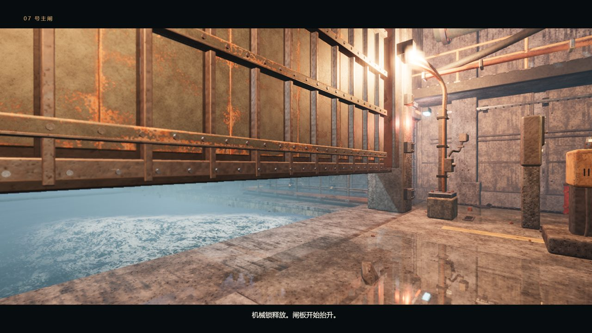
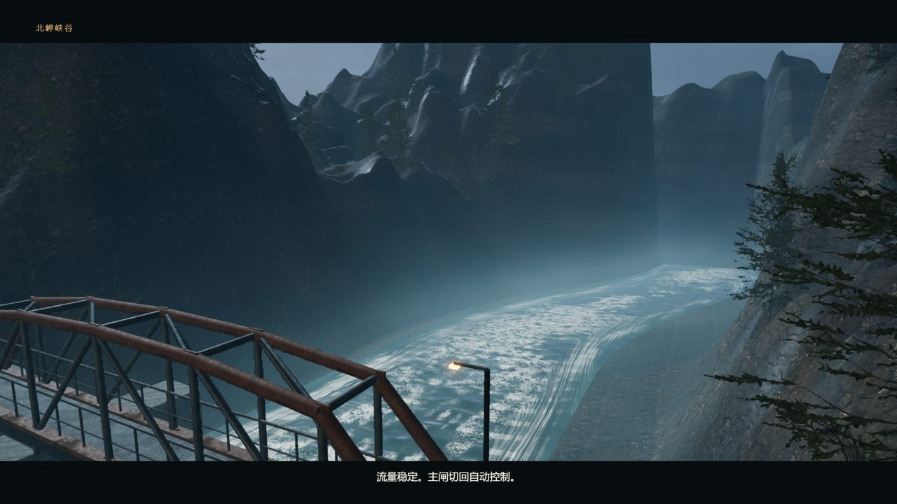

# 余压 / AFTERPRESSURE（FPS 小关卡试验，r10）

暴雨后，北岬水电站的 07 号主闸失去液压控制。沿检修栈桥进入电站，穿过涡轮大厅和主闸控制室，最后在峡谷观测台确认泄洪。由本机强执行者（Codex CLI，GPT-6.2 sol xhigh）全 AI 制作，方向会话只写目标和验收；**未达发售级 3A**。试验过程与各轮结论见 [demo 试验记录](../../docs/collaboration/demo-trial-20261117.md)。

| 涡轮大厅遭遇 | 闸板抬升镜头 | 峡谷收尾 |
| --- | --- | --- |
|  |  |  |

截图为 RTX 5070、Chromium（ANGLE D3D11）实机 1920×1080 原图缩到 1280 宽。

## 运行

本目录只含代码和 200 KB 以下的小素材。补齐方式：

1. `npm i`（依赖 `three@0.170.0`；跑 `npm run smoke` 还需 Playwright，可用 `PLAYWRIGHT_ROOT` 指向已装 Playwright 的目录）。
2. 按 [ASSETS-OMITTED.md](ASSETS-OMITTED.md) 的路径放回大素材，来源与许可见 [CREDITS.md](CREDITS.md)（Poly Haven / ambientCG 的 CC0 贴图、HDRI 与模型，按原名下载 1K/2K 版本）。
3. `npm start`，用支持 WebGL 2 的桌面浏览器打开终端显示的本机地址；`npm start -- --port 4328` 可指定端口。

| 操作 | 按键 |
| --- | --- |
| 移动 / 奔跑 / 蹲伏 | WASD / Shift / C 或 Ctrl |
| 射击 / 瞄准 / 换弹 | 左键或空格 / 按住右键 / R |
| 操作设备、领补给 | 面向设备按住 E |
| 跳过开场 / 暂停 / 隐藏界面 | 空格或 Enter / Esc / H |

## 关卡流程

| 段落 | 内容 |
| --- | --- |
| 检修栈桥 | 双镜头建立雨中电站，落到玩家视线；刷通行证升起卷闸。 |
| 涡轮大厅 | 三台巡检机：横扫的前哨、换位开火的第二台、蓄能时打开散热护板的重型机。 |
| 隔离门与控制室 | 接通旁路、升起隔离门；拉下主闸手柄，镜头从闸板下的起流切到泄水槽。 |
| 下游观测台 | 外侧栈道走到测流桥和河槽，回传流量，终镜拉到峡谷后结算。 |

## 关键技法与代码位置

| 位置 | 做法 |
| --- | --- |
| [layout.mjs](src/layout.mjs) · [sim.mjs](src/sim.mjs) | 固定 120 Hz 步进；移动碰撞、弹道遮挡和贴墙收枪读同一份场景实体；液压状态同时驱动设备、放流、声音和读数。 |
| [station.mjs](src/station.mjs) · [spaces.mjs](src/spaces.mjs) · [structures.mjs](src/structures.mjs) · [plant.mjs](src/plant.mjs) | 构件按材质合批；排风架、吊车、检修梯和桥梁做出可见的载荷连接；蓄放压驱动闸板、活塞、表针和状态灯。 |
| [art.mjs](src/art.mjs) · [hall-finishes.mjs](src/hall-finishes.mjs) · [site-assets.mjs](src/site-assets.mjs) · [surface-worker.mjs](src/surface-worker.mjs) | Worker 后台生成程序底材并解码 PBR；按构件局部坐标混合漆、底层与氧化皮，边缘、挂水与擦伤分别写入颜色、法线、金属度和粗糙度。 |
| [render.mjs](src/render.mjs) · [millrace.mjs](src/millrace.mjs) · [outside.mjs](src/outside.mjs) · [firs.mjs](src/firs.mjs) | HDR 环境与深度体积雾；放流时间控制涌浪、波冠、泡沫平流和岸侧回流；岩壁世界空间三轴投影；近岸针叶逐枝构造，远林用树冠图集。 |
| [viewmodel.mjs](src/viewmodel.mjs) · [shape.mjs](src/shape.mjs) · [surveyors.mjs](src/surveyors.mjs) | 截面放样生成武器与机体，变截面曲线生成手指；刷证、握杆各有姿态；敌机按命中部位后仰。 |
| [cinematics.mjs](src/cinematics.mjs) · [main.mjs](src/main.mjs) | 三段双镜头演出，轨道移动带注视点与按深度对焦，控制权平滑交接。 |
| [audio.mjs](src/audio.mjs) · [actors.mjs](src/actors.mjs) | Web Audio 合成脉冲、闸机和水流，掩体衰减敌机马达；材质接触产生反射方向火花与碎片。 |

`npm test` 跑完整任务、碰撞、掩体、弱点、检查点和放流的离线断言；`npm run smoke -- --screenshots` 在实际 GPU 的 Chromium 上走通任务、暂停、失败与重来并刷新截图。

## 到哪一步（本端复核，单次样本）

本机方向会话在 RTX 5070 上独立重跑 r10 的整关与 8 项测试；上一轮 r9 连续 3 次整关最长帧 33.3 ms。用户试玩 r7 后的评价是“整体感觉还可以，但是真正的画面和材质质量细节始终感觉还是没有更近一步”。r8–r10 主要补交互、命中反馈与放流演出；方向会话判断材质与形体仍在同一档。
