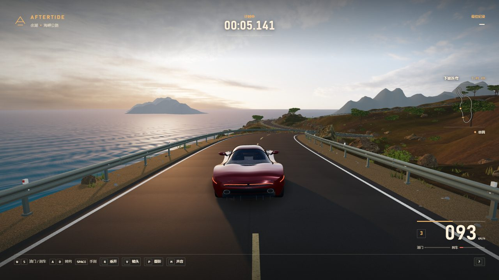
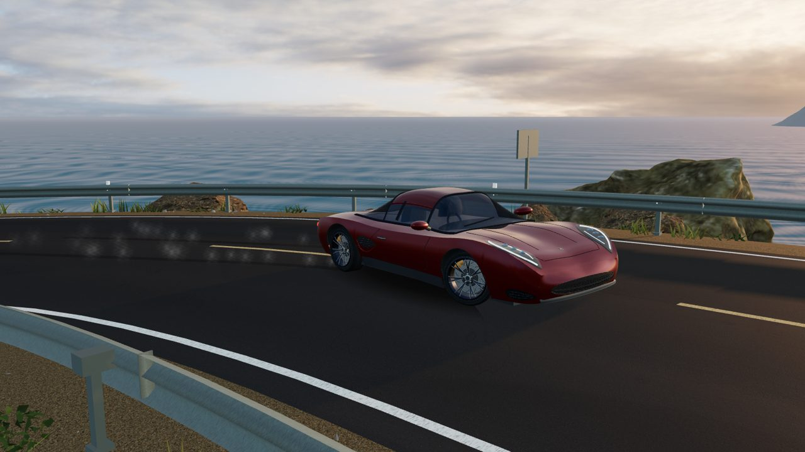
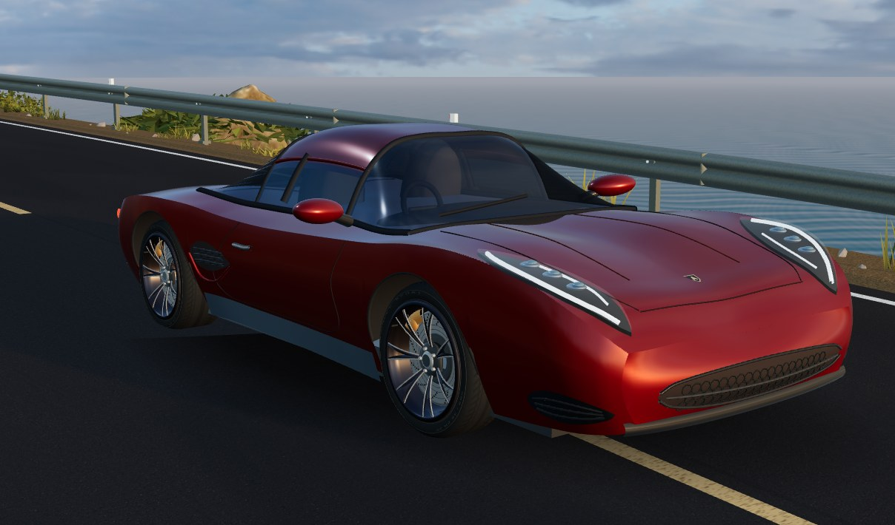
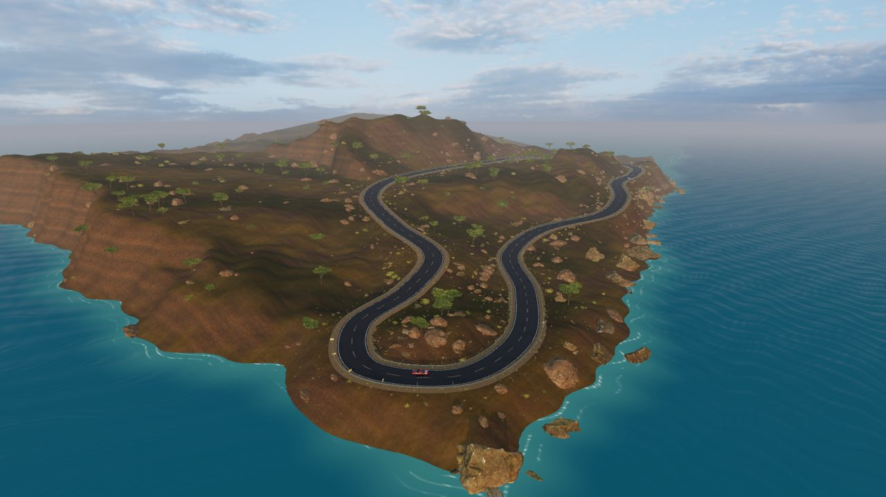

# 余潮 / Aftertide（赛车手感试验，键盘修正版）

开一辆原创后驱双座跑车，沿海岬公路下坡、在海湾掉头、再沿山脊开回起点，闭合路线约 1,009 m。由本机强执行者（Codex CLI，GPT-6.2 sol xhigh）全 AI 制作，方向会话只写目标和验收；**未达发售级 3A**。试验过程见 [demo 试验记录](../../docs/collaboration/demo-trial-20261117.md)。



| 发卡弯漂移 | 车头 1:1 裁切 | 海岸全景 |
| --- | --- | --- |
|  |  |  |

截图为 RTX 5070、Chrome（ANGLE D3D11）实机 1600×900 渲染；全景缩到 1280 宽，车头裁切保留原像素。

## 运行

本目录只含代码和 200 KB 以下的小素材。补齐方式：

1. `npm i`（`three@0.170.0`；浏览器回归与截图需要 Playwright 和本机 Chrome，画图需要 Python 与 Matplotlib）。
2. 按 [ASSETS-OMITTED.md](ASSETS-OMITTED.md) 的路径放回大素材，来源与许可见 [CREDITS.md](CREDITS.md)。
3. 双击 [PLAY.cmd](PLAY.cmd) 或 `npm start`，默认 `http://127.0.0.1:4328/`，端口被占时以终端显示为准。

| 键位 | 动作 |
| --- | --- |
| W / S 或 ↑ / ↓ | 油门 / 刹车，停稳后按 S 倒车 |
| A / D 或 ← / → | 转向（D 向右） |
| Space / R / V | 后轮手刹 / 重开计时 / 切换追尾距离 |
| P / T / H / M / ? | 摄影模式 / 遥测 / 隐藏界面 / 静音 / 键位帮助 |

## 关键技法与代码位置

| 位置 | 做法 |
| --- | --- |
| [vehicle.mjs](src/vehicle.mjs) | 浏览器与脚本共用的 120 Hz 四轮模型：各轮侧偏角、法向载荷与组合力，俯仰与侧向载荷转移各有响应时间，坡度进入纵向积分。键盘转向限速建立与回正，默认辅助对过量横摆做有上限的修正，手刹允许车尾外摆。 |
| [main.mjs](src/main.mjs) | 按键映射到追尾视角左右；相机分别平滑视线与车身位置，按侧滑量混合速度方向，起步、刹车、换挡驱动镜头反馈。 |
| [car.mjs](src/car.mjs) | 纵向截面生成车身，轮拱实体内衬；旋转截面胎体、分叉轮辐、打孔制动盘；车漆独立清漆粗糙度。 |
| [track.mjs](src/track.mjs) · [world.mjs](src/world.mjs) | 统一中心线、坡度与横断面；沿弧长铺设沥青法线、车辙与修补缝，W 型护栏实体截面；海面多尺度波法线与随距离滤波的高光；路段局部反射探针。 |
| [audio.mjs](src/audio.mjs) · [effects.mjs](src/effects.mjs) | 引擎声随负载与转速，轮胎近极限出声，换挡瞬态；按各轮侧偏和利用率留胎印与烟尘。 |
| [tools/](tools/) | `telemetry.mjs` 固定输入工况（起步、绕圆、单移线、发卡弯、手刹反打、擦栏、转向阶跃）；`check-keyboard.mjs` 用 Playwright 发真实按键做五项手感断言；`check-play.mjs` 浏览器整圈回归。 |

```powershell
npm run telemetry
npm run check:keyboard
npm test
```

## 到哪一步（本端实测，单次样本）

- 1600×900 行驶约 100 FPS，帧间隔 P95 10.1 ms。
- 用户对修正前版本说“操作手感还是一坨？左右方向还是反的？甚至稍微一打方向就会打转”，对本版说“至少是能玩了”。原因是旧版的固定转角回放绕过了键盘映射；本版改为用真实按键做验收。
- 同一车辆模型另试了“类人合成玩家”评估：能替代改控制后的重复回归，替代不了手感验收（见试验记录）。
