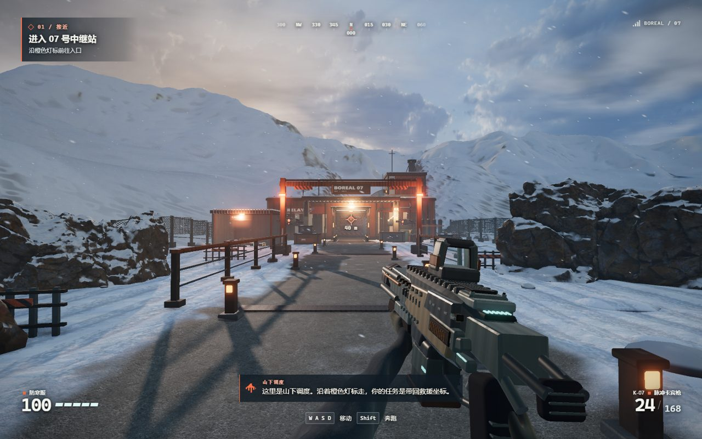
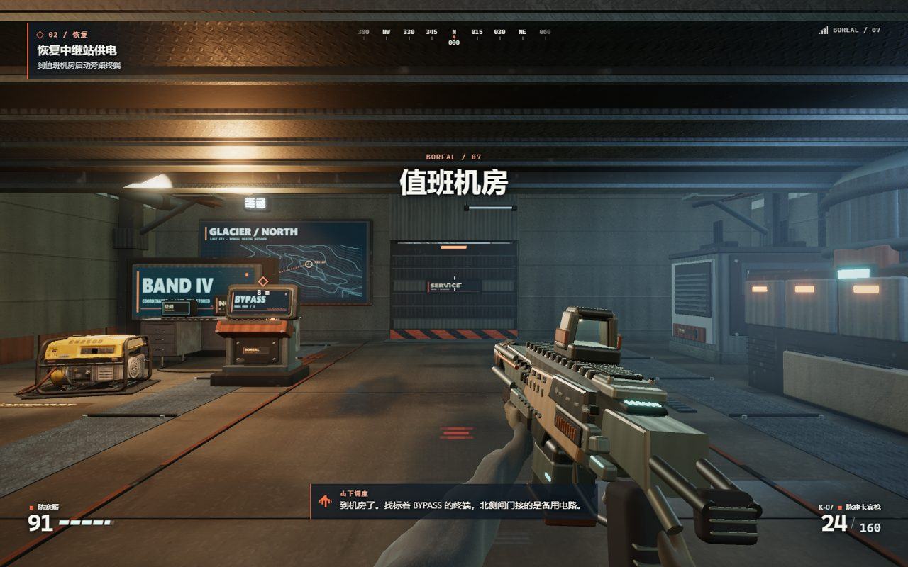
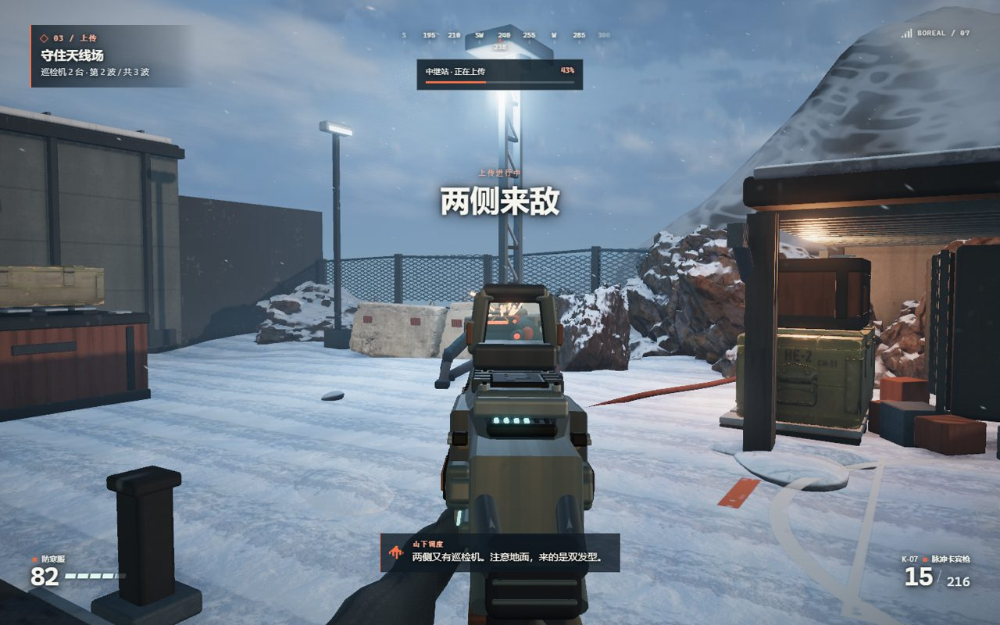
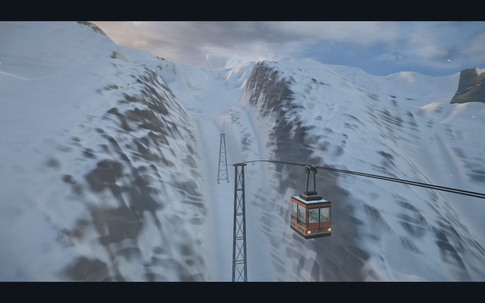

# 雪线回波 / PALE SIGNAL（FPS 标杆试验，2026-11-23 封存版）

一段原创单人网页 FPS：暴风雪中进入 07 号中继站，恢复备用电源、回传失联队伍坐标，再乘缆车撤离。由本机强执行者（Codex CLI，GPT-6.2 sol xhigh）全 AI 制作，方向会话只写目标和验收；**未达发售级 3A**。试验过程与结论见 [demo 试验记录](../../docs/collaboration/demo-trial-20261117.md)。

| 中继机房 | 巡检机交战 | 缆车撤离 |
| --- | --- | --- |
|  |  |  |

截图为 RTX 5070、Chromium（ANGLE D3D11）实机 1440×900 原图缩到 1280 宽。

## 运行

本目录只含代码和 200 KB 以下的小素材，直接运行会缺贴图、HDRI、扫描岩石、道具模型和手套网格。补齐方式：

1. `npm i three@0.170.0`（入口用 importmap 读 `node_modules/three`）。
2. 按 [ASSETS-OMITTED.md](ASSETS-OMITTED.md) 的路径放回大素材：Poly Haven / ambientCG 文件按 [assets/CREDITS.md](assets/CREDITS.md) 的链接下载 1K 版本并按原名放置；`alpine.r16`、`alpine-ortho.jpg` 是按 CREDITS 所列新西兰 DEM 与影像（CC BY 4.0）裁切重采样得到的。
3. 手套网格 `assets/gloves.json` 由 `python tools/build-gloves.py` 从 CC0 MakeHuman 手部数据生成（数据放在 `evidence/makehuman-source/`）；两级岩石由 `python tools/build-rock-lod.py` 从 Poly Haven Boulder 01 生成。
4. `node serve.cjs`，用支持 WebGL 2 的桌面 Chromium 打开 `http://127.0.0.1:8270/`。

| 操作 | 按键 |
| --- | --- |
| 移动 / 奔跑 / 跳跃 | WASD / Shift / Space |
| 射击 / 瞄准 | 左键 / 右键 |
| 装填 / 交互 / 暂停 | R / E / Esc |

## 关键技法与代码位置

| 位置 | 做法 |
| --- | --- |
| [alpine.js](src/alpine.js) · [world.js](src/world.js) · [tracks.js](src/tracks.js) | 真实 DEM 高程裁切成远山，近处坡型、露岩脊和冲沟在其上改造；远山的太阳遮蔽和低洼度按实际高度计算；岩雪分布用世界尺度的扫描岩石材质。缆车线路和高度采样共用一份地形。 |
| [atmosphere.js](src/atmosphere.js) | 风雪与体积雾：半分辨率积分、全分辨率深度重建，屋顶覆盖区域屏蔽室内落雪。 |
| [visual.js](src/visual.js) · [hall-reflection.js](src/hall-reflection.js) · [station.js](src/station.js) | 扫描 PBR 与程序噪声混合的表面函数；中继机房的局部反射；站房构件合批。 |
| [first-person.js](src/first-person.js) · [glove-rig.js](src/glove-rig.js) · [actors.js](src/actors.js) | 起跑、急停、落地用实际位移和触地状态驱动前臂、武器、脚步与足印；装填分腾手、抓住、脱开、送回阶段，旧电池落入场景；终端按钮与手部动作同帧。手套取 CC0 MakeHuman 手部拓扑，细分增厚后用原始顶点权重四权重蒙皮，绑定逐指接触约束。 |
| [combat.js](src/combat.js) | 地面移动、射线与遮挡；巡检机脉冲有飞行时间，可躲闪或借货箱遮挡。 |
| [audio.js](src/audio.js) · [cinematic-assets.js](src/cinematic-assets.js) | 脚步按地面材质取 CC0 采样，其余 Web Audio 合成；音频图与脉冲响应在加载阶段准备，避免开场长帧。 |

## 实测与已知差距（本端实测，单次样本）

- **性能**：RTX 5070 独立不录制一次通关，帧间隔中位 16.7 ms、P95 16.8 ms、P99 33.3 ms、最长 50.0 ms；载入菜单约 5.6 s。
- **到哪一步**：光照、天空和色调已经成熟。雪山近处形体偏柔、岩层与雪粒尺度能看出程序生成；第一人称枪身仍由方块拼成；手套面数低，衣褶与极限腕姿可见拟合痕迹。
- **原因判断**：前几轮纯代码改进没让这三项跨档；任务说明承诺的 Blender 与 3D 生成当时执行者用不上。后续用 Blender 重做这三项的试验结论见试验记录第六批。
