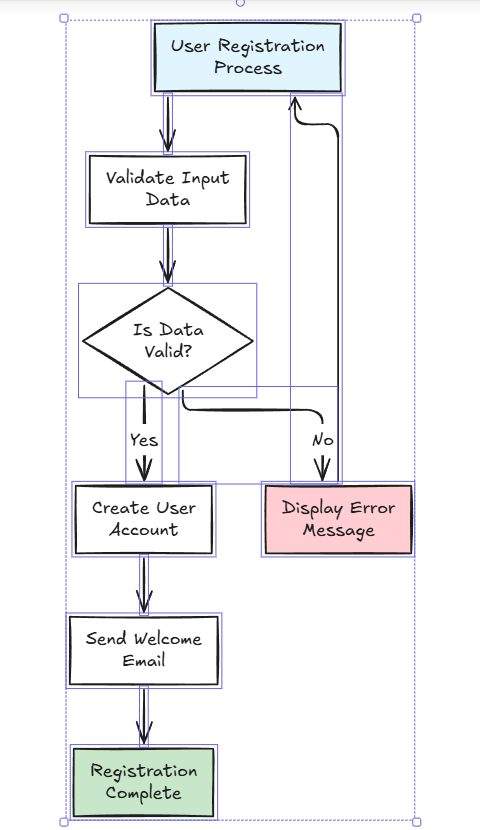

# Excalidraw #9708 预检：固定基线不复现，本题 blocked

**结论：在卡片固定的 `c0a0ca348faa273c768de839a22df113f997c095` 上，原 issue 的 Mermaid 输入经真实应用导入后已正确分行，没有字面 ` `。按冻结协议“无法复现则该题 blocked，不换题、不计方法失败”，两臂均未启动模型。** [本端实测，11-18]

## 怎么测的

- 依赖：`corepack yarn install --frozen-lockfile`（yarn 1.22.22，Node 22.23.2），lockfile 内 `@excalidraw/mermaid-to-excalidraw` 3.6.0。
- 入口：`excalidraw-app` 的 Vite 开发服务（端口 3001），Playwright 1.64.1 驱动 Chromium（硬件 GPU，ANGLE d3d11）。
- 操作：打开 Mermaid 对话框（与工具栏菜单同一个 `setOpenDialog({ name: "ttd", tab: "mermaid" })`），在编辑器里粘贴原 issue 的完整 graph TD 输入，等预览后按 Ctrl+Enter 插入画布，再读场景里的文本元素。

## 结果

- 9 个文本元素：两条边标签 `Yes`、`No`，7 个节点文本全部是带换行符的两行文本（如 `User Registration\nProcess`）；含 ` ` 的为 0；页面无未捕获错误。
- 画布截图见下，节点分两行显示，填充色按 `style` 生效。

## 对后续的含义

- 这题已在上游修掉（或 issue 针对的是更早的库版本／线上站点），在固定基线上无缺陷可修，不能用作对照题。
- 换题需由 dot-A 决定；方向会话不自行换题。建议给 2–3 个候选（界面类、能在本机浏览器真实入口复现），方向会话逐个预检，取第一个在固定 SHA 上复现的。
