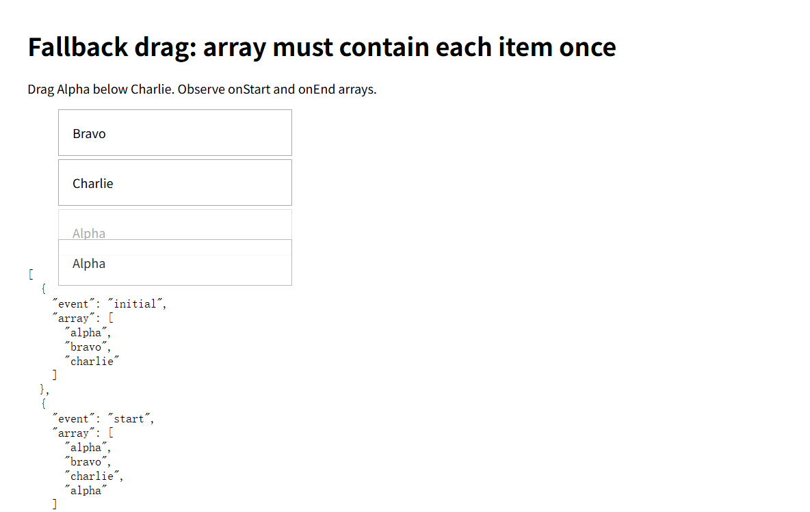

# Sortable #2456 预检：固定基线复现，首选候选成立

**结论：在 1.15.6 / `63ecb31937d19fcb30aa924e82ee8a769ef34492` 上，`forceFallback: true` 拖拽时 `onStart` 内 `toArray()` 返回 4 项，Alpha 重复一次（`["alpha","bravo","charlie","alpha"]`），释放后的 `onSort`/`onEnd` 为正常的 3 项。连续三轮一致，判定 reproduced。按冻结协议取首个复现项即停止：候选 2（#2469 destroy-recreate）未检查，未启动任何模型。** [本端实测，2026-11-18]

## 基线与输入

| 项 | 值 |
|---|---|
| 候选 | fallback-array（[SortableJS/Sortable #2456](https://github.com/SortableJS/Sortable/issues/2456)） |
| 固定基线 | 1.15.6，`63ecb31937d19fcb30aa924e82ee8a769ef34492` |
| 页面 | 候选包 `fixtures/fallback-array.html` 原样复制为检出根目录 `preflight.html`，未改库、未注入错误或时间条件 |
| `Sortable.js` SHA-256 | `ef647f5de9f6229193bcf1c024e706b24aa1a73fb3876a1fc7b780f16d4200f7`（与候选包记录一致） |
| `preflight.html` SHA-256 | `0640d39018716a39a3856aa96c5188b569ce135c1694c7429d383b2ddea7c39d` |
| 源码包 SHA-256 | `a97dcf55a43763384e4c5d58786ca8c2482928461ac4ee415628634674f09f7c` |

源码包经 `https://codeload.github.com/SortableJS/Sortable/tar.gz/63ecb31937d19fcb30aa924e82ee8a769ef34492` 获取，解压后 `package.json` 版本为 1.15.6。未读取上游修复提交、issue 评论、规避方案或本项目旧补丁。

## 环境与入口

- OS：Windows 11 Enterprise 10.0.26300。
- Node 22.23.2；Python 3.13.5。
- 浏览器：Playwright 自带 Chromium 156.0.8078.4，`--headless=new --disable-gpu`，CDP 1.3；无可见窗口，未做桌面键鼠操作。
- 页面服务：`python3 -m http.server 8765 --bind 127.0.0.1`，地址 `http://127.0.0.1:8765/preflight.html`。
- 拖动由浏览器内 CDP `Input.dispatchMouseEvent` 完成；截图为 `Page.captureScreenshot`。

复跑入口（统一从**仓库根目录**执行；`<checkout>` 为候选固定 SHA 的解压目录，`<tmp>` 为任意临时目录。静态服务会占住终端，驱动命令另开终端执行）：

```
# 仓库根目录：把候选页面放进检出根目录
cp experiments/strong-short-task-20261117/ui-replacement/fixtures/fallback-array.html <checkout>/preflight.html
# 仓库根目录：在检出目录启动静态服务（占住当前终端）
cd <checkout> && python3 -m http.server 8765 --bind 127.0.0.1
# 另开终端，仍在仓库根目录：驱动脚本按仓库相对路径直接运行
CHROME_PATH=<chromium>/chrome.exe CHROME_PROFILE=<tmp>/chrome-profile \
  PAGE_URL=http://127.0.0.1:8765/preflight.html OUT_DIR=<tmp> \
  node experiments/strong-short-task-20261117/ui-replacement/results/preflight-driver.mjs
```

该块于 2026-11-18 按原文从仓库根目录复跑（1.15.6 固定基线检出，Chromium 156.0.8078.4 headless）：驱动 exit=0，三轮 start/sort/end 数组与本记录一致，九张截图逐字节相同。注意 `python3 -m http.server` 会占住终端，需另开终端执行驱动命令；端口被占用时按候选包约定换空闲端口并同步 `PAGE_URL`。

驱动脚本见 [preflight-driver.mjs](preflight-driver.mjs)，完整三轮原始记录见 [fallback-preflight-result.json](fallback-preflight-result.json)。

## 实际动作

每轮重新加载页面，读取 initial 数组；在 Alpha 中心按下左键，向右下各移动 4 px 触发 fallback 拖拽；读取 start 数组并截图；再分 10 步移到 Charlie 下方，释放前截图；释放后读取 sort/end 与最终 DOM 并截图。重复三轮，未人工修补或重跑筛选。

## 结果

逐轮事件数组：

| 轮 | initial | start（拖拽中） | sort（释放后） | end |
|---|---|---|---|---|
| 1 | alpha, bravo, charlie | **alpha, bravo, charlie, alpha** | bravo, charlie, alpha | bravo, charlie, alpha |
| 2 | alpha, bravo, charlie | **alpha, bravo, charlie, alpha** | bravo, charlie, alpha | bravo, charlie, alpha |
| 3 | alpha, bravo, charlie | **alpha, bravo, charlie, alpha** | bravo, charlie, alpha | bravo, charlie, alpha |

- 拖拽开始后列表 DOM 子项为 `alpha, bravo, charlie, alpha`，其中第 4 项是 `ghost` 临时克隆；释放前 DOM 为 `bravo, charlie, alpha, alpha`，克隆仍在。释放后克隆移除，最终 DOM 为 `bravo, charlie, alpha`，`sort`/`end` 数组正确。
- 缺陷只出现在 `onStart`：`toArray()` 把临时克隆计入，数组比 `onSort` 多一项，与报告一致。
- 页面自身无未捕获异常。第 1 轮有一条静态服务 404 日志；页面只引用存在的 `Sortable.js`，`/favicon.ico` 由浏览器自动请求且服务确为 404，第 2、3 轮无错误。





三轮同阶段截图字节一致，run1–run3 全部保存在本目录；按阶段哈希：drag `159379d377ac27937d4bf0b333b4d1d7fe4a0ada048a773df12b041bc06ba4d9`，release `8f9fe314a66de8a3e7745708012892762b811a2ea3dfa73f8d27edf47e150634`，final `f8c2d6e6355997ce7284183f425f3380d397de06f1317326439e712eb16ca8c3`。

## 判定与后续

- 判定：**reproduced**。首个候选已复现，候选 2 未检查；未启动模型对照，未改动库，未加题。
- `RUN-ENV.txt` 尚未生成；提升成对卡时由 dot-A 按本记录冻结版本、命令、复现步骤和观察，不改动行为描述。
- 设置与素材准备约 3.5 分钟（09:37:47–09:41:16 UTC），三轮自动化拖拽约 4.5 秒（09:41:24–09:41:29 UTC），驱动从启动到写出结果约 13 秒（自 09:41:16 起算）；全部为本机公开工具，计费 0。