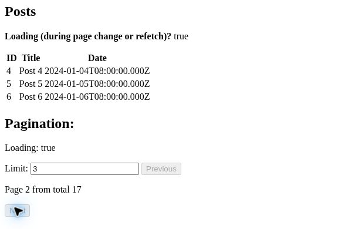
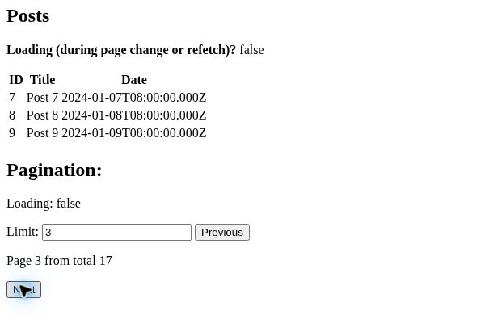

# SvelteKit 翻页时保留旧行并显示等待

在固定公开示例里，保留 `await`，将翻页提示与 Previous/Next 的 disabled 依据改成 `$effect.pending() > 0`。这两处修改已在编译后组件试验与真实浏览器正常路径通过；不是全场景或部署接收。

## 来源和范围

- 真实需求：https://github.com/sveltejs/kit/discussions/14945
- 目标：https://github.com/davidbaranek/sveltekit-demo/tree/7dea2077f4851e7709b68db11eb6f3e02c0dfa46
- 固定 lockfile：Kit 2.48.5、Svelte 5.43.10、Runed 0.36.0、Vite 7.2.2。
- 官方 Skill：https://github.com/sveltejs/ai-tools/tree/b2589f890e9c5c4a788a557315aa5012d1fba4ba/tools/skills
- 官方机制：https://svelte.dev/docs/svelte/await-expressions#Indicating-loading-states
- 核实：2026-10-23。Skill 的 async 参考资料帮助确定 pending 语义；并未验证原生自动触发或模型增益。官方 @sveltejs/mcp 0.1.27 的 autofixer 已执行，传入 --async --svelte-version 5.43.10，结果无 issues／suggestions；它只是静态分析，不替代行为验收。

已有 boundary pending 只显示首次等待。组件后续 await 会协调状态提交，因此查询对象的 loading 不等于用户此刻可见的后续等待状态。本例原版静态检查 0 错误，运行组件仍出现 pending=1、旧行保留、两按钮未禁用。补丁后等待提示变 true，两按钮禁用，完成后显示新行并重新启用。

Limit 输入没有禁用。`$effect.pending()` 是所在边界异步工作的计数，不是通用网络请求计数，复杂页面应先判断边界范围是否符合交互。

## 可重放

本次 Node 24.19.0；固定 Vite 7.2.2 要求 Node ^20.19.0 或 >=22.12.0。

脚本显式核对固定 Svelte/Kit 版本、必要文件、Query 类标记和独立 jsdom 版本，不匹配就停止。每次生成文件都放入新建的 `.svelte-refetch-trial-*` 目录，保留供检查，不覆盖既有 `.trial`；整个一次性副本验完可按自己的文件管理流程清理。

只在一次性目录使用。上游未发现明确 LICENSE，本包不包含上游整份代码；脚本从读者自行取得的固定公开副本与 npm 依赖读取必要源码。

1. clone 目标仓库，checkout 上述 SHA，审查 package.json 和 Vite 配置。
2. 在应用目录运行 `npm ci --ignore-scripts --no-audit --no-fund`。缓存目录需要可写时使用 `--cache <自己的可写缓存>`。不要为加测试依赖而更新应用 lockfile。
3. 另建一次性工具目录，写入 package.json：`{"private":true,"dependencies":{"jsdom":"26.1.0"}}`，在该目录运行 `npm install --ignore-scripts --no-audit --no-fund`。
4. 将本包全部 .mjs 文件放到应用根目录。先运行 `node preflight-check.mjs` 检查前置条件校验器的正常、缺输入和错误版本分支。设置环境变量 SVELTE_TEST_TOOLS 为第 3 步目录的绝对路径。
5. 原版运行 `node trial.mjs`：必须失败在 pending 按钮应禁用的断言。`node trial.mjs --baseline` 则检查并报告已知原版失败现象，不代表修复通过。
6. `git apply <本包路径>/refetch-loading.patch` 后，`node trial.mjs` 应通过等待、成功和失败边界检查。
7. `node server-check.mjs` 检查真实服务端 schema/handler 和独立服务器渲染；`npm run check` 检查类型。`npm run build` 已在相同固定源码与补丁的干净副本完成，记录见 [构建回执](build-result.json)。

## 验收与局限

- 已通过：编译后的实际 Data/Pagination/+page 组件与 Kit 2.48.5 Query 类在 jsdom 中的初次 pending、旧行保留、等待提示、Previous/Next 禁用／重新启用、新行提交、拒绝后进入失败边界。
- 已通过：实际 data.remote.ts 的 Zod schema 和 handler，第二页 IDs 6–10；缺 page/limit 时默认 1/10，缺整个参数对象或 page=0 拒绝。
- 已通过：实际组件的独立 Svelte 服务器渲染保留首次 pending 文本，没有初始数据表。这并不声称 SSR 输出首屏帖子；原例本来就由 pending boundary 输出占位。
- 已通过：修改前后 svelte-check 均 0 错误／0 警告；git diff --check。
- 已通过：同一源码、两行补丁与lockfile的干净副本执行生产构建退出0，生成SSR及客户端产物；adapter-auto未识别部署目标，不等于已部署。
- 后续真实浏览器正常路径已补验，见下；请求缓存／重复请求、专门hydration诊断、错误reset/retry及部署仍未验。

初始组件试验使用真实编译器和真实 Query 类，但替换 URL 状态及响应来源，以手动 resolve/reject 控制等待，不替代全应用测试。server-check 分别验证服务端数据契约与 SSR，不是端到端客户端／服务端往返。

## 真实浏览器：等待保旧行，完成后交新页

2026-10-23 23:14–23:22（UTC+8），同一补丁和依赖锁的生产构建经普通Vite预览运行；Chrome真实调用原例内存数据handler，保留原4秒延迟，没有替换响应。[逐项记录](browser-acceptance.json)覆盖首次等待、双向翻页、Limit／页码URL同步、新标签页重开及刷新。[本轮真实客户端]

下图是**实际页面局部截图**，不是重绘：limit3从第2页前往第3页时，旧Post4–6仍在、Loading为true、两按钮禁用；完成后变为Post7–9、Loading为false、按钮恢复。

Limit仍可编辑。本轮还观察到查询对象loading与可见边界pending不一致，因此只能接收界面等待行为，不能说网络活动、重复请求或缓存问题已经解决。图片呈现两种状态，其他交互结论以逐项记录为依据。[本轮实测／范围]
