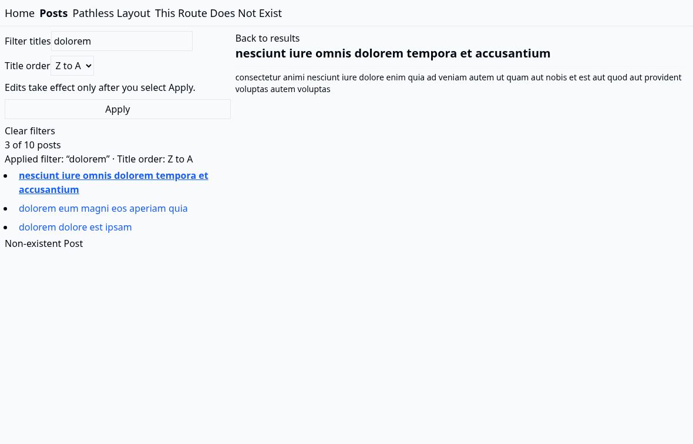

# 在官方 Router 示例里，把筛选变成可分享的页面状态

核实时间：2026-10-24。🧪 试用：给已经使用 TanStack Router 的项目，按当前安装包加载窄领域 Skill，再用真实应用的导航验收它。无需为两个字段再装 Zod，也无需启用整套 agent hooks。[本轮实测／研究]

本产物在官方 React basic 示例上新增 Posts 标题筛选、A→Z／Z→A 排序、清空与返回结果；不是上游缺陷修复或真实客户委托。读者可直接运行，也可把 `posts-search.ts` 和父路由的 search 配置迁入现有项目。

## 立即运行

需要 Node.js 24（本轮 24.19.0）和 npm。所有依赖与 lockfile 已固定；首次安装需访问公开 npm registry。以下命令从本仓根进入实验目录后运行：

```sh
cd experiments/tanstack-url-state
npm ci
npm test
npm run build
npm run dev
```

打开 Vite 输出的本地地址，进入 Posts：输入标题片段，选择 Title order，按 Apply；打开任意结果后，地址仍带筛选与排序，Back to results 保留状态。Clear filters 删除默认参数。复制详情地址，在新标签页打开也应恢复筛选状态。生产示例沿用上游 JSONPlaceholder 请求，因此手动运行需要网络；自动测试使用独立手写数据，不依赖该服务。

Apply 提交一次历史记录，不为每个按键生成记录；尚未提交的输入只是表单草稿。筛选不区分英文大小写，忽略首尾空白；排序固定英文 locale，标题相同时按 ID 打破平局。浏览器后退恢复的是已应用状态。

## 接收页面反馈：让已应用条件可见

**反馈不能只说“这里不清楚”：把对象、期望变化和保留行为一起交给 Agent。** 本轮源码审查发现，表单允许保留未提交草稿，页面却只显示结果数量；接手者据此增加已应用的筛选／排序摘要，并在 Apply 旁说明提交后生效。[本仓实试／研究]

可复制的任务入口：“在 Posts 结果数量旁显示当前已应用的标题条件与排序；在 Apply 旁解释输入需提交才生效。摘要从 URL 的 q／sort 读取，不新增平行状态；保留提交、详情、清空及前进／后退行为。证明只改输入时摘要仍显示旧条件，提交后才一起更新。”[本轮任务]

关键实现选择不是加一段文案，而是**摘要读取已应用的 URL，不读取表单草稿**；这复用了前述依赖配方的单一状态来源。两处源码／测试改动通过 8 项真实 Router＋React DOM 测试及构建／类型检查，读者可用上面的入口运行。[本仓实试]

本轮输入来自源码审查，不是 Agentation 实采导出；旧两条批注明确没有要求修改。新版已补真实浏览器接收，草稿、提交与历史恢复均符合上述选择；本次未观察到需要继续改动的问题，因此没有新增批注或制造修改链。[范围]

## 新版真实浏览器接收

2026-10-24 03:38（UTC+8），同一份已交付源码在真实云端 Chrome、原 JSONPlaceholder 数据请求下完成接收：修改草稿不改变已应用摘要，Apply 后摘要与结果一起更新；详情返回、清空、浏览器前进／后退、新标签详情链接与刷新、空结果均符合预期。[本仓真实客户端；[版本与观察记录](browser-acceptance.json)]



可借用的接收方式是同时看输入草稿、URL、摘要和实际结果，而不只断言一个标签变了。本轮仅覆盖桌面这条使用路径，未验移动端或模型收益；源码反馈促成的修改与真实批注促成的修改仍分开记录。[本仓实试／经验]

## 真正可借用的三处选择

1. **共享状态放在父路由。** `/posts` 的 `validateSearch` 将不可信 URL 值收窄为可用值，子详情继承相同 schema。组件从 `Route.useSearch()` 读取，不另建一份 React 状态当真源。
2. **保留与清空要一起设计。** `retainSearchParams(['q', 'sort'])` 让详情链接保留筛选；`stripSearchParams({ q: '', sort: 'asc' })` 让默认 URL 简短。Clear 必须显式给默认值，不能假定空对象会覆盖 retain。测试同时走详情、返回、清空、后退与前进。
3. **先分清本地展示与取数依赖。** 这里筛选的是已加载的前十条帖子，没有把所有 search 塞进 `loaderDeps`。服务器筛选／分页若依赖字段，才把实际取数需要的字段加进去。

原来的 Home、Pathless Layout、根 not-found 和 Non-existent Post 演示保留。假帖子单独放在结果列表外，不混入过滤数量。原 `posts.ts` 未修改。为了让 URL 重建可验，路由声明移入 `router.tsx`，`main.tsx` 只负责挂载；测试使用同一份路由和组件。

## 窄 Skill 的复制入口

本轮 `@tanstack/react-router@1.170.46` 精确依赖 `@tanstack/router-core@1.171.39`。Intent 是可选开发依赖，不是运行时功能所需。

在 `experiments/tanstack-url-state`（先按“立即运行”从本仓根执行 `cd experiments/tanstack-url-state && npm ci`；首次安装需访问公开 npm registry）先确认实际安装版本；`npm ls` 只读，不安装：

```sh
npm ls @tanstack/react-router @tanstack/router-core @tanstack/intent
```

再从这个消费包解析传递依赖并只读配方。下面的 Node 从 `@tanstack/react-router` 自身的安装位置解析 `@tanstack/router-core`，不假设 npm 把传递依赖提升到顶层；pnpm 的目录布局由同一 Node 解析处理，已在 pnpm 11.21.0 的真实布局实测：

```sh
node --input-type=commonjs <<'NODE'
const { createRequire } = require('node:module')
const { dirname, join } = require('node:path')
const { existsSync, readFileSync } = require('node:fs')

let routerPkg
try {
  routerPkg = require.resolve('@tanstack/react-router/package.json')
} catch {
  console.error('缺依赖：当前目录解析不到 @tanstack/react-router；按项目原方式安装后再读取，本入口不下载。')
  process.exit(2)
}

const routerVersion = JSON.parse(readFileSync(routerPkg, 'utf8')).version
const router = createRequire(routerPkg)
let corePkg
try {
  corePkg = router.resolve('@tanstack/router-core/package.json')
} catch {
  console.error(`已安装 @tanstack/react-router@${routerVersion}，但解析不到它声明的 @tanstack/router-core。`)
  process.exit(3)
}

const coreVersion = JSON.parse(readFileSync(corePkg, 'utf8')).version
const skill = join(dirname(corePkg), 'skills/router-core/search-params/SKILL.md')
console.log(`@tanstack/react-router ${routerVersion}`)
console.log(`@tanstack/router-core ${coreVersion}: ${corePkg}`)
if (!existsSync(skill)) {
  console.error('已安装该版本，但包内未附 search-params Skill；按对应版本的官方指南或源码核对。')
  process.exit(4)
}
process.stdout.write(readFileSync(skill, 'utf8'))
NODE
```

按退出码区分：`2` 是当前目录缺 Router，先按“立即运行”的 `npm ci` 安装，读取入口不下载；`3` 是 Router 已安装但解析不到它声明的 router-core，核对版本与依赖声明；`4` 是该版本包内未附此 Skill，改读对应版本的官方指南或源码；`0` 且输出正文才是读到配方。读取成功只说明正文进了终端，不等于 agent 自动加载或模型遵守。

Intent 只在已安装时走；未安装时不调用 `npm exec`，直接用上面的 Node 只读入口：

```sh
if node --input-type=module -e "import.meta.resolve('@tanstack/intent')" >/dev/null 2>&1; then
  npm exec --no -- intent list --json
  npm exec --no -- intent load '@tanstack/router-core#router-core/search-params' --json
else
  echo '未安装 Intent：跳过可选 CLI，上面的 Node 入口已能读到正文。'
fi
```

本轮 list 确实发现了传递依赖 router-core，load 返回该本地包的 Skill（source: local；path: node_modules/@tanstack/router-core/skills/router-core/search-params/SKILL.md；version: 1.171.39）。这是手动 CLI 加载并阅读，不是原生 agent 自动激活验证。它的文件内容与固定上游提交一致，但 `library_version` 仍写 `1.171.15`。因此“随包交付”解决定位，不保证文档每项都已按该版本校正；最终仍对照当前源码与消费端测试。不要把发现列表全部当可信指令，也不要仅为加载这个 Skill 安装 hooks／全局配置。[本轮实测／一手源码]

读到正文后按“立即运行”的 `npm test` 和 `npm run build` 验收实际行为，读取成功不等于应用通过。

交给 coding agent 的短任务可以是：

> 在现有 Posts 页实现可分享的标题筛选和升降序。先核对已安装 Router 版本，只读该包 search-params Skill 与相关源码。沿用现有路由和 loader，不新增 schema 库。用 URL 作为已应用状态；验详情／返回／清空／历史后退前进／新 Router 从 URL 重建，以及非法参数和空结果。报告实际返工与未验范围，不比较未实测的模型收益。

## 实测与返工

- 初版 `npm test`：7 项真实 Router + React DOM 消费流程通过。jsdom 环境、memory history、受控 fetch；生产 loader 和 redaxios 照常执行，未伪造 Router／组件。覆盖详情与返回、清空后后退前进、复制详情 URL 的新 Router 重建、错误类型／非法排序、空结果与重复 Apply、筛选中换序和输入清空、原有导航／错误演示。
- `npm run build`：Vite 构建与严格 TypeScript 检查通过。
- 首次用了 `toSorted`，类型检查发现上游 lib 仍是 ES2022；改为 `.filter(...).sort(...)`，排序的本来就是新数组，不改原 loader 数据，也无需升级上游编译目标。测试中误用了 `getByRole` 不支持的 `exact` 选项，类型检查后删除。
- 初始程序化验收使用jsdom／memory history；后续真实Chrome与HTTP补验见下，两种证据分别保留。未做移动端、性能、安全或线上部署验收。未做模型有无 Skill 对照，因此不声称提高成功率、节省 token 或减少返工。

## 初版真实浏览器补验

2026-10-23 23:03（UTC+8），重新构建同一份已交付源码，以普通Vite预览在真实Chrome运行，保留原JSONPlaceholder请求，没有替换API或数据。`dolorem`＋降序得到3/10；详情、复制URL到新标签及刷新均保留条件和正文，浏览器前进／后退、返回结果、清空、空结果及非法参数默认也已实际操作通过。[本轮真实客户端；[逐项记录与源文件哈希](browser-acceptance.json)]


截图是实际页面，不是生成示意；只支持这个桌面浏览器与窄功能范围，不是跨设备体验或部署接收。

## 来源与许可

- [官方 basic 示例与源码](https://github.com/TanStack/router/tree/6b9fe6d29552270836c511bc9b343d73541f4424/examples/react/basic)，固定提交 `6b9fe6d29552270836c511bc9b343d73541f4424`。[一手]
- [包内 search-params Skill](https://github.com/TanStack/router/blob/6b9fe6d29552270836c511bc9b343d73541f4424/packages/router-core/skills/router-core/search-params/SKILL.md)、[官方 search params 指南](https://github.com/TanStack/router/blob/6b9fe6d29552270836c511bc9b343d73541f4424/docs/router/guide/search-params.md)及实际安装包 `src/searchMiddleware.ts`。[一手]
- [Intent 0.5 官方介绍](https://tanstack.com/blog/intent-0.5-skills-you-can-maintain)：按包维护、发现和加载领域知识。[一手；背景，不能证明模型收益]
- [开发者讨论：Router、Query 与过滤状态保留](https://www.reddit.com/r/reactjs/comments/1to7tcj/tanstack_router_and_query/)。[社区；需求参照，不代表此示例是对该作者的交付]

上游 MIT 许可证完整保留于 LICENSE；依赖沿各自许可证。探索回执：本轮定向续接既有官方／实践者调研，实际读固定示例、Skill、官方指南与已安装 middleware 源码，并运行 Intent 与应用测试；未另做全渠道前沿横评。
